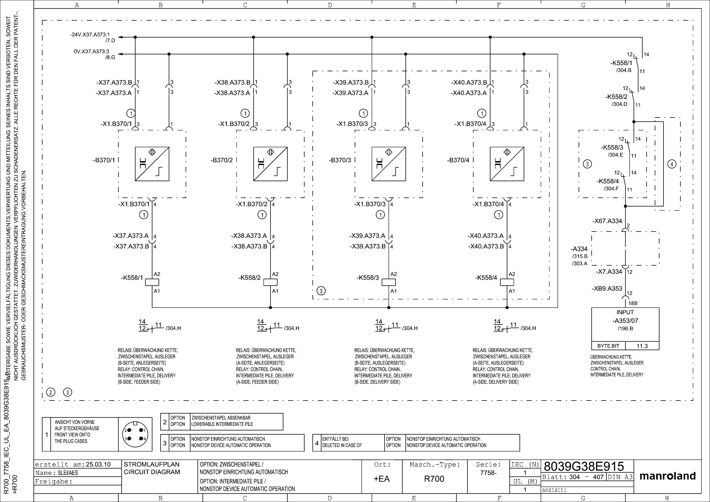

# +EA — Sheet 304 of 407 — OPTION: ZWISCHENSTAPEL /

**NONSTOP EINRICHTUNG AUTOMATISCH**

> Part of the manroland **R700** printing press IEC/UL circuit diagrams.
> Drawing class: **Stromlaufplan / Circuit diagram** (DIN A3).
> Document `+EA` covers the **Printing unit** machine section.

## At a glance

| Field | Value |
|---|---|
| Document | `+EA`  (8039G38E915) |
| Sheet | **304** of 407 |
| Section (DE) | OPTION: ZWISCHENSTAPEL / |
| Section (EN) | NONSTOP EINRICHTUNG AUTOMATISCH |
| Section type | CIRCUIT — Circuit diagram |
| Machine type | `R700` |
| Series | `7758` |
| Created | 25.03.10 |
| Replaces | — |
| Columns used | A, B, C, D, E, F, G, H |
| Path numbers | — |
| Labels on sheet | 194 |
| Cross-refs out | 9 |
| Cross-refs in | 48 |

**Previous:** [+EA sheet 303](SHEET_0303.md) · **Next:** [+EA sheet 305](SHEET_0305.md) · **Document TOC:** [_TOC.md](_TOC.md)  (+EA) · **Master TOC:** [all sheets](../_MASTER_TOC.md)

## Sheet image (300 DPI, exact vector render)



_Rendered directly from the PDF vector layer at 300 DPI (1-bit), no OCR and no resampling. Use it to confirm anything ambiguous in the text below._

## Cross-references on this sheet

Each entry is a wire leaving this sheet. The printed token is `/sheet.column`; the link resolves to that sheet inside the same document.

| Ref | Target sheet | Col | Path | Destination on target | Target section | From col |
|---|---|---|---|---|---|---|
| `/7.D` | [+EA sheet 7](SHEET_0007.md) | D | — | 24V.X37.A373:1 | SPANNUNGSVERSORGUNG: 400V, 24V | A |
| `/8.G` | [+EA sheet 8](SHEET_0008.md) | G | — | 0V.X37.A373:3 | SPANNUNGSVERSORGUNG: 400V, 24V | A |
| `/304.B` | [+EA sheet 304](SHEET_0304.md) | B | — | — | OPTION: ZWISCHENSTAPEL / | G |
| `/304.D` | [+EA sheet 304](SHEET_0304.md) | D | — | — | OPTION: ZWISCHENSTAPEL / | G |
| `/304.E` | [+EA sheet 304](SHEET_0304.md) | E | — | — | OPTION: ZWISCHENSTAPEL / | G |
| `/304.F` | [+EA sheet 304](SHEET_0304.md) | F | — | — | OPTION: ZWISCHENSTAPEL / | G |
| `/315.B` | [+EA sheet 315](SHEET_0315.md) | B | — | — | OPTION: LOGISTIK, AUSLEGER | G |
| `/303.A` | [+EA sheet 303](SHEET_0303.md) | A | — | — | OPTION: ZWISCHENSTAPEL / | G |
| `/196.B` | [+EA sheet 196](SHEET_0196.md) | B | — | — | REFERENZMODUL | G |

### Incoming references (sheets that point here)

Every other sheet that sends a wire to this one. `Back-ref` is the token printed on *that* sheet; `Path` is its line number.

| From sheet | Cols | Back-ref | Path | Refs | What continues there |
|---|---|---|---|---|---|
| [+EA#7](SHEET_0007.md) | D | `/7.D` | — | 1 | 24V.X37.A373:1 |
| [+EA#8](SHEET_0008.md) | G | `/8.G` | — | 1 | 0V.X37.A373:3 |
| [+EA#196](SHEET_0196.md) | B | `/196.B` | — | 1 | — |
| [+EA#209](SHEET_0209.md) | D, F | `/209.D`, `/209.F` | — | 12 | — |
| [+EA#246](SHEET_0246.md) | F | `/246.F` | — | 1 | — |
| [+EA#252](SHEET_0252.md) | C | `/252.C` | — | 1 | — |
| [+EA#279](SHEET_0279.md) | F | `/279.F` | — | 6 | — |
| [+EA#280](SHEET_0280.md) | B, F, H | `/280.B`, `/280.F`, `/280.H` | — | 18 | — |
| [+EA#285](SHEET_0285.md) | B | `/285.B` | — | 1 | — |
| [+EA#303](SHEET_0303.md) | A | `/303.A` | — | 1 | — |
| [+EA#304](SHEET_0304.md) | G | `/304.G` | — | 4 | — |
| [+EA#315](SHEET_0315.md) | B | `/315.B` | — | 1 | — |


## Devices on this sheet

| Tag | Class | Class meaning (IEC) | Col | Sub | Terminal | Sign |
|---|---|---|---|---|---|---|
| `B370/4` | B | Umformer / transducer, sensor | F | 4 | — | — |
| `A2` | A | Baugruppe / assembly, module, PC board | F | — | — | — |
| `A1` | A | Baugruppe / assembly, module, PC board | F | — | — | — |
| `K558/4` | K | Relais / relay, contactor | F | 4 | — | — |
| `B370/2` | B | Umformer / transducer, sensor | C | 2 | — | — |
| `B370/3` | B | Umformer / transducer, sensor | D | 3 | — | — |
| `A2` | A | Baugruppe / assembly, module, PC board | E | — | — | — |
| `A1` | A | Baugruppe / assembly, module, PC board | E | — | — | — |
| `K558/3` | K | Relais / relay, contactor | D | 3 | — | — |
| `A2` | A | Baugruppe / assembly, module, PC board | C | — | — | — |
| `A1` | A | Baugruppe / assembly, module, PC board | C | — | — | — |
| `K558/2` | K | Relais / relay, contactor | C | 2 | — | — |
| `B370/1` | B | Umformer / transducer, sensor | A | 1 | — | — |
| `A2` | A | Baugruppe / assembly, module, PC board | B | — | — | — |
| `A1` | A | Baugruppe / assembly, module, PC board | B | — | — | — |
| `K558/1` | K | Relais / relay, contactor | B | 1 | — | — |
| `K558/1` | K | Relais / relay, contactor | G | 1 | — | — |
| `K558/2` | K | Relais / relay, contactor | G | 2 | — | — |
| `K558/3` | K | Relais / relay, contactor | G | 3 | — | — |
| `K558/4` | K | Relais / relay, contactor | G | 4 | — | — |
| `A334` | A | Baugruppe / assembly, module, PC board | G | — | — | — |
| `A353/07` | A | Baugruppe / assembly, module, PC board | G | 07 | — | — |
| `X40.A373.B` | — | cross-device reference | F | — | — | — |
| `X40.A373.A` | — | cross-device reference | F | — | — | — |
| `X40.A373.B` | — | cross-device reference | F | — | — | — |
| `X40.A373.A` | — | cross-device reference | F | — | — | — |
| `X39.A373.B` | — | cross-device reference | D | — | — | — |
| `X39.A373.A` | — | cross-device reference | D | — | — | — |
| `X39.A373.B` | — | cross-device reference | D | — | — | — |
| `X39.A373.A` | — | cross-device reference | D | — | — | — |
| `X38.A373.B` | — | cross-device reference | C | — | — | — |
| `X38.A373.A` | — | cross-device reference | C | — | — | — |
| `X38.A373.B` | — | cross-device reference | C | — | — | — |
| `X38.A373.A` | — | cross-device reference | C | — | — | — |
| `X37.A373.B` | — | cross-device reference | A | — | — | — |
| `X37.A373.A` | — | cross-device reference | A | — | — | — |
| `X37.A373.B` | — | cross-device reference | B | — | — | — |
| `X37.A373.A` | — | cross-device reference | B | — | — | — |
| `X67.A334` | — | cross-device reference | G | — | — | — |
| `X7.A334` | — | cross-device reference | G | — | — | — |
| `11.3` | — | cross-device reference | H | — | — | — |
| `XB9.A353` | — | cross-device reference | G | — | — | — |

## Potentials / nets

| Potential | Count | Columns | Attached devices | Terminals |
|---|---|---|---|---|
| `0V` | 1 | A | `A373`, `X37` | `3` |
| `24V` | 1 | A | `A373`, `X37` | `1` |


A potential such as `L24+/4` or `M24+` is a named supply/return rail; every place it appears on this sheet is electrically common.

## Wire-end annotations (grouped as printed)

A wire that continues elsewhere is annotated with a small cluster: the destination description, the path/line number `#NN`, and the `/sheet.column` cross reference. Each row below is one such cluster exactly as it is grouped on the drawing.

| Col | Y | Path | Cross-ref | Text on the wire |
|---|---|---|---|---|
| A | 54.1 | — | `/7.D` | `24V.X37.A373:1` |
| A | 82.5 | — | `/8.G` | `0V.X37.A373:3` |
| H | 87.5 | — | — | `K558/1 14` |
| H | 87.5 | — | — | `12` |
| G | 114.0 | — | `/304.B` | — |
| H | 115.8 | — | — | `11` |
| A | 133.5 | — | — | `X37.A373.B 1` |
| C | 133.5 | — | — | `X38.A373.B 1` |
| D | 133.5 | — | — | `X39.A373.B 1` |
| F | 133.5 | — | — | `X40.A373.B 1` |
| B | 133.6 | — | — | `3` |
| D | 133.6 | — | — | `3` |
| E | 133.6 | — | — | `3` |
| F | 133.6 | — | — | `3` |
| G | 144.2 | — | — | `K558/2 14` |
| G | 144.2 | — | — | `12` |
| A | 150.6 | — | — | `X37.A373.A 1` |
| B | 150.6 | — | — | `3` |
| C | 150.6 | — | — | `X38.A373.A 1` |
| D | 150.6 | — | — | `3` |
| D | 150.6 | — | — | `X39.A373.A 1` |
| E | 150.6 | — | — | `3` |
| F | 150.6 | — | — | `X40.A373.A 1` |
| F | 150.6 | — | — | `3` |
| G | 170.7 | — | `/304.D` | — |
| H | 172.5 | — | — | `11` |
| B | 186.9 | — | — | `1` |
| D | 186.9 | — | — | `1 1` |
| D | 186.9 | — | — | `1` |
| B | 203.0 | — | — | `X1.B370/1 3 1` |
| C | 203.0 | — | — | `X1.B370/2 3 1` |
| E | 203.0 | — | — | `X1.B370/3 3 1` |
| F | 203.0 | — | — | `X1.B370/4 3 1` |
| G | 229.2 | — | — | `K558/3 14` |
| G | 229.2 | — | — | `12` |
| G | 255.7 | — | `/304.E` | — |
| H | 257.6 | — | — | `11` |
| A | 263.9 | — | — | `B370/1` |
| C | 263.9 | — | — | `B370/2` |
| D | 263.9 | — | — | `B370/3` |
| F | 263.9 | — | — | `B370/4` |
| H | 272.4 | — | — | `3 4` |
| G | 285.9 | — | — | `K558/4 14` |
| G | 285.9 | — | — | `12` |
| G | 312.4 | — | `/304.F` | — |
| H | 314.3 | — | — | `11` |
| B | 337.6 | — | — | `X1.B370/1 4` |
| C | 337.6 | — | — | `X1.B370/2 4` |
| E | 337.6 | — | — | `X1.B370/3 4` |
| F | 337.6 | — | — | `X1.B370/4 4` |
| B | 356.9 | — | — | `1` |
| D | 356.9 | — | — | `1 1` |
| F | 356.9 | — | — | `1` |
| G | 366.0 | — | — | `X67.A334 2` |
| B | 390.8 | — | — | `X37.A373.A 4` |
| C | 390.8 | — | — | `X38.A373.A 4` |
| D | 390.8 | — | — | `X39.A373.A 4` |
| F | 390.8 | — | — | `X40.A373.A 4` |
| B | 408.5 | — | — | `X37.A373.B 4` |
| C | 408.5 | — | — | `X38.A373.B 4` |
| D | 408.5 | — | — | `X39.A373.B 4` |
| F | 408.5 | — | — | `X40.A373.B 4` |
| G | 412.7 | — | — | `A334` |
| G | 425.8 | — | `/315.B`, `/303.A` | — |
| G | 451.0 | — | — | `X7.A334 12` |
| B | 455.9 | — | — | `A2` |
| C | 455.9 | — | — | `A2` |
| E | 455.9 | — | — | `A2` |
| F | 455.9 | — | — | `A2` |
| B | 460.9 | — | — | `K558/1` |
| C | 460.9 | — | — | `K558/2` |
| D | 460.9 | — | — | `K558/3` |
| F | 460.9 | — | — | `K558/4` |
| G | 479.4 | — | — | `XB9.A353 12` |
| B | 484.3 | — | — | `A1` |
| C | 484.3 | — | — | `A1` |
| E | 484.3 | — | — | `A1` |
| F | 484.3 | — | — | `A1` |
| D | 485.0 | — | — | `3` |
| H | 504.9 | — | — | `18B` |
| G | 519.4 | — | — | `INPUT` |
| G | 533.2 | — | — | `A353/07` |
| B | 534.6 | — | — | `14 12 11 /304.H` |
| C | 534.6 | — | — | `14 12 11 /304.H` |
| E | 534.6 | — | — | `14 12 11 /304.H` |
| F | 534.6 | — | — | `14 12 11 /304.H` |
| G | 547.0 | — | `/196.B` | — |
| G | 576.1 | — | — | `BYTE.BIT 11.3` |
| B | 584.5 | — | — | `RELAIS: ÜBERWACHUNG KETTE,` |
| C | 584.5 | — | — | `RELAIS: ÜBERWACHUNG KETTE,` |
| E | 584.5 | — | — | `RELAIS: ÜBERWACHUNG KETTE,` |
| F | 584.5 | — | — | `RELAIS: ÜBERWACHUNG KETTE,` |
| B | 595.2 | — | — | `RELAY: CONTROL CHAIN, INTERMEDIATE PILE, DELIVERY (B SEITE, ANLEGERSEITE) (B SIDE, FEEDER SIDE) ZWISCHENSTAPEL, AUSLEGER` |
| C | 595.2 | — | — | `RELAY: CONTROL CHAIN, INTERMEDIATE PILE, DELIVERY (A SEITE, ANLEGERSEITE) (A SIDE, FEEDER SIDE) ZWISCHENSTAPEL, AUSLEGER` |
| E | 595.2 | — | — | `RELAY: CONTROL CHAIN, INTERMEDIATE PILE, DELIVERY (B SEITE, AUSLEGERSEITE) (B SIDE, DELIVERY SIDE) ZWISCHENSTAPEL, AUSLEGER` |
| F | 595.2 | — | — | `RELAY: CONTROL CHAIN, INTERMEDIATE PILE, DELIVERY (A SEITE, AUSLEGERSEITE) (A SIDE, DELIVERY SIDE) ZWISCHENSTAPEL, AUSLEGER` |
| G | 596.0 | — | — | `ÜBERWACHUNG KETTE,` |
| G | 606.0 | — | — | `INTERMEDIATE PILE, DELIVERY CONTROL CHAIN, ZWISCHENSTAPEL, AUSLEGER` |
| A | 655.1 | — | — | `2 3` |
| B | 697.9 | — | — | `2 OPTION OPTION` |
| C | 697.9 | — | — | `LOWERABLE INTERMEDIATE PILE ZWISCHENSTAPEL ABSENKBAR` |
| A | 705.0 | — | — | `FRONT VIEW ONTO ANSICHT VON VORNE AUF STECKERGEHÄUSE` |
| B | 718.8 | — | — | `2 1` |
| A | 724.5 | — | — | `1 THE PLUG CASES 3 4` |
| B | 733.4 | — | — | `3 OPTION OPTION` |
| C | 733.4 | — | — | `NONSTOP EINRICHTUNG AUTOMATISCH NONSTOP DEVICE AUTOMATIC OPERATION 4 ENTFÄLLT BEI DELETED IN CASE OF` |
| E | 733.4 | — | — | `OPTION OPTION` |
| E | 733.4 | — | — | `NONSTOP EINRICHTUNG AUTOMATISCH NONSTOP DEVICE AUTOMATIC OPERATION` |


## Reconstructed tables

This sheet carries tabular content (pin map / terminal assignment / index). The grid below was rebuilt from the drawing's own rule lines, so each row is exactly one physical row of the table.

### Table 1 — 0 data rows × 2 columns (at x=226.8, y=62.4) — **1 1 3**

_none_


### Table 2 — 0 data rows × 2 columns (at x=425.2, y=62.4) — **1 1 3**

_none_


### Table 3 — 0 data rows × 2 columns (at x=623.6, y=62.4) — **1 1 3**

_none_


### Table 4 — 6 data rows × 10 columns (at x=822.0, y=62.4)

| 1 1 |  | 3 3 |  | K558/1 /304.B K558/2 /304.D | 12 | 12 | 11 | 11 14 | 14 |
|---|---|---|---|---|---|---|---|---|---|
| `3` |  | `1` |  | `12` |  |  | `14` |  |  |
|  |  |  | `3` | `K558/3 /304.E 12` |  | `11 14` |  |  |  |
|  | `4` |  |  | `K558/4 /304.F` | `11` |  |  |  |  |
| `1` | `4 4 A2 A1` |  | `A334 /315.B /303.A` | `X67.A334 X7.A334 XB9.A353` | `2 12 12` | `18B` |  |  |  |
| `14 12` | `11` | `/304.H` |  | `INPUT` | `A353/07 /196.B` |  |  |  |  |
|  |  |  |  | `BYTE.BIT` |  |  |  | `11.3` |  |


## Notes and free text on this sheet

| Text | Col | Y (pt) |
|---|---|---|
| `X1.B370/4` | F | 202.99 |
| `11 /304.H` | F | 540.27 |
| `RELAIS: ÜBERWACHUNG KETTE,` | F | 584.54 |
| `ZWISCHENSTAPEL, AUSLEGER` | F | 595.18 |
| `(A SEITE, AUSLEGERSEITE)` | F | 605.81 |
| `RELAY: CONTROL CHAIN,` | F | 616.46 |
| `INTERMEDIATE PILE, DELIVERY` | F | 627.08 |
| `(A SIDE, DELIVERY SIDE)` | F | 637.71 |
| `X1.B370/2` | C | 202.99 |
| `X1.B370/3` | D | 202.99 |
| `11 /304.H` | E | 540.27 |
| `RELAIS: ÜBERWACHUNG KETTE,` | E | 584.54 |
| `ZWISCHENSTAPEL, AUSLEGER` | E | 595.18 |
| `(B SEITE, AUSLEGERSEITE)` | E | 605.81 |
| `RELAY: CONTROL CHAIN,` | E | 616.46 |
| `INTERMEDIATE PILE, DELIVERY` | E | 627.08 |
| `(B SIDE, DELIVERY SIDE)` | E | 637.71 |
| `11 /304.H` | C | 540.27 |
| `RELAIS: ÜBERWACHUNG KETTE,` | C | 584.54 |
| `ZWISCHENSTAPEL, AUSLEGER` | C | 595.18 |
| `(A SEITE, ANLEGERSEITE)` | C | 605.81 |
| `RELAY: CONTROL CHAIN,` | C | 616.46 |
| `INTERMEDIATE PILE, DELIVERY` | C | 627.08 |
| `(A SIDE, FEEDER SIDE)` | C | 637.71 |
| `X1.B370/1` | A | 202.99 |
| `X1.B370/1` | B | 337.64 |
| `11 /304.H` | B | 540.27 |
| `RELAIS: ÜBERWACHUNG KETTE,` | B | 584.54 |
| `ZWISCHENSTAPEL, AUSLEGER` | B | 595.18 |
| `(B SEITE, ANLEGERSEITE)` | B | 605.81 |
| `RELAY: CONTROL CHAIN,` | B | 616.46 |
| `INTERMEDIATE PILE, DELIVERY` | B | 627.08 |
| `(B SIDE, FEEDER SIDE)` | B | 637.71 |
| `18B` | H | 504.85 |
| `INPUT` | G | 519.38 |
| `BYTE.BIT` | G | 576.63 |
| `ÜBERWACHUNG KETTE,` | G | 596.01 |
| `ZWISCHENSTAPEL, AUSLEGER` | G | 606 |
| `CONTROL CHAIN,` | G | 615.93 |
| `INTERMEDIATE PILE, DELIVERY` | G | 625.93 |
| `ANSICHT VON VORNE` | A | 705.04 |
| `AUF STECKERGEHÄUSE` | A | 715.67 |
| `FRONT VIEW ONTO` | A | 726.27 |
| `THE PLUG CASES` | A | 736.92 |
| `OPTION` | B | 697.92 |
| `ZWISCHENSTAPEL ABSENKBAR` | C | 697.93 |
| `LOWERABLE INTERMEDIATE PILE` | C | 708.56 |
| `NONSTOP EINRICHTUNG AUTOMATISCH` | C | 733.39 |
| `NONSTOP DEVICE AUTOMATIC OPERATION` | C | 744.01 |
| `ENTFÄLLT BEI` | D | 733.35 |
| `DELETED IN CASE OF` | D | 744 |
| `OPTION` | E | 733.35 |
| `NONSTOP EINRICHTUNG AUTOMATISCH` | E | 733.39 |
| `NONSTOP DEVICE AUTOMATIC OPERATION` | E | 744.01 |

## Complete label inventory (exact text from the drawing)

Every text object inside the drawing area of this sheet, in DIN reading order (column A→H, then top→bottom). This is the authoritative list: if a string is not here it is not printed on this sheet.

| Col | Y | X | Dir | Type | Text |
|---|---|---|---|---|---|
| A | 54.1 | 117.6 | → | potential | `24V.X37.A373:1` |
| A | 64.0 | 176.9 | → | cross-reference | `/7.D` |
| A | 82.5 | 123.9 | → | potential | `0V.X37.A373:3` |
| A | 92.4 | 176.6 | → | cross-reference | `/8.G` |
| A | 133.5 | 161.6 | → | device ref | `X37.A373.B` |
| A | 151.3 | 160.7 | → | device ref | `X37.A373.A` |
| A | 203.0 | 168.7 | → | text | `X1.B370/1` |
| A | 263.9 | 156.2 | → | device tag | `B370/1` |
| A | 655.1 | 83.0 | → | number | `2` |
| A | 655.1 | 111.4 | → | number | `3` |
| A | 705.0 | 92.1 | → | text | `ANSICHT VON VORNE` |
| A | 715.7 | 92.1 | → | text | `AUF STECKERGEHÄUSE` |
| A | 724.5 | 75.4 | → | number | `1` |
| A | 726.3 | 91.3 | → | text | `FRONT VIEW ONTO` |
| A | 736.9 | 91.8 | → | text | `THE PLUG CASES` |
| B | 133.6 | 228.8 | → | number | `1` |
| B | 133.6 | 286.0 | → | number | `3` |
| B | 150.6 | 228.8 | → | number | `1` |
| B | 150.6 | 286.0 | → | number | `3` |
| B | 186.9 | 217.9 | → | number | `1` |
| B | 204.4 | 229.3 | → | number | `3` |
| B | 204.4 | 285.4 | → | number | `1` |
| B | 337.6 | 198.4 | → | text | `X1.B370/1` |
| B | 339.1 | 257.7 | → | number | `4` |
| B | 356.9 | 239.2 | → | number | `1` |
| B | 390.8 | 189.1 | → | device ref | `X37.A373.A` |
| B | 392.9 | 257.7 | → | number | `4` |
| B | 408.5 | 189.9 | → | device ref | `X37.A373.B` |
| B | 409.9 | 257.7 | → | number | `4` |
| B | 455.9 | 258.0 | → | device tag | `A2` |
| B | 460.9 | 203.0 | → | device tag | `K558/1` |
| B | 484.3 | 258.0 | → | device tag | `A1` |
| B | 534.6 | 232.4 | → | number | `14` |
| B | 540.3 | 259.7 | → | text | `11 /304.H` |
| B | 545.9 | 232.4 | → | number | `12` |
| B | 584.5 | 197.6 | → | text | `RELAIS: ÜBERWACHUNG KETTE,` |
| B | 595.2 | 198.4 | → | text | `ZWISCHENSTAPEL, AUSLEGER` |
| B | 605.8 | 197.9 | → | text | `(B SEITE, ANLEGERSEITE)` |
| B | 616.5 | 197.6 | → | text | `RELAY: CONTROL CHAIN,` |
| B | 627.1 | 197.6 | → | text | `INTERMEDIATE PILE, DELIVERY` |
| B | 637.7 | 197.9 | → | text | `(B SIDE, FEEDER SIDE)` |
| B | 697.9 | 286.0 | → | text | `OPTION` |
| B | 703.3 | 273.5 | → | number | `2` |
| B | 708.6 | 286.0 | → | text | `OPTION` |
| B | 718.8 | 208.9 | → | number | `2` |
| B | 718.8 | 240.4 | → | number | `1` |
| B | 732.9 | 208.9 | → | number | `3` |
| B | 732.9 | 240.7 | → | number | `4` |
| B | 733.4 | 286.0 | → | text | `OPTION` |
| B | 738.7 | 273.4 | → | number | `3` |
| B | 744.0 | 286.0 | → | text | `OPTION` |
| C | 133.5 | 360.0 | → | device ref | `X38.A373.B` |
| C | 133.6 | 427.2 | → | number | `1` |
| C | 150.6 | 427.2 | → | number | `1` |
| C | 151.3 | 359.1 | → | device ref | `X38.A373.A` |
| C | 186.9 | 409.3 | → | number | `1` |
| C | 203.0 | 365.7 | → | text | `X1.B370/2` |
| C | 204.4 | 427.7 | → | number | `3` |
| C | 263.9 | 353.2 | → | device tag | `B370/2` |
| C | 337.6 | 395.4 | → | text | `X1.B370/2` |
| C | 339.1 | 456.1 | → | number | `4` |
| C | 356.9 | 437.6 | → | number | `1` |
| C | 390.8 | 387.5 | → | device ref | `X38.A373.A` |
| C | 392.9 | 456.1 | → | number | `4` |
| C | 408.5 | 388.3 | → | device ref | `X38.A373.B` |
| C | 409.9 | 456.1 | → | number | `4` |
| C | 455.9 | 456.4 | → | device tag | `A2` |
| C | 460.9 | 400.0 | → | device tag | `K558/2` |
| C | 484.3 | 456.4 | → | device tag | `A1` |
| C | 534.6 | 430.9 | → | number | `14` |
| C | 540.3 | 458.1 | → | text | `11 /304.H` |
| C | 545.9 | 430.9 | → | number | `12` |
| C | 584.5 | 396.0 | → | text | `RELAIS: ÜBERWACHUNG KETTE,` |
| C | 595.2 | 396.9 | → | text | `ZWISCHENSTAPEL, AUSLEGER` |
| C | 605.8 | 396.3 | → | text | `(A SEITE, ANLEGERSEITE)` |
| C | 616.5 | 396.0 | → | text | `RELAY: CONTROL CHAIN,` |
| C | 627.1 | 396.0 | → | text | `INTERMEDIATE PILE, DELIVERY` |
| C | 637.7 | 396.3 | → | text | `(A SIDE, FEEDER SIDE)` |
| C | 697.9 | 321.7 | → | text | `ZWISCHENSTAPEL ABSENKBAR` |
| C | 708.6 | 320.9 | → | text | `LOWERABLE INTERMEDIATE PILE` |
| C | 733.4 | 320.9 | → | text | `NONSTOP EINRICHTUNG AUTOMATISCH` |
| C | 744.0 | 320.9 | → | text | `NONSTOP DEVICE AUTOMATIC OPERATION` |
| D | 133.5 | 558.4 | → | device ref | `X39.A373.B` |
| D | 133.6 | 484.4 | → | number | `3` |
| D | 150.6 | 484.4 | → | number | `3` |
| D | 151.3 | 557.6 | → | device ref | `X39.A373.A` |
| D | 186.9 | 607.7 | → | number | `1` |
| D | 203.0 | 564.1 | → | text | `X1.B370/3` |
| D | 204.4 | 483.9 | → | number | `1` |
| D | 263.9 | 551.6 | → | device tag | `B370/3` |
| D | 337.6 | 593.9 | → | text | `X1.B370/3` |
| D | 390.8 | 585.9 | → | device ref | `X39.A373.A` |
| D | 408.5 | 586.8 | → | device ref | `X39.A373.B` |
| D | 460.9 | 598.4 | → | device tag | `K558/3` |
| D | 485.0 | 536.6 | → | number | `3` |
| D | 733.3 | 540.6 | → | text | `ENTFÄLLT BEI` |
| D | 738.7 | 528.7 | → | number | `4` |
| D | 744.0 | 540.6 | → | text | `DELETED IN CASE OF` |
| E | 133.6 | 625.6 | → | number | `1` |
| E | 133.6 | 682.9 | → | number | `3` |
| E | 150.6 | 625.6 | → | number | `1` |
| E | 150.6 | 682.9 | → | number | `3` |
| E | 204.4 | 626.2 | → | number | `3` |
| E | 204.4 | 682.3 | → | number | `1` |
| E | 339.1 | 654.5 | → | number | `4` |
| E | 356.9 | 636.0 | → | number | `1` |
| E | 392.9 | 654.5 | → | number | `4` |
| E | 409.9 | 654.5 | → | number | `4` |
| E | 455.9 | 654.8 | → | device tag | `A2` |
| E | 484.3 | 654.8 | → | device tag | `A1` |
| E | 534.6 | 629.3 | → | number | `14` |
| E | 540.3 | 656.5 | → | text | `11 /304.H` |
| E | 545.9 | 629.3 | → | number | `12` |
| E | 584.5 | 594.4 | → | text | `RELAIS: ÜBERWACHUNG KETTE,` |
| E | 595.2 | 595.3 | → | text | `ZWISCHENSTAPEL, AUSLEGER` |
| E | 605.8 | 594.7 | → | text | `(B SEITE, AUSLEGERSEITE)` |
| E | 616.5 | 594.4 | → | text | `RELAY: CONTROL CHAIN,` |
| E | 627.1 | 594.4 | → | text | `INTERMEDIATE PILE, DELIVERY` |
| E | 637.7 | 594.7 | → | text | `(B SIDE, DELIVERY SIDE)` |
| E | 733.4 | 647.4 | → | text | `OPTION` |
| E | 733.4 | 682.3 | → | text | `NONSTOP EINRICHTUNG AUTOMATISCH` |
| E | 744.0 | 647.4 | → | text | `OPTION` |
| E | 744.0 | 682.3 | → | text | `NONSTOP DEVICE AUTOMATIC OPERATION` |
| F | 133.5 | 756.9 | → | device ref | `X40.A373.B` |
| F | 133.6 | 824.0 | → | number | `1` |
| F | 133.6 | 881.3 | → | number | `3` |
| F | 150.6 | 824.0 | → | number | `1` |
| F | 150.6 | 881.3 | → | number | `3` |
| F | 151.3 | 756.0 | → | device ref | `X40.A373.A` |
| F | 186.9 | 806.1 | → | number | `1` |
| F | 203.0 | 762.5 | → | text | `X1.B370/4` |
| F | 204.4 | 824.6 | → | number | `3` |
| F | 204.4 | 880.7 | → | number | `1` |
| F | 263.9 | 750.0 | → | device tag | `B370/4` |
| F | 337.6 | 792.3 | → | text | `X1.B370/4` |
| F | 339.1 | 852.9 | → | number | `4` |
| F | 356.9 | 834.5 | → | number | `1` |
| F | 390.8 | 784.3 | → | device ref | `X40.A373.A` |
| F | 392.9 | 852.9 | → | number | `4` |
| F | 408.5 | 785.2 | → | device ref | `X40.A373.B` |
| F | 409.9 | 852.9 | → | number | `4` |
| F | 455.9 | 853.2 | → | device tag | `A2` |
| F | 460.9 | 796.8 | → | device tag | `K558/4` |
| F | 484.3 | 853.2 | → | device tag | `A1` |
| F | 534.6 | 827.7 | → | number | `14` |
| F | 540.3 | 854.9 | → | text | `11 /304.H` |
| F | 545.9 | 827.7 | → | number | `12` |
| F | 584.5 | 792.9 | → | text | `RELAIS: ÜBERWACHUNG KETTE,` |
| F | 595.2 | 793.7 | → | text | `ZWISCHENSTAPEL, AUSLEGER` |
| F | 605.8 | 793.1 | → | text | `(A SEITE, AUSLEGERSEITE)` |
| F | 616.5 | 792.9 | → | text | `RELAY: CONTROL CHAIN,` |
| F | 627.1 | 792.9 | → | text | `INTERMEDIATE PILE, DELIVERY` |
| F | 637.7 | 793.1 | → | text | `(A SIDE, DELIVERY SIDE)` |
| G | 100.9 | 1023.6 | → | device tag | `K558/1` |
| G | 114.0 | 1033.5 | → | cross-reference | `/304.B` |
| G | 144.2 | 1044.0 | → | number | `12` |
| G | 157.6 | 1015.1 | → | device tag | `K558/2` |
| G | 170.7 | 1026.1 | → | cross-reference | `/304.D` |
| G | 229.2 | 1036.9 | → | number | `12` |
| G | 242.7 | 1008.0 | → | device tag | `K558/3` |
| G | 255.7 | 1019.6 | → | cross-reference | `/304.E` |
| G | 272.4 | 983.0 | → | number | `3` |
| G | 285.9 | 1029.8 | → | number | `12` |
| G | 299.4 | 1000.9 | → | device tag | `K558/4` |
| G | 312.4 | 1012.8 | → | cross-reference | `/304.F` |
| G | 366.0 | 993.5 | → | device ref | `X67.A334` |
| G | 412.7 | 957.3 | → | device tag | `A334` |
| G | 425.8 | 959.8 | → | cross-reference | `/315.B` |
| G | 438.2 | 959.5 | → | cross-reference | `/303.A` |
| G | 451.0 | 999.5 | → | device ref | `X7.A334` |
| G | 479.4 | 992.4 | → | device ref | `XB9.A353` |
| G | 519.4 | 1033.9 | → | text | `INPUT` |
| G | 533.2 | 1027.4 | → | device tag | `A353/07` |
| G | 547.0 | 1036.2 | → | cross-reference | `/196.B` |
| G | 576.6 | 1002.0 | → | text | `BYTE.BIT` |
| G | 596.0 | 990.1 | → | text | `ÜBERWACHUNG KETTE,` |
| G | 606.0 | 990.7 | → | text | `ZWISCHENSTAPEL, AUSLEGER` |
| G | 615.9 | 990.4 | → | text | `CONTROL CHAIN,` |
| G | 625.9 | 990.1 | → | text | `INTERMEDIATE PILE, DELIVERY` |
| H | 87.5 | 1051.1 | → | number | `12` |
| H | 87.5 | 1079.1 | → | number | `14` |
| H | 115.8 | 1072.1 | → | number | `11` |
| H | 144.2 | 1072.1 | → | number | `14` |
| H | 172.5 | 1065.0 | → | number | `11` |
| H | 229.2 | 1065.0 | → | number | `14` |
| H | 257.6 | 1057.9 | → | number | `11` |
| H | 272.4 | 1124.8 | → | number | `4` |
| H | 285.9 | 1057.9 | → | number | `14` |
| H | 314.3 | 1050.8 | → | number | `11` |
| H | 374.5 | 1051.4 | → | number | `2` |
| H | 452.5 | 1050.8 | → | number | `12` |
| H | 487.9 | 1050.8 | → | number | `12` |
| H | 504.9 | 1053.6 | → | text | `18B` |
| H | 576.1 | 1067.4 | → | device ref | `11.3` |

## Reading-order text block

The same content as a plain block, grouped by DIN column — convenient to paste or to match against a visual description.

```text
=== Column A ===
  54.1  117.6  net          24V.X37.A373:1
  64.0  176.9  xref         /7.D
  82.5  123.9  net          0V.X37.A373:3
  92.4  176.6  xref         /8.G
 133.5  161.6  devref       X37.A373.B
 151.3  160.7  devref       X37.A373.A
 203.0  168.7  text         X1.B370/1
 263.9  156.2  devtag       B370/1
 655.1   83.0  numeric      2
 655.1  111.4  numeric      3
 705.0   92.1  text         ANSICHT VON VORNE
 715.7   92.1  text         AUF STECKERGEHÄUSE
 724.5   75.4  numeric      1
 726.3   91.3  text         FRONT VIEW ONTO
 736.9   91.8  text         THE PLUG CASES
=== Column B ===
 133.6  228.8  numeric      1
 133.6  286.0  numeric      3
 150.6  228.8  numeric      1
 150.6  286.0  numeric      3
 186.9  217.9  numeric      1
 204.4  229.3  numeric      3
 204.4  285.4  numeric      1
 337.6  198.4  text         X1.B370/1
 339.1  257.7  numeric      4
 356.9  239.2  numeric      1
 390.8  189.1  devref       X37.A373.A
 392.9  257.7  numeric      4
 408.5  189.9  devref       X37.A373.B
 409.9  257.7  numeric      4
 455.9  258.0  devtag       A2
 460.9  203.0  devtag       K558/1
 484.3  258.0  devtag       A1
 534.6  232.4  numeric      14
 540.3  259.7  text         11 /304.H
 545.9  232.4  numeric      12
 584.5  197.6  text         RELAIS: ÜBERWACHUNG KETTE,
 595.2  198.4  text         ZWISCHENSTAPEL, AUSLEGER
 605.8  197.9  text         (B SEITE, ANLEGERSEITE)
 616.5  197.6  text         RELAY: CONTROL CHAIN,
 627.1  197.6  text         INTERMEDIATE PILE, DELIVERY
 637.7  197.9  text         (B SIDE, FEEDER SIDE)
 697.9  286.0  text         OPTION
 703.3  273.5  numeric      2
 708.6  286.0  text         OPTION
 718.8  208.9  numeric      2
 718.8  240.4  numeric      1
 732.9  208.9  numeric      3
 732.9  240.7  numeric      4
 733.4  286.0  text         OPTION
 738.7  273.4  numeric      3
 744.0  286.0  text         OPTION
=== Column C ===
 133.5  360.0  devref       X38.A373.B
 133.6  427.2  numeric      1
 150.6  427.2  numeric      1
 151.3  359.1  devref       X38.A373.A
 186.9  409.3  numeric      1
 203.0  365.7  text         X1.B370/2
 204.4  427.7  numeric      3
 263.9  353.2  devtag       B370/2
 337.6  395.4  text         X1.B370/2
 339.1  456.1  numeric      4
 356.9  437.6  numeric      1
 390.8  387.5  devref       X38.A373.A
 392.9  456.1  numeric      4
 408.5  388.3  devref       X38.A373.B
 409.9  456.1  numeric      4
 455.9  456.4  devtag       A2
 460.9  400.0  devtag       K558/2
 484.3  456.4  devtag       A1
 534.6  430.9  numeric      14
 540.3  458.1  text         11 /304.H
 545.9  430.9  numeric      12
 584.5  396.0  text         RELAIS: ÜBERWACHUNG KETTE,
 595.2  396.9  text         ZWISCHENSTAPEL, AUSLEGER
 605.8  396.3  text         (A SEITE, ANLEGERSEITE)
 616.5  396.0  text         RELAY: CONTROL CHAIN,
 627.1  396.0  text         INTERMEDIATE PILE, DELIVERY
 637.7  396.3  text         (A SIDE, FEEDER SIDE)
 697.9  321.7  text         ZWISCHENSTAPEL ABSENKBAR
 708.6  320.9  text         LOWERABLE INTERMEDIATE PILE
 733.4  320.9  text         NONSTOP EINRICHTUNG AUTOMATISCH
 744.0  320.9  text         NONSTOP DEVICE AUTOMATIC OPERATION
=== Column D ===
 133.5  558.4  devref       X39.A373.B
 133.6  484.4  numeric      3
 150.6  484.4  numeric      3
 151.3  557.6  devref       X39.A373.A
 186.9  607.7  numeric      1
 203.0  564.1  text         X1.B370/3
 204.4  483.9  numeric      1
 263.9  551.6  devtag       B370/3
 337.6  593.9  text         X1.B370/3
 390.8  585.9  devref       X39.A373.A
 408.5  586.8  devref       X39.A373.B
 460.9  598.4  devtag       K558/3
 485.0  536.6  numeric      3
 733.3  540.6  text         ENTFÄLLT BEI
 738.7  528.7  numeric      4
 744.0  540.6  text         DELETED IN CASE OF
=== Column E ===
 133.6  625.6  numeric      1
 133.6  682.9  numeric      3
 150.6  625.6  numeric      1
 150.6  682.9  numeric      3
 204.4  626.2  numeric      3
 204.4  682.3  numeric      1
 339.1  654.5  numeric      4
 356.9  636.0  numeric      1
 392.9  654.5  numeric      4
 409.9  654.5  numeric      4
 455.9  654.8  devtag       A2
 484.3  654.8  devtag       A1
 534.6  629.3  numeric      14
 540.3  656.5  text         11 /304.H
 545.9  629.3  numeric      12
 584.5  594.4  text         RELAIS: ÜBERWACHUNG KETTE,
 595.2  595.3  text         ZWISCHENSTAPEL, AUSLEGER
 605.8  594.7  text         (B SEITE, AUSLEGERSEITE)
 616.5  594.4  text         RELAY: CONTROL CHAIN,
 627.1  594.4  text         INTERMEDIATE PILE, DELIVERY
 637.7  594.7  text         (B SIDE, DELIVERY SIDE)
 733.4  647.4  text         OPTION
 733.4  682.3  text         NONSTOP EINRICHTUNG AUTOMATISCH
 744.0  647.4  text         OPTION
 744.0  682.3  text         NONSTOP DEVICE AUTOMATIC OPERATION
=== Column F ===
 133.5  756.9  devref       X40.A373.B
 133.6  824.0  numeric      1
 133.6  881.3  numeric      3
 150.6  824.0  numeric      1
 150.6  881.3  numeric      3
 151.3  756.0  devref       X40.A373.A
 186.9  806.1  numeric      1
 203.0  762.5  text         X1.B370/4
 204.4  824.6  numeric      3
 204.4  880.7  numeric      1
 263.9  750.0  devtag       B370/4
 337.6  792.3  text         X1.B370/4
 339.1  852.9  numeric      4
 356.9  834.5  numeric      1
 390.8  784.3  devref       X40.A373.A
 392.9  852.9  numeric      4
 408.5  785.2  devref       X40.A373.B
 409.9  852.9  numeric      4
 455.9  853.2  devtag       A2
 460.9  796.8  devtag       K558/4
 484.3  853.2  devtag       A1
 534.6  827.7  numeric      14
 540.3  854.9  text         11 /304.H
 545.9  827.7  numeric      12
 584.5  792.9  text         RELAIS: ÜBERWACHUNG KETTE,
 595.2  793.7  text         ZWISCHENSTAPEL, AUSLEGER
 605.8  793.1  text         (A SEITE, AUSLEGERSEITE)
 616.5  792.9  text         RELAY: CONTROL CHAIN,
 627.1  792.9  text         INTERMEDIATE PILE, DELIVERY
 637.7  793.1  text         (A SIDE, DELIVERY SIDE)
=== Column G ===
 100.9 1023.6  devtag       K558/1
 114.0 1033.5  xref         /304.B
 144.2 1044.0  numeric      12
 157.6 1015.1  devtag       K558/2
 170.7 1026.1  xref         /304.D
 229.2 1036.9  numeric      12
 242.7 1008.0  devtag       K558/3
 255.7 1019.6  xref         /304.E
 272.4  983.0  numeric      3
 285.9 1029.8  numeric      12
 299.4 1000.9  devtag       K558/4
 312.4 1012.8  xref         /304.F
 366.0  993.5  devref       X67.A334
 412.7  957.3  devtag       A334
 425.8  959.8  xref         /315.B
 438.2  959.5  xref         /303.A
 451.0  999.5  devref       X7.A334
 479.4  992.4  devref       XB9.A353
 519.4 1033.9  text         INPUT
 533.2 1027.4  devtag       A353/07
 547.0 1036.2  xref         /196.B
 576.6 1002.0  text         BYTE.BIT
 596.0  990.1  text         ÜBERWACHUNG KETTE,
 606.0  990.7  text         ZWISCHENSTAPEL, AUSLEGER
 615.9  990.4  text         CONTROL CHAIN,
 625.9  990.1  text         INTERMEDIATE PILE, DELIVERY
=== Column H ===
  87.5 1051.1  numeric      12
  87.5 1079.1  numeric      14
 115.8 1072.1  numeric      11
 144.2 1072.1  numeric      14
 172.5 1065.0  numeric      11
 229.2 1065.0  numeric      14
 257.6 1057.9  numeric      11
 272.4 1124.8  numeric      4
 285.9 1057.9  numeric      14
 314.3 1050.8  numeric      11
 374.5 1051.4  numeric      2
 452.5 1050.8  numeric      12
 487.9 1050.8  numeric      12
 504.9 1053.6  text         18B
 576.1 1067.4  devref       11.3
```

---
_Generated from the PDF vector text layer; no OCR. Source: `R700_7758_IEC_UL_EA_8039G38E915_p`, sheet 304._
