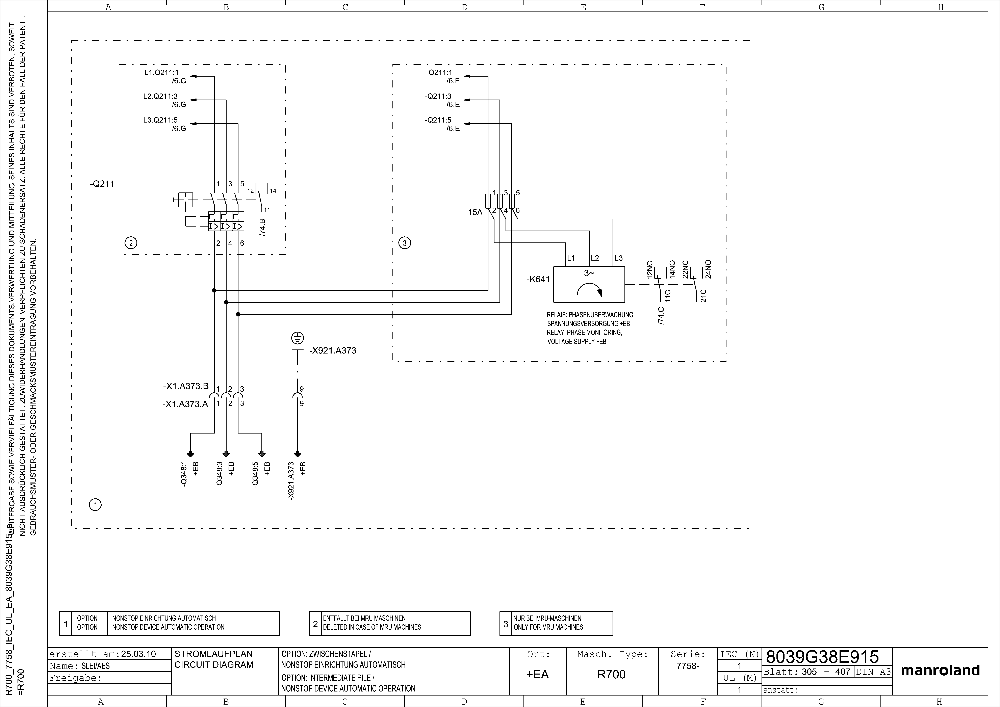

# +EA — Sheet 305 of 407 — OPTION: ZWISCHENSTAPEL /

**NONSTOP EINRICHTUNG AUTOMATISCH**

> Part of the manroland **R700** printing press IEC/UL circuit diagrams.
> Drawing class: **Stromlaufplan / Circuit diagram** (DIN A3).
> Document `+EA` covers the **Printing unit** machine section.

## At a glance

| Field | Value |
|---|---|
| Document | `+EA`  (8039G38E915) |
| Sheet | **305** of 407 |
| Section (DE) | OPTION: ZWISCHENSTAPEL / |
| Section (EN) | NONSTOP EINRICHTUNG AUTOMATISCH |
| Section type | CIRCUIT — Circuit diagram |
| Machine type | `R700` |
| Series | `7758` |
| Created | 25.03.10 |
| Replaces | — |
| Columns used | A, B, C, D, E, F |
| Path numbers | — |
| Labels on sheet | 79 |
| Cross-refs out | 8 |
| Cross-refs in | 8 |

**Previous:** [+EA sheet 304](SHEET_0304.md) · **Next:** [+EA sheet 306](SHEET_0306.md) · **Document TOC:** [_TOC.md](_TOC.md)  (+EA) · **Master TOC:** [all sheets](../_MASTER_TOC.md)

## Sheet image (300 DPI, exact vector render)



_Rendered directly from the PDF vector layer at 300 DPI (1-bit), no OCR and no resampling. Use it to confirm anything ambiguous in the text below._

## Cross-references on this sheet

Each entry is a wire leaving this sheet. The printed token is `/sheet.column`; the link resolves to that sheet inside the same document.

| Ref | Target sheet | Col | Path | Destination on target | Target section | From col |
|---|---|---|---|---|---|---|
| `/6.G` | [+EA sheet 6](SHEET_0006.md) | G | — | L1.Q211:1 | SPANNUNGSVERSORGUNG: 400V,24V | A |
| `/6.E` | [+EA sheet 6](SHEET_0006.md) | E | — | Q211:1 | SPANNUNGSVERSORGUNG: 400V,24V | D |
| `/6.G` | [+EA sheet 6](SHEET_0006.md) | G | — | L2.Q211:3 | SPANNUNGSVERSORGUNG: 400V,24V | A |
| `/6.E` | [+EA sheet 6](SHEET_0006.md) | E | — | Q211:3 | SPANNUNGSVERSORGUNG: 400V,24V | D |
| `/6.G` | [+EA sheet 6](SHEET_0006.md) | G | — | L3.Q211:5 | SPANNUNGSVERSORGUNG: 400V,24V | A |
| `/6.E` | [+EA sheet 6](SHEET_0006.md) | E | — | Q211:5 | SPANNUNGSVERSORGUNG: 400V,24V | D |
| `/74.B` | [+EA sheet 74](SHEET_0074.md) | B | — | — | AUSLEGERSTAPELSTEUERUNG | B |
| `/74.C` | [+EA sheet 74](SHEET_0074.md) | C | — | — | AUSLEGERSTAPELSTEUERUNG | F |

### Incoming references (sheets that point here)

Every other sheet that sends a wire to this one. `Back-ref` is the token printed on *that* sheet; `Path` is its line number.

| From sheet | Cols | Back-ref | Path | Refs | What continues there |
|---|---|---|---|---|---|
| [+EA#6](SHEET_0006.md) | E, H | `/6.E`, `/6.H` | — | 6 | L1.Q211:1; L2.Q211:3; L3.Q211:5; Q211:1; Q211:3; Q211:5 |
| [+EA#74](SHEET_0074.md) | B, C | `/74.B`, `/74.C` | — | 2 | — |


## Devices on this sheet

| Tag | Class | Class meaning (IEC) | Col | Sub | Terminal | Sign |
|---|---|---|---|---|---|---|
| `Q211` | Q | Leistungsschalter / power switching device | A | — | — | — |
| `Q348:1` | Q | Leistungsschalter / power switching device | B | — | 1 | — |
| `Q348:3` | Q | Leistungsschalter / power switching device | B | — | 3 | — |
| `Q348:5` | Q | Leistungsschalter / power switching device | B | — | 5 | — |
| `K641` | K | Relais / relay, contactor | E | — | — | — |
| `Q211:1` | Q | Leistungsschalter / power switching device | D | — | 1 | — |
| `Q211:5` | Q | Leistungsschalter / power switching device | D | — | 5 | — |
| `Q211:3` | Q | Leistungsschalter / power switching device | D | — | 3 | — |
| `X921.A373` | — | cross-device reference | C | — | — | — |
| `X1.A373.B` | — | cross-device reference | B | — | — | — |
| `X1.A373.A` | — | cross-device reference | B | — | — | — |
| `X921.A373` | — | cross-device reference | C | — | — | — |

## Potentials / nets

| Potential | Count | Columns | Attached devices | Terminals |
|---|---|---|---|---|
| `L1` | 2 | A, E | `Q211` | `1` |
| `L2` | 2 | A, E | `Q211` | `3` |
| `L3` | 2 | A, E | `Q211` | `5` |


A potential such as `L24+/4` or `M24+` is a named supply/return rail; every place it appears on this sheet is electrically common.

## Wire-end annotations (grouped as printed)

A wire that continues elsewhere is annotated with a small cluster: the destination description, the path/line number `#NN`, and the `/sheet.column` cross reference. Each row below is one such cluster exactly as it is grouped on the drawing.

| Col | Y | Path | Cross-ref | Text on the wire |
|---|---|---|---|---|
| A | 82.5 | — | `/6.G` | `L1.Q211:1` |
| D | 82.5 | — | `/6.E` | `Q211:1` |
| A | 110.8 | — | `/6.G` | `L2.Q211:3` |
| D | 110.9 | — | `/6.E` | `Q211:3` |
| A | 139.2 | — | `/6.G` | `L3.Q211:5` |
| D | 139.2 | — | `/6.E` | `Q211:5` |
| A | 214.3 | — | — | `Q211` |
| B | 215.1 | — | — | `1` |
| B | 215.1 | — | — | `3` |
| B | 215.1 | — | — | `5` |
| B | 224.1 | — | — | `12 14` |
| D | 225.7 | — | — | `1 3 5` |
| B | 246.8 | — | — | `11` |
| D | 246.9 | — | — | `2 4 6` |
| D | 248.6 | — | — | `15A` |
| B | 260.5 | — | `/74.B` | — |
| B | 285.9 | — | — | `2` |
| B | 285.9 | — | — | `4` |
| B | 285.9 | — | — | `6` |
| A | 286.6 | — | — | `2` |
| C | 286.6 | — | — | `3` |
| E | 303.6 | — | — | `L1 L2 L3` |
| F | 309.3 | — | — | `24NO` |
| F | 309.8 | — | — | `14NO` |
| F | 309.8 | — | — | `22NC` |
| F | 310.4 | — | — | `12NC` |
| E | 320.6 | — | — | `3~` |
| E | 327.7 | — | — | `K641` |
| F | 344.4 | — | — | `21C` |
| F | 345.0 | — | — | `11C` |
| F | 365.4 | — | `/74.C` | — |
| E | 371.9 | — | — | `RELAIS: PHASENÜBERWACHUNG,` |
| E | 382.6 | — | — | `RELAY: PHASE MONITORING, SPANNUNGSVERSORGUNG +EB` |
| E | 403.9 | — | — | `VOLTAGE SUPPLY +EB` |
| C | 412.7 | — | — | `X921.A373` |
| B | 455.3 | — | — | `X1.A373.B` |
| B | 459.5 | — | — | `1 2 3` |
| C | 459.5 | — | — | `9` |
| B | 476.5 | — | — | `X1.A373.A` |
| B | 476.5 | — | — | `1 2 3` |
| C | 476.5 | — | — | `9` |
| B | 548.2 | — | — | `Q348:1` |
| B | 549.6 | — | — | `+EB` |
| B | 549.6 | — | — | `Q348:3` |
| B | 549.6 | — | — | `+EB` |
| B | 549.6 | — | — | `Q348:5` |
| B | 549.6 | — | — | `+EB` |
| C | 549.6 | — | — | `X921.A373` |
| C | 549.6 | — | — | `+EB` |
| A | 597.9 | — | — | `1` |
| C | 733.4 | — | — | `1 NONSTOP EINRICHTUNG AUTOMATISCH NONSTOP DEVICE AUTOMATIC OPERATION 2 ENTFÄLLT BEI MRU MASCHINEN DELETED IN CASE OF MRU MACHINES 3 NUR BEI MRU MASCHINEN` |
| A | 733.4 | — | — | `OPTION OPTION` |
| E | 744.0 | — | — | `ONLY FOR MRU MACHINES` |


## Reconstructed tables

This sheet carries tabular content (pin map / terminal assignment / index). The grid below was rebuilt from the drawing's own rule lines, so each row is exactly one physical row of the table.

### Table 1 — 2 data rows × 1 columns (at x=255.1, y=147.4)

| C1 |
|---|
| `1` |
| `2` |


### Table 2 — 2 data rows × 1 columns (at x=269.3, y=147.4)

| C1 |
|---|
| `3` |
| `4` |


### Table 3 — 3 data rows × 2 columns (at x=283.5, y=147.4)

| 5 | 12 14 |
|---|---|
|  | `11` |
|  | `/74.B` |
| `6` |  |


### Table 4 — 2 data rows × 6 columns (at x=588.2, y=147.4)

| 1 2 | 3 4 | 5 6 |  |  |  |
|---|---|---|---|---|---|
|  |  |  | `L1` | `L2` | `L3` |
|  |  | `K641` | `3~` |  |  |


## Notes and free text on this sheet

| Text | Col | Y (pt) |
|---|---|---|
| `+EB` | B | 549.64 |
| `+EB` | C | 549.64 |
| `15A` | D | 248.62 |
| `11C` | F | 344.98 |
| `21C` | F | 344.41 |
| `14NO` | F | 309.83 |
| `24NO` | F | 309.26 |
| `22NC` | F | 309.83 |
| `12NC` | F | 310.39 |
| `RELAIS: PHASENÜBERWACHUNG,` | E | 371.94 |
| `SPANNUNGSVERSORGUNG +EB` | E | 382.61 |
| `RELAY: PHASE MONITORING,` | E | 393.22 |
| `VOLTAGE SUPPLY +EB` | E | 403.85 |
| `OPTION` | A | 733.35 |
| `NONSTOP EINRICHTUNG AUTOMATISCH` | A | 733.39 |
| `NONSTOP DEVICE AUTOMATIC OPERATION` | B | 744.01 |
| `ENTFÄLLT BEI MRU MASCHINEN` | C | 733.38 |
| `DELETED IN CASE OF MRU MACHINES` | C | 744.02 |
| `NUR BEI MRU MASCHINEN` | E | 733.4 |
| `ONLY FOR MRU MACHINES` | E | 744.03 |

## Complete label inventory (exact text from the drawing)

Every text object inside the drawing area of this sheet, in DIN reading order (column A→H, then top→bottom). This is the authoritative list: if a string is not here it is not printed on this sheet.

| Col | Y | X | Dir | Type | Text |
|---|---|---|---|---|---|
| A | 82.5 | 172.1 | → | potential | `L1.Q211:1` |
| A | 110.8 | 170.6 | → | potential | `L2.Q211:3` |
| A | 139.2 | 170.6 | → | potential | `L3.Q211:5` |
| A | 214.3 | 107.1 | → | device tag | `Q211` |
| A | 286.6 | 153.9 | → | number | `2` |
| A | 597.9 | 111.6 | → | number | `1` |
| A | 733.4 | 91.8 | → | text | `OPTION` |
| A | 733.4 | 133.8 | → | text | `NONSTOP EINRICHTUNG AUTOMATISCH` |
| A | 738.7 | 75.4 | → | number | `1` |
| A | 744.0 | 91.8 | → | text | `OPTION` |
| B | 92.4 | 204.9 | → | cross-reference | `/6.G` |
| B | 120.7 | 204.9 | → | cross-reference | `/6.G` |
| B | 149.1 | 204.9 | → | cross-reference | `/6.G` |
| B | 215.0 | 257.1 | → | number | `1` |
| B | 215.0 | 271.8 | → | number | `3` |
| B | 215.0 | 286.0 | → | number | `5` |
| B | 224.1 | 294.2 | → | number | `12` |
| B | 224.1 | 321.2 | → | number | `14` |
| B | 246.8 | 314.1 | → | number | `11` |
| B | 260.5 | 308.5 | ↕ | cross-reference | `/74.B` |
| B | 285.9 | 257.7 | → | number | `2` |
| B | 285.9 | 271.8 | → | number | `4` |
| B | 285.9 | 286.0 | → | number | `6` |
| B | 455.3 | 194.5 | → | device ref | `X1.A373.B` |
| B | 459.5 | 257.1 | → | number | `1` |
| B | 459.5 | 271.8 | → | number | `2` |
| B | 459.5 | 286.0 | → | number | `3` |
| B | 476.5 | 193.6 | → | device ref | `X1.A373.A` |
| B | 476.5 | 257.1 | → | number | `1` |
| B | 476.5 | 271.8 | → | number | `2` |
| B | 476.5 | 286.0 | → | number | `3` |
| B | 548.2 | 215.0 | ↕ | device tag | `Q348:1` |
| B | 549.6 | 229.1 | ↕ | text | `+EB` |
| B | 549.6 | 257.6 | ↕ | device tag | `Q348:3` |
| B | 549.6 | 271.7 | ↕ | text | `+EB` |
| B | 549.6 | 300.1 | ↕ | device tag | `Q348:5` |
| B | 549.6 | 314.2 | ↕ | text | `+EB` |
| B | 744.0 | 133.8 | → | text | `NONSTOP DEVICE AUTOMATIC OPERATION` |
| C | 286.6 | 479.9 | → | number | `3` |
| C | 412.7 | 368.2 | → | device ref | `X921.A373` |
| C | 459.5 | 356.9 | → | number | `9` |
| C | 476.5 | 356.9 | → | number | `9` |
| C | 549.6 | 342.6 | ↕ | device ref | `X921.A373` |
| C | 549.6 | 356.7 | ↕ | text | `+EB` |
| C | 733.4 | 384.7 | → | text | `ENTFÄLLT BEI MRU MASCHINEN` |
| C | 738.7 | 372.8 | → | number | `2` |
| C | 744.0 | 384.7 | → | text | `DELETED IN CASE OF MRU MACHINES` |
| D | 82.5 | 507.4 | → | device tag | `Q211:1` |
| D | 92.4 | 531.8 | → | cross-reference | `/6.E` |
| D | 110.9 | 506.0 | → | device tag | `Q211:3` |
| D | 120.7 | 531.8 | → | cross-reference | `/6.E` |
| D | 139.2 | 506.0 | → | device tag | `Q211:5` |
| D | 149.0 | 531.8 | → | cross-reference | `/6.E` |
| D | 225.7 | 586.2 | → | number | `1` |
| D | 225.7 | 600.0 | → | number | `3` |
| D | 225.7 | 614.1 | → | number | `5` |
| D | 246.9 | 585.9 | → | number | `2` |
| D | 246.9 | 600.0 | → | number | `4` |
| D | 246.9 | 614.1 | → | number | `6` |
| D | 248.6 | 557.3 | → | text | `15A` |
| D | 738.7 | 599.4 | → | number | `3` |
| E | 303.6 | 675.2 | → | potential | `L1` |
| E | 303.6 | 703.6 | → | potential | `L2` |
| E | 303.6 | 731.9 | → | potential | `L3` |
| E | 320.6 | 695.3 | → | other | `3~` |
| E | 327.7 | 627.0 | → | device tag | `K641` |
| E | 371.9 | 651.1 | → | text | `RELAIS: PHASENÜBERWACHUNG,` |
| E | 382.6 | 651.7 | → | text | `SPANNUNGSVERSORGUNG +EB` |
| E | 393.2 | 651.1 | → | text | `RELAY: PHASE MONITORING,` |
| E | 403.9 | 652.0 | → | text | `VOLTAGE SUPPLY +EB` |
| E | 733.4 | 611.4 | → | text | `NUR BEI MRU MASCHINEN` |
| E | 744.0 | 612.0 | → | text | `ONLY FOR MRU MACHINES` |
| F | 309.3 | 839.4 | ↕ | text | `24NO` |
| F | 309.8 | 796.9 | ↕ | text | `14NO` |
| F | 309.8 | 812.5 | ↕ | text | `22NC` |
| F | 310.4 | 769.9 | ↕ | text | `12NC` |
| F | 344.4 | 833.7 | ↕ | text | `21C` |
| F | 345.0 | 791.2 | ↕ | text | `11C` |
| F | 365.4 | 783.4 | ↕ | cross-reference | `/74.C` |

## Reading-order text block

The same content as a plain block, grouped by DIN column — convenient to paste or to match against a visual description.

```text
=== Column A ===
  82.5  172.1  net          L1.Q211:1
 110.8  170.6  net          L2.Q211:3
 139.2  170.6  net          L3.Q211:5
 214.3  107.1  devtag       Q211
 286.6  153.9  numeric      2
 597.9  111.6  numeric      1
 733.4   91.8  text         OPTION
 733.4  133.8  text         NONSTOP EINRICHTUNG AUTOMATISCH
 738.7   75.4  numeric      1
 744.0   91.8  text         OPTION
=== Column B ===
  92.4  204.9  xref         /6.G
 120.7  204.9  xref         /6.G
 149.1  204.9  xref         /6.G
 215.0  257.1  numeric      1
 215.0  271.8  numeric      3
 215.0  286.0  numeric      5
 224.1  294.2  numeric      12
 224.1  321.2  numeric      14
 246.8  314.1  numeric      11
 260.5  308.5  xref         /74.B
 285.9  257.7  numeric      2
 285.9  271.8  numeric      4
 285.9  286.0  numeric      6
 455.3  194.5  devref       X1.A373.B
 459.5  257.1  numeric      1
 459.5  271.8  numeric      2
 459.5  286.0  numeric      3
 476.5  193.6  devref       X1.A373.A
 476.5  257.1  numeric      1
 476.5  271.8  numeric      2
 476.5  286.0  numeric      3
 548.2  215.0  devtag       Q348:1
 549.6  229.1  text         +EB
 549.6  257.6  devtag       Q348:3
 549.6  271.7  text         +EB
 549.6  300.1  devtag       Q348:5
 549.6  314.2  text         +EB
 744.0  133.8  text         NONSTOP DEVICE AUTOMATIC OPERATION
=== Column C ===
 286.6  479.9  numeric      3
 412.7  368.2  devref       X921.A373
 459.5  356.9  numeric      9
 476.5  356.9  numeric      9
 549.6  342.6  devref       X921.A373
 549.6  356.7  text         +EB
 733.4  384.7  text         ENTFÄLLT BEI MRU MASCHINEN
 738.7  372.8  numeric      2
 744.0  384.7  text         DELETED IN CASE OF MRU MACHINES
=== Column D ===
  82.5  507.4  devtag       Q211:1
  92.4  531.8  xref         /6.E
 110.9  506.0  devtag       Q211:3
 120.7  531.8  xref         /6.E
 139.2  506.0  devtag       Q211:5
 149.0  531.8  xref         /6.E
 225.7  586.2  numeric      1
 225.7  600.0  numeric      3
 225.7  614.1  numeric      5
 246.9  585.9  numeric      2
 246.9  600.0  numeric      4
 246.9  614.1  numeric      6
 248.6  557.3  text         15A
 738.7  599.4  numeric      3
=== Column E ===
 303.6  675.2  net          L1
 303.6  703.6  net          L2
 303.6  731.9  net          L3
 320.6  695.3  other        3~
 327.7  627.0  devtag       K641
 371.9  651.1  text         RELAIS: PHASENÜBERWACHUNG,
 382.6  651.7  text         SPANNUNGSVERSORGUNG +EB
 393.2  651.1  text         RELAY: PHASE MONITORING,
 403.9  652.0  text         VOLTAGE SUPPLY +EB
 733.4  611.4  text         NUR BEI MRU MASCHINEN
 744.0  612.0  text         ONLY FOR MRU MACHINES
=== Column F ===
 309.3  839.4  text         24NO
 309.8  796.9  text         14NO
 309.8  812.5  text         22NC
 310.4  769.9  text         12NC
 344.4  833.7  text         21C
 345.0  791.2  text         11C
 365.4  783.4  xref         /74.C
```

---
_Generated from the PDF vector text layer; no OCR. Source: `R700_7758_IEC_UL_EA_8039G38E915_p`, sheet 305._
