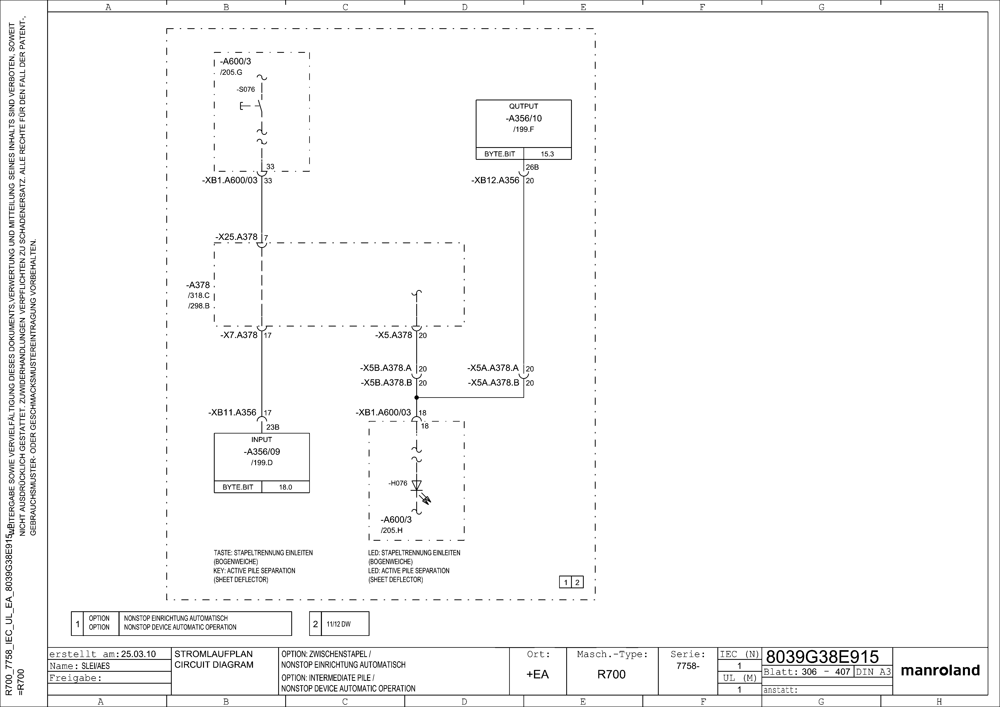

# +EA — Sheet 306 of 407 — OPTION: ZWISCHENSTAPEL /

**NONSTOP EINRICHTUNG AUTOMATISCH**

> Part of the manroland **R700** printing press IEC/UL circuit diagrams.
> Drawing class: **Stromlaufplan / Circuit diagram** (DIN A3).
> Document `+EA` covers the **Printing unit** machine section.

## At a glance

| Field | Value |
|---|---|
| Document | `+EA`  (8039G38E915) |
| Sheet | **306** of 407 |
| Section (DE) | OPTION: ZWISCHENSTAPEL / |
| Section (EN) | NONSTOP EINRICHTUNG AUTOMATISCH |
| Section type | CIRCUIT — Circuit diagram |
| Machine type | `R700` |
| Series | `7758` |
| Created | 25.03.10 |
| Replaces | — |
| Columns used | A, B, C, D, E |
| Path numbers | — |
| Labels on sheet | 62 |
| Cross-refs out | 6 |
| Cross-refs in | 17 |

**Previous:** [+EA sheet 305](SHEET_0305.md) · **Next:** [+EA sheet 307](SHEET_0307.md) · **Document TOC:** [_TOC.md](_TOC.md)  (+EA) · **Master TOC:** [all sheets](../_MASTER_TOC.md)

## Sheet image (300 DPI, exact vector render)



_Rendered directly from the PDF vector layer at 300 DPI (1-bit), no OCR and no resampling. Use it to confirm anything ambiguous in the text below._

## Cross-references on this sheet

Each entry is a wire leaving this sheet. The printed token is `/sheet.column`; the link resolves to that sheet inside the same document.

| Ref | Target sheet | Col | Path | Destination on target | Target section | From col |
|---|---|---|---|---|---|---|
| `/205.G` | [+EA sheet 205](SHEET_0205.md) | G | — | A600/3 | REFERENZMODUL | B |
| `/199.F` | [+EA sheet 199](SHEET_0199.md) | F | — | — | REFERENZMODUL | E |
| `/318.C` | [+EA sheet 318](SHEET_0318.md) | C | — | — | OPTION: LOGISTIK, AUSLEGER | B |
| `/298.B` | [+EA sheet 298](SHEET_0298.md) | B | — | — | OPTION: ZWISCHENSTAPEL / | B |
| `/199.D` | [+EA sheet 199](SHEET_0199.md) | D | — | — | REFERENZMODUL | B |
| `/205.H` | [+EA sheet 205](SHEET_0205.md) | H | — | A600/3 | REFERENZMODUL | C |

### Incoming references (sheets that point here)

Every other sheet that sends a wire to this one. `Back-ref` is the token printed on *that* sheet; `Path` is its line number.

| From sheet | Cols | Back-ref | Path | Refs | What continues there |
|---|---|---|---|---|---|
| [+EA#199](SHEET_0199.md) | D, F | `/199.D`, `/199.F` | — | 2 | — |
| [+EA#205](SHEET_0205.md) | G, H | `/205.G`, `/205.H` | — | 2 | — |
| [+EA#213](SHEET_0213.md) | A, B | `/213.A`, `/213.B` | — | 2 | — |
| [+EA#242](SHEET_0242.md) | D, E, F | `/242.D`, `/242.E`, `/242.F` | — | 3 | — |
| [+EA#243](SHEET_0243.md) | A, B | `/243.A`, `/243.B` | — | 2 | — |
| [+EA#247](SHEET_0247.md) | F | `/247.F` | — | 1 | — |
| [+EA#256](SHEET_0256.md) | B | `/256.B` | — | 1 | — |
| [+EA#257](SHEET_0257.md) | D | `/257.D` | — | 1 | — |
| [+EA#268](SHEET_0268.md) | A | `/268.A` | — | 1 | — |
| [+EA#298](SHEET_0298.md) | A | `/298.A` | — | 1 | — |
| [+EA#318](SHEET_0318.md) | C | `/318.C` | — | 1 | — |


## Devices on this sheet

| Tag | Class | Class meaning (IEC) | Col | Sub | Terminal | Sign |
|---|---|---|---|---|---|---|
| `S076` | S | Schalter / switch | B | — | — | — |
| `A600/3` | A | Baugruppe / assembly, module, PC board | B | 3 | — | — |
| `A356/10` | A | Baugruppe / assembly, module, PC board | E | 10 | — | — |
| `A600/3` | A | Baugruppe / assembly, module, PC board | C | 3 | — | — |
| `A356/09` | A | Baugruppe / assembly, module, PC board | B | 09 | — | — |
| `A378` | A | Baugruppe / assembly, module, PC board | B | — | — | — |
| `15.3` | — | cross-device reference | E | — | — | — |
| `XB12.A356` | — | cross-device reference | D | — | — | — |
| `X5.A378` | — | cross-device reference | C | — | — | — |
| `X5B.A378.B` | — | cross-device reference | C | — | — | — |
| `X5B.A378.A` | — | cross-device reference | C | — | — | — |
| `18.0` | — | cross-device reference | B | — | — | — |
| `XB11.A356` | — | cross-device reference | B | — | — | — |
| `X7.A378` | — | cross-device reference | B | — | — | — |
| `X25.A378` | — | cross-device reference | B | — | — | — |
| `X5A.A378.B` | — | cross-device reference | D | — | — | — |
| `X5A.A378.A` | — | cross-device reference | D | — | — | — |

## Potentials / nets

| Potential | Count | Columns | Attached devices | Terminals |
|---|---|---|---|---|
| `H076` | 1 | C | — | — |


A potential such as `L24+/4` or `M24+` is a named supply/return rail; every place it appears on this sheet is electrically common.

## Wire-end annotations (grouped as printed)

A wire that continues elsewhere is annotated with a small cluster: the destination description, the path/line number `#NN`, and the `/sheet.column` cross reference. Each row below is one such cluster exactly as it is grouped on the drawing.

| Col | Y | Path | Cross-ref | Text on the wire |
|---|---|---|---|---|
| B | 68.3 | — | `/205.G` | `A600/3` |
| B | 102.8 | — | — | `S076` |
| D | 123.0 | — | — | `QUTPUT` |
| E | 136.4 | — | — | `A356/10` |
| E | 150.2 | — | `/199.F` | — |
| D | 179.8 | — | — | `BYTE.BIT 15.3` |
| B | 194.5 | — | — | `33` |
| E | 195.2 | — | — | `26B` |
| B | 210.1 | — | — | `XB1.A600/03 33` |
| D | 210.1 | — | — | `XB12.A356 20` |
| B | 277.4 | — | — | `X25.A378 7` |
| B | 334.8 | — | — | `A378` |
| B | 347.9 | — | `/318.C`, `/298.B` | — |
| B | 394.3 | — | — | `X7.A378 17` |
| C | 394.3 | — | — | `X5.A378 20` |
| C | 433.3 | — | — | `X5B.A378.A 20` |
| D | 433.3 | — | — | `X5A.A378.A 20` |
| C | 451.0 | — | — | `X5B.A378.B 20` |
| D | 451.0 | — | — | `X5A.A378.B 20` |
| B | 486.4 | — | — | `XB11.A356 17` |
| C | 486.4 | — | — | `XB1.A600/03 18` |
| D | 503.5 | — | — | `18` |
| B | 504.9 | — | — | `23B` |
| B | 519.9 | — | — | `INPUT` |
| B | 533.2 | — | — | `A356/09` |
| B | 547.0 | — | `/199.D` | — |
| C | 571.9 | — | — | `H076` |
| B | 576.6 | — | — | `BYTE.BIT 18.0` |
| C | 614.0 | — | `/205.H` | `A600/3` |
| B | 655.4 | — | — | `KEY: ACTIVE PILE SEPARATION (BOGENWEICHE) (SHEET DEFLECTOR) TASTE: STAPELTRENNUNG EINLEITEN` |
| D | 655.4 | — | — | `LED: STAPELTRENNUNG EINLEITEN LED: ACTIVE PILE SEPARATION (BOGENWEICHE) (SHEET DEFLECTOR)` |
| E | 689.9 | — | — | `1 2` |
| B | 733.4 | — | — | `1 NONSTOP EINRICHTUNG AUTOMATISCH NONSTOP DEVICE AUTOMATIC OPERATION 2 11/12 DW` |
| A | 733.4 | — | — | `OPTION OPTION` |


## Reconstructed tables

This sheet carries tabular content (pin map / terminal assignment / index). The grid below was rebuilt from the drawing's own rule lines, so each row is exactly one physical row of the table.

### Table 1 — 4 data rows × 2 columns (at x=255.1, y=62.4) — **A600/3 /205.G S076 33**

| XB1.A600/03 X25.A378 X7.A378 | 33 7 17 |
|---|---|
| `XB11.A356` | `17` |
|  | `23B` |
| `INPUT` | `A356/09 /199.D` |
| `BYTE.BIT` | `18.0` |


### Table 2 — 4 data rows × 2 columns (at x=439.4, y=62.4)

| X5.A378 X5B.A378.A X5B.A378.B | 20 20 20 |
|---|---|
| `XB1.A600/03` | `18` |
|  | `18` |
| `H076` |  |
| `A600/3 /205.H` |  |


### Table 3 — 2 data rows × 2 columns (at x=566.9, y=62.4) — **QUTPUT A356/10 /199.F**

| BYTE.BIT | 15.3 |
|---|---|
|  | `26B` |
| `XB12.A356 X5A.A378.A X5A.A378.B` | `20 20 20` |


## Notes and free text on this sheet

| Text | Col | Y (pt) |
|---|---|---|
| `XB1.A600/03` | B | 210.07 |
| `26B` | E | 195.17 |
| `QUTPUT` | D | 123.01 |
| `BYTE.BIT` | D | 179.78 |
| `LED: STAPELTRENNUNG EINLEITEN` | D | 655.42 |
| `(BOGENWEICHE)` | C | 666.03 |
| `LED: ACTIVE PILE SEPARATION` | D | 676.67 |
| `(SHEET DEFLECTOR)` | C | 687.33 |
| `XB1.A600/03` | C | 486.45 |
| `23B` | B | 504.85 |
| `INPUT` | B | 519.94 |
| `BYTE.BIT` | B | 576.63 |
| `TASTE: STAPELTRENNUNG EINLEITEN` | B | 655.42 |
| `(BOGENWEICHE)` | B | 666.03 |
| `KEY: ACTIVE PILE SEPARATION` | B | 676.66 |
| `(SHEET DEFLECTOR)` | B | 687.33 |
| `OPTION` | A | 733.35 |
| `NONSTOP EINRICHTUNG AUTOMATISCH` | B | 733.39 |
| `NONSTOP DEVICE AUTOMATIC OPERATION` | B | 744.01 |
| `11/12 DW` | C | 740.4 |

## Complete label inventory (exact text from the drawing)

Every text object inside the drawing area of this sheet, in DIN reading order (column A→H, then top→bottom). This is the authoritative list: if a string is not here it is not printed on this sheet.

| Col | Y | X | Dir | Type | Text |
|---|---|---|---|---|---|
| A | 733.4 | 106.0 | → | text | `OPTION` |
| A | 738.7 | 89.6 | → | number | `1` |
| A | 744.0 | 106.0 | → | text | `OPTION` |
| B | 68.3 | 261.9 | → | device tag | `A600/3` |
| B | 82.1 | 262.2 | → | cross-reference | `/205.G` |
| B | 102.8 | 281.8 | → | device tag | `S076` |
| B | 194.5 | 317.2 | → | number | `33` |
| B | 210.1 | 240.7 | → | text | `XB1.A600/03` |
| B | 211.5 | 314.4 | → | number | `33` |
| B | 277.4 | 256.5 | → | device ref | `X25.A378` |
| B | 279.5 | 314.4 | → | number | `7` |
| B | 334.8 | 221.7 | → | device tag | `A378` |
| B | 347.9 | 223.9 | → | cross-reference | `/318.C` |
| B | 360.3 | 224.2 | → | cross-reference | `/298.B` |
| B | 394.3 | 262.5 | → | device ref | `X7.A378` |
| B | 395.8 | 313.8 | → | number | `17` |
| B | 486.4 | 248.0 | → | device ref | `XB11.A356` |
| B | 487.9 | 313.8 | → | number | `17` |
| B | 504.9 | 317.2 | → | text | `23B` |
| B | 519.9 | 299.3 | → | text | `INPUT` |
| B | 533.2 | 290.4 | → | device tag | `A356/09` |
| B | 547.0 | 299.1 | → | cross-reference | `/199.D` |
| B | 576.6 | 265.0 | → | text | `BYTE.BIT` |
| B | 576.7 | 331.9 | → | device ref | `18.0` |
| B | 655.4 | 254.8 | → | text | `TASTE: STAPELTRENNUNG EINLEITEN` |
| B | 666.0 | 254.6 | → | text | `(BOGENWEICHE)` |
| B | 676.7 | 254.3 | → | text | `KEY: ACTIVE PILE SEPARATION` |
| B | 687.3 | 254.6 | → | text | `(SHEET DEFLECTOR)` |
| B | 733.4 | 148.0 | → | text | `NONSTOP EINRICHTUNG AUTOMATISCH` |
| B | 744.0 | 148.0 | → | text | `NONSTOP DEVICE AUTOMATIC OPERATION` |
| C | 394.3 | 446.7 | → | device ref | `X5.A378` |
| C | 433.3 | 428.9 | → | device ref | `X5B.A378.A` |
| C | 451.0 | 429.7 | → | device ref | `X5B.A378.B` |
| C | 486.5 | 423.5 | → | text | `XB1.A600/03` |
| C | 571.9 | 462.6 | → | potential | `H076` |
| C | 614.0 | 453.3 | → | device tag | `A600/3` |
| C | 627.8 | 453.5 | → | cross-reference | `/205.H` |
| C | 666.0 | 438.8 | → | text | `(BOGENWEICHE)` |
| C | 687.3 | 438.8 | → | text | `(SHEET DEFLECTOR)` |
| C | 738.7 | 372.8 | → | number | `2` |
| C | 740.4 | 388.9 | → | text | `11/12 DW` |
| D | 123.0 | 606.3 | → | text | `QUTPUT` |
| D | 179.8 | 576.9 | → | text | `BYTE.BIT` |
| D | 210.1 | 561.3 | → | device ref | `XB12.A356` |
| D | 395.8 | 498.6 | → | number | `20` |
| D | 433.3 | 556.4 | → | device ref | `X5A.A378.A` |
| D | 435.4 | 498.6 | → | number | `20` |
| D | 451.0 | 557.3 | → | device ref | `X5A.A378.B` |
| D | 452.5 | 498.6 | → | number | `20` |
| D | 487.9 | 498.0 | → | number | `18` |
| D | 503.5 | 500.9 | → | number | `18` |
| D | 655.4 | 438.5 | → | text | `LED: STAPELTRENNUNG EINLEITEN` |
| D | 676.7 | 438.5 | → | text | `LED: ACTIVE PILE SEPARATION` |
| E | 136.4 | 602.2 | → | device tag | `A356/10` |
| E | 150.2 | 611.3 | → | cross-reference | `/199.F` |
| E | 179.8 | 643.7 | → | device ref | `15.3` |
| E | 195.2 | 626.2 | → | text | `26B` |
| E | 211.5 | 626.2 | → | number | `20` |
| E | 435.4 | 626.2 | → | number | `20` |
| E | 452.5 | 626.2 | → | number | `20` |
| E | 689.9 | 671.2 | → | number | `1` |
| E | 689.9 | 685.1 | → | number | `2` |

## Reading-order text block

The same content as a plain block, grouped by DIN column — convenient to paste or to match against a visual description.

```text
=== Column A ===
 733.4  106.0  text         OPTION
 738.7   89.6  numeric      1
 744.0  106.0  text         OPTION
=== Column B ===
  68.3  261.9  devtag       A600/3
  82.1  262.2  xref         /205.G
 102.8  281.8  devtag       S076
 194.5  317.2  numeric      33
 210.1  240.7  text         XB1.A600/03
 211.5  314.4  numeric      33
 277.4  256.5  devref       X25.A378
 279.5  314.4  numeric      7
 334.8  221.7  devtag       A378
 347.9  223.9  xref         /318.C
 360.3  224.2  xref         /298.B
 394.3  262.5  devref       X7.A378
 395.8  313.8  numeric      17
 486.4  248.0  devref       XB11.A356
 487.9  313.8  numeric      17
 504.9  317.2  text         23B
 519.9  299.3  text         INPUT
 533.2  290.4  devtag       A356/09
 547.0  299.1  xref         /199.D
 576.6  265.0  text         BYTE.BIT
 576.7  331.9  devref       18.0
 655.4  254.8  text         TASTE: STAPELTRENNUNG EINLEITEN
 666.0  254.6  text         (BOGENWEICHE)
 676.7  254.3  text         KEY: ACTIVE PILE SEPARATION
 687.3  254.6  text         (SHEET DEFLECTOR)
 733.4  148.0  text         NONSTOP EINRICHTUNG AUTOMATISCH
 744.0  148.0  text         NONSTOP DEVICE AUTOMATIC OPERATION
=== Column C ===
 394.3  446.7  devref       X5.A378
 433.3  428.9  devref       X5B.A378.A
 451.0  429.7  devref       X5B.A378.B
 486.5  423.5  text         XB1.A600/03
 571.9  462.6  net          H076
 614.0  453.3  devtag       A600/3
 627.8  453.5  xref         /205.H
 666.0  438.8  text         (BOGENWEICHE)
 687.3  438.8  text         (SHEET DEFLECTOR)
 738.7  372.8  numeric      2
 740.4  388.9  text         11/12 DW
=== Column D ===
 123.0  606.3  text         QUTPUT
 179.8  576.9  text         BYTE.BIT
 210.1  561.3  devref       XB12.A356
 395.8  498.6  numeric      20
 433.3  556.4  devref       X5A.A378.A
 435.4  498.6  numeric      20
 451.0  557.3  devref       X5A.A378.B
 452.5  498.6  numeric      20
 487.9  498.0  numeric      18
 503.5  500.9  numeric      18
 655.4  438.5  text         LED: STAPELTRENNUNG EINLEITEN
 676.7  438.5  text         LED: ACTIVE PILE SEPARATION
=== Column E ===
 136.4  602.2  devtag       A356/10
 150.2  611.3  xref         /199.F
 179.8  643.7  devref       15.3
 195.2  626.2  text         26B
 211.5  626.2  numeric      20
 435.4  626.2  numeric      20
 452.5  626.2  numeric      20
 689.9  671.2  numeric      1
 689.9  685.1  numeric      2
```

---
_Generated from the PDF vector text layer; no OCR. Source: `R700_7758_IEC_UL_EA_8039G38E915_p`, sheet 306._
