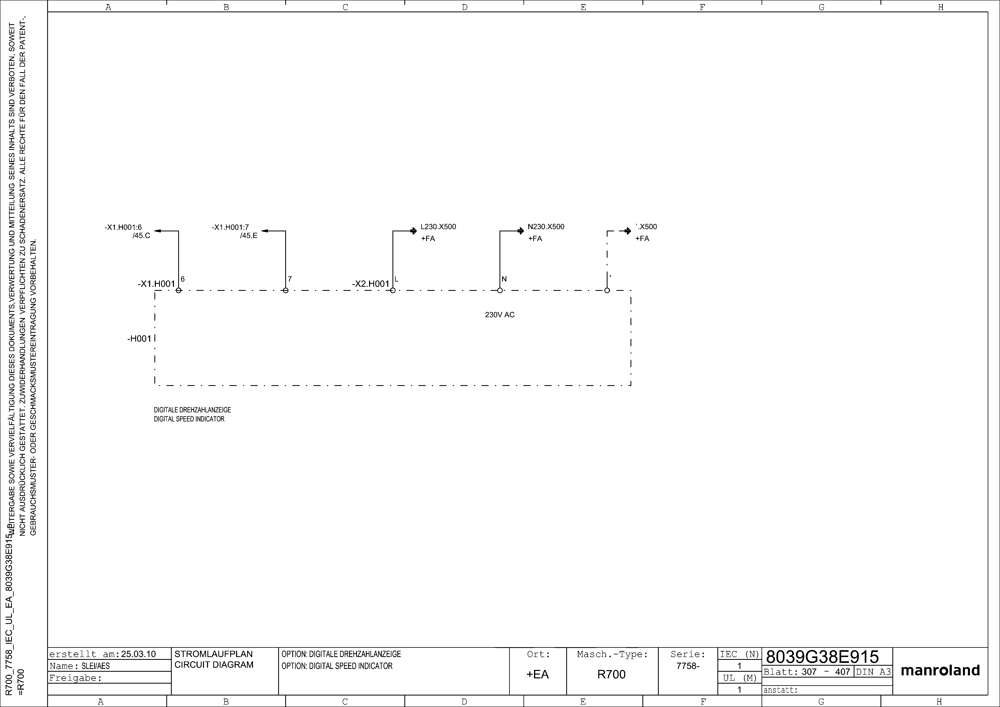

# +EA — Sheet 307 of 407 — OPTION: DIGITALE DREHZAHLANZEIGE

**OPTION: DIGITAL SPEED INDICATOR**

> Part of the manroland **R700** printing press IEC/UL circuit diagrams.
> Drawing class: **Stromlaufplan / Circuit diagram** (DIN A3).
> Document `+EA` covers the **Printing unit** machine section.

## At a glance

| Field | Value |
|---|---|
| Document | `+EA`  (8039G38E915) |
| Sheet | **307** of 407 |
| Section (DE) | OPTION: DIGITALE DREHZAHLANZEIGE |
| Section (EN) | OPTION: DIGITAL SPEED INDICATOR |
| Section type | CIRCUIT — Circuit diagram |
| Machine type | `R700` |
| Series | `7758` |
| Created | 25.03.10 |
| Replaces | — |
| Columns used | A, B, C, D, E, F |
| Path numbers | — |
| Labels on sheet | 21 |
| Cross-refs out | 2 |
| Cross-refs in | 2 |

**Previous:** [+EA sheet 306](SHEET_0306.md) · **Next:** [+EA sheet 308](SHEET_0308.md) · **Document TOC:** [_TOC.md](_TOC.md)  (+EA) · **Master TOC:** [all sheets](../_MASTER_TOC.md)

## Sheet image (300 DPI, exact vector render)



_Rendered directly from the PDF vector layer at 300 DPI (1-bit), no OCR and no resampling. Use it to confirm anything ambiguous in the text below._

## Cross-references on this sheet

Each entry is a wire leaving this sheet. The printed token is `/sheet.column`; the link resolves to that sheet inside the same document.

| Ref | Target sheet | Col | Path | Destination on target | Target section | From col |
|---|---|---|---|---|---|---|
| `/45.E` | [+EA sheet 45](SHEET_0045.md) | E | — | X1.H001:6 X1.H001:7 +FA | BUSVERBINDUNGEN: 20 mA SCHLEIFE | C |
| `/45.C` | [+EA sheet 45](SHEET_0045.md) | C | — | X1.H001:6 X1.H001:7 +FA | BUSVERBINDUNGEN: 20 mA SCHLEIFE | C |

### Incoming references (sheets that point here)

Every other sheet that sends a wire to this one. `Back-ref` is the token printed on *that* sheet; `Path` is its line number.

| From sheet | Cols | Back-ref | Path | Refs | What continues there |
|---|---|---|---|---|---|
| [+EA#45](SHEET_0045.md) | C, E | `/45.C`, `/45.E` | — | 2 | — |


## Devices on this sheet

| Tag | Class | Class meaning (IEC) | Col | Sub | Terminal | Sign |
|---|---|---|---|---|---|---|
| `X1.H001` | — | cross-device reference | A | — | — | — |
| `X2.H001` | — | cross-device reference | C | — | — | — |
| `N230.X500` | — | cross-device reference | E | — | — | — |
| `X1.H001:7` | — | cross-device reference | B | — | 7 | — |
| `X1.H001:6` | — | cross-device reference | A | — | 6 | — |

## Potentials / nets

| Potential | Count | Columns | Attached devices | Terminals |
|---|---|---|---|---|
| `230V` | 1 | D | — | — |
| `H001` | 1 | A | — | — |
| `L230` | 1 | D | `X500` | — |
| `N` | 1 | D | — | — |


A potential such as `L24+/4` or `M24+` is a named supply/return rail; every place it appears on this sheet is electrically common.

## Wire-end annotations (grouped as printed)

A wire that continues elsewhere is annotated with a small cluster: the destination description, the path/line number `#NN`, and the `/sheet.column` cross reference. Each row below is one such cluster exactly as it is grouped on the drawing.

| Col | Y | Path | Cross-ref | Text on the wire |
|---|---|---|---|---|
| F | 266.0 | — | — | `'.X500` |
| D | 266.1 | — | — | `L230.X500` |
| E | 266.1 | — | — | `N230.X500` |
| C | 266.8 | — | `/45.E`, `/45.C` | `X1.H001:6 X1.H001:7 +FA` |
| D | 280.2 | — | — | `+FA` |
| E | 280.2 | — | — | `+FA` |
| D | 327.2 | — | — | `7 X2.H001 L N '` |
| A | 328.4 | — | — | `X1.H001 6` |
| D | 370.9 | — | — | `230V AC` |
| A | 398.6 | — | — | `H001` |
| B | 485.4 | — | — | `DIGITALE DREHZAHLANZEIGE DIGITAL SPEED INDICATOR` |


## Reconstructed tables

This sheet carries tabular content (pin map / terminal assignment / index). The grid below was rebuilt from the drawing's own rule lines, so each row is exactly one physical row of the table.

### Table 1 — 5 data rows × 12 columns (at x=204.1, y=0.0) — **X1.H001:7 /45.E 6 DREHZAHLANZEIGE SPEED INDICATOR 7 X2.H001 L230.X500 +FA L 230V N N230.X500 +FA AC `.X500 +FA `**

|  | STROMLAUFPLAN |  | OPTION: DIGITALE DREHZAHLANZEIGE |  |  | Ort: |  | Masch. Type: | Serie: | IEC (N) | 8039G38E915 |
|---|---|---|---|---|---|---|---|---|---|---|---|
|  | `CIRCUIT DIAGRAM` |  |  |  |  |  |  |  |  |  |  |
|  |  |  | `OPTION: DIGITAL SPEED INDICATOR` |  |  |  |  |  | `7758` | `1` |  |
|  |  |  |  |  |  | `+EA` |  | `R700` |  |  | `Blatt: DIN A3 307 407` |
|  |  |  |  |  |  |  |  |  |  | `UL (M)` |  |
|  |  |  |  |  |  |  |  |  |  | `1` | `anstatt:` |


## Notes and free text on this sheet

| Text | Col | Y (pt) |
|---|---|---|
| `DIGITALE DREHZAHLANZEIGE` | B | 485.35 |
| `DIGITAL SPEED INDICATOR` | B | 495.98 |
| `L` | C | 328.43 |
| `+FA` | D | 280.18 |
| `+FA` | E | 280.18 |
| `'.X500` | F | 266.04 |

## Complete label inventory (exact text from the drawing)

Every text object inside the drawing area of this sheet, in DIN reading order (column A→H, then top→bottom). This is the authoritative list: if a string is not here it is not printed on this sheet.

| Col | Y | X | Dir | Type | Text |
|---|---|---|---|---|---|
| A | 266.8 | 124.7 | → | device ref | `X1.H001:6` |
| A | 276.7 | 157.9 | → | cross-reference | `/45.C` |
| A | 333.4 | 164.1 | → | device ref | `X1.H001` |
| A | 398.6 | 151.7 | → | potential | `H001` |
| B | 266.8 | 252.3 | → | device ref | `X1.H001:7` |
| B | 276.6 | 286.0 | → | cross-reference | `/45.E` |
| B | 328.4 | 215.1 | → | number | `6` |
| B | 485.3 | 183.4 | → | text | `DIGITALE DREHZAHLANZEIGE` |
| B | 496.0 | 183.4 | → | text | `DIGITAL SPEED INDICATOR` |
| C | 328.4 | 342.7 | → | number | `7` |
| C | 328.4 | 469.7 | → | text | `L` |
| C | 333.4 | 419.2 | → | device ref | `X2.H001` |
| D | 266.0 | 500.9 | → | potential | `L230.X500` |
| D | 280.2 | 501.4 | → | text | `+FA` |
| D | 328.4 | 597.3 | → | potential | `N` |
| D | 370.9 | 577.7 | → | potential | `230V AC` |
| E | 266.0 | 628.4 | → | device ref | `N230.X500` |
| E | 280.2 | 629.0 | → | text | `+FA` |
| E | 280.2 | 756.6 | → | text | `+FA` |
| E | 327.2 | 725.1 | → | other | `'` |
| F | 266.0 | 756.6 | → | text | `'.X500` |

## Reading-order text block

The same content as a plain block, grouped by DIN column — convenient to paste or to match against a visual description.

```text
=== Column A ===
 266.8  124.7  devref       X1.H001:6
 276.7  157.9  xref         /45.C
 333.4  164.1  devref       X1.H001
 398.6  151.7  net          H001
=== Column B ===
 266.8  252.3  devref       X1.H001:7
 276.6  286.0  xref         /45.E
 328.4  215.1  numeric      6
 485.3  183.4  text         DIGITALE DREHZAHLANZEIGE
 496.0  183.4  text         DIGITAL SPEED INDICATOR
=== Column C ===
 328.4  342.7  numeric      7
 328.4  469.7  text         L
 333.4  419.2  devref       X2.H001
=== Column D ===
 266.0  500.9  net          L230.X500
 280.2  501.4  text         +FA
 328.4  597.3  net          N
 370.9  577.7  net          230V AC
=== Column E ===
 266.0  628.4  devref       N230.X500
 280.2  629.0  text         +FA
 280.2  756.6  text         +FA
 327.2  725.1  other        `
=== Column F ===
 266.0  756.6  text         `.X500
```

---
_Generated from the PDF vector text layer; no OCR. Source: `R700_7758_IEC_UL_EA_8039G38E915_p`, sheet 307._
