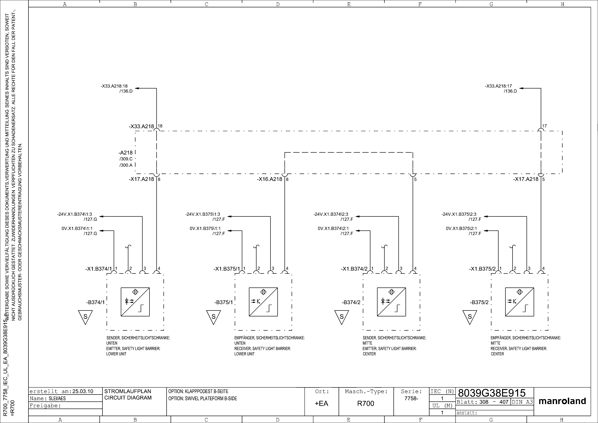

# +EA — Sheet 308 of 407 — OPTION: KLAPPPODEST B SEITE

**OPTION: SWIVEL PLATEFORM B SIDE**

> Part of the manroland **R700** printing press IEC/UL circuit diagrams.
> Drawing class: **Stromlaufplan / Circuit diagram** (DIN A3).
> Document `+EA` covers the **Printing unit** machine section.

## At a glance

| Field | Value |
|---|---|
| Document | `+EA`  (8039G38E915) |
| Sheet | **308** of 407 |
| Section (DE) | OPTION: KLAPPPODEST B SEITE |
| Section (EN) | OPTION: SWIVEL PLATEFORM B SIDE |
| Section type | CIRCUIT — Circuit diagram |
| Machine type | `R700` |
| Series | `7758` |
| Created | 25.03.10 |
| Replaces | — |
| Columns used | A, B, C, D, E, F, G, H |
| Path numbers | — |
| Labels on sheet | 77 |
| Cross-refs out | 12 |
| Cross-refs in | 34 |

**Previous:** [+EA sheet 307](SHEET_0307.md) · **Next:** [+EA sheet 309](SHEET_0309.md) · **Document TOC:** [_TOC.md](_TOC.md)  (+EA) · **Master TOC:** [all sheets](../_MASTER_TOC.md)

## Sheet image (300 DPI, exact vector render)



_Rendered directly from the PDF vector layer at 300 DPI (1-bit), no OCR and no resampling. Use it to confirm anything ambiguous in the text below._

## Cross-references on this sheet

Each entry is a wire leaving this sheet. The printed token is `/sheet.column`; the link resolves to that sheet inside the same document.

| Ref | Target sheet | Col | Path | Destination on target | Target section | From col |
|---|---|---|---|---|---|---|
| `/136.D` | [+EA sheet 136](SHEET_0136.md) | D | — | X33.A218:18 X33.A218:17 | ZUGANGSABSICHERUNG | D |
| `/136.D` | [+EA sheet 136](SHEET_0136.md) | D | — | X33.A218:18 X33.A218:17 | ZUGANGSABSICHERUNG | D |
| `/309.C` | [+EA sheet 309](SHEET_0309.md) | C | — | — | OPTION: KLAPPPODEST B SEITE | B |
| `/300.A` | [+EA sheet 300](SHEET_0300.md) | A | — | — | OPTION: ZWISCHENSTAPEL / | B |
| `/127.F` | [+EA sheet 127](SHEET_0127.md) | F | — | 24V.X1.B374\1:3 24V.X1.B374\2:3 | ZUGANGSABSICHERUNG | C |
| `/127.G` | [+EA sheet 127](SHEET_0127.md) | G | — | 24V.X1.B374\1:3 24V.X1.B374\2:3 | ZUGANGSABSICHERUNG | C |
| `/127.F` | [+EA sheet 127](SHEET_0127.md) | F | — | 24V.X1.B375\1:3 24V.X1.B375\2:3 | ZUGANGSABSICHERUNG | E |
| `/127.F` | [+EA sheet 127](SHEET_0127.md) | F | — | 24V.X1.B375\1:3 24V.X1.B375\2:3 | ZUGANGSABSICHERUNG | E |
| `/127.F` | [+EA sheet 127](SHEET_0127.md) | F | — | 0V.X1.B374\1:1 0V.X1.B375\1:1 0V.X1.B374\2:1 0V.X1.B375\2:1 | ZUGANGSABSICHERUNG | D |
| `/127.F` | [+EA sheet 127](SHEET_0127.md) | F | — | 0V.X1.B374\1:1 0V.X1.B375\1:1 0V.X1.B374\2:1 0V.X1.B375\2:1 | ZUGANGSABSICHERUNG | D |
| `/127.F` | [+EA sheet 127](SHEET_0127.md) | F | — | 0V.X1.B374\1:1 0V.X1.B375\1:1 0V.X1.B374\2:1 0V.X1.B375\2:1 | ZUGANGSABSICHERUNG | D |
| `/127.G` | [+EA sheet 127](SHEET_0127.md) | G | — | 0V.X1.B374\1:1 0V.X1.B375\1:1 0V.X1.B374\2:1 0V.X1.B375\2:1 | ZUGANGSABSICHERUNG | D |

### Incoming references (sheets that point here)

Every other sheet that sends a wire to this one. `Back-ref` is the token printed on *that* sheet; `Path` is its line number.

| From sheet | Cols | Back-ref | Path | Refs | What continues there |
|---|---|---|---|---|---|
| [+EA#127](SHEET_0127.md) | F, G | `/127.F`, `/127.G` | — | 8 | 24V.X1.B374\1:3; 24V.X1.B374\2:3; 24V.X1.B375\1:3; 24V.X1.B375\2:3 |
| [+EA#136](SHEET_0136.md) | D | `/136.D` | — | 2 | — |
| [+EA#217](SHEET_0217.md) | C, E | `/217.C`, `/217.E` | — | 16 | — |
| [+EA#261](SHEET_0261.md) | E | `/261.E` | — | 2 | — |
| [+EA#263](SHEET_0263.md) | A | `/263.A` | — | 2 | — |
| [+EA#277](SHEET_0277.md) | A | `/277.A` | — | 2 | — |
| [+EA#300](SHEET_0300.md) | A | `/300.A` | — | 1 | — |
| [+EA#309](SHEET_0309.md) | B | `/309.B` | — | 1 | — |


## Devices on this sheet

| Tag | Class | Class meaning (IEC) | Col | Sub | Terminal | Sign |
|---|---|---|---|---|---|---|
| `B374/1` | B | Umformer / transducer, sensor | A | 1 | — | — |
| `B375/1` | B | Umformer / transducer, sensor | C | 1 | — | — |
| `B374/2` | B | Umformer / transducer, sensor | E | 2 | — | — |
| `B375/2` | B | Umformer / transducer, sensor | G | 2 | — | — |
| `A218` | A | Baugruppe / assembly, module, PC board | B | — | — | — |
| `X17.A218` | — | cross-device reference | B | — | — | — |
| `X16.A218` | — | cross-device reference | D | — | — | — |
| `X17.A218` | — | cross-device reference | G | — | — | — |
| `X33.A218` | — | cross-device reference | B | — | — | — |
| `X33.A218:17` | — | cross-device reference | G | — | 17 | — |
| `X33.A218:18` | — | cross-device reference | B | — | 18 | — |

## Potentials / nets

| Potential | Count | Columns | Attached devices | Terminals |
|---|---|---|---|---|
| `0V` | 4 | A, C, E, G | `B374\1`, `B374\2`, `B375\1`, `B375\2`, `X1` | `1` |
| `24V` | 4 | A, C, E, G | `B374\1`, `B374\2`, `B375\1`, `B375\2`, `X1` | `3` |


A potential such as `L24+/4` or `M24+` is a named supply/return rail; every place it appears on this sheet is electrically common.

## Wire-end annotations (grouped as printed)

A wire that continues elsewhere is annotated with a small cluster: the destination description, the path/line number `#NN`, and the `/sheet.column` cross reference. Each row below is one such cluster exactly as it is grouped on the drawing.

| Col | Y | Path | Cross-ref | Text on the wire |
|---|---|---|---|---|
| D | 167.5 | — | `/136.D`, `/136.D` | `X33.A218:18 X33.A218:17` |
| B | 246.9 | — | — | `X33.A218 18` |
| H | 246.9 | — | — | `17` |
| B | 299.4 | — | — | `A218` |
| B | 312.5 | — | `/309.C`, `/300.A` | — |
| E | 351.8 | — | — | `X17.A218 8 X16.A218 8 5 X17.A218 5` |
| C | 422.6 | — | `/127.F`, `/127.G` | `24V.X1.B374\1:3 24V.X1.B374\2:3` |
| E | 422.6 | — | `/127.F`, `/127.F` | `24V.X1.B375\1:3 24V.X1.B375\2:3` |
| D | 451.0 | — | `/127.F`, `/127.F`, `/127.F`, `/127.G` | `0V.X1.B374\1:1 0V.X1.B375\1:1 0V.X1.B374\2:1 0V.X1.B375\2:1` |
| B | 530.4 | — | — | `X1.B374/1 1 2 3 4` |
| D | 530.4 | — | — | `X1.B375/1 1 2 3 4` |
| E | 530.4 | — | — | `X1.B374/2 1 2 3 4` |
| G | 530.4 | — | — | `X1.B375/2 1 2 3 4` |
| A | 597.0 | — | — | `B374/1` |
| C | 597.0 | — | — | `B375/1` |
| E | 597.0 | — | — | `B374/2` |
| G | 597.0 | — | — | `B375/2` |
| D | 624.7 | — | — | `S S S S` |
| B | 669.6 | — | — | `UNTEN EMITTER, SAFETY LIGHT BARRIER: LOWER UNIT SENDER, SICHERHEITSLICHTSCHRANKE:` |
| D | 669.6 | — | — | `EMPFÄNGER, SICHERHEITSLICHTSCHRANKE: UNTEN RECEIVER, SAFETY LIGHT BARRIER: LOWER UNIT` |
| F | 669.6 | — | — | `EMITTER, SAFETY LIGHT BARRIER: MITTE SENDER, SICHERHEITSLICHTSCHRANKE:` |
| G | 669.6 | — | — | `EMPFÄNGER, SICHERHEITSLICHTSCHRANKE: RECEIVER, SAFETY LIGHT BARRIER: MITTE` |
| E | 701.5 | — | — | `CENTER` |
| G | 701.5 | — | — | `CENTER` |


## Reconstructed tables

This sheet carries tabular content (pin map / terminal assignment / index). The grid below was rebuilt from the drawing's own rule lines, so each row is exactly one physical row of the table.

### Table 1 — 0 data rows × 2 columns (at x=510.2, y=303.3) — **X16.A218**

_none_


## Notes and free text on this sheet

| Text | Col | Y (pt) |
|---|---|---|
| `SENDER, SICHERHEITSLICHTSCHRANKE:` | B | 669.61 |
| `UNTEN` | B | 680.2 |
| `EMITTER, SAFETY LIGHT BARRIER:` | B | 690.85 |
| `LOWER UNIT` | B | 701.46 |
| `X1.B374/1` | A | 530.39 |
| `EMPFÄNGER, SICHERHEITSLICHTSCHRANKE:` | D | 669.6 |
| `UNTEN` | C | 680.2 |
| `RECEIVER, SAFETY LIGHT BARRIER:` | D | 690.85 |
| `LOWER UNIT` | D | 701.46 |
| `X1.B375/1` | C | 530.39 |
| `SENDER, SICHERHEITSLICHTSCHRANKE:` | F | 669.61 |
| `MITTE` | E | 680.2 |
| `EMITTER, SAFETY LIGHT BARRIER:` | F | 690.85 |
| `CENTER` | E | 701.51 |
| `X1.B374/2` | E | 530.39 |
| `EMPFÄNGER, SICHERHEITSLICHTSCHRANKE:` | G | 669.6 |
| `MITTE` | G | 680.2 |
| `RECEIVER, SAFETY LIGHT BARRIER:` | G | 690.85 |
| `CENTER` | G | 701.51 |
| `X1.B375/2` | G | 530.39 |
| `S` | A | 624.71 |
| `S` | C | 624.71 |
| `S` | E | 624.71 |
| `S` | G | 624.71 |

## Complete label inventory (exact text from the drawing)

Every text object inside the drawing area of this sheet, in DIN reading order (column A→H, then top→bottom). This is the authoritative list: if a string is not here it is not printed on this sheet.

| Col | Y | X | Dir | Type | Text |
|---|---|---|---|---|---|
| A | 422.6 | 113.7 | → | potential | `24V.X1.B374\1:3` |
| A | 432.6 | 167.0 | → | cross-reference | `/127.G` |
| A | 451.0 | 122.7 | → | potential | `0V.X1.B374\1:1` |
| A | 460.9 | 167.0 | → | cross-reference | `/127.G` |
| A | 530.4 | 170.1 | → | text | `X1.B374/1` |
| A | 597.0 | 171.8 | → | device tag | `B374/1` |
| A | 624.7 | 166.0 | → | text | `S` |
| B | 167.5 | 200.4 | → | device ref | `X33.A218:18` |
| B | 177.5 | 238.1 | → | cross-reference | `/136.D` |
| B | 246.9 | 256.5 | → | device ref | `X33.A218` |
| B | 246.9 | 313.8 | → | number | `18` |
| B | 299.4 | 235.8 | → | device tag | `A218` |
| B | 312.5 | 238.1 | → | cross-reference | `/309.C` |
| B | 324.8 | 238.1 | → | cross-reference | `/300.A` |
| B | 351.8 | 256.5 | → | device ref | `X17.A218` |
| B | 353.2 | 314.4 | → | number | `8` |
| B | 530.4 | 228.8 | → | number | `1` |
| B | 530.4 | 257.7 | → | number | `2` |
| B | 530.4 | 286.0 | → | number | `3` |
| B | 530.4 | 314.4 | → | number | `4` |
| B | 669.6 | 212.3 | → | text | `SENDER, SICHERHEITSLICHTSCHRANKE:` |
| B | 680.2 | 211.7 | → | text | `UNTEN` |
| B | 690.9 | 211.7 | → | text | `EMITTER, SAFETY LIGHT BARRIER:` |
| B | 701.5 | 211.7 | → | text | `LOWER UNIT` |
| C | 422.6 | 368.8 | → | potential | `24V.X1.B375\1:3` |
| C | 432.6 | 423.2 | → | cross-reference | `/127.F` |
| C | 451.0 | 377.9 | → | potential | `0V.X1.B375\1:1` |
| C | 460.9 | 423.2 | → | cross-reference | `/127.F` |
| C | 530.4 | 425.2 | → | text | `X1.B375/1` |
| C | 597.0 | 426.9 | → | device tag | `B375/1` |
| C | 624.7 | 421.1 | → | text | `S` |
| C | 680.2 | 466.9 | → | text | `UNTEN` |
| D | 351.8 | 511.7 | → | device ref | `X16.A218` |
| D | 353.2 | 569.5 | → | number | `8` |
| D | 530.4 | 483.9 | → | number | `1` |
| D | 530.4 | 512.8 | → | number | `2` |
| D | 530.4 | 541.1 | → | number | `3` |
| D | 530.4 | 569.5 | → | number | `4` |
| D | 669.6 | 466.9 | → | text | `EMPFÄNGER, SICHERHEITSLICHTSCHRANKE:` |
| D | 690.9 | 466.9 | → | text | `RECEIVER, SAFETY LIGHT BARRIER:` |
| D | 701.5 | 466.9 | → | text | `LOWER UNIT` |
| E | 422.6 | 623.9 | → | potential | `24V.X1.B374\2:3` |
| E | 432.6 | 678.3 | → | cross-reference | `/127.F` |
| E | 451.0 | 633.0 | → | potential | `0V.X1.B374\2:1` |
| E | 460.9 | 678.3 | → | cross-reference | `/127.F` |
| E | 530.4 | 678.9 | → | text | `X1.B374/2` |
| E | 530.4 | 739.0 | → | number | `1` |
| E | 597.0 | 680.6 | → | device tag | `B374/2` |
| E | 624.7 | 676.2 | → | text | `S` |
| E | 680.2 | 722.3 | → | text | `MITTE` |
| E | 701.5 | 722.6 | → | text | `CENTER` |
| F | 353.2 | 824.6 | → | number | `5` |
| F | 530.4 | 767.9 | → | number | `2` |
| F | 530.4 | 796.3 | → | number | `3` |
| F | 530.4 | 824.6 | → | number | `4` |
| F | 669.6 | 722.6 | → | text | `SENDER, SICHERHEITSLICHTSCHRANKE:` |
| F | 690.9 | 722.0 | → | text | `EMITTER, SAFETY LIGHT BARRIER:` |
| G | 167.5 | 965.8 | → | device ref | `X33.A218:17` |
| G | 177.5 | 1003.5 | → | cross-reference | `/136.D` |
| G | 351.8 | 1021.9 | → | device ref | `X17.A218` |
| G | 422.6 | 879.0 | → | potential | `24V.X1.B375\2:3` |
| G | 432.6 | 933.4 | → | cross-reference | `/127.F` |
| G | 451.0 | 888.1 | → | potential | `0V.X1.B375\2:1` |
| G | 460.9 | 933.4 | → | cross-reference | `/127.F` |
| G | 530.4 | 934.0 | → | text | `X1.B375/2` |
| G | 530.4 | 994.1 | → | number | `1` |
| G | 530.4 | 1023.0 | → | number | `2` |
| G | 597.0 | 935.7 | → | device tag | `B375/2` |
| G | 624.7 | 931.3 | → | text | `S` |
| G | 669.6 | 977.1 | → | text | `EMPFÄNGER, SICHERHEITSLICHTSCHRANKE:` |
| G | 680.2 | 977.4 | → | text | `MITTE` |
| G | 690.9 | 977.1 | → | text | `RECEIVER, SAFETY LIGHT BARRIER:` |
| G | 701.5 | 977.7 | → | text | `CENTER` |
| H | 246.9 | 1079.1 | → | number | `17` |
| H | 353.2 | 1079.7 | → | number | `5` |
| H | 530.4 | 1051.4 | → | number | `3` |
| H | 530.4 | 1079.7 | → | number | `4` |

## Reading-order text block

The same content as a plain block, grouped by DIN column — convenient to paste or to match against a visual description.

```text
=== Column A ===
 422.6  113.7  net          24V.X1.B374\1:3
 432.6  167.0  xref         /127.G
 451.0  122.7  net          0V.X1.B374\1:1
 460.9  167.0  xref         /127.G
 530.4  170.1  text         X1.B374/1
 597.0  171.8  devtag       B374/1
 624.7  166.0  text         S
=== Column B ===
 167.5  200.4  devref       X33.A218:18
 177.5  238.1  xref         /136.D
 246.9  256.5  devref       X33.A218
 246.9  313.8  numeric      18
 299.4  235.8  devtag       A218
 312.5  238.1  xref         /309.C
 324.8  238.1  xref         /300.A
 351.8  256.5  devref       X17.A218
 353.2  314.4  numeric      8
 530.4  228.8  numeric      1
 530.4  257.7  numeric      2
 530.4  286.0  numeric      3
 530.4  314.4  numeric      4
 669.6  212.3  text         SENDER, SICHERHEITSLICHTSCHRANKE:
 680.2  211.7  text         UNTEN
 690.9  211.7  text         EMITTER, SAFETY LIGHT BARRIER:
 701.5  211.7  text         LOWER UNIT
=== Column C ===
 422.6  368.8  net          24V.X1.B375\1:3
 432.6  423.2  xref         /127.F
 451.0  377.9  net          0V.X1.B375\1:1
 460.9  423.2  xref         /127.F
 530.4  425.2  text         X1.B375/1
 597.0  426.9  devtag       B375/1
 624.7  421.1  text         S
 680.2  466.9  text         UNTEN
=== Column D ===
 351.8  511.7  devref       X16.A218
 353.2  569.5  numeric      8
 530.4  483.9  numeric      1
 530.4  512.8  numeric      2
 530.4  541.1  numeric      3
 530.4  569.5  numeric      4
 669.6  466.9  text         EMPFÄNGER, SICHERHEITSLICHTSCHRANKE:
 690.9  466.9  text         RECEIVER, SAFETY LIGHT BARRIER:
 701.5  466.9  text         LOWER UNIT
=== Column E ===
 422.6  623.9  net          24V.X1.B374\2:3
 432.6  678.3  xref         /127.F
 451.0  633.0  net          0V.X1.B374\2:1
 460.9  678.3  xref         /127.F
 530.4  678.9  text         X1.B374/2
 530.4  739.0  numeric      1
 597.0  680.6  devtag       B374/2
 624.7  676.2  text         S
 680.2  722.3  text         MITTE
 701.5  722.6  text         CENTER
=== Column F ===
 353.2  824.6  numeric      5
 530.4  767.9  numeric      2
 530.4  796.3  numeric      3
 530.4  824.6  numeric      4
 669.6  722.6  text         SENDER, SICHERHEITSLICHTSCHRANKE:
 690.9  722.0  text         EMITTER, SAFETY LIGHT BARRIER:
=== Column G ===
 167.5  965.8  devref       X33.A218:17
 177.5 1003.5  xref         /136.D
 351.8 1021.9  devref       X17.A218
 422.6  879.0  net          24V.X1.B375\2:3
 432.6  933.4  xref         /127.F
 451.0  888.1  net          0V.X1.B375\2:1
 460.9  933.4  xref         /127.F
 530.4  934.0  text         X1.B375/2
 530.4  994.1  numeric      1
 530.4 1023.0  numeric      2
 597.0  935.7  devtag       B375/2
 624.7  931.3  text         S
 669.6  977.1  text         EMPFÄNGER, SICHERHEITSLICHTSCHRANKE:
 680.2  977.4  text         MITTE
 690.9  977.1  text         RECEIVER, SAFETY LIGHT BARRIER:
 701.5  977.7  text         CENTER
=== Column H ===
 246.9 1079.1  numeric      17
 353.2 1079.7  numeric      5
 530.4 1051.4  numeric      3
 530.4 1079.7  numeric      4
```

---
_Generated from the PDF vector text layer; no OCR. Source: `R700_7758_IEC_UL_EA_8039G38E915_p`, sheet 308._
