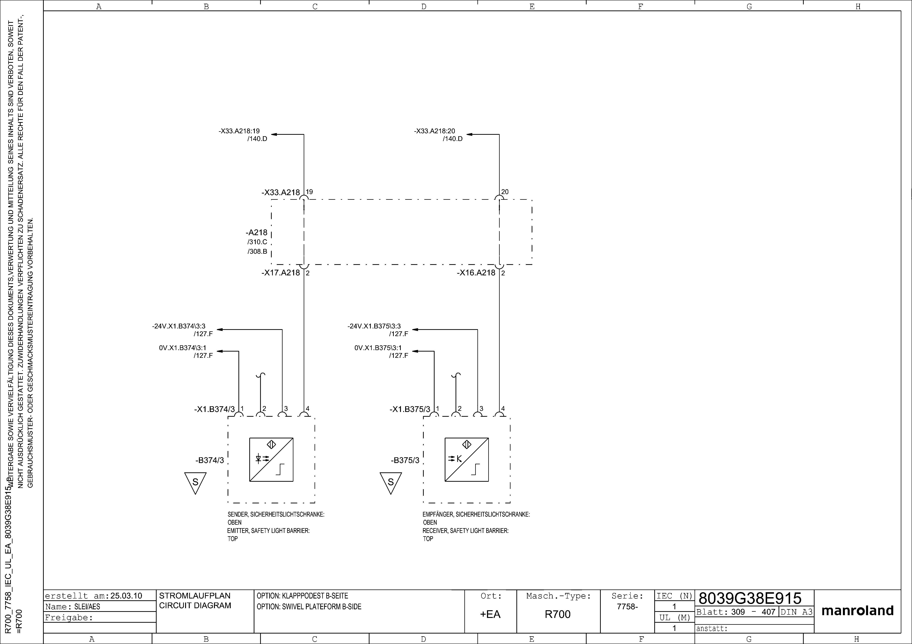

# +EA — Sheet 309 of 407 — OPTION: KLAPPPODEST B SEITE

**OPTION: SWIVEL PLATEFORM B SIDE**

> Part of the manroland **R700** printing press IEC/UL circuit diagrams.
> Drawing class: **Stromlaufplan / Circuit diagram** (DIN A3).
> Document `+EA` covers the **Printing unit** machine section.

## At a glance

| Field | Value |
|---|---|
| Document | `+EA`  (8039G38E915) |
| Sheet | **309** of 407 |
| Section (DE) | OPTION: KLAPPPODEST B SEITE |
| Section (EN) | OPTION: SWIVEL PLATEFORM B SIDE |
| Section type | CIRCUIT — Circuit diagram |
| Machine type | `R700` |
| Series | `7758` |
| Created | 25.03.10 |
| Replaces | — |
| Columns used | B, C, D, E |
| Path numbers | — |
| Labels on sheet | 44 |
| Cross-refs out | 8 |
| Cross-refs in | 20 |

**Previous:** [+EA sheet 308](SHEET_0308.md) · **Next:** [+EA sheet 310](SHEET_0310.md) · **Document TOC:** [_TOC.md](_TOC.md)  (+EA) · **Master TOC:** [all sheets](../_MASTER_TOC.md)

## Sheet image (300 DPI, exact vector render)



_Rendered directly from the PDF vector layer at 300 DPI (1-bit), no OCR and no resampling. Use it to confirm anything ambiguous in the text below._

## Cross-references on this sheet

Each entry is a wire leaving this sheet. The printed token is `/sheet.column`; the link resolves to that sheet inside the same document.

| Ref | Target sheet | Col | Path | Destination on target | Target section | From col |
|---|---|---|---|---|---|---|
| `/140.D` | [+EA sheet 140](SHEET_0140.md) | D | — | X33.A218:19 X33.A218:20 | ZUGANGSABSICHERUNG | C |
| `/140.D` | [+EA sheet 140](SHEET_0140.md) | D | — | X33.A218:19 X33.A218:20 | ZUGANGSABSICHERUNG | C |
| `/310.C` | [+EA sheet 310](SHEET_0310.md) | C | — | — | OPTION: AUTOMATISCHE STAPELAUFFAHRT STOP / | B |
| `/308.B` | [+EA sheet 308](SHEET_0308.md) | B | — | — | OPTION: KLAPPPODEST B SEITE | B |
| `/127.F` | [+EA sheet 127](SHEET_0127.md) | F | — | 24V.X1.B374\3:3 24V.X1.B375\3:3 | ZUGANGSABSICHERUNG | C |
| `/127.F` | [+EA sheet 127](SHEET_0127.md) | F | — | 24V.X1.B374\3:3 24V.X1.B375\3:3 | ZUGANGSABSICHERUNG | C |
| `/127.F` | [+EA sheet 127](SHEET_0127.md) | F | — | 0V.X1.B374\3:1 0V.X1.B375\3:1 | ZUGANGSABSICHERUNG | C |
| `/127.F` | [+EA sheet 127](SHEET_0127.md) | F | — | 0V.X1.B374\3:1 0V.X1.B375\3:1 | ZUGANGSABSICHERUNG | C |

### Incoming references (sheets that point here)

Every other sheet that sends a wire to this one. `Back-ref` is the token printed on *that* sheet; `Path` is its line number.

| From sheet | Cols | Back-ref | Path | Refs | What continues there |
|---|---|---|---|---|---|
| [+EA#127](SHEET_0127.md) | F | `/127.F` | — | 4 | 24V.X1.B374\3:3; 24V.X1.B375\3:3 |
| [+EA#140](SHEET_0140.md) | E | `/140.E` | — | 2 | — |
| [+EA#217](SHEET_0217.md) | C, E | `/217.C`, `/217.E` | — | 8 | — |
| [+EA#261](SHEET_0261.md) | E | `/261.E` | — | 1 | — |
| [+EA#263](SHEET_0263.md) | A | `/263.A` | — | 1 | — |
| [+EA#277](SHEET_0277.md) | A | `/277.A` | — | 2 | — |
| [+EA#308](SHEET_0308.md) | B | `/308.B` | — | 1 | — |
| [+EA#310](SHEET_0310.md) | B | `/310.B` | — | 1 | — |


## Devices on this sheet

| Tag | Class | Class meaning (IEC) | Col | Sub | Terminal | Sign |
|---|---|---|---|---|---|---|
| `B374/3` | B | Umformer / transducer, sensor | B | 3 | — | — |
| `B375/3` | B | Umformer / transducer, sensor | D | 3 | — | — |
| `A218` | A | Baugruppe / assembly, module, PC board | B | — | — | — |
| `X17.A218` | — | cross-device reference | C | — | — | — |
| `X16.A218` | — | cross-device reference | D | — | — | — |
| `X33.A218` | — | cross-device reference | C | — | — | — |
| `X33.A218:20` | — | cross-device reference | D | — | 20 | — |
| `X33.A218:19` | — | cross-device reference | B | — | 19 | — |

## Potentials / nets

| Potential | Count | Columns | Attached devices | Terminals |
|---|---|---|---|---|
| `0V` | 2 | B, D | `B374\3`, `B375\3`, `X1` | `1` |
| `24V` | 2 | B, D | `B374\3`, `B375\3`, `X1` | `3` |


A potential such as `L24+/4` or `M24+` is a named supply/return rail; every place it appears on this sheet is electrically common.

## Wire-end annotations (grouped as printed)

A wire that continues elsewhere is annotated with a small cluster: the destination description, the path/line number `#NN`, and the `/sheet.column` cross reference. Each row below is one such cluster exactly as it is grouped on the drawing.

| Col | Y | Path | Cross-ref | Text on the wire |
|---|---|---|---|---|
| C | 167.5 | — | `/140.D`, `/140.D` | `X33.A218:19 X33.A218:20` |
| C | 246.9 | — | — | `X33.A218 19` |
| E | 246.9 | — | — | `20` |
| B | 299.4 | — | — | `A218` |
| B | 312.5 | — | `/310.C`, `/308.B` | — |
| D | 351.8 | — | — | `X17.A218 2 X16.A218 2` |
| C | 422.6 | — | `/127.F`, `/127.F` | `24V.X1.B374\3:3 24V.X1.B375\3:3` |
| C | 451.0 | — | `/127.F`, `/127.F` | `0V.X1.B374\3:1 0V.X1.B375\3:1` |
| B | 530.4 | — | — | `X1.B374/3 1 2 3 4` |
| D | 530.4 | — | — | `X1.B375/3 1 2 3 4` |
| B | 597.0 | — | — | `B374/3` |
| D | 597.0 | — | — | `B375/3` |
| C | 624.7 | — | — | `S S` |
| C | 669.6 | — | — | `EMITTER, SAFETY LIGHT BARRIER: SENDER, SICHERHEITSLICHTSCHRANKE: OBEN` |
| D | 669.6 | — | — | `EMPFÄNGER, SICHERHEITSLICHTSCHRANKE:` |
| D | 680.2 | — | — | `RECEIVER, SAFETY LIGHT BARRIER: OBEN` |
| B | 701.5 | — | — | `TOP` |
| D | 701.5 | — | — | `TOP` |


## Reconstructed tables

This sheet carries tabular content (pin map / terminal assignment / index). The grid below was rebuilt from the drawing's own rule lines, so each row is exactly one physical row of the table.

### Table 1 — 5 data rows × 19 columns (at x=204.1, y=0.0) — **24V.X1.B374\3:3 X33.A218:19 /140.D A218 /310.C /308.B X33.A218 X17.A218 19 2 24V.X1.B375\3:3 X33.A218:20 /140.D X16.A218 20 2 /127.F 0V.X1.B374\3:1 /127.F X1.B374/3 1 2 3 /127.F 0V.X1.B375\3:1 /127.F X1.B375/3 4 4 B374/3 B375/3 S SENDER, OBEN EMITTER, TOP SAFETY LIGHT SICHERHEITSLICHTSCHRANKE: BARRIER: S OBEN TOP EMPFÄNGER, RECEIVER, SAFETY LIGHT SICHERHEITSLICHTSCHRANKE: BARRIER:**

| STROMLAUFPLAN |  |  |  | OPTION: |  | KLAPPPODEST | B SEITE |  |  |  |  |  | Ort: |  | Masch. Type: | Serie: | IEC (N) | 8039G38E915 |
|---|---|---|---|---|---|---|---|---|---|---|---|---|---|---|---|---|---|---|
| `CIRCUIT DIAGRAM` |  |  |  |  |  |  |  |  |  |  |  |  |  |  |  |  |  |  |
|  |  |  |  | `OPTION:` | `SWIVEL` |  | `PLATEFORM B SIDE` |  |  |  |  |  |  |  |  | `7758` | `1` |  |
|  |  |  |  |  |  |  |  |  |  |  |  |  | `+EA` |  | `R700` |  |  | `Blatt: DIN A3 309 407` |
|  |  |  |  |  |  |  |  |  |  |  |  |  |  |  |  |  | `UL (M)` |  |
|  |  |  |  |  |  |  |  |  |  |  |  |  |  |  |  |  | `1` | `anstatt:` |


## Notes and free text on this sheet

| Text | Col | Y (pt) |
|---|---|---|
| `SENDER, SICHERHEITSLICHTSCHRANKE:` | C | 669.61 |
| `OBEN` | B | 680.19 |
| `EMITTER, SAFETY LIGHT BARRIER:` | C | 690.85 |
| `TOP` | B | 701.47 |
| `X1.B374/3` | B | 530.39 |
| `EMPFÄNGER, SICHERHEITSLICHTSCHRANKE:` | D | 669.6 |
| `OBEN` | D | 680.19 |
| `RECEIVER, SAFETY LIGHT BARRIER:` | D | 690.85 |
| `TOP` | D | 701.47 |
| `X1.B375/3` | D | 530.39 |
| `S` | B | 624.71 |
| `S` | D | 624.71 |

## Complete label inventory (exact text from the drawing)

Every text object inside the drawing area of this sheet, in DIN reading order (column A→H, then top→bottom). This is the authoritative list: if a string is not here it is not printed on this sheet.

| Col | Y | X | Dir | Type | Text |
|---|---|---|---|---|---|
| B | 167.5 | 285.4 | → | device ref | `X33.A218:19` |
| B | 177.5 | 323.1 | → | cross-reference | `/140.D` |
| B | 299.4 | 320.9 | → | device tag | `A218` |
| B | 312.5 | 323.1 | → | cross-reference | `/310.C` |
| B | 324.8 | 323.4 | → | cross-reference | `/308.B` |
| B | 422.6 | 198.7 | → | potential | `24V.X1.B374\3:3` |
| B | 432.6 | 253.1 | → | cross-reference | `/127.F` |
| B | 451.0 | 207.8 | → | potential | `0V.X1.B374\3:1` |
| B | 460.9 | 253.1 | → | cross-reference | `/127.F` |
| B | 530.4 | 253.7 | → | text | `X1.B374/3` |
| B | 530.4 | 313.8 | → | number | `1` |
| B | 597.0 | 255.4 | → | device tag | `B374/3` |
| B | 624.7 | 251.0 | → | text | `S` |
| B | 680.2 | 297.4 | → | text | `OBEN` |
| B | 701.5 | 297.4 | → | text | `TOP` |
| C | 246.9 | 341.6 | → | device ref | `X33.A218` |
| C | 246.9 | 398.8 | → | number | `19` |
| C | 351.8 | 341.6 | → | device ref | `X17.A218` |
| C | 353.2 | 399.4 | → | number | `2` |
| C | 530.4 | 342.7 | → | number | `2` |
| C | 530.4 | 371.1 | → | number | `3` |
| C | 530.4 | 399.4 | → | number | `4` |
| C | 669.6 | 297.4 | → | text | `SENDER, SICHERHEITSLICHTSCHRANKE:` |
| C | 690.9 | 296.8 | → | text | `EMITTER, SAFETY LIGHT BARRIER:` |
| D | 167.5 | 540.6 | → | device ref | `X33.A218:20` |
| D | 177.5 | 578.3 | → | cross-reference | `/140.D` |
| D | 351.8 | 596.7 | → | device ref | `X16.A218` |
| D | 422.6 | 453.8 | → | potential | `24V.X1.B375\3:3` |
| D | 432.6 | 508.3 | → | cross-reference | `/127.F` |
| D | 451.0 | 462.9 | → | potential | `0V.X1.B375\3:1` |
| D | 460.9 | 508.3 | → | cross-reference | `/127.F` |
| D | 530.4 | 508.8 | → | text | `X1.B375/3` |
| D | 530.4 | 568.9 | → | number | `1` |
| D | 530.4 | 597.8 | → | number | `2` |
| D | 597.0 | 510.5 | → | device tag | `B375/3` |
| D | 624.7 | 506.1 | → | text | `S` |
| D | 669.6 | 551.9 | → | text | `EMPFÄNGER, SICHERHEITSLICHTSCHRANKE:` |
| D | 680.2 | 552.5 | → | text | `OBEN` |
| D | 690.9 | 551.9 | → | text | `RECEIVER, SAFETY LIGHT BARRIER:` |
| D | 701.5 | 552.5 | → | text | `TOP` |
| E | 246.9 | 654.5 | → | number | `20` |
| E | 353.2 | 654.5 | → | number | `2` |
| E | 530.4 | 626.2 | → | number | `3` |
| E | 530.4 | 654.5 | → | number | `4` |

## Reading-order text block

The same content as a plain block, grouped by DIN column — convenient to paste or to match against a visual description.

```text
=== Column B ===
 167.5  285.4  devref       X33.A218:19
 177.5  323.1  xref         /140.D
 299.4  320.9  devtag       A218
 312.5  323.1  xref         /310.C
 324.8  323.4  xref         /308.B
 422.6  198.7  net          24V.X1.B374\3:3
 432.6  253.1  xref         /127.F
 451.0  207.8  net          0V.X1.B374\3:1
 460.9  253.1  xref         /127.F
 530.4  253.7  text         X1.B374/3
 530.4  313.8  numeric      1
 597.0  255.4  devtag       B374/3
 624.7  251.0  text         S
 680.2  297.4  text         OBEN
 701.5  297.4  text         TOP
=== Column C ===
 246.9  341.6  devref       X33.A218
 246.9  398.8  numeric      19
 351.8  341.6  devref       X17.A218
 353.2  399.4  numeric      2
 530.4  342.7  numeric      2
 530.4  371.1  numeric      3
 530.4  399.4  numeric      4
 669.6  297.4  text         SENDER, SICHERHEITSLICHTSCHRANKE:
 690.9  296.8  text         EMITTER, SAFETY LIGHT BARRIER:
=== Column D ===
 167.5  540.6  devref       X33.A218:20
 177.5  578.3  xref         /140.D
 351.8  596.7  devref       X16.A218
 422.6  453.8  net          24V.X1.B375\3:3
 432.6  508.3  xref         /127.F
 451.0  462.9  net          0V.X1.B375\3:1
 460.9  508.3  xref         /127.F
 530.4  508.8  text         X1.B375/3
 530.4  568.9  numeric      1
 530.4  597.8  numeric      2
 597.0  510.5  devtag       B375/3
 624.7  506.1  text         S
 669.6  551.9  text         EMPFÄNGER, SICHERHEITSLICHTSCHRANKE:
 680.2  552.5  text         OBEN
 690.9  551.9  text         RECEIVER, SAFETY LIGHT BARRIER:
 701.5  552.5  text         TOP
=== Column E ===
 246.9  654.5  numeric      20
 353.2  654.5  numeric      2
 530.4  626.2  numeric      3
 530.4  654.5  numeric      4
```

---
_Generated from the PDF vector text layer; no OCR. Source: `R700_7758_IEC_UL_EA_8039G38E915_p`, sheet 309._
