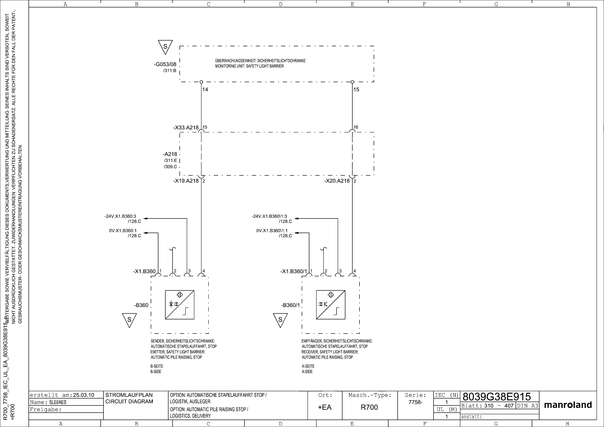

# +EA — Sheet 310 of 407 — OPTION: AUTOMATISCHE STAPELAUFFAHRT STOP /

**LOGISTIK, AUSLEGER**

> Part of the manroland **R700** printing press IEC/UL circuit diagrams.
> Drawing class: **Stromlaufplan / Circuit diagram** (DIN A3).
> Document `+EA` covers the **Printing unit** machine section.

## At a glance

| Field | Value |
|---|---|
| Document | `+EA`  (8039G38E915) |
| Sheet | **310** of 407 |
| Section (DE) | OPTION: AUTOMATISCHE STAPELAUFFAHRT STOP / |
| Section (EN) | LOGISTIK, AUSLEGER |
| Section type | CIRCUIT — Circuit diagram |
| Machine type | `R700` |
| Series | `7758` |
| Created | 25.03.10 |
| Replaces | — |
| Columns used | B, C, D, E |
| Path numbers | — |
| Labels on sheet | 51 |
| Cross-refs out | 7 |
| Cross-refs in | 19 |

**Previous:** [+EA sheet 309](SHEET_0309.md) · **Next:** [+EA sheet 311](SHEET_0311.md) · **Document TOC:** [_TOC.md](_TOC.md)  (+EA) · **Master TOC:** [all sheets](../_MASTER_TOC.md)

## Sheet image (300 DPI, exact vector render)



_Rendered directly from the PDF vector layer at 300 DPI (1-bit), no OCR and no resampling. Use it to confirm anything ambiguous in the text below._

## Cross-references on this sheet

Each entry is a wire leaving this sheet. The printed token is `/sheet.column`; the link resolves to that sheet inside the same document.

| Ref | Target sheet | Col | Path | Destination on target | Target section | From col |
|---|---|---|---|---|---|---|
| `/311.B` | [+EA sheet 311](SHEET_0311.md) | B | — | — | OPTION: AUTOMATISCHE STAPELAUFFAHRT STOP / | B |
| `/311.E` | [+EA sheet 311](SHEET_0311.md) | E | — | — | OPTION: AUTOMATISCHE STAPELAUFFAHRT STOP / | B |
| `/309.C` | [+EA sheet 309](SHEET_0309.md) | C | — | — | OPTION: KLAPPPODEST B SEITE | B |
| `/128.C` | [+EA sheet 128](SHEET_0128.md) | C | — | 24V.X1.B360:3 | ZUGANGSABSICHERUNG | B |
| `/128.C` | [+EA sheet 128](SHEET_0128.md) | C | — | 24V.X1.B360\1:3 | ZUGANGSABSICHERUNG | D |
| `/128.C` | [+EA sheet 128](SHEET_0128.md) | C | — | 0V.X1.B360\1:1 0V.X1.B360:1 | ZUGANGSABSICHERUNG | C |
| `/128.C` | [+EA sheet 128](SHEET_0128.md) | C | — | 0V.X1.B360\1:1 0V.X1.B360:1 | ZUGANGSABSICHERUNG | C |

### Incoming references (sheets that point here)

Every other sheet that sends a wire to this one. `Back-ref` is the token printed on *that* sheet; `Path` is its line number.

| From sheet | Cols | Back-ref | Path | Refs | What continues there |
|---|---|---|---|---|---|
| [+EA#128](SHEET_0128.md) | B, C | `/128.B`, `/128.C` | — | 4 | 24V.X1.B360:3; 24V.X1.B360\1:3 |
| [+EA#217](SHEET_0217.md) | B | `/217.B` | — | 8 | — |
| [+EA#263](SHEET_0263.md) | G | `/263.G` | — | 1 | — |
| [+EA#264](SHEET_0264.md) | A | `/264.A` | — | 1 | — |
| [+EA#277](SHEET_0277.md) | A | `/277.A` | — | 2 | — |
| [+EA#309](SHEET_0309.md) | B | `/309.B` | — | 1 | — |
| [+EA#311](SHEET_0311.md) | A, E | `/311.A`, `/311.E` | — | 2 | — |


## Devices on this sheet

| Tag | Class | Class meaning (IEC) | Col | Sub | Terminal | Sign |
|---|---|---|---|---|---|---|
| `B360/1` | B | Umformer / transducer, sensor | D | 1 | — | — |
| `B360` | B | Umformer / transducer, sensor | B | — | — | — |
| `A218` | A | Baugruppe / assembly, module, PC board | B | — | — | — |
| `G053/08` | G | Stromversorgung / power supply | B | 08 | — | — |
| `X1.B360` | — | cross-device reference | B | — | — | — |
| `X20.A218` | — | cross-device reference | E | — | — | — |
| `X19.A218` | — | cross-device reference | C | — | — | — |
| `X33.A218` | — | cross-device reference | C | — | — | — |

## Potentials / nets

| Potential | Count | Columns | Attached devices | Terminals |
|---|---|---|---|---|
| `0V` | 2 | B, D | `B360`, `B360\1`, `X1` | `1` |
| `24V` | 2 | B, D | `B360`, `B360\1`, `X1` | `3` |


A potential such as `L24+/4` or `M24+` is a named supply/return rail; every place it appears on this sheet is electrically common.

## Wire-end annotations (grouped as printed)

A wire that continues elsewhere is annotated with a small cluster: the destination description, the path/line number `#NN`, and the `/sheet.column` cross reference. Each row below is one such cluster exactly as it is grouped on the drawing.

| Col | Y | Path | Cross-ref | Text on the wire |
|---|---|---|---|---|
| B | 86.1 | — | — | `S` |
| D | 116.8 | — | — | `ÜBERWACHUNGSEINHEIT: SICHERHEITSLICHTSCHRANKE MONITORING UNIT: SAFETY LIGHT BARRIER` |
| B | 122.2 | — | — | `G053/08` |
| B | 135.3 | — | `/311.B` | — |
| D | 171.8 | — | — | `14 15` |
| D | 246.9 | — | — | `X33.A218 15 16` |
| B | 299.4 | — | — | `A218` |
| B | 312.4 | — | `/311.E`, `/309.C` | — |
| D | 351.8 | — | — | `X19.A218 2 X20.A218 2` |
| B | 422.6 | — | `/128.C` | `24V.X1.B360:3` |
| D | 422.6 | — | `/128.C` | `24V.X1.B360\1:3` |
| C | 451.0 | — | `/128.C`, `/128.C` | `0V.X1.B360:1 0V.X1.B360\1:1` |
| B | 530.4 | — | — | `X1.B360 1 2 3 4` |
| E | 530.4 | — | — | `X1.B360/1 1 2 3 4` |
| B | 597.0 | — | — | `B360` |
| D | 597.0 | — | — | `B360/1` |
| B | 624.7 | — | — | `S` |
| D | 624.7 | — | — | `S` |
| C | 669.6 | — | — | `EMITTER, SAFETY LIGHT BARRIER: SENDER, SICHERHEITSLICHTSCHRANKE: AUTOMATISCHE STAPELAUFFAHRT, STOP` |
| E | 669.6 | — | — | `EMPFÄNGER, SICHERHEITSLICHTSCHRANKE:` |
| E | 680.2 | — | — | `RECEIVER, SAFETY LIGHT BARRIER: AUTOMATISCHE STAPELAUFFAHRT, STOP` |
| C | 701.5 | — | — | `AUTOMATIC PILE RAISING, STOP` |
| E | 701.5 | — | — | `AUTOMATIC PILE RAISING, STOP` |
| B | 719.1 | — | — | `B SEITE B SIDE` |
| D | 719.2 | — | — | `A SEITE A SIDE` |


## Reconstructed tables

This sheet carries tabular content (pin map / terminal assignment / index). The grid below was rebuilt from the drawing's own rule lines, so each row is exactly one physical row of the table.

### Table 1 — 5 data rows × 18 columns (at x=204.1, y=0.0) — **24V.X1.B360:3 S G053/08 /311.B A218 /311.E /309.C X33.A218 X19.A218 ÜBERWACHUNGSEINHEIT: SICHERHEITSLICHTSCHRANKE MONITORING UNIT: SAFETY LIGHT BARRIER 14 15 2 24V.X1.B360\1:3 X20.A218 15 16 2 /128.C 0V.X1.B360:1 /128.C X1.B360 1 2 3 /128.C 0V.X1.B360\1:1 /128.C X1.B360/1 4 4 B360 B360/1 S SENDER, EMITTER, B SEITE B SIDE AUTOMATISCHE AUTOMATIC SAFETY LIGHT PILE RAISING, SICHERHEITSLICHTSCHRANKE: STAPELAUFFAHRT, BARRIER: STOP S STOP A SIDE EMPFÄNGER, AUTOMATISCHE RECEIVER, AUTOMATIC STAPELAUFFAHRT, SICHERHEITSLICHTSCHRANKE: BARRIER: STOP STOP**

| STROMLAUFPLAN |  |  |  | OPTION: |  |  | AUTOMATISCHE STAPELAUFFAHRT STOP / |  |  | Ort: |  |  |  | Masch. Type: | Serie: | IEC (N) | 8039G38E915 |
|---|---|---|---|---|---|---|---|---|---|---|---|---|---|---|---|---|---|
| `CIRCUIT DIAGRAM` |  |  |  |  |  |  |  |  |  |  |  |  |  |  |  |  |  |
|  |  |  |  | `LOGISTIK,` |  | `AUSLEGER` |  |  |  |  |  |  |  |  | `7758` | `1` |  |
|  |  |  |  |  |  |  |  |  |  | `+EA` |  |  |  | `R700` |  |  | `Blatt: DIN A3 310 407` |
|  |  |  |  | `OPTION:` |  | `AUTOMATIC` | `PILE RAISING STOP /` |  |  |  |  |  |  |  |  | `UL (M)` |  |
|  |  |  |  | `LOGISTICS,` |  |  | `DELIVERY` |  |  |  |  |  |  |  |  | `1` | `anstatt:` |


## Notes and free text on this sheet

| Text | Col | Y (pt) |
|---|---|---|
| `EMPFÄNGER, SICHERHEITSLICHTSCHRANKE:` | E | 669.6 |
| `AUTOMATISCHE STAPELAUFFAHRT, STOP` | E | 680.24 |
| `RECEIVER, SAFETY LIGHT BARRIER:` | E | 690.85 |
| `AUTOMATIC PILE RAISING, STOP` | E | 701.5 |
| `X1.B360/1` | D | 530.39 |
| `SENDER, SICHERHEITSLICHTSCHRANKE:` | C | 669.61 |
| `AUTOMATISCHE STAPELAUFFAHRT, STOP` | C | 680.24 |
| `EMITTER, SAFETY LIGHT BARRIER:` | C | 690.85 |
| `AUTOMATIC PILE RAISING, STOP` | C | 701.5 |
| `ÜBERWACHUNGSEINHEIT: SICHERHEITSLICHTSCHRANKE` | D | 116.85 |
| `MONITORING UNIT: SAFETY LIGHT BARRIER` | D | 127.48 |
| `S` | D | 624.71 |
| `A SEITE` | D | 719.17 |
| `A SIDE` | D | 729.82 |
| `S` | B | 624.71 |
| `B SEITE` | B | 719.14 |
| `B SIDE` | B | 729.78 |

## Complete label inventory (exact text from the drawing)

Every text object inside the drawing area of this sheet, in DIN reading order (column A→H, then top→bottom). This is the authoritative list: if a string is not here it is not printed on this sheet.

| Col | Y | X | Dir | Type | Text |
|---|---|---|---|---|---|
| B | 86.1 | 321.9 | → | text | `S` |
| B | 122.2 | 303.6 | → | device tag | `G053/08` |
| B | 135.3 | 322.0 | → | cross-reference | `/311.B` |
| B | 299.4 | 320.9 | → | device tag | `A218` |
| B | 312.4 | 323.7 | → | cross-reference | `/311.E` |
| B | 324.9 | 323.1 | → | cross-reference | `/309.C` |
| B | 422.6 | 206.1 | → | potential | `24V.X1.B360:3` |
| B | 432.6 | 252.3 | → | cross-reference | `/128.C` |
| B | 451.0 | 215.1 | → | potential | `0V.X1.B360:1` |
| B | 460.9 | 252.3 | → | cross-reference | `/128.C` |
| B | 530.4 | 262.5 | → | device ref | `X1.B360` |
| B | 530.4 | 313.8 | → | number | `1` |
| B | 597.0 | 264.2 | → | device tag | `B360` |
| B | 624.7 | 251.0 | → | text | `S` |
| B | 719.1 | 296.8 | → | text | `B SEITE` |
| B | 729.8 | 296.8 | → | text | `B SIDE` |
| C | 171.8 | 398.6 | → | number | `14` |
| C | 246.9 | 341.6 | → | device ref | `X33.A218` |
| C | 246.9 | 398.8 | → | number | `15` |
| C | 351.8 | 341.6 | → | device ref | `X19.A218` |
| C | 353.2 | 399.4 | → | number | `2` |
| C | 530.4 | 342.7 | → | number | `2` |
| C | 530.4 | 371.1 | → | number | `3` |
| C | 530.4 | 399.4 | → | number | `4` |
| C | 669.6 | 297.4 | → | text | `SENDER, SICHERHEITSLICHTSCHRANKE:` |
| C | 680.2 | 297.6 | → | text | `AUTOMATISCHE STAPELAUFFAHRT, STOP` |
| C | 690.9 | 296.8 | → | text | `EMITTER, SAFETY LIGHT BARRIER:` |
| C | 701.5 | 297.6 | → | text | `AUTOMATIC PILE RAISING, STOP` |
| D | 116.8 | 424.3 | → | text | `ÜBERWACHUNGSEINHEIT: SICHERHEITSLICHTSCHRANKE` |
| D | 127.5 | 424.6 | → | text | `MONITORING UNIT: SAFETY LIGHT BARRIER` |
| D | 422.6 | 496.3 | → | potential | `24V.X1.B360\1:3` |
| D | 432.6 | 549.9 | → | cross-reference | `/128.C` |
| D | 451.0 | 505.4 | → | potential | `0V.X1.B360\1:1` |
| D | 460.9 | 549.9 | → | cross-reference | `/128.C` |
| D | 530.4 | 552.8 | → | text | `X1.B360/1` |
| D | 530.4 | 611.4 | → | number | `1` |
| D | 597.0 | 554.5 | → | device tag | `B360/1` |
| D | 624.7 | 548.6 | → | text | `S` |
| D | 719.2 | 595.3 | → | text | `A SEITE` |
| D | 729.8 | 595.3 | → | text | `A SIDE` |
| E | 171.8 | 696.2 | → | number | `15` |
| E | 246.9 | 696.5 | → | number | `16` |
| E | 351.8 | 639.2 | → | device ref | `X20.A218` |
| E | 353.2 | 697.0 | → | number | `2` |
| E | 530.4 | 640.3 | → | number | `2` |
| E | 530.4 | 668.7 | → | number | `3` |
| E | 530.4 | 697.0 | → | number | `4` |
| E | 669.6 | 594.4 | → | text | `EMPFÄNGER, SICHERHEITSLICHTSCHRANKE:` |
| E | 680.2 | 595.3 | → | text | `AUTOMATISCHE STAPELAUFFAHRT, STOP` |
| E | 690.9 | 594.4 | → | text | `RECEIVER, SAFETY LIGHT BARRIER:` |
| E | 701.5 | 595.3 | → | text | `AUTOMATIC PILE RAISING, STOP` |

## Reading-order text block

The same content as a plain block, grouped by DIN column — convenient to paste or to match against a visual description.

```text
=== Column B ===
  86.1  321.9  text         S
 122.2  303.6  devtag       G053/08
 135.3  322.0  xref         /311.B
 299.4  320.9  devtag       A218
 312.4  323.7  xref         /311.E
 324.9  323.1  xref         /309.C
 422.6  206.1  net          24V.X1.B360:3
 432.6  252.3  xref         /128.C
 451.0  215.1  net          0V.X1.B360:1
 460.9  252.3  xref         /128.C
 530.4  262.5  devref       X1.B360
 530.4  313.8  numeric      1
 597.0  264.2  devtag       B360
 624.7  251.0  text         S
 719.1  296.8  text         B SEITE
 729.8  296.8  text         B SIDE
=== Column C ===
 171.8  398.6  numeric      14
 246.9  341.6  devref       X33.A218
 246.9  398.8  numeric      15
 351.8  341.6  devref       X19.A218
 353.2  399.4  numeric      2
 530.4  342.7  numeric      2
 530.4  371.1  numeric      3
 530.4  399.4  numeric      4
 669.6  297.4  text         SENDER, SICHERHEITSLICHTSCHRANKE:
 680.2  297.6  text         AUTOMATISCHE STAPELAUFFAHRT, STOP
 690.9  296.8  text         EMITTER, SAFETY LIGHT BARRIER:
 701.5  297.6  text         AUTOMATIC PILE RAISING, STOP
=== Column D ===
 116.8  424.3  text         ÜBERWACHUNGSEINHEIT: SICHERHEITSLICHTSCHRANKE
 127.5  424.6  text         MONITORING UNIT: SAFETY LIGHT BARRIER
 422.6  496.3  net          24V.X1.B360\1:3
 432.6  549.9  xref         /128.C
 451.0  505.4  net          0V.X1.B360\1:1
 460.9  549.9  xref         /128.C
 530.4  552.8  text         X1.B360/1
 530.4  611.4  numeric      1
 597.0  554.5  devtag       B360/1
 624.7  548.6  text         S
 719.2  595.3  text         A SEITE
 729.8  595.3  text         A SIDE
=== Column E ===
 171.8  696.2  numeric      15
 246.9  696.5  numeric      16
 351.8  639.2  devref       X20.A218
 353.2  697.0  numeric      2
 530.4  640.3  numeric      2
 530.4  668.7  numeric      3
 530.4  697.0  numeric      4
 669.6  594.4  text         EMPFÄNGER, SICHERHEITSLICHTSCHRANKE:
 680.2  595.3  text         AUTOMATISCHE STAPELAUFFAHRT, STOP
 690.9  594.4  text         RECEIVER, SAFETY LIGHT BARRIER:
 701.5  595.3  text         AUTOMATIC PILE RAISING, STOP
```

---
_Generated from the PDF vector text layer; no OCR. Source: `R700_7758_IEC_UL_EA_8039G38E915_p`, sheet 310._
