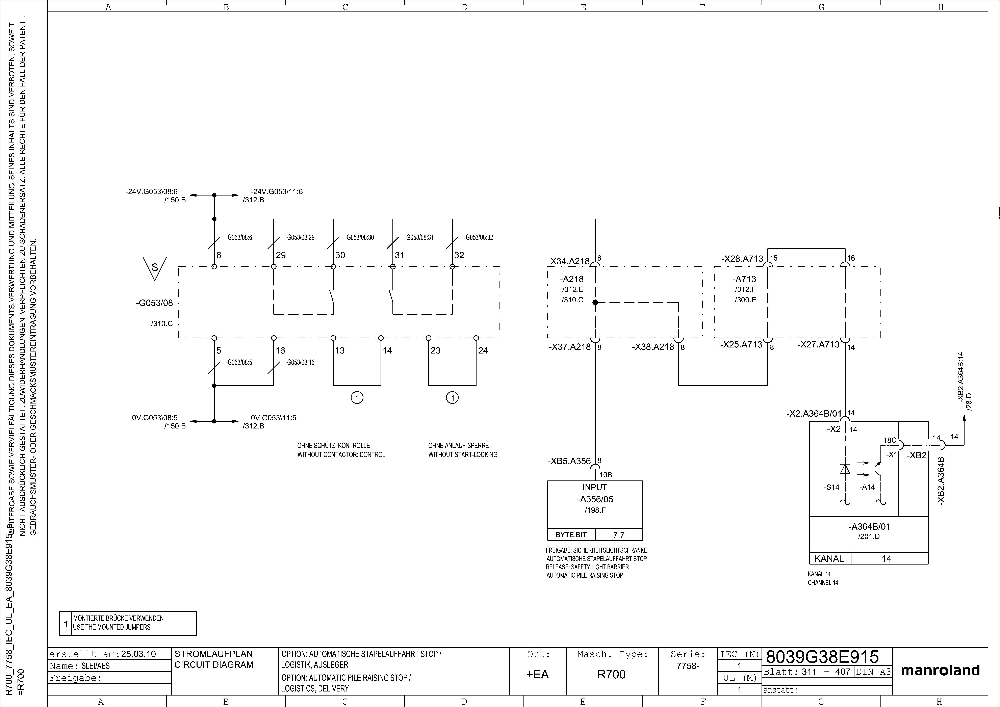

# +EA — Sheet 311 of 407 — OPTION: AUTOMATISCHE STAPELAUFFAHRT STOP /

**LOGISTIK, AUSLEGER**

> Part of the manroland **R700** printing press IEC/UL circuit diagrams.
> Drawing class: **Stromlaufplan / Circuit diagram** (DIN A3).
> Document `+EA` covers the **Printing unit** machine section.

## At a glance

| Field | Value |
|---|---|
| Document | `+EA`  (8039G38E915) |
| Sheet | **311** of 407 |
| Section (DE) | OPTION: AUTOMATISCHE STAPELAUFFAHRT STOP / |
| Section (EN) | LOGISTIK, AUSLEGER |
| Section type | CIRCUIT — Circuit diagram |
| Machine type | `R700` |
| Series | `7758` |
| Created | 25.03.10 |
| Replaces | — |
| Columns used | A, B, C, D, E, F, G, H |
| Path numbers | — |
| Labels on sheet | 89 |
| Cross-refs out | 12 |
| Cross-refs in | 22 |

**Previous:** [+EA sheet 310](SHEET_0310.md) · **Next:** [+EA sheet 312](SHEET_0312.md) · **Document TOC:** [_TOC.md](_TOC.md)  (+EA) · **Master TOC:** [all sheets](../_MASTER_TOC.md)

## Sheet image (300 DPI, exact vector render)



_Rendered directly from the PDF vector layer at 300 DPI (1-bit), no OCR and no resampling. Use it to confirm anything ambiguous in the text below._

## Cross-references on this sheet

Each entry is a wire leaving this sheet. The printed token is `/sheet.column`; the link resolves to that sheet inside the same document.

| Ref | Target sheet | Col | Path | Destination on target | Target section | From col |
|---|---|---|---|---|---|---|
| `/150.B` | [+EA sheet 150](SHEET_0150.md) | B | — | 24V.G053\08:6 | ZUGANGSABSICHERUNG | A |
| `/312.B` | [+EA sheet 312](SHEET_0312.md) | B | — | — | OPTION: LOGISTIK, AUSLEGER | B |
| `/312.E` | [+EA sheet 312](SHEET_0312.md) | E | — | — | OPTION: LOGISTIK, AUSLEGER | E |
| `/310.C` | [+EA sheet 310](SHEET_0310.md) | C | — | — | OPTION: AUTOMATISCHE STAPELAUFFAHRT STOP / | E |
| `/312.F` | [+EA sheet 312](SHEET_0312.md) | F | — | — | OPTION: LOGISTIK, AUSLEGER | F |
| `/300.E` | [+EA sheet 300](SHEET_0300.md) | E | — | — | OPTION: ZWISCHENSTAPEL / | F |
| `/310.C` | [+EA sheet 310](SHEET_0310.md) | C | — | — | OPTION: AUTOMATISCHE STAPELAUFFAHRT STOP / | A |
| `/28.D` | [+EA sheet 28](SHEET_0028.md) | D | — | XB2.A364B:14 | BUSVERBINDUNGEN: SICHERHEITSBUS | H |
| `/150.B` | [+EA sheet 150](SHEET_0150.md) | B | — | 0V.G053\08:5 | ZUGANGSABSICHERUNG | B |
| `/312.B` | [+EA sheet 312](SHEET_0312.md) | B | — | 0V.G053\08:5 | OPTION: LOGISTIK, AUSLEGER | B |
| `/198.F` | [+EA sheet 198](SHEET_0198.md) | F | — | — | REFERENZMODUL | E |
| `/201.D` | [+EA sheet 201](SHEET_0201.md) | D | — | — | REFERENZMODUL | G |

### Incoming references (sheets that point here)

Every other sheet that sends a wire to this one. `Back-ref` is the token printed on *that* sheet; `Path` is its line number.

| From sheet | Cols | Back-ref | Path | Refs | What continues there |
|---|---|---|---|---|---|
| [+EA#28](SHEET_0028.md) | D | `/28.D` | — | 1 | — |
| [+EA#150](SHEET_0150.md) | B, C | `/150.B`, `/150.C` | — | 2 | 0V.G053\07:5; X18.A218:4 |
| [+EA#198](SHEET_0198.md) | F | `/198.F` | — | 1 | — |
| [+EA#201](SHEET_0201.md) | D | `/201.D` | — | 1 | — |
| [+EA#227](SHEET_0227.md) | B, D | `/227.B`, `/227.D` | — | 2 | — |
| [+EA#241](SHEET_0241.md) | H | `/241.H` | — | 1 | — |
| [+EA#268](SHEET_0268.md) | G | `/268.G` | — | 1 | — |
| [+EA#272](SHEET_0272.md) | A | `/272.A` | — | 1 | — |
| [+EA#273](SHEET_0273.md) | F | `/273.F` | — | 2 | — |
| [+EA#277](SHEET_0277.md) | G | `/277.G` | — | 1 | — |
| [+EA#279](SHEET_0279.md) | E | `/279.E` | — | 1 | — |
| [+EA#280](SHEET_0280.md) | A | `/280.A` | — | 1 | — |
| [+EA#300](SHEET_0300.md) | E | `/300.E` | — | 1 | — |
| [+EA#310](SHEET_0310.md) | B | `/310.B` | — | 2 | — |
| [+EA#312](SHEET_0312.md) | B, E, F | `/312.B`, `/312.E`, `/312.F` | — | 4 | 0V.G053\11:5 0V.G053\12:5; 24V.G053\11:6 |


## Devices on this sheet

| Tag | Class | Class meaning (IEC) | Col | Sub | Terminal | Sign |
|---|---|---|---|---|---|---|
| `G053/08` | G | Stromversorgung / power supply | A | 08 | — | — |
| `A356/05` | A | Baugruppe / assembly, module, PC board | E | 05 | — | — |
| `A218` | A | Baugruppe / assembly, module, PC board | E | — | — | — |
| `A713` | A | Baugruppe / assembly, module, PC board | F | — | — | — |
| `S14` | S | Schalter / switch | G | — | — | — |
| `A14` | A | Baugruppe / assembly, module, PC board | G | — | — | — |
| `X1` | X | Klemme / terminal, plug connector | H | — | — | — |
| `X2` | X | Klemme / terminal, plug connector | G | — | — | — |
| `XB2` | XB |  | H | — | — | — |
| `G053/08:6` | G | Stromversorgung / power supply | B | 08 | 6 | — |
| `G053/08:29` | G | Stromversorgung / power supply | C | 08 | 29 | — |
| `G053/08:30` | G | Stromversorgung / power supply | C | 08 | 30 | — |
| `G053/08:32` | G | Stromversorgung / power supply | D | 08 | 32 | — |
| `G053/08:31` | G | Stromversorgung / power supply | D | 08 | 31 | — |
| `G053/08:5` | G | Stromversorgung / power supply | B | 08 | 5 | — |
| `G053/08:16` | G | Stromversorgung / power supply | C | 08 | 16 | — |
| `7.7` | — | cross-device reference | E | — | — | — |
| `XB5.A356` | — | cross-device reference | E | — | — | — |
| `X34.A218` | — | cross-device reference | E | — | — | — |
| `X37.A218` | — | cross-device reference | E | — | — | — |
| `X38.A218` | — | cross-device reference | F | — | — | — |
| `X28.A713` | — | cross-device reference | F | — | — | — |
| `XB2.A364B` | — | cross-device reference | H | — | — | — |
| `X27.A713` | — | cross-device reference | G | — | — | — |
| `X25.A713` | — | cross-device reference | F | — | — | — |
| `XB2.A364B:14` | — | cross-device reference | H | — | 14 | — |

## Potentials / nets

| Potential | Count | Columns | Attached devices | Terminals |
|---|---|---|---|---|
| `0V` | 2 | A, B | `G053\08`, `G053\11` | `5` |
| `24V` | 2 | A, B | `G053\08`, `G053\11` | `6` |


A potential such as `L24+/4` or `M24+` is a named supply/return rail; every place it appears on this sheet is electrically common.

## Wire-end annotations (grouped as printed)

A wire that continues elsewhere is annotated with a small cluster: the destination description, the path/line number `#NN`, and the `/sheet.column` cross reference. Each row below is one such cluster exactly as it is grouped on the drawing.

| Col | Y | Path | Cross-ref | Text on the wire |
|---|---|---|---|---|
| A | 224.2 | — | `/150.B` | `24V.G053\08:6` |
| B | 224.2 | — | — | `24V.G053\11:6` |
| B | 234.1 | — | `/312.B` | — |
| C | 279.8 | — | — | `G053/08:6 G053/08:29 G053/08:30 G053/08:31 G053/08:32` |
| C | 299.3 | — | — | `6 29 30 31 32` |
| E | 303.6 | — | — | `X34.A218 8` |
| G | 303.6 | — | — | `X28.A713 15 16` |
| A | 312.9 | — | — | `S` |
| E | 327.7 | — | — | `A218` |
| F | 327.7 | — | — | `A713` |
| E | 340.8 | — | `/312.E`, `/310.C` | — |
| F | 340.8 | — | `/312.F`, `/300.E` | — |
| A | 356.1 | — | — | `G053/08` |
| A | 381.6 | — | `/310.C` | — |
| G | 405.7 | — | — | `X25.A713 8 X27.A713 14` |
| E | 408.5 | — | — | `X37.A218 8 X38.A218 8` |
| B | 412.7 | — | — | `5` |
| C | 412.7 | — | — | `16 13 14 23 24` |
| H | 418.7 | — | `/28.D` | `XB2.A364B:14` |
| B | 428.7 | — | — | `G053/08:5 G053/08:16` |
| D | 470.3 | — | — | `1 1` |
| G | 487.9 | — | — | `X2.A364B/01 14` |
| B | 493.5 | — | `/150.B`, `/312.B` | `0V.G053\08:5` |
| B | 493.5 | — | — | `0V.G053\11:5` |
| G | 506.3 | — | — | `X2` |
| H | 507.7 | — | — | `14 14` |
| H | 516.2 | — | — | `14` |
| H | 520.5 | — | — | `18C` |
| C | 527.9 | — | — | `OHNE SCHÜTZ: KONTROLLE WITHOUT CONTACTOR: CONTROL OHNE ANLAUF SPERRE WITHOUT START LOCKING` |
| H | 537.5 | — | — | `X1` |
| H | 537.5 | — | — | `XB2` |
| H | 543.7 | — | — | `XB2.A364B` |
| E | 544.6 | — | — | `XB5.A356 8` |
| E | 561.5 | — | — | `10B` |
| E | 576.1 | — | — | `INPUT` |
| G | 576.4 | — | — | `S14 A14` |
| E | 589.9 | — | — | `A356/05` |
| E | 603.7 | — | `/198.F` | — |
| G | 622.5 | — | — | `A364B/01` |
| E | 632.7 | — | — | `BYTE.BIT 7.7` |
| G | 634.9 | — | `/201.D` | — |
| E | 652.8 | — | — | `FREIGABE: SICHERHEITSLICHTSCHRANKE` |
| G | 660.7 | — | — | `KANAL 14` |
| E | 662.7 | — | — | `RELEASE: SAFETY LIGHT BARRIER AUTOMATISCHE STAPELAUFFAHRT STOP` |
| G | 681.1 | — | — | `KANAL 14 CHANNEL 14` |
| E | 682.6 | — | — | `AUTOMATIC PILE RAISING STOP` |
| A | 733.4 | — | — | `1 USE THE MOUNTED JUMPERS MONTIERTE BRÜCKE VERWENDEN` |


## Reconstructed tables

This sheet carries tabular content (pin map / terminal assignment / index). The grid below was rebuilt from the drawing's own rule lines, so each row is exactly one physical row of the table.

### Table 1 — 9 data rows × 18 columns (at x=255.1, y=260.8)

| G053/08:6 | G053/08:29 | G053/08:30 |  | G053/08:31 |  |  | G053/08:32 |  |  |  |  |  |  |  |  |  |  |
|---|---|---|---|---|---|---|---|---|---|---|---|---|---|---|---|---|---|
| `6` | `29` | `30` |  | `31` |  | `32` |  | `X34.A218 A218 /312.E /310.C` | `8` |  | `X28.A713 A713 /312.F /300.E` | `15` |  | `16` |  |  |  |
| `5 G053/08:5` | `16 G053/08:16` | `13` | `14` |  | `23` |  | `24` | `X37.A218` | `8` | `X38.A218` | `X25.A713 8` | `8` | `X27.A713` | `14` |  |  | `XB2.A364B:14` |
| `0V.G053\11:5` |  | `1` |  |  |  | `1` |  |  |  |  |  |  | `X2.A364B/01` | `14` |  |  |  |
| `/312.B` | `OHNE SCHÜTZ: WITHOUT` | `KONTROLLE CONTACTOR: CONTROL` |  |  | `OHNE WITHOUT` | `ANLAUF SPERRE START LOCKING` |  | `XB5.A356` | `8 10B` |  |  |  | `X2` | `14` | `18C X1` | `XB2` | `14 14` |
|  |  |  |  |  |  |  |  | `INPUT` | `A356/05 /198.F` |  |  |  | `S14` | `A14` |  |  | `XB2.A364B` |
|  |  |  |  |  |  |  |  |  |  |  |  |  |  | `A364B/01` |  |  |  |
|  |  |  |  |  |  |  |  | `BYTE.BIT` | `7.7` |  |  |  |  | `/201.D` |  |  |  |
|  |  |  |  |  |  |  |  | `FREIGABE:` | `SICHERHEITSLICHTSCHRANKE` |  |  |  |  |  |  |  |  |
|  |  |  |  |  |  |  |  | `AUTOMATISCHE` | `STAPELAUFFAHRT STOP` |  |  |  | `KANAL` |  | `14` |  |  |


## Notes and free text on this sheet

| Text | Col | Y (pt) |
|---|---|---|
| `10B` | E | 561.55 |
| `INPUT` | E | 576.07 |
| `BYTE.BIT` | E | 633.32 |
| `FREIGABE: SICHERHEITSLICHTSCHRANKE` | E | 652.76 |
| `AUTOMATISCHE STAPELAUFFAHRT STOP` | E | 662.69 |
| `RELEASE: SAFETY LIGHT BARRIER` | E | 672.66 |
| `AUTOMATIC PILE RAISING STOP` | E | 682.61 |
| `KANAL 14` | G | 681.1 |
| `CHANNEL 14` | G | 691.04 |
| `18C` | H | 520.49 |
| `KANAL` | G | 660.77 |
| `A364B/01` | G | 622.51 |
| `X2.A364B/01` | G | 487.87 |
| `MONTIERTE BRÜCKE VERWENDEN` | A | 733.37 |
| `USE THE MOUNTED JUMPERS` | A | 744.02 |
| `OHNE ANLAUF SPERRE` | D | 527.88 |
| `WITHOUT START LOCKING` | D | 538.5 |
| `OHNE SCHÜTZ: KONTROLLE` | C | 527.88 |
| `WITHOUT CONTACTOR: CONTROL` | C | 538.51 |
| `S` | A | 312.9 |

## Complete label inventory (exact text from the drawing)

Every text object inside the drawing area of this sheet, in DIN reading order (column A→H, then top→bottom). This is the authoritative list: if a string is not here it is not printed on this sheet.

| Col | Y | X | Dir | Type | Text |
|---|---|---|---|---|---|
| A | 224.2 | 149.7 | → | potential | `24V.G053\08:6` |
| A | 312.9 | 180.1 | → | text | `S` |
| A | 356.1 | 161.9 | → | device tag | `G053/08` |
| A | 381.5 | 180.0 | → | cross-reference | `/310.C` |
| A | 493.5 | 157.3 | → | potential | `0V.G053\08:5` |
| A | 733.4 | 87.3 | → | text | `MONTIERTE BRÜCKE VERWENDEN` |
| A | 738.7 | 75.4 | → | number | `1` |
| A | 744.0 | 87.0 | → | text | `USE THE MOUNTED JUMPERS` |
| B | 224.2 | 298.8 | → | potential | `24V.G053\11:6` |
| B | 234.1 | 195.9 | → | cross-reference | `/150.B` |
| B | 234.1 | 289.1 | → | cross-reference | `/312.B` |
| B | 279.9 | 269.0 | → | device tag | `G053/08:6` |
| B | 299.3 | 257.7 | → | number | `6` |
| B | 299.3 | 328.5 | → | number | `29` |
| B | 412.7 | 257.4 | → | number | `5` |
| B | 412.7 | 327.7 | → | number | `16` |
| B | 428.7 | 269.0 | → | device tag | `G053/08:5` |
| B | 493.5 | 298.8 | → | potential | `0V.G053\11:5` |
| B | 503.4 | 195.9 | → | cross-reference | `/150.B` |
| B | 503.4 | 289.1 | → | cross-reference | `/312.B` |
| C | 279.9 | 339.9 | → | device tag | `G053/08:29` |
| C | 279.9 | 410.7 | → | device tag | `G053/08:30` |
| C | 299.3 | 399.1 | → | number | `30` |
| C | 299.3 | 470.0 | → | number | `31` |
| C | 412.7 | 398.6 | → | number | `13` |
| C | 412.7 | 455.2 | → | number | `14` |
| C | 428.7 | 339.9 | → | device tag | `G053/08:16` |
| C | 470.3 | 423.4 | → | number | `1` |
| C | 527.9 | 354.0 | → | text | `OHNE SCHÜTZ: KONTROLLE` |
| C | 538.5 | 354.3 | → | text | `WITHOUT CONTACTOR: CONTROL` |
| D | 279.8 | 481.6 | → | device tag | `G053/08:31` |
| D | 279.9 | 552.5 | → | device tag | `G053/08:32` |
| D | 299.3 | 540.9 | → | number | `32` |
| D | 412.7 | 512.8 | → | number | `23` |
| D | 412.7 | 569.5 | → | number | `24` |
| D | 470.3 | 536.8 | → | number | `1` |
| D | 527.9 | 510.0 | → | text | `OHNE ANLAUF SPERRE` |
| D | 538.5 | 510.2 | → | text | `WITHOUT START LOCKING` |
| E | 303.6 | 711.2 | → | number | `8` |
| E | 306.4 | 652.0 | → | device ref | `X34.A218` |
| E | 327.7 | 666.7 | → | device tag | `A218` |
| E | 340.8 | 669.5 | → | cross-reference | `/312.E` |
| E | 353.2 | 669.0 | → | cross-reference | `/310.C` |
| E | 408.5 | 653.4 | → | device ref | `X37.A218` |
| E | 409.9 | 711.2 | → | number | `8` |
| E | 544.6 | 652.3 | → | device ref | `XB5.A356` |
| E | 544.6 | 711.2 | → | number | `8` |
| E | 561.5 | 713.5 | → | text | `10B` |
| E | 576.1 | 693.8 | → | text | `INPUT` |
| E | 589.9 | 687.3 | → | device tag | `A356/05` |
| E | 603.7 | 696.3 | → | cross-reference | `/198.F` |
| E | 632.7 | 730.2 | → | device ref | `7.7` |
| E | 633.3 | 661.9 | → | text | `BYTE.BIT` |
| E | 652.8 | 650.0 | → | text | `FREIGABE: SICHERHEITSLICHTSCHRANKE` |
| E | 662.7 | 650.8 | → | text | `AUTOMATISCHE STAPELAUFFAHRT STOP` |
| E | 672.7 | 650.0 | → | text | `RELEASE: SAFETY LIGHT BARRIER` |
| E | 682.6 | 650.8 | → | text | `AUTOMATIC PILE RAISING STOP` |
| F | 303.6 | 858.9 | → | device ref | `X28.A713` |
| F | 327.7 | 872.2 | → | device tag | `A713` |
| F | 340.8 | 875.3 | → | cross-reference | `/312.F` |
| F | 353.2 | 875.1 | → | cross-reference | `/300.E` |
| F | 405.7 | 857.5 | → | device ref | `X25.A713` |
| F | 408.5 | 752.6 | → | device ref | `X38.A218` |
| F | 409.9 | 810.4 | → | number | `8` |
| G | 303.6 | 916.2 | → | number | `15` |
| G | 303.6 | 1008.3 | → | number | `16` |
| G | 405.7 | 949.6 | → | device ref | `X27.A713` |
| G | 409.9 | 916.7 | → | number | `8` |
| G | 409.9 | 1008.3 | → | number | `14` |
| G | 487.9 | 936.6 | → | text | `X2.A364B/01` |
| G | 487.9 | 1008.3 | → | number | `14` |
| G | 506.3 | 984.8 | → | device tag | `X2` |
| G | 507.7 | 1011.1 | → | number | `14` |
| G | 576.4 | 981.1 | → | device tag | `S14` |
| G | 576.4 | 1023.6 | → | device tag | `A14` |
| G | 622.5 | 1010.4 | → | text | `A364B/01` |
| G | 634.9 | 1021.9 | → | cross-reference | `/201.D` |
| G | 660.8 | 970.0 | → | text | `KANAL` |
| G | 681.1 | 961.8 | → | text | `KANAL 14` |
| G | 691.0 | 962.1 | → | text | `CHANNEL 14` |
| H | 418.7 | 1139.8 | ↕ | device ref | `XB2.A364B:14` |
| H | 468.0 | 1149.7 | ↕ | cross-reference | `/28.D` |
| H | 516.2 | 1131.6 | → | number | `14` |
| H | 517.6 | 1110.3 | → | number | `14` |
| H | 520.5 | 1051.7 | → | text | `18C` |
| H | 537.5 | 1055.3 | → | device tag | `X1` |
| H | 537.5 | 1079.7 | → | device tag | `XB2` |
| H | 543.7 | 1115.7 | ↕ | device ref | `XB2.A364B` |
| H | 660.7 | 1049.7 | → | number | `14` |

## Reading-order text block

The same content as a plain block, grouped by DIN column — convenient to paste or to match against a visual description.

```text
=== Column A ===
 224.2  149.7  net          24V.G053\08:6
 312.9  180.1  text         S
 356.1  161.9  devtag       G053/08
 381.5  180.0  xref         /310.C
 493.5  157.3  net          0V.G053\08:5
 733.4   87.3  text         MONTIERTE BRÜCKE VERWENDEN
 738.7   75.4  numeric      1
 744.0   87.0  text         USE THE MOUNTED JUMPERS
=== Column B ===
 224.2  298.8  net          24V.G053\11:6
 234.1  195.9  xref         /150.B
 234.1  289.1  xref         /312.B
 279.9  269.0  devtag       G053/08:6
 299.3  257.7  numeric      6
 299.3  328.5  numeric      29
 412.7  257.4  numeric      5
 412.7  327.7  numeric      16
 428.7  269.0  devtag       G053/08:5
 493.5  298.8  net          0V.G053\11:5
 503.4  195.9  xref         /150.B
 503.4  289.1  xref         /312.B
=== Column C ===
 279.9  339.9  devtag       G053/08:29
 279.9  410.7  devtag       G053/08:30
 299.3  399.1  numeric      30
 299.3  470.0  numeric      31
 412.7  398.6  numeric      13
 412.7  455.2  numeric      14
 428.7  339.9  devtag       G053/08:16
 470.3  423.4  numeric      1
 527.9  354.0  text         OHNE SCHÜTZ: KONTROLLE
 538.5  354.3  text         WITHOUT CONTACTOR: CONTROL
=== Column D ===
 279.8  481.6  devtag       G053/08:31
 279.9  552.5  devtag       G053/08:32
 299.3  540.9  numeric      32
 412.7  512.8  numeric      23
 412.7  569.5  numeric      24
 470.3  536.8  numeric      1
 527.9  510.0  text         OHNE ANLAUF SPERRE
 538.5  510.2  text         WITHOUT START LOCKING
=== Column E ===
 303.6  711.2  numeric      8
 306.4  652.0  devref       X34.A218
 327.7  666.7  devtag       A218
 340.8  669.5  xref         /312.E
 353.2  669.0  xref         /310.C
 408.5  653.4  devref       X37.A218
 409.9  711.2  numeric      8
 544.6  652.3  devref       XB5.A356
 544.6  711.2  numeric      8
 561.5  713.5  text         10B
 576.1  693.8  text         INPUT
 589.9  687.3  devtag       A356/05
 603.7  696.3  xref         /198.F
 632.7  730.2  devref       7.7
 633.3  661.9  text         BYTE.BIT
 652.8  650.0  text         FREIGABE: SICHERHEITSLICHTSCHRANKE
 662.7  650.8  text         AUTOMATISCHE STAPELAUFFAHRT STOP
 672.7  650.0  text         RELEASE: SAFETY LIGHT BARRIER
 682.6  650.8  text         AUTOMATIC PILE RAISING STOP
=== Column F ===
 303.6  858.9  devref       X28.A713
 327.7  872.2  devtag       A713
 340.8  875.3  xref         /312.F
 353.2  875.1  xref         /300.E
 405.7  857.5  devref       X25.A713
 408.5  752.6  devref       X38.A218
 409.9  810.4  numeric      8
=== Column G ===
 303.6  916.2  numeric      15
 303.6 1008.3  numeric      16
 405.7  949.6  devref       X27.A713
 409.9  916.7  numeric      8
 409.9 1008.3  numeric      14
 487.9  936.6  text         X2.A364B/01
 487.9 1008.3  numeric      14
 506.3  984.8  devtag       X2
 507.7 1011.1  numeric      14
 576.4  981.1  devtag       S14
 576.4 1023.6  devtag       A14
 622.5 1010.4  text         A364B/01
 634.9 1021.9  xref         /201.D
 660.8  970.0  text         KANAL
 681.1  961.8  text         KANAL 14
 691.0  962.1  text         CHANNEL 14
=== Column H ===
 418.7 1139.8  devref       XB2.A364B:14
 468.0 1149.7  xref         /28.D
 516.2 1131.6  numeric      14
 517.6 1110.3  numeric      14
 520.5 1051.7  text         18C
 537.5 1055.3  devtag       X1
 537.5 1079.7  devtag       XB2
 543.7 1115.7  devref       XB2.A364B
 660.7 1049.7  numeric      14
```

---
_Generated from the PDF vector text layer; no OCR. Source: `R700_7758_IEC_UL_EA_8039G38E915_p`, sheet 311._
