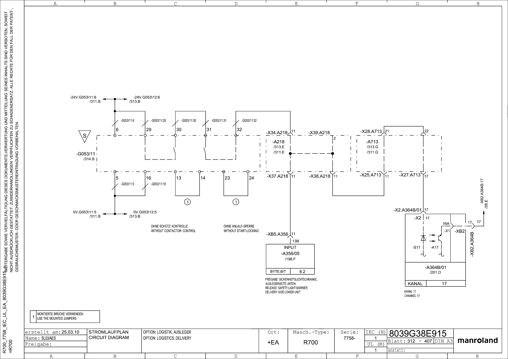

# +EA — Sheet 312 of 407 — OPTION: LOGISTIK, AUSLEGER

**OPTION: LOGISTICS, DELIVERY**

> Part of the manroland **R700** printing press IEC/UL circuit diagrams.
> Drawing class: **Stromlaufplan / Circuit diagram** (DIN A3).
> Document `+EA` covers the **Printing unit** machine section.

## At a glance

| Field | Value |
|---|---|
| Document | `+EA`  (8039G38E915) |
| Sheet | **312** of 407 |
| Section (DE) | OPTION: LOGISTIK, AUSLEGER |
| Section (EN) | OPTION: LOGISTICS, DELIVERY |
| Section type | CIRCUIT — Circuit diagram |
| Machine type | `R700` |
| Series | `7758` |
| Created | 25.03.10 |
| Replaces | — |
| Columns used | A, B, C, D, E, F, G, H |
| Path numbers | — |
| Labels on sheet | 91 |
| Cross-refs out | 12 |
| Cross-refs in | 23 |

**Previous:** [+EA sheet 311](SHEET_0311.md) · **Next:** [+EA sheet 313](SHEET_0313.md) · **Document TOC:** [_TOC.md](_TOC.md)  (+EA) · **Master TOC:** [all sheets](../_MASTER_TOC.md)

## Sheet image (300 DPI, exact vector render)



_Rendered directly from the PDF vector layer at 300 DPI (1-bit), no OCR and no resampling. Use it to confirm anything ambiguous in the text below._

## Cross-references on this sheet

Each entry is a wire leaving this sheet. The printed token is `/sheet.column`; the link resolves to that sheet inside the same document.

| Ref | Target sheet | Col | Path | Destination on target | Target section | From col |
|---|---|---|---|---|---|---|
| `/311.B` | [+EA sheet 311](SHEET_0311.md) | B | — | 24V.G053\11:6 | OPTION: AUTOMATISCHE STAPELAUFFAHRT STOP / | B |
| `/313.B` | [+EA sheet 313](SHEET_0313.md) | B | — | — | OPTION: LOGISTIK, AUSLEGER | B |
| `/313.E` | [+EA sheet 313](SHEET_0313.md) | E | — | — | OPTION: LOGISTIK, AUSLEGER | E |
| `/311.E` | [+EA sheet 311](SHEET_0311.md) | E | — | — | OPTION: AUTOMATISCHE STAPELAUFFAHRT STOP / | E |
| `/313.G` | [+EA sheet 313](SHEET_0313.md) | G | — | — | OPTION: LOGISTIK, AUSLEGER | F |
| `/311.G` | [+EA sheet 311](SHEET_0311.md) | G | — | — | OPTION: AUTOMATISCHE STAPELAUFFAHRT STOP / | F |
| `/314.B` | [+EA sheet 314](SHEET_0314.md) | B | — | — | OPTION: LOGISTIK, AUSLEGER | B |
| `/28.E` | [+EA sheet 28](SHEET_0028.md) | E | — | XB2.A364B:17 | BUSVERBINDUNGEN: SICHERHEITSBUS | H |
| `/311.B` | [+EA sheet 311](SHEET_0311.md) | B | — | 0V.G053\11:5 0V.G053\12:5 | OPTION: AUTOMATISCHE STAPELAUFFAHRT STOP / | B |
| `/313.B` | [+EA sheet 313](SHEET_0313.md) | B | — | — | OPTION: LOGISTIK, AUSLEGER | B |
| `/198.F` | [+EA sheet 198](SHEET_0198.md) | F | — | — | REFERENZMODUL | E |
| `/201.D` | [+EA sheet 201](SHEET_0201.md) | D | — | — | REFERENZMODUL | G |

### Incoming references (sheets that point here)

Every other sheet that sends a wire to this one. `Back-ref` is the token printed on *that* sheet; `Path` is its line number.

| From sheet | Cols | Back-ref | Path | Refs | What continues there |
|---|---|---|---|---|---|
| [+EA#28](SHEET_0028.md) | E | `/28.E` | — | 1 | — |
| [+EA#198](SHEET_0198.md) | F | `/198.F` | — | 1 | — |
| [+EA#201](SHEET_0201.md) | D | `/201.D` | — | 1 | — |
| [+EA#227](SHEET_0227.md) | B, D | `/227.B`, `/227.D` | — | 2 | — |
| [+EA#241](SHEET_0241.md) | H | `/241.H` | — | 1 | — |
| [+EA#268](SHEET_0268.md) | G | `/268.G` | — | 1 | — |
| [+EA#272](SHEET_0272.md) | A | `/272.A` | — | 1 | — |
| [+EA#273](SHEET_0273.md) | F | `/273.F` | — | 2 | — |
| [+EA#277](SHEET_0277.md) | G | `/277.G` | — | 1 | — |
| [+EA#279](SHEET_0279.md) | E | `/279.E` | — | 1 | — |
| [+EA#280](SHEET_0280.md) | A, E | `/280.A`, `/280.E` | — | 2 | — |
| [+EA#311](SHEET_0311.md) | B, E, F | `/311.B`, `/311.E`, `/311.F` | — | 4 | 0V.G053\08:5 |
| [+EA#313](SHEET_0313.md) | B, D, F | `/313.B`, `/313.D`, `/313.F` | — | 4 | 0V.G053\12:5 0V.G053\14:5; 24V.G053\12:6 24V.G053\14:6 |
| [+EA#314](SHEET_0314.md) | B | `/314.B` | — | 1 | — |


## Devices on this sheet

| Tag | Class | Class meaning (IEC) | Col | Sub | Terminal | Sign |
|---|---|---|---|---|---|---|
| `G053/11` | G | Stromversorgung / power supply | B | 11 | — | — |
| `A218` | A | Baugruppe / assembly, module, PC board | E | — | — | — |
| `A356/05` | A | Baugruppe / assembly, module, PC board | E | 05 | — | — |
| `A713` | A | Baugruppe / assembly, module, PC board | F | — | — | — |
| `S17` | S | Schalter / switch | G | — | — | — |
| `A17` | A | Baugruppe / assembly, module, PC board | G | — | — | — |
| `X1` | X | Klemme / terminal, plug connector | G | — | — | — |
| `X2` | X | Klemme / terminal, plug connector | G | — | — | — |
| `XB2` | XB |  | H | — | — | — |
| `G053/11:6` | G | Stromversorgung / power supply | B | 11 | 6 | — |
| `G053/11:29` | G | Stromversorgung / power supply | C | 11 | 29 | — |
| `G053/11:30` | G | Stromversorgung / power supply | C | 11 | 30 | — |
| `G053/11:32` | G | Stromversorgung / power supply | D | 11 | 32 | — |
| `G053/11:31` | G | Stromversorgung / power supply | D | 11 | 31 | — |
| `G053/11:5` | G | Stromversorgung / power supply | B | 11 | 5 | — |
| `G053/11:16` | G | Stromversorgung / power supply | C | 11 | 16 | — |
| `X34.A218` | — | cross-device reference | E | — | — | — |
| `X37.A218` | — | cross-device reference | E | — | — | — |
| `8.2` | — | cross-device reference | E | — | — | — |
| `XB5.A356` | — | cross-device reference | E | — | — | — |
| `X38.A218` | — | cross-device reference | E | — | — | — |
| `X28.A713` | — | cross-device reference | F | — | — | — |
| `XB2.A364B` | — | cross-device reference | H | — | — | — |
| `X27.A713` | — | cross-device reference | G | — | — | — |
| `X25.A713` | — | cross-device reference | F | — | — | — |
| `XB2.A364B:17` | — | cross-device reference | H | — | 17 | — |
| `X39.A218` | — | cross-device reference | E | — | — | — |

## Potentials / nets

| Potential | Count | Columns | Attached devices | Terminals |
|---|---|---|---|---|
| `0V` | 2 | A, B | `G053\11`, `G053\12` | `5` |
| `24V` | 2 | A, C | `G053\11`, `G053\12` | `6` |


A potential such as `L24+/4` or `M24+` is a named supply/return rail; every place it appears on this sheet is electrically common.

## Wire-end annotations (grouped as printed)

A wire that continues elsewhere is annotated with a small cluster: the destination description, the path/line number `#NN`, and the `/sheet.column` cross reference. Each row below is one such cluster exactly as it is grouped on the drawing.

| Col | Y | Path | Cross-ref | Text on the wire |
|---|---|---|---|---|
| B | 224.2 | — | `/311.B` | `24V.G053\11:6` |
| C | 224.2 | — | — | `24V.G053\12:6` |
| B | 234.1 | — | `/313.B` | — |
| C | 279.8 | — | — | `G053/11:6 G053/11:29 G053/11:30 G053/11:31 G053/11:32` |
| C | 299.3 | — | — | `6 29 30 31 32` |
| E | 303.6 | — | — | `X34.A218 11` |
| G | 303.6 | — | — | `X28.A713 21 22` |
| D | 306.4 | — | — | `S X39.A218` |
| F | 320.6 | — | — | `2` |
| E | 327.7 | — | — | `A218` |
| F | 327.7 | — | — | `A713` |
| E | 340.8 | — | `/313.E`, `/311.E` | — |
| F | 340.8 | — | `/313.G`, `/311.G` | — |
| B | 356.1 | — | — | `G053/11` |
| B | 369.1 | — | `/314.B` | — |
| G | 405.7 | — | — | `X25.A713 11 X27.A713 17` |
| E | 408.5 | — | — | `X37.A218 11` |
| E | 408.5 | — | — | `X38.A218 11` |
| B | 412.7 | — | — | `5` |
| C | 412.7 | — | — | `16 13 14 23 24` |
| H | 418.7 | — | `/28.E` | `XB2.A364B:17` |
| B | 428.7 | — | — | `G053/11:5 G053/11:16` |
| D | 470.3 | — | — | `1 1` |
| G | 487.9 | — | — | `X2.A364B/01 17` |
| B | 493.5 | — | `/311.B` | `0V.G053\11:5 0V.G053\12:5` |
| B | 503.4 | — | `/313.B` | — |
| G | 506.3 | — | — | `X2` |
| H | 507.7 | — | — | `17 17` |
| H | 516.2 | — | — | `17` |
| G | 520.4 | — | — | `16A` |
| C | 527.9 | — | — | `OHNE SCHÜTZ: KONTROLLE WITHOUT CONTACTOR: CONTROL` |
| D | 527.9 | — | — | `OHNE ANLAUF SPERRE WITHOUT START LOCKING` |
| G | 537.5 | — | — | `X1` |
| H | 537.5 | — | — | `XB2` |
| H | 543.7 | — | — | `XB2.A364B` |
| E | 544.6 | — | — | `XB5.A356 11` |
| E | 561.5 | — | — | `13B` |
| E | 576.1 | — | — | `INPUT` |
| G | 576.4 | — | — | `S17 A17` |
| E | 589.9 | — | — | `A356/05` |
| E | 603.7 | — | `/198.F` | — |
| G | 622.5 | — | — | `A364B/01` |
| E | 632.7 | — | — | `BYTE.BIT 8.2` |
| G | 634.9 | — | `/201.D` | — |
| E | 652.8 | — | — | `FREIGABE: SICHERHEITSLICHTSCHRANKE,` |
| G | 660.7 | — | — | `KANAL 17` |
| E | 662.7 | — | — | `RELEASE: SAFETY LIGHT BARRIER, DELIVERY SIDE LOWER UNIT AUSLEGERSEITE UNTEN` |
| G | 681.1 | — | — | `KANAL 17 CHANNEL 17` |
| A | 733.4 | — | — | `1 USE THE MOUNTED JUMPERS MONTIERTE BRÜCKE VERWENDEN` |


## Reconstructed tables

This sheet carries tabular content (pin map / terminal assignment / index). The grid below was rebuilt from the drawing's own rule lines, so each row is exactly one physical row of the table.

### Table 1 — 4 data rows × 11 columns (at x=269.3, y=260.8)

| G053/11:6 6 | G053/11:29 29 | G053/11:30 30 |  | G053/11:31 31 |  | 32 | G053/11:32 | X34.A218 A218 /313.E /311.E | 11 | X39.A218 |
|---|---|---|---|---|---|---|---|---|---|---|
| `5 G053/11:5` | `16 G053/11:16` | `13` | `14` |  | `23` |  | `24` | `X37.A218` | `11` | `X38.A218` |
| `0V.G053\12:5 /313.B` | `OHNE SCHÜTZ: WITHOUT CONTACTOR:` | `1 KONTROLLE CONTROL` |  |  | `OHNE WITHOUT` | `1 ANLAUF SPERRE START LOCKING` |  | `XB5.A356` | `11 13B` |  |
|  |  |  |  |  |  |  |  | `INPUT` | `A356/05 /198.F` |  |
|  |  |  |  |  |  |  |  | `BYTE.BIT` | `8.2` |  |


### Table 2 — 4 data rows × 6 columns (at x=900.0, y=296.2)

| 21 11 | X27.A713 | 22 17 |  |  | XB2.A364B:17 |
|---|---|---|---|---|---|
|  | `X2.A364B/01` | `17` |  |  |  |
|  | `X2 S17` | `17 A17` | `16A X1` | `XB2` | `17 17 XB2.A364B` |
|  |  | `A364B/01 /201.D` |  |  |  |
|  | `KANAL` |  | `17` |  |  |


## Notes and free text on this sheet

| Text | Col | Y (pt) |
|---|---|---|
| `13B` | E | 561.55 |
| `INPUT` | E | 576.07 |
| `BYTE.BIT` | E | 633.32 |
| `FREIGABE: SICHERHEITSLICHTSCHRANKE,` | E | 652.76 |
| `AUSLEGERSEITE UNTEN` | E | 662.7 |
| `RELEASE: SAFETY LIGHT BARRIER,` | E | 672.65 |
| `DELIVERY SIDE LOWER UNIT` | E | 682.59 |
| `KANAL 17` | G | 681.1 |
| `CHANNEL 17` | G | 691.04 |
| `16A` | G | 520.44 |
| `KANAL` | G | 660.77 |
| `A364B/01` | G | 622.51 |
| `X2.A364B/01` | G | 487.87 |
| `MONTIERTE BRÜCKE VERWENDEN` | A | 733.37 |
| `USE THE MOUNTED JUMPERS` | A | 744.02 |
| `OHNE SCHÜTZ: KONTROLLE` | C | 527.88 |
| `WITHOUT CONTACTOR: CONTROL` | C | 538.51 |
| `OHNE ANLAUF SPERRE` | D | 527.88 |
| `WITHOUT START LOCKING` | D | 538.5 |
| `S` | A | 312.9 |

## Complete label inventory (exact text from the drawing)

Every text object inside the drawing area of this sheet, in DIN reading order (column A→H, then top→bottom). This is the authoritative list: if a string is not here it is not printed on this sheet.

| Col | Y | X | Dir | Type | Text |
|---|---|---|---|---|---|
| A | 224.2 | 163.8 | → | potential | `24V.G053\11:6` |
| A | 312.9 | 194.3 | → | text | `S` |
| A | 493.5 | 171.5 | → | potential | `0V.G053\11:5` |
| A | 733.4 | 87.3 | → | text | `MONTIERTE BRÜCKE VERWENDEN` |
| A | 738.7 | 75.4 | → | number | `1` |
| A | 744.0 | 87.0 | → | text | `USE THE MOUNTED JUMPERS` |
| B | 234.1 | 210.0 | → | cross-reference | `/311.B` |
| B | 234.1 | 303.3 | → | cross-reference | `/313.B` |
| B | 279.9 | 283.2 | → | device tag | `G053/11:6` |
| B | 299.3 | 271.8 | → | number | `6` |
| B | 356.1 | 178.9 | → | device tag | `G053/11` |
| B | 369.1 | 195.9 | → | cross-reference | `/314.B` |
| B | 412.7 | 271.6 | → | number | `5` |
| B | 428.7 | 283.2 | → | device tag | `G053/11:5` |
| B | 493.5 | 312.9 | → | potential | `0V.G053\12:5` |
| B | 503.4 | 210.0 | → | cross-reference | `/311.B` |
| B | 503.4 | 303.3 | → | cross-reference | `/313.B` |
| C | 224.2 | 312.9 | → | potential | `24V.G053\12:6` |
| C | 279.9 | 354.0 | → | device tag | `G053/11:29` |
| C | 279.9 | 424.9 | → | device tag | `G053/11:30` |
| C | 299.3 | 342.7 | → | number | `29` |
| C | 299.3 | 413.3 | → | number | `30` |
| C | 412.7 | 341.9 | → | number | `16` |
| C | 412.7 | 412.7 | → | number | `13` |
| C | 412.7 | 469.4 | → | number | `14` |
| C | 428.7 | 354.0 | → | device tag | `G053/11:16` |
| C | 470.3 | 437.6 | → | number | `1` |
| C | 527.9 | 354.0 | → | text | `OHNE SCHÜTZ: KONTROLLE` |
| C | 538.5 | 354.3 | → | text | `WITHOUT CONTACTOR: CONTROL` |
| D | 279.8 | 495.8 | → | device tag | `G053/11:31` |
| D | 279.9 | 566.6 | → | device tag | `G053/11:32` |
| D | 299.3 | 484.2 | → | number | `31` |
| D | 299.3 | 555.0 | → | number | `32` |
| D | 412.7 | 527.0 | → | number | `23` |
| D | 412.7 | 583.7 | → | number | `24` |
| D | 470.3 | 551.0 | → | number | `1` |
| D | 527.9 | 524.1 | → | text | `OHNE ANLAUF SPERRE` |
| D | 538.5 | 524.4 | → | text | `WITHOUT START LOCKING` |
| E | 303.6 | 682.3 | → | number | `11` |
| E | 306.4 | 623.6 | → | device ref | `X34.A218` |
| E | 306.4 | 722.8 | → | device ref | `X39.A218` |
| E | 327.7 | 638.4 | → | device tag | `A218` |
| E | 340.8 | 641.2 | → | cross-reference | `/313.E` |
| E | 353.2 | 641.2 | → | cross-reference | `/311.E` |
| E | 408.5 | 625.0 | → | device ref | `X37.A218` |
| E | 408.5 | 724.3 | → | device ref | `X38.A218` |
| E | 409.9 | 682.3 | → | number | `11` |
| E | 544.6 | 623.9 | → | device ref | `XB5.A356` |
| E | 544.6 | 682.3 | → | number | `11` |
| E | 561.5 | 685.1 | → | text | `13B` |
| E | 576.1 | 665.4 | → | text | `INPUT` |
| E | 589.9 | 658.9 | → | device tag | `A356/05` |
| E | 603.7 | 668.0 | → | cross-reference | `/198.F` |
| E | 632.7 | 701.9 | → | device ref | `8.2` |
| E | 633.3 | 633.5 | → | text | `BYTE.BIT` |
| E | 652.8 | 621.6 | → | text | `FREIGABE: SICHERHEITSLICHTSCHRANKE,` |
| E | 662.7 | 622.5 | → | text | `AUSLEGERSEITE UNTEN` |
| E | 672.7 | 621.6 | → | text | `RELEASE: SAFETY LIGHT BARRIER,` |
| E | 682.6 | 621.6 | → | text | `DELIVERY SIDE LOWER UNIT` |
| F | 303.6 | 844.7 | → | device ref | `X28.A713` |
| F | 320.6 | 782.1 | → | number | `2` |
| F | 327.7 | 858.0 | → | device tag | `A713` |
| F | 340.8 | 860.0 | → | cross-reference | `/313.G` |
| F | 353.2 | 860.0 | → | cross-reference | `/311.G` |
| F | 405.7 | 843.3 | → | device ref | `X25.A713` |
| F | 409.9 | 781.5 | → | number | `11` |
| F | 409.9 | 902.0 | → | number | `11` |
| G | 303.6 | 902.6 | → | number | `21` |
| G | 303.6 | 994.7 | → | number | `22` |
| G | 405.7 | 935.4 | → | device ref | `X27.A713` |
| G | 409.9 | 994.1 | → | number | `17` |
| G | 487.9 | 922.4 | → | text | `X2.A364B/01` |
| G | 487.9 | 994.1 | → | number | `17` |
| G | 506.3 | 970.6 | → | device tag | `X2` |
| G | 507.7 | 996.9 | → | number | `17` |
| G | 520.4 | 1037.5 | → | text | `16A` |
| G | 537.5 | 1041.2 | → | device tag | `X1` |
| G | 576.4 | 966.9 | → | device tag | `S17` |
| G | 576.4 | 1009.4 | → | device tag | `A17` |
| G | 622.5 | 996.2 | → | text | `A364B/01` |
| G | 634.9 | 1007.7 | → | cross-reference | `/201.D` |
| G | 660.7 | 1035.5 | → | number | `17` |
| G | 660.8 | 955.8 | → | text | `KANAL` |
| G | 681.1 | 947.6 | → | text | `KANAL 17` |
| G | 691.0 | 947.9 | → | text | `CHANNEL 17` |
| H | 418.7 | 1125.6 | ↕ | device ref | `XB2.A364B:17` |
| H | 468.3 | 1135.5 | ↕ | cross-reference | `/28.E` |
| H | 516.2 | 1117.4 | → | number | `17` |
| H | 517.6 | 1096.2 | → | number | `17` |
| H | 537.5 | 1065.5 | → | device tag | `XB2` |
| H | 543.7 | 1101.6 | ↕ | device ref | `XB2.A364B` |

## Reading-order text block

The same content as a plain block, grouped by DIN column — convenient to paste or to match against a visual description.

```text
=== Column A ===
 224.2  163.8  net          24V.G053\11:6
 312.9  194.3  text         S
 493.5  171.5  net          0V.G053\11:5
 733.4   87.3  text         MONTIERTE BRÜCKE VERWENDEN
 738.7   75.4  numeric      1
 744.0   87.0  text         USE THE MOUNTED JUMPERS
=== Column B ===
 234.1  210.0  xref         /311.B
 234.1  303.3  xref         /313.B
 279.9  283.2  devtag       G053/11:6
 299.3  271.8  numeric      6
 356.1  178.9  devtag       G053/11
 369.1  195.9  xref         /314.B
 412.7  271.6  numeric      5
 428.7  283.2  devtag       G053/11:5
 493.5  312.9  net          0V.G053\12:5
 503.4  210.0  xref         /311.B
 503.4  303.3  xref         /313.B
=== Column C ===
 224.2  312.9  net          24V.G053\12:6
 279.9  354.0  devtag       G053/11:29
 279.9  424.9  devtag       G053/11:30
 299.3  342.7  numeric      29
 299.3  413.3  numeric      30
 412.7  341.9  numeric      16
 412.7  412.7  numeric      13
 412.7  469.4  numeric      14
 428.7  354.0  devtag       G053/11:16
 470.3  437.6  numeric      1
 527.9  354.0  text         OHNE SCHÜTZ: KONTROLLE
 538.5  354.3  text         WITHOUT CONTACTOR: CONTROL
=== Column D ===
 279.8  495.8  devtag       G053/11:31
 279.9  566.6  devtag       G053/11:32
 299.3  484.2  numeric      31
 299.3  555.0  numeric      32
 412.7  527.0  numeric      23
 412.7  583.7  numeric      24
 470.3  551.0  numeric      1
 527.9  524.1  text         OHNE ANLAUF SPERRE
 538.5  524.4  text         WITHOUT START LOCKING
=== Column E ===
 303.6  682.3  numeric      11
 306.4  623.6  devref       X34.A218
 306.4  722.8  devref       X39.A218
 327.7  638.4  devtag       A218
 340.8  641.2  xref         /313.E
 353.2  641.2  xref         /311.E
 408.5  625.0  devref       X37.A218
 408.5  724.3  devref       X38.A218
 409.9  682.3  numeric      11
 544.6  623.9  devref       XB5.A356
 544.6  682.3  numeric      11
 561.5  685.1  text         13B
 576.1  665.4  text         INPUT
 589.9  658.9  devtag       A356/05
 603.7  668.0  xref         /198.F
 632.7  701.9  devref       8.2
 633.3  633.5  text         BYTE.BIT
 652.8  621.6  text         FREIGABE: SICHERHEITSLICHTSCHRANKE,
 662.7  622.5  text         AUSLEGERSEITE UNTEN
 672.7  621.6  text         RELEASE: SAFETY LIGHT BARRIER,
 682.6  621.6  text         DELIVERY SIDE LOWER UNIT
=== Column F ===
 303.6  844.7  devref       X28.A713
 320.6  782.1  numeric      2
 327.7  858.0  devtag       A713
 340.8  860.0  xref         /313.G
 353.2  860.0  xref         /311.G
 405.7  843.3  devref       X25.A713
 409.9  781.5  numeric      11
 409.9  902.0  numeric      11
=== Column G ===
 303.6  902.6  numeric      21
 303.6  994.7  numeric      22
 405.7  935.4  devref       X27.A713
 409.9  994.1  numeric      17
 487.9  922.4  text         X2.A364B/01
 487.9  994.1  numeric      17
 506.3  970.6  devtag       X2
 507.7  996.9  numeric      17
 520.4 1037.5  text         16A
 537.5 1041.2  devtag       X1
 576.4  966.9  devtag       S17
 576.4 1009.4  devtag       A17
 622.5  996.2  text         A364B/01
 634.9 1007.7  xref         /201.D
 660.7 1035.5  numeric      17
 660.8  955.8  text         KANAL
 681.1  947.6  text         KANAL 17
 691.0  947.9  text         CHANNEL 17
=== Column H ===
 418.7 1125.6  devref       XB2.A364B:17
 468.3 1135.5  xref         /28.E
 516.2 1117.4  numeric      17
 517.6 1096.2  numeric      17
 537.5 1065.5  devtag       XB2
 543.7 1101.6  devref       XB2.A364B
```

---
_Generated from the PDF vector text layer; no OCR. Source: `R700_7758_IEC_UL_EA_8039G38E915_p`, sheet 312._
