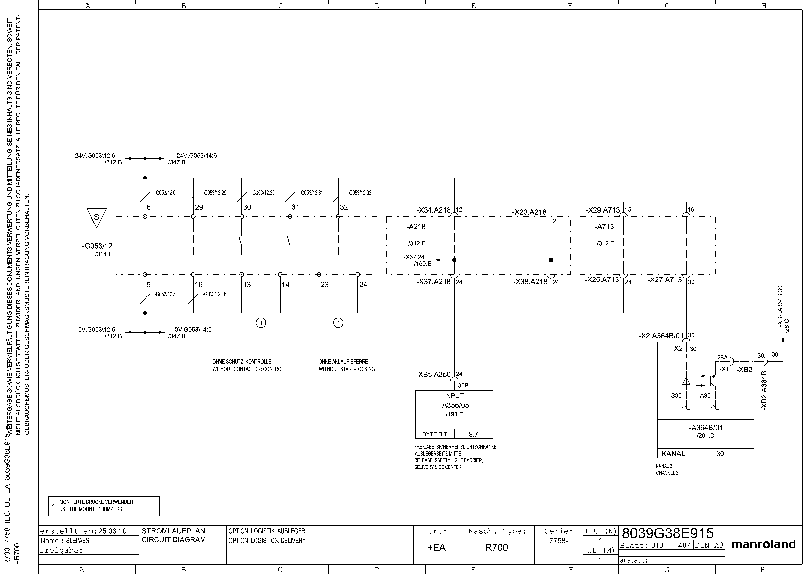

# +EA — Sheet 313 of 407 — OPTION: LOGISTIK, AUSLEGER

**OPTION: LOGISTICS, DELIVERY**

> Part of the manroland **R700** printing press IEC/UL circuit diagrams.
> Drawing class: **Stromlaufplan / Circuit diagram** (DIN A3).
> Document `+EA` covers the **Printing unit** machine section.

## At a glance

| Field | Value |
|---|---|
| Document | `+EA`  (8039G38E915) |
| Sheet | **313** of 407 |
| Section (DE) | OPTION: LOGISTIK, AUSLEGER |
| Section (EN) | OPTION: LOGISTICS, DELIVERY |
| Section type | CIRCUIT — Circuit diagram |
| Machine type | `R700` |
| Series | `7758` |
| Created | 25.03.10 |
| Replaces | — |
| Columns used | A, B, C, D, E, F, G, H |
| Path numbers | — |
| Labels on sheet | 91 |
| Cross-refs out | 11 |
| Cross-refs in | 22 |

**Previous:** [+EA sheet 312](SHEET_0312.md) · **Next:** [+EA sheet 314](SHEET_0314.md) · **Document TOC:** [_TOC.md](_TOC.md)  (+EA) · **Master TOC:** [all sheets](../_MASTER_TOC.md)

## Sheet image (300 DPI, exact vector render)



_Rendered directly from the PDF vector layer at 300 DPI (1-bit), no OCR and no resampling. Use it to confirm anything ambiguous in the text below._

## Cross-references on this sheet

Each entry is a wire leaving this sheet. The printed token is `/sheet.column`; the link resolves to that sheet inside the same document.

| Ref | Target sheet | Col | Path | Destination on target | Target section | From col |
|---|---|---|---|---|---|---|
| `/312.B` | [+EA sheet 312](SHEET_0312.md) | B | — | 24V.G053\12:6 24V.G053\14:6 | OPTION: LOGISTIK, AUSLEGER | B |
| `/347.B` | [+EA sheet 347](SHEET_0347.md) | B | — | — | OPTION: LOGISTIK PALETTENWAGEN | B |
| `/312.E` | [+EA sheet 312](SHEET_0312.md) | E | — | — | OPTION: LOGISTIK, AUSLEGER | D |
| `/312.F` | [+EA sheet 312](SHEET_0312.md) | F | — | — | OPTION: LOGISTIK, AUSLEGER | F |
| `/314.E` | [+EA sheet 314](SHEET_0314.md) | E | — | — | OPTION: LOGISTIK, AUSLEGER | A |
| `/160.E` | [+EA sheet 160](SHEET_0160.md) | E | — | X37:24 | ZUGANGSABSICHERUNG | D |
| `/28.G` | [+EA sheet 28](SHEET_0028.md) | G | — | XB2.A364B:30 | BUSVERBINDUNGEN: SICHERHEITSBUS | H |
| `/312.B` | [+EA sheet 312](SHEET_0312.md) | B | — | 0V.G053\12:5 0V.G053\14:5 | OPTION: LOGISTIK, AUSLEGER | B |
| `/347.B` | [+EA sheet 347](SHEET_0347.md) | B | — | — | OPTION: LOGISTIK PALETTENWAGEN | B |
| `/198.F` | [+EA sheet 198](SHEET_0198.md) | F | — | — | REFERENZMODUL | E |
| `/201.D` | [+EA sheet 201](SHEET_0201.md) | D | — | — | REFERENZMODUL | G |

### Incoming references (sheets that point here)

Every other sheet that sends a wire to this one. `Back-ref` is the token printed on *that* sheet; `Path` is its line number.

| From sheet | Cols | Back-ref | Path | Refs | What continues there |
|---|---|---|---|---|---|
| [+EA#28](SHEET_0028.md) | G | `/28.G` | — | 1 | — |
| [+EA#160](SHEET_0160.md) | F | `/160.F` | — | 1 | — |
| [+EA#198](SHEET_0198.md) | F | `/198.F` | — | 1 | — |
| [+EA#201](SHEET_0201.md) | D | `/201.D` | — | 1 | — |
| [+EA#227](SHEET_0227.md) | C, E | `/227.C`, `/227.E` | — | 2 | — |
| [+EA#241](SHEET_0241.md) | H | `/241.H` | — | 1 | — |
| [+EA#265](SHEET_0265.md) | A | `/265.A` | — | 1 | — |
| [+EA#268](SHEET_0268.md) | G | `/268.G` | — | 1 | — |
| [+EA#272](SHEET_0272.md) | B | `/272.B` | — | 1 | — |
| [+EA#275](SHEET_0275.md) | A | `/275.A` | — | 2 | — |
| [+EA#277](SHEET_0277.md) | G | `/277.G` | — | 1 | — |
| [+EA#279](SHEET_0279.md) | E | `/279.E` | — | 1 | — |
| [+EA#280](SHEET_0280.md) | A | `/280.A` | — | 1 | — |
| [+EA#312](SHEET_0312.md) | B, E, F | `/312.B`, `/312.E`, `/312.F` | — | 4 | — |
| [+EA#314](SHEET_0314.md) | E | `/314.E` | — | 1 | — |
| [+EA#347](SHEET_0347.md) | B, C | `/347.B`, `/347.C` | — | 2 | 0V.G053\14:5; 24V.G053\14:6 G053\14:32 |


## Devices on this sheet

| Tag | Class | Class meaning (IEC) | Col | Sub | Terminal | Sign |
|---|---|---|---|---|---|---|
| `G053/12` | G | Stromversorgung / power supply | A | 12 | — | — |
| `A218` | A | Baugruppe / assembly, module, PC board | D | — | — | — |
| `A356/05` | A | Baugruppe / assembly, module, PC board | E | 05 | — | — |
| `A713` | A | Baugruppe / assembly, module, PC board | F | — | — | — |
| `S30` | S | Schalter / switch | G | — | — | — |
| `A30` | A | Baugruppe / assembly, module, PC board | G | — | — | — |
| `X1` | X | Klemme / terminal, plug connector | H | — | — | — |
| `X2` | X | Klemme / terminal, plug connector | G | — | — | — |
| `XB2` | XB |  | H | — | — | — |
| `X37:24` | X | Klemme / terminal, plug connector | D | — | 24 | — |
| `G053/12:6` | G | Stromversorgung / power supply | B | 12 | 6 | — |
| `G053/12:29` | G | Stromversorgung / power supply | B | 12 | 29 | — |
| `G053/12:30` | G | Stromversorgung / power supply | C | 12 | 30 | — |
| `G053/12:32` | G | Stromversorgung / power supply | D | 12 | 32 | — |
| `G053/12:31` | G | Stromversorgung / power supply | C | 12 | 31 | — |
| `G053/12:5` | G | Stromversorgung / power supply | B | 12 | 5 | — |
| `G053/12:16` | G | Stromversorgung / power supply | B | 12 | 16 | — |
| `X34.A218` | — | cross-device reference | E | — | — | — |
| `X37.A218` | — | cross-device reference | E | — | — | — |
| `9.7` | — | cross-device reference | E | — | — | — |
| `XB5.A356` | — | cross-device reference | E | — | — | — |
| `X38.A218` | — | cross-device reference | F | — | — | — |
| `X29.A713` | — | cross-device reference | F | — | — | — |
| `XB2.A364B` | — | cross-device reference | H | — | — | — |
| `X27.A713` | — | cross-device reference | G | — | — | — |
| `X25.A713` | — | cross-device reference | F | — | — | — |
| `XB2.A364B:30` | — | cross-device reference | H | — | 30 | — |
| `X23.A218` | — | cross-device reference | F | — | — | — |

## Potentials / nets

| Potential | Count | Columns | Attached devices | Terminals |
|---|---|---|---|---|
| `0V` | 2 | A, B | `G053\12`, `G053\14` | `5` |
| `24V` | 2 | A, B | `G053\12`, `G053\14` | `6` |


A potential such as `L24+/4` or `M24+` is a named supply/return rail; every place it appears on this sheet is electrically common.

## Wire-end annotations (grouped as printed)

A wire that continues elsewhere is annotated with a small cluster: the destination description, the path/line number `#NN`, and the `/sheet.column` cross reference. Each row below is one such cluster exactly as it is grouped on the drawing.

| Col | Y | Path | Cross-ref | Text on the wire |
|---|---|---|---|---|
| B | 224.2 | — | `/312.B` | `24V.G053\12:6 24V.G053\14:6` |
| B | 234.1 | — | `/347.B` | — |
| C | 279.8 | — | — | `G053/12:6 G053/12:29 G053/12:30 G053/12:31 G053/12:32` |
| C | 299.3 | — | — | `6 29 30 31 32` |
| E | 303.6 | — | — | `X34.A218 12` |
| G | 303.6 | — | — | `X29.A713 15 16` |
| C | 306.4 | — | — | `S X23.A218` |
| F | 320.6 | — | — | `2` |
| D | 327.7 | — | — | `A218` |
| F | 327.7 | — | — | `A713` |
| D | 353.2 | — | `/312.E` | — |
| F | 353.2 | — | `/312.F` | — |
| A | 356.1 | — | — | `G053/12` |
| A | 369.1 | — | `/314.E` | — |
| D | 373.1 | — | `/160.E` | `X37:24` |
| G | 405.7 | — | — | `X25.A713 24 X27.A713 30` |
| E | 408.5 | — | — | `X37.A218 24` |
| F | 408.5 | — | — | `X38.A218 24` |
| B | 412.7 | — | — | `5` |
| C | 412.7 | — | — | `16 13 14 23 24` |
| H | 418.7 | — | `/28.G` | `XB2.A364B:30` |
| B | 428.7 | — | — | `G053/12:5 G053/12:16` |
| C | 470.3 | — | — | `1 1` |
| B | 479.3 | — | `/312.B` | `0V.G053\12:5 0V.G053\14:5` |
| G | 487.9 | — | — | `X2.A364B/01 30` |
| B | 489.2 | — | `/347.B` | — |
| G | 506.3 | — | — | `X2` |
| H | 507.7 | — | — | `30 30` |
| H | 516.2 | — | — | `30` |
| H | 520.4 | — | — | `28A` |
| C | 527.9 | — | — | `OHNE SCHÜTZ: KONTROLLE WITHOUT CONTACTOR: CONTROL OHNE ANLAUF SPERRE WITHOUT START LOCKING` |
| H | 537.5 | — | — | `X1` |
| H | 537.5 | — | — | `XB2` |
| H | 543.7 | — | — | `XB2.A364B` |
| E | 544.6 | — | — | `XB5.A356 24` |
| E | 561.5 | — | — | `30B` |
| E | 576.1 | — | — | `INPUT` |
| G | 576.4 | — | — | `S30 A30` |
| E | 589.9 | — | — | `A356/05` |
| E | 603.7 | — | `/198.F` | — |
| G | 622.5 | — | — | `A364B/01` |
| E | 632.7 | — | — | `BYTE.BIT 9.7` |
| G | 634.9 | — | `/201.D` | — |
| E | 652.8 | — | — | `FREIGABE: SICHERHEITSLICHTSCHRANKE,` |
| G | 660.7 | — | — | `KANAL 30` |
| E | 662.7 | — | — | `RELEASE: SAFETY LIGHT BARRIER, DELIVERY SIDE CENTER AUSLEGERSEITE MITTE` |
| G | 681.1 | — | — | `KANAL 30 CHANNEL 30` |
| A | 733.4 | — | — | `1 USE THE MOUNTED JUMPERS MONTIERTE BRÜCKE VERWENDEN` |


## Reconstructed tables

This sheet carries tabular content (pin map / terminal assignment / index). The grid below was rebuilt from the drawing's own rule lines, so each row is exactly one physical row of the table.

### Table 1 — 10 data rows × 18 columns (at x=212.6, y=260.8)

| G053/12:6 | G053/12:29 | G053/12:30 |  | G053/12:31 |  |  | G053/12:32 |  |  |  |  |  |  |  |  |  |  |
|---|---|---|---|---|---|---|---|---|---|---|---|---|---|---|---|---|---|
| `6` | `29` | `30` |  | `31` |  | `32` |  | `X34.A218 A218 /312.E` | `12` | `X23.A218` | `X29.A713 2 A713 /312.F` | `15` |  | `16` |  |  |  |
|  |  |  |  |  |  |  | `X37:24` |  |  |  |  |  |  |  |  |  |  |
| `5 G053/12:5` | `16 G053/12:16` | `13` | `14` |  | `23` |  | `24` | `/160.E X37.A218` | `24` | `X38.A218` | `X25.A713 24` | `24` | `X27.A713` | `30` |  |  | `XB2.A364B:30` |
| `0V.G053\14:5 /347.B` |  | `1` |  |  |  | `1` |  |  |  |  |  |  | `X2.A364B/01` | `30` |  |  |  |
|  | `OHNE SCHÜTZ: WITHOUT` | `KONTROLLE CONTACTOR: CONTROL` |  |  | `OHNE WITHOUT` | `ANLAUF SPERRE START LOCKING` |  | `XB5.A356` | `24 30B` |  |  |  | `X2` | `30` | `28A X1` | `XB2` | `30 30` |
|  |  |  |  |  |  |  |  | `INPUT` | `A356/05 /198.F` |  |  |  | `S30` | `A30` |  |  | `XB2.A364B` |
|  |  |  |  |  |  |  |  |  |  |  |  |  |  | `A364B/01` |  |  |  |
|  |  |  |  |  |  |  |  | `BYTE.BIT` | `9.7` |  |  |  |  | `/201.D` |  |  |  |
|  |  |  |  |  |  |  |  | `FREIGABE:` | `SICHERHEITSLICHTSCHRANKE,` |  |  |  |  |  |  |  |  |
|  |  |  |  |  |  |  |  | `AUSLEGERSEITE` | `MITTE` |  |  |  | `KANAL` |  | `30` |  |  |


## Notes and free text on this sheet

| Text | Col | Y (pt) |
|---|---|---|
| `30B` | E | 561.55 |
| `INPUT` | E | 576.07 |
| `BYTE.BIT` | E | 633.32 |
| `FREIGABE: SICHERHEITSLICHTSCHRANKE,` | E | 652.76 |
| `AUSLEGERSEITE MITTE` | E | 662.71 |
| `RELEASE: SAFETY LIGHT BARRIER,` | E | 672.65 |
| `DELIVERY SIDE CENTER` | E | 682.61 |
| `KANAL 30` | G | 681.1 |
| `CHANNEL 30` | G | 691.04 |
| `28A` | H | 520.44 |
| `KANAL` | G | 660.77 |
| `A364B/01` | G | 622.51 |
| `X2.A364B/01` | G | 487.87 |
| `MONTIERTE BRÜCKE VERWENDEN` | A | 733.37 |
| `USE THE MOUNTED JUMPERS` | A | 744.02 |
| `OHNE ANLAUF SPERRE` | D | 527.88 |
| `WITHOUT START LOCKING` | D | 538.5 |
| `OHNE SCHÜTZ: KONTROLLE` | C | 527.88 |
| `WITHOUT CONTACTOR: CONTROL` | C | 538.51 |
| `S` | A | 312.9 |

## Complete label inventory (exact text from the drawing)

Every text object inside the drawing area of this sheet, in DIN reading order (column A→H, then top→bottom). This is the authoritative list: if a string is not here it is not printed on this sheet.

| Col | Y | X | Dir | Type | Text |
|---|---|---|---|---|---|
| A | 224.2 | 107.1 | → | potential | `24V.G053\12:6` |
| A | 234.1 | 153.4 | → | cross-reference | `/312.B` |
| A | 312.9 | 137.6 | → | text | `S` |
| A | 356.1 | 120.8 | → | device tag | `G053/12` |
| A | 369.1 | 139.5 | → | cross-reference | `/314.E` |
| A | 479.3 | 114.8 | → | potential | `0V.G053\12:5` |
| A | 489.2 | 153.4 | → | cross-reference | `/312.B` |
| A | 733.4 | 87.3 | → | text | `MONTIERTE BRÜCKE VERWENDEN` |
| A | 738.7 | 75.4 | → | number | `1` |
| A | 744.0 | 87.0 | → | text | `USE THE MOUNTED JUMPERS` |
| B | 224.2 | 256.3 | → | potential | `24V.G053\14:6` |
| B | 234.1 | 246.6 | → | cross-reference | `/347.B` |
| B | 279.9 | 226.5 | → | device tag | `G053/12:6` |
| B | 279.9 | 297.4 | → | device tag | `G053/12:29` |
| B | 299.3 | 215.1 | → | number | `6` |
| B | 299.3 | 286.0 | → | number | `29` |
| B | 412.7 | 214.9 | → | number | `5` |
| B | 412.7 | 285.2 | → | number | `16` |
| B | 428.7 | 226.5 | → | device tag | `G053/12:5` |
| B | 428.7 | 297.4 | → | device tag | `G053/12:16` |
| B | 479.3 | 256.3 | → | potential | `0V.G053\14:5` |
| B | 489.2 | 246.6 | → | cross-reference | `/347.B` |
| C | 279.8 | 439.1 | → | device tag | `G053/12:31` |
| C | 279.9 | 368.2 | → | device tag | `G053/12:30` |
| C | 299.3 | 356.6 | → | number | `30` |
| C | 299.3 | 427.5 | → | number | `31` |
| C | 412.7 | 356.0 | → | number | `13` |
| C | 412.7 | 412.7 | → | number | `14` |
| C | 412.7 | 470.3 | → | number | `23` |
| C | 470.3 | 380.9 | → | number | `1` |
| C | 527.9 | 311.5 | → | text | `OHNE SCHÜTZ: KONTROLLE` |
| C | 538.5 | 311.8 | → | text | `WITHOUT CONTACTOR: CONTROL` |
| D | 279.9 | 510.0 | → | device tag | `G053/12:32` |
| D | 299.3 | 498.3 | → | number | `32` |
| D | 327.7 | 595.8 | → | device tag | `A218` |
| D | 353.2 | 598.7 | → | cross-reference | `/312.E` |
| D | 373.1 | 591.9 | → | device tag | `X37:24` |
| D | 382.9 | 607.2 | → | cross-reference | `/160.E` |
| D | 412.7 | 527.0 | → | number | `24` |
| D | 470.3 | 494.3 | → | number | `1` |
| D | 527.9 | 467.4 | → | text | `OHNE ANLAUF SPERRE` |
| D | 538.5 | 467.7 | → | text | `WITHOUT START LOCKING` |
| E | 303.6 | 610.9 | → | device ref | `X34.A218` |
| E | 303.6 | 668.1 | → | number | `12` |
| E | 408.5 | 610.9 | → | device ref | `X37.A218` |
| E | 409.9 | 668.7 | → | number | `24` |
| E | 544.6 | 609.7 | → | device ref | `XB5.A356` |
| E | 544.6 | 668.7 | → | number | `24` |
| E | 561.5 | 671.5 | → | text | `30B` |
| E | 576.1 | 651.3 | → | text | `INPUT` |
| E | 589.9 | 644.7 | → | device tag | `A356/05` |
| E | 603.7 | 653.8 | → | cross-reference | `/198.F` |
| E | 632.7 | 687.7 | → | device ref | `9.7` |
| E | 633.3 | 619.4 | → | text | `BYTE.BIT` |
| E | 652.8 | 607.5 | → | text | `FREIGABE: SICHERHEITSLICHTSCHRANKE,` |
| E | 662.7 | 608.3 | → | text | `AUSLEGERSEITE MITTE` |
| E | 672.7 | 607.5 | → | text | `RELEASE: SAFETY LIGHT BARRIER,` |
| E | 682.6 | 607.5 | → | text | `DELIVERY SIDE CENTER` |
| F | 303.6 | 858.9 | → | device ref | `X29.A713` |
| F | 306.4 | 751.2 | → | device ref | `X23.A218` |
| F | 320.6 | 810.4 | → | number | `2` |
| F | 327.7 | 872.2 | → | device tag | `A713` |
| F | 353.2 | 875.3 | → | cross-reference | `/312.F` |
| F | 405.7 | 857.5 | → | device ref | `X25.A713` |
| F | 408.5 | 752.6 | → | device ref | `X38.A218` |
| F | 409.9 | 810.4 | → | number | `24` |
| G | 303.6 | 916.2 | → | number | `15` |
| G | 303.6 | 1008.3 | → | number | `16` |
| G | 405.7 | 949.6 | → | device ref | `X27.A713` |
| G | 409.9 | 916.7 | → | number | `24` |
| G | 409.9 | 1008.9 | → | number | `30` |
| G | 487.9 | 936.6 | → | text | `X2.A364B/01` |
| G | 487.9 | 1008.9 | → | number | `30` |
| G | 506.3 | 984.8 | → | device tag | `X2` |
| G | 507.7 | 1011.7 | → | number | `30` |
| G | 576.4 | 981.1 | → | device tag | `S30` |
| G | 576.4 | 1023.6 | → | device tag | `A30` |
| G | 622.5 | 1010.4 | → | text | `A364B/01` |
| G | 634.9 | 1021.9 | → | cross-reference | `/201.D` |
| G | 660.8 | 970.0 | → | text | `KANAL` |
| G | 681.1 | 961.8 | → | text | `KANAL 30` |
| G | 691.0 | 962.1 | → | text | `CHANNEL 30` |
| H | 418.7 | 1139.8 | ↕ | device ref | `XB2.A364B:30` |
| H | 467.4 | 1149.7 | ↕ | cross-reference | `/28.G` |
| H | 516.2 | 1131.6 | → | number | `30` |
| H | 517.6 | 1110.9 | → | number | `30` |
| H | 520.4 | 1051.7 | → | text | `28A` |
| H | 537.5 | 1055.3 | → | device tag | `X1` |
| H | 537.5 | 1079.7 | → | device tag | `XB2` |
| H | 543.7 | 1115.7 | ↕ | device ref | `XB2.A364B` |
| H | 660.7 | 1050.0 | → | number | `30` |

## Reading-order text block

The same content as a plain block, grouped by DIN column — convenient to paste or to match against a visual description.

```text
=== Column A ===
 224.2  107.1  net          24V.G053\12:6
 234.1  153.4  xref         /312.B
 312.9  137.6  text         S
 356.1  120.8  devtag       G053/12
 369.1  139.5  xref         /314.E
 479.3  114.8  net          0V.G053\12:5
 489.2  153.4  xref         /312.B
 733.4   87.3  text         MONTIERTE BRÜCKE VERWENDEN
 738.7   75.4  numeric      1
 744.0   87.0  text         USE THE MOUNTED JUMPERS
=== Column B ===
 224.2  256.3  net          24V.G053\14:6
 234.1  246.6  xref         /347.B
 279.9  226.5  devtag       G053/12:6
 279.9  297.4  devtag       G053/12:29
 299.3  215.1  numeric      6
 299.3  286.0  numeric      29
 412.7  214.9  numeric      5
 412.7  285.2  numeric      16
 428.7  226.5  devtag       G053/12:5
 428.7  297.4  devtag       G053/12:16
 479.3  256.3  net          0V.G053\14:5
 489.2  246.6  xref         /347.B
=== Column C ===
 279.8  439.1  devtag       G053/12:31
 279.9  368.2  devtag       G053/12:30
 299.3  356.6  numeric      30
 299.3  427.5  numeric      31
 412.7  356.0  numeric      13
 412.7  412.7  numeric      14
 412.7  470.3  numeric      23
 470.3  380.9  numeric      1
 527.9  311.5  text         OHNE SCHÜTZ: KONTROLLE
 538.5  311.8  text         WITHOUT CONTACTOR: CONTROL
=== Column D ===
 279.9  510.0  devtag       G053/12:32
 299.3  498.3  numeric      32
 327.7  595.8  devtag       A218
 353.2  598.7  xref         /312.E
 373.1  591.9  devtag       X37:24
 382.9  607.2  xref         /160.E
 412.7  527.0  numeric      24
 470.3  494.3  numeric      1
 527.9  467.4  text         OHNE ANLAUF SPERRE
 538.5  467.7  text         WITHOUT START LOCKING
=== Column E ===
 303.6  610.9  devref       X34.A218
 303.6  668.1  numeric      12
 408.5  610.9  devref       X37.A218
 409.9  668.7  numeric      24
 544.6  609.7  devref       XB5.A356
 544.6  668.7  numeric      24
 561.5  671.5  text         30B
 576.1  651.3  text         INPUT
 589.9  644.7  devtag       A356/05
 603.7  653.8  xref         /198.F
 632.7  687.7  devref       9.7
 633.3  619.4  text         BYTE.BIT
 652.8  607.5  text         FREIGABE: SICHERHEITSLICHTSCHRANKE,
 662.7  608.3  text         AUSLEGERSEITE MITTE
 672.7  607.5  text         RELEASE: SAFETY LIGHT BARRIER,
 682.6  607.5  text         DELIVERY SIDE CENTER
=== Column F ===
 303.6  858.9  devref       X29.A713
 306.4  751.2  devref       X23.A218
 320.6  810.4  numeric      2
 327.7  872.2  devtag       A713
 353.2  875.3  xref         /312.F
 405.7  857.5  devref       X25.A713
 408.5  752.6  devref       X38.A218
 409.9  810.4  numeric      24
=== Column G ===
 303.6  916.2  numeric      15
 303.6 1008.3  numeric      16
 405.7  949.6  devref       X27.A713
 409.9  916.7  numeric      24
 409.9 1008.9  numeric      30
 487.9  936.6  text         X2.A364B/01
 487.9 1008.9  numeric      30
 506.3  984.8  devtag       X2
 507.7 1011.7  numeric      30
 576.4  981.1  devtag       S30
 576.4 1023.6  devtag       A30
 622.5 1010.4  text         A364B/01
 634.9 1021.9  xref         /201.D
 660.8  970.0  text         KANAL
 681.1  961.8  text         KANAL 30
 691.0  962.1  text         CHANNEL 30
=== Column H ===
 418.7 1139.8  devref       XB2.A364B:30
 467.4 1149.7  xref         /28.G
 516.2 1131.6  numeric      30
 517.6 1110.9  numeric      30
 520.4 1051.7  text         28A
 537.5 1055.3  devtag       X1
 537.5 1079.7  devtag       XB2
 543.7 1115.7  devref       XB2.A364B
 660.7 1050.0  numeric      30
```

---
_Generated from the PDF vector text layer; no OCR. Source: `R700_7758_IEC_UL_EA_8039G38E915_p`, sheet 313._
