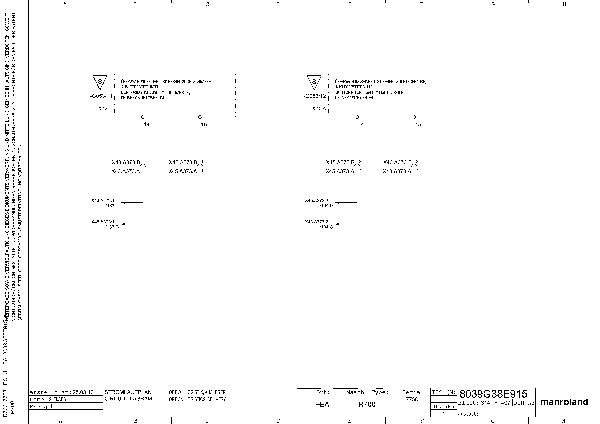

# +EA — Sheet 314 of 407 — OPTION: LOGISTIK, AUSLEGER

**OPTION: LOGISTICS, DELIVERY**

> Part of the manroland **R700** printing press IEC/UL circuit diagrams.
> Drawing class: **Stromlaufplan / Circuit diagram** (DIN A3).
> Document `+EA` covers the **Printing unit** machine section.

## At a glance

| Field | Value |
|---|---|
| Document | `+EA`  (8039G38E915) |
| Sheet | **314** of 407 |
| Section (DE) | OPTION: LOGISTIK, AUSLEGER |
| Section (EN) | OPTION: LOGISTICS, DELIVERY |
| Section type | CIRCUIT — Circuit diagram |
| Machine type | `R700` |
| Series | `7758` |
| Created | 25.03.10 |
| Replaces | — |
| Columns used | A, B, C, D, E, F |
| Path numbers | — |
| Labels on sheet | 42 |
| Cross-refs out | 6 |
| Cross-refs in | 14 |

**Previous:** [+EA sheet 313](SHEET_0313.md) · **Next:** [+EA sheet 315](SHEET_0315.md) · **Document TOC:** [_TOC.md](_TOC.md)  (+EA) · **Master TOC:** [all sheets](../_MASTER_TOC.md)

## Sheet image (300 DPI, exact vector render)



_Rendered directly from the PDF vector layer at 300 DPI (1-bit), no OCR and no resampling. Use it to confirm anything ambiguous in the text below._

## Cross-references on this sheet

Each entry is a wire leaving this sheet. The printed token is `/sheet.column`; the link resolves to that sheet inside the same document.

| Ref | Target sheet | Col | Path | Destination on target | Target section | From col |
|---|---|---|---|---|---|---|
| `/312.B` | [+EA sheet 312](SHEET_0312.md) | B | — | — | OPTION: LOGISTIK, AUSLEGER | B |
| `/313.A` | [+EA sheet 313](SHEET_0313.md) | A | — | — | OPTION: LOGISTIK, AUSLEGER | E |
| `/133.D` | [+EA sheet 133](SHEET_0133.md) | D | — | X43.A373:1 | ZUGANGSABSICHERUNG | B |
| `/134.D` | [+EA sheet 134](SHEET_0134.md) | D | — | X45.A373:2 | ZUGANGSABSICHERUNG | E |
| `/133.G` | [+EA sheet 133](SHEET_0133.md) | G | — | X45.A373:1 | ZUGANGSABSICHERUNG | B |
| `/134.G` | [+EA sheet 134](SHEET_0134.md) | G | — | X43.A373:2 | ZUGANGSABSICHERUNG | E |

### Incoming references (sheets that point here)

Every other sheet that sends a wire to this one. `Back-ref` is the token printed on *that* sheet; `Path` is its line number.

| From sheet | Cols | Back-ref | Path | Refs | What continues there |
|---|---|---|---|---|---|
| [+EA#133](SHEET_0133.md) | E, G | `/133.E`, `/133.G` | — | 2 | X45.A373:1 |
| [+EA#134](SHEET_0134.md) | D, G | `/134.D`, `/134.G` | — | 2 | — |
| [+EA#281](SHEET_0281.md) | C, G | `/281.C`, `/281.G` | — | 8 | — |
| [+EA#312](SHEET_0312.md) | B | `/312.B` | — | 1 | — |
| [+EA#313](SHEET_0313.md) | A | `/313.A` | — | 1 | — |


## Devices on this sheet

| Tag | Class | Class meaning (IEC) | Col | Sub | Terminal | Sign |
|---|---|---|---|---|---|---|
| `G053/11` | G | Stromversorgung / power supply | B | 11 | — | — |
| `G053/12` | G | Stromversorgung / power supply | E | 12 | — | — |
| `X43.A373.B` | — | cross-device reference | B | — | — | — |
| `X43.A373.B` | — | cross-device reference | F | — | — | — |
| `X45.A373.B` | — | cross-device reference | C | — | — | — |
| `X45.A373.B` | — | cross-device reference | E | — | — | — |
| `X43.A373.A` | — | cross-device reference | B | — | — | — |
| `X45.A373.A` | — | cross-device reference | C | — | — | — |
| `X45.A373.A` | — | cross-device reference | E | — | — | — |
| `X43.A373.A` | — | cross-device reference | F | — | — | — |
| `X45.A373:2` | — | cross-device reference | E | — | 2 | — |
| `X45.A373:1` | — | cross-device reference | B | — | 1 | — |
| `X43.A373:2` | — | cross-device reference | E | — | 2 | — |
| `X43.A373:1` | — | cross-device reference | B | — | 1 | — |

## Potentials / nets

_No named potentials on this sheet._

## Wire-end annotations (grouped as printed)

A wire that continues elsewhere is annotated with a small cluster: the destination description, the path/line number `#NN`, and the `/sheet.column` cross reference. Each row below is one such cluster exactly as it is grouped on the drawing.

| Col | Y | Path | Cross-ref | Text on the wire |
|---|---|---|---|---|
| C | 157.0 | — | — | `S S` |
| B | 159.4 | — | — | `ÜBERWACHUNGSEINHEIT: SICHERHEITSLICHTSCHRANKE,` |
| E | 159.4 | — | — | `ÜBERWACHUNGSEINHEIT: SICHERHEITSLICHTSCHRANKE,` |
| B | 170.0 | — | — | `DELIVERY SIDE LOWER UNIT MONITORING UNIT: SAFETY LIGHT BARRIER, AUSLEGERSEITE UNTEN` |
| E | 170.0 | — | — | `DELIVERY SIDE CENTER MONITORING UNIT: SAFETY LIGHT BARRIER, AUSLEGERSEITE MITTE` |
| B | 186.0 | — | — | `G053/11` |
| E | 186.0 | — | — | `G053/12` |
| B | 211.4 | — | `/312.B` | — |
| E | 211.4 | — | `/313.A` | — |
| C | 242.6 | — | — | `14 15` |
| F | 242.6 | — | — | `14 15` |
| D | 317.8 | — | — | `X43.A373.B 1 X45.A373.B 1 X45.A373.B 2 X43.A373.B 2` |
| D | 334.8 | — | — | `X43.A373.A 1 X45.A373.A 1 X45.A373.A 2 X43.A373.A 2` |
| B | 394.3 | — | `/133.D` | `X43.A373:1` |
| E | 394.3 | — | `/134.D` | `X45.A373:2` |
| B | 436.8 | — | `/133.G` | `X45.A373:1` |
| E | 436.8 | — | `/134.G` | `X43.A373:2` |


## Reconstructed tables

This sheet carries tabular content (pin map / terminal assignment / index). The grid below was rebuilt from the drawing's own rule lines, so each row is exactly one physical row of the table.

### Table 1 — 5 data rows × 11 columns (at x=204.1, y=0.0) — **ÜBERWACHUNGSEINHEIT: AUSLEGERSEITE MONITORING DELIVERY SIDE /312.B X43.A373.B X43.A373.A /133.D UNTEN UNIT: SAFETY LOWER UNIT 14 1 1 SICHERHEITSLICHTSCHRANKE, LIGHT BARRIER, X45.A373.B X45.A373.A 15 1 1 S G053/12 /313.A X45.A373.B X45.A373.A X45.A373:2 /134.D X43.A373:2 ÜBERWACHUNGSEINHEIT: AUSLEGERSEITE MONITORING DELIVERY SIDE MITTE UNIT: SAFETY LIGHT CENTER 14 2 2 SICHERHEITSLICHTSCHRANKE, BARRIER, X43.A373.B X43.A373.A 15 2 2 /133.G /134.G**

| STROMLAUFPLAN |  | OPTION: LOGISTIK, | AUSLEGER | Ort: |  | Masch. Type: | Serie: |  | IEC (N) | 8039G38E915 |
|---|---|---|---|---|---|---|---|---|---|---|
| `CIRCUIT DIAGRAM` |  |  |  |  |  |  |  |  |  |  |
|  |  | `OPTION: LOGISTICS,` | `DELIVERY` |  |  |  | `7758` |  | `1` |  |
|  |  |  |  | `+EA` |  | `R700` |  |  |  | `Blatt: DIN A3 314 407` |
|  |  |  |  |  |  |  |  |  | `UL (M)` |  |
|  |  |  |  |  |  |  |  |  | `1` | `anstatt:` |


## Notes and free text on this sheet

| Text | Col | Y (pt) |
|---|---|---|
| `ÜBERWACHUNGSEINHEIT: SICHERHEITSLICHTSCHRANKE,` | B | 159.36 |
| `AUSLEGERSEITE UNTEN` | B | 169.99 |
| `MONITORING UNIT: SAFETY LIGHT BARRIER,` | B | 180.63 |
| `DELIVERY SIDE LOWER UNIT` | B | 191.24 |
| `ÜBERWACHUNGSEINHEIT: SICHERHEITSLICHTSCHRANKE,` | E | 159.36 |
| `AUSLEGERSEITE MITTE` | E | 169.99 |
| `MONITORING UNIT: SAFETY LIGHT BARRIER,` | E | 180.63 |
| `DELIVERY SIDE CENTER` | E | 191.25 |
| `S` | A | 156.99 |
| `S` | D | 156.99 |

## Complete label inventory (exact text from the drawing)

Every text object inside the drawing area of this sheet, in DIN reading order (column A→H, then top→bottom). This is the authoritative list: if a string is not here it is not printed on this sheet.

| Col | Y | X | Dir | Type | Text |
|---|---|---|---|---|---|
| A | 157.0 | 194.3 | → | text | `S` |
| B | 159.4 | 240.1 | → | text | `ÜBERWACHUNGSEINHEIT: SICHERHEITSLICHTSCHRANKE,` |
| B | 170.0 | 240.9 | → | text | `AUSLEGERSEITE UNTEN` |
| B | 180.6 | 240.4 | → | text | `MONITORING UNIT: SAFETY LIGHT BARRIER,` |
| B | 186.0 | 178.9 | → | device tag | `G053/11` |
| B | 191.2 | 240.1 | → | text | `DELIVERY SIDE LOWER UNIT` |
| B | 211.4 | 195.9 | → | cross-reference | `/312.B` |
| B | 242.6 | 285.2 | → | number | `14` |
| B | 317.8 | 218.3 | → | device ref | `X43.A373.B` |
| B | 317.8 | 285.4 | → | number | `1` |
| B | 334.8 | 285.4 | → | number | `1` |
| B | 335.5 | 217.4 | → | device ref | `X43.A373.A` |
| B | 394.3 | 178.3 | → | device ref | `X43.A373:1` |
| B | 404.2 | 209.8 | → | cross-reference | `/133.D` |
| B | 436.8 | 178.3 | → | device ref | `X45.A373:1` |
| B | 446.7 | 209.5 | → | cross-reference | `/133.G` |
| C | 242.6 | 398.6 | → | number | `15` |
| C | 317.8 | 331.7 | → | device ref | `X45.A373.B` |
| C | 317.8 | 398.8 | → | number | `1` |
| C | 334.8 | 398.8 | → | number | `1` |
| C | 335.5 | 330.8 | → | device ref | `X45.A373.A` |
| D | 157.0 | 619.5 | → | text | `S` |
| E | 159.4 | 665.3 | → | text | `ÜBERWACHUNGSEINHEIT: SICHERHEITSLICHTSCHRANKE,` |
| E | 170.0 | 666.1 | → | text | `AUSLEGERSEITE MITTE` |
| E | 180.6 | 665.6 | → | text | `MONITORING UNIT: SAFETY LIGHT BARRIER,` |
| E | 186.0 | 602.6 | → | device tag | `G053/12` |
| E | 191.3 | 665.3 | → | text | `DELIVERY SIDE CENTER` |
| E | 211.4 | 620.8 | → | cross-reference | `/313.A` |
| E | 242.6 | 710.4 | → | number | `14` |
| E | 317.8 | 643.5 | → | device ref | `X45.A373.B` |
| E | 317.8 | 711.2 | → | number | `2` |
| E | 334.8 | 711.2 | → | number | `2` |
| E | 335.5 | 642.6 | → | device ref | `X45.A373.A` |
| E | 394.3 | 602.4 | → | device ref | `X45.A373:2` |
| E | 404.2 | 635.0 | → | cross-reference | `/134.D` |
| E | 436.8 | 602.4 | → | device ref | `X43.A373:2` |
| E | 446.7 | 634.7 | → | cross-reference | `/134.G` |
| F | 242.6 | 823.7 | → | number | `15` |
| F | 317.8 | 756.9 | → | device ref | `X43.A373.B` |
| F | 317.8 | 824.6 | → | number | `2` |
| F | 334.8 | 824.6 | → | number | `2` |
| F | 335.5 | 756.0 | → | device ref | `X43.A373.A` |

## Reading-order text block

The same content as a plain block, grouped by DIN column — convenient to paste or to match against a visual description.

```text
=== Column A ===
 157.0  194.3  text         S
=== Column B ===
 159.4  240.1  text         ÜBERWACHUNGSEINHEIT: SICHERHEITSLICHTSCHRANKE,
 170.0  240.9  text         AUSLEGERSEITE UNTEN
 180.6  240.4  text         MONITORING UNIT: SAFETY LIGHT BARRIER,
 186.0  178.9  devtag       G053/11
 191.2  240.1  text         DELIVERY SIDE LOWER UNIT
 211.4  195.9  xref         /312.B
 242.6  285.2  numeric      14
 317.8  218.3  devref       X43.A373.B
 317.8  285.4  numeric      1
 334.8  285.4  numeric      1
 335.5  217.4  devref       X43.A373.A
 394.3  178.3  devref       X43.A373:1
 404.2  209.8  xref         /133.D
 436.8  178.3  devref       X45.A373:1
 446.7  209.5  xref         /133.G
=== Column C ===
 242.6  398.6  numeric      15
 317.8  331.7  devref       X45.A373.B
 317.8  398.8  numeric      1
 334.8  398.8  numeric      1
 335.5  330.8  devref       X45.A373.A
=== Column D ===
 157.0  619.5  text         S
=== Column E ===
 159.4  665.3  text         ÜBERWACHUNGSEINHEIT: SICHERHEITSLICHTSCHRANKE,
 170.0  666.1  text         AUSLEGERSEITE MITTE
 180.6  665.6  text         MONITORING UNIT: SAFETY LIGHT BARRIER,
 186.0  602.6  devtag       G053/12
 191.3  665.3  text         DELIVERY SIDE CENTER
 211.4  620.8  xref         /313.A
 242.6  710.4  numeric      14
 317.8  643.5  devref       X45.A373.B
 317.8  711.2  numeric      2
 334.8  711.2  numeric      2
 335.5  642.6  devref       X45.A373.A
 394.3  602.4  devref       X45.A373:2
 404.2  635.0  xref         /134.D
 436.8  602.4  devref       X43.A373:2
 446.7  634.7  xref         /134.G
=== Column F ===
 242.6  823.7  numeric      15
 317.8  756.9  devref       X43.A373.B
 317.8  824.6  numeric      2
 334.8  824.6  numeric      2
 335.5  756.0  devref       X43.A373.A
```

---
_Generated from the PDF vector text layer; no OCR. Source: `R700_7758_IEC_UL_EA_8039G38E915_p`, sheet 314._
