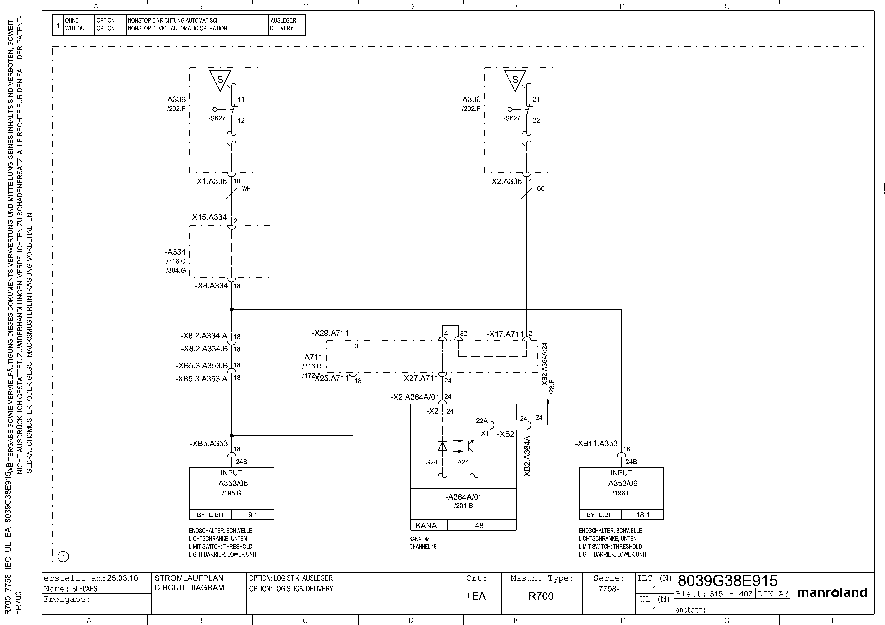

# +EA — Sheet 315 of 407 — OPTION: LOGISTIK, AUSLEGER

**OPTION: LOGISTICS, DELIVERY**

> Part of the manroland **R700** printing press IEC/UL circuit diagrams.
> Drawing class: **Stromlaufplan / Circuit diagram** (DIN A3).
> Document `+EA` covers the **Printing unit** machine section.

## At a glance

| Field | Value |
|---|---|
| Document | `+EA`  (8039G38E915) |
| Sheet | **315** of 407 |
| Section (DE) | OPTION: LOGISTIK, AUSLEGER |
| Section (EN) | OPTION: LOGISTICS, DELIVERY |
| Section type | CIRCUIT — Circuit diagram |
| Machine type | `R700` |
| Series | `7758` |
| Created | 25.03.10 |
| Replaces | — |
| Columns used | A, B, C, D, E, F |
| Path numbers | — |
| Labels on sheet | 100 |
| Cross-refs out | 10 |
| Cross-refs in | 28 |

**Previous:** [+EA sheet 314](SHEET_0314.md) · **Next:** [+EA sheet 316](SHEET_0316.md) · **Document TOC:** [_TOC.md](_TOC.md)  (+EA) · **Master TOC:** [all sheets](../_MASTER_TOC.md)

## Sheet image (300 DPI, exact vector render)



_Rendered directly from the PDF vector layer at 300 DPI (1-bit), no OCR and no resampling. Use it to confirm anything ambiguous in the text below._

## Cross-references on this sheet

Each entry is a wire leaving this sheet. The printed token is `/sheet.column`; the link resolves to that sheet inside the same document.

| Ref | Target sheet | Col | Path | Destination on target | Target section | From col |
|---|---|---|---|---|---|---|
| `/202.F` | [+EA sheet 202](SHEET_0202.md) | F | — | — | REFERENZMODUL | B |
| `/202.F` | [+EA sheet 202](SHEET_0202.md) | F | — | — | REFERENZMODUL | E |
| `/316.C` | [+EA sheet 316](SHEET_0316.md) | C | — | — | OPTION: LOGISTIK, AUSLEGER | B |
| `/304.G` | [+EA sheet 304](SHEET_0304.md) | G | — | — | OPTION: ZWISCHENSTAPEL / | B |
| `/28.F` | [+EA sheet 28](SHEET_0028.md) | F | — | XB2.A364A:24 | BUSVERBINDUNGEN: SICHERHEITSBUS | E |
| `/316.D` | [+EA sheet 316](SHEET_0316.md) | D | — | — | OPTION: LOGISTIK, AUSLEGER | C |
| `/172.A` | [+EA sheet 172](SHEET_0172.md) | A | — | — | RESERVE | C |
| `/196.F` | [+EA sheet 196](SHEET_0196.md) | F | — | — | REFERENZMODUL | F |
| `/195.G` | [+EA sheet 195](SHEET_0195.md) | G | — | — | REFERENZMODUL | B |
| `/201.B` | [+EA sheet 201](SHEET_0201.md) | B | — | — | REFERENZMODUL | E |

### Incoming references (sheets that point here)

Every other sheet that sends a wire to this one. `Back-ref` is the token printed on *that* sheet; `Path` is its line number.

| From sheet | Cols | Back-ref | Path | Refs | What continues there |
|---|---|---|---|---|---|
| [+EA#28](SHEET_0028.md) | F | `/28.F` | — | 1 | — |
| [+EA#172](SHEET_0172.md) | A | `/172.A` | — | 1 | — |
| [+EA#195](SHEET_0195.md) | G | `/195.G` | — | 1 | — |
| [+EA#196](SHEET_0196.md) | F | `/196.F` | — | 1 | — |
| [+EA#201](SHEET_0201.md) | B | `/201.B` | — | 1 | — |
| [+EA#202](SHEET_0202.md) | F | `/202.F` | — | 2 | — |
| [+EA#208](SHEET_0208.md) | F | `/208.F` | — | 1 | — |
| [+EA#224](SHEET_0224.md) | C | `/224.C` | — | 1 | — |
| [+EA#227](SHEET_0227.md) | C, E | `/227.C`, `/227.E` | — | 2 | — |
| [+EA#240](SHEET_0240.md) | F | `/240.F` | — | 1 | — |
| [+EA#241](SHEET_0241.md) | F, G | `/241.F`, `/241.G` | — | 2 | — |
| [+EA#249](SHEET_0249.md) | D, G, H | `/249.D`, `/249.G`, `/249.H` | — | 3 | — |
| [+EA#256](SHEET_0256.md) | A | `/256.A` | — | 1 | — |
| [+EA#260](SHEET_0260.md) | D | `/260.D` | — | 1 | — |
| [+EA#263](SHEET_0263.md) | C | `/263.C` | — | 1 | — |
| [+EA#268](SHEET_0268.md) | E | `/268.E` | — | 1 | — |
| [+EA#271](SHEET_0271.md) | F | `/271.F` | — | 1 | — |
| [+EA#274](SHEET_0274.md) | E, F | `/274.E`, `/274.F` | — | 3 | — |
| [+EA#304](SHEET_0304.md) | G | `/304.G` | — | 1 | — |
| [+EA#316](SHEET_0316.md) | C, D | `/316.C`, `/316.D` | — | 2 | — |


## Devices on this sheet

| Tag | Class | Class meaning (IEC) | Col | Sub | Terminal | Sign |
|---|---|---|---|---|---|---|
| `A334` | A | Baugruppe / assembly, module, PC board | B | — | — | — |
| `S627` | S | Schalter / switch | B | — | — | — |
| `A336` | A | Baugruppe / assembly, module, PC board | B | — | — | — |
| `A353/05` | A | Baugruppe / assembly, module, PC board | B | 05 | — | — |
| `A353/09` | A | Baugruppe / assembly, module, PC board | F | 09 | — | — |
| `S24` | S | Schalter / switch | D | — | — | — |
| `A24` | A | Baugruppe / assembly, module, PC board | D | — | — | — |
| `X1` | X | Klemme / terminal, plug connector | E | — | — | — |
| `X2` | X | Klemme / terminal, plug connector | D | — | — | — |
| `XB2` | XB |  | E | — | — | — |
| `A711` | A | Baugruppe / assembly, module, PC board | C | — | — | — |
| `S627` | S | Schalter / switch | E | — | — | — |
| `A336` | A | Baugruppe / assembly, module, PC board | E | — | — | — |
| `X15.A334` | — | cross-device reference | B | — | — | — |
| `X8.A334` | — | cross-device reference | B | — | — | — |
| `X1.A336` | — | cross-device reference | B | — | — | — |
| `9.1` | — | cross-device reference | C | — | — | — |
| `XB5.A353` | — | cross-device reference | B | — | — | — |
| `XB5.3.A353.B` | — | cross-device reference | B | — | — | — |
| `XB5.3.A353.A` | — | cross-device reference | B | — | — | — |
| `X8.2.A334.B` | — | cross-device reference | B | — | — | — |
| `X8.2.A334.A` | — | cross-device reference | B | — | — | — |
| `18.1` | — | cross-device reference | F | — | — | — |
| `XB11.A353` | — | cross-device reference | F | — | — | — |
| `XB2.A364A` | — | cross-device reference | E | — | — | — |
| `X25.A711` | — | cross-device reference | C | — | — | — |
| `X27.A711` | — | cross-device reference | D | — | — | — |
| `X17.A711` | — | cross-device reference | E | — | — | — |
| `X2.A336` | — | cross-device reference | E | — | — | — |
| `XB2.A364A:24` | — | cross-device reference | E | — | 24 | — |
| `X29.A711` | — | cross-device reference | C | — | — | — |

## Potentials / nets

_No named potentials on this sheet._

## Wire-end annotations (grouped as printed)

A wire that continues elsewhere is annotated with a small cluster: the destination description, the path/line number `#NN`, and the `/sheet.column` cross reference. Each row below is one such cluster exactly as it is grouped on the drawing.

| Col | Y | Path | Cross-ref | Text on the wire |
|---|---|---|---|---|
| A | 24.7 | — | — | `1 OHNE WITHOUT` |
| A | 24.7 | — | — | `OPTION OPTION` |
| B | 24.7 | — | — | `NONSTOP EINRICHTUNG AUTOMATISCH NONSTOP DEVICE AUTOMATIC OPERATION` |
| C | 24.7 | — | — | `DELIVERY AUSLEGER` |
| B | 101.7 | — | — | `S` |
| E | 101.7 | — | — | `S` |
| B | 129.3 | — | — | `A336` |
| E | 129.3 | — | — | `A336` |
| B | 130.0 | — | — | `11` |
| E | 130.0 | — | — | `21` |
| B | 142.4 | — | `/202.F` | — |
| E | 142.4 | — | `/202.F` | — |
| B | 155.5 | — | — | `S627` |
| E | 155.5 | — | — | `S627` |
| B | 158.4 | — | — | `12` |
| E | 158.4 | — | — | `22` |
| B | 239.8 | — | — | `X1.A336 10` |
| E | 239.8 | — | — | `X2.A336 4` |
| B | 251.3 | — | — | `WH` |
| E | 251.4 | — | — | `OG` |
| B | 288.0 | — | — | `X15.A334 2` |
| B | 334.8 | — | — | `A334` |
| B | 347.9 | — | `/316.C`, `/304.G` | — |
| B | 380.1 | — | — | `X8.A334 18` |
| C | 443.9 | — | — | `X29.A711` |
| E | 445.3 | — | — | `32 X17.A711 2` |
| D | 445.4 | — | — | `4` |
| B | 447.5 | — | — | `X8.2.A334.A 18` |
| E | 461.2 | — | `/28.F` | `XB2.A364A:24` |
| C | 462.4 | — | — | `3` |
| B | 465.2 | — | — | `X8.2.A334.B 18` |
| C | 476.5 | — | — | `A711` |
| B | 487.9 | — | — | `XB5.3.A353.B 18` |
| C | 489.6 | — | `/316.D`, `/172.A` | — |
| B | 504.9 | — | — | `XB5.3.A353.A 18` |
| C | 504.9 | — | — | `X25.A711 18` |
| D | 504.9 | — | — | `X27.A711 24` |
| D | 530.4 | — | — | `X2.A364A/01 24` |
| D | 548.8 | — | — | `X2` |
| E | 550.2 | — | — | `24 24` |
| E | 558.8 | — | — | `24` |
| E | 563.0 | — | — | `22A` |
| E | 580.0 | — | — | `X1` |
| E | 580.0 | — | — | `XB2` |
| E | 587.1 | — | — | `XB2.A364A` |
| B | 592.8 | — | — | `XB5.A353 18` |
| F | 592.8 | — | — | `XB11.A353 18` |
| B | 618.2 | — | — | `24B` |
| F | 618.2 | — | — | `24B` |
| D | 619.0 | — | — | `S24 A24` |
| B | 632.8 | — | — | `INPUT` |
| F | 632.8 | — | — | `INPUT` |
| B | 646.6 | — | — | `A353/05` |
| F | 646.6 | — | — | `A353/09` |
| B | 660.4 | — | `/195.G` | — |
| F | 660.4 | — | `/196.F` | — |
| E | 665.0 | — | — | `A364A/01` |
| E | 677.4 | — | `/201.B` | — |
| B | 689.4 | — | — | `BYTE.BIT 9.1` |
| F | 689.5 | — | — | `BYTE.BIT 18.1` |
| D | 703.3 | — | — | `KANAL 48` |
| B | 712.1 | — | — | `ENDSCHALTER: SCHWELLE LICHTSCHRANKE, UNTEN LIMIT SWITCH: THRESHOLD LIGHT BARRIER, LOWER UNIT` |
| F | 712.1 | — | — | `ENDSCHALTER: SCHWELLE LICHTSCHRANKE, UNTEN LIMIT SWITCH: THRESHOLD LIGHT BARRIER, LOWER UNIT` |
| D | 723.6 | — | — | `KANAL 48 CHANNEL 48` |
| A | 746.7 | — | — | `1` |


## Reconstructed tables

This sheet carries tabular content (pin map / terminal assignment / index). The grid below was rebuilt from the drawing's own rule lines, so each row is exactly one physical row of the table.

### Table 1 — 7 data rows × 13 columns (at x=255.1, y=416.7)

| X8.2.A334.A X8.2.A334.B | 18 18 | X29.A711 | 3 |  | 4 32 |  | X17.A711 |  | 2 |  |  |  |
|---|---|---|---|---|---|---|---|---|---|---|---|---|
| `XB5.3.A353.B XB5.3.A353.A` | `18 18` | `A711 /316.D /172.A X25.A711` | `18` | `X27.A711 X2.A364A/01` | `24 24` |  |  |  | `XB2.A364A:24` | `/28.F` |  |  |
|  |  |  |  | `X2` | `24` | `22A X1` | `XB2` | `24` | `24` |  |  |  |
| `XB5.A353` | `18 24B` |  |  | `S24` | `A24` |  |  |  | `XB2.A364A` |  | `XB11.A353` | `18 24B` |
| `INPUT` | `A353/05` |  |  |  |  |  |  |  |  |  | `INPUT` | `A353/09` |
|  | `/195.G` |  |  |  | `A364A/01 /201.B` |  |  |  |  |  |  | `/196.F` |
| `BYTE.BIT` | `9.1` |  |  |  |  |  |  |  |  |  | `BYTE.BIT` | `18.1` |
|  |  |  |  | `KANAL` |  | `48` |  |  |  |  |  |  |


## Notes and free text on this sheet

| Text | Col | Y (pt) |
|---|---|---|
| `24B` | B | 618.24 |
| `INPUT` | B | 632.76 |
| `BYTE.BIT` | B | 690.01 |
| `ENDSCHALTER: SCHWELLE` | B | 712.11 |
| `LICHTSCHRANKE, UNTEN` | B | 722.76 |
| `LIMIT SWITCH: THRESHOLD` | B | 733.37 |
| `LIGHT BARRIER, LOWER UNIT` | B | 744 |
| `24B` | F | 618.24 |
| `INPUT` | F | 632.76 |
| `BYTE.BIT` | F | 690.01 |
| `ENDSCHALTER: SCHWELLE` | F | 712.11 |
| `LICHTSCHRANKE, UNTEN` | F | 722.76 |
| `LIMIT SWITCH: THRESHOLD` | F | 733.37 |
| `LIGHT BARRIER, LOWER UNIT` | F | 744 |
| `KANAL 48` | D | 723.62 |
| `CHANNEL 48` | D | 733.56 |
| `22A` | E | 562.96 |
| `KANAL` | D | 703.29 |
| `A364A/01` | E | 665.03 |
| `X2.A364A/01` | D | 530.39 |
| `S` | B | 101.72 |
| `WH` | B | 251.31 |
| `OHNE` | A | 24.71 |
| `WITHOUT` | A | 35.31 |
| `OPTION` | A | 24.69 |
| `NONSTOP EINRICHTUNG AUTOMATISCH` | B | 24.73 |
| `NONSTOP DEVICE AUTOMATIC OPERATION` | B | 35.35 |
| `AUSLEGER` | C | 24.73 |
| `DELIVERY` | C | 35.33 |
| `S` | E | 101.72 |
| `OG` | E | 251.45 |

## Complete label inventory (exact text from the drawing)

Every text object inside the drawing area of this sheet, in DIN reading order (column A→H, then top→bottom). This is the authoritative list: if a string is not here it is not printed on this sheet.

| Col | Y | X | Dir | Type | Text |
|---|---|---|---|---|---|
| A | 24.7 | 87.6 | → | text | `OHNE` |
| A | 24.7 | 130.1 | → | text | `OPTION` |
| A | 30.0 | 75.4 | → | number | `1` |
| A | 35.3 | 87.9 | → | text | `WITHOUT` |
| A | 35.3 | 130.1 | → | text | `OPTION` |
| A | 746.7 | 83.3 | → | number | `1` |
| B | 24.7 | 172.1 | → | text | `NONSTOP EINRICHTUNG AUTOMATISCH` |
| B | 35.4 | 172.1 | → | text | `NONSTOP DEVICE AUTOMATIC OPERATION` |
| B | 101.7 | 292.1 | → | text | `S` |
| B | 129.3 | 221.7 | → | device tag | `A336` |
| B | 130.0 | 319.5 | → | number | `11` |
| B | 142.4 | 224.8 | → | cross-reference | `/202.F` |
| B | 155.5 | 280.3 | → | device tag | `S627` |
| B | 158.4 | 319.5 | → | number | `12` |
| B | 239.8 | 261.1 | → | device ref | `X1.A336` |
| B | 239.9 | 313.8 | → | number | `10` |
| B | 251.3 | 326.0 | → | text | `WH` |
| B | 288.0 | 255.1 | → | device ref | `X15.A334` |
| B | 293.7 | 314.4 | → | number | `2` |
| B | 334.8 | 221.7 | → | device tag | `A334` |
| B | 347.9 | 223.9 | → | cross-reference | `/316.C` |
| B | 360.3 | 223.7 | → | cross-reference | `/304.G` |
| B | 380.2 | 262.5 | → | device ref | `X8.A334` |
| B | 381.6 | 313.8 | → | number | `18` |
| B | 447.5 | 242.9 | → | device ref | `X8.2.A334.A` |
| B | 449.6 | 313.8 | → | number | `18` |
| B | 465.2 | 243.8 | → | device ref | `X8.2.A334.B` |
| B | 466.6 | 313.8 | → | number | `18` |
| B | 487.9 | 236.7 | → | device ref | `XB5.3.A353.B` |
| B | 487.9 | 313.8 | → | number | `18` |
| B | 504.9 | 313.8 | → | number | `18` |
| B | 505.6 | 235.8 | → | device ref | `XB5.3.A353.A` |
| B | 592.7 | 255.4 | → | device ref | `XB5.A353` |
| B | 601.3 | 313.8 | → | number | `18` |
| B | 618.2 | 317.2 | → | text | `24B` |
| B | 632.8 | 296.9 | → | text | `INPUT` |
| B | 646.6 | 290.4 | → | device tag | `A353/05` |
| B | 660.4 | 298.9 | → | cross-reference | `/195.G` |
| B | 690.0 | 265.0 | → | text | `BYTE.BIT` |
| B | 712.1 | 254.3 | → | text | `ENDSCHALTER: SCHWELLE` |
| B | 722.8 | 254.3 | → | text | `LICHTSCHRANKE, UNTEN` |
| B | 733.4 | 254.3 | → | text | `LIMIT SWITCH: THRESHOLD` |
| B | 744.0 | 254.3 | → | text | `LIGHT BARRIER, LOWER UNIT` |
| C | 24.7 | 364.3 | → | text | `AUSLEGER` |
| C | 35.3 | 363.4 | → | text | `DELIVERY` |
| C | 443.9 | 419.5 | → | device ref | `X29.A711` |
| C | 462.4 | 477.4 | → | number | `3` |
| C | 476.5 | 405.9 | → | device tag | `A711` |
| C | 489.6 | 406.8 | → | cross-reference | `/316.D` |
| C | 502.0 | 406.8 | → | cross-reference | `/172.A` |
| C | 504.9 | 419.5 | → | device ref | `X25.A711` |
| C | 509.1 | 476.8 | → | number | `18` |
| C | 689.4 | 334.2 | → | device ref | `9.1` |
| D | 445.4 | 597.8 | → | number | `4` |
| D | 504.9 | 540.0 | → | device ref | `X27.A711` |
| D | 509.1 | 597.8 | → | number | `24` |
| D | 530.4 | 525.5 | → | text | `X2.A364A/01` |
| D | 530.4 | 597.8 | → | number | `24` |
| D | 548.8 | 573.7 | → | device tag | `X2` |
| D | 550.2 | 600.7 | → | number | `24` |
| D | 619.0 | 570.0 | → | device tag | `S24` |
| D | 619.0 | 612.6 | → | device tag | `A24` |
| D | 703.3 | 559.0 | → | text | `KANAL` |
| D | 723.6 | 550.8 | → | text | `KANAL 48` |
| D | 733.6 | 551.1 | → | text | `CHANNEL 48` |
| E | 101.7 | 689.0 | → | text | `S` |
| E | 129.3 | 618.5 | → | device tag | `A336` |
| E | 130.0 | 716.9 | → | number | `21` |
| E | 142.4 | 621.6 | → | cross-reference | `/202.F` |
| E | 155.5 | 677.2 | → | device tag | `S627` |
| E | 158.4 | 716.9 | → | number | `22` |
| E | 239.8 | 657.9 | → | device ref | `X2.A336` |
| E | 239.9 | 711.2 | → | number | `4` |
| E | 251.4 | 722.6 | → | text | `OG` |
| E | 445.3 | 654.8 | → | device ref | `X17.A711` |
| E | 445.4 | 619.1 | → | number | `32` |
| E | 445.4 | 711.2 | → | number | `2` |
| E | 461.2 | 728.8 | ↕ | device ref | `XB2.A364A:24` |
| E | 511.4 | 738.7 | ↕ | cross-reference | `/28.F` |
| E | 558.7 | 720.6 | → | number | `24` |
| E | 560.2 | 699.9 | → | number | `24` |
| E | 563.0 | 640.6 | → | text | `22A` |
| E | 580.0 | 644.3 | → | device tag | `X1` |
| E | 580.0 | 668.7 | → | device tag | `XB2` |
| E | 587.1 | 704.7 | ↕ | device ref | `XB2.A364A` |
| E | 665.0 | 599.4 | → | text | `A364A/01` |
| E | 677.4 | 611.0 | → | cross-reference | `/201.B` |
| E | 703.3 | 639.1 | → | number | `48` |
| F | 592.7 | 773.9 | → | device ref | `XB11.A353` |
| F | 601.3 | 838.2 | → | number | `18` |
| F | 618.2 | 841.6 | → | text | `24B` |
| F | 632.8 | 821.3 | → | text | `INPUT` |
| F | 646.6 | 814.8 | → | device tag | `A353/09` |
| F | 660.4 | 823.9 | → | cross-reference | `/196.F` |
| F | 689.4 | 855.6 | → | device ref | `18.1` |
| F | 690.0 | 789.4 | → | text | `BYTE.BIT` |
| F | 712.1 | 778.7 | → | text | `ENDSCHALTER: SCHWELLE` |
| F | 722.8 | 778.7 | → | text | `LICHTSCHRANKE, UNTEN` |
| F | 733.4 | 778.7 | → | text | `LIMIT SWITCH: THRESHOLD` |
| F | 744.0 | 778.7 | → | text | `LIGHT BARRIER, LOWER UNIT` |

## Reading-order text block

The same content as a plain block, grouped by DIN column — convenient to paste or to match against a visual description.

```text
=== Column A ===
  24.7   87.6  text         OHNE
  24.7  130.1  text         OPTION
  30.0   75.4  numeric      1
  35.3   87.9  text         WITHOUT
  35.3  130.1  text         OPTION
 746.7   83.3  numeric      1
=== Column B ===
  24.7  172.1  text         NONSTOP EINRICHTUNG AUTOMATISCH
  35.4  172.1  text         NONSTOP DEVICE AUTOMATIC OPERATION
 101.7  292.1  text         S
 129.3  221.7  devtag       A336
 130.0  319.5  numeric      11
 142.4  224.8  xref         /202.F
 155.5  280.3  devtag       S627
 158.4  319.5  numeric      12
 239.8  261.1  devref       X1.A336
 239.9  313.8  numeric      10
 251.3  326.0  text         WH
 288.0  255.1  devref       X15.A334
 293.7  314.4  numeric      2
 334.8  221.7  devtag       A334
 347.9  223.9  xref         /316.C
 360.3  223.7  xref         /304.G
 380.2  262.5  devref       X8.A334
 381.6  313.8  numeric      18
 447.5  242.9  devref       X8.2.A334.A
 449.6  313.8  numeric      18
 465.2  243.8  devref       X8.2.A334.B
 466.6  313.8  numeric      18
 487.9  236.7  devref       XB5.3.A353.B
 487.9  313.8  numeric      18
 504.9  313.8  numeric      18
 505.6  235.8  devref       XB5.3.A353.A
 592.7  255.4  devref       XB5.A353
 601.3  313.8  numeric      18
 618.2  317.2  text         24B
 632.8  296.9  text         INPUT
 646.6  290.4  devtag       A353/05
 660.4  298.9  xref         /195.G
 690.0  265.0  text         BYTE.BIT
 712.1  254.3  text         ENDSCHALTER: SCHWELLE
 722.8  254.3  text         LICHTSCHRANKE, UNTEN
 733.4  254.3  text         LIMIT SWITCH: THRESHOLD
 744.0  254.3  text         LIGHT BARRIER, LOWER UNIT
=== Column C ===
  24.7  364.3  text         AUSLEGER
  35.3  363.4  text         DELIVERY
 443.9  419.5  devref       X29.A711
 462.4  477.4  numeric      3
 476.5  405.9  devtag       A711
 489.6  406.8  xref         /316.D
 502.0  406.8  xref         /172.A
 504.9  419.5  devref       X25.A711
 509.1  476.8  numeric      18
 689.4  334.2  devref       9.1
=== Column D ===
 445.4  597.8  numeric      4
 504.9  540.0  devref       X27.A711
 509.1  597.8  numeric      24
 530.4  525.5  text         X2.A364A/01
 530.4  597.8  numeric      24
 548.8  573.7  devtag       X2
 550.2  600.7  numeric      24
 619.0  570.0  devtag       S24
 619.0  612.6  devtag       A24
 703.3  559.0  text         KANAL
 723.6  550.8  text         KANAL 48
 733.6  551.1  text         CHANNEL 48
=== Column E ===
 101.7  689.0  text         S
 129.3  618.5  devtag       A336
 130.0  716.9  numeric      21
 142.4  621.6  xref         /202.F
 155.5  677.2  devtag       S627
 158.4  716.9  numeric      22
 239.8  657.9  devref       X2.A336
 239.9  711.2  numeric      4
 251.4  722.6  text         OG
 445.3  654.8  devref       X17.A711
 445.4  619.1  numeric      32
 445.4  711.2  numeric      2
 461.2  728.8  devref       XB2.A364A:24
 511.4  738.7  xref         /28.F
 558.7  720.6  numeric      24
 560.2  699.9  numeric      24
 563.0  640.6  text         22A
 580.0  644.3  devtag       X1
 580.0  668.7  devtag       XB2
 587.1  704.7  devref       XB2.A364A
 665.0  599.4  text         A364A/01
 677.4  611.0  xref         /201.B
 703.3  639.1  numeric      48
=== Column F ===
 592.7  773.9  devref       XB11.A353
 601.3  838.2  numeric      18
 618.2  841.6  text         24B
 632.8  821.3  text         INPUT
 646.6  814.8  devtag       A353/09
 660.4  823.9  xref         /196.F
 689.4  855.6  devref       18.1
 690.0  789.4  text         BYTE.BIT
 712.1  778.7  text         ENDSCHALTER: SCHWELLE
 722.8  778.7  text         LICHTSCHRANKE, UNTEN
 733.4  778.7  text         LIMIT SWITCH: THRESHOLD
 744.0  778.7  text         LIGHT BARRIER, LOWER UNIT
```

---
_Generated from the PDF vector text layer; no OCR. Source: `R700_7758_IEC_UL_EA_8039G38E915_p`, sheet 315._
