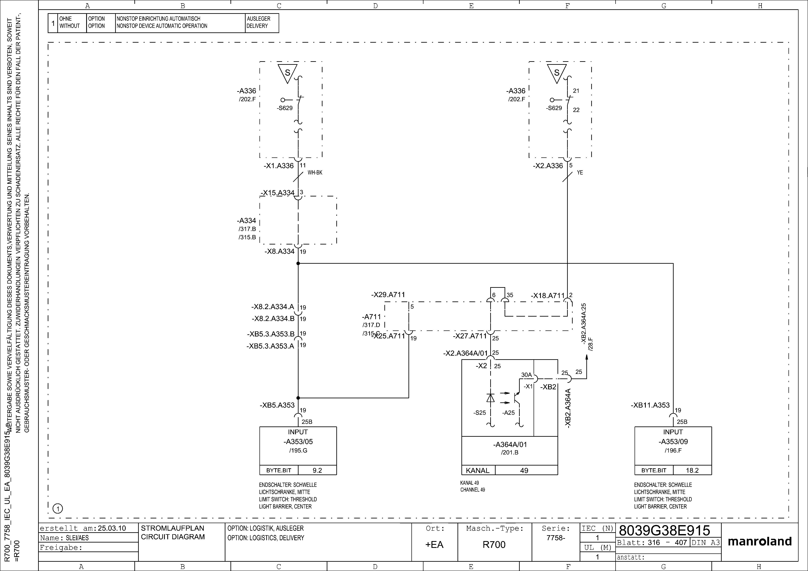

# +EA — Sheet 316 of 407 — OPTION: LOGISTIK, AUSLEGER

**OPTION: LOGISTICS, DELIVERY**

> Part of the manroland **R700** printing press IEC/UL circuit diagrams.
> Drawing class: **Stromlaufplan / Circuit diagram** (DIN A3).
> Document `+EA` covers the **Printing unit** machine section.

## At a glance

| Field | Value |
|---|---|
| Document | `+EA`  (8039G38E915) |
| Sheet | **316** of 407 |
| Section (DE) | OPTION: LOGISTIK, AUSLEGER |
| Section (EN) | OPTION: LOGISTICS, DELIVERY |
| Section type | CIRCUIT — Circuit diagram |
| Machine type | `R700` |
| Series | `7758` |
| Created | 25.03.10 |
| Replaces | — |
| Columns used | A, B, C, D, E, F, G |
| Path numbers | — |
| Labels on sheet | 98 |
| Cross-refs out | 10 |
| Cross-refs in | 27 |

**Previous:** [+EA sheet 315](SHEET_0315.md) · **Next:** [+EA sheet 317](SHEET_0317.md) · **Document TOC:** [_TOC.md](_TOC.md)  (+EA) · **Master TOC:** [all sheets](../_MASTER_TOC.md)

## Sheet image (300 DPI, exact vector render)



_Rendered directly from the PDF vector layer at 300 DPI (1-bit), no OCR and no resampling. Use it to confirm anything ambiguous in the text below._

## Cross-references on this sheet

Each entry is a wire leaving this sheet. The printed token is `/sheet.column`; the link resolves to that sheet inside the same document.

| Ref | Target sheet | Col | Path | Destination on target | Target section | From col |
|---|---|---|---|---|---|---|
| `/202.F` | [+EA sheet 202](SHEET_0202.md) | F | — | — | REFERENZMODUL | C |
| `/202.F` | [+EA sheet 202](SHEET_0202.md) | F | — | — | REFERENZMODUL | E |
| `/317.B` | [+EA sheet 317](SHEET_0317.md) | B | — | — | OPTION: LOGISTIK, AUSLEGER | C |
| `/315.B` | [+EA sheet 315](SHEET_0315.md) | B | — | — | OPTION: LOGISTIK, AUSLEGER | C |
| `/28.F` | [+EA sheet 28](SHEET_0028.md) | F | — | XB2.A364A:25 | BUSVERBINDUNGEN: SICHERHEITSBUS | F |
| `/317.D` | [+EA sheet 317](SHEET_0317.md) | D | — | — | OPTION: LOGISTIK, AUSLEGER | D |
| `/315.C` | [+EA sheet 315](SHEET_0315.md) | C | — | — | OPTION: LOGISTIK, AUSLEGER | D |
| `/196.F` | [+EA sheet 196](SHEET_0196.md) | F | — | — | REFERENZMODUL | G |
| `/195.G` | [+EA sheet 195](SHEET_0195.md) | G | — | — | REFERENZMODUL | C |
| `/201.B` | [+EA sheet 201](SHEET_0201.md) | B | — | — | REFERENZMODUL | E |

### Incoming references (sheets that point here)

Every other sheet that sends a wire to this one. `Back-ref` is the token printed on *that* sheet; `Path` is its line number.

| From sheet | Cols | Back-ref | Path | Refs | What continues there |
|---|---|---|---|---|---|
| [+EA#28](SHEET_0028.md) | F | `/28.F` | — | 1 | — |
| [+EA#195](SHEET_0195.md) | G | `/195.G` | — | 1 | — |
| [+EA#196](SHEET_0196.md) | F | `/196.F` | — | 1 | — |
| [+EA#201](SHEET_0201.md) | B | `/201.B` | — | 1 | — |
| [+EA#202](SHEET_0202.md) | F | `/202.F` | — | 2 | — |
| [+EA#208](SHEET_0208.md) | F | `/208.F` | — | 1 | — |
| [+EA#224](SHEET_0224.md) | C | `/224.C` | — | 1 | — |
| [+EA#227](SHEET_0227.md) | C, E | `/227.C`, `/227.E` | — | 2 | — |
| [+EA#240](SHEET_0240.md) | F | `/240.F` | — | 1 | — |
| [+EA#241](SHEET_0241.md) | F, G | `/241.F`, `/241.G` | — | 2 | — |
| [+EA#249](SHEET_0249.md) | D, G, H | `/249.D`, `/249.G`, `/249.H` | — | 3 | — |
| [+EA#256](SHEET_0256.md) | A | `/256.A` | — | 1 | — |
| [+EA#260](SHEET_0260.md) | D | `/260.D` | — | 1 | — |
| [+EA#263](SHEET_0263.md) | F | `/263.F` | — | 1 | — |
| [+EA#268](SHEET_0268.md) | E | `/268.E` | — | 1 | — |
| [+EA#271](SHEET_0271.md) | F | `/271.F` | — | 1 | — |
| [+EA#274](SHEET_0274.md) | E, F | `/274.E`, `/274.F` | — | 2 | — |
| [+EA#315](SHEET_0315.md) | B, C | `/315.B`, `/315.C` | — | 2 | — |
| [+EA#317](SHEET_0317.md) | B, D | `/317.B`, `/317.D` | — | 2 | — |


## Devices on this sheet

| Tag | Class | Class meaning (IEC) | Col | Sub | Terminal | Sign |
|---|---|---|---|---|---|---|
| `A353/09` | A | Baugruppe / assembly, module, PC board | G | 09 | — | — |
| `S629` | S | Schalter / switch | C | — | — | — |
| `A336` | A | Baugruppe / assembly, module, PC board | C | — | — | — |
| `A353/05` | A | Baugruppe / assembly, module, PC board | C | 05 | — | — |
| `S25` | S | Schalter / switch | E | — | — | — |
| `A25` | A | Baugruppe / assembly, module, PC board | E | — | — | — |
| `X1` | X | Klemme / terminal, plug connector | F | — | — | — |
| `X2` | X | Klemme / terminal, plug connector | E | — | — | — |
| `XB2` | XB |  | F | — | — | — |
| `A711` | A | Baugruppe / assembly, module, PC board | D | — | — | — |
| `A334` | A | Baugruppe / assembly, module, PC board | C | — | — | — |
| `S629` | S | Schalter / switch | F | — | — | — |
| `A336` | A | Baugruppe / assembly, module, PC board | E | — | — | — |
| `18.2` | — | cross-device reference | G | — | — | — |
| `XB11.A353` | — | cross-device reference | G | — | — | — |
| `X1.A336` | — | cross-device reference | C | — | — | — |
| `9.2` | — | cross-device reference | C | — | — | — |
| `XB5.A353` | — | cross-device reference | C | — | — | — |
| `XB5.3.A353.B` | — | cross-device reference | C | — | — | — |
| `XB5.3.A353.A` | — | cross-device reference | C | — | — | — |
| `X8.2.A334.B` | — | cross-device reference | C | — | — | — |
| `X8.2.A334.A` | — | cross-device reference | C | — | — | — |
| `X15.A334` | — | cross-device reference | C | — | — | — |
| `X8.A334` | — | cross-device reference | C | — | — | — |
| `XB2.A364A` | — | cross-device reference | F | — | — | — |
| `X25.A711` | — | cross-device reference | D | — | — | — |
| `X27.A711` | — | cross-device reference | E | — | — | — |
| `X18.A711` | — | cross-device reference | F | — | — | — |
| `X2.A336` | — | cross-device reference | F | — | — | — |
| `XB2.A364A:25` | — | cross-device reference | F | — | 25 | — |
| `X29.A711` | — | cross-device reference | D | — | — | — |

## Potentials / nets

_No named potentials on this sheet._

## Wire-end annotations (grouped as printed)

A wire that continues elsewhere is annotated with a small cluster: the destination description, the path/line number `#NN`, and the `/sheet.column` cross reference. Each row below is one such cluster exactly as it is grouped on the drawing.

| Col | Y | Path | Cross-ref | Text on the wire |
|---|---|---|---|---|
| A | 24.7 | — | — | `1 OHNE WITHOUT` |
| A | 24.7 | — | — | `OPTION OPTION` |
| B | 24.7 | — | — | `NONSTOP EINRICHTUNG AUTOMATISCH NONSTOP DEVICE AUTOMATIC OPERATION` |
| C | 24.7 | — | — | `DELIVERY AUSLEGER` |
| C | 101.7 | — | — | `S` |
| F | 101.7 | — | — | `S` |
| C | 129.3 | — | — | `A336` |
| E | 129.3 | — | — | `A336` |
| F | 130.0 | — | — | `21` |
| C | 142.4 | — | `/202.F` | — |
| E | 142.4 | — | `/202.F` | — |
| C | 155.5 | — | — | `S629` |
| F | 155.5 | — | — | `S629` |
| F | 158.4 | — | — | `22` |
| C | 239.8 | — | — | `X1.A336 11` |
| F | 239.8 | — | — | `X2.A336 5` |
| C | 251.4 | — | — | `WH BK` |
| F | 251.4 | — | — | `YE` |
| C | 279.5 | — | — | `X15.A334 3` |
| C | 320.6 | — | — | `A334` |
| C | 333.7 | — | `/317.B`, `/315.B` | — |
| C | 366.0 | — | — | `X8.A334 19` |
| D | 429.8 | — | — | `X29.A711` |
| E | 431.2 | — | — | `6` |
| F | 431.2 | — | — | `35 X18.A711 2` |
| F | 447.0 | — | `/28.F` | `XB2.A364A:25` |
| C | 447.5 | — | — | `X8.2.A334.A 19` |
| D | 448.2 | — | — | `5` |
| D | 462.4 | — | — | `A711` |
| C | 465.2 | — | — | `X8.2.A334.B 19` |
| D | 475.4 | — | `/317.D`, `/315.C` | — |
| C | 487.9 | — | — | `XB5.3.A353.B 19` |
| D | 490.7 | — | — | `X25.A711 19` |
| E | 490.7 | — | — | `X27.A711 25` |
| C | 504.9 | — | — | `XB5.3.A353.A 19` |
| E | 516.2 | — | — | `X2.A364A/01 25` |
| E | 534.7 | — | — | `X2` |
| F | 536.1 | — | — | `25 25` |
| F | 544.6 | — | — | `25` |
| F | 548.8 | — | — | `30A` |
| F | 565.8 | — | — | `X1` |
| F | 565.8 | — | — | `XB2` |
| F | 572.9 | — | — | `XB2.A364A` |
| C | 592.8 | — | — | `XB5.A353 19` |
| G | 592.8 | — | — | `XB11.A353 19` |
| E | 604.8 | — | — | `S25 A25` |
| C | 618.2 | — | — | `25B` |
| G | 618.2 | — | — | `25B` |
| C | 632.8 | — | — | `INPUT` |
| G | 632.8 | — | — | `INPUT` |
| C | 646.6 | — | — | `A353/05` |
| G | 646.6 | — | — | `A353/09` |
| E | 650.9 | — | — | `A364A/01` |
| C | 660.4 | — | `/195.G` | — |
| G | 660.4 | — | `/196.F` | — |
| E | 663.2 | — | `/201.B` | — |
| E | 689.1 | — | — | `KANAL 49` |
| C | 689.4 | — | — | `BYTE.BIT 9.2` |
| G | 689.5 | — | — | `BYTE.BIT 18.2` |
| E | 709.5 | — | — | `KANAL 49 CHANNEL 49` |
| C | 712.1 | — | — | `ENDSCHALTER: SCHWELLE LICHTSCHRANKE, MITTE LIMIT SWITCH: THRESHOLD LIGHT BARRIER, CENTER` |
| G | 712.1 | — | — | `ENDSCHALTER: SCHWELLE LICHTSCHRANKE, MITTE LIMIT SWITCH: THRESHOLD LIGHT BARRIER, CENTER` |
| A | 746.7 | — | — | `1` |


## Reconstructed tables

This sheet carries tabular content (pin map / terminal assignment / index). The grid below was rebuilt from the drawing's own rule lines, so each row is exactly one physical row of the table.

### Table 1 — 6 data rows × 13 columns (at x=382.7, y=388.3)

| X8.2.A334.A | 19 | X29.A711 | 5 |  | 6 35 |  | X18.A711 |  | 2 |  |  |  |
|---|---|---|---|---|---|---|---|---|---|---|---|---|
| `X8.2.A334.B XB5.3.A353.B XB5.3.A353.A` | `19 19 19` | `A711 /317.D /315.C X25.A711` | `19` | `X27.A711 X2.A364A/01` | `25 25` |  |  |  | `XB2.A364A:25` | `/28.F` |  |  |
|  |  |  |  | `X2` | `25` | `30A X1` | `XB2` | `25` | `25` |  |  |  |
| `XB5.A353` | `19 25B` |  |  | `S25` | `A25` |  |  |  | `XB2.A364A` |  | `XB11.A353` | `19 25B` |
| `INPUT` |  |  |  |  |  |  |  |  |  |  | `INPUT` |  |
|  | `A353/05 /195.G` |  |  |  | `A364A/01 /201.B` |  |  |  |  |  |  | `A353/09 /196.F` |
| `BYTE.BIT` | `9.2` |  |  | `KANAL` |  | `49` |  |  |  |  | `BYTE.BIT` | `18.2` |


## Notes and free text on this sheet

| Text | Col | Y (pt) |
|---|---|---|
| `25B` | G | 618.24 |
| `INPUT` | G | 632.76 |
| `BYTE.BIT` | G | 690.01 |
| `ENDSCHALTER: SCHWELLE` | G | 712.11 |
| `LICHTSCHRANKE, MITTE` | G | 722.75 |
| `LIMIT SWITCH: THRESHOLD` | G | 733.37 |
| `LIGHT BARRIER, CENTER` | G | 744.02 |
| `25B` | C | 618.24 |
| `INPUT` | C | 632.76 |
| `BYTE.BIT` | C | 690.01 |
| `ENDSCHALTER: SCHWELLE` | C | 712.11 |
| `LICHTSCHRANKE, MITTE` | C | 722.75 |
| `LIMIT SWITCH: THRESHOLD` | C | 733.37 |
| `LIGHT BARRIER, CENTER` | C | 744.02 |
| `KANAL 49` | E | 709.45 |
| `CHANNEL 49` | E | 719.39 |
| `30A` | F | 548.79 |
| `KANAL` | E | 689.12 |
| `A364A/01` | E | 650.86 |
| `X2.A364A/01` | E | 516.21 |
| `OHNE` | A | 24.71 |
| `WITHOUT` | A | 35.31 |
| `OPTION` | A | 24.69 |
| `NONSTOP EINRICHTUNG AUTOMATISCH` | B | 24.73 |
| `NONSTOP DEVICE AUTOMATIC OPERATION` | B | 35.35 |
| `AUSLEGER` | C | 24.73 |
| `DELIVERY` | C | 35.33 |
| `S` | C | 101.72 |
| `WH BK` | C | 251.43 |
| `S` | F | 101.72 |
| `YE` | F | 251.41 |

## Complete label inventory (exact text from the drawing)

Every text object inside the drawing area of this sheet, in DIN reading order (column A→H, then top→bottom). This is the authoritative list: if a string is not here it is not printed on this sheet.

| Col | Y | X | Dir | Type | Text |
|---|---|---|---|---|---|
| A | 24.7 | 87.6 | → | text | `OHNE` |
| A | 24.7 | 130.1 | → | text | `OPTION` |
| A | 30.0 | 75.4 | → | number | `1` |
| A | 35.3 | 87.9 | → | text | `WITHOUT` |
| A | 35.3 | 130.1 | → | text | `OPTION` |
| A | 746.7 | 83.3 | → | number | `1` |
| B | 24.7 | 172.1 | → | text | `NONSTOP EINRICHTUNG AUTOMATISCH` |
| B | 35.4 | 172.1 | → | text | `NONSTOP DEVICE AUTOMATIC OPERATION` |
| C | 24.7 | 364.3 | → | text | `AUSLEGER` |
| C | 35.3 | 363.4 | → | text | `DELIVERY` |
| C | 101.7 | 419.7 | → | text | `S` |
| C | 129.3 | 349.2 | → | device tag | `A336` |
| C | 142.4 | 352.3 | → | cross-reference | `/202.F` |
| C | 155.5 | 407.9 | → | device tag | `S629` |
| C | 239.8 | 388.6 | → | device ref | `X1.A336` |
| C | 239.9 | 441.4 | → | number | `11` |
| C | 251.4 | 453.5 | → | text | `WH BK` |
| C | 279.5 | 384.1 | → | device ref | `X15.A334` |
| C | 279.5 | 441.9 | → | number | `3` |
| C | 320.6 | 349.2 | → | device tag | `A334` |
| C | 333.7 | 351.8 | → | cross-reference | `/317.B` |
| C | 346.1 | 351.8 | → | cross-reference | `/315.B` |
| C | 366.0 | 390.0 | → | device ref | `X8.A334` |
| C | 367.4 | 441.4 | → | number | `19` |
| C | 447.5 | 370.5 | → | device ref | `X8.2.A334.A` |
| C | 449.6 | 441.4 | → | number | `19` |
| C | 465.2 | 371.3 | → | device ref | `X8.2.A334.B` |
| C | 466.6 | 441.4 | → | number | `19` |
| C | 487.9 | 364.3 | → | device ref | `XB5.3.A353.B` |
| C | 487.9 | 441.4 | → | number | `19` |
| C | 504.9 | 441.4 | → | number | `19` |
| C | 505.6 | 363.4 | → | device ref | `XB5.3.A353.A` |
| C | 592.7 | 383.0 | → | device ref | `XB5.A353` |
| C | 601.3 | 441.4 | → | number | `19` |
| C | 618.2 | 444.8 | → | text | `25B` |
| C | 632.8 | 424.5 | → | text | `INPUT` |
| C | 646.6 | 418.0 | → | device tag | `A353/05` |
| C | 660.4 | 426.5 | → | cross-reference | `/195.G` |
| C | 689.4 | 460.9 | → | device ref | `9.2` |
| C | 690.0 | 392.6 | → | text | `BYTE.BIT` |
| C | 712.1 | 381.8 | → | text | `ENDSCHALTER: SCHWELLE` |
| C | 722.8 | 381.8 | → | text | `LICHTSCHRANKE, MITTE` |
| C | 733.4 | 381.8 | → | text | `LIMIT SWITCH: THRESHOLD` |
| C | 744.0 | 381.8 | → | text | `LIGHT BARRIER, CENTER` |
| D | 429.8 | 547.1 | → | device ref | `X29.A711` |
| D | 448.2 | 604.9 | → | number | `5` |
| D | 462.3 | 533.5 | → | device tag | `A711` |
| D | 475.4 | 534.3 | → | cross-reference | `/317.D` |
| D | 487.8 | 534.3 | → | cross-reference | `/315.C` |
| D | 490.7 | 547.1 | → | device ref | `X25.A711` |
| D | 495.0 | 604.3 | → | number | `19` |
| E | 129.3 | 746.1 | → | device tag | `A336` |
| E | 142.4 | 749.2 | → | cross-reference | `/202.F` |
| E | 431.2 | 725.4 | → | number | `6` |
| E | 431.2 | 746.6 | → | number | `35` |
| E | 490.7 | 667.6 | → | device ref | `X27.A711` |
| E | 495.0 | 725.4 | → | number | `25` |
| E | 516.2 | 653.1 | → | text | `X2.A364A/01` |
| E | 516.2 | 725.4 | → | number | `25` |
| E | 534.7 | 701.3 | → | device tag | `X2` |
| E | 536.1 | 728.2 | → | number | `25` |
| E | 604.8 | 697.6 | → | device tag | `S25` |
| E | 604.8 | 740.1 | → | device tag | `A25` |
| E | 650.9 | 726.9 | → | text | `A364A/01` |
| E | 663.2 | 738.6 | → | cross-reference | `/201.B` |
| E | 689.1 | 686.6 | → | text | `KANAL` |
| E | 709.4 | 678.3 | → | text | `KANAL 49` |
| E | 719.4 | 678.6 | → | text | `CHANNEL 49` |
| F | 101.7 | 816.5 | → | text | `S` |
| F | 130.0 | 844.4 | → | number | `21` |
| F | 155.5 | 804.8 | → | device tag | `S629` |
| F | 158.4 | 844.4 | → | number | `22` |
| F | 239.8 | 785.5 | → | device ref | `X2.A336` |
| F | 239.9 | 838.8 | → | number | `5` |
| F | 251.4 | 850.4 | → | text | `YE` |
| F | 431.2 | 782.4 | → | device ref | `X18.A711` |
| F | 431.2 | 838.8 | → | number | `2` |
| F | 447.0 | 856.3 | ↕ | device ref | `XB2.A364A:25` |
| F | 497.2 | 866.2 | ↕ | cross-reference | `/28.F` |
| F | 544.6 | 848.1 | → | number | `25` |
| F | 546.0 | 827.4 | → | number | `25` |
| F | 548.8 | 768.2 | → | text | `30A` |
| F | 565.8 | 771.9 | → | device tag | `X1` |
| F | 565.8 | 796.3 | → | device tag | `XB2` |
| F | 572.9 | 832.3 | ↕ | device ref | `XB2.A364A` |
| F | 689.1 | 766.6 | → | number | `49` |
| G | 592.7 | 929.8 | → | device ref | `XB11.A353` |
| G | 601.3 | 994.1 | → | number | `19` |
| G | 618.2 | 997.5 | → | text | `25B` |
| G | 632.8 | 977.2 | → | text | `INPUT` |
| G | 646.6 | 970.7 | → | device tag | `A353/09` |
| G | 660.4 | 979.8 | → | cross-reference | `/196.F` |
| G | 689.4 | 1010.7 | → | device ref | `18.2` |
| G | 690.0 | 945.4 | → | text | `BYTE.BIT` |
| G | 712.1 | 934.6 | → | text | `ENDSCHALTER: SCHWELLE` |
| G | 722.8 | 934.6 | → | text | `LICHTSCHRANKE, MITTE` |
| G | 733.4 | 934.6 | → | text | `LIMIT SWITCH: THRESHOLD` |
| G | 744.0 | 934.6 | → | text | `LIGHT BARRIER, CENTER` |

## Reading-order text block

The same content as a plain block, grouped by DIN column — convenient to paste or to match against a visual description.

```text
=== Column A ===
  24.7   87.6  text         OHNE
  24.7  130.1  text         OPTION
  30.0   75.4  numeric      1
  35.3   87.9  text         WITHOUT
  35.3  130.1  text         OPTION
 746.7   83.3  numeric      1
=== Column B ===
  24.7  172.1  text         NONSTOP EINRICHTUNG AUTOMATISCH
  35.4  172.1  text         NONSTOP DEVICE AUTOMATIC OPERATION
=== Column C ===
  24.7  364.3  text         AUSLEGER
  35.3  363.4  text         DELIVERY
 101.7  419.7  text         S
 129.3  349.2  devtag       A336
 142.4  352.3  xref         /202.F
 155.5  407.9  devtag       S629
 239.8  388.6  devref       X1.A336
 239.9  441.4  numeric      11
 251.4  453.5  text         WH BK
 279.5  384.1  devref       X15.A334
 279.5  441.9  numeric      3
 320.6  349.2  devtag       A334
 333.7  351.8  xref         /317.B
 346.1  351.8  xref         /315.B
 366.0  390.0  devref       X8.A334
 367.4  441.4  numeric      19
 447.5  370.5  devref       X8.2.A334.A
 449.6  441.4  numeric      19
 465.2  371.3  devref       X8.2.A334.B
 466.6  441.4  numeric      19
 487.9  364.3  devref       XB5.3.A353.B
 487.9  441.4  numeric      19
 504.9  441.4  numeric      19
 505.6  363.4  devref       XB5.3.A353.A
 592.7  383.0  devref       XB5.A353
 601.3  441.4  numeric      19
 618.2  444.8  text         25B
 632.8  424.5  text         INPUT
 646.6  418.0  devtag       A353/05
 660.4  426.5  xref         /195.G
 689.4  460.9  devref       9.2
 690.0  392.6  text         BYTE.BIT
 712.1  381.8  text         ENDSCHALTER: SCHWELLE
 722.8  381.8  text         LICHTSCHRANKE, MITTE
 733.4  381.8  text         LIMIT SWITCH: THRESHOLD
 744.0  381.8  text         LIGHT BARRIER, CENTER
=== Column D ===
 429.8  547.1  devref       X29.A711
 448.2  604.9  numeric      5
 462.3  533.5  devtag       A711
 475.4  534.3  xref         /317.D
 487.8  534.3  xref         /315.C
 490.7  547.1  devref       X25.A711
 495.0  604.3  numeric      19
=== Column E ===
 129.3  746.1  devtag       A336
 142.4  749.2  xref         /202.F
 431.2  725.4  numeric      6
 431.2  746.6  numeric      35
 490.7  667.6  devref       X27.A711
 495.0  725.4  numeric      25
 516.2  653.1  text         X2.A364A/01
 516.2  725.4  numeric      25
 534.7  701.3  devtag       X2
 536.1  728.2  numeric      25
 604.8  697.6  devtag       S25
 604.8  740.1  devtag       A25
 650.9  726.9  text         A364A/01
 663.2  738.6  xref         /201.B
 689.1  686.6  text         KANAL
 709.4  678.3  text         KANAL 49
 719.4  678.6  text         CHANNEL 49
=== Column F ===
 101.7  816.5  text         S
 130.0  844.4  numeric      21
 155.5  804.8  devtag       S629
 158.4  844.4  numeric      22
 239.8  785.5  devref       X2.A336
 239.9  838.8  numeric      5
 251.4  850.4  text         YE
 431.2  782.4  devref       X18.A711
 431.2  838.8  numeric      2
 447.0  856.3  devref       XB2.A364A:25
 497.2  866.2  xref         /28.F
 544.6  848.1  numeric      25
 546.0  827.4  numeric      25
 548.8  768.2  text         30A
 565.8  771.9  devtag       X1
 565.8  796.3  devtag       XB2
 572.9  832.3  devref       XB2.A364A
 689.1  766.6  numeric      49
=== Column G ===
 592.7  929.8  devref       XB11.A353
 601.3  994.1  numeric      19
 618.2  997.5  text         25B
 632.8  977.2  text         INPUT
 646.6  970.7  devtag       A353/09
 660.4  979.8  xref         /196.F
 689.4 1010.7  devref       18.2
 690.0  945.4  text         BYTE.BIT
 712.1  934.6  text         ENDSCHALTER: SCHWELLE
 722.8  934.6  text         LICHTSCHRANKE, MITTE
 733.4  934.6  text         LIMIT SWITCH: THRESHOLD
 744.0  934.6  text         LIGHT BARRIER, CENTER
```

---
_Generated from the PDF vector text layer; no OCR. Source: `R700_7758_IEC_UL_EA_8039G38E915_p`, sheet 316._
