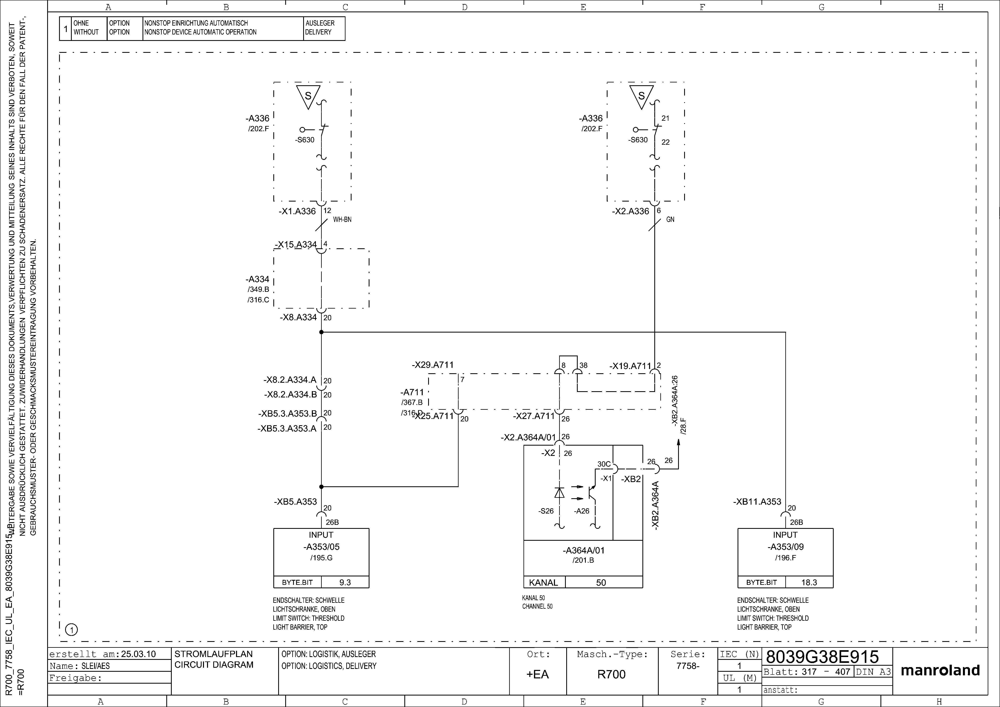

# +EA — Sheet 317 of 407 — OPTION: LOGISTIK, AUSLEGER

**OPTION: LOGISTICS, DELIVERY**

> Part of the manroland **R700** printing press IEC/UL circuit diagrams.
> Drawing class: **Stromlaufplan / Circuit diagram** (DIN A3).
> Document `+EA` covers the **Printing unit** machine section.

## At a glance

| Field | Value |
|---|---|
| Document | `+EA`  (8039G38E915) |
| Sheet | **317** of 407 |
| Section (DE) | OPTION: LOGISTIK, AUSLEGER |
| Section (EN) | OPTION: LOGISTICS, DELIVERY |
| Section type | CIRCUIT — Circuit diagram |
| Machine type | `R700` |
| Series | `7758` |
| Created | 25.03.10 |
| Replaces | — |
| Columns used | A, B, C, D, E, F, G |
| Path numbers | — |
| Labels on sheet | 98 |
| Cross-refs out | 10 |
| Cross-refs in | 27 |

**Previous:** [+EA sheet 316](SHEET_0316.md) · **Next:** [+EA sheet 318](SHEET_0318.md) · **Document TOC:** [_TOC.md](_TOC.md)  (+EA) · **Master TOC:** [all sheets](../_MASTER_TOC.md)

## Sheet image (300 DPI, exact vector render)



_Rendered directly from the PDF vector layer at 300 DPI (1-bit), no OCR and no resampling. Use it to confirm anything ambiguous in the text below._

## Cross-references on this sheet

Each entry is a wire leaving this sheet. The printed token is `/sheet.column`; the link resolves to that sheet inside the same document.

| Ref | Target sheet | Col | Path | Destination on target | Target section | From col |
|---|---|---|---|---|---|---|
| `/202.F` | [+EA sheet 202](SHEET_0202.md) | F | — | — | REFERENZMODUL | B |
| `/202.F` | [+EA sheet 202](SHEET_0202.md) | F | — | — | REFERENZMODUL | E |
| `/349.B` | [+EA sheet 349](SHEET_0349.md) | B | — | — | OPTION: VORBEREITUNG IONISATIONSANLAGE | B |
| `/316.C` | [+EA sheet 316](SHEET_0316.md) | C | — | — | OPTION: LOGISTIK, AUSLEGER | B |
| `/28.F` | [+EA sheet 28](SHEET_0028.md) | F | — | XB2.A364A:26 | BUSVERBINDUNGEN: SICHERHEITSBUS | F |
| `/367.B` | [+EA sheet 367](SHEET_0367.md) | B | — | — | OPTION: TROCKNER VORBEREITUNG; | D |
| `/316.D` | [+EA sheet 316](SHEET_0316.md) | D | — | — | OPTION: LOGISTIK, AUSLEGER | D |
| `/196.F` | [+EA sheet 196](SHEET_0196.md) | F | — | — | REFERENZMODUL | G |
| `/195.G` | [+EA sheet 195](SHEET_0195.md) | G | — | — | REFERENZMODUL | C |
| `/201.B` | [+EA sheet 201](SHEET_0201.md) | B | — | — | REFERENZMODUL | E |

### Incoming references (sheets that point here)

Every other sheet that sends a wire to this one. `Back-ref` is the token printed on *that* sheet; `Path` is its line number.

| From sheet | Cols | Back-ref | Path | Refs | What continues there |
|---|---|---|---|---|---|
| [+EA#28](SHEET_0028.md) | F | `/28.F` | — | 1 | — |
| [+EA#195](SHEET_0195.md) | G | `/195.G` | — | 1 | — |
| [+EA#196](SHEET_0196.md) | F | `/196.F` | — | 1 | — |
| [+EA#201](SHEET_0201.md) | B | `/201.B` | — | 1 | — |
| [+EA#202](SHEET_0202.md) | F | `/202.F` | — | 2 | — |
| [+EA#208](SHEET_0208.md) | F | `/208.F` | — | 1 | — |
| [+EA#224](SHEET_0224.md) | C | `/224.C` | — | 1 | — |
| [+EA#227](SHEET_0227.md) | C, E | `/227.C`, `/227.E` | — | 2 | — |
| [+EA#240](SHEET_0240.md) | F | `/240.F` | — | 1 | — |
| [+EA#241](SHEET_0241.md) | F, G | `/241.F`, `/241.G` | — | 2 | — |
| [+EA#249](SHEET_0249.md) | D, G, H | `/249.D`, `/249.G`, `/249.H` | — | 3 | — |
| [+EA#256](SHEET_0256.md) | A | `/256.A` | — | 1 | — |
| [+EA#260](SHEET_0260.md) | D | `/260.D` | — | 1 | — |
| [+EA#263](SHEET_0263.md) | H | `/263.H` | — | 1 | — |
| [+EA#268](SHEET_0268.md) | E | `/268.E` | — | 1 | — |
| [+EA#271](SHEET_0271.md) | F | `/271.F` | — | 1 | — |
| [+EA#274](SHEET_0274.md) | E, F | `/274.E`, `/274.F` | — | 2 | — |
| [+EA#316](SHEET_0316.md) | C, D | `/316.C`, `/316.D` | — | 2 | — |
| [+EA#349](SHEET_0349.md) | A | `/349.A` | — | 1 | — |
| [+EA#367](SHEET_0367.md) | B | `/367.B` | — | 1 | — |


## Devices on this sheet

| Tag | Class | Class meaning (IEC) | Col | Sub | Terminal | Sign |
|---|---|---|---|---|---|---|
| `S630` | S | Schalter / switch | C | — | — | — |
| `A336` | A | Baugruppe / assembly, module, PC board | B | — | — | — |
| `A353/05` | A | Baugruppe / assembly, module, PC board | C | 05 | — | — |
| `S26` | S | Schalter / switch | E | — | — | — |
| `A26` | A | Baugruppe / assembly, module, PC board | E | — | — | — |
| `X1` | X | Klemme / terminal, plug connector | E | — | — | — |
| `X2` | X | Klemme / terminal, plug connector | E | — | — | — |
| `XB2` | XB |  | E | — | — | — |
| `A711` | A | Baugruppe / assembly, module, PC board | D | — | — | — |
| `A334` | A | Baugruppe / assembly, module, PC board | B | — | — | — |
| `A353/09` | A | Baugruppe / assembly, module, PC board | G | 09 | — | — |
| `S630` | S | Schalter / switch | E | — | — | — |
| `A336` | A | Baugruppe / assembly, module, PC board | E | — | — | — |
| `X1.A336` | — | cross-device reference | C | — | — | — |
| `9.3` | — | cross-device reference | C | — | — | — |
| `XB5.A353` | — | cross-device reference | C | — | — | — |
| `X8.2.A334.B` | — | cross-device reference | C | — | — | — |
| `X8.2.A334.A` | — | cross-device reference | C | — | — | — |
| `XB5.3.A353.A` | — | cross-device reference | C | — | — | — |
| `XB5.3.A353.B` | — | cross-device reference | C | — | — | — |
| `XB2.A364A` | — | cross-device reference | F | — | — | — |
| `X25.A711` | — | cross-device reference | D | — | — | — |
| `X27.A711` | — | cross-device reference | E | — | — | — |
| `X15.A334` | — | cross-device reference | C | — | — | — |
| `X8.A334` | — | cross-device reference | C | — | — | — |
| `18.3` | — | cross-device reference | G | — | — | — |
| `XB11.A353` | — | cross-device reference | F | — | — | — |
| `X19.A711` | — | cross-device reference | E | — | — | — |
| `X2.A336` | — | cross-device reference | E | — | — | — |
| `XB2.A364A:26` | — | cross-device reference | F | — | 26 | — |
| `X29.A711` | — | cross-device reference | D | — | — | — |

## Potentials / nets

_No named potentials on this sheet._

## Wire-end annotations (grouped as printed)

A wire that continues elsewhere is annotated with a small cluster: the destination description, the path/line number `#NN`, and the `/sheet.column` cross reference. Each row below is one such cluster exactly as it is grouped on the drawing.

| Col | Y | Path | Cross-ref | Text on the wire |
|---|---|---|---|---|
| A | 24.7 | — | — | `1 OHNE WITHOUT` |
| A | 24.7 | — | — | `OPTION OPTION` |
| B | 24.7 | — | — | `NONSTOP EINRICHTUNG AUTOMATISCH NONSTOP DEVICE AUTOMATIC OPERATION` |
| C | 24.7 | — | — | `DELIVERY AUSLEGER` |
| C | 108.8 | — | — | `S` |
| E | 108.8 | — | — | `S` |
| B | 136.4 | — | — | `A336` |
| E | 136.4 | — | — | `A336` |
| F | 137.1 | — | — | `21` |
| B | 149.4 | — | `/202.F` | — |
| E | 149.4 | — | `/202.F` | — |
| C | 162.6 | — | — | `S630` |
| E | 162.6 | — | — | `S630` |
| F | 165.4 | — | — | `22` |
| C | 246.9 | — | — | `X1.A336 12` |
| E | 246.9 | — | — | `X2.A336 6` |
| C | 258.5 | — | — | `WH BN` |
| F | 258.5 | — | — | `GN` |
| C | 286.6 | — | — | `X15.A334 4` |
| B | 327.7 | — | — | `A334` |
| B | 340.8 | — | `/349.B`, `/316.C` | — |
| C | 373.1 | — | — | `X8.A334 20` |
| D | 429.8 | — | — | `X29.A711` |
| E | 431.2 | — | — | `8` |
| E | 431.2 | — | — | `38 X19.A711 2` |
| F | 447.0 | — | `/28.F` | `XB2.A364A:26` |
| C | 447.5 | — | — | `X8.2.A334.A 20` |
| D | 448.2 | — | — | `7` |
| D | 462.4 | — | — | `A711` |
| C | 465.2 | — | — | `X8.2.A334.B 20` |
| D | 475.4 | — | `/367.B`, `/316.D` | — |
| C | 487.9 | — | — | `XB5.3.A353.B 20` |
| D | 490.7 | — | — | `X25.A711 20` |
| E | 490.7 | — | — | `X27.A711 26` |
| C | 504.9 | — | — | `XB5.3.A353.A 20` |
| E | 516.2 | — | — | `X2.A364A/01 26` |
| E | 534.7 | — | — | `X2` |
| E | 536.1 | — | — | `26 26` |
| F | 544.6 | — | — | `26` |
| E | 548.8 | — | — | `30C` |
| E | 565.8 | — | — | `X1` |
| E | 565.8 | — | — | `XB2` |
| F | 572.9 | — | — | `XB2.A364A` |
| C | 592.8 | — | — | `XB5.A353 20` |
| G | 592.8 | — | — | `XB11.A353 20` |
| E | 604.8 | — | — | `S26 A26` |
| C | 618.2 | — | — | `26B` |
| G | 618.2 | — | — | `26B` |
| C | 632.8 | — | — | `INPUT` |
| G | 632.8 | — | — | `INPUT` |
| C | 646.6 | — | — | `A353/05` |
| G | 646.6 | — | — | `A353/09` |
| E | 650.9 | — | — | `A364A/01` |
| C | 660.4 | — | `/195.G` | — |
| G | 660.4 | — | `/196.F` | — |
| E | 663.2 | — | `/201.B` | — |
| E | 689.1 | — | — | `KANAL 50` |
| C | 689.4 | — | — | `BYTE.BIT 9.3` |
| G | 689.5 | — | — | `BYTE.BIT 18.3` |
| E | 709.5 | — | — | `KANAL 50 CHANNEL 50` |
| C | 712.1 | — | — | `ENDSCHALTER: SCHWELLE LICHTSCHRANKE, OBEN LIMIT SWITCH: THRESHOLD LIGHT BARRIER, TOP` |
| G | 712.1 | — | — | `ENDSCHALTER: SCHWELLE LICHTSCHRANKE, OBEN LIMIT SWITCH: THRESHOLD LIGHT BARRIER, TOP` |
| A | 746.7 | — | — | `1` |


## Reconstructed tables

This sheet carries tabular content (pin map / terminal assignment / index). The grid below was rebuilt from the drawing's own rule lines, so each row is exactly one physical row of the table.

### Table 1 — 6 data rows × 13 columns (at x=326.0, y=395.4)

| X8.2.A334.A | 20 | X29.A711 | 7 |  | 8 38 |  | X19.A711 |  | 2 |  |  |  |
|---|---|---|---|---|---|---|---|---|---|---|---|---|
| `X8.2.A334.B XB5.3.A353.B XB5.3.A353.A` | `20 20 20` | `A711 /367.B /316.D X25.A711` | `20` | `X27.A711 X2.A364A/01` | `26 26` |  |  |  | `XB2.A364A:26` | `/28.F` |  |  |
|  |  |  |  | `X2` | `26` | `30C X1` | `XB2` | `26` | `26` |  |  |  |
| `XB5.A353` | `20 26B` |  |  | `S26` | `A26` |  |  |  | `XB2.A364A` |  | `XB11.A353` | `20 26B` |
| `INPUT` |  |  |  |  |  |  |  |  |  |  | `INPUT` |  |
|  | `A353/05 /195.G` |  |  |  | `A364A/01 /201.B` |  |  |  |  |  |  | `A353/09 /196.F` |
| `BYTE.BIT` | `9.3` |  |  | `KANAL` |  | `50` |  |  |  |  | `BYTE.BIT` | `18.3` |


## Notes and free text on this sheet

| Text | Col | Y (pt) |
|---|---|---|
| `26B` | C | 618.24 |
| `INPUT` | C | 632.76 |
| `BYTE.BIT` | C | 690.01 |
| `ENDSCHALTER: SCHWELLE` | C | 712.11 |
| `LICHTSCHRANKE, OBEN` | C | 722.75 |
| `LIMIT SWITCH: THRESHOLD` | C | 733.37 |
| `LIGHT BARRIER, TOP` | C | 744.01 |
| `KANAL 50` | E | 709.45 |
| `CHANNEL 50` | E | 719.39 |
| `30C` | E | 548.83 |
| `KANAL` | E | 689.12 |
| `A364A/01` | E | 650.86 |
| `X2.A364A/01` | E | 516.21 |
| `26B` | G | 618.24 |
| `INPUT` | G | 632.76 |
| `BYTE.BIT` | F | 690.01 |
| `ENDSCHALTER: SCHWELLE` | G | 712.11 |
| `LICHTSCHRANKE, OBEN` | G | 722.75 |
| `LIMIT SWITCH: THRESHOLD` | G | 733.37 |
| `LIGHT BARRIER, TOP` | G | 744.01 |
| `OHNE` | A | 24.71 |
| `WITHOUT` | A | 35.31 |
| `OPTION` | A | 24.69 |
| `NONSTOP EINRICHTUNG AUTOMATISCH` | B | 24.73 |
| `NONSTOP DEVICE AUTOMATIC OPERATION` | B | 35.35 |
| `AUSLEGER` | C | 24.73 |
| `DELIVERY` | C | 35.33 |
| `S` | C | 108.81 |
| `WH BN` | C | 258.51 |
| `S` | E | 108.81 |
| `GN` | F | 258.52 |

## Complete label inventory (exact text from the drawing)

Every text object inside the drawing area of this sheet, in DIN reading order (column A→H, then top→bottom). This is the authoritative list: if a string is not here it is not printed on this sheet.

| Col | Y | X | Dir | Type | Text |
|---|---|---|---|---|---|
| A | 24.7 | 87.6 | → | text | `OHNE` |
| A | 24.7 | 130.1 | → | text | `OPTION` |
| A | 30.0 | 75.4 | → | number | `1` |
| A | 35.3 | 87.9 | → | text | `WITHOUT` |
| A | 35.3 | 130.1 | → | text | `OPTION` |
| A | 746.7 | 83.3 | → | number | `1` |
| B | 24.7 | 172.1 | → | text | `NONSTOP EINRICHTUNG AUTOMATISCH` |
| B | 35.4 | 172.1 | → | text | `NONSTOP DEVICE AUTOMATIC OPERATION` |
| B | 136.4 | 292.5 | → | device tag | `A336` |
| B | 149.4 | 295.7 | → | cross-reference | `/202.F` |
| B | 327.7 | 292.5 | → | device tag | `A334` |
| B | 340.8 | 295.1 | → | cross-reference | `/349.B` |
| B | 353.2 | 294.8 | → | cross-reference | `/316.C` |
| C | 24.7 | 364.3 | → | text | `AUSLEGER` |
| C | 35.3 | 363.4 | → | text | `DELIVERY` |
| C | 108.8 | 363.0 | → | text | `S` |
| C | 162.6 | 351.2 | → | device tag | `S630` |
| C | 246.9 | 331.9 | → | device ref | `X1.A336` |
| C | 246.9 | 384.7 | → | number | `12` |
| C | 258.5 | 396.9 | → | text | `WH BN` |
| C | 286.6 | 327.4 | → | device ref | `X15.A334` |
| C | 286.6 | 385.2 | → | number | `4` |
| C | 373.1 | 333.4 | → | device ref | `X8.A334` |
| C | 374.5 | 385.2 | → | number | `20` |
| C | 447.5 | 313.8 | → | device ref | `X8.2.A334.A` |
| C | 449.6 | 385.2 | → | number | `20` |
| C | 465.2 | 314.6 | → | device ref | `X8.2.A334.B` |
| C | 466.6 | 385.2 | → | number | `20` |
| C | 487.9 | 307.6 | → | device ref | `XB5.3.A353.B` |
| C | 487.9 | 385.2 | → | number | `20` |
| C | 504.9 | 385.2 | → | number | `20` |
| C | 505.6 | 306.7 | → | device ref | `XB5.3.A353.A` |
| C | 592.7 | 326.3 | → | device ref | `XB5.A353` |
| C | 601.3 | 385.2 | → | number | `20` |
| C | 618.2 | 388.1 | → | text | `26B` |
| C | 632.8 | 367.8 | → | text | `INPUT` |
| C | 646.6 | 361.3 | → | device tag | `A353/05` |
| C | 660.4 | 369.8 | → | cross-reference | `/195.G` |
| C | 689.4 | 404.2 | → | device ref | `9.3` |
| C | 690.0 | 335.9 | → | text | `BYTE.BIT` |
| C | 712.1 | 325.1 | → | text | `ENDSCHALTER: SCHWELLE` |
| C | 722.7 | 325.1 | → | text | `LICHTSCHRANKE, OBEN` |
| C | 733.4 | 325.1 | → | text | `LIMIT SWITCH: THRESHOLD` |
| C | 744.0 | 325.1 | → | text | `LIGHT BARRIER, TOP` |
| D | 429.8 | 490.4 | → | device ref | `X29.A711` |
| D | 448.2 | 548.2 | → | number | `7` |
| D | 462.3 | 476.8 | → | device tag | `A711` |
| D | 475.4 | 477.9 | → | cross-reference | `/367.B` |
| D | 487.8 | 477.6 | → | cross-reference | `/316.D` |
| D | 490.7 | 490.4 | → | device ref | `X25.A711` |
| D | 495.0 | 548.2 | → | number | `20` |
| E | 108.8 | 759.8 | → | text | `S` |
| E | 136.4 | 689.4 | → | device tag | `A336` |
| E | 149.4 | 692.5 | → | cross-reference | `/202.F` |
| E | 162.6 | 748.1 | → | device tag | `S630` |
| E | 246.9 | 728.8 | → | device ref | `X2.A336` |
| E | 431.2 | 668.7 | → | number | `8` |
| E | 431.2 | 690.0 | → | number | `38` |
| E | 431.2 | 725.7 | → | device ref | `X19.A711` |
| E | 490.7 | 610.9 | → | device ref | `X27.A711` |
| E | 495.0 | 668.7 | → | number | `26` |
| E | 516.2 | 596.4 | → | text | `X2.A364A/01` |
| E | 516.2 | 668.7 | → | number | `26` |
| E | 534.7 | 644.6 | → | device tag | `X2` |
| E | 536.1 | 671.5 | → | number | `26` |
| E | 548.8 | 711.5 | → | text | `30C` |
| E | 565.8 | 715.2 | → | device tag | `X1` |
| E | 565.8 | 739.6 | → | device tag | `XB2` |
| E | 604.8 | 640.9 | → | device tag | `S26` |
| E | 604.8 | 683.4 | → | device tag | `A26` |
| E | 650.9 | 670.3 | → | text | `A364A/01` |
| E | 663.2 | 681.9 | → | cross-reference | `/201.B` |
| E | 689.1 | 629.9 | → | text | `KANAL` |
| E | 689.1 | 709.8 | → | number | `50` |
| E | 709.4 | 621.6 | → | text | `KANAL 50` |
| E | 719.4 | 621.9 | → | text | `CHANNEL 50` |
| F | 137.1 | 787.7 | → | number | `21` |
| F | 165.4 | 787.7 | → | number | `22` |
| F | 246.9 | 782.1 | → | number | `6` |
| F | 258.5 | 793.4 | → | text | `GN` |
| F | 431.2 | 782.1 | → | number | `2` |
| F | 447.0 | 799.6 | ↕ | device ref | `XB2.A364A:26` |
| F | 497.2 | 809.6 | ↕ | cross-reference | `/28.F` |
| F | 544.6 | 791.4 | → | number | `26` |
| F | 546.0 | 770.7 | → | number | `26` |
| F | 572.9 | 775.6 | ↕ | device ref | `XB2.A364A` |
| F | 592.7 | 873.1 | → | device ref | `XB11.A353` |
| F | 690.0 | 888.7 | → | text | `BYTE.BIT` |
| G | 601.3 | 938.0 | → | number | `20` |
| G | 618.2 | 940.8 | → | text | `26B` |
| G | 632.8 | 920.6 | → | text | `INPUT` |
| G | 646.6 | 914.0 | → | device tag | `A353/09` |
| G | 660.4 | 923.1 | → | cross-reference | `/196.F` |
| G | 689.4 | 954.0 | → | device ref | `18.3` |
| G | 712.1 | 877.9 | → | text | `ENDSCHALTER: SCHWELLE` |
| G | 722.7 | 877.9 | → | text | `LICHTSCHRANKE, OBEN` |
| G | 733.4 | 877.9 | → | text | `LIMIT SWITCH: THRESHOLD` |
| G | 744.0 | 877.9 | → | text | `LIGHT BARRIER, TOP` |

## Reading-order text block

The same content as a plain block, grouped by DIN column — convenient to paste or to match against a visual description.

```text
=== Column A ===
  24.7   87.6  text         OHNE
  24.7  130.1  text         OPTION
  30.0   75.4  numeric      1
  35.3   87.9  text         WITHOUT
  35.3  130.1  text         OPTION
 746.7   83.3  numeric      1
=== Column B ===
  24.7  172.1  text         NONSTOP EINRICHTUNG AUTOMATISCH
  35.4  172.1  text         NONSTOP DEVICE AUTOMATIC OPERATION
 136.4  292.5  devtag       A336
 149.4  295.7  xref         /202.F
 327.7  292.5  devtag       A334
 340.8  295.1  xref         /349.B
 353.2  294.8  xref         /316.C
=== Column C ===
  24.7  364.3  text         AUSLEGER
  35.3  363.4  text         DELIVERY
 108.8  363.0  text         S
 162.6  351.2  devtag       S630
 246.9  331.9  devref       X1.A336
 246.9  384.7  numeric      12
 258.5  396.9  text         WH BN
 286.6  327.4  devref       X15.A334
 286.6  385.2  numeric      4
 373.1  333.4  devref       X8.A334
 374.5  385.2  numeric      20
 447.5  313.8  devref       X8.2.A334.A
 449.6  385.2  numeric      20
 465.2  314.6  devref       X8.2.A334.B
 466.6  385.2  numeric      20
 487.9  307.6  devref       XB5.3.A353.B
 487.9  385.2  numeric      20
 504.9  385.2  numeric      20
 505.6  306.7  devref       XB5.3.A353.A
 592.7  326.3  devref       XB5.A353
 601.3  385.2  numeric      20
 618.2  388.1  text         26B
 632.8  367.8  text         INPUT
 646.6  361.3  devtag       A353/05
 660.4  369.8  xref         /195.G
 689.4  404.2  devref       9.3
 690.0  335.9  text         BYTE.BIT
 712.1  325.1  text         ENDSCHALTER: SCHWELLE
 722.7  325.1  text         LICHTSCHRANKE, OBEN
 733.4  325.1  text         LIMIT SWITCH: THRESHOLD
 744.0  325.1  text         LIGHT BARRIER, TOP
=== Column D ===
 429.8  490.4  devref       X29.A711
 448.2  548.2  numeric      7
 462.3  476.8  devtag       A711
 475.4  477.9  xref         /367.B
 487.8  477.6  xref         /316.D
 490.7  490.4  devref       X25.A711
 495.0  548.2  numeric      20
=== Column E ===
 108.8  759.8  text         S
 136.4  689.4  devtag       A336
 149.4  692.5  xref         /202.F
 162.6  748.1  devtag       S630
 246.9  728.8  devref       X2.A336
 431.2  668.7  numeric      8
 431.2  690.0  numeric      38
 431.2  725.7  devref       X19.A711
 490.7  610.9  devref       X27.A711
 495.0  668.7  numeric      26
 516.2  596.4  text         X2.A364A/01
 516.2  668.7  numeric      26
 534.7  644.6  devtag       X2
 536.1  671.5  numeric      26
 548.8  711.5  text         30C
 565.8  715.2  devtag       X1
 565.8  739.6  devtag       XB2
 604.8  640.9  devtag       S26
 604.8  683.4  devtag       A26
 650.9  670.3  text         A364A/01
 663.2  681.9  xref         /201.B
 689.1  629.9  text         KANAL
 689.1  709.8  numeric      50
 709.4  621.6  text         KANAL 50
 719.4  621.9  text         CHANNEL 50
=== Column F ===
 137.1  787.7  numeric      21
 165.4  787.7  numeric      22
 246.9  782.1  numeric      6
 258.5  793.4  text         GN
 431.2  782.1  numeric      2
 447.0  799.6  devref       XB2.A364A:26
 497.2  809.6  xref         /28.F
 544.6  791.4  numeric      26
 546.0  770.7  numeric      26
 572.9  775.6  devref       XB2.A364A
 592.7  873.1  devref       XB11.A353
 690.0  888.7  text         BYTE.BIT
=== Column G ===
 601.3  938.0  numeric      20
 618.2  940.8  text         26B
 632.8  920.6  text         INPUT
 646.6  914.0  devtag       A353/09
 660.4  923.1  xref         /196.F
 689.4  954.0  devref       18.3
 712.1  877.9  text         ENDSCHALTER: SCHWELLE
 722.7  877.9  text         LICHTSCHRANKE, OBEN
 733.4  877.9  text         LIMIT SWITCH: THRESHOLD
 744.0  877.9  text         LIGHT BARRIER, TOP
```

---
_Generated from the PDF vector text layer; no OCR. Source: `R700_7758_IEC_UL_EA_8039G38E915_p`, sheet 317._
