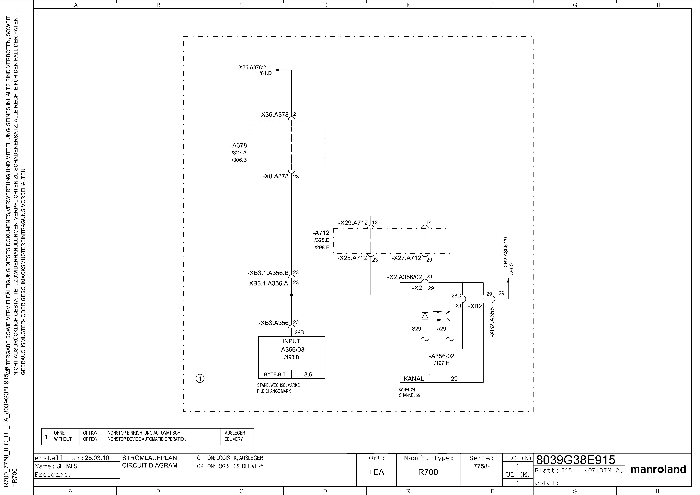

# +EA — Sheet 318 of 407 — OPTION: LOGISTIK, AUSLEGER

**OPTION: LOGISTICS, DELIVERY**

> Part of the manroland **R700** printing press IEC/UL circuit diagrams.
> Drawing class: **Stromlaufplan / Circuit diagram** (DIN A3).
> Document `+EA` covers the **Printing unit** machine section.

## At a glance

| Field | Value |
|---|---|
| Document | `+EA`  (8039G38E915) |
| Sheet | **318** of 407 |
| Section (DE) | OPTION: LOGISTIK, AUSLEGER |
| Section (EN) | OPTION: LOGISTICS, DELIVERY |
| Section type | CIRCUIT — Circuit diagram |
| Machine type | `R700` |
| Series | `7758` |
| Created | 25.03.10 |
| Replaces | — |
| Columns used | A, B, C, D, E, F |
| Path numbers | — |
| Labels on sheet | 63 |
| Cross-refs out | 8 |
| Cross-refs in | 19 |

**Previous:** [+EA sheet 317](SHEET_0317.md) · **Next:** [+EA sheet 319](SHEET_0319.md) · **Document TOC:** [_TOC.md](_TOC.md)  (+EA) · **Master TOC:** [all sheets](../_MASTER_TOC.md)

## Sheet image (300 DPI, exact vector render)



_Rendered directly from the PDF vector layer at 300 DPI (1-bit), no OCR and no resampling. Use it to confirm anything ambiguous in the text below._

## Cross-references on this sheet

Each entry is a wire leaving this sheet. The printed token is `/sheet.column`; the link resolves to that sheet inside the same document.

| Ref | Target sheet | Col | Path | Destination on target | Target section | From col |
|---|---|---|---|---|---|---|
| `/84.D` | [+EA sheet 84](SHEET_0084.md) | D | — | X36.A378:2 | AUSLEGERSTAPELSTEUERUNG: PROGRAMMSCHALTWERK | C |
| `/327.A` | [+EA sheet 327](SHEET_0327.md) | A | — | — | OPTION: BOGENWEICHE | C |
| `/306.B` | [+EA sheet 306](SHEET_0306.md) | B | — | — | OPTION: ZWISCHENSTAPEL / | C |
| `/26.G` | [+EA sheet 26](SHEET_0026.md) | G | — | XB2.A356:29 | BUSVERBINDUNGEN: SICHERHEITSBUS | F |
| `/328.E` | [+EA sheet 328](SHEET_0328.md) | E | — | — | OPTION: BOGENWEICHE | D |
| `/298.F` | [+EA sheet 298](SHEET_0298.md) | F | — | — | OPTION: ZWISCHENSTAPEL / | D |
| `/198.B` | [+EA sheet 198](SHEET_0198.md) | B | — | — | REFERENZMODUL | D |
| `/197.H` | [+EA sheet 197](SHEET_0197.md) | H | — | — | REFERENZMODUL | E |

### Incoming references (sheets that point here)

Every other sheet that sends a wire to this one. `Back-ref` is the token printed on *that* sheet; `Path` is its line number.

| From sheet | Cols | Back-ref | Path | Refs | What continues there |
|---|---|---|---|---|---|
| [+EA#26](SHEET_0026.md) | G | `/26.G` | — | 1 | XB2.A356:29 |
| [+EA#84](SHEET_0084.md) | E | `/84.E` | — | 1 | — |
| [+EA#197](SHEET_0197.md) | H | `/197.H` | — | 1 | — |
| [+EA#198](SHEET_0198.md) | B | `/198.B` | — | 1 | — |
| [+EA#225](SHEET_0225.md) | G | `/225.G` | — | 1 | — |
| [+EA#226](SHEET_0226.md) | F | `/226.F` | — | 1 | — |
| [+EA#234](SHEET_0234.md) | H | `/234.H` | — | 1 | — |
| [+EA#235](SHEET_0235.md) | A, B | `/235.A`, `/235.B` | — | 2 | — |
| [+EA#250](SHEET_0250.md) | D | `/250.D` | — | 1 | — |
| [+EA#268](SHEET_0268.md) | F | `/268.F` | — | 1 | — |
| [+EA#271](SHEET_0271.md) | H | `/271.H` | — | 1 | — |
| [+EA#274](SHEET_0274.md) | G | `/274.G` | — | 2 | — |
| [+EA#279](SHEET_0279.md) | D | `/279.D` | — | 1 | — |
| [+EA#298](SHEET_0298.md) | F | `/298.F` | — | 1 | — |
| [+EA#306](SHEET_0306.md) | B | `/306.B` | — | 1 | — |
| [+EA#327](SHEET_0327.md) | A | `/327.A` | — | 1 | — |
| [+EA#328](SHEET_0328.md) | E | `/328.E` | — | 1 | — |


## Devices on this sheet

| Tag | Class | Class meaning (IEC) | Col | Sub | Terminal | Sign |
|---|---|---|---|---|---|---|
| `A378` | A | Baugruppe / assembly, module, PC board | C | — | — | — |
| `S29` | S | Schalter / switch | E | — | — | — |
| `A29` | A | Baugruppe / assembly, module, PC board | E | — | — | — |
| `X1` | X | Klemme / terminal, plug connector | F | — | — | — |
| `X2` | X | Klemme / terminal, plug connector | E | — | — | — |
| `XB2` | XB |  | F | — | — | — |
| `A356/02` | A | Baugruppe / assembly, module, PC board | E | 02 | — | — |
| `A712` | A | Baugruppe / assembly, module, PC board | D | — | — | — |
| `A356/03` | A | Baugruppe / assembly, module, PC board | D | 03 | — | — |
| `X8.A378` | — | cross-device reference | C | — | — | — |
| `X36.A378` | — | cross-device reference | C | — | — | — |
| `XB3.1.A356.B` | — | cross-device reference | C | — | — | — |
| `XB3.1.A356.A` | — | cross-device reference | C | — | — | — |
| `XB2.A356` | — | cross-device reference | F | — | — | — |
| `X29.A712` | — | cross-device reference | D | — | — | — |
| `X27.A712` | — | cross-device reference | E | — | — | — |
| `X25.A712` | — | cross-device reference | D | — | — | — |
| `3.6` | — | cross-device reference | D | — | — | — |
| `XB3.A356` | — | cross-device reference | C | — | — | — |
| `XB2.A356:29` | — | cross-device reference | F | — | 29 | — |
| `X36.A378:2` | — | cross-device reference | C | — | 2 | — |

## Potentials / nets

_No named potentials on this sheet._

## Wire-end annotations (grouped as printed)

A wire that continues elsewhere is annotated with a small cluster: the destination description, the path/line number `#NN`, and the `/sheet.column` cross reference. Each row below is one such cluster exactly as it is grouped on the drawing.

| Col | Y | Path | Cross-ref | Text on the wire |
|---|---|---|---|---|
| C | 110.8 | — | `/84.D` | `X36.A378:2` |
| C | 190.2 | — | — | `X36.A378 2` |
| C | 242.7 | — | — | `A378` |
| C | 255.7 | — | `/327.A`, `/306.B` | — |
| C | 295.1 | — | — | `X8.A378 23` |
| E | 374.5 | — | — | `X29.A712 13 14` |
| D | 391.5 | — | — | `A712` |
| F | 403.4 | — | `/26.G` | `XB2.A356:29` |
| D | 404.6 | — | `/328.E`, `/298.F` | — |
| E | 434.0 | — | — | `X25.A712 23 X27.A712 29` |
| C | 459.5 | — | — | `XB3.1.A356.B 23` |
| E | 466.6 | — | — | `X2.A356/02 29` |
| C | 476.5 | — | — | `XB3.1.A356.A 23` |
| E | 485.1 | — | — | `X2` |
| F | 486.5 | — | — | `29 29` |
| F | 495.0 | — | — | `29` |
| F | 499.2 | — | — | `28C` |
| F | 516.2 | — | — | `X1` |
| F | 516.2 | — | — | `XB2` |
| F | 522.4 | — | — | `XB2.A356` |
| C | 544.6 | — | — | `XB3.A356 23` |
| E | 555.2 | — | — | `S29 A29` |
| D | 561.5 | — | — | `29B` |
| D | 576.1 | — | — | `INPUT` |
| D | 589.9 | — | — | `A356/03` |
| E | 601.2 | — | — | `A356/02` |
| D | 603.7 | — | `/198.B` | — |
| E | 613.6 | — | `/197.H` | — |
| D | 632.7 | — | — | `BYTE.BIT 3.6` |
| E | 639.5 | — | — | `KANAL 29` |
| C | 640.4 | — | — | `1` |
| C | 652.8 | — | — | `PILE CHANGE MARK STAPELWECHSELMARKE` |
| E | 659.8 | — | — | `KANAL 29 CHANNEL 29` |
| A | 733.4 | — | — | `1 OHNE WITHOUT` |
| A | 733.4 | — | — | `OPTION OPTION` |
| B | 733.4 | — | — | `NONSTOP EINRICHTUNG AUTOMATISCH NONSTOP DEVICE AUTOMATIC OPERATION` |
| C | 733.4 | — | — | `DELIVERY AUSLEGER` |


## Reconstructed tables

This sheet carries tabular content (pin map / terminal assignment / index). The grid below was rebuilt from the drawing's own rule lines, so each row is exactly one physical row of the table.

### Table 1 — 6 data rows × 9 columns (at x=439.4, y=367.1)

| XB3.1.A356.B | A712 /328.E /298.F 23 | X29.A712 X25.A712 | 13 23 | X27.A712 X2.A356/02 | 14 29 29 |  |  | XB2.A356:29 |
|---|---|---|---|---|---|---|---|---|
| `XB3.1.A356.A` | `23` |  |  | `X2` | `29` |  |  | `29 29` |
| `XB3.A356` | `23 29B` |  |  | `S29` | `A29` | `28C X1` | `XB2` | `XB2.A356` |
| `INPUT` |  |  |  |  |  |  |  |  |
|  | `A356/03 /198.B` |  |  |  | `A356/02 /197.H` |  |  |  |
| `BYTE.BIT` | `3.6` |  |  |  |  |  |  |  |
|  |  |  |  | `KANAL` |  | `29` |  |  |


## Notes and free text on this sheet

| Text | Col | Y (pt) |
|---|---|---|
| `KANAL 29` | E | 659.84 |
| `CHANNEL 29` | E | 669.78 |
| `28C` | F | 499.23 |
| `KANAL` | E | 639.51 |
| `X2.A356/02` | E | 466.61 |
| `29B` | D | 561.55 |
| `INPUT` | D | 576.07 |
| `BYTE.BIT` | C | 633.32 |
| `STAPELWECHSELMARKE` | C | 652.75 |
| `PILE CHANGE MARK` | C | 662.72 |
| `OHNE` | A | 733.37 |
| `WITHOUT` | A | 743.97 |
| `OPTION` | A | 733.35 |
| `NONSTOP EINRICHTUNG AUTOMATISCH` | B | 733.39 |
| `NONSTOP DEVICE AUTOMATIC OPERATION` | B | 744.01 |
| `AUSLEGER` | C | 733.39 |
| `DELIVERY` | C | 743.99 |

## Complete label inventory (exact text from the drawing)

Every text object inside the drawing area of this sheet, in DIN reading order (column A→H, then top→bottom). This is the authoritative list: if a string is not here it is not printed on this sheet.

| Col | Y | X | Dir | Type | Text |
|---|---|---|---|---|---|
| A | 733.4 | 91.8 | → | text | `OHNE` |
| A | 733.4 | 141.4 | → | text | `OPTION` |
| A | 738.7 | 75.4 | → | number | `1` |
| A | 744.0 | 92.1 | → | text | `WITHOUT` |
| A | 744.0 | 141.4 | → | text | `OPTION` |
| B | 733.4 | 183.4 | → | text | `NONSTOP EINRICHTUNG AUTOMATISCH` |
| B | 744.0 | 183.4 | → | text | `NONSTOP DEVICE AUTOMATIC OPERATION` |
| C | 110.8 | 403.9 | → | device ref | `X36.A378:2` |
| C | 120.8 | 441.4 | → | cross-reference | `/84.D` |
| C | 190.2 | 440.8 | → | device ref | `X36.A378` |
| C | 242.7 | 391.7 | → | device tag | `A378` |
| C | 255.7 | 394.0 | → | cross-reference | `/327.A` |
| C | 268.1 | 394.3 | → | cross-reference | `/306.B` |
| C | 295.1 | 446.7 | → | device ref | `X8.A378` |
| C | 459.5 | 420.9 | → | device ref | `XB3.1.A356.B` |
| C | 477.2 | 420.1 | → | device ref | `XB3.1.A356.A` |
| C | 544.6 | 439.7 | → | device ref | `XB3.A356` |
| C | 633.3 | 449.3 | → | text | `BYTE.BIT` |
| C | 640.4 | 338.4 | → | number | `1` |
| C | 652.7 | 437.7 | → | text | `STAPELWECHSELMARKE` |
| C | 662.7 | 437.4 | → | text | `PILE CHANGE MARK` |
| C | 733.4 | 382.7 | → | text | `AUSLEGER` |
| C | 744.0 | 381.8 | → | text | `DELIVERY` |
| D | 190.2 | 498.6 | → | number | `2` |
| D | 296.5 | 498.6 | → | number | `23` |
| D | 374.5 | 575.4 | → | device ref | `X29.A712` |
| D | 391.5 | 532.1 | → | device tag | `A712` |
| D | 404.6 | 534.9 | → | cross-reference | `/328.E` |
| D | 417.0 | 535.2 | → | cross-reference | `/298.F` |
| D | 434.0 | 574.0 | → | device ref | `X25.A712` |
| D | 459.5 | 498.6 | → | number | `23` |
| D | 476.5 | 498.6 | → | number | `23` |
| D | 544.6 | 498.6 | → | number | `23` |
| D | 561.5 | 501.4 | → | text | `29B` |
| D | 576.1 | 481.2 | → | text | `INPUT` |
| D | 589.9 | 474.7 | → | device tag | `A356/03` |
| D | 603.7 | 483.4 | → | cross-reference | `/198.B` |
| D | 632.7 | 517.6 | → | device ref | `3.6` |
| E | 374.5 | 632.7 | → | number | `13` |
| E | 374.5 | 724.8 | → | number | `14` |
| E | 434.0 | 666.1 | → | device ref | `X27.A712` |
| E | 438.3 | 633.3 | → | number | `23` |
| E | 438.3 | 725.4 | → | number | `29` |
| E | 466.6 | 658.8 | → | text | `X2.A356/02` |
| E | 466.6 | 725.4 | → | number | `29` |
| E | 485.0 | 701.3 | → | device tag | `X2` |
| E | 486.5 | 728.2 | → | number | `29` |
| E | 555.2 | 697.6 | → | device tag | `S29` |
| E | 555.2 | 740.1 | → | device tag | `A29` |
| E | 601.2 | 729.8 | → | device tag | `A356/02` |
| E | 613.6 | 738.7 | → | cross-reference | `/197.H` |
| E | 639.5 | 686.6 | → | text | `KANAL` |
| E | 659.8 | 678.3 | → | text | `KANAL 29` |
| E | 669.8 | 678.6 | → | text | `CHANNEL 29` |
| F | 403.4 | 856.3 | ↕ | device ref | `XB2.A356:29` |
| F | 446.2 | 866.3 | ↕ | cross-reference | `/26.G` |
| F | 495.0 | 848.1 | → | number | `29` |
| F | 496.4 | 827.4 | → | number | `29` |
| F | 499.2 | 768.2 | → | text | `28C` |
| F | 516.2 | 771.9 | → | device tag | `X1` |
| F | 516.2 | 796.3 | → | device tag | `XB2` |
| F | 522.4 | 832.3 | ↕ | device ref | `XB2.A356` |
| F | 639.5 | 766.6 | → | number | `29` |

## Reading-order text block

The same content as a plain block, grouped by DIN column — convenient to paste or to match against a visual description.

```text
=== Column A ===
 733.4   91.8  text         OHNE
 733.4  141.4  text         OPTION
 738.7   75.4  numeric      1
 744.0   92.1  text         WITHOUT
 744.0  141.4  text         OPTION
=== Column B ===
 733.4  183.4  text         NONSTOP EINRICHTUNG AUTOMATISCH
 744.0  183.4  text         NONSTOP DEVICE AUTOMATIC OPERATION
=== Column C ===
 110.8  403.9  devref       X36.A378:2
 120.8  441.4  xref         /84.D
 190.2  440.8  devref       X36.A378
 242.7  391.7  devtag       A378
 255.7  394.0  xref         /327.A
 268.1  394.3  xref         /306.B
 295.1  446.7  devref       X8.A378
 459.5  420.9  devref       XB3.1.A356.B
 477.2  420.1  devref       XB3.1.A356.A
 544.6  439.7  devref       XB3.A356
 633.3  449.3  text         BYTE.BIT
 640.4  338.4  numeric      1
 652.7  437.7  text         STAPELWECHSELMARKE
 662.7  437.4  text         PILE CHANGE MARK
 733.4  382.7  text         AUSLEGER
 744.0  381.8  text         DELIVERY
=== Column D ===
 190.2  498.6  numeric      2
 296.5  498.6  numeric      23
 374.5  575.4  devref       X29.A712
 391.5  532.1  devtag       A712
 404.6  534.9  xref         /328.E
 417.0  535.2  xref         /298.F
 434.0  574.0  devref       X25.A712
 459.5  498.6  numeric      23
 476.5  498.6  numeric      23
 544.6  498.6  numeric      23
 561.5  501.4  text         29B
 576.1  481.2  text         INPUT
 589.9  474.7  devtag       A356/03
 603.7  483.4  xref         /198.B
 632.7  517.6  devref       3.6
=== Column E ===
 374.5  632.7  numeric      13
 374.5  724.8  numeric      14
 434.0  666.1  devref       X27.A712
 438.3  633.3  numeric      23
 438.3  725.4  numeric      29
 466.6  658.8  text         X2.A356/02
 466.6  725.4  numeric      29
 485.0  701.3  devtag       X2
 486.5  728.2  numeric      29
 555.2  697.6  devtag       S29
 555.2  740.1  devtag       A29
 601.2  729.8  devtag       A356/02
 613.6  738.7  xref         /197.H
 639.5  686.6  text         KANAL
 659.8  678.3  text         KANAL 29
 669.8  678.6  text         CHANNEL 29
=== Column F ===
 403.4  856.3  devref       XB2.A356:29
 446.2  866.3  xref         /26.G
 495.0  848.1  numeric      29
 496.4  827.4  numeric      29
 499.2  768.2  text         28C
 516.2  771.9  devtag       X1
 516.2  796.3  devtag       XB2
 522.4  832.3  devref       XB2.A356
 639.5  766.6  numeric      29
```

---
_Generated from the PDF vector text layer; no OCR. Source: `R700_7758_IEC_UL_EA_8039G38E915_p`, sheet 318._
