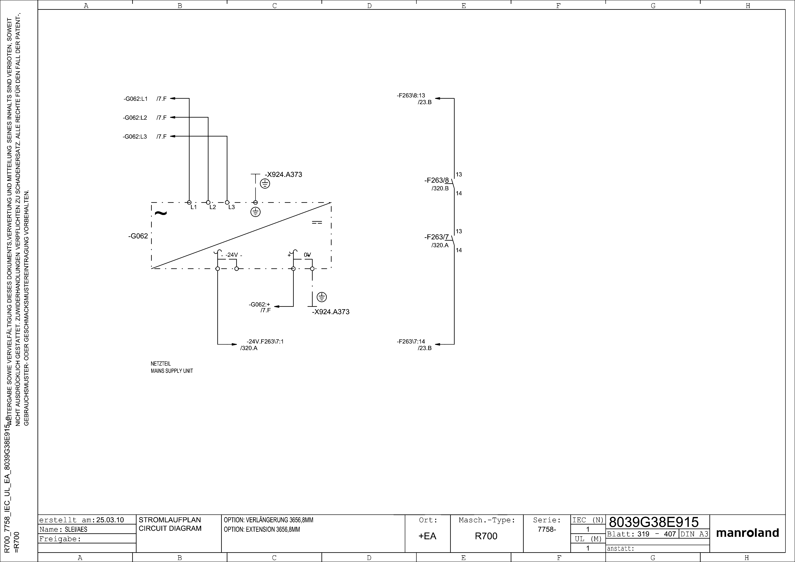

# +EA — Sheet 319 of 407 — OPTION: VERLÄNGERUNG 3656,8MM

**OPTION: EXTENSION 3656,8MM**

> Part of the manroland **R700** printing press IEC/UL circuit diagrams.
> Drawing class: **Stromlaufplan / Circuit diagram** (DIN A3).
> Document `+EA` covers the **Printing unit** machine section.

## At a glance

| Field | Value |
|---|---|
| Document | `+EA`  (8039G38E915) |
| Sheet | **319** of 407 |
| Section (DE) | OPTION: VERLÄNGERUNG 3656,8MM |
| Section (EN) | OPTION: EXTENSION 3656,8MM |
| Section type | CIRCUIT — Circuit diagram |
| Machine type | `R700` |
| Series | `7758` |
| Created | 25.03.10 |
| Replaces | — |
| Columns used | B, C, D, E |
| Path numbers | — |
| Labels on sheet | 35 |
| Cross-refs out | 9 |
| Cross-refs in | 9 |

**Previous:** [+EA sheet 318](SHEET_0318.md) · **Next:** [+EA sheet 320](SHEET_0320.md) · **Document TOC:** [_TOC.md](_TOC.md)  (+EA) · **Master TOC:** [all sheets](../_MASTER_TOC.md)

## Sheet image (300 DPI, exact vector render)



_Rendered directly from the PDF vector layer at 300 DPI (1-bit), no OCR and no resampling. Use it to confirm anything ambiguous in the text below._

## Cross-references on this sheet

Each entry is a wire leaving this sheet. The printed token is `/sheet.column`; the link resolves to that sheet inside the same document.

| Ref | Target sheet | Col | Path | Destination on target | Target section | From col |
|---|---|---|---|---|---|---|
| `/23.B` | [+EA sheet 23](SHEET_0023.md) | B | — | F263\8:13 | SPANNUNGSVERSORGUNG: 400V, 24V | D |
| `/7.F` | [+EA sheet 7](SHEET_0007.md) | F | — | G062:L1 | SPANNUNGSVERSORGUNG: 400V, 24V | B |
| `/7.F` | [+EA sheet 7](SHEET_0007.md) | F | — | G062:L2 | SPANNUNGSVERSORGUNG: 400V, 24V | B |
| `/7.F` | [+EA sheet 7](SHEET_0007.md) | F | — | G062:L3 | SPANNUNGSVERSORGUNG: 400V, 24V | B |
| `/320.B` | [+EA sheet 320](SHEET_0320.md) | B | — | — | OPTION: VERLÄNGERUNG 3656,8MM | E |
| `/320.A` | [+EA sheet 320](SHEET_0320.md) | A | — | — | OPTION: VERLÄNGERUNG 3656,8MM | E |
| `/7.F` | [+EA sheet 7](SHEET_0007.md) | F | — | G062:+ | SPANNUNGSVERSORGUNG: 400V, 24V | C |
| `/23.B` | [+EA sheet 23](SHEET_0023.md) | B | — | F263\7:14 | SPANNUNGSVERSORGUNG: 400V, 24V | D |
| `/320.A` | [+EA sheet 320](SHEET_0320.md) | A | — | — | OPTION: VERLÄNGERUNG 3656,8MM | C |

### Incoming references (sheets that point here)

Every other sheet that sends a wire to this one. `Back-ref` is the token printed on *that* sheet; `Path` is its line number.

| From sheet | Cols | Back-ref | Path | Refs | What continues there |
|---|---|---|---|---|---|
| [+EA#7](SHEET_0007.md) | F | `/7.F` | — | 4 | G062:+; G062:L1; G062:L2; G062:L3 |
| [+EA#23](SHEET_0023.md) | B | `/23.B` | — | 2 | — |
| [+EA#320](SHEET_0320.md) | A, B | `/320.A`, `/320.B` | — | 3 | 24V.F263\7:1 |


## Devices on this sheet

| Tag | Class | Class meaning (IEC) | Col | Sub | Terminal | Sign |
|---|---|---|---|---|---|---|
| `G062` | G | Stromversorgung / power supply | B | — | — | — |
| `F263/8` | F | Schutz / protection device (fuse, circuit breaker) | E | 8 | — | — |
| `F263/7` | F | Schutz / protection device (fuse, circuit breaker) | E | 7 | — | — |
| `G062:L3` | G | Stromversorgung / power supply | B | — | L3 | — |
| `G062:L2` | G | Stromversorgung / power supply | B | — | L2 | — |
| `G062:L1` | G | Stromversorgung / power supply | B | — | L1 | — |
| `X924.A373` | — | cross-device reference | C | — | — | — |
| `X924.A373` | — | cross-device reference | D | — | — | — |

## Potentials / nets

| Potential | Count | Columns | Attached devices | Terminals |
|---|---|---|---|---|
| `0V` | 1 | C | — | — |
| `24V` | 2 | C | `F263\7` | `1` |
| `L1` | 1 | B | — | — |
| `L2` | 1 | B | — | — |
| `L3` | 1 | C | — | — |


A potential such as `L24+/4` or `M24+` is a named supply/return rail; every place it appears on this sheet is electrically common.

## Wire-end annotations (grouped as printed)

A wire that continues elsewhere is annotated with a small cluster: the destination description, the path/line number `#NN`, and the `/sheet.column` cross reference. Each row below is one such cluster exactly as it is grouped on the drawing.

| Col | Y | Path | Cross-ref | Text on the wire |
|---|---|---|---|---|
| D | 139.2 | — | `/23.B` | `F263\8:13` |
| B | 144.1 | — | `/7.F` | `G062:L1` |
| B | 172.4 | — | `/7.F` | `G062:L2` |
| B | 200.8 | — | `/7.F` | `G062:L3` |
| C | 256.8 | — | — | `X924.A373` |
| E | 257.6 | — | — | `13` |
| E | 265.4 | — | — | `F263/8` |
| E | 278.4 | — | `/320.B` | — |
| E | 285.9 | — | — | `14` |
| B | 304.5 | — | — | `~` |
| B | 306.5 | — | — | `L1 L2 L3` |
| E | 342.6 | — | — | `13` |
| B | 349.0 | — | — | `G062` |
| E | 350.4 | — | — | `F263/7` |
| E | 363.4 | — | `/320.A` | — |
| E | 370.9 | — | — | `14` |
| C | 378.0 | — | — | `24V 0V` |
| C | 378.7 | — | — | `+ +` |
| C | 452.4 | — | `/7.F` | `G062:+` |
| D | 462.4 | — | — | `X924.A373` |
| C | 507.7 | — | — | `24V.F263\7:1` |
| D | 507.7 | — | `/23.B` | `F263\7:14` |
| C | 517.6 | — | `/320.A` | — |
| B | 542.0 | — | — | `NETZTEIL MAINS SUPPLY UNIT` |


## Reconstructed tables

This sheet carries tabular content (pin map / terminal assignment / index). The grid below was rebuilt from the drawing's own rule lines, so each row is exactly one physical row of the table.

### Table 1 — 5 data rows × 14 columns (at x=204.1, y=0.0) — **/7.F F263\8:13 /23.B /7.F ~ G062 NETZTEIL MAINS SUPPLY UNIT L1 L2 X924.A373 L3 24V + G062:+ /7.F 24V.F263\7:1 /320.A 0V + X924.A373 F263/8 /320.B F263/7 /320.A F263\7:14 /23.B 13 14 13 14**

| STROMLAUFPLAN |  |  |  |  | OPTION: VERLÄNGERUNG | 3656,8MM |  | Ort: |  | Masch. Type: | Serie: | IEC (N) | 8039G38E915 |
|---|---|---|---|---|---|---|---|---|---|---|---|---|---|
| `CIRCUIT DIAGRAM` |  |  |  |  |  |  |  |  |  |  |  |  |  |
|  |  |  |  |  | `OPTION: EXTENSION 3656,8MM` |  |  |  |  |  | `7758` | `1` |  |
|  |  |  |  |  |  |  |  | `+EA` |  | `R700` |  |  | `Blatt: DIN A3 319 407` |
|  |  |  |  |  |  |  |  |  |  |  |  | `UL (M)` |  |
|  |  |  |  |  |  |  |  |  |  |  |  | `1` | `anstatt:` |


## Notes and free text on this sheet

| Text | Col | Y (pt) |
|---|---|---|
| `NETZTEIL` | B | 542.01 |
| `MAINS SUPPLY UNIT` | B | 552.67 |
| `G062:+` | C | 452.43 |
| `F263\7:14` | D | 507.7 |
| `F263\8:13` | D | 139.2 |

## Complete label inventory (exact text from the drawing)

Every text object inside the drawing area of this sheet, in DIN reading order (column A→H, then top→bottom). This is the authoritative list: if a string is not here it is not printed on this sheet.

| Col | Y | X | Dir | Type | Text |
|---|---|---|---|---|---|
| B | 144.1 | 234.4 | → | cross-reference | `/7.F` |
| B | 144.2 | 185.1 | → | device tag | `G062:L1` |
| B | 172.4 | 234.4 | → | cross-reference | `/7.F` |
| B | 172.5 | 184.0 | → | device tag | `G062:L2` |
| B | 200.8 | 234.4 | → | cross-reference | `/7.F` |
| B | 200.9 | 183.7 | → | device tag | `G062:L3` |
| B | 304.5 | 230.7 | → | other | `~` |
| B | 306.5 | 285.4 | → | potential | `L1` |
| B | 306.5 | 313.8 | → | potential | `L2` |
| B | 349.0 | 192.2 | → | device tag | `G062` |
| B | 542.0 | 225.9 | → | text | `NETZTEIL` |
| B | 552.7 | 226.2 | → | text | `MAINS SUPPLY UNIT` |
| C | 256.8 | 396.6 | → | device ref | `X924.A373` |
| C | 306.5 | 342.1 | → | potential | `L3` |
| C | 378.0 | 337.9 | → | potential | `24V` |
| C | 378.0 | 455.1 | → | potential | `0V` |
| C | 378.7 | 430.6 | → | number | `+` |
| C | 378.7 | 458.9 | → | number | `+` |
| C | 452.4 | 372.8 | → | text | `G062:+` |
| C | 460.9 | 390.3 | → | cross-reference | `/7.F` |
| C | 507.7 | 369.6 | → | potential | `24V.F263\7:1` |
| C | 517.6 | 360.0 | → | cross-reference | `/320.A` |
| D | 139.2 | 594.4 | → | text | `F263\8:13` |
| D | 462.3 | 467.4 | → | device ref | `X924.A373` |
| D | 507.7 | 594.4 | → | text | `F263\7:14` |
| E | 149.1 | 625.9 | → | cross-reference | `/23.B` |
| E | 257.6 | 682.3 | → | number | `13` |
| E | 265.3 | 635.8 | → | device tag | `F263/8` |
| E | 278.4 | 646.6 | → | cross-reference | `/320.B` |
| E | 285.9 | 682.3 | → | number | `14` |
| E | 342.6 | 682.3 | → | number | `13` |
| E | 350.4 | 635.8 | → | device tag | `F263/7` |
| E | 363.5 | 646.3 | → | cross-reference | `/320.A` |
| E | 371.0 | 682.3 | → | number | `14` |
| E | 517.6 | 625.9 | → | cross-reference | `/23.B` |

## Reading-order text block

The same content as a plain block, grouped by DIN column — convenient to paste or to match against a visual description.

```text
=== Column B ===
 144.1  234.4  xref         /7.F
 144.2  185.1  devtag       G062:L1
 172.4  234.4  xref         /7.F
 172.5  184.0  devtag       G062:L2
 200.8  234.4  xref         /7.F
 200.9  183.7  devtag       G062:L3
 304.5  230.7  other        ~
 306.5  285.4  net          L1
 306.5  313.8  net          L2
 349.0  192.2  devtag       G062
 542.0  225.9  text         NETZTEIL
 552.7  226.2  text         MAINS SUPPLY UNIT
=== Column C ===
 256.8  396.6  devref       X924.A373
 306.5  342.1  net          L3
 378.0  337.9  net          24V
 378.0  455.1  net          0V
 378.7  430.6  numeric      +
 378.7  458.9  numeric      +
 452.4  372.8  text         G062:+
 460.9  390.3  xref         /7.F
 507.7  369.6  net          24V.F263\7:1
 517.6  360.0  xref         /320.A
=== Column D ===
 139.2  594.4  text         F263\8:13
 462.3  467.4  devref       X924.A373
 507.7  594.4  text         F263\7:14
=== Column E ===
 149.1  625.9  xref         /23.B
 257.6  682.3  numeric      13
 265.3  635.8  devtag       F263/8
 278.4  646.6  xref         /320.B
 285.9  682.3  numeric      14
 342.6  682.3  numeric      13
 350.4  635.8  devtag       F263/7
 363.5  646.3  xref         /320.A
 371.0  682.3  numeric      14
 517.6  625.9  xref         /23.B
```

---
_Generated from the PDF vector text layer; no OCR. Source: `R700_7758_IEC_UL_EA_8039G38E915_p`, sheet 319._
