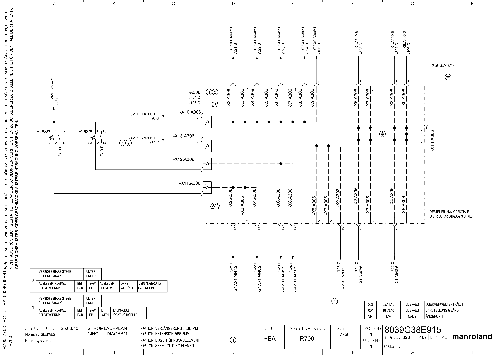

# +EA — Sheet 320 of 407 — OPTION: VERLÄNGERUNG 3656,8MM

**OPTION: EXTENSION 3656,8MM**

> Part of the manroland **R700** printing press IEC/UL circuit diagrams.
> Drawing class: **Stromlaufplan / Circuit diagram** (DIN A3).
> Document `+EA` covers the **Printing unit** machine section.

## At a glance

| Field | Value |
|---|---|
| Document | `+EA`  (8039G38E915) |
| Sheet | **320** of 407 |
| Section (DE) | OPTION: VERLÄNGERUNG 3656,8MM |
| Section (EN) | OPTION: EXTENSION 3656,8MM |
| Section type | CIRCUIT — Circuit diagram |
| Machine type | `R700` |
| Series | `7758` |
| Created | 25.03.10 |
| Replaces | — |
| Columns used | A, B, C, D, E, F, G, H |
| Path numbers | — |
| Labels on sheet | 170 |
| Cross-refs out | 22 |
| Cross-refs in | 46 |

**Previous:** [+EA sheet 319](SHEET_0319.md) · **Next:** [+EA sheet 321](SHEET_0321.md) · **Document TOC:** [_TOC.md](_TOC.md)  (+EA) · **Master TOC:** [all sheets](../_MASTER_TOC.md)

## Sheet image (300 DPI, exact vector render)



_Rendered directly from the PDF vector layer at 300 DPI (1-bit), no OCR and no resampling. Use it to confirm anything ambiguous in the text below._

## Cross-references on this sheet

Each entry is a wire leaving this sheet. The printed token is `/sheet.column`; the link resolves to that sheet inside the same document.

| Ref | Target sheet | Col | Path | Destination on target | Target section | From col |
|---|---|---|---|---|---|---|
| `/321.B` | [+EA sheet 321](SHEET_0321.md) | B | — | 0V.X1.A647:1 | OPTION: VERLÄNGERUNG 3656,8MM | D |
| `/322.B` | [+EA sheet 322](SHEET_0322.md) | B | — | 0V.X1.A648:1 | OPTION: VERLÄNGERUNG 3656,8MM | D |
| `/323.B` | [+EA sheet 323](SHEET_0323.md) | B | — | 0V.X1.A649:1 | OPTION: VERLÄNGERUNG 3656,8MM | E |
| `/324.B` | [+EA sheet 324](SHEET_0324.md) | B | — | 0V.X1.A650:1 | OPTION: VERLÄNGERUNG 3656,8MM | E |
| `/106.B` | [+EA sheet 106](SHEET_0106.md) | B | — | 0V.X9.A306:1 | BOGENFÜHRUNGSELEMENT | E |
| `/323.C` | [+EA sheet 323](SHEET_0323.md) | C | — | X1.A649:6 | OPTION: VERLÄNGERUNG 3656,8MM | F |
| `/324.C` | [+EA sheet 324](SHEET_0324.md) | C | — | X1.A650:6 | OPTION: VERLÄNGERUNG 3656,8MM | G |
| `/106.C` | [+EA sheet 106](SHEET_0106.md) | C | — | X9.A306:6 | BOGENFÜHRUNGSELEMENT | G |
| `/319.C` | [+EA sheet 319](SHEET_0319.md) | C | — | 24V.F263\7:1 | OPTION: VERLÄNGERUNG 3656,8MM | A |
| `/321.D` | [+EA sheet 321](SHEET_0321.md) | D | — | — | OPTION: VERLÄNGERUNG 3656,8MM | C |
| `/106.D` | [+EA sheet 106](SHEET_0106.md) | D | — | — | BOGENFÜHRUNGSELEMENT | C |
| `/8.G` | [+EA sheet 8](SHEET_0008.md) | G | — | 0V.X10.A306:1 | SPANNUNGSVERSORGUNG: 400V, 24V | C |
| `/17.C` | [+EA sheet 17](SHEET_0017.md) | C | — | 24V.X13.A306:1 | SPANNUNGSVERSORGUNG: 400V, 24V | B |
| `/319.E` | [+EA sheet 319](SHEET_0319.md) | E | — | — | OPTION: VERLÄNGERUNG 3656,8MM | A |
| `/319.E` | [+EA sheet 319](SHEET_0319.md) | E | — | — | OPTION: VERLÄNGERUNG 3656,8MM | B |
| `/321.B` | [+EA sheet 321](SHEET_0321.md) | B | — | — | OPTION: VERLÄNGERUNG 3656,8MM | D |
| `/322.B` | [+EA sheet 322](SHEET_0322.md) | B | — | — | OPTION: VERLÄNGERUNG 3656,8MM | D |
| `/323.B` | [+EA sheet 323](SHEET_0323.md) | B | — | — | OPTION: VERLÄNGERUNG 3656,8MM | E |
| `/324.B` | [+EA sheet 324](SHEET_0324.md) | B | — | — | OPTION: VERLÄNGERUNG 3656,8MM | E |
| `/106.C` | [+EA sheet 106](SHEET_0106.md) | C | — | — | BOGENFÜHRUNGSELEMENT | F |
| `/321.C` | [+EA sheet 321](SHEET_0321.md) | C | — | — | OPTION: VERLÄNGERUNG 3656,8MM | F |
| `/322.C` | [+EA sheet 322](SHEET_0322.md) | C | — | — | OPTION: VERLÄNGERUNG 3656,8MM | G |

### Incoming references (sheets that point here)

Every other sheet that sends a wire to this one. `Back-ref` is the token printed on *that* sheet; `Path` is its line number.

| From sheet | Cols | Back-ref | Path | Refs | What continues there |
|---|---|---|---|---|---|
| [+EA#8](SHEET_0008.md) | G | `/8.G` | — | 1 | 0V.X10.A306:1 |
| [+EA#17](SHEET_0017.md) | C | `/17.C` | — | 1 | — |
| [+EA#106](SHEET_0106.md) | B, C, D | `/106.B`, `/106.C`, `/106.D` | — | 4 | — |
| [+EA#224](SHEET_0224.md) | B | `/224.B` | — | 3 | — |
| [+EA#233](SHEET_0233.md) | G | `/233.G` | — | 3 | — |
| [+EA#236](SHEET_0236.md) | E | `/236.E` | — | 3 | — |
| [+EA#240](SHEET_0240.md) | A | `/240.A` | — | 3 | — |
| [+EA#244](SHEET_0244.md) | E | `/244.E` | — | 3 | — |
| [+EA#246](SHEET_0246.md) | E | `/246.E` | — | 3 | — |
| [+EA#249](SHEET_0249.md) | B | `/249.B` | — | 3 | — |
| [+EA#251](SHEET_0251.md) | F | `/251.F` | — | 3 | — |
| [+EA#319](SHEET_0319.md) | C, E | `/319.C`, `/319.E` | — | 3 | — |
| [+EA#321](SHEET_0321.md) | A, B, C | `/321.A`, `/321.B`, `/321.C` | — | 4 | 0V.X1.A647:1; 24V.X1.A647:2; X1.A647:6 |
| [+EA#322](SHEET_0322.md) | A, B | `/322.A`, `/322.B` | — | 3 | 0V.X1.A648:1; 24V.X1.A648:2; X1.A648:6 |
| [+EA#323](SHEET_0323.md) | A, B | `/323.A`, `/323.B` | — | 3 | 0V.X1.A649:1; 24V.X1.A649:2; X1.A649:6 |
| [+EA#324](SHEET_0324.md) | A, B | `/324.A`, `/324.B` | — | 3 | 0V.X1.A650:1; 24V.X1.A650:2; X1.A650:6 |


## Devices on this sheet

| Tag | Class | Class meaning (IEC) | Col | Sub | Terminal | Sign |
|---|---|---|---|---|---|---|
| `F263/8` | F | Schutz / protection device (fuse, circuit breaker) | B | 8 | — | — |
| `F263/7` | F | Schutz / protection device (fuse, circuit breaker) | A | 7 | — | — |
| `A306` | A | Baugruppe / assembly, module, PC board | C | — | — | — |
| `X4.A306` | — | cross-device reference | D | — | — | — |
| `X2.A306` | — | cross-device reference | D | — | — | — |
| `X2.A306` | — | cross-device reference | F | — | — | — |
| `X4.A306` | — | cross-device reference | G | — | — | — |
| `X8.A306` | — | cross-device reference | E | — | — | — |
| `X6.A306` | — | cross-device reference | E | — | — | — |
| `X9.A306` | — | cross-device reference | F | — | — | — |
| `X11.A306` | — | cross-device reference | C | — | — | — |
| `X4.A306` | — | cross-device reference | D | — | — | — |
| `X2.A306` | — | cross-device reference | D | — | — | — |
| `X6.A306` | — | cross-device reference | E | — | — | — |
| `X8.A306` | — | cross-device reference | E | — | — | — |
| `X9.A306` | — | cross-device reference | E | — | — | — |
| `X10.A306` | — | cross-device reference | C | — | — | — |
| `X13.A306` | — | cross-device reference | C | — | — | — |
| `X12.A306` | — | cross-device reference | C | — | — | — |
| `NR.` | — | cross-device reference | F | — | — | — |
| `16.09.10` | — | cross-device reference | G | — | — | — |
| `X14.A306` | — | cross-device reference | G | — | — | — |
| `05.11.10` | — | cross-device reference | G | — | — | — |
| `X1.A650:6` | — | cross-device reference | G | — | 6 | — |
| `X1.A649:6` | — | cross-device reference | F | — | 6 | — |
| `X1.A648:6` | — | cross-device reference | G | — | 6 | — |
| `X1.A647:6` | — | cross-device reference | F | — | 6 | — |
| `X9.A306:6` | — | cross-device reference | G | — | 6 | — |
| `X3.A306` | — | cross-device reference | D | — | — | — |
| `X3.A306` | — | cross-device reference | F | — | — | — |
| `X5.A306` | — | cross-device reference | G | — | — | — |
| `X5.A306` | — | cross-device reference | E | — | — | — |
| `X7.A306` | — | cross-device reference | F | — | — | — |
| `X3.A306` | — | cross-device reference | D | — | — | — |
| `X6.A306` | — | cross-device reference | F | — | — | — |
| `X7.A306` | — | cross-device reference | F | — | — | — |
| `X8.A306` | — | cross-device reference | G | — | — | — |
| `X9.A306` | — | cross-device reference | G | — | — | — |
| `X5.A306` | — | cross-device reference | E | — | — | — |
| `X7.A306` | — | cross-device reference | E | — | — | — |
| `X506.A373` | — | cross-device reference | G | — | — | — |

## Potentials / nets

| Potential | Count | Columns | Attached devices | Terminals |
|---|---|---|---|---|
| `0V` | 7 | B, D, E | `A306`, `A647`, `A648`, `A649`, `A650`, `X1`, `X10`, `X9` | `1` |
| `24V` | 8 | A, B, D, E, F | `A306`, `A647`, `A648`, `A649`, `A650`, `F263\7`, `X1`, `X13`, `X9` | `1`, `2` |


A potential such as `L24+/4` or `M24+` is a named supply/return rail; every place it appears on this sheet is electrically common.

## Wire-end annotations (grouped as printed)

A wire that continues elsewhere is annotated with a small cluster: the destination description, the path/line number `#NN`, and the `/sheet.column` cross reference. Each row below is one such cluster exactly as it is grouped on the drawing.

| Col | Y | Path | Cross-ref | Text on the wire |
|---|---|---|---|---|
| D | 63.5 | — | `/321.B` | `0V.X1.A647:1` |
| D | 63.5 | — | `/322.B` | `0V.X1.A648:1` |
| E | 63.5 | — | `/323.B` | `0V.X1.A649:1` |
| E | 63.5 | — | `/324.B` | `0V.X1.A650:1` |
| E | 63.5 | — | `/106.B` | `0V.X9.A306:1` |
| F | 74.0 | — | `/323.C` | `X1.A649:6` |
| G | 74.0 | — | `/324.C` | `X1.A650:6` |
| G | 74.0 | — | `/106.C` | `X9.A306:6` |
| G | 150.5 | — | — | `X506.A373` |
| A | 182.8 | — | `/319.C` | `24V.F263\7:1` |
| D | 190.2 | — | — | `1` |
| D | 190.2 | — | — | `1` |
| E | 190.2 | — | — | `1` |
| F | 190.2 | — | — | `1 6 6 6` |
| E | 190.2 | — | — | `1` |
| D | 208.0 | — | — | `1 1` |
| E | 208.0 | — | — | `1 6` |
| E | 208.0 | — | — | `1` |
| D | 210.6 | — | — | `X2.A306` |
| D | 210.6 | — | — | `X3.A306` |
| D | 210.6 | — | — | `X4.A306` |
| E | 210.6 | — | — | `X5.A306` |
| E | 210.6 | — | — | `X6.A306` |
| E | 210.6 | — | — | `X7.A306` |
| E | 210.6 | — | — | `X8.A306` |
| E | 210.6 | — | — | `X9.A306` |
| F | 210.6 | — | — | `X6.A306` |
| F | 210.6 | — | — | `X7.A306` |
| G | 210.6 | — | — | `X8.A306` |
| G | 210.6 | — | — | `X9.A306` |
| C | 214.3 | — | — | `A306` |
| D | 215.7 | — | — | `2` |
| C | 227.4 | — | `/321.D`, `/106.D` | — |
| D | 242.2 | — | — | `0V` |
| C | 261.1 | — | — | `X10.A306` |
| C | 266.7 | — | `/8.G` | `0V.X10.A306:1` |
| C | 278.1 | — | — | `1` |
| D | 293.0 | — | — | `1` |
| G | 294.2 | — | — | `1 X14.A306` |
| A | 307.2 | — | — | `1` |
| A | 307.2 | — | — | `13` |
| B | 307.2 | — | — | `1` |
| B | 307.2 | — | — | `13` |
| G | 307.2 | — | — | `1` |
| A | 307.9 | — | — | `F263/7` |
| B | 307.9 | — | — | `F263/8` |
| C | 317.8 | — | — | `X13.A306` |
| B | 323.4 | — | `/17.C` | `24V.X13.A306:1` |
| C | 334.8 | — | — | `1` |
| A | 335.5 | — | — | `6A 2` |
| A | 335.5 | — | — | `14` |
| B | 335.5 | — | — | `6A 2` |
| B | 335.5 | — | — | `14` |
| G | 335.5 | — | — | `1` |
| B | 335.7 | — | — | `1 2` |
| A | 345.3 | — | `/319.E` | — |
| B | 345.3 | — | `/319.E` | — |
| D | 349.7 | — | — | `1` |
| C | 373.1 | — | — | `X12.A306` |
| C | 405.6 | — | — | `1` |
| C | 429.8 | — | — | `X11.A306` |
| D | 434.7 | — | — | `1` |
| F | 444.5 | — | — | `X2.A306` |
| G | 444.5 | — | — | `X4.A306` |
| D | 447.3 | — | — | `X2.A306` |
| D | 447.3 | — | — | `X4.A306` |
| E | 447.3 | — | — | `X6.A306` |
| E | 447.3 | — | — | `X8.A306` |
| F | 447.3 | — | — | `X9.A306` |
| C | 462.3 | — | — | `1` |
| D | 464.9 | — | — | `X3.A306` |
| E | 464.9 | — | — | `X5.A306` |
| F | 464.9 | — | — | `X7.A306` |
| F | 464.9 | — | — | `X3.A306` |
| G | 464.9 | — | — | `X5.A306` |
| D | 483.2 | — | — | `24V` |
| H | 499.5 | — | — | `DISTRIBUTOR: ANALOG SIGNALS VERTEILER: ANALOGSIGNALE` |
| E | 520.5 | — | — | `2 6` |
| F | 520.5 | — | — | `2 2` |
| G | 520.5 | — | — | `6` |
| D | 537.5 | — | — | `2` |
| D | 537.5 | — | — | `2` |
| E | 537.5 | — | — | `2` |
| E | 537.5 | — | — | `2` |
| F | 537.5 | — | — | `2` |
| F | 537.5 | — | — | `6` |
| G | 537.5 | — | — | `6` |
| D | 620.5 | — | `/321.B` | — |
| D | 620.5 | — | `/322.B` | — |
| E | 620.5 | — | `/323.B` | — |
| E | 620.5 | — | `/324.B` | — |
| F | 620.5 | — | `/106.C` | — |
| F | 620.5 | — | `/321.C` | — |
| G | 620.5 | — | `/322.C` | — |
| D | 630.1 | — | — | `24V.X1.A647:2` |
| D | 630.1 | — | — | `24V.X1.A648:2` |
| E | 630.1 | — | — | `24V.X1.A649:2` |
| E | 630.1 | — | — | `24V.X1.A650:2` |
| F | 630.1 | — | — | `24V.X9.A306:2` |
| F | 630.4 | — | — | `X1.A647:6` |
| G | 630.4 | — | — | `X1.A648:6` |
| A | 641.2 | — | — | `SHIFTING STRAPS VERSCHIEBBARE STEGE` |
| B | 641.2 | — | — | `UNTER UNDER` |
| A | 660.7 | — | — | `2 DELIVERY DRUM AUSLEGERTROMMEL` |
| A | 669.4 | — | — | `BEI FOR` |
| B | 669.5 | — | — | `PP S+W` |
| B | 669.6 | — | — | `DELIVERY AUSLEGER` |
| B | 669.6 | — | — | `OHNE WITHOUT` |
| C | 669.6 | — | — | `EXTENSION VERLÄNGERUNG` |
| A | 705.0 | — | — | `SHIFTING STRAPS VERSCHIEBBARE STEGE` |
| B | 705.0 | — | — | `UNTER UNDER` |
| F | 711.3 | — | — | `1` |
| G | 719.0 | — | — | `002 05.11.10 SLEI/AES QUERVERWEIS ENTFÄLLT` |
| A | 724.5 | — | — | `1 DELIVERY DRUM AUSLEGERTROMMEL` |
| G | 733.0 | — | — | `001 16.09.10 SLEI/AES DARSTELLUNG GEÄND.` |
| A | 733.2 | — | — | `BEI FOR` |
| B | 733.2 | — | — | `PP S+W` |
| B | 733.4 | — | — | `MIT` |
| B | 733.4 | — | — | `LACKMODUL` |
| B | 743.9 | — | — | `WITH` |
| B | 744.0 | — | — | `COATING MODULE` |
| G | 747.1 | — | — | `NR. TAG NAME ÄNDERUNG` |


## Reconstructed tables

This sheet carries tabular content (pin map / terminal assignment / index). The grid below was rebuilt from the drawing's own rule lines, so each row is exactly one physical row of the table.

### Table 1 — 3 data rows × 1 columns (at x=986.5, y=289.1)

| C1 |
|---|
| `1` |
| `1` |
| `X14.A306 1` |


## Notes and free text on this sheet

| Text | Col | Y (pt) |
|---|---|---|
| `6A` | B | 335.73 |
| `6A` | A | 335.73 |
| `VERTEILER: ANALOGSIGNALE` | H | 499.52 |
| `DISTRIBUTOR: ANALOG SIGNALS` | H | 510.15 |
| `TAG` | G | 747.27 |
| `NAME` | G | 747.25 |
| `ÄNDERUNG` | G | 747.31 |
| `SLEI/AES` | G | 733.13 |
| `DARSTELLUNG GEÄND.` | H | 733.12 |
| `QUERVERWEIS ENTFÄLLT` | H | 718.95 |
| `AUSLEGERTROMMEL` | A | 733.41 |
| `DELIVERY DRUM` | A | 744.02 |
| `BEI` | A | 733.2 |
| `FOR` | A | 743.98 |
| `S+W` | B | 733.24 |
| `PP` | B | 743.87 |
| `MIT` | B | 733.35 |
| `WITH` | B | 743.89 |
| `LACKMODUL` | B | 733.4 |
| `COATING MODULE` | B | 744.03 |
| `VERSCHIEBBARE STEGE` | A | 705.02 |
| `SHIFTING STRAPS` | A | 715.65 |
| `UNTER` | B | 705.03 |
| `UNDER` | B | 715.67 |
| `AUSLEGER` | B | 669.61 |
| `DELIVERY` | B | 680.21 |
| `OHNE` | B | 669.6 |
| `WITHOUT` | B | 680.2 |
| `VERLÄNGERUNG` | C | 669.62 |
| `EXTENSION` | C | 680.2 |

## Complete label inventory (exact text from the drawing)

Every text object inside the drawing area of this sheet, in DIN reading order (column A→H, then top→bottom). This is the authoritative list: if a string is not here it is not printed on this sheet.

| Col | Y | X | Dir | Type | Text |
|---|---|---|---|---|---|
| A | 182.8 | 119.3 | ↕ | potential | `24V.F263\7:1` |
| A | 222.2 | 129.3 | ↕ | cross-reference | `/319.C` |
| A | 307.2 | 129.5 | → | number | `1` |
| A | 307.2 | 143.7 | → | number | `13` |
| A | 307.9 | 83.1 | → | device tag | `F263/7` |
| A | 335.5 | 130.1 | → | number | `2` |
| A | 335.5 | 143.7 | → | number | `14` |
| A | 335.7 | 110.3 | → | text | `6A` |
| A | 345.3 | 138.5 | ↕ | cross-reference | `/319.E` |
| A | 641.2 | 92.1 | → | text | `VERSCHIEBBARE STEGE` |
| A | 651.9 | 91.8 | → | text | `SHIFTING STRAPS` |
| A | 660.7 | 75.1 | → | number | `2` |
| A | 669.4 | 183.4 | → | text | `BEI` |
| A | 669.6 | 92.1 | → | text | `AUSLEGERTROMMEL` |
| A | 680.2 | 91.3 | → | text | `DELIVERY DRUM` |
| A | 680.2 | 183.4 | → | text | `FOR` |
| A | 705.0 | 92.1 | → | text | `VERSCHIEBBARE STEGE` |
| A | 715.7 | 91.8 | → | text | `SHIFTING STRAPS` |
| A | 724.5 | 75.4 | → | number | `1` |
| A | 733.2 | 183.4 | → | text | `BEI` |
| A | 733.4 | 92.1 | → | text | `AUSLEGERTROMMEL` |
| A | 744.0 | 91.3 | → | text | `DELIVERY DRUM` |
| A | 744.0 | 183.4 | → | text | `FOR` |
| B | 266.7 | 309.5 | → | potential | `0V.X10.A306:1` |
| B | 307.2 | 228.8 | → | number | `1` |
| B | 307.2 | 242.9 | → | number | `13` |
| B | 307.9 | 182.3 | → | device tag | `F263/8` |
| B | 323.4 | 301.9 | → | potential | `24V.X13.A306:1` |
| B | 335.5 | 229.3 | → | number | `2` |
| B | 335.5 | 242.9 | → | number | `14` |
| B | 335.7 | 209.5 | → | text | `6A` |
| B | 335.7 | 288.8 | → | number | `1` |
| B | 336.2 | 302.7 | → | number | `2` |
| B | 345.3 | 237.7 | ↕ | cross-reference | `/319.E` |
| B | 641.2 | 204.7 | → | text | `UNTER` |
| B | 651.9 | 204.7 | → | text | `UNDER` |
| B | 669.5 | 212.3 | → | text | `S+W` |
| B | 669.6 | 236.7 | → | text | `AUSLEGER` |
| B | 669.6 | 286.0 | → | text | `OHNE` |
| B | 680.1 | 211.7 | → | text | `PP` |
| B | 680.2 | 235.8 | → | text | `DELIVERY` |
| B | 680.2 | 286.3 | → | text | `WITHOUT` |
| B | 705.0 | 204.7 | → | text | `UNTER` |
| B | 715.7 | 204.7 | → | text | `UNDER` |
| B | 733.2 | 212.3 | → | text | `S+W` |
| B | 733.4 | 240.4 | → | text | `MIT` |
| B | 733.4 | 268.4 | → | text | `LACKMODUL` |
| B | 743.9 | 211.7 | → | text | `PP` |
| B | 743.9 | 240.9 | → | text | `WITH` |
| B | 744.0 | 269.0 | → | text | `COATING MODULE` |
| C | 214.3 | 447.0 | → | device tag | `A306` |
| C | 227.4 | 449.3 | → | cross-reference | `/321.D` |
| C | 239.8 | 449.3 | → | cross-reference | `/106.D` |
| C | 261.1 | 426.6 | → | device ref | `X10.A306` |
| C | 276.6 | 360.9 | → | cross-reference | `/8.G` |
| C | 278.1 | 466.6 | → | number | `1` |
| C | 317.8 | 410.7 | → | device ref | `X13.A306` |
| C | 333.4 | 356.3 | → | cross-reference | `/17.C` |
| C | 334.8 | 466.6 | → | number | `1` |
| C | 373.1 | 410.7 | → | device ref | `X12.A306` |
| C | 405.6 | 466.6 | → | number | `1` |
| C | 429.8 | 425.2 | → | device ref | `X11.A306` |
| C | 462.3 | 466.6 | → | number | `1` |
| C | 669.6 | 328.8 | → | text | `VERLÄNGERUNG` |
| C | 680.2 | 328.0 | → | text | `EXTENSION` |
| D | 63.5 | 544.5 | ↕ | potential | `0V.X1.A647:1` |
| D | 63.5 | 601.2 | ↕ | potential | `0V.X1.A648:1` |
| D | 102.0 | 554.4 | ↕ | cross-reference | `/321.B` |
| D | 102.0 | 611.1 | ↕ | cross-reference | `/322.B` |
| D | 190.2 | 554.7 | → | number | `1` |
| D | 190.2 | 611.4 | → | number | `1` |
| D | 208.0 | 585.1 | → | number | `1` |
| D | 210.6 | 537.5 | ↕ | device ref | `X2.A306` |
| D | 210.6 | 570.1 | ↕ | device ref | `X3.A306` |
| D | 210.6 | 594.2 | ↕ | device ref | `X4.A306` |
| D | 215.2 | 494.3 | → | number | `1` |
| D | 215.7 | 508.2 | → | number | `2` |
| D | 242.2 | 502.0 | → | potential | `0V` |
| D | 293.0 | 485.9 | → | number | `1` |
| D | 349.7 | 485.9 | → | number | `1` |
| D | 434.7 | 485.9 | → | number | `1` |
| D | 447.3 | 541.7 | ↕ | device ref | `X2.A306` |
| D | 447.3 | 598.4 | ↕ | device ref | `X4.A306` |
| D | 464.9 | 570.1 | ↕ | device ref | `X3.A306` |
| D | 483.2 | 496.7 | → | potential | `24V` |
| D | 520.5 | 583.7 | → | number | `2` |
| D | 537.5 | 555.3 | → | number | `2` |
| D | 537.5 | 612.0 | → | number | `2` |
| D | 620.5 | 544.5 | ↕ | cross-reference | `/321.B` |
| D | 620.5 | 601.2 | ↕ | cross-reference | `/322.B` |
| D | 630.1 | 554.4 | ↕ | potential | `24V.X1.A647:2` |
| D | 630.1 | 611.1 | ↕ | potential | `24V.X1.A648:2` |
| E | 63.5 | 657.9 | ↕ | potential | `0V.X1.A649:1` |
| E | 63.5 | 714.6 | ↕ | potential | `0V.X1.A650:1` |
| E | 63.5 | 742.9 | ↕ | potential | `0V.X9.A306:1` |
| E | 102.0 | 667.8 | ↕ | cross-reference | `/323.B` |
| E | 102.0 | 724.5 | ↕ | cross-reference | `/324.B` |
| E | 102.0 | 752.9 | ↕ | cross-reference | `/106.B` |
| E | 190.2 | 668.1 | → | number | `1` |
| E | 190.2 | 724.8 | → | number | `1` |
| E | 190.2 | 753.2 | → | number | `1` |
| E | 208.0 | 641.8 | → | number | `1` |
| E | 208.0 | 698.5 | → | number | `1` |
| E | 210.6 | 626.8 | ↕ | device ref | `X5.A306` |
| E | 210.6 | 650.9 | ↕ | device ref | `X6.A306` |
| E | 210.6 | 683.5 | ↕ | device ref | `X7.A306` |
| E | 210.6 | 707.6 | ↕ | device ref | `X8.A306` |
| E | 210.6 | 735.9 | ↕ | device ref | `X9.A306` |
| E | 447.3 | 655.1 | ↕ | device ref | `X6.A306` |
| E | 447.3 | 683.5 | ↕ | device ref | `X8.A306` |
| E | 464.9 | 740.2 | ↕ | device ref | `X5.A306` |
| E | 520.5 | 753.7 | → | number | `2` |
| E | 537.5 | 668.7 | → | number | `2` |
| E | 537.5 | 697.0 | → | number | `2` |
| E | 620.5 | 657.9 | ↕ | cross-reference | `/323.B` |
| E | 620.5 | 686.2 | ↕ | cross-reference | `/324.B` |
| E | 630.1 | 667.8 | ↕ | potential | `24V.X1.A649:2` |
| E | 630.1 | 696.2 | ↕ | potential | `24V.X1.A650:2` |
| F | 74.0 | 842.2 | ↕ | device ref | `X1.A649:6` |
| F | 101.8 | 852.1 | ↕ | cross-reference | `/323.C` |
| F | 190.2 | 852.9 | → | number | `6` |
| F | 208.0 | 881.3 | → | number | `6` |
| F | 210.6 | 839.4 | ↕ | device ref | `X6.A306` |
| F | 210.6 | 867.7 | ↕ | device ref | `X7.A306` |
| F | 444.5 | 839.4 | ↕ | device ref | `X2.A306` |
| F | 447.3 | 796.8 | ↕ | device ref | `X9.A306` |
| F | 464.9 | 768.5 | ↕ | device ref | `X7.A306` |
| F | 464.9 | 867.7 | ↕ | device ref | `X3.A306` |
| F | 520.5 | 782.1 | → | number | `2` |
| F | 520.5 | 881.3 | → | number | `6` |
| F | 537.5 | 810.4 | → | number | `2` |
| F | 537.5 | 852.9 | → | number | `6` |
| F | 620.5 | 799.7 | ↕ | cross-reference | `/106.C` |
| F | 620.5 | 842.2 | ↕ | cross-reference | `/321.C` |
| F | 630.1 | 809.6 | ↕ | potential | `24V.X9.A306:2` |
| F | 630.4 | 852.1 | ↕ | device ref | `X1.A647:6` |
| F | 711.3 | 791.9 | → | number | `1` |
| F | 719.0 | 872.9 | → | number | `002` |
| F | 733.0 | 873.5 | → | number | `001` |
| F | 747.1 | 872.6 | → | device ref | `NR.` |
| G | 74.0 | 927.2 | ↕ | device ref | `X1.A650:6` |
| G | 74.0 | 955.6 | ↕ | device ref | `X9.A306:6` |
| G | 101.8 | 937.1 | ↕ | cross-reference | `/324.C` |
| G | 101.8 | 965.5 | ↕ | cross-reference | `/106.C` |
| G | 150.5 | 1020.2 | → | device ref | `X506.A373` |
| G | 190.2 | 938.0 | → | number | `6` |
| G | 190.2 | 966.3 | → | number | `6` |
| G | 210.6 | 924.4 | ↕ | device ref | `X8.A306` |
| G | 210.6 | 952.8 | ↕ | device ref | `X9.A306` |
| G | 294.2 | 1012.2 | ↕ | number | `1` |
| G | 307.2 | 998.4 | → | number | `1` |
| G | 308.4 | 1020.8 | ↕ | device ref | `X14.A306` |
| G | 335.5 | 998.4 | → | number | `1` |
| G | 444.5 | 924.4 | ↕ | device ref | `X4.A306` |
| G | 464.9 | 952.8 | ↕ | device ref | `X5.A306` |
| G | 520.5 | 966.3 | → | number | `6` |
| G | 537.5 | 938.0 | → | number | `6` |
| G | 620.5 | 927.2 | ↕ | cross-reference | `/322.C` |
| G | 630.4 | 937.1 | ↕ | device ref | `X1.A648:6` |
| G | 719.0 | 907.7 | → | device ref | `05.11.10` |
| G | 719.0 | 962.4 | → | text | `SLEI/AES` |
| G | 733.1 | 907.3 | → | device ref | `16.09.10` |
| G | 733.1 | 962.4 | → | text | `SLEI/AES` |
| G | 747.3 | 914.1 | → | text | `TAG` |
| G | 747.3 | 967.5 | → | text | `NAME` |
| G | 747.3 | 1010.1 | → | text | `ÄNDERUNG` |
| H | 499.5 | 1020.5 | → | text | `VERTEILER: ANALOGSIGNALE` |
| H | 510.2 | 1019.6 | → | text | `DISTRIBUTOR: ANALOG SIGNALS` |
| H | 718.9 | 1009.3 | → | text | `QUERVERWEIS ENTFÄLLT` |
| H | 733.1 | 1009.0 | → | text | `DARSTELLUNG GEÄND.` |

## Reading-order text block

The same content as a plain block, grouped by DIN column — convenient to paste or to match against a visual description.

```text
=== Column A ===
 182.8  119.3  net          24V.F263\7:1
 222.2  129.3  xref         /319.C
 307.2  129.5  numeric      1
 307.2  143.7  numeric      13
 307.9   83.1  devtag       F263/7
 335.5  130.1  numeric      2
 335.5  143.7  numeric      14
 335.7  110.3  text         6A
 345.3  138.5  xref         /319.E
 641.2   92.1  text         VERSCHIEBBARE STEGE
 651.9   91.8  text         SHIFTING STRAPS
 660.7   75.1  numeric      2
 669.4  183.4  text         BEI
 669.6   92.1  text         AUSLEGERTROMMEL
 680.2   91.3  text         DELIVERY DRUM
 680.2  183.4  text         FOR
 705.0   92.1  text         VERSCHIEBBARE STEGE
 715.7   91.8  text         SHIFTING STRAPS
 724.5   75.4  numeric      1
 733.2  183.4  text         BEI
 733.4   92.1  text         AUSLEGERTROMMEL
 744.0   91.3  text         DELIVERY DRUM
 744.0  183.4  text         FOR
=== Column B ===
 266.7  309.5  net          0V.X10.A306:1
 307.2  228.8  numeric      1
 307.2  242.9  numeric      13
 307.9  182.3  devtag       F263/8
 323.4  301.9  net          24V.X13.A306:1
 335.5  229.3  numeric      2
 335.5  242.9  numeric      14
 335.7  209.5  text         6A
 335.7  288.8  numeric      1
 336.2  302.7  numeric      2
 345.3  237.7  xref         /319.E
 641.2  204.7  text         UNTER
 651.9  204.7  text         UNDER
 669.5  212.3  text         S+W
 669.6  236.7  text         AUSLEGER
 669.6  286.0  text         OHNE
 680.1  211.7  text         PP
 680.2  235.8  text         DELIVERY
 680.2  286.3  text         WITHOUT
 705.0  204.7  text         UNTER
 715.7  204.7  text         UNDER
 733.2  212.3  text         S+W
 733.4  240.4  text         MIT
 733.4  268.4  text         LACKMODUL
 743.9  211.7  text         PP
 743.9  240.9  text         WITH
 744.0  269.0  text         COATING MODULE
=== Column C ===
 214.3  447.0  devtag       A306
 227.4  449.3  xref         /321.D
 239.8  449.3  xref         /106.D
 261.1  426.6  devref       X10.A306
 276.6  360.9  xref         /8.G
 278.1  466.6  numeric      1
 317.8  410.7  devref       X13.A306
 333.4  356.3  xref         /17.C
 334.8  466.6  numeric      1
 373.1  410.7  devref       X12.A306
 405.6  466.6  numeric      1
 429.8  425.2  devref       X11.A306
 462.3  466.6  numeric      1
 669.6  328.8  text         VERLÄNGERUNG
 680.2  328.0  text         EXTENSION
=== Column D ===
  63.5  544.5  net          0V.X1.A647:1
  63.5  601.2  net          0V.X1.A648:1
 102.0  554.4  xref         /321.B
 102.0  611.1  xref         /322.B
 190.2  554.7  numeric      1
 190.2  611.4  numeric      1
 208.0  585.1  numeric      1
 210.6  537.5  devref       X2.A306
 210.6  570.1  devref       X3.A306
 210.6  594.2  devref       X4.A306
 215.2  494.3  numeric      1
 215.7  508.2  numeric      2
 242.2  502.0  net          0V
 293.0  485.9  numeric      1
 349.7  485.9  numeric      1
 434.7  485.9  numeric      1
 447.3  541.7  devref       X2.A306
 447.3  598.4  devref       X4.A306
 464.9  570.1  devref       X3.A306
 483.2  496.7  net          24V
 520.5  583.7  numeric      2
 537.5  555.3  numeric      2
 537.5  612.0  numeric      2
 620.5  544.5  xref         /321.B
 620.5  601.2  xref         /322.B
 630.1  554.4  net          24V.X1.A647:2
 630.1  611.1  net          24V.X1.A648:2
=== Column E ===
  63.5  657.9  net          0V.X1.A649:1
  63.5  714.6  net          0V.X1.A650:1
  63.5  742.9  net          0V.X9.A306:1
 102.0  667.8  xref         /323.B
 102.0  724.5  xref         /324.B
 102.0  752.9  xref         /106.B
 190.2  668.1  numeric      1
 190.2  724.8  numeric      1
 190.2  753.2  numeric      1
 208.0  641.8  numeric      1
 208.0  698.5  numeric      1
 210.6  626.8  devref       X5.A306
 210.6  650.9  devref       X6.A306
 210.6  683.5  devref       X7.A306
 210.6  707.6  devref       X8.A306
 210.6  735.9  devref       X9.A306
 447.3  655.1  devref       X6.A306
 447.3  683.5  devref       X8.A306
 464.9  740.2  devref       X5.A306
 520.5  753.7  numeric      2
 537.5  668.7  numeric      2
 537.5  697.0  numeric      2
 620.5  657.9  xref         /323.B
 620.5  686.2  xref         /324.B
 630.1  667.8  net          24V.X1.A649:2
 630.1  696.2  net          24V.X1.A650:2
=== Column F ===
  74.0  842.2  devref       X1.A649:6
 101.8  852.1  xref         /323.C
 190.2  852.9  numeric      6
 208.0  881.3  numeric      6
 210.6  839.4  devref       X6.A306
 210.6  867.7  devref       X7.A306
 444.5  839.4  devref       X2.A306
 447.3  796.8  devref       X9.A306
 464.9  768.5  devref       X7.A306
 464.9  867.7  devref       X3.A306
 520.5  782.1  numeric      2
 520.5  881.3  numeric      6
 537.5  810.4  numeric      2
 537.5  852.9  numeric      6
 620.5  799.7  xref         /106.C
 620.5  842.2  xref         /321.C
 630.1  809.6  net          24V.X9.A306:2
 630.4  852.1  devref       X1.A647:6
 711.3  791.9  numeric      1
 719.0  872.9  numeric      002
 733.0  873.5  numeric      001
 747.1  872.6  devref       NR.
=== Column G ===
  74.0  927.2  devref       X1.A650:6
  74.0  955.6  devref       X9.A306:6
 101.8  937.1  xref         /324.C
 101.8  965.5  xref         /106.C
 150.5 1020.2  devref       X506.A373
 190.2  938.0  numeric      6
 190.2  966.3  numeric      6
 210.6  924.4  devref       X8.A306
 210.6  952.8  devref       X9.A306
 294.2 1012.2  numeric      1
 307.2  998.4  numeric      1
 308.4 1020.8  devref       X14.A306
 335.5  998.4  numeric      1
 444.5  924.4  devref       X4.A306
 464.9  952.8  devref       X5.A306
 520.5  966.3  numeric      6
 537.5  938.0  numeric      6
 620.5  927.2  xref         /322.C
 630.4  937.1  devref       X1.A648:6
 719.0  907.7  devref       05.11.10
 719.0  962.4  text         SLEI/AES
 733.1  907.3  devref       16.09.10
 733.1  962.4  text         SLEI/AES
 747.3  914.1  text         TAG
 747.3  967.5  text         NAME
 747.3 1010.1  text         ÄNDERUNG
=== Column H ===
 499.5 1020.5  text         VERTEILER: ANALOGSIGNALE
 510.2 1019.6  text         DISTRIBUTOR: ANALOG SIGNALS
 718.9 1009.3  text         QUERVERWEIS ENTFÄLLT
 733.1 1009.0  text         DARSTELLUNG GEÄND.
```

---
_Generated from the PDF vector text layer; no OCR. Source: `R700_7758_IEC_UL_EA_8039G38E915_p`, sheet 320._
