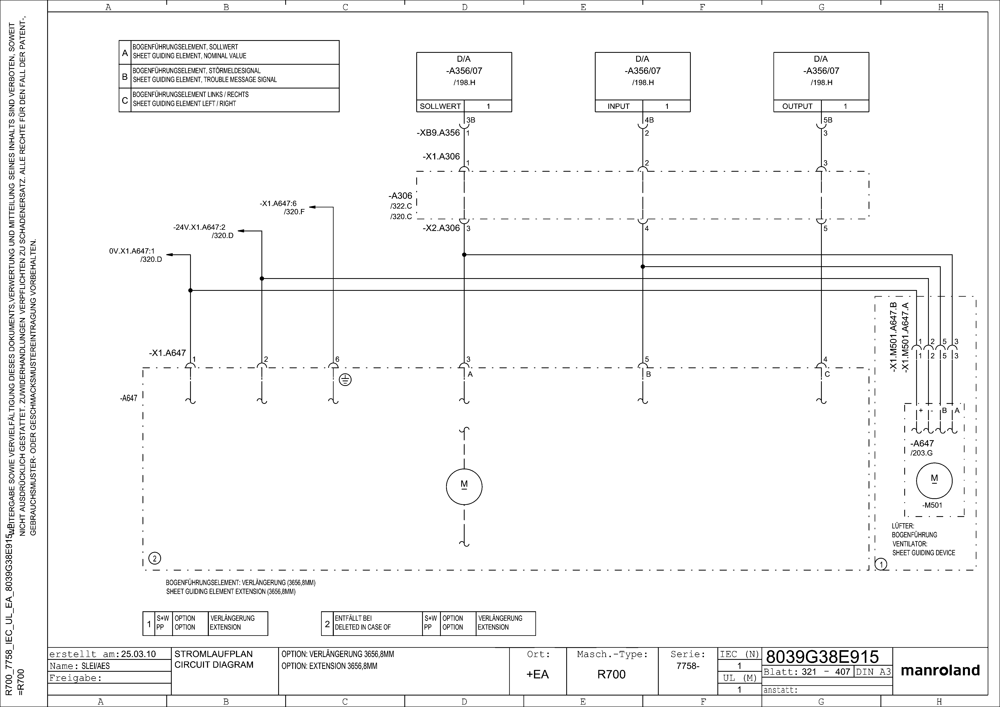

# +EA — Sheet 321 of 407 — OPTION: VERLÄNGERUNG 3656,8MM

**OPTION: EXTENSION 3656,8MM**

> Part of the manroland **R700** printing press IEC/UL circuit diagrams.
> Drawing class: **Stromlaufplan / Circuit diagram** (DIN A3).
> Document `+EA` covers the **Printing unit** machine section.

## At a glance

| Field | Value |
|---|---|
| Document | `+EA`  (8039G38E915) |
| Sheet | **321** of 407 |
| Section (DE) | OPTION: VERLÄNGERUNG 3656,8MM |
| Section (EN) | OPTION: EXTENSION 3656,8MM |
| Section type | CIRCUIT — Circuit diagram |
| Machine type | `R700` |
| Series | `7758` |
| Created | 25.03.10 |
| Replaces | — |
| Columns used | A, B, C, D, E, F, G, H |
| Path numbers | — |
| Labels on sheet | 101 |
| Cross-refs out | 9 |
| Cross-refs in | 32 |

**Previous:** [+EA sheet 320](SHEET_0320.md) · **Next:** [+EA sheet 322](SHEET_0322.md) · **Document TOC:** [_TOC.md](_TOC.md)  (+EA) · **Master TOC:** [all sheets](../_MASTER_TOC.md)

## Sheet image (300 DPI, exact vector render)



_Rendered directly from the PDF vector layer at 300 DPI (1-bit), no OCR and no resampling. Use it to confirm anything ambiguous in the text below._

## Cross-references on this sheet

Each entry is a wire leaving this sheet. The printed token is `/sheet.column`; the link resolves to that sheet inside the same document.

| Ref | Target sheet | Col | Path | Destination on target | Target section | From col |
|---|---|---|---|---|---|---|
| `/198.H` | [+EA sheet 198](SHEET_0198.md) | H | — | — | REFERENZMODUL | D |
| `/198.H` | [+EA sheet 198](SHEET_0198.md) | H | — | — | REFERENZMODUL | F |
| `/198.H` | [+EA sheet 198](SHEET_0198.md) | H | — | — | REFERENZMODUL | G |
| `/320.F` | [+EA sheet 320](SHEET_0320.md) | F | — | X1.A647:6 | OPTION: VERLÄNGERUNG 3656,8MM | B |
| `/322.C` | [+EA sheet 322](SHEET_0322.md) | C | — | — | OPTION: VERLÄNGERUNG 3656,8MM | C |
| `/320.C` | [+EA sheet 320](SHEET_0320.md) | C | — | — | OPTION: VERLÄNGERUNG 3656,8MM | C |
| `/320.D` | [+EA sheet 320](SHEET_0320.md) | D | — | 24V.X1.A647:2 | OPTION: VERLÄNGERUNG 3656,8MM | B |
| `/320.D` | [+EA sheet 320](SHEET_0320.md) | D | — | 0V.X1.A647:1 | OPTION: VERLÄNGERUNG 3656,8MM | A |
| `/203.G` | [+EA sheet 203](SHEET_0203.md) | G | — | A647 | REFERENZMODUL | H |

### Incoming references (sheets that point here)

Every other sheet that sends a wire to this one. `Back-ref` is the token printed on *that* sheet; `Path` is its line number.

| From sheet | Cols | Back-ref | Path | Refs | What continues there |
|---|---|---|---|---|---|
| [+EA#198](SHEET_0198.md) | H | `/198.H` | — | 3 | — |
| [+EA#203](SHEET_0203.md) | G | `/203.G` | — | 1 | — |
| [+EA#208](SHEET_0208.md) | E | `/208.E` | — | 3 | — |
| [+EA#213](SHEET_0213.md) | H | `/213.H` | — | 6 | — |
| [+EA#220](SHEET_0220.md) | E | `/220.E` | — | 8 | — |
| [+EA#224](SHEET_0224.md) | B | `/224.B` | — | 3 | — |
| [+EA#252](SHEET_0252.md) | E | `/252.E` | — | 3 | — |
| [+EA#320](SHEET_0320.md) | C, D, F | `/320.C`, `/320.D`, `/320.F` | — | 4 | 0V.X1.A647:1 |
| [+EA#322](SHEET_0322.md) | C | `/322.C` | — | 1 | — |


## Devices on this sheet

| Tag | Class | Class meaning (IEC) | Col | Sub | Terminal | Sign |
|---|---|---|---|---|---|---|
| `A647` | A | Baugruppe / assembly, module, PC board | H | — | — | — |
| `A356/07` | A | Baugruppe / assembly, module, PC board | D | 07 | — | — |
| `A356/07` | A | Baugruppe / assembly, module, PC board | G | 07 | — | — |
| `A356/07` | A | Baugruppe / assembly, module, PC board | F | 07 | — | — |
| `A306` | A | Baugruppe / assembly, module, PC board | C | — | — | — |
| `A647` | A | Baugruppe / assembly, module, PC board | A | — | — | — |
| `X1.M501.A647.B` | — | cross-device reference | H | — | — | — |
| `X1.M501.A647.A` | — | cross-device reference | H | — | — | — |
| `XB9.A356` | — | cross-device reference | D | — | — | — |
| `X1.A647` | — | cross-device reference | B | — | — | — |
| `X1.A306` | — | cross-device reference | D | — | — | — |
| `X2.A306` | — | cross-device reference | D | — | — | — |
| `X1.A647:6` | — | cross-device reference | B | — | 6 | — |

## Potentials / nets

| Potential | Count | Columns | Attached devices | Terminals |
|---|---|---|---|---|
| `0V` | 1 | A | `A647`, `X1` | `1` |
| `24V` | 1 | B | `A647`, `X1` | `2` |
| `M501` | 1 | H | — | — |


A potential such as `L24+/4` or `M24+` is a named supply/return rail; every place it appears on this sheet is electrically common.

## Wire-end annotations (grouped as printed)

A wire that continues elsewhere is annotated with a small cluster: the destination description, the path/line number `#NN`, and the `/sheet.column` cross reference. Each row below is one such cluster exactly as it is grouped on the drawing.

| Col | Y | Path | Cross-ref | Text on the wire |
|---|---|---|---|---|
| B | 53.1 | — | — | `BOGENFÜHRUNGSELEMENT, SOLLWERT` |
| B | 58.4 | — | — | `A SHEET GUIDING ELEMENT, NOMINAL VALUE` |
| D | 65.8 | — | — | `D/A` |
| E | 65.8 | — | — | `D/A` |
| G | 65.8 | — | — | `D/A` |
| D | 79.7 | — | — | `A356/07` |
| F | 79.7 | — | — | `A356/07` |
| G | 79.7 | — | — | `A356/07` |
| B | 81.4 | — | — | `BOGENFÜHRUNGSELEMENT, STÖRMELDESIGNAL` |
| B | 86.8 | — | — | `B SHEET GUIDING ELEMENT, TROUBLE MESSAGE SIGNAL` |
| D | 94.5 | — | `/198.H` | — |
| F | 94.5 | — | `/198.H` | — |
| G | 94.5 | — | `/198.H` | — |
| B | 109.8 | — | — | `BOGENFÜHRUNGSELEMENT LINKS / RECHTS` |
| B | 115.1 | — | — | `C SHEET GUIDING ELEMENT LEFT / RIGHT` |
| D | 122.8 | — | — | `SOLLWERT 1` |
| E | 122.9 | — | — | `INPUT 1` |
| G | 122.9 | — | — | `OUTPUT 1` |
| D | 139.2 | — | — | `3B` |
| F | 139.2 | — | — | `4B` |
| G | 139.2 | — | — | `5B` |
| D | 153.4 | — | — | `XB9.A356 1` |
| F | 154.8 | — | — | `2` |
| G | 154.8 | — | — | `3` |
| D | 181.7 | — | — | `X1.A306 1` |
| F | 190.2 | — | — | `2 3` |
| C | 228.5 | — | — | `A306` |
| B | 238.4 | — | `/320.F` | `X1.A647:6` |
| C | 241.6 | — | `/322.C`, `/320.C` | — |
| B | 266.7 | — | `/320.D` | `24V.X1.A647:2` |
| E | 266.8 | — | — | `X2.A306 3 4 5` |
| A | 295.1 | — | `/320.D` | `0V.X1.A647:1` |
| H | 359.4 | — | — | `X1.M501.A647.B` |
| H | 360.3 | — | — | `X1.M501.A647.A` |
| H | 402.8 | — | — | `1` |
| H | 402.8 | — | — | `2 5 3` |
| B | 415.6 | — | — | `X1.A647 1` |
| H | 419.9 | — | — | `1` |
| H | 419.9 | — | — | `2 5 3` |
| E | 424.1 | — | — | `2 6 3 5 4` |
| F | 441.7 | — | — | `A B C` |
| A | 470.7 | — | — | `A647` |
| H | 484.9 | — | — | `+ B A` |
| H | 523.3 | — | `/203.G` | `A647` |
| H | 564.4 | — | — | `M` |
| D | 571.5 | — | — | `M` |
| H | 597.8 | — | — | `M501` |
| H | 623.5 | — | — | `LÜFTER: BOGENFÜHRUNG` |
| H | 644.8 | — | — | `SHEET GUIDING DEVICE VENTILATOR:` |
| A | 662.2 | — | — | `2` |
| H | 668.8 | — | — | `1` |
| B | 690.9 | — | — | `BOGENFÜHRUNGSELEMENT: VERLÄNGERUNG (3656,8MM)` |
| B | 701.5 | — | — | `SHEET GUIDING ELEMENT EXTENSION (3656,8MM)` |
| B | 733.2 | — | — | `1 PP S+W OPTION OPTION` |
| D | 733.2 | — | — | `PP S+W` |
| B | 733.4 | — | — | `EXTENSION VERLÄNGERUNG` |
| D | 733.4 | — | — | `2 ENTFÄLLT BEI DELETED IN CASE OF EXTENSION VERLÄNGERUNG` |
| D | 733.4 | — | — | `OPTION OPTION` |


## Reconstructed tables

This sheet carries tabular content (pin map / terminal assignment / index). The grid below was rebuilt from the drawing's own rule lines, so each row is exactly one physical row of the table.

### Table 1 — 4 data rows × 5 columns (at x=226.8, y=62.4)

| NOMINAL VALUE STÖRMELDESIGNAL TROUBLE MESSAGE LINKS / RECHTS | SIGNAL |  | D/A | A356/07 /198.H |
|---|---|---|---|---|
| `LEFT / RIGHT` |  |  | `SOLLWERT` | `1` |
| `24V.X1.A647:2 /320.D` | `X1.A647:6 /320.F` | `A306 /322.C /320.C` | `XB9.A356 X1.A306 X2.A306` | `3B 1 1 3` |
| `1` | `2` | `6` |  | `3 A` |
|  |  |  | `M` |  |


### Table 2 — 3 data rows × 2 columns (at x=708.7, y=62.4)

| D/A | A356/07 /198.H |
|---|---|
| `INPUT` | `1` |
|  | `4B 2 2 4` |
|  | `5 B` |


### Table 3 — 4 data rows × 8 columns (at x=921.3, y=62.4)

| D/A | A356/07 /198.H |  |  |  |  |  |  |
|---|---|---|---|---|---|---|---|
| `OUTPUT` | `1` |  |  |  |  |  |  |
|  | `5B 3 3 5` |  |  |  |  |  |  |
|  | `4 C` | `X1.M501.A647.B` | `X1.M501.A647.A` | `1 1` | `2 2` | `5 5` | `3 3` |
|  |  |  |  | `+ A647 /203.G` | `M M501` | `B` | `A` |


## Notes and free text on this sheet

| Text | Col | Y (pt) |
|---|---|---|
| `M` | H | 564.43 |
| `LÜFTER:` | H | 623.5 |
| `BOGENFÜHRUNG` | H | 634.19 |
| `VENTILATOR:` | H | 644.79 |
| `SHEET GUIDING DEVICE` | H | 655.43 |
| `B` | H | 484.95 |
| `A` | H | 484.95 |
| `3B` | D | 139.17 |
| `D/A` | D | 65.78 |
| `SOLLWERT` | D | 122.83 |
| `5B` | G | 139.17 |
| `D/A` | G | 65.78 |
| `OUTPUT` | G | 122.89 |
| `4B` | F | 139.17 |
| `D/A` | E | 65.78 |
| `INPUT` | E | 122.88 |
| `BOGENFÜHRUNGSELEMENT, SOLLWERT` | B | 53.07 |
| `SHEET GUIDING ELEMENT, NOMINAL VALUE` | B | 63.71 |
| `A` | A | 58.41 |
| `BOGENFÜHRUNGSELEMENT, STÖRMELDESIGNAL` | B | 81.43 |
| `SHEET GUIDING ELEMENT, TROUBLE MESSAGE SIGNAL` | B | 92.05 |
| `B` | A | 86.76 |
| `BOGENFÜHRUNGSELEMENT LINKS / RECHTS` | B | 109.77 |
| `SHEET GUIDING ELEMENT LEFT / RIGHT` | B | 120.4 |
| `C` | A | 115.11 |
| `S+W` | A | 733.24 |
| `PP` | A | 743.87 |
| `OPTION` | B | 733.35 |
| `VERLÄNGERUNG` | B | 733.4 |
| `EXTENSION` | B | 743.98 |
| `S+W` | D | 733.24 |
| `PP` | D | 743.87 |
| `OPTION` | D | 733.35 |
| `VERLÄNGERUNG` | D | 733.4 |
| `EXTENSION` | D | 743.98 |
| `ENTFÄLLT BEI` | C | 733.35 |
| `DELETED IN CASE OF` | C | 744 |
| `M` | D | 571.51 |
| `BOGENFÜHRUNGSELEMENT: VERLÄNGERUNG (3656,8MM)` | B | 690.89 |
| `SHEET GUIDING ELEMENT EXTENSION (3656,8MM)` | B | 701.51 |
| `A` | D | 441.72 |
| `B` | F | 441.72 |
| `C` | G | 441.83 |

## Complete label inventory (exact text from the drawing)

Every text object inside the drawing area of this sheet, in DIN reading order (column A→H, then top→bottom). This is the authoritative list: if a string is not here it is not printed on this sheet.

| Col | Y | X | Dir | Type | Text |
|---|---|---|---|---|---|
| A | 58.4 | 145.3 | → | text | `A` |
| A | 86.8 | 145.1 | → | text | `B` |
| A | 115.1 | 145.0 | → | text | `C` |
| A | 295.1 | 130.1 | → | potential | `0V.X1.A647:1` |
| A | 305.0 | 167.2 | → | cross-reference | `/320.D` |
| A | 470.7 | 143.2 | → | device tag | `A647` |
| A | 662.2 | 182.3 | → | number | `2` |
| A | 733.2 | 186.8 | → | text | `S+W` |
| A | 738.7 | 174.6 | → | number | `1` |
| A | 743.9 | 186.2 | → | text | `PP` |
| B | 53.1 | 157.9 | → | text | `BOGENFÜHRUNGSELEMENT, SOLLWERT` |
| B | 63.7 | 158.5 | → | text | `SHEET GUIDING ELEMENT, NOMINAL VALUE` |
| B | 81.4 | 157.9 | → | text | `BOGENFÜHRUNGSELEMENT, STÖRMELDESIGNAL` |
| B | 92.0 | 158.5 | → | text | `SHEET GUIDING ELEMENT, TROUBLE MESSAGE SIGNAL` |
| B | 109.8 | 157.9 | → | text | `BOGENFÜHRUNGSELEMENT LINKS / RECHTS` |
| B | 120.4 | 158.5 | → | text | `SHEET GUIDING ELEMENT LEFT / RIGHT` |
| B | 238.4 | 309.3 | → | device ref | `X1.A647:6` |
| B | 266.7 | 206.4 | → | potential | `24V.X1.A647:2` |
| B | 276.7 | 252.3 | → | cross-reference | `/320.D` |
| B | 415.6 | 177.4 | → | device ref | `X1.A647` |
| B | 424.1 | 228.8 | → | number | `1` |
| B | 424.1 | 314.4 | → | number | `2` |
| B | 690.9 | 197.6 | → | text | `BOGENFÜHRUNGSELEMENT: VERLÄNGERUNG (3656,8MM)` |
| B | 701.5 | 198.1 | → | text | `SHEET GUIDING ELEMENT EXTENSION (3656,8MM)` |
| B | 733.4 | 208.1 | → | text | `OPTION` |
| B | 733.4 | 250.9 | → | text | `VERLÄNGERUNG` |
| B | 744.0 | 208.1 | → | text | `OPTION` |
| B | 744.0 | 250.0 | → | text | `EXTENSION` |
| C | 228.5 | 462.6 | → | device tag | `A306` |
| C | 241.6 | 464.9 | → | cross-reference | `/322.C` |
| C | 248.3 | 338.2 | → | cross-reference | `/320.F` |
| C | 254.0 | 464.9 | → | cross-reference | `/320.C` |
| C | 424.1 | 399.4 | → | number | `6` |
| C | 733.3 | 398.8 | → | text | `ENTFÄLLT BEI` |
| C | 738.7 | 386.9 | → | number | `2` |
| C | 744.0 | 398.8 | → | text | `DELETED IN CASE OF` |
| D | 65.8 | 544.0 | → | text | `D/A` |
| D | 79.7 | 531.4 | → | device tag | `A356/07` |
| D | 94.5 | 540.3 | → | cross-reference | `/198.H` |
| D | 122.8 | 499.9 | → | text | `SOLLWERT` |
| D | 122.9 | 579.1 | → | number | `1` |
| D | 139.2 | 555.3 | → | text | `3B` |
| D | 153.4 | 496.3 | → | device ref | `XB9.A356` |
| D | 154.8 | 554.7 | → | number | `1` |
| D | 181.7 | 503.4 | → | device ref | `X1.A306` |
| D | 190.2 | 554.7 | → | number | `1` |
| D | 266.8 | 503.4 | → | device ref | `X2.A306` |
| D | 268.2 | 555.3 | → | number | `3` |
| D | 424.1 | 555.3 | → | number | `3` |
| D | 441.7 | 556.9 | → | text | `A` |
| D | 571.5 | 548.4 | → | text | `M` |
| D | 733.2 | 505.7 | → | text | `S+W` |
| D | 733.4 | 527.0 | → | text | `OPTION` |
| D | 733.4 | 569.8 | → | text | `VERLÄNGERUNG` |
| D | 743.9 | 505.1 | → | text | `PP` |
| D | 744.0 | 527.0 | → | text | `OPTION` |
| D | 744.0 | 568.9 | → | text | `EXTENSION` |
| E | 65.8 | 756.6 | → | text | `D/A` |
| E | 122.9 | 723.5 | → | text | `INPUT` |
| F | 79.7 | 744.0 | → | device tag | `A356/07` |
| F | 94.5 | 752.9 | → | cross-reference | `/198.H` |
| F | 122.9 | 791.7 | → | number | `1` |
| F | 139.2 | 767.9 | → | text | `4B` |
| F | 154.8 | 767.9 | → | number | `2` |
| F | 190.2 | 767.9 | → | number | `2` |
| F | 268.2 | 767.9 | → | number | `4` |
| F | 424.1 | 767.9 | → | number | `5` |
| F | 441.7 | 769.2 | → | text | `B` |
| G | 65.8 | 969.2 | → | text | `D/A` |
| G | 79.7 | 956.6 | → | device tag | `A356/07` |
| G | 94.5 | 965.5 | → | cross-reference | `/198.H` |
| G | 122.9 | 931.6 | → | text | `OUTPUT` |
| G | 122.9 | 1004.3 | → | number | `1` |
| G | 139.2 | 980.5 | → | text | `5B` |
| G | 154.8 | 980.5 | → | number | `3` |
| G | 190.2 | 980.5 | → | number | `3` |
| G | 268.2 | 980.5 | → | number | `5` |
| G | 424.1 | 980.5 | → | number | `4` |
| G | 441.8 | 981.9 | → | text | `C` |
| H | 359.4 | 1059.1 | ↕ | device ref | `X1.M501.A647.B` |
| H | 360.3 | 1073.2 | ↕ | device ref | `X1.M501.A647.A` |
| H | 402.8 | 1093.3 | → | number | `1` |
| H | 402.8 | 1108.1 | → | number | `2` |
| H | 402.8 | 1122.2 | → | number | `5` |
| H | 402.8 | 1136.4 | → | number | `3` |
| H | 419.9 | 1093.3 | → | number | `1` |
| H | 419.9 | 1108.1 | → | number | `2` |
| H | 419.9 | 1122.2 | → | number | `5` |
| H | 419.9 | 1136.4 | → | number | `3` |
| H | 484.9 | 1121.7 | → | text | `B` |
| H | 484.9 | 1136.7 | → | text | `A` |
| H | 485.0 | 1093.9 | → | number | `+` |
| H | 523.3 | 1084.0 | → | device tag | `A647` |
| H | 535.7 | 1084.3 | → | cross-reference | `/203.G` |
| H | 564.4 | 1108.2 | → | text | `M` |
| H | 597.8 | 1098.1 | → | potential | `M501` |
| H | 623.5 | 1062.1 | → | text | `LÜFTER:` |
| H | 634.2 | 1062.1 | → | text | `BOGENFÜHRUNG` |
| H | 644.8 | 1063.0 | → | text | `VENTILATOR:` |
| H | 655.4 | 1062.7 | → | text | `SHEET GUIDING DEVICE` |
| H | 668.8 | 1047.1 | → | number | `1` |

## Reading-order text block

The same content as a plain block, grouped by DIN column — convenient to paste or to match against a visual description.

```text
=== Column A ===
  58.4  145.3  text         A
  86.8  145.1  text         B
 115.1  145.0  text         C
 295.1  130.1  net          0V.X1.A647:1
 305.0  167.2  xref         /320.D
 470.7  143.2  devtag       A647
 662.2  182.3  numeric      2
 733.2  186.8  text         S+W
 738.7  174.6  numeric      1
 743.9  186.2  text         PP
=== Column B ===
  53.1  157.9  text         BOGENFÜHRUNGSELEMENT, SOLLWERT
  63.7  158.5  text         SHEET GUIDING ELEMENT, NOMINAL VALUE
  81.4  157.9  text         BOGENFÜHRUNGSELEMENT, STÖRMELDESIGNAL
  92.0  158.5  text         SHEET GUIDING ELEMENT, TROUBLE MESSAGE SIGNAL
 109.8  157.9  text         BOGENFÜHRUNGSELEMENT LINKS / RECHTS
 120.4  158.5  text         SHEET GUIDING ELEMENT LEFT / RIGHT
 238.4  309.3  devref       X1.A647:6
 266.7  206.4  net          24V.X1.A647:2
 276.7  252.3  xref         /320.D
 415.6  177.4  devref       X1.A647
 424.1  228.8  numeric      1
 424.1  314.4  numeric      2
 690.9  197.6  text         BOGENFÜHRUNGSELEMENT: VERLÄNGERUNG (3656,8MM)
 701.5  198.1  text         SHEET GUIDING ELEMENT EXTENSION (3656,8MM)
 733.4  208.1  text         OPTION
 733.4  250.9  text         VERLÄNGERUNG
 744.0  208.1  text         OPTION
 744.0  250.0  text         EXTENSION
=== Column C ===
 228.5  462.6  devtag       A306
 241.6  464.9  xref         /322.C
 248.3  338.2  xref         /320.F
 254.0  464.9  xref         /320.C
 424.1  399.4  numeric      6
 733.3  398.8  text         ENTFÄLLT BEI
 738.7  386.9  numeric      2
 744.0  398.8  text         DELETED IN CASE OF
=== Column D ===
  65.8  544.0  text         D/A
  79.7  531.4  devtag       A356/07
  94.5  540.3  xref         /198.H
 122.8  499.9  text         SOLLWERT
 122.9  579.1  numeric      1
 139.2  555.3  text         3B
 153.4  496.3  devref       XB9.A356
 154.8  554.7  numeric      1
 181.7  503.4  devref       X1.A306
 190.2  554.7  numeric      1
 266.8  503.4  devref       X2.A306
 268.2  555.3  numeric      3
 424.1  555.3  numeric      3
 441.7  556.9  text         A
 571.5  548.4  text         M
 733.2  505.7  text         S+W
 733.4  527.0  text         OPTION
 733.4  569.8  text         VERLÄNGERUNG
 743.9  505.1  text         PP
 744.0  527.0  text         OPTION
 744.0  568.9  text         EXTENSION
=== Column E ===
  65.8  756.6  text         D/A
 122.9  723.5  text         INPUT
=== Column F ===
  79.7  744.0  devtag       A356/07
  94.5  752.9  xref         /198.H
 122.9  791.7  numeric      1
 139.2  767.9  text         4B
 154.8  767.9  numeric      2
 190.2  767.9  numeric      2
 268.2  767.9  numeric      4
 424.1  767.9  numeric      5
 441.7  769.2  text         B
=== Column G ===
  65.8  969.2  text         D/A
  79.7  956.6  devtag       A356/07
  94.5  965.5  xref         /198.H
 122.9  931.6  text         OUTPUT
 122.9 1004.3  numeric      1
 139.2  980.5  text         5B
 154.8  980.5  numeric      3
 190.2  980.5  numeric      3
 268.2  980.5  numeric      5
 424.1  980.5  numeric      4
 441.8  981.9  text         C
=== Column H ===
 359.4 1059.1  devref       X1.M501.A647.B
 360.3 1073.2  devref       X1.M501.A647.A
 402.8 1093.3  numeric      1
 402.8 1108.1  numeric      2
 402.8 1122.2  numeric      5
 402.8 1136.4  numeric      3
 419.9 1093.3  numeric      1
 419.9 1108.1  numeric      2
 419.9 1122.2  numeric      5
 419.9 1136.4  numeric      3
 484.9 1121.7  text         B
 484.9 1136.7  text         A
 485.0 1093.9  numeric      +
 523.3 1084.0  devtag       A647
 535.7 1084.3  xref         /203.G
 564.4 1108.2  text         M
 597.8 1098.1  net          M501
 623.5 1062.1  text         LÜFTER:
 634.2 1062.1  text         BOGENFÜHRUNG
 644.8 1063.0  text         VENTILATOR:
 655.4 1062.7  text         SHEET GUIDING DEVICE
 668.8 1047.1  numeric      1
```

---
_Generated from the PDF vector text layer; no OCR. Source: `R700_7758_IEC_UL_EA_8039G38E915_p`, sheet 321._
