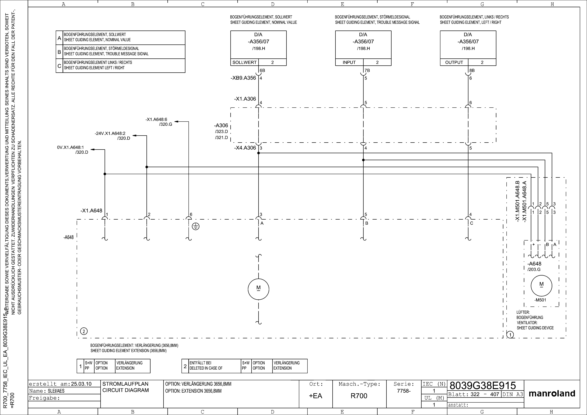

# +EA — Sheet 322 of 407 — OPTION: VERLÄNGERUNG 3656,8MM

**OPTION: EXTENSION 3656,8MM**

> Part of the manroland **R700** printing press IEC/UL circuit diagrams.
> Drawing class: **Stromlaufplan / Circuit diagram** (DIN A3).
> Document `+EA` covers the **Printing unit** machine section.

## At a glance

| Field | Value |
|---|---|
| Document | `+EA`  (8039G38E915) |
| Sheet | **322** of 407 |
| Section (DE) | OPTION: VERLÄNGERUNG 3656,8MM |
| Section (EN) | OPTION: EXTENSION 3656,8MM |
| Section type | CIRCUIT — Circuit diagram |
| Machine type | `R700` |
| Series | `7758` |
| Created | 25.03.10 |
| Replaces | — |
| Columns used | A, B, C, D, E, F, G, H |
| Path numbers | — |
| Labels on sheet | 107 |
| Cross-refs out | 9 |
| Cross-refs in | 32 |

**Previous:** [+EA sheet 321](SHEET_0321.md) · **Next:** [+EA sheet 323](SHEET_0323.md) · **Document TOC:** [_TOC.md](_TOC.md)  (+EA) · **Master TOC:** [all sheets](../_MASTER_TOC.md)

## Sheet image (300 DPI, exact vector render)



_Rendered directly from the PDF vector layer at 300 DPI (1-bit), no OCR and no resampling. Use it to confirm anything ambiguous in the text below._

## Cross-references on this sheet

Each entry is a wire leaving this sheet. The printed token is `/sheet.column`; the link resolves to that sheet inside the same document.

| Ref | Target sheet | Col | Path | Destination on target | Target section | From col |
|---|---|---|---|---|---|---|
| `/198.H` | [+EA sheet 198](SHEET_0198.md) | H | — | — | REFERENZMODUL | D |
| `/198.H` | [+EA sheet 198](SHEET_0198.md) | H | — | — | REFERENZMODUL | E |
| `/198.H` | [+EA sheet 198](SHEET_0198.md) | H | — | — | REFERENZMODUL | G |
| `/320.G` | [+EA sheet 320](SHEET_0320.md) | G | — | X1.A648:6 | OPTION: VERLÄNGERUNG 3656,8MM | B |
| `/323.D` | [+EA sheet 323](SHEET_0323.md) | D | — | — | OPTION: VERLÄNGERUNG 3656,8MM | C |
| `/321.D` | [+EA sheet 321](SHEET_0321.md) | D | — | — | OPTION: VERLÄNGERUNG 3656,8MM | C |
| `/320.D` | [+EA sheet 320](SHEET_0320.md) | D | — | 24V.X1.A648:2 | OPTION: VERLÄNGERUNG 3656,8MM | B |
| `/320.D` | [+EA sheet 320](SHEET_0320.md) | D | — | 0V.X1.A648:1 | OPTION: VERLÄNGERUNG 3656,8MM | A |
| `/203.G` | [+EA sheet 203](SHEET_0203.md) | G | — | A648 | REFERENZMODUL | H |

### Incoming references (sheets that point here)

Every other sheet that sends a wire to this one. `Back-ref` is the token printed on *that* sheet; `Path` is its line number.

| From sheet | Cols | Back-ref | Path | Refs | What continues there |
|---|---|---|---|---|---|
| [+EA#198](SHEET_0198.md) | H | `/198.H` | — | 3 | — |
| [+EA#203](SHEET_0203.md) | G | `/203.G` | — | 1 | — |
| [+EA#208](SHEET_0208.md) | E | `/208.E` | — | 3 | — |
| [+EA#213](SHEET_0213.md) | H | `/213.H` | — | 6 | — |
| [+EA#220](SHEET_0220.md) | F | `/220.F` | — | 8 | — |
| [+EA#236](SHEET_0236.md) | E | `/236.E` | — | 3 | — |
| [+EA#252](SHEET_0252.md) | E | `/252.E` | — | 3 | — |
| [+EA#320](SHEET_0320.md) | D, G | `/320.D`, `/320.G` | — | 3 | 0V.X1.A648:1 |
| [+EA#321](SHEET_0321.md) | C | `/321.C` | — | 1 | — |
| [+EA#323](SHEET_0323.md) | C | `/323.C` | — | 1 | — |


## Devices on this sheet

| Tag | Class | Class meaning (IEC) | Col | Sub | Terminal | Sign |
|---|---|---|---|---|---|---|
| `A306` | A | Baugruppe / assembly, module, PC board | C | — | — | — |
| `A356/07` | A | Baugruppe / assembly, module, PC board | D | 07 | — | — |
| `A356/07` | A | Baugruppe / assembly, module, PC board | G | 07 | — | — |
| `A356/07` | A | Baugruppe / assembly, module, PC board | E | 07 | — | — |
| `A648` | A | Baugruppe / assembly, module, PC board | H | — | — | — |
| `A648` | A | Baugruppe / assembly, module, PC board | A | — | — | — |
| `X1.A306` | — | cross-device reference | D | — | — | — |
| `XB9.A356` | — | cross-device reference | D | — | — | — |
| `X4.A306` | — | cross-device reference | D | — | — | — |
| `X1.A648` | — | cross-device reference | A | — | — | — |
| `X1.M501.A648.B` | — | cross-device reference | H | — | — | — |
| `X1.M501.A648.A` | — | cross-device reference | H | — | — | — |
| `X1.A648:6` | — | cross-device reference | B | — | 6 | — |

## Potentials / nets

| Potential | Count | Columns | Attached devices | Terminals |
|---|---|---|---|---|
| `0V` | 1 | A | `A648`, `X1` | `1` |
| `24V` | 1 | B | `A648`, `X1` | `2` |
| `M501` | 1 | H | — | — |


A potential such as `L24+/4` or `M24+` is a named supply/return rail; every place it appears on this sheet is electrically common.

## Wire-end annotations (grouped as printed)

A wire that continues elsewhere is annotated with a small cluster: the destination description, the path/line number `#NN`, and the `/sheet.column` cross reference. Each row below is one such cluster exactly as it is grouped on the drawing.

| Col | Y | Path | Cross-ref | Text on the wire |
|---|---|---|---|---|
| D | 31.8 | — | — | `BOGENFÜHRUNGSELEMENT, SOLLWERT` |
| E | 31.8 | — | — | `BOGENFÜHRUNGSELEMENT, STÖRMELDESIGNAL` |
| G | 31.8 | — | — | `BOGENFÜHRUNGSELEMENT, LINKS / RECHTS` |
| F | 42.4 | — | — | `SHEET GUIDING ELEMENT, TROUBLE MESSAGE SIGNAL` |
| G | 42.4 | — | — | `SHEET GUIDING ELEMENT, LEFT / RIGHT` |
| D | 42.5 | — | — | `SHEET GUIDING ELEMENT, NOMINAL VALUE` |
| D | 65.8 | — | — | `D/A` |
| E | 65.8 | — | — | `D/A` |
| G | 65.8 | — | — | `D/A` |
| A | 67.2 | — | — | `BOGENFÜHRUNGSELEMENT, SOLLWERT` |
| A | 72.6 | — | — | `A SHEET GUIDING ELEMENT, NOMINAL VALUE` |
| D | 79.7 | — | — | `A356/07` |
| E | 79.7 | — | — | `A356/07` |
| G | 79.7 | — | — | `A356/07` |
| D | 94.5 | — | `/198.H` | — |
| E | 94.5 | — | `/198.H` | — |
| G | 94.5 | — | `/198.H` | — |
| B | 95.6 | — | — | `BOGENFÜHRUNGSELEMENT, STÖRMELDESIGNAL` |
| B | 100.9 | — | — | `B SHEET GUIDING ELEMENT, TROUBLE MESSAGE SIGNAL` |
| D | 122.8 | — | — | `SOLLWERT 2` |
| E | 122.9 | — | — | `INPUT 2` |
| G | 122.9 | — | — | `OUTPUT 2` |
| A | 123.9 | — | — | `BOGENFÜHRUNGSELEMENT LINKS / RECHTS` |
| A | 129.3 | — | — | `C SHEET GUIDING ELEMENT LEFT / RIGHT` |
| D | 139.2 | — | — | `6B` |
| E | 139.2 | — | — | `7B` |
| G | 139.2 | — | — | `8B` |
| D | 153.4 | — | — | `XB9.A356 4` |
| E | 154.8 | — | — | `5` |
| G | 154.8 | — | — | `6` |
| D | 195.9 | — | — | `X1.A306 4` |
| F | 204.4 | — | — | `5 6` |
| B | 238.4 | — | `/320.G` | `X1.A648:6` |
| C | 249.8 | — | — | `A306` |
| C | 262.9 | — | `/323.D`, `/321.D` | — |
| B | 266.7 | — | `/320.D` | `24V.X1.A648:2` |
| A | 295.1 | — | `/320.D` | `0V.X1.A648:1` |
| E | 295.1 | — | — | `X4.A306 3 4 5` |
| H | 366.5 | — | — | `X1.M501.A648.B` |
| H | 367.4 | — | — | `X1.M501.A648.A` |
| H | 409.9 | — | — | `1` |
| H | 409.9 | — | — | `2 5 3` |
| A | 422.7 | — | — | `X1.A648 1` |
| H | 426.9 | — | — | `1` |
| H | 426.9 | — | — | `2 5 3` |
| E | 431.2 | — | — | `2 6 3 5 4` |
| E | 448.8 | — | — | `A B C` |
| A | 477.8 | — | — | `A648` |
| H | 492.0 | — | — | `+ B A` |
| H | 530.4 | — | `/203.G` | `A648` |
| H | 571.5 | — | — | `M` |
| D | 578.6 | — | — | `M` |
| H | 604.8 | — | — | `M501` |
| H | 630.6 | — | — | `LÜFTER: BOGENFÜHRUNG` |
| H | 651.9 | — | — | `SHEET GUIDING DEVICE VENTILATOR:` |
| A | 669.3 | — | — | `2` |
| G | 675.8 | — | — | `1` |
| B | 698.0 | — | — | `BOGENFÜHRUNGSELEMENT: VERLÄNGERUNG (3656,8MM)` |
| B | 708.6 | — | — | `SHEET GUIDING ELEMENT EXTENSION (3656,8MM)` |
| A | 733.2 | — | — | `1 PP S+W OPTION OPTION` |
| D | 733.2 | — | — | `PP S+W` |
| B | 733.4 | — | — | `EXTENSION VERLÄNGERUNG` |
| D | 733.4 | — | — | `2 ENTFÄLLT BEI DELETED IN CASE OF EXTENSION VERLÄNGERUNG` |
| D | 733.4 | — | — | `OPTION OPTION` |


## Reconstructed tables

This sheet carries tabular content (pin map / terminal assignment / index). The grid below was rebuilt from the drawing's own rule lines, so each row is exactly one physical row of the table.

### Table 1 — 4 data rows × 5 columns (at x=212.6, y=62.4)

| SOLLWERT NOMINAL VALUE STÖRMELDESIGNAL TROUBLE MESSAGE SIGNAL |  |  | D/A | A356/07 /198.H |
|---|---|---|---|---|
| `LINKS / RECHTS` |  |  | `SOLLWERT` | `2` |
| `LEFT / RIGHT 24V.X1.A648:2 /320.D` | `X1.A648:6 /320.G` | `A306 /323.D /321.D` | `XB9.A356 X1.A306 X4.A306` | `6B 4 4 3` |
| `1` | `2` | `6` |  | `3 A` |
|  |  |  |  | `M` |


### Table 2 — 3 data rows × 2 columns (at x=680.3, y=62.4)

| D/A | A356/07 /198.H |
|---|---|
| `INPUT` | `2` |
|  | `7B 5 5 4` |
|  | `5 B` |


### Table 3 — 4 data rows × 8 columns (at x=892.9, y=62.4)

| D/A | A356/07 /198.H |  |  |  |  |  |  |
|---|---|---|---|---|---|---|---|
| `OUTPUT` | `2` |  |  |  |  |  |  |
|  | `8B 6 6 5` |  |  |  |  |  |  |
|  | `4 C` | `X1.M501.A648.B` | `X1.M501.A648.A` | `1 1` | `2 2` | `5 5` | `3 3` |
|  |  |  |  | `+ A648 /203.G` | `M M501` | `B` | `A` |


## Notes and free text on this sheet

| Text | Col | Y (pt) |
|---|---|---|
| `6B` | D | 139.17 |
| `D/A` | D | 65.78 |
| `SOLLWERT` | D | 122.83 |
| `BOGENFÜHRUNGSELEMENT, SOLLWERT` | D | 31.81 |
| `SHEET GUIDING ELEMENT, NOMINAL VALUE` | D | 42.45 |
| `8B` | G | 139.17 |
| `D/A` | G | 65.78 |
| `OUTPUT` | G | 122.89 |
| `BOGENFÜHRUNGSELEMENT, LINKS / RECHTS` | G | 31.81 |
| `SHEET GUIDING ELEMENT, LEFT / RIGHT` | G | 42.44 |
| `7B` | E | 139.17 |
| `D/A` | E | 65.78 |
| `INPUT` | E | 122.88 |
| `BOGENFÜHRUNGSELEMENT, STÖRMELDESIGNAL` | E | 31.82 |
| `SHEET GUIDING ELEMENT, TROUBLE MESSAGE SIGNAL` | F | 42.44 |
| `M` | H | 571.51 |
| `LÜFTER:` | H | 630.59 |
| `BOGENFÜHRUNG` | H | 641.27 |
| `VENTILATOR:` | H | 651.88 |
| `SHEET GUIDING DEVICE` | H | 662.52 |
| `B` | H | 492.04 |
| `A` | H | 492.04 |
| `M` | D | 578.6 |
| `S+W` | A | 733.24 |
| `PP` | A | 743.87 |
| `OPTION` | B | 733.35 |
| `VERLÄNGERUNG` | B | 733.4 |
| `EXTENSION` | B | 743.98 |
| `S+W` | D | 733.24 |
| `PP` | D | 743.87 |
| `OPTION` | D | 733.35 |
| `VERLÄNGERUNG` | D | 733.4 |
| `EXTENSION` | D | 743.98 |
| `ENTFÄLLT BEI` | C | 733.35 |
| `DELETED IN CASE OF` | C | 744 |
| `BOGENFÜHRUNGSELEMENT: VERLÄNGERUNG (3656,8MM)` | B | 697.97 |
| `SHEET GUIDING ELEMENT EXTENSION (3656,8MM)` | B | 708.6 |
| `BOGENFÜHRUNGSELEMENT, SOLLWERT` | A | 67.24 |
| `SHEET GUIDING ELEMENT, NOMINAL VALUE` | A | 77.88 |
| `A` | A | 72.59 |
| `BOGENFÜHRUNGSELEMENT, STÖRMELDESIGNAL` | B | 95.6 |
| `SHEET GUIDING ELEMENT, TROUBLE MESSAGE SIGNAL` | B | 106.22 |
| `B` | A | 100.93 |
| `BOGENFÜHRUNGSELEMENT LINKS / RECHTS` | A | 123.94 |
| `SHEET GUIDING ELEMENT LEFT / RIGHT` | A | 134.57 |
| `C` | A | 129.29 |
| `B` | E | 448.81 |
| `C` | G | 448.92 |
| `A` | D | 448.81 |

## Complete label inventory (exact text from the drawing)

Every text object inside the drawing area of this sheet, in DIN reading order (column A→H, then top→bottom). This is the authoritative list: if a string is not here it is not printed on this sheet.

| Col | Y | X | Dir | Type | Text |
|---|---|---|---|---|---|
| A | 67.2 | 129.5 | → | text | `BOGENFÜHRUNGSELEMENT, SOLLWERT` |
| A | 72.6 | 116.9 | → | text | `A` |
| A | 77.9 | 130.1 | → | text | `SHEET GUIDING ELEMENT, NOMINAL VALUE` |
| A | 100.9 | 116.8 | → | text | `B` |
| A | 123.9 | 129.5 | → | text | `BOGENFÜHRUNGSELEMENT LINKS / RECHTS` |
| A | 129.3 | 116.6 | → | text | `C` |
| A | 134.6 | 130.1 | → | text | `SHEET GUIDING ELEMENT LEFT / RIGHT` |
| A | 295.1 | 115.9 | → | potential | `0V.X1.A648:1` |
| A | 305.0 | 153.1 | → | cross-reference | `/320.D` |
| A | 422.7 | 163.3 | → | device ref | `X1.A648` |
| A | 477.8 | 129.0 | → | device tag | `A648` |
| A | 669.3 | 168.1 | → | number | `2` |
| A | 733.2 | 172.6 | → | text | `S+W` |
| A | 738.7 | 160.4 | → | number | `1` |
| A | 743.9 | 172.1 | → | text | `PP` |
| B | 95.6 | 129.5 | → | text | `BOGENFÜHRUNGSELEMENT, STÖRMELDESIGNAL` |
| B | 106.2 | 130.1 | → | text | `SHEET GUIDING ELEMENT, TROUBLE MESSAGE SIGNAL` |
| B | 238.4 | 295.1 | → | device ref | `X1.A648:6` |
| B | 248.3 | 322.9 | → | cross-reference | `/320.G` |
| B | 266.7 | 192.2 | → | potential | `24V.X1.A648:2` |
| B | 276.7 | 238.1 | → | cross-reference | `/320.D` |
| B | 431.2 | 214.6 | → | number | `1` |
| B | 431.2 | 300.2 | → | number | `2` |
| B | 698.0 | 183.4 | → | text | `BOGENFÜHRUNGSELEMENT: VERLÄNGERUNG (3656,8MM)` |
| B | 708.6 | 184.0 | → | text | `SHEET GUIDING ELEMENT EXTENSION (3656,8MM)` |
| B | 733.4 | 193.9 | → | text | `OPTION` |
| B | 733.4 | 236.7 | → | text | `VERLÄNGERUNG` |
| B | 744.0 | 193.9 | → | text | `OPTION` |
| B | 744.0 | 235.8 | → | text | `EXTENSION` |
| C | 249.8 | 434.3 | → | device tag | `A306` |
| C | 262.8 | 436.5 | → | cross-reference | `/323.D` |
| C | 275.3 | 436.5 | → | cross-reference | `/321.D` |
| C | 431.2 | 385.2 | → | number | `6` |
| C | 733.3 | 384.7 | → | text | `ENTFÄLLT BEI` |
| C | 738.7 | 372.8 | → | number | `2` |
| C | 744.0 | 384.7 | → | text | `DELETED IN CASE OF` |
| D | 31.8 | 466.9 | → | text | `BOGENFÜHRUNGSELEMENT, SOLLWERT` |
| D | 42.4 | 467.4 | → | text | `SHEET GUIDING ELEMENT, NOMINAL VALUE` |
| D | 65.8 | 515.6 | → | text | `D/A` |
| D | 79.7 | 503.0 | → | device tag | `A356/07` |
| D | 94.5 | 511.9 | → | cross-reference | `/198.H` |
| D | 122.8 | 471.5 | → | text | `SOLLWERT` |
| D | 122.9 | 550.5 | → | number | `2` |
| D | 139.2 | 527.0 | → | text | `6B` |
| D | 153.4 | 468.0 | → | device ref | `XB9.A356` |
| D | 154.8 | 527.0 | → | number | `4` |
| D | 195.9 | 475.1 | → | device ref | `X1.A306` |
| D | 204.4 | 527.0 | → | number | `4` |
| D | 295.1 | 475.1 | → | device ref | `X4.A306` |
| D | 296.5 | 527.0 | → | number | `3` |
| D | 431.2 | 527.0 | → | number | `3` |
| D | 448.8 | 528.5 | → | text | `A` |
| D | 578.6 | 520.0 | → | text | `M` |
| D | 733.2 | 491.5 | → | text | `S+W` |
| D | 733.4 | 512.8 | → | text | `OPTION` |
| D | 733.4 | 555.6 | → | text | `VERLÄNGERUNG` |
| D | 743.9 | 491.0 | → | text | `PP` |
| D | 744.0 | 512.8 | → | text | `OPTION` |
| D | 744.0 | 554.7 | → | text | `EXTENSION` |
| E | 31.8 | 679.5 | → | text | `BOGENFÜHRUNGSELEMENT, STÖRMELDESIGNAL` |
| E | 65.8 | 728.2 | → | text | `D/A` |
| E | 79.7 | 715.6 | → | device tag | `A356/07` |
| E | 94.5 | 724.5 | → | cross-reference | `/198.H` |
| E | 122.9 | 695.2 | → | text | `INPUT` |
| E | 139.2 | 739.6 | → | text | `7B` |
| E | 154.8 | 739.6 | → | number | `5` |
| E | 204.4 | 739.6 | → | number | `5` |
| E | 296.5 | 739.6 | → | number | `4` |
| E | 431.2 | 739.6 | → | number | `5` |
| E | 448.8 | 740.8 | → | text | `B` |
| F | 42.4 | 680.0 | → | text | `SHEET GUIDING ELEMENT, TROUBLE MESSAGE SIGNAL` |
| F | 122.9 | 763.1 | → | number | `2` |
| G | 31.8 | 892.1 | → | text | `BOGENFÜHRUNGSELEMENT, LINKS / RECHTS` |
| G | 42.4 | 892.6 | → | text | `SHEET GUIDING ELEMENT, LEFT / RIGHT` |
| G | 65.8 | 940.8 | → | text | `D/A` |
| G | 79.7 | 928.2 | → | device tag | `A356/07` |
| G | 94.5 | 937.1 | → | cross-reference | `/198.H` |
| G | 122.9 | 903.3 | → | text | `OUTPUT` |
| G | 122.9 | 975.7 | → | number | `2` |
| G | 139.2 | 952.2 | → | text | `8B` |
| G | 154.8 | 952.2 | → | number | `6` |
| G | 204.4 | 952.2 | → | number | `6` |
| G | 296.5 | 952.2 | → | number | `5` |
| G | 431.2 | 952.2 | → | number | `4` |
| G | 448.9 | 953.6 | → | text | `C` |
| G | 675.8 | 1032.9 | → | number | `1` |
| H | 366.5 | 1044.9 | ↕ | device ref | `X1.M501.A648.B` |
| H | 367.4 | 1059.1 | ↕ | device ref | `X1.M501.A648.A` |
| H | 409.9 | 1079.1 | → | number | `1` |
| H | 409.9 | 1093.9 | → | number | `2` |
| H | 409.9 | 1108.1 | → | number | `5` |
| H | 409.9 | 1122.2 | → | number | `3` |
| H | 426.9 | 1079.1 | → | number | `1` |
| H | 426.9 | 1093.9 | → | number | `2` |
| H | 426.9 | 1108.1 | → | number | `5` |
| H | 426.9 | 1122.2 | → | number | `3` |
| H | 492.0 | 1107.5 | → | text | `B` |
| H | 492.0 | 1122.5 | → | text | `A` |
| H | 492.1 | 1079.7 | → | number | `+` |
| H | 530.4 | 1069.8 | → | device tag | `A648` |
| H | 542.8 | 1070.1 | → | cross-reference | `/203.G` |
| H | 571.5 | 1094.0 | → | text | `M` |
| H | 604.8 | 1084.0 | → | potential | `M501` |
| H | 630.6 | 1048.0 | → | text | `LÜFTER:` |
| H | 641.3 | 1048.0 | → | text | `BOGENFÜHRUNG` |
| H | 651.9 | 1048.8 | → | text | `VENTILATOR:` |
| H | 662.5 | 1048.5 | → | text | `SHEET GUIDING DEVICE` |

## Reading-order text block

The same content as a plain block, grouped by DIN column — convenient to paste or to match against a visual description.

```text
=== Column A ===
  67.2  129.5  text         BOGENFÜHRUNGSELEMENT, SOLLWERT
  72.6  116.9  text         A
  77.9  130.1  text         SHEET GUIDING ELEMENT, NOMINAL VALUE
 100.9  116.8  text         B
 123.9  129.5  text         BOGENFÜHRUNGSELEMENT LINKS / RECHTS
 129.3  116.6  text         C
 134.6  130.1  text         SHEET GUIDING ELEMENT LEFT / RIGHT
 295.1  115.9  net          0V.X1.A648:1
 305.0  153.1  xref         /320.D
 422.7  163.3  devref       X1.A648
 477.8  129.0  devtag       A648
 669.3  168.1  numeric      2
 733.2  172.6  text         S+W
 738.7  160.4  numeric      1
 743.9  172.1  text         PP
=== Column B ===
  95.6  129.5  text         BOGENFÜHRUNGSELEMENT, STÖRMELDESIGNAL
 106.2  130.1  text         SHEET GUIDING ELEMENT, TROUBLE MESSAGE SIGNAL
 238.4  295.1  devref       X1.A648:6
 248.3  322.9  xref         /320.G
 266.7  192.2  net          24V.X1.A648:2
 276.7  238.1  xref         /320.D
 431.2  214.6  numeric      1
 431.2  300.2  numeric      2
 698.0  183.4  text         BOGENFÜHRUNGSELEMENT: VERLÄNGERUNG (3656,8MM)
 708.6  184.0  text         SHEET GUIDING ELEMENT EXTENSION (3656,8MM)
 733.4  193.9  text         OPTION
 733.4  236.7  text         VERLÄNGERUNG
 744.0  193.9  text         OPTION
 744.0  235.8  text         EXTENSION
=== Column C ===
 249.8  434.3  devtag       A306
 262.8  436.5  xref         /323.D
 275.3  436.5  xref         /321.D
 431.2  385.2  numeric      6
 733.3  384.7  text         ENTFÄLLT BEI
 738.7  372.8  numeric      2
 744.0  384.7  text         DELETED IN CASE OF
=== Column D ===
  31.8  466.9  text         BOGENFÜHRUNGSELEMENT, SOLLWERT
  42.4  467.4  text         SHEET GUIDING ELEMENT, NOMINAL VALUE
  65.8  515.6  text         D/A
  79.7  503.0  devtag       A356/07
  94.5  511.9  xref         /198.H
 122.8  471.5  text         SOLLWERT
 122.9  550.5  numeric      2
 139.2  527.0  text         6B
 153.4  468.0  devref       XB9.A356
 154.8  527.0  numeric      4
 195.9  475.1  devref       X1.A306
 204.4  527.0  numeric      4
 295.1  475.1  devref       X4.A306
 296.5  527.0  numeric      3
 431.2  527.0  numeric      3
 448.8  528.5  text         A
 578.6  520.0  text         M
 733.2  491.5  text         S+W
 733.4  512.8  text         OPTION
 733.4  555.6  text         VERLÄNGERUNG
 743.9  491.0  text         PP
 744.0  512.8  text         OPTION
 744.0  554.7  text         EXTENSION
=== Column E ===
  31.8  679.5  text         BOGENFÜHRUNGSELEMENT, STÖRMELDESIGNAL
  65.8  728.2  text         D/A
  79.7  715.6  devtag       A356/07
  94.5  724.5  xref         /198.H
 122.9  695.2  text         INPUT
 139.2  739.6  text         7B
 154.8  739.6  numeric      5
 204.4  739.6  numeric      5
 296.5  739.6  numeric      4
 431.2  739.6  numeric      5
 448.8  740.8  text         B
=== Column F ===
  42.4  680.0  text         SHEET GUIDING ELEMENT, TROUBLE MESSAGE SIGNAL
 122.9  763.1  numeric      2
=== Column G ===
  31.8  892.1  text         BOGENFÜHRUNGSELEMENT, LINKS / RECHTS
  42.4  892.6  text         SHEET GUIDING ELEMENT, LEFT / RIGHT
  65.8  940.8  text         D/A
  79.7  928.2  devtag       A356/07
  94.5  937.1  xref         /198.H
 122.9  903.3  text         OUTPUT
 122.9  975.7  numeric      2
 139.2  952.2  text         8B
 154.8  952.2  numeric      6
 204.4  952.2  numeric      6
 296.5  952.2  numeric      5
 431.2  952.2  numeric      4
 448.9  953.6  text         C
 675.8 1032.9  numeric      1
=== Column H ===
 366.5 1044.9  devref       X1.M501.A648.B
 367.4 1059.1  devref       X1.M501.A648.A
 409.9 1079.1  numeric      1
 409.9 1093.9  numeric      2
 409.9 1108.1  numeric      5
 409.9 1122.2  numeric      3
 426.9 1079.1  numeric      1
 426.9 1093.9  numeric      2
 426.9 1108.1  numeric      5
 426.9 1122.2  numeric      3
 492.0 1107.5  text         B
 492.0 1122.5  text         A
 492.1 1079.7  numeric      +
 530.4 1069.8  devtag       A648
 542.8 1070.1  xref         /203.G
 571.5 1094.0  text         M
 604.8 1084.0  net          M501
 630.6 1048.0  text         LÜFTER:
 641.3 1048.0  text         BOGENFÜHRUNG
 651.9 1048.8  text         VENTILATOR:
 662.5 1048.5  text         SHEET GUIDING DEVICE
```

---
_Generated from the PDF vector text layer; no OCR. Source: `R700_7758_IEC_UL_EA_8039G38E915_p`, sheet 322._
