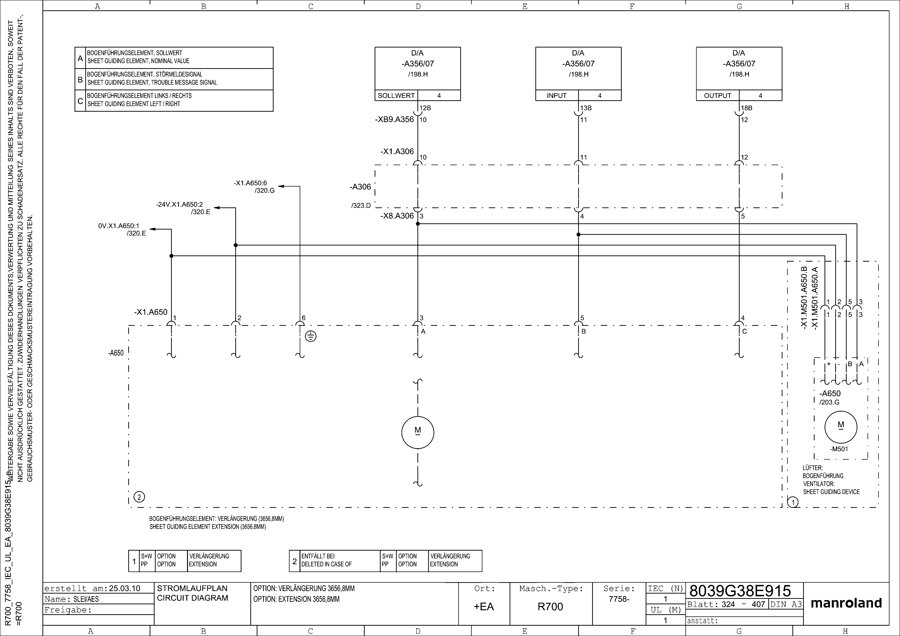

# +EA — Sheet 324 of 407 — OPTION: VERLÄNGERUNG 3656,8MM

**OPTION: EXTENSION 3656,8MM**

> Part of the manroland **R700** printing press IEC/UL circuit diagrams.
> Drawing class: **Stromlaufplan / Circuit diagram** (DIN A3).
> Document `+EA` covers the **Printing unit** machine section.

## At a glance

| Field | Value |
|---|---|
| Document | `+EA`  (8039G38E915) |
| Sheet | **324** of 407 |
| Section (DE) | OPTION: VERLÄNGERUNG 3656,8MM |
| Section (EN) | OPTION: EXTENSION 3656,8MM |
| Section type | CIRCUIT — Circuit diagram |
| Machine type | `R700` |
| Series | `7758` |
| Created | 25.03.10 |
| Replaces | — |
| Columns used | A, B, C, D, E, F, G, H |
| Path numbers | — |
| Labels on sheet | 100 |
| Cross-refs out | 8 |
| Cross-refs in | 31 |

**Previous:** [+EA sheet 323](SHEET_0323.md) · **Next:** [+EA sheet 325](SHEET_0325.md) · **Document TOC:** [_TOC.md](_TOC.md)  (+EA) · **Master TOC:** [all sheets](../_MASTER_TOC.md)

## Sheet image (300 DPI, exact vector render)



_Rendered directly from the PDF vector layer at 300 DPI (1-bit), no OCR and no resampling. Use it to confirm anything ambiguous in the text below._

## Cross-references on this sheet

Each entry is a wire leaving this sheet. The printed token is `/sheet.column`; the link resolves to that sheet inside the same document.

| Ref | Target sheet | Col | Path | Destination on target | Target section | From col |
|---|---|---|---|---|---|---|
| `/198.H` | [+EA sheet 198](SHEET_0198.md) | H | — | — | REFERENZMODUL | D |
| `/198.H` | [+EA sheet 198](SHEET_0198.md) | H | — | — | REFERENZMODUL | F |
| `/198.H` | [+EA sheet 198](SHEET_0198.md) | H | — | — | REFERENZMODUL | G |
| `/320.G` | [+EA sheet 320](SHEET_0320.md) | G | — | X1.A650:6 | OPTION: VERLÄNGERUNG 3656,8MM | B |
| `/320.E` | [+EA sheet 320](SHEET_0320.md) | E | — | 24V.X1.A650:2 | OPTION: VERLÄNGERUNG 3656,8MM | B |
| `/323.D` | [+EA sheet 323](SHEET_0323.md) | D | — | — | OPTION: VERLÄNGERUNG 3656,8MM | C |
| `/320.E` | [+EA sheet 320](SHEET_0320.md) | E | — | 0V.X1.A650:1 | OPTION: VERLÄNGERUNG 3656,8MM | A |
| `/203.G` | [+EA sheet 203](SHEET_0203.md) | G | — | A650 | REFERENZMODUL | H |

### Incoming references (sheets that point here)

Every other sheet that sends a wire to this one. `Back-ref` is the token printed on *that* sheet; `Path` is its line number.

| From sheet | Cols | Back-ref | Path | Refs | What continues there |
|---|---|---|---|---|---|
| [+EA#198](SHEET_0198.md) | H | `/198.H` | — | 3 | — |
| [+EA#203](SHEET_0203.md) | G | `/203.G` | — | 1 | — |
| [+EA#208](SHEET_0208.md) | E | `/208.E` | — | 3 | — |
| [+EA#214](SHEET_0214.md) | A | `/214.A` | — | 6 | — |
| [+EA#220](SHEET_0220.md) | H | `/220.H` | — | 8 | — |
| [+EA#249](SHEET_0249.md) | B | `/249.B` | — | 3 | — |
| [+EA#252](SHEET_0252.md) | E | `/252.E` | — | 3 | — |
| [+EA#320](SHEET_0320.md) | E, G | `/320.E`, `/320.G` | — | 3 | 0V.X1.A650:1; X1.A650:6 |
| [+EA#323](SHEET_0323.md) | C | `/323.C` | — | 1 | — |


## Devices on this sheet

| Tag | Class | Class meaning (IEC) | Col | Sub | Terminal | Sign |
|---|---|---|---|---|---|---|
| `A306` | A | Baugruppe / assembly, module, PC board | C | — | — | — |
| `A356/07` | A | Baugruppe / assembly, module, PC board | D | 07 | — | — |
| `A356/07` | A | Baugruppe / assembly, module, PC board | G | 07 | — | — |
| `A356/07` | A | Baugruppe / assembly, module, PC board | F | 07 | — | — |
| `A650` | A | Baugruppe / assembly, module, PC board | H | — | — | — |
| `A650` | A | Baugruppe / assembly, module, PC board | A | — | — | — |
| `X1.A306` | — | cross-device reference | D | — | — | — |
| `XB9.A356` | — | cross-device reference | D | — | — | — |
| `X8.A306` | — | cross-device reference | D | — | — | — |
| `X1.A650` | — | cross-device reference | B | — | — | — |
| `X1.M501.A650.B` | — | cross-device reference | H | — | — | — |
| `X1.M501.A650.A` | — | cross-device reference | H | — | — | — |
| `X1.A650:6` | — | cross-device reference | B | — | 6 | — |

## Potentials / nets

| Potential | Count | Columns | Attached devices | Terminals |
|---|---|---|---|---|
| `0V` | 1 | A | `A650`, `X1` | `1` |
| `24V` | 1 | B | `A650`, `X1` | `2` |
| `M501` | 1 | H | — | — |


A potential such as `L24+/4` or `M24+` is a named supply/return rail; every place it appears on this sheet is electrically common.

## Wire-end annotations (grouped as printed)

A wire that continues elsewhere is annotated with a small cluster: the destination description, the path/line number `#NN`, and the `/sheet.column` cross reference. Each row below is one such cluster exactly as it is grouped on the drawing.

| Col | Y | Path | Cross-ref | Text on the wire |
|---|---|---|---|---|
| D | 65.8 | — | — | `D/A` |
| E | 65.8 | — | — | `D/A` |
| G | 65.8 | — | — | `D/A` |
| A | 67.2 | — | — | `BOGENFÜHRUNGSELEMENT, SOLLWERT` |
| A | 72.6 | — | — | `A SHEET GUIDING ELEMENT, NOMINAL VALUE` |
| D | 79.7 | — | — | `A356/07` |
| F | 79.7 | — | — | `A356/07` |
| G | 79.7 | — | — | `A356/07` |
| D | 94.5 | — | `/198.H` | — |
| F | 94.5 | — | `/198.H` | — |
| G | 94.5 | — | `/198.H` | — |
| A | 95.6 | — | — | `BOGENFÜHRUNGSELEMENT, STÖRMELDESIGNAL` |
| A | 100.9 | — | — | `B SHEET GUIDING ELEMENT, TROUBLE MESSAGE SIGNAL` |
| D | 122.8 | — | — | `SOLLWERT 4` |
| E | 122.9 | — | — | `INPUT 4` |
| G | 122.9 | — | — | `OUTPUT 4` |
| A | 123.9 | — | — | `BOGENFÜHRUNGSELEMENT LINKS / RECHTS` |
| A | 129.3 | — | — | `C SHEET GUIDING ELEMENT LEFT / RIGHT` |
| D | 139.2 | — | — | `12B` |
| F | 139.2 | — | — | `13B` |
| G | 139.2 | — | — | `18B` |
| D | 153.4 | — | — | `XB9.A356 10` |
| F | 154.8 | — | — | `11` |
| G | 154.8 | — | — | `12` |
| D | 195.9 | — | — | `X1.A306 10` |
| F | 204.4 | — | — | `11 12` |
| B | 238.4 | — | `/320.G` | `X1.A650:6` |
| C | 242.7 | — | — | `A306` |
| B | 266.7 | — | `/320.E` | `24V.X1.A650:2` |
| C | 268.2 | — | `/323.D` | — |
| E | 280.9 | — | — | `X8.A306 3 4 5` |
| A | 295.1 | — | `/320.E` | `0V.X1.A650:1` |
| H | 352.4 | — | — | `X1.M501.A650.B` |
| H | 353.2 | — | — | `X1.M501.A650.A` |
| H | 395.8 | — | — | `1` |
| H | 395.8 | — | — | `2 5 3` |
| B | 408.5 | — | — | `X1.A650 1` |
| H | 412.8 | — | — | `1` |
| H | 412.8 | — | — | `2 5 3` |
| E | 417.0 | — | — | `2 6 3 5 4` |
| F | 434.6 | — | — | `A B C` |
| A | 463.6 | — | — | `A650` |
| H | 477.9 | — | — | `+ B A` |
| H | 516.2 | — | `/203.G` | `A650` |
| H | 557.3 | — | — | `M` |
| D | 564.4 | — | — | `M` |
| H | 590.7 | — | — | `M501` |
| H | 616.4 | — | — | `LÜFTER: BOGENFÜHRUNG` |
| H | 637.7 | — | — | `SHEET GUIDING DEVICE VENTILATOR:` |
| A | 655.1 | — | — | `2` |
| H | 661.7 | — | — | `1` |
| B | 683.8 | — | — | `BOGENFÜHRUNGSELEMENT: VERLÄNGERUNG (3656,8MM)` |
| B | 694.4 | — | — | `SHEET GUIDING ELEMENT EXTENSION (3656,8MM)` |
| B | 733.2 | — | — | `1 PP S+W OPTION OPTION` |
| D | 733.2 | — | — | `PP S+W` |
| B | 733.4 | — | — | `EXTENSION VERLÄNGERUNG` |
| D | 733.4 | — | — | `2 ENTFÄLLT BEI DELETED IN CASE OF EXTENSION VERLÄNGERUNG` |
| D | 733.4 | — | — | `OPTION OPTION` |


## Reconstructed tables

This sheet carries tabular content (pin map / terminal assignment / index). The grid below was rebuilt from the drawing's own rule lines, so each row is exactly one physical row of the table.

### Table 1 — 4 data rows × 5 columns (at x=226.8, y=62.4)

| VALUE STÖRMELDESIGNAL MESSAGE SIGNAL |  |  | D/A | A356/07 /198.H |
|---|---|---|---|---|
| `RECHTS` |  |  | `SOLLWERT` | `4` |
| `RIGHT 24V.X1.A650:2 /320.E` | `X1.A650:6 /320.G` | `A306 /323.D` | `XB9.A356 X1.A306 X8.A306` | `12B 10 10 3` |
| `1` | `2` | `6` |  | `3 A` |
|  |  |  | `M` |  |


### Table 2 — 3 data rows × 2 columns (at x=708.7, y=62.4)

| D/A | A356/07 /198.H |
|---|---|
| `INPUT` | `4` |
|  | `13B 11 11 4` |
|  | `5 B` |


### Table 3 — 4 data rows × 8 columns (at x=921.3, y=62.4)

| D/A | A356/07 /198.H |  |  |  |  |  |  |
|---|---|---|---|---|---|---|---|
| `OUTPUT` | `4` |  |  |  |  |  |  |
|  | `18B 12 12 5` |  |  |  |  |  |  |
|  | `4 C` | `X1.M501.A650.B` | `X1.M501.A650.A` | `1 1` | `2 2` | `5 5` | `3 3` |
|  |  |  |  | `+ A650 /203.G` | `M M501` | `B` | `A` |


## Notes and free text on this sheet

| Text | Col | Y (pt) |
|---|---|---|
| `12B` | D | 139.18 |
| `D/A` | D | 65.78 |
| `SOLLWERT` | D | 122.83 |
| `18B` | G | 139.18 |
| `D/A` | G | 65.78 |
| `OUTPUT` | G | 122.89 |
| `13B` | F | 139.18 |
| `D/A` | E | 65.78 |
| `INPUT` | E | 122.88 |
| `M` | H | 557.34 |
| `LÜFTER:` | H | 616.42 |
| `BOGENFÜHRUNG` | H | 627.1 |
| `VENTILATOR:` | H | 637.71 |
| `SHEET GUIDING DEVICE` | H | 648.35 |
| `B` | H | 477.86 |
| `A` | H | 477.86 |
| `M` | D | 564.43 |
| `BOGENFÜHRUNGSELEMENT: VERLÄNGERUNG (3656,8MM)` | B | 683.8 |
| `SHEET GUIDING ELEMENT EXTENSION (3656,8MM)` | B | 694.42 |
| `BOGENFÜHRUNGSELEMENT, SOLLWERT` | A | 67.24 |
| `SHEET GUIDING ELEMENT, NOMINAL VALUE` | A | 77.88 |
| `A` | A | 72.59 |
| `BOGENFÜHRUNGSELEMENT, STÖRMELDESIGNAL` | A | 95.6 |
| `SHEET GUIDING ELEMENT, TROUBLE MESSAGE SIGNAL` | B | 106.22 |
| `B` | A | 100.93 |
| `BOGENFÜHRUNGSELEMENT LINKS / RECHTS` | A | 123.94 |
| `SHEET GUIDING ELEMENT LEFT / RIGHT` | A | 134.57 |
| `C` | A | 129.29 |
| `S+W` | A | 733.24 |
| `PP` | A | 743.87 |
| `OPTION` | B | 733.35 |
| `VERLÄNGERUNG` | B | 733.4 |
| `EXTENSION` | B | 743.98 |
| `S+W` | D | 733.24 |
| `PP` | D | 743.87 |
| `OPTION` | D | 733.35 |
| `VERLÄNGERUNG` | D | 733.4 |
| `EXTENSION` | D | 743.98 |
| `ENTFÄLLT BEI` | C | 733.35 |
| `DELETED IN CASE OF` | C | 744 |
| `A` | D | 434.63 |
| `B` | F | 434.63 |
| `C` | G | 434.75 |

## Complete label inventory (exact text from the drawing)

Every text object inside the drawing area of this sheet, in DIN reading order (column A→H, then top→bottom). This is the authoritative list: if a string is not here it is not printed on this sheet.

| Col | Y | X | Dir | Type | Text |
|---|---|---|---|---|---|
| A | 67.2 | 115.4 | → | text | `BOGENFÜHRUNGSELEMENT, SOLLWERT` |
| A | 72.6 | 102.8 | → | text | `A` |
| A | 77.9 | 115.9 | → | text | `SHEET GUIDING ELEMENT, NOMINAL VALUE` |
| A | 95.6 | 115.4 | → | text | `BOGENFÜHRUNGSELEMENT, STÖRMELDESIGNAL` |
| A | 100.9 | 102.6 | → | text | `B` |
| A | 123.9 | 115.4 | → | text | `BOGENFÜHRUNGSELEMENT LINKS / RECHTS` |
| A | 129.3 | 102.5 | → | text | `C` |
| A | 134.6 | 115.9 | → | text | `SHEET GUIDING ELEMENT LEFT / RIGHT` |
| A | 295.1 | 130.1 | → | potential | `0V.X1.A650:1` |
| A | 305.0 | 167.8 | → | cross-reference | `/320.E` |
| A | 463.6 | 143.2 | → | device tag | `A650` |
| A | 655.1 | 182.3 | → | number | `2` |
| A | 733.2 | 186.8 | → | text | `S+W` |
| A | 738.7 | 174.6 | → | number | `1` |
| A | 743.9 | 186.2 | → | text | `PP` |
| B | 106.2 | 115.9 | → | text | `SHEET GUIDING ELEMENT, TROUBLE MESSAGE SIGNAL` |
| B | 238.4 | 309.3 | → | device ref | `X1.A650:6` |
| B | 266.7 | 206.4 | → | potential | `24V.X1.A650:2` |
| B | 276.6 | 252.9 | → | cross-reference | `/320.E` |
| B | 408.5 | 177.4 | → | device ref | `X1.A650` |
| B | 417.0 | 228.8 | → | number | `1` |
| B | 417.0 | 314.4 | → | number | `2` |
| B | 683.8 | 197.6 | → | text | `BOGENFÜHRUNGSELEMENT: VERLÄNGERUNG (3656,8MM)` |
| B | 694.4 | 198.1 | → | text | `SHEET GUIDING ELEMENT EXTENSION (3656,8MM)` |
| B | 733.4 | 208.1 | → | text | `OPTION` |
| B | 733.4 | 250.9 | → | text | `VERLÄNGERUNG` |
| B | 744.0 | 208.1 | → | text | `OPTION` |
| B | 744.0 | 250.0 | → | text | `EXTENSION` |
| C | 242.7 | 462.6 | → | device tag | `A306` |
| C | 248.3 | 337.0 | → | cross-reference | `/320.G` |
| C | 268.2 | 464.9 | → | cross-reference | `/323.D` |
| C | 417.0 | 399.4 | → | number | `6` |
| C | 733.3 | 398.8 | → | text | `ENTFÄLLT BEI` |
| C | 738.7 | 386.9 | → | number | `2` |
| C | 744.0 | 398.8 | → | text | `DELETED IN CASE OF` |
| D | 65.8 | 544.0 | → | text | `D/A` |
| D | 79.7 | 531.4 | → | device tag | `A356/07` |
| D | 94.5 | 540.3 | → | cross-reference | `/198.H` |
| D | 122.8 | 499.9 | → | text | `SOLLWERT` |
| D | 122.9 | 578.7 | → | number | `4` |
| D | 139.2 | 554.7 | → | text | `12B` |
| D | 153.4 | 496.3 | → | device ref | `XB9.A356` |
| D | 154.8 | 554.7 | → | number | `10` |
| D | 195.9 | 503.4 | → | device ref | `X1.A306` |
| D | 204.4 | 554.7 | → | number | `10` |
| D | 280.9 | 503.4 | → | device ref | `X8.A306` |
| D | 282.4 | 555.3 | → | number | `3` |
| D | 417.0 | 555.3 | → | number | `3` |
| D | 434.6 | 556.9 | → | text | `A` |
| D | 564.4 | 548.4 | → | text | `M` |
| D | 733.2 | 505.7 | → | text | `S+W` |
| D | 733.4 | 527.0 | → | text | `OPTION` |
| D | 733.4 | 569.8 | → | text | `VERLÄNGERUNG` |
| D | 743.9 | 505.1 | → | text | `PP` |
| D | 744.0 | 527.0 | → | text | `OPTION` |
| D | 744.0 | 568.9 | → | text | `EXTENSION` |
| E | 65.8 | 756.6 | → | text | `D/A` |
| E | 122.9 | 723.5 | → | text | `INPUT` |
| F | 79.7 | 744.0 | → | device tag | `A356/07` |
| F | 94.5 | 752.9 | → | cross-reference | `/198.H` |
| F | 122.9 | 791.3 | → | number | `4` |
| F | 139.2 | 767.3 | → | text | `13B` |
| F | 154.8 | 767.3 | → | number | `11` |
| F | 204.4 | 767.3 | → | number | `11` |
| F | 282.4 | 767.9 | → | number | `4` |
| F | 417.0 | 767.9 | → | number | `5` |
| F | 434.6 | 769.2 | → | text | `B` |
| G | 65.8 | 969.2 | → | text | `D/A` |
| G | 79.7 | 956.6 | → | device tag | `A356/07` |
| G | 94.5 | 965.5 | → | cross-reference | `/198.H` |
| G | 122.9 | 931.6 | → | text | `OUTPUT` |
| G | 122.9 | 1003.9 | → | number | `4` |
| G | 139.2 | 979.9 | → | text | `18B` |
| G | 154.8 | 979.9 | → | number | `12` |
| G | 204.4 | 979.9 | → | number | `12` |
| G | 282.4 | 980.5 | → | number | `5` |
| G | 417.0 | 980.5 | → | number | `4` |
| G | 434.7 | 981.9 | → | text | `C` |
| H | 352.3 | 1059.1 | ↕ | device ref | `X1.M501.A650.B` |
| H | 353.2 | 1073.2 | ↕ | device ref | `X1.M501.A650.A` |
| H | 395.8 | 1093.3 | → | number | `1` |
| H | 395.8 | 1108.1 | → | number | `2` |
| H | 395.8 | 1122.2 | → | number | `5` |
| H | 395.8 | 1136.4 | → | number | `3` |
| H | 412.8 | 1093.3 | → | number | `1` |
| H | 412.8 | 1108.1 | → | number | `2` |
| H | 412.8 | 1122.2 | → | number | `5` |
| H | 412.8 | 1136.4 | → | number | `3` |
| H | 477.9 | 1093.9 | → | number | `+` |
| H | 477.9 | 1121.7 | → | text | `B` |
| H | 477.9 | 1136.7 | → | text | `A` |
| H | 516.2 | 1084.0 | → | device tag | `A650` |
| H | 528.6 | 1084.3 | → | cross-reference | `/203.G` |
| H | 557.3 | 1108.2 | → | text | `M` |
| H | 590.7 | 1098.1 | → | potential | `M501` |
| H | 616.4 | 1062.1 | → | text | `LÜFTER:` |
| H | 627.1 | 1062.1 | → | text | `BOGENFÜHRUNG` |
| H | 637.7 | 1063.0 | → | text | `VENTILATOR:` |
| H | 648.3 | 1062.7 | → | text | `SHEET GUIDING DEVICE` |
| H | 661.7 | 1047.1 | → | number | `1` |

## Reading-order text block

The same content as a plain block, grouped by DIN column — convenient to paste or to match against a visual description.

```text
=== Column A ===
  67.2  115.4  text         BOGENFÜHRUNGSELEMENT, SOLLWERT
  72.6  102.8  text         A
  77.9  115.9  text         SHEET GUIDING ELEMENT, NOMINAL VALUE
  95.6  115.4  text         BOGENFÜHRUNGSELEMENT, STÖRMELDESIGNAL
 100.9  102.6  text         B
 123.9  115.4  text         BOGENFÜHRUNGSELEMENT LINKS / RECHTS
 129.3  102.5  text         C
 134.6  115.9  text         SHEET GUIDING ELEMENT LEFT / RIGHT
 295.1  130.1  net          0V.X1.A650:1
 305.0  167.8  xref         /320.E
 463.6  143.2  devtag       A650
 655.1  182.3  numeric      2
 733.2  186.8  text         S+W
 738.7  174.6  numeric      1
 743.9  186.2  text         PP
=== Column B ===
 106.2  115.9  text         SHEET GUIDING ELEMENT, TROUBLE MESSAGE SIGNAL
 238.4  309.3  devref       X1.A650:6
 266.7  206.4  net          24V.X1.A650:2
 276.6  252.9  xref         /320.E
 408.5  177.4  devref       X1.A650
 417.0  228.8  numeric      1
 417.0  314.4  numeric      2
 683.8  197.6  text         BOGENFÜHRUNGSELEMENT: VERLÄNGERUNG (3656,8MM)
 694.4  198.1  text         SHEET GUIDING ELEMENT EXTENSION (3656,8MM)
 733.4  208.1  text         OPTION
 733.4  250.9  text         VERLÄNGERUNG
 744.0  208.1  text         OPTION
 744.0  250.0  text         EXTENSION
=== Column C ===
 242.7  462.6  devtag       A306
 248.3  337.0  xref         /320.G
 268.2  464.9  xref         /323.D
 417.0  399.4  numeric      6
 733.3  398.8  text         ENTFÄLLT BEI
 738.7  386.9  numeric      2
 744.0  398.8  text         DELETED IN CASE OF
=== Column D ===
  65.8  544.0  text         D/A
  79.7  531.4  devtag       A356/07
  94.5  540.3  xref         /198.H
 122.8  499.9  text         SOLLWERT
 122.9  578.7  numeric      4
 139.2  554.7  text         12B
 153.4  496.3  devref       XB9.A356
 154.8  554.7  numeric      10
 195.9  503.4  devref       X1.A306
 204.4  554.7  numeric      10
 280.9  503.4  devref       X8.A306
 282.4  555.3  numeric      3
 417.0  555.3  numeric      3
 434.6  556.9  text         A
 564.4  548.4  text         M
 733.2  505.7  text         S+W
 733.4  527.0  text         OPTION
 733.4  569.8  text         VERLÄNGERUNG
 743.9  505.1  text         PP
 744.0  527.0  text         OPTION
 744.0  568.9  text         EXTENSION
=== Column E ===
  65.8  756.6  text         D/A
 122.9  723.5  text         INPUT
=== Column F ===
  79.7  744.0  devtag       A356/07
  94.5  752.9  xref         /198.H
 122.9  791.3  numeric      4
 139.2  767.3  text         13B
 154.8  767.3  numeric      11
 204.4  767.3  numeric      11
 282.4  767.9  numeric      4
 417.0  767.9  numeric      5
 434.6  769.2  text         B
=== Column G ===
  65.8  969.2  text         D/A
  79.7  956.6  devtag       A356/07
  94.5  965.5  xref         /198.H
 122.9  931.6  text         OUTPUT
 122.9 1003.9  numeric      4
 139.2  979.9  text         18B
 154.8  979.9  numeric      12
 204.4  979.9  numeric      12
 282.4  980.5  numeric      5
 417.0  980.5  numeric      4
 434.7  981.9  text         C
=== Column H ===
 352.3 1059.1  devref       X1.M501.A650.B
 353.2 1073.2  devref       X1.M501.A650.A
 395.8 1093.3  numeric      1
 395.8 1108.1  numeric      2
 395.8 1122.2  numeric      5
 395.8 1136.4  numeric      3
 412.8 1093.3  numeric      1
 412.8 1108.1  numeric      2
 412.8 1122.2  numeric      5
 412.8 1136.4  numeric      3
 477.9 1093.9  numeric      +
 477.9 1121.7  text         B
 477.9 1136.7  text         A
 516.2 1084.0  devtag       A650
 528.6 1084.3  xref         /203.G
 557.3 1108.2  text         M
 590.7 1098.1  net          M501
 616.4 1062.1  text         LÜFTER:
 627.1 1062.1  text         BOGENFÜHRUNG
 637.7 1063.0  text         VENTILATOR:
 648.3 1062.7  text         SHEET GUIDING DEVICE
 661.7 1047.1  numeric      1
```

---
_Generated from the PDF vector text layer; no OCR. Source: `R700_7758_IEC_UL_EA_8039G38E915_p`, sheet 324._
