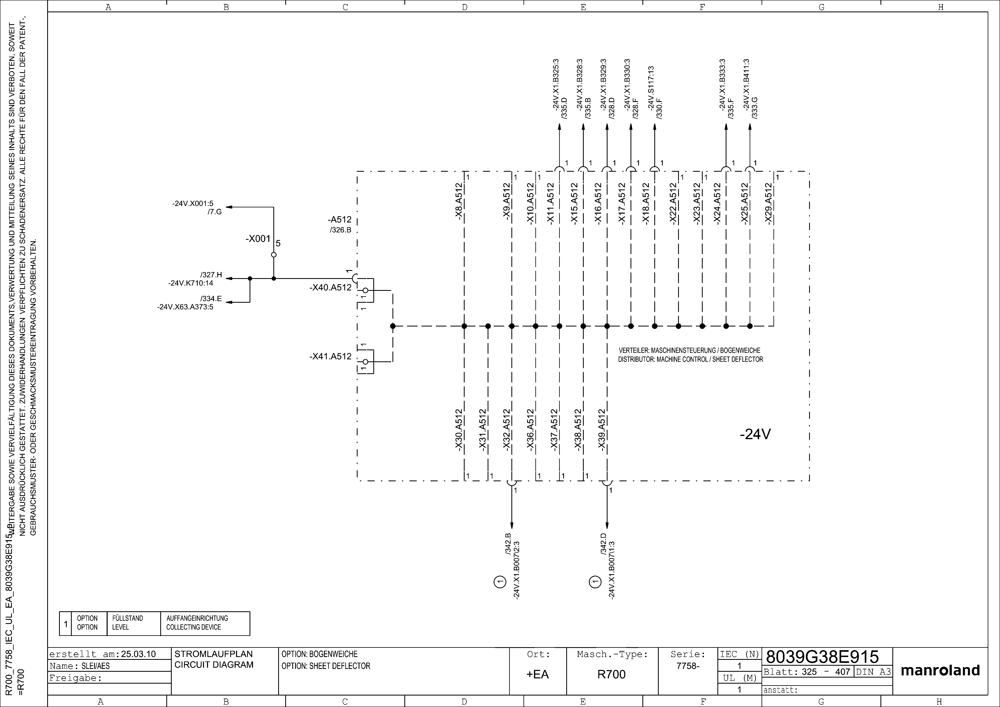

# +EA — Sheet 325 of 407 — OPTION: BOGENWEICHE

**OPTION: SHEET DEFLECTOR**

> Part of the manroland **R700** printing press IEC/UL circuit diagrams.
> Drawing class: **Stromlaufplan / Circuit diagram** (DIN A3).
> Document `+EA` covers the **Printing unit** machine section.

## At a glance

| Field | Value |
|---|---|
| Document | `+EA`  (8039G38E915) |
| Sheet | **325** of 407 |
| Section (DE) | OPTION: BOGENWEICHE |
| Section (EN) | OPTION: SHEET DEFLECTOR |
| Section type | CIRCUIT — Circuit diagram |
| Machine type | `R700` |
| Series | `7758` |
| Created | 25.03.10 |
| Replaces | — |
| Columns used | A, B, C, D, E, F, G |
| Path numbers | — |
| Labels on sheet | 87 |
| Cross-refs out | 13 |
| Cross-refs in | 33 |

**Previous:** [+EA sheet 324](SHEET_0324.md) · **Next:** [+EA sheet 326](SHEET_0326.md) · **Document TOC:** [_TOC.md](_TOC.md)  (+EA) · **Master TOC:** [all sheets](../_MASTER_TOC.md)

## Sheet image (300 DPI, exact vector render)



_Rendered directly from the PDF vector layer at 300 DPI (1-bit), no OCR and no resampling. Use it to confirm anything ambiguous in the text below._

## Cross-references on this sheet

Each entry is a wire leaving this sheet. The printed token is `/sheet.column`; the link resolves to that sheet inside the same document.

| Ref | Target sheet | Col | Path | Destination on target | Target section | From col |
|---|---|---|---|---|---|---|
| `/335.D` | [+EA sheet 335](SHEET_0335.md) | D | — | 24V.X1.B325:3 | OPTION: BOGENWEICHE | E |
| `/335.B` | [+EA sheet 335](SHEET_0335.md) | B | — | 24V.X1.B328:3 | OPTION: BOGENWEICHE | E |
| `/328.D` | [+EA sheet 328](SHEET_0328.md) | D | — | 24V.X1.B329:3 | OPTION: BOGENWEICHE | E |
| `/328.F` | [+EA sheet 328](SHEET_0328.md) | F | — | 24V.X1.B330:3 | OPTION: BOGENWEICHE | E |
| `/335.F` | [+EA sheet 335](SHEET_0335.md) | F | — | 24V.X1.B333:3 | OPTION: BOGENWEICHE | F |
| `/333.G` | [+EA sheet 333](SHEET_0333.md) | G | — | 24V.X1.B411:3 | OPTION: BOGENWEICHE | F |
| `/330.F` | [+EA sheet 330](SHEET_0330.md) | F | — | 24V.S117:13 | OPTION: BOGENWEICHE | F |
| `/7.G` | [+EA sheet 7](SHEET_0007.md) | G | — | 24V.X001:5 | SPANNUNGSVERSORGUNG: 400V, 24V | B |
| `/326.B` | [+EA sheet 326](SHEET_0326.md) | B | — | — | OPTION: BOGENWEICHE | C |
| `/327.H` | [+EA sheet 327](SHEET_0327.md) | H | — | 24V.K710:14 | OPTION: BOGENWEICHE | B |
| `/334.E` | [+EA sheet 334](SHEET_0334.md) | E | — | 24V.X63.A373:5 | OPTION: BOGENWEICHE | B |
| `/342.B` | [+EA sheet 342](SHEET_0342.md) | B | — | — | OPTION: BOGENWEICHE | D |
| `/342.D` | [+EA sheet 342](SHEET_0342.md) | D | — | — | OPTION: BOGENWEICHE | E |

### Incoming references (sheets that point here)

Every other sheet that sends a wire to this one. `Back-ref` is the token printed on *that* sheet; `Path` is its line number.

| From sheet | Cols | Back-ref | Path | Refs | What continues there |
|---|---|---|---|---|---|
| [+EA#7](SHEET_0007.md) | H | `/7.H` | — | 1 | 24V.X001:5 |
| [+EA#250](SHEET_0250.md) | G | `/250.G` | — | 1 | — |
| [+EA#253](SHEET_0253.md) | A | `/253.A` | — | 1 | — |
| [+EA#254](SHEET_0254.md) | G | `/254.G` | — | 1 | — |
| [+EA#256](SHEET_0256.md) | F | `/256.F` | — | 1 | — |
| [+EA#261](SHEET_0261.md) | B | `/261.B` | — | 1 | — |
| [+EA#262](SHEET_0262.md) | G | `/262.G` | — | 1 | — |
| [+EA#263](SHEET_0263.md) | C, F | `/263.C`, `/263.F` | — | 2 | — |
| [+EA#264](SHEET_0264.md) | H | `/264.H` | — | 1 | — |
| [+EA#265](SHEET_0265.md) | E | `/265.E` | — | 1 | — |
| [+EA#266](SHEET_0266.md) | G | `/266.G` | — | 1 | — |
| [+EA#268](SHEET_0268.md) | B | `/268.B` | — | 1 | — |
| [+EA#274](SHEET_0274.md) | A | `/274.A` | — | 1 | — |
| [+EA#275](SHEET_0275.md) | F | `/275.F` | — | 1 | — |
| [+EA#276](SHEET_0276.md) | B, H | `/276.B`, `/276.H` | — | 2 | — |
| [+EA#279](SHEET_0279.md) | D, G | `/279.D`, `/279.G` | — | 2 | — |
| [+EA#280](SHEET_0280.md) | C, F | `/280.C`, `/280.F` | — | 2 | — |
| [+EA#326](SHEET_0326.md) | B | `/326.B` | — | 1 | — |
| [+EA#327](SHEET_0327.md) | G | `/327.G` | — | 1 | 24V.K710:14 |
| [+EA#328](SHEET_0328.md) | D, E | `/328.D`, `/328.E` | — | 2 | 24V.X1.B329:3; 24V.X1.B330:3 |
| [+EA#330](SHEET_0330.md) | E | `/330.E` | — | 1 | 24V.S117:13 |
| [+EA#333](SHEET_0333.md) | F | `/333.F` | — | 1 | 24V.X1.B411:3 |
| [+EA#334](SHEET_0334.md) | D | `/334.D` | — | 1 | 24V.X63.A373:5 |
| [+EA#335](SHEET_0335.md) | A, D, F | `/335.A`, `/335.D`, `/335.F` | — | 3 | 24V.X1.B325:3; 24V.X1.B328:3; 24V.X1.B333:3 |
| [+EA#342](SHEET_0342.md) | B | `/342.B` | — | 2 | 24V.X1.B007\2:3 24V.X1.B007\1:3 |


## Devices on this sheet

| Tag | Class | Class meaning (IEC) | Col | Sub | Terminal | Sign |
|---|---|---|---|---|---|---|
| `A512` | A | Baugruppe / assembly, module, PC board | C | — | — | — |
| `X001` | X | Klemme / terminal, plug connector | B | — | — | — |
| `X11.A512` | — | cross-device reference | E | — | — | — |
| `X15.A512` | — | cross-device reference | E | — | — | — |
| `X16.A512` | — | cross-device reference | E | — | — | — |
| `X17.A512` | — | cross-device reference | E | — | — | — |
| `X18.A512` | — | cross-device reference | F | — | — | — |
| `X39.A512` | — | cross-device reference | E | — | — | — |
| `X32.A512` | — | cross-device reference | D | — | — | — |
| `X40.A512` | — | cross-device reference | C | — | — | — |
| `X24.A512` | — | cross-device reference | F | — | — | — |
| `X36.A512` | — | cross-device reference | E | — | — | — |
| `X37.A512` | — | cross-device reference | E | — | — | — |
| `X30.A512` | — | cross-device reference | D | — | — | — |
| `X31.A512` | — | cross-device reference | D | — | — | — |
| `X38.A512` | — | cross-device reference | E | — | — | — |
| `X8.A512` | — | cross-device reference | D | — | — | — |
| `X9.A512` | — | cross-device reference | D | — | — | — |
| `X10.A512` | — | cross-device reference | E | — | — | — |
| `X41.A512` | — | cross-device reference | C | — | — | — |
| `X22.A512` | — | cross-device reference | F | — | — | — |
| `X23.A512` | — | cross-device reference | F | — | — | — |
| `X25.A512` | — | cross-device reference | F | — | — | — |
| `X29.A512` | — | cross-device reference | G | — | — | — |

## Potentials / nets

| Potential | Count | Columns | Attached devices | Terminals |
|---|---|---|---|---|
| `24V` | 13 | B, D, E, F | `A373`, `B007\1`, `B007\2`, `B325`, `B328`, `B329`, `B330`, `B333`, `B411`, `K710`, `S117`, `X001`, `X1`, `X63` | `13`, `14`, `3`, `5` |


A potential such as `L24+/4` or `M24+` is a named supply/return rail; every place it appears on this sheet is electrically common.

## Wire-end annotations (grouped as printed)

A wire that continues elsewhere is annotated with a small cluster: the destination description, the path/line number `#NN`, and the `/sheet.column` cross reference. Each row below is one such cluster exactly as it is grouped on the drawing.

| Col | Y | Path | Cross-ref | Text on the wire |
|---|---|---|---|---|
| E | 70.0 | — | `/335.D` | `24V.X1.B325:3` |
| E | 70.0 | — | `/335.B` | `24V.X1.B328:3` |
| E | 70.0 | — | `/328.D` | `24V.X1.B329:3` |
| E | 70.0 | — | `/328.F` | `24V.X1.B330:3` |
| F | 70.0 | — | `/335.F` | `24V.X1.B333:3` |
| F | 70.0 | — | `/333.G` | `24V.X1.B411:3` |
| F | 78.5 | — | `/330.F` | `24V.S117:13` |
| E | 190.2 | — | — | `1` |
| E | 190.2 | — | — | `1` |
| E | 190.2 | — | — | `1` |
| E | 190.2 | — | — | `1` |
| F | 190.2 | — | — | `1` |
| F | 190.2 | — | — | `1` |
| F | 190.2 | — | — | `1` |
| D | 207.2 | — | — | `1 1 1` |
| F | 207.2 | — | — | `1 1` |
| G | 207.2 | — | — | `1` |
| D | 217.7 | — | — | `X8.A512` |
| D | 217.7 | — | — | `X9.A512` |
| E | 217.7 | — | — | `X10.A512` |
| E | 217.7 | — | — | `X11.A512` |
| E | 217.7 | — | — | `X15.A512` |
| E | 217.7 | — | — | `X16.A512` |
| E | 217.7 | — | — | `X17.A512` |
| F | 217.7 | — | — | `X18.A512` |
| F | 217.7 | — | — | `X22.A512` |
| F | 217.7 | — | — | `X23.A512` |
| F | 217.7 | — | — | `X24.A512` |
| F | 217.7 | — | — | `X25.A512` |
| G | 217.7 | — | — | `X29.A512` |
| B | 238.4 | — | `/7.G` | `24V.X001:5` |
| C | 256.8 | — | — | `A512` |
| C | 269.9 | — | `/326.B` | — |
| B | 279.3 | — | — | `X001 5` |
| C | 319.8 | — | — | `1` |
| B | 323.4 | — | `/327.H` | `24V.K710:14` |
| C | 337.6 | — | — | `X40.A512` |
| C | 351.2 | — | — | `1 1 1 1` |
| B | 351.8 | — | `/334.E` | `24V.X63.A373:5` |
| F | 414.5 | — | — | `DISTRIBUTOR: MACHINE CONTROL / SHEET DEFLECTOR VERTEILER: MASCHINENSTEUERUNG / BOGENWEICHE` |
| C | 419.8 | — | — | `X41.A512` |
| D | 487.0 | — | — | `X30.A512` |
| D | 487.0 | — | — | `X31.A512` |
| D | 487.0 | — | — | `X32.A512` |
| E | 487.0 | — | — | `X36.A512` |
| E | 487.0 | — | — | `X37.A512` |
| E | 487.0 | — | — | `X38.A512` |
| E | 487.0 | — | — | `X39.A512` |
| F | 509.4 | — | — | `24V` |
| E | 563.0 | — | — | `1 1 1 1 1` |
| D | 580.0 | — | — | `1` |
| E | 580.0 | — | — | `1` |
| D | 634.7 | — | `/342.B` | — |
| E | 634.7 | — | `/342.D` | — |
| D | 644.6 | — | — | `24V.X1.B007\2:3` |
| E | 644.6 | — | — | `24V.X1.B007\1:3` |
| D | 690.2 | — | — | `1` |
| E | 690.2 | — | — | `1` |
| A | 733.4 | — | — | `1 OPTION OPTION` |
| A | 733.4 | — | — | `FÜLLSTAND LEVEL` |
| B | 733.4 | — | — | `COLLECTING DEVICE AUFFANGEINRICHTUNG` |


## Reconstructed tables

This sheet carries tabular content (pin map / terminal assignment / index). The grid below was rebuilt from the drawing's own rule lines, so each row is exactly one physical row of the table.

### Table 1 — 5 data rows × 24 columns (at x=204.1, y=0.0) — **24V.X001:5 X8.A512 1 X9.A512 1 X10.A512 24V.X1.B325:3 1 X11.A512 /335.D 24V.X1.B328:3 1 X15.A512 24V.X1.B329:3 /335.B 1 X16.A512 24V.X1.B330:3 /328.D 1 X17.A512 24V.S117:13 /328.F 1 X18.A512 /330.F 1 X22.A512 1 X23.A512 1 X24.A512 24V.X1.B333:3 24V.X1.B411:3 /335.F 1 X25.A512 /333.G 1 X29.A512 /7.G /327.H X001 5 A512 /326.B 1 24V.K710:14 /334.E 24V.X63.A373:5 X40.A512 1 1 AUFFANGEINRICHTUNG COLLECTING DEVICE 1 X41.A512 1 X30.A512 X31.A512 1 X32.A512 1 /342.B 1 X36.A512 1 24V.X1.B007\2:3 X37.A512 1 X38.A512 X39.A512 1 /342.D 1 1 24V.X1.B007\1:3 VERTEILER: DISTRIBUTOR: MACHINE MASCHINENSTEUERUNG CONTROL / / SHEET BOGENWEICHE DEFLECTOR 24V**

| STROMLAUFPLAN |  |  | OPTION: BOGENWEICHE |  |  |  |  |  | Ort: |  |  |  | Masch. Type: |  |  |  | Serie: |  |  | IEC | (N) |  | 8039G38E915 |
|---|---|---|---|---|---|---|---|---|---|---|---|---|---|---|---|---|---|---|---|---|---|---|---|
| `CIRCUIT DIAGRAM` |  |  |  |  |  |  |  |  |  |  |  |  |  |  |  |  |  |  |  |  |  |  |  |
|  |  |  | `OPTION: SHEET DEFLECTOR` |  |  |  |  |  |  |  |  |  |  |  |  |  | `7758` |  |  | `1` |  |  |  |
|  |  |  |  |  |  |  |  |  | `+EA` |  |  |  | `R700` |  |  |  |  |  |  |  |  |  | `Blatt: DIN A3 325 407` |
|  |  |  |  |  |  |  |  |  |  |  |  |  |  |  |  |  |  |  |  | `UL (M)` |  |  |  |
|  |  |  |  |  |  |  |  |  |  |  |  |  |  |  |  |  |  |  |  | `1` |  |  | `anstatt:` |


## Notes and free text on this sheet

| Text | Col | Y (pt) |
|---|---|---|
| `VERTEILER: MASCHINENSTEUERUNG / BOGENWEICHE` | F | 414.48 |
| `DISTRIBUTOR: MACHINE CONTROL / SHEET DEFLECTOR` | F | 425.13 |
| `OPTION` | A | 733.35 |
| `FÜLLSTAND` | A | 733.38 |
| `LEVEL` | A | 743.97 |
| `AUFFANGEINRICHTUNG` | B | 733.4 |
| `COLLECTING DEVICE` | B | 744.02 |

## Complete label inventory (exact text from the drawing)

Every text object inside the drawing area of this sheet, in DIN reading order (column A→H, then top→bottom). This is the authoritative list: if a string is not here it is not printed on this sheet.

| Col | Y | X | Dir | Type | Text |
|---|---|---|---|---|---|
| A | 733.4 | 91.8 | → | text | `OPTION` |
| A | 733.4 | 133.8 | → | text | `FÜLLSTAND` |
| A | 738.7 | 75.4 | → | number | `1` |
| A | 744.0 | 91.8 | → | text | `OPTION` |
| A | 744.0 | 133.8 | → | text | `LEVEL` |
| B | 238.4 | 205.2 | → | potential | `24V.X001:5` |
| B | 248.3 | 247.5 | → | cross-reference | `/7.G` |
| B | 279.3 | 292.5 | → | device tag | `X001` |
| B | 285.2 | 328.3 | → | number | `5` |
| B | 323.4 | 238.7 | → | cross-reference | `/327.H` |
| B | 333.4 | 200.4 | → | potential | `24V.K710:14` |
| B | 351.8 | 238.7 | → | cross-reference | `/334.E` |
| B | 361.7 | 187.1 | → | potential | `24V.X63.A373:5` |
| B | 733.4 | 198.4 | → | text | `AUFFANGEINRICHTUNG` |
| B | 744.0 | 198.1 | → | text | `COLLECTING DEVICE` |
| C | 256.8 | 390.3 | → | device tag | `A512` |
| C | 269.9 | 392.9 | → | cross-reference | `/326.B` |
| C | 319.7 | 411.3 | ↕ | number | `1` |
| C | 337.6 | 368.5 | → | device ref | `X40.A512` |
| C | 351.2 | 429.1 | ↕ | number | `1` |
| C | 365.4 | 429.1 | ↕ | number | `1` |
| C | 407.9 | 429.1 | ↕ | number | `1` |
| C | 419.8 | 368.5 | → | device ref | `X41.A512` |
| C | 436.3 | 429.1 | ↕ | number | `1` |
| D | 207.3 | 554.7 | → | number | `1` |
| D | 207.3 | 611.4 | → | number | `1` |
| D | 217.7 | 541.7 | ↕ | device ref | `X8.A512` |
| D | 217.7 | 598.4 | ↕ | device ref | `X9.A512` |
| D | 487.0 | 541.7 | ↕ | device ref | `X30.A512` |
| D | 487.0 | 570.1 | ↕ | device ref | `X31.A512` |
| D | 487.0 | 598.4 | ↕ | device ref | `X32.A512` |
| D | 563.0 | 554.7 | → | number | `1` |
| D | 563.0 | 583.1 | → | number | `1` |
| D | 580.0 | 611.4 | → | number | `1` |
| D | 634.7 | 601.2 | ↕ | cross-reference | `/342.B` |
| D | 644.6 | 611.1 | ↕ | potential | `24V.X1.B007\2:3` |
| D | 690.2 | 592.2 | ↕ | number | `1` |
| E | 70.0 | 657.9 | ↕ | potential | `24V.X1.B325:3` |
| E | 70.0 | 686.3 | ↕ | potential | `24V.X1.B328:3` |
| E | 70.0 | 714.6 | ↕ | potential | `24V.X1.B329:3` |
| E | 70.0 | 743.0 | ↕ | potential | `24V.X1.B330:3` |
| E | 115.9 | 667.8 | ↕ | cross-reference | `/335.D` |
| E | 115.9 | 724.5 | ↕ | cross-reference | `/328.D` |
| E | 116.2 | 696.2 | ↕ | cross-reference | `/335.B` |
| E | 116.8 | 752.9 | ↕ | cross-reference | `/328.F` |
| E | 190.2 | 672.4 | → | number | `1` |
| E | 190.2 | 700.7 | → | number | `1` |
| E | 190.2 | 729.1 | → | number | `1` |
| E | 190.2 | 757.4 | → | number | `1` |
| E | 207.3 | 639.8 | → | number | `1` |
| E | 217.7 | 626.8 | ↕ | device ref | `X10.A512` |
| E | 217.7 | 650.9 | ↕ | device ref | `X11.A512` |
| E | 217.7 | 679.2 | ↕ | device ref | `X15.A512` |
| E | 217.7 | 707.5 | ↕ | device ref | `X16.A512` |
| E | 217.7 | 735.9 | ↕ | device ref | `X17.A512` |
| E | 487.0 | 626.8 | ↕ | device ref | `X36.A512` |
| E | 487.0 | 655.1 | ↕ | device ref | `X37.A512` |
| E | 487.0 | 683.5 | ↕ | device ref | `X38.A512` |
| E | 487.0 | 711.8 | ↕ | device ref | `X39.A512` |
| E | 563.0 | 639.8 | → | number | `1` |
| E | 563.0 | 668.1 | → | number | `1` |
| E | 563.0 | 696.5 | → | number | `1` |
| E | 580.0 | 724.8 | → | number | `1` |
| E | 634.7 | 714.6 | ↕ | cross-reference | `/342.D` |
| E | 644.6 | 724.5 | ↕ | potential | `24V.X1.B007\1:3` |
| E | 690.2 | 705.6 | ↕ | number | `1` |
| F | 70.0 | 856.3 | ↕ | potential | `24V.X1.B333:3` |
| F | 70.0 | 884.7 | ↕ | potential | `24V.X1.B411:3` |
| F | 78.5 | 771.3 | ↕ | potential | `24V.S117:13` |
| F | 115.4 | 894.6 | ↕ | cross-reference | `/333.G` |
| F | 116.8 | 781.2 | ↕ | cross-reference | `/330.F` |
| F | 116.8 | 866.3 | ↕ | cross-reference | `/335.F` |
| F | 190.2 | 785.8 | → | number | `1` |
| F | 190.2 | 870.8 | → | number | `1` |
| F | 190.2 | 896.9 | → | number | `1` |
| F | 207.3 | 809.9 | → | number | `1` |
| F | 207.3 | 838.2 | → | number | `1` |
| F | 217.7 | 764.2 | ↕ | device ref | `X18.A512` |
| F | 217.7 | 796.8 | ↕ | device ref | `X22.A512` |
| F | 217.7 | 825.2 | ↕ | device ref | `X23.A512` |
| F | 217.7 | 849.3 | ↕ | device ref | `X24.A512` |
| F | 217.7 | 881.9 | ↕ | device ref | `X25.A512` |
| F | 414.5 | 737.0 | → | text | `VERTEILER: MASCHINENSTEUERUNG / BOGENWEICHE` |
| F | 425.1 | 736.2 | → | text | `DISTRIBUTOR: MACHINE CONTROL / SHEET DEFLECTOR` |
| F | 509.4 | 881.1 | → | potential | `24V` |
| G | 207.3 | 923.2 | → | number | `1` |
| G | 217.7 | 910.2 | ↕ | device ref | `X29.A512` |

## Reading-order text block

The same content as a plain block, grouped by DIN column — convenient to paste or to match against a visual description.

```text
=== Column A ===
 733.4   91.8  text         OPTION
 733.4  133.8  text         FÜLLSTAND
 738.7   75.4  numeric      1
 744.0   91.8  text         OPTION
 744.0  133.8  text         LEVEL
=== Column B ===
 238.4  205.2  net          24V.X001:5
 248.3  247.5  xref         /7.G
 279.3  292.5  devtag       X001
 285.2  328.3  numeric      5
 323.4  238.7  xref         /327.H
 333.4  200.4  net          24V.K710:14
 351.8  238.7  xref         /334.E
 361.7  187.1  net          24V.X63.A373:5
 733.4  198.4  text         AUFFANGEINRICHTUNG
 744.0  198.1  text         COLLECTING DEVICE
=== Column C ===
 256.8  390.3  devtag       A512
 269.9  392.9  xref         /326.B
 319.7  411.3  numeric      1
 337.6  368.5  devref       X40.A512
 351.2  429.1  numeric      1
 365.4  429.1  numeric      1
 407.9  429.1  numeric      1
 419.8  368.5  devref       X41.A512
 436.3  429.1  numeric      1
=== Column D ===
 207.3  554.7  numeric      1
 207.3  611.4  numeric      1
 217.7  541.7  devref       X8.A512
 217.7  598.4  devref       X9.A512
 487.0  541.7  devref       X30.A512
 487.0  570.1  devref       X31.A512
 487.0  598.4  devref       X32.A512
 563.0  554.7  numeric      1
 563.0  583.1  numeric      1
 580.0  611.4  numeric      1
 634.7  601.2  xref         /342.B
 644.6  611.1  net          24V.X1.B007\2:3
 690.2  592.2  numeric      1
=== Column E ===
  70.0  657.9  net          24V.X1.B325:3
  70.0  686.3  net          24V.X1.B328:3
  70.0  714.6  net          24V.X1.B329:3
  70.0  743.0  net          24V.X1.B330:3
 115.9  667.8  xref         /335.D
 115.9  724.5  xref         /328.D
 116.2  696.2  xref         /335.B
 116.8  752.9  xref         /328.F
 190.2  672.4  numeric      1
 190.2  700.7  numeric      1
 190.2  729.1  numeric      1
 190.2  757.4  numeric      1
 207.3  639.8  numeric      1
 217.7  626.8  devref       X10.A512
 217.7  650.9  devref       X11.A512
 217.7  679.2  devref       X15.A512
 217.7  707.5  devref       X16.A512
 217.7  735.9  devref       X17.A512
 487.0  626.8  devref       X36.A512
 487.0  655.1  devref       X37.A512
 487.0  683.5  devref       X38.A512
 487.0  711.8  devref       X39.A512
 563.0  639.8  numeric      1
 563.0  668.1  numeric      1
 563.0  696.5  numeric      1
 580.0  724.8  numeric      1
 634.7  714.6  xref         /342.D
 644.6  724.5  net          24V.X1.B007\1:3
 690.2  705.6  numeric      1
=== Column F ===
  70.0  856.3  net          24V.X1.B333:3
  70.0  884.7  net          24V.X1.B411:3
  78.5  771.3  net          24V.S117:13
 115.4  894.6  xref         /333.G
 116.8  781.2  xref         /330.F
 116.8  866.3  xref         /335.F
 190.2  785.8  numeric      1
 190.2  870.8  numeric      1
 190.2  896.9  numeric      1
 207.3  809.9  numeric      1
 207.3  838.2  numeric      1
 217.7  764.2  devref       X18.A512
 217.7  796.8  devref       X22.A512
 217.7  825.2  devref       X23.A512
 217.7  849.3  devref       X24.A512
 217.7  881.9  devref       X25.A512
 414.5  737.0  text         VERTEILER: MASCHINENSTEUERUNG / BOGENWEICHE
 425.1  736.2  text         DISTRIBUTOR: MACHINE CONTROL / SHEET DEFLECTOR
 509.4  881.1  net          24V
=== Column G ===
 207.3  923.2  numeric      1
 217.7  910.2  devref       X29.A512
```

---
_Generated from the PDF vector text layer; no OCR. Source: `R700_7758_IEC_UL_EA_8039G38E915_p`, sheet 325._
