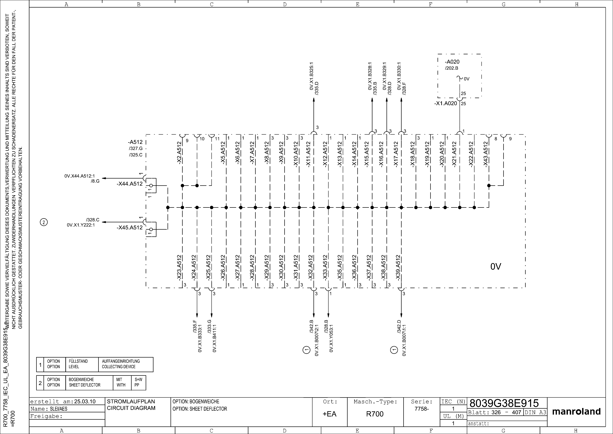

# +EA — Sheet 326 of 407 — OPTION: BOGENWEICHE

**OPTION: SHEET DEFLECTOR**

> Part of the manroland **R700** printing press IEC/UL circuit diagrams.
> Drawing class: **Stromlaufplan / Circuit diagram** (DIN A3).
> Document `+EA` covers the **Printing unit** machine section.

## At a glance

| Field | Value |
|---|---|
| Document | `+EA`  (8039G38E915) |
| Sheet | **326** of 407 |
| Section (DE) | OPTION: BOGENWEICHE |
| Section (EN) | OPTION: SHEET DEFLECTOR |
| Section type | CIRCUIT — Circuit diagram |
| Machine type | `R700` |
| Series | `7758` |
| Created | 25.03.10 |
| Replaces | — |
| Columns used | A, B, C, D, E, F, G |
| Path numbers | — |
| Labels on sheet | 132 |
| Cross-refs out | 14 |
| Cross-refs in | 54 |

**Previous:** [+EA sheet 325](SHEET_0325.md) · **Next:** [+EA sheet 327](SHEET_0327.md) · **Document TOC:** [_TOC.md](_TOC.md)  (+EA) · **Master TOC:** [all sheets](../_MASTER_TOC.md)

## Sheet image (300 DPI, exact vector render)



_Rendered directly from the PDF vector layer at 300 DPI (1-bit), no OCR and no resampling. Use it to confirm anything ambiguous in the text below._

## Cross-references on this sheet

Each entry is a wire leaving this sheet. The printed token is `/sheet.column`; the link resolves to that sheet inside the same document.

| Ref | Target sheet | Col | Path | Destination on target | Target section | From col |
|---|---|---|---|---|---|---|
| `/202.B` | [+EA sheet 202](SHEET_0202.md) | B | — | A020 | REFERENZMODUL | F |
| `/335.D` | [+EA sheet 335](SHEET_0335.md) | D | — | 0V.X1.B325:1 0V.X1.B007\2:1 | OPTION: BOGENWEICHE | D |
| `/335.B` | [+EA sheet 335](SHEET_0335.md) | B | — | 0V.X1.B328:1 | OPTION: BOGENWEICHE | E |
| `/328.D` | [+EA sheet 328](SHEET_0328.md) | D | — | 0V.X1.B329:1 | OPTION: BOGENWEICHE | E |
| `/328.F` | [+EA sheet 328](SHEET_0328.md) | F | — | 0V.X1.B330:1 | OPTION: BOGENWEICHE | F |
| `/327.G` | [+EA sheet 327](SHEET_0327.md) | G | — | — | OPTION: BOGENWEICHE | B |
| `/325.C` | [+EA sheet 325](SHEET_0325.md) | C | — | — | OPTION: BOGENWEICHE | B |
| `/8.G` | [+EA sheet 8](SHEET_0008.md) | G | — | 0V.X44.A512:1 | SPANNUNGSVERSORGUNG: 400V, 24V | A |
| `/328.C` | [+EA sheet 328](SHEET_0328.md) | C | — | 0V.X1.Y222:1 | OPTION: BOGENWEICHE | A |
| `/333.G` | [+EA sheet 333](SHEET_0333.md) | G | — | — | OPTION: BOGENWEICHE | C |
| `/335.F` | [+EA sheet 335](SHEET_0335.md) | F | — | — | OPTION: BOGENWEICHE | C |
| `/342.B` | [+EA sheet 342](SHEET_0342.md) | B | — | — | OPTION: BOGENWEICHE | D |
| `/328.B` | [+EA sheet 328](SHEET_0328.md) | B | — | — | OPTION: BOGENWEICHE | E |
| `/342.D` | [+EA sheet 342](SHEET_0342.md) | D | — | — | OPTION: BOGENWEICHE | F |

### Incoming references (sheets that point here)

Every other sheet that sends a wire to this one. `Back-ref` is the token printed on *that* sheet; `Path` is its line number.

| From sheet | Cols | Back-ref | Path | Refs | What continues there |
|---|---|---|---|---|---|
| [+EA#8](SHEET_0008.md) | G | `/8.G` | — | 1 | 0V.X44.A512:1 |
| [+EA#202](SHEET_0202.md) | B | `/202.B` | — | 1 | — |
| [+EA#206](SHEET_0206.md) | B | `/206.B` | — | 1 | — |
| [+EA#230](SHEET_0230.md) | C | `/230.C` | — | 3 | — |
| [+EA#243](SHEET_0243.md) | C | `/243.C` | — | 1 | STROMPFAD PIN 1 2 3 4 |
| [+EA#245](SHEET_0245.md) | G | `/245.G` | — | 1 | STROMPFAD PIN 1 2 3 4 |
| [+EA#247](SHEET_0247.md) | G | `/247.G` | — | 1 | STROMPFAD PIN 1 2 3 4 |
| [+EA#250](SHEET_0250.md) | G | `/250.G` | — | 1 | — |
| [+EA#253](SHEET_0253.md) | A | `/253.A` | — | 1 | — |
| [+EA#254](SHEET_0254.md) | G | `/254.G` | — | 1 | — |
| [+EA#256](SHEET_0256.md) | F | `/256.F` | — | 1 | — |
| [+EA#257](SHEET_0257.md) | F | `/257.F` | — | 1 | STROMPFAD PIN 1 2 3 4 |
| [+EA#259](SHEET_0259.md) | C | `/259.C` | — | 1 | STROMPFAD PIN 1 2 3 4 |
| [+EA#260](SHEET_0260.md) | C | `/260.C` | — | 1 | STROMPFAD PIN 1 2 3 4 |
| [+EA#261](SHEET_0261.md) | B | `/261.B` | — | 1 | — |
| [+EA#262](SHEET_0262.md) | G | `/262.G` | — | 1 | — |
| [+EA#263](SHEET_0263.md) | C, F, H | `/263.C`, `/263.F`, `/263.H` | — | 3 | STROMPFAD PIN 1 2 3 4 |
| [+EA#264](SHEET_0264.md) | B, E, H | `/264.B`, `/264.E`, `/264.H` | — | 3 | STROMPFAD PIN 1 2 3 4 |
| [+EA#265](SHEET_0265.md) | E | `/265.E` | — | 1 | — |
| [+EA#266](SHEET_0266.md) | G | `/266.G` | — | 1 | — |
| [+EA#268](SHEET_0268.md) | B | `/268.B` | — | 1 | — |
| [+EA#269](SHEET_0269.md) | G | `/269.G` | — | 1 | — |
| [+EA#271](SHEET_0271.md) | A | `/271.A` | — | 1 | — |
| [+EA#272](SHEET_0272.md) | F | `/272.F` | — | 1 | — |
| [+EA#274](SHEET_0274.md) | A | `/274.A` | — | 1 | — |
| [+EA#275](SHEET_0275.md) | F | `/275.F` | — | 1 | — |
| [+EA#276](SHEET_0276.md) | B, H | `/276.B`, `/276.H` | — | 2 | — |
| [+EA#277](SHEET_0277.md) | F | `/277.F` | — | 1 | — |
| [+EA#278](SHEET_0278.md) | G | `/278.G` | — | 1 | — |
| [+EA#279](SHEET_0279.md) | D, G | `/279.D`, `/279.G` | — | 2 | — |
| [+EA#280](SHEET_0280.md) | C, F | `/280.C`, `/280.F` | — | 2 | — |
| [+EA#281](SHEET_0281.md) | E | `/281.E` | — | 2 | — |
| [+EA#325](SHEET_0325.md) | C | `/325.C` | — | 1 | — |
| [+EA#327](SHEET_0327.md) | G | `/327.G` | — | 1 | — |
| [+EA#328](SHEET_0328.md) | B, E | `/328.B`, `/328.E` | — | 4 | 0V.X1.B329:1 0V.X1.B330:1; 0V.X1.Y053:1 0V.X1.Y222:1 |
| [+EA#333](SHEET_0333.md) | F | `/333.F` | — | 1 | 0V.X1.B411:1 |
| [+EA#335](SHEET_0335.md) | C | `/335.C` | — | 3 | 0V.X1.B328:1 0V.X1.B325:1 0V.X1.B333:1 |
| [+EA#342](SHEET_0342.md) | B | `/342.B` | — | 2 | 0V.X1.B007\2:1 0V.X1.B007\1:1 |


## Devices on this sheet

| Tag | Class | Class meaning (IEC) | Col | Sub | Terminal | Sign |
|---|---|---|---|---|---|---|
| `A512` | A | Baugruppe / assembly, module, PC board | B | — | — | — |
| `A020` | A | Baugruppe / assembly, module, PC board | F | — | — | — |
| `X11.A512` | — | cross-device reference | D | — | — | — |
| `X15.A512` | — | cross-device reference | E | — | — | — |
| `X16.A512` | — | cross-device reference | E | — | — | — |
| `X17.A512` | — | cross-device reference | F | — | — | — |
| `X33.A512` | — | cross-device reference | E | — | — | — |
| `X21.A512` | — | cross-device reference | F | — | — | — |
| `X24.A512` | — | cross-device reference | C | — | — | — |
| `X32.A512` | — | cross-device reference | D | — | — | — |
| `X44.A512` | — | cross-device reference | B | — | — | — |
| `X39.A512` | — | cross-device reference | F | — | — | — |
| `X45.A512` | — | cross-device reference | B | — | — | — |
| `X1.A020` | — | cross-device reference | F | — | — | — |
| `X5.A512` | — | cross-device reference | C | — | — | — |
| `X6.A512` | — | cross-device reference | C | — | — | — |
| `X7.A512` | — | cross-device reference | D | — | — | — |
| `X8.A512` | — | cross-device reference | D | — | — | — |
| `X9.A512` | — | cross-device reference | D | — | — | — |
| `X20.A512` | — | cross-device reference | F | — | — | — |
| `X12.A512` | — | cross-device reference | E | — | — | — |
| `X13.A512` | — | cross-device reference | E | — | — | — |
| `X18.A512` | — | cross-device reference | F | — | — | — |
| `X14.A512` | — | cross-device reference | E | — | — | — |
| `X19.A512` | — | cross-device reference | F | — | — | — |
| `X23.A512` | — | cross-device reference | C | — | — | — |
| `X29.A512` | — | cross-device reference | D | — | — | — |
| `X30.A512` | — | cross-device reference | D | — | — | — |
| `X31.A512` | — | cross-device reference | D | — | — | — |
| `X35.A512` | — | cross-device reference | E | — | — | — |
| `X37.A512` | — | cross-device reference | E | — | — | — |
| `X38.A512` | — | cross-device reference | E | — | — | — |
| `X2.A512` | — | cross-device reference | C | — | — | — |
| `X36.A512` | — | cross-device reference | E | — | — | — |
| `X26.A512` | — | cross-device reference | C | — | — | — |
| `X27.A512` | — | cross-device reference | C | — | — | — |
| `X28.A512` | — | cross-device reference | D | — | — | — |
| `X22.A512` | — | cross-device reference | G | — | — | — |
| `X10.A512` | — | cross-device reference | D | — | — | — |
| `X25.A512` | — | cross-device reference | C | — | — | — |
| `X43.A512` | — | cross-device reference | G | — | — | — |

## Potentials / nets

| Potential | Count | Columns | Attached devices | Terminals |
|---|---|---|---|---|
| `0V` | 13 | A, C, D, E, F, G | `A512`, `B007\1`, `B007\2`, `B325`, `B328`, `B329`, `B330`, `B333`, `B411`, `X1`, `X44`, `Y053`, `Y222` | `1` |


A potential such as `L24+/4` or `M24+` is a named supply/return rail; every place it appears on this sheet is electrically common.

## Wire-end annotations (grouped as printed)

A wire that continues elsewhere is annotated with a small cluster: the destination description, the path/line number `#NN`, and the `/sheet.column` cross reference. Each row below is one such cluster exactly as it is grouped on the drawing.

| Col | Y | Path | Cross-ref | Text on the wire |
|---|---|---|---|---|
| F | 115.1 | — | `/202.B` | `A020` |
| D | 120.2 | — | `/335.D` | `0V.X1.B325:1 0V.X1.B007\2:1` |
| E | 120.2 | — | `/335.B` | `0V.X1.B328:1` |
| E | 120.2 | — | `/328.D` | `0V.X1.B329:1` |
| F | 120.2 | — | `/328.F` | `0V.X1.B330:1` |
| F | 149.1 | — | — | `0V` |
| F | 177.5 | — | — | `25` |
| F | 195.9 | — | — | `X1.A020 25` |
| D | 243.4 | — | — | `3` |
| E | 250.5 | — | — | `3` |
| E | 250.5 | — | — | `3` |
| F | 250.5 | — | — | `3` |
| F | 250.5 | — | — | `1` |
| C | 263.9 | — | — | `9 1 1 1 3 3` |
| D | 263.9 | — | — | `3` |
| E | 263.9 | — | — | `1 1 1 3 1 1` |
| C | 265.4 | — | — | `10 11` |
| G | 265.4 | — | — | `8 9` |
| B | 271.0 | — | — | `A512` |
| C | 274.4 | — | — | `X2.A512` |
| C | 274.4 | — | — | `X5.A512` |
| C | 274.4 | — | — | `X6.A512` |
| D | 274.4 | — | — | `X7.A512` |
| D | 274.4 | — | — | `X8.A512` |
| D | 274.4 | — | — | `X9.A512` |
| D | 274.4 | — | — | `X10.A512` |
| D | 274.4 | — | — | `X11.A512` |
| E | 274.4 | — | — | `X12.A512` |
| E | 274.4 | — | — | `X13.A512` |
| E | 274.4 | — | — | `X14.A512` |
| E | 274.4 | — | — | `X15.A512` |
| E | 274.4 | — | — | `X16.A512` |
| F | 274.4 | — | — | `X17.A512` |
| F | 274.4 | — | — | `X18.A512` |
| F | 274.4 | — | — | `X19.A512` |
| F | 274.4 | — | — | `X20.A512` |
| F | 274.4 | — | — | `X21.A512` |
| G | 274.4 | — | — | `X22.A512` |
| G | 274.4 | — | — | `X43.A512` |
| B | 284.1 | — | `/327.G`, `/325.C` | — |
| B | 333.9 | — | — | `1` |
| A | 337.6 | — | `/8.G` | `0V.X44.A512:1` |
| B | 351.8 | — | — | `X44.A512` |
| B | 365.4 | — | — | `1 1 1` |
| B | 419.0 | — | — | `1` |
| A | 422.6 | — | `/328.C` | `0V.X1.Y222:1` |
| A | 428.3 | — | — | `2` |
| B | 436.8 | — | — | `X45.A512` |
| C | 494.4 | — | — | `X23.A512` |
| C | 494.4 | — | — | `X24.A512` |
| C | 494.4 | — | — | `X25.A512` |
| C | 494.4 | — | — | `X26.A512` |
| C | 494.4 | — | — | `X27.A512` |
| D | 494.4 | — | — | `X28.A512` |
| D | 494.4 | — | — | `X29.A512` |
| D | 494.4 | — | — | `X30.A512` |
| D | 494.4 | — | — | `X31.A512` |
| D | 494.4 | — | — | `X32.A512` |
| E | 494.4 | — | — | `X33.A512` |
| E | 494.4 | — | — | `X35.A512` |
| E | 494.4 | — | — | `X36.A512` |
| E | 494.4 | — | — | `X37.A512` |
| E | 494.4 | — | — | `X38.A512` |
| F | 494.4 | — | — | `X39.A512` |
| G | 509.4 | — | — | `0V` |
| D | 548.8 | — | — | `3 3 3 3 1 3 3` |
| C | 548.8 | — | — | `1` |
| D | 548.8 | — | — | `1 3` |
| D | 548.8 | — | — | `1` |
| C | 565.8 | — | — | `3` |
| D | 565.8 | — | — | `3 3` |
| D | 565.8 | — | — | `3` |
| E | 565.8 | — | — | `1` |
| C | 620.2 | — | `/333.G` | — |
| C | 620.5 | — | `/335.F` | — |
| D | 620.5 | — | `/342.B` | — |
| E | 620.5 | — | `/328.B` | — |
| F | 620.5 | — | `/342.D` | — |
| C | 629.0 | — | — | `0V.X1.B333:1` |
| C | 629.0 | — | — | `0V.X1.B411:1` |
| E | 629.0 | — | — | `0V.X1.Y053:1` |
| F | 629.0 | — | — | `0V.X1.B007\1:1` |
| D | 676.0 | — | — | `1` |
| F | 676.0 | — | — | `1` |
| A | 697.9 | — | — | `1 OPTION OPTION` |
| A | 698.0 | — | — | `FÜLLSTAND LEVEL` |
| B | 698.0 | — | — | `COLLECTING DEVICE AUFFANGEINRICHTUNG` |
| A | 733.2 | — | — | `2 PP S+W` |
| A | 733.3 | — | — | `BOGENWEICHE` |
| A | 733.4 | — | — | `OPTION OPTION` |
| B | 733.4 | — | — | `MIT` |
| B | 743.9 | — | — | `WITH` |
| A | 744.0 | — | — | `SHEET DEFLECTOR` |


## Reconstructed tables

This sheet carries tabular content (pin map / terminal assignment / index). The grid below was rebuilt from the drawing's own rule lines, so each row is exactly one physical row of the table.

### Table 1 — 5 data rows × 31 columns (at x=204.1, y=0.0) — **A512 /327.G /325.C 1 X2.A512 9 10 11 X5.A512 1 X6.A512 1 X7.A512 1 X8.A512 3 X9.A512 3 X10.A512 0V.X1.B325:1 3 X11.A512 /335.D 3 X12.A512 1 X13.A512 1 X14.A512 0V.X1.B328:1 1 X15.A512 0V.X1.B329:1 /335.B 3 X16.A512 0V.X1.B330:1 /328.D 3 X17.A512 /328.F 3 X18.A512 3 X19.A512 X20.A512 A020 /202.B X1.A020 1 X21.A512 0V 25 25 1 X22.A512 X43.A512 8 X44.A512 1 1 X45.A512 1 AUFFANGEINRICHTUNG COLLECTING DEVICE S+W MIT PP WITH X23.A512 X24.A512 3 /335.F X25.A512 3 /333.G 0V.X1.B333:1 X26.A512 3 0V.X1.B411:1 X27.A512 1 X28.A512 1 X29.A512 1 X30.A512 3 X31.A512 3 X32.A512 3 /342.B 1 X33.A512 3 /328.B 0V.X1.B007\2:1 X35.A512 1 0V.X1.Y053:1 X36.A512 X37.A512 3 X38.A512 3 X39.A512 3 /342.D 1 3 0V.X1.B007\1:1 0V**

| STROMLAUFPLAN |  |  | OPTION: |  | BOGENWEICHE |  |  |  |  |  |  |  |  | Ort: |  |  |  | Masch. Type: |  |  |  | Serie: |  |  | IEC | (N) |  |  |  | 8039G38E915 |
|---|---|---|---|---|---|---|---|---|---|---|---|---|---|---|---|---|---|---|---|---|---|---|---|---|---|---|---|---|---|---|
| `CIRCUIT DIAGRAM` |  |  |  |  |  |  |  |  |  |  |  |  |  |  |  |  |  |  |  |  |  |  |  |  |  |  |  |  |  |  |
|  |  |  | `OPTION:` | `SHEET` |  | `DEFLECTOR` |  |  |  |  |  |  |  |  |  |  |  |  |  |  |  | `7758` |  |  | `1` |  |  |  |  |  |
|  |  |  |  |  |  |  |  |  |  |  |  |  |  | `+EA` |  |  |  | `R700` |  |  |  |  |  |  |  |  |  | `Blatt:` | `326` | `DIN A3 407` |
|  |  |  |  |  |  |  |  |  |  |  |  |  |  |  |  |  |  |  |  |  |  |  |  |  | `UL (M)` |  |  |  |  |  |
|  |  |  |  |  |  |  |  |  |  |  |  |  |  |  |  |  |  |  |  |  |  |  |  |  | `1` |  |  | `anstatt:` |  |  |


## Notes and free text on this sheet

| Text | Col | Y (pt) |
|---|---|---|
| `OPTION` | A | 733.35 |
| `BOGENWEICHE` | A | 733.33 |
| `SHEET DEFLECTOR` | A | 744.02 |
| `MIT` | B | 733.35 |
| `WITH` | B | 743.89 |
| `S+W` | B | 733.24 |
| `PP` | B | 743.87 |
| `FÜLLSTAND` | A | 697.95 |
| `LEVEL` | A | 708.53 |
| `AUFFANGEINRICHTUNG` | B | 697.97 |
| `COLLECTING DEVICE` | B | 708.59 |

## Complete label inventory (exact text from the drawing)

Every text object inside the drawing area of this sheet, in DIN reading order (column A→H, then top→bottom). This is the authoritative list: if a string is not here it is not printed on this sheet.

| Col | Y | X | Dir | Type | Text |
|---|---|---|---|---|---|
| A | 337.6 | 125.3 | → | potential | `0V.X44.A512:1` |
| A | 347.5 | 176.6 | → | cross-reference | `/8.G` |
| A | 422.7 | 167.2 | → | cross-reference | `/328.C` |
| A | 428.3 | 83.0 | → | number | `2` |
| A | 432.5 | 130.1 | → | potential | `0V.X1.Y222:1` |
| A | 697.9 | 91.8 | → | text | `OPTION` |
| A | 698.0 | 133.8 | → | text | `FÜLLSTAND` |
| A | 703.3 | 75.4 | → | number | `1` |
| A | 708.5 | 133.8 | → | text | `LEVEL` |
| A | 708.6 | 91.8 | → | text | `OPTION` |
| A | 733.3 | 133.8 | → | text | `BOGENWEICHE` |
| A | 733.4 | 91.8 | → | text | `OPTION` |
| A | 738.7 | 75.1 | → | number | `2` |
| A | 744.0 | 91.8 | → | text | `OPTION` |
| A | 744.0 | 134.4 | → | text | `SHEET DEFLECTOR` |
| B | 271.0 | 248.6 | → | device tag | `A512` |
| B | 284.1 | 250.6 | → | cross-reference | `/327.G` |
| B | 296.5 | 250.9 | → | cross-reference | `/325.C` |
| B | 333.9 | 269.6 | ↕ | number | `1` |
| B | 351.8 | 226.8 | → | device ref | `X44.A512` |
| B | 365.4 | 287.3 | ↕ | number | `1` |
| B | 379.6 | 287.3 | ↕ | number | `1` |
| B | 419.0 | 269.6 | ↕ | number | `1` |
| B | 436.8 | 226.8 | → | device ref | `X45.A512` |
| B | 450.4 | 287.3 | ↕ | number | `1` |
| B | 698.0 | 198.4 | → | text | `AUFFANGEINRICHTUNG` |
| B | 708.6 | 198.1 | → | text | `COLLECTING DEVICE` |
| B | 733.2 | 261.9 | → | text | `S+W` |
| B | 733.4 | 226.2 | → | text | `MIT` |
| B | 743.9 | 226.8 | → | text | `WITH` |
| B | 743.9 | 261.4 | → | text | `PP` |
| C | 263.9 | 441.4 | → | number | `1` |
| C | 263.9 | 469.7 | → | number | `1` |
| C | 265.4 | 387.5 | → | number | `10` |
| C | 265.4 | 417.3 | → | number | `11` |
| C | 268.9 | 361.1 | → | number | `9` |
| C | 274.4 | 343.3 | ↕ | device ref | `X2.A512` |
| C | 274.4 | 428.3 | ↕ | device ref | `X5.A512` |
| C | 274.4 | 456.7 | ↕ | device ref | `X6.A512` |
| C | 494.4 | 343.3 | ↕ | device ref | `X23.A512` |
| C | 494.4 | 371.6 | ↕ | device ref | `X24.A512` |
| C | 494.4 | 400.0 | ↕ | device ref | `X25.A512` |
| C | 494.4 | 428.3 | ↕ | device ref | `X26.A512` |
| C | 494.4 | 456.7 | ↕ | device ref | `X27.A512` |
| C | 548.8 | 356.9 | → | number | `3` |
| C | 548.8 | 441.4 | → | number | `1` |
| C | 548.8 | 469.7 | → | number | `1` |
| C | 565.8 | 385.2 | → | number | `3` |
| C | 565.8 | 413.6 | → | number | `3` |
| C | 620.2 | 402.8 | ↕ | cross-reference | `/333.G` |
| C | 620.5 | 374.4 | ↕ | cross-reference | `/335.F` |
| C | 629.0 | 384.4 | ↕ | potential | `0V.X1.B333:1` |
| C | 629.0 | 412.7 | ↕ | potential | `0V.X1.B411:1` |
| D | 120.2 | 601.2 | ↕ | potential | `0V.X1.B325:1` |
| D | 158.5 | 611.2 | ↕ | cross-reference | `/335.D` |
| D | 243.4 | 614.1 | → | number | `3` |
| D | 263.9 | 498.0 | → | number | `1` |
| D | 263.9 | 527.0 | → | number | `3` |
| D | 263.9 | 555.3 | → | number | `3` |
| D | 263.9 | 583.7 | → | number | `3` |
| D | 274.4 | 485.0 | ↕ | device ref | `X7.A512` |
| D | 274.4 | 513.4 | ↕ | device ref | `X8.A512` |
| D | 274.4 | 541.7 | ↕ | device ref | `X9.A512` |
| D | 274.4 | 570.1 | ↕ | device ref | `X10.A512` |
| D | 274.4 | 594.2 | ↕ | device ref | `X11.A512` |
| D | 494.4 | 485.0 | ↕ | device ref | `X28.A512` |
| D | 494.4 | 513.4 | ↕ | device ref | `X29.A512` |
| D | 494.4 | 541.7 | ↕ | device ref | `X30.A512` |
| D | 494.4 | 570.1 | ↕ | device ref | `X31.A512` |
| D | 494.4 | 598.4 | ↕ | device ref | `X32.A512` |
| D | 548.8 | 498.0 | → | number | `1` |
| D | 548.8 | 527.0 | → | number | `3` |
| D | 548.8 | 555.3 | → | number | `3` |
| D | 548.8 | 583.7 | → | number | `3` |
| D | 565.8 | 612.0 | → | number | `3` |
| D | 620.5 | 601.2 | ↕ | cross-reference | `/342.B` |
| D | 629.0 | 611.1 | ↕ | potential | `0V.X1.B007\2:1` |
| D | 676.0 | 592.2 | ↕ | number | `1` |
| E | 120.2 | 714.6 | ↕ | potential | `0V.X1.B328:1` |
| E | 120.2 | 742.9 | ↕ | potential | `0V.X1.B329:1` |
| E | 158.5 | 752.9 | ↕ | cross-reference | `/328.D` |
| E | 158.7 | 724.5 | ↕ | cross-reference | `/335.B` |
| E | 250.5 | 727.5 | → | number | `3` |
| E | 250.5 | 755.9 | → | number | `3` |
| E | 263.9 | 639.8 | → | number | `1` |
| E | 263.9 | 668.1 | → | number | `1` |
| E | 263.9 | 696.5 | → | number | `1` |
| E | 274.4 | 626.8 | ↕ | device ref | `X12.A512` |
| E | 274.4 | 655.1 | ↕ | device ref | `X13.A512` |
| E | 274.4 | 683.5 | ↕ | device ref | `X14.A512` |
| E | 274.4 | 707.5 | ↕ | device ref | `X15.A512` |
| E | 274.4 | 735.9 | ↕ | device ref | `X16.A512` |
| E | 494.4 | 626.8 | ↕ | device ref | `X33.A512` |
| E | 494.4 | 655.1 | ↕ | device ref | `X35.A512` |
| E | 494.4 | 683.5 | ↕ | device ref | `X36.A512` |
| E | 494.4 | 711.8 | ↕ | device ref | `X37.A512` |
| E | 494.4 | 740.1 | ↕ | device ref | `X38.A512` |
| E | 548.8 | 668.1 | → | number | `1` |
| E | 548.8 | 697.0 | → | number | `3` |
| E | 548.8 | 725.4 | → | number | `3` |
| E | 548.8 | 753.7 | → | number | `3` |
| E | 565.8 | 639.8 | → | number | `1` |
| E | 620.5 | 629.6 | ↕ | cross-reference | `/328.B` |
| E | 629.0 | 639.5 | ↕ | potential | `0V.X1.Y053:1` |
| F | 115.1 | 864.3 | → | device tag | `A020` |
| F | 120.2 | 771.3 | ↕ | potential | `0V.X1.B330:1` |
| F | 128.2 | 864.6 | → | cross-reference | `/202.B` |
| F | 149.1 | 901.1 | → | potential | `0V` |
| F | 159.3 | 781.2 | ↕ | cross-reference | `/328.F` |
| F | 177.5 | 895.5 | → | number | `25` |
| F | 195.9 | 843.6 | → | device ref | `X1.A020` |
| F | 197.3 | 895.5 | → | number | `25` |
| F | 250.5 | 784.2 | → | number | `3` |
| F | 250.5 | 898.0 | → | number | `1` |
| F | 263.9 | 810.4 | → | number | `3` |
| F | 263.9 | 838.2 | → | number | `1` |
| F | 263.9 | 866.6 | → | number | `1` |
| F | 274.4 | 764.2 | ↕ | device ref | `X17.A512` |
| F | 274.4 | 796.8 | ↕ | device ref | `X18.A512` |
| F | 274.4 | 825.2 | ↕ | device ref | `X19.A512` |
| F | 274.4 | 853.5 | ↕ | device ref | `X20.A512` |
| F | 274.4 | 877.6 | ↕ | device ref | `X21.A512` |
| F | 494.4 | 768.5 | ↕ | device ref | `X39.A512` |
| F | 565.8 | 782.1 | → | number | `3` |
| F | 620.5 | 771.3 | ↕ | cross-reference | `/342.D` |
| F | 629.0 | 781.2 | ↕ | potential | `0V.X1.B007\1:1` |
| F | 676.0 | 762.3 | ↕ | number | `1` |
| G | 265.4 | 960.7 | → | number | `8` |
| G | 265.4 | 989.0 | → | number | `9` |
| G | 274.4 | 910.2 | ↕ | device ref | `X22.A512` |
| G | 274.4 | 938.6 | ↕ | device ref | `X43.A512` |
| G | 509.4 | 952.6 | → | potential | `0V` |

## Reading-order text block

The same content as a plain block, grouped by DIN column — convenient to paste or to match against a visual description.

```text
=== Column A ===
 337.6  125.3  net          0V.X44.A512:1
 347.5  176.6  xref         /8.G
 422.7  167.2  xref         /328.C
 428.3   83.0  numeric      2
 432.5  130.1  net          0V.X1.Y222:1
 697.9   91.8  text         OPTION
 698.0  133.8  text         FÜLLSTAND
 703.3   75.4  numeric      1
 708.5  133.8  text         LEVEL
 708.6   91.8  text         OPTION
 733.3  133.8  text         BOGENWEICHE
 733.4   91.8  text         OPTION
 738.7   75.1  numeric      2
 744.0   91.8  text         OPTION
 744.0  134.4  text         SHEET DEFLECTOR
=== Column B ===
 271.0  248.6  devtag       A512
 284.1  250.6  xref         /327.G
 296.5  250.9  xref         /325.C
 333.9  269.6  numeric      1
 351.8  226.8  devref       X44.A512
 365.4  287.3  numeric      1
 379.6  287.3  numeric      1
 419.0  269.6  numeric      1
 436.8  226.8  devref       X45.A512
 450.4  287.3  numeric      1
 698.0  198.4  text         AUFFANGEINRICHTUNG
 708.6  198.1  text         COLLECTING DEVICE
 733.2  261.9  text         S+W
 733.4  226.2  text         MIT
 743.9  226.8  text         WITH
 743.9  261.4  text         PP
=== Column C ===
 263.9  441.4  numeric      1
 263.9  469.7  numeric      1
 265.4  387.5  numeric      10
 265.4  417.3  numeric      11
 268.9  361.1  numeric      9
 274.4  343.3  devref       X2.A512
 274.4  428.3  devref       X5.A512
 274.4  456.7  devref       X6.A512
 494.4  343.3  devref       X23.A512
 494.4  371.6  devref       X24.A512
 494.4  400.0  devref       X25.A512
 494.4  428.3  devref       X26.A512
 494.4  456.7  devref       X27.A512
 548.8  356.9  numeric      3
 548.8  441.4  numeric      1
 548.8  469.7  numeric      1
 565.8  385.2  numeric      3
 565.8  413.6  numeric      3
 620.2  402.8  xref         /333.G
 620.5  374.4  xref         /335.F
 629.0  384.4  net          0V.X1.B333:1
 629.0  412.7  net          0V.X1.B411:1
=== Column D ===
 120.2  601.2  net          0V.X1.B325:1
 158.5  611.2  xref         /335.D
 243.4  614.1  numeric      3
 263.9  498.0  numeric      1
 263.9  527.0  numeric      3
 263.9  555.3  numeric      3
 263.9  583.7  numeric      3
 274.4  485.0  devref       X7.A512
 274.4  513.4  devref       X8.A512
 274.4  541.7  devref       X9.A512
 274.4  570.1  devref       X10.A512
 274.4  594.2  devref       X11.A512
 494.4  485.0  devref       X28.A512
 494.4  513.4  devref       X29.A512
 494.4  541.7  devref       X30.A512
 494.4  570.1  devref       X31.A512
 494.4  598.4  devref       X32.A512
 548.8  498.0  numeric      1
 548.8  527.0  numeric      3
 548.8  555.3  numeric      3
 548.8  583.7  numeric      3
 565.8  612.0  numeric      3
 620.5  601.2  xref         /342.B
 629.0  611.1  net          0V.X1.B007\2:1
 676.0  592.2  numeric      1
=== Column E ===
 120.2  714.6  net          0V.X1.B328:1
 120.2  742.9  net          0V.X1.B329:1
 158.5  752.9  xref         /328.D
 158.7  724.5  xref         /335.B
 250.5  727.5  numeric      3
 250.5  755.9  numeric      3
 263.9  639.8  numeric      1
 263.9  668.1  numeric      1
 263.9  696.5  numeric      1
 274.4  626.8  devref       X12.A512
 274.4  655.1  devref       X13.A512
 274.4  683.5  devref       X14.A512
 274.4  707.5  devref       X15.A512
 274.4  735.9  devref       X16.A512
 494.4  626.8  devref       X33.A512
 494.4  655.1  devref       X35.A512
 494.4  683.5  devref       X36.A512
 494.4  711.8  devref       X37.A512
 494.4  740.1  devref       X38.A512
 548.8  668.1  numeric      1
 548.8  697.0  numeric      3
 548.8  725.4  numeric      3
 548.8  753.7  numeric      3
 565.8  639.8  numeric      1
 620.5  629.6  xref         /328.B
 629.0  639.5  net          0V.X1.Y053:1
=== Column F ===
 115.1  864.3  devtag       A020
 120.2  771.3  net          0V.X1.B330:1
 128.2  864.6  xref         /202.B
 149.1  901.1  net          0V
 159.3  781.2  xref         /328.F
 177.5  895.5  numeric      25
 195.9  843.6  devref       X1.A020
 197.3  895.5  numeric      25
 250.5  784.2  numeric      3
 250.5  898.0  numeric      1
 263.9  810.4  numeric      3
 263.9  838.2  numeric      1
 263.9  866.6  numeric      1
 274.4  764.2  devref       X17.A512
 274.4  796.8  devref       X18.A512
 274.4  825.2  devref       X19.A512
 274.4  853.5  devref       X20.A512
 274.4  877.6  devref       X21.A512
 494.4  768.5  devref       X39.A512
 565.8  782.1  numeric      3
 620.5  771.3  xref         /342.D
 629.0  781.2  net          0V.X1.B007\1:1
 676.0  762.3  numeric      1
=== Column G ===
 265.4  960.7  numeric      8
 265.4  989.0  numeric      9
 274.4  910.2  devref       X22.A512
 274.4  938.6  devref       X43.A512
 509.4  952.6  net          0V
```

---
_Generated from the PDF vector text layer; no OCR. Source: `R700_7758_IEC_UL_EA_8039G38E915_p`, sheet 326._
