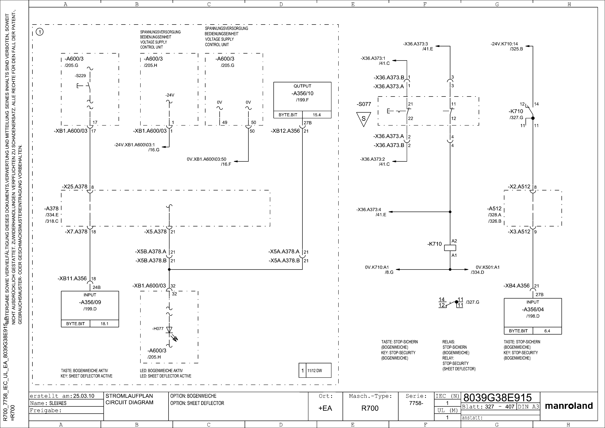

# +EA — Sheet 327 of 407 — OPTION: BOGENWEICHE

**OPTION: SHEET DEFLECTOR**

> Part of the manroland **R700** printing press IEC/UL circuit diagrams.
> Drawing class: **Stromlaufplan / Circuit diagram** (DIN A3).
> Document `+EA` covers the **Printing unit** machine section.

## At a glance

| Field | Value |
|---|---|
| Document | `+EA`  (8039G38E915) |
| Sheet | **327** of 407 |
| Section (DE) | OPTION: BOGENWEICHE |
| Section (EN) | OPTION: SHEET DEFLECTOR |
| Section type | CIRCUIT — Circuit diagram |
| Machine type | `R700` |
| Series | `7758` |
| Created | 25.03.10 |
| Replaces | — |
| Columns used | A, B, C, D, E, F, G, H |
| Path numbers | — |
| Labels on sheet | 151 |
| Cross-refs out | 21 |
| Cross-refs in | 45 |

**Previous:** [+EA sheet 326](SHEET_0326.md) · **Next:** [+EA sheet 328](SHEET_0328.md) · **Document TOC:** [_TOC.md](_TOC.md)  (+EA) · **Master TOC:** [all sheets](../_MASTER_TOC.md)

## Sheet image (300 DPI, exact vector render)



_Rendered directly from the PDF vector layer at 300 DPI (1-bit), no OCR and no resampling. Use it to confirm anything ambiguous in the text below._

## Cross-references on this sheet

Each entry is a wire leaving this sheet. The printed token is `/sheet.column`; the link resolves to that sheet inside the same document.

| Ref | Target sheet | Col | Path | Destination on target | Target section | From col |
|---|---|---|---|---|---|---|
| `/41.E` | [+EA sheet 41](SHEET_0041.md) | E | — | X36.A373:3 | BUSVERBINDUNGEN: STOP SICHERN | F |
| `/325.B` | [+EA sheet 325](SHEET_0325.md) | B | — | 24V.K710:14 | OPTION: BOGENWEICHE | G |
| `/41.C` | [+EA sheet 41](SHEET_0041.md) | C | — | X36.A373:1 | BUSVERBINDUNGEN: STOP SICHERN | E |
| `/205.G` | [+EA sheet 205](SHEET_0205.md) | G | — | A600/3 | REFERENZMODUL | A |
| `/205.H` | [+EA sheet 205](SHEET_0205.md) | H | — | A600/3 | REFERENZMODUL | B |
| `/205.G` | [+EA sheet 205](SHEET_0205.md) | G | — | — | REFERENZMODUL | C |
| `/199.F` | [+EA sheet 199](SHEET_0199.md) | F | — | — | REFERENZMODUL | D |
| `/327.G` | [+EA sheet 327](SHEET_0327.md) | G | — | — | OPTION: BOGENWEICHE | G |
| `/16.G` | [+EA sheet 16](SHEET_0016.md) | G | — | 24V.XB1.A600\03:1 | SPANNUNGSVERSORGUNG: 400V, 24V | B |
| `/16.F` | [+EA sheet 16](SHEET_0016.md) | F | — | 0V.XB1.A600\03:50 | SPANNUNGSVERSORGUNG: 400V, 24V | C |
| `/41.C` | [+EA sheet 41](SHEET_0041.md) | C | — | X36.A373:2 | BUSVERBINDUNGEN: STOP SICHERN | E |
| `/41.E` | [+EA sheet 41](SHEET_0041.md) | E | — | X36.A373:4 | BUSVERBINDUNGEN: STOP SICHERN | E |
| `/334.E` | [+EA sheet 334](SHEET_0334.md) | E | — | — | OPTION: BOGENWEICHE | A |
| `/318.C` | [+EA sheet 318](SHEET_0318.md) | C | — | — | OPTION: LOGISTIK, AUSLEGER | A |
| `/328.A` | [+EA sheet 328](SHEET_0328.md) | A | — | — | OPTION: BOGENWEICHE | G |
| `/326.B` | [+EA sheet 326](SHEET_0326.md) | B | — | — | OPTION: BOGENWEICHE | G |
| `/8.G` | [+EA sheet 8](SHEET_0008.md) | G | — | 0V.K710:A1 | SPANNUNGSVERSORGUNG: 400V, 24V | E |
| `/334.D` | [+EA sheet 334](SHEET_0334.md) | D | — | — | OPTION: BOGENWEICHE | G |
| `/199.D` | [+EA sheet 199](SHEET_0199.md) | D | — | — | REFERENZMODUL | A |
| `/198.D` | [+EA sheet 198](SHEET_0198.md) | D | — | — | REFERENZMODUL | G |
| `/205.H` | [+EA sheet 205](SHEET_0205.md) | H | — | A600/3 | REFERENZMODUL | B |

### Incoming references (sheets that point here)

Every other sheet that sends a wire to this one. `Back-ref` is the token printed on *that* sheet; `Path` is its line number.

| From sheet | Cols | Back-ref | Path | Refs | What continues there |
|---|---|---|---|---|---|
| [+EA#8](SHEET_0008.md) | G | `/8.G` | — | 1 | 0V.K710:A1 |
| [+EA#16](SHEET_0016.md) | F, G | `/16.F`, `/16.G` | — | 2 | 24V.XB1.A600\03:1 |
| [+EA#41](SHEET_0041.md) | C, E | `/41.C`, `/41.E` | — | 4 | — |
| [+EA#198](SHEET_0198.md) | D | `/198.D` | — | 1 | — |
| [+EA#199](SHEET_0199.md) | D, F | `/199.D`, `/199.F` | — | 2 | — |
| [+EA#205](SHEET_0205.md) | G, H | `/205.G`, `/205.H` | — | 4 | — |
| [+EA#213](SHEET_0213.md) | A, B | `/213.A`, `/213.B` | — | 4 | — |
| [+EA#230](SHEET_0230.md) | C | `/230.C` | — | 1 | — |
| [+EA#235](SHEET_0235.md) | E | `/235.E` | — | 1 | — |
| [+EA#237](SHEET_0237.md) | E | `/237.E` | — | 1 | — |
| [+EA#242](SHEET_0242.md) | D, E, F | `/242.D`, `/242.E`, `/242.F` | — | 3 | — |
| [+EA#243](SHEET_0243.md) | A, B | `/243.A`, `/243.B` | — | 2 | — |
| [+EA#247](SHEET_0247.md) | F | `/247.F` | — | 1 | — |
| [+EA#256](SHEET_0256.md) | B | `/256.B` | — | 1 | — |
| [+EA#257](SHEET_0257.md) | D | `/257.D` | — | 1 | — |
| [+EA#268](SHEET_0268.md) | A | `/268.A` | — | 1 | — |
| [+EA#279](SHEET_0279.md) | B | `/279.B` | — | 8 | — |
| [+EA#318](SHEET_0318.md) | C | `/318.C` | — | 1 | — |
| [+EA#325](SHEET_0325.md) | B | `/325.B` | — | 1 | 24V.K710:14 |
| [+EA#326](SHEET_0326.md) | B | `/326.B` | — | 1 | — |
| [+EA#327](SHEET_0327.md) | G | `/327.G` | — | 1 | — |
| [+EA#328](SHEET_0328.md) | A | `/328.A` | — | 1 | — |
| [+EA#334](SHEET_0334.md) | D, E | `/334.D`, `/334.E` | — | 2 | 0V.K501:A1 |


## Devices on this sheet

| Tag | Class | Class meaning (IEC) | Col | Sub | Terminal | Sign |
|---|---|---|---|---|---|---|
| `A512` | A | Baugruppe / assembly, module, PC board | G | — | — | — |
| `A356/09` | A | Baugruppe / assembly, module, PC board | A | 09 | — | — |
| `S229` | S | Schalter / switch | A | — | — | — |
| `A600/3` | A | Baugruppe / assembly, module, PC board | A | 3 | — | — |
| `A378` | A | Baugruppe / assembly, module, PC board | A | — | — | — |
| `A600/3` | A | Baugruppe / assembly, module, PC board | B | 3 | — | — |
| `A600/3` | A | Baugruppe / assembly, module, PC board | C | 3 | — | — |
| `A600/3` | A | Baugruppe / assembly, module, PC board | B | 3 | — | — |
| `A356/10` | A | Baugruppe / assembly, module, PC board | D | 10 | — | — |
| `S077` | S | Schalter / switch | E | — | — | — |
| `A2` | A | Baugruppe / assembly, module, PC board | F | — | — | — |
| `A1` | A | Baugruppe / assembly, module, PC board | F | — | — | — |
| `K710` | K | Relais / relay, contactor | F | — | — | — |
| `A356/04` | A | Baugruppe / assembly, module, PC board | G | 04 | — | — |
| `K710` | K | Relais / relay, contactor | G | — | — | — |
| `X3.A512` | — | cross-device reference | G | — | — | — |
| `X2.A512` | — | cross-device reference | G | — | — | — |
| `X7.A378` | — | cross-device reference | A | — | — | — |
| `18.1` | — | cross-device reference | B | — | — | — |
| `XB11.A356` | — | cross-device reference | A | — | — | — |
| `X25.A378` | — | cross-device reference | A | — | — | — |
| `X5B.A378.B` | — | cross-device reference | B | — | — | — |
| `X5B.A378.A` | — | cross-device reference | B | — | — | — |
| `X5.A378` | — | cross-device reference | B | — | — | — |
| `X5A.A378.B` | — | cross-device reference | D | — | — | — |
| `X5A.A378.A` | — | cross-device reference | D | — | — | — |
| `15.4` | — | cross-device reference | D | — | — | — |
| `XB12.A356` | — | cross-device reference | D | — | — | — |
| `X36.A373.B` | — | cross-device reference | F | — | — | — |
| `X36.A373.A` | — | cross-device reference | E | — | — | — |
| `X36.A373.A` | — | cross-device reference | E | — | — | — |
| `X36.A373.B` | — | cross-device reference | F | — | — | — |
| `6.4` | — | cross-device reference | H | — | — | — |
| `XB4.A356` | — | cross-device reference | G | — | — | — |
| `X36.A373:1` | — | cross-device reference | E | — | 1 | — |
| `X36.A373:2` | — | cross-device reference | E | — | 2 | — |
| `X36.A373:4` | — | cross-device reference | E | — | 4 | — |
| `X36.A373:3` | — | cross-device reference | F | — | 3 | — |

## Potentials / nets

| Potential | Count | Columns | Attached devices | Terminals |
|---|---|---|---|---|
| `0V` | 5 | C, D, E, G | `A600\03`, `K501`, `K710`, `XB1` | `50`, `A1` |
| `24V` | 3 | B, G | `A600\03`, `K710`, `XB1` | `1`, `14` |
| `H077` | 1 | B | — | — |


A potential such as `L24+/4` or `M24+` is a named supply/return rail; every place it appears on this sheet is electrically common.

## Wire-end annotations (grouped as printed)

A wire that continues elsewhere is annotated with a small cluster: the destination description, the path/line number `#NN`, and the `/sheet.column` cross reference. Each row below is one such cluster exactly as it is grouped on the drawing.

| Col | Y | Path | Cross-ref | Text on the wire |
|---|---|---|---|---|
| C | 53.1 | — | — | `BEDIENUNGSEINHEIT SPANNUNGSVERSORGUNG` |
| A | 59.3 | — | — | `1` |
| B | 60.3 | — | — | `BEDIENUNGSEINHEIT SPANNUNGSVERSORGUNG` |
| C | 74.3 | — | — | `CONTROL UNIT VOLTAGE SUPPLY` |
| B | 80.2 | — | — | `CONTROL UNIT VOLTAGE SUPPLY` |
| F | 82.5 | — | `/41.E` | `X36.A373:3` |
| G | 82.5 | — | `/325.B` | `24V.K710:14` |
| E | 110.8 | — | `/41.C` | `X36.A373:1` |
| A | 110.9 | — | `/205.G` | `A600/3` |
| B | 110.9 | — | `/205.H` | `A600/3` |
| C | 110.9 | — | — | `A600/3` |
| C | 124.7 | — | `/205.G` | — |
| A | 145.3 | — | — | `S229` |
| F | 147.7 | — | — | `X36.A373.B 1` |
| F | 147.7 | — | — | `3` |
| F | 164.7 | — | — | `X36.A373.A 1` |
| F | 164.7 | — | — | `3` |
| D | 165.5 | — | — | `QUTPUT` |
| D | 178.9 | — | — | `A356/10` |
| B | 183.6 | — | — | `24V` |
| D | 192.7 | — | `/199.F` | — |
| C | 197.8 | — | — | `0V 0V` |
| E | 200.1 | — | — | `S077` |
| F | 200.9 | — | — | `21` |
| F | 200.9 | — | — | `11` |
| G | 200.9 | — | — | `K710 14` |
| G | 200.9 | — | — | `12` |
| D | 222.3 | — | — | `BYTE.BIT 15.4` |
| G | 227.4 | — | `/327.G` | — |
| E | 227.9 | — | — | `S` |
| F | 229.2 | — | — | `22` |
| F | 229.2 | — | — | `12` |
| A | 237.0 | — | — | `17` |
| B | 237.0 | — | — | `1` |
| C | 237.0 | — | — | `49 50` |
| D | 237.7 | — | — | `27B` |
| G | 243.4 | — | — | `11 11` |
| A | 252.6 | — | — | `XB1.A600/03 17` |
| B | 252.6 | — | — | `XB1.A600/03 1` |
| D | 252.6 | — | — | `XB12.A356 21` |
| D | 254.0 | — | — | `50` |
| F | 263.2 | — | — | `X36.A373.A 2` |
| F | 265.4 | — | — | `4` |
| B | 280.9 | — | `/16.G` | `24V.XB1.A600\03:1` |
| F | 280.9 | — | — | `X36.A373.B 2` |
| F | 282.4 | — | — | `4` |
| C | 309.2 | — | `/16.F` | `0V.XB1.A600\03:50` |
| E | 309.3 | — | `/41.C` | `X36.A373:2` |
| A | 362.4 | — | — | `X25.A378 8` |
| G | 362.4 | — | — | `X2.A512 8` |
| A | 405.7 | — | — | `A378` |
| G | 405.7 | — | — | `A512` |
| E | 408.5 | — | `/41.E` | `X36.A373:4` |
| A | 418.7 | — | `/334.E`, `/318.C` | — |
| G | 418.7 | — | `/328.A`, `/326.B` | — |
| A | 451.0 | — | — | `X7.A378 18` |
| B | 451.0 | — | — | `X5.A378 21` |
| G | 451.0 | — | — | `X3.A512 9` |
| F | 470.1 | — | — | `A2` |
| F | 475.1 | — | — | `K710` |
| B | 490.0 | — | — | `X5B.A378.A 21` |
| D | 490.0 | — | — | `X5A.A378.A 21` |
| F | 498.5 | — | — | `A1` |
| B | 507.7 | — | — | `X5B.A378.B 21` |
| D | 507.7 | — | — | `X5A.A378.B 21` |
| E | 521.8 | — | `/8.G` | `0V.K710:A1` |
| G | 521.8 | — | — | `0V.K501:A1` |
| G | 531.8 | — | `/334.D` | — |
| A | 543.1 | — | — | `XB11.A356 18` |
| B | 557.3 | — | — | `XB1.A600/03 32` |
| G | 557.3 | — | — | `XB4.A356 21` |
| A | 561.5 | — | — | `24B` |
| C | 574.3 | — | — | `32` |
| H | 575.7 | — | — | `27B` |
| A | 576.6 | — | — | `INPUT` |
| F | 584.2 | — | — | `14 12 11 11 /327.G` |
| A | 589.9 | — | — | `A356/09` |
| G | 590.8 | — | — | `INPUT` |
| A | 603.7 | — | `/199.D` | — |
| G | 604.1 | — | — | `A356/04` |
| G | 617.9 | — | `/198.D` | — |
| A | 633.3 | — | — | `BYTE.BIT 18.1` |
| B | 642.8 | — | — | `H077` |
| G | 647.5 | — | — | `BYTE.BIT 6.4` |
| F | 669.5 | — | — | `RELAIS:` |
| F | 669.6 | — | — | `KEY: STOP SECURITY (BOGENWEICHE) (BOGENWEICHE) TASTE: STOP SICHERN` |
| G | 669.6 | — | — | `KEY: STOP SECURITY (BOGENWEICHE) (BOGENWEICHE) TASTE: STOP SICHERN` |
| F | 680.2 | — | — | `RELAY: (BOGENWEICHE) STOP SICHERN` |
| B | 684.9 | — | `/205.H` | `A600/3` |
| F | 712.1 | — | — | `(SHEET DEFLECTOR) STOP SECURITY` |
| D | 724.5 | — | — | `1 11/12 DW` |
| A | 726.3 | — | — | `KEY: SHEET DEFLECTOR ACTIVE TASTE: BOGENWEICHE AKTIV` |
| B | 726.3 | — | — | `LED: BOGENWEICHE AKTIV LED: SHEET DEFLECTOR ACTIVE` |


## Reconstructed tables

This sheet carries tabular content (pin map / terminal assignment / index). The grid below was rebuilt from the drawing's own rule lines, so each row is exactly one physical row of the table.

### Table 1 — 7 data rows × 5 columns (at x=120.5, y=104.9)

| A600/3 /205.G S229 |  |  | A600/3 /205.H |  |
|---|---|---|---|---|
|  |  |  |  | `24V` |
|  | `17` |  |  | `1` |
| `XB1.A600/03 X25.A378 X7.A378` | `17 8 18` | `24V.XB1.A600\03:1` | `XB1.A600/03 /16.G X5.A378 X5B.A378.A X5B.A378.B` | `1 21 21 21` |
| `XB11.A356` | `18 24B` |  | `XB1.A600/03` | `32` |
| `INPUT` | `A356/09 /199.D` |  |  | `32` |
| `BYTE.BIT` | `18.1` |  |  |  |
|  |  |  | `H077 A600/3 /205.H` |  |


### Table 2 — 2 data rows × 3 columns (at x=403.9, y=104.9) — **A600/3 /205.G**

| 0V | 0V |  |
|---|---|---|
|  | `49` | `50` |
| `0V.XB1.A600\03:50` | `/16.F` | `50` |


### Table 3 — 3 data rows × 2 columns (at x=538.6, y=104.9)

| QUTPUT | A356/10 /199.F |
|---|---|
| `BYTE.BIT` | `15.4` |
|  | `27B` |
| `XB12.A356 X5A.A378.A X5A.A378.B` | `21 21 21` |


### Table 4 — 3 data rows × 4 columns (at x=800.8, y=416.7)

| K710 | /328.A /326.B A2 A1 0V.K501:A1 | X3.A512 | 9 |
|---|---|---|---|
|  | `/334.D` | `XB4.A356` | `21 27B` |
| `14 12` | `11 /327.G 11` | `INPUT` | `A356/04 /198.D` |
|  |  | `BYTE.BIT` | `6.4` |


## Notes and free text on this sheet

| Text | Col | Y (pt) |
|---|---|---|
| `24B` | A | 561.55 |
| `INPUT` | A | 576.63 |
| `BYTE.BIT` | A | 633.32 |
| `TASTE: BOGENWEICHE AKTIV` | A | 726.26 |
| `KEY: SHEET DEFLECTOR ACTIVE` | A | 736.91 |
| `XB1.A600/03` | A | 252.59 |
| `LED: BOGENWEICHE AKTIV` | B | 726.26 |
| `LED: SHEET DEFLECTOR ACTIVE` | B | 736.92 |
| `XB1.A600/03` | B | 557.32 |
| `SPANNUNGSVERSORGUNG` | C | 53.08 |
| `BEDIENUNGSEINHEIT` | C | 63.69 |
| `VOLTAGE SUPPLY` | C | 74.33 |
| `CONTROL UNIT` | C | 84.99 |
| `SPANNUNGSVERSORGUNG` | B | 60.3 |
| `BEDIENUNGSEINHEIT` | B | 70.27 |
| `VOLTAGE SUPPLY` | B | 80.21 |
| `CONTROL UNIT` | B | 90.11 |
| `27B` | D | 237.69 |
| `QUTPUT` | D | 165.53 |
| `BYTE.BIT` | D | 222.3 |
| `TASTE: STOP SICHERN` | F | 669.59 |
| `(BOGENWEICHE)` | F | 680.2 |
| `KEY: STOP SECURITY` | F | 690.85 |
| `11 /327.G` | G | 590.59 |
| `RELAIS:` | F | 669.53 |
| `STOP SICHERN` | F | 680.23 |
| `RELAY:` | F | 701.43 |
| `STOP SECURITY` | F | 712.14 |
| `(SHEET DEFLECTOR)` | F | 722.77 |
| `27B` | H | 575.72 |
| `INPUT` | G | 590.8 |
| `BYTE.BIT` | G | 647.49 |
| `TASTE: STOP SICHERN` | G | 669.59 |
| `(BOGENWEICHE)` | G | 680.2 |
| `KEY: STOP SECURITY` | G | 690.85 |
| `11/12 DW` | D | 726.23 |
| `S` | E | 227.86 |

## Complete label inventory (exact text from the drawing)

Every text object inside the drawing area of this sheet, in DIN reading order (column A→H, then top→bottom). This is the authoritative list: if a string is not here it is not printed on this sheet.

| Col | Y | X | Dir | Type | Text |
|---|---|---|---|---|---|
| A | 59.3 | 76.2 | → | number | `1` |
| A | 110.9 | 127.3 | → | device tag | `A600/3` |
| A | 124.7 | 127.6 | → | cross-reference | `/205.G` |
| A | 145.3 | 147.1 | → | device tag | `S229` |
| A | 237.0 | 182.0 | → | number | `17` |
| A | 252.6 | 106.0 | → | text | `XB1.A600/03` |
| A | 254.0 | 179.1 | → | number | `17` |
| A | 362.4 | 121.9 | → | device ref | `X25.A378` |
| A | 364.6 | 179.7 | → | number | `8` |
| A | 405.7 | 87.0 | → | device tag | `A378` |
| A | 418.7 | 89.9 | → | cross-reference | `/334.E` |
| A | 431.2 | 89.3 | → | cross-reference | `/318.C` |
| A | 451.0 | 127.8 | → | device ref | `X7.A378` |
| A | 452.5 | 179.1 | → | number | `18` |
| A | 543.1 | 113.4 | → | device ref | `XB11.A356` |
| A | 544.6 | 179.1 | → | number | `18` |
| A | 561.5 | 182.6 | → | text | `24B` |
| A | 576.6 | 164.7 | → | text | `INPUT` |
| A | 589.9 | 155.8 | → | device tag | `A356/09` |
| A | 603.7 | 164.4 | → | cross-reference | `/199.D` |
| A | 633.3 | 130.4 | → | text | `BYTE.BIT` |
| A | 726.3 | 120.2 | → | text | `TASTE: BOGENWEICHE AKTIV` |
| A | 736.9 | 119.6 | → | text | `KEY: SHEET DEFLECTOR ACTIVE` |
| B | 60.3 | 276.1 | → | text | `SPANNUNGSVERSORGUNG` |
| B | 70.3 | 275.8 | → | text | `BEDIENUNGSEINHEIT` |
| B | 80.2 | 276.4 | → | text | `VOLTAGE SUPPLY` |
| B | 90.1 | 276.1 | → | text | `CONTROL UNIT` |
| B | 110.9 | 283.2 | → | device tag | `A600/3` |
| B | 124.7 | 283.5 | → | cross-reference | `/205.H` |
| B | 183.6 | 325.7 | → | potential | `24V` |
| B | 237.0 | 337.9 | → | number | `1` |
| B | 252.6 | 261.9 | → | text | `XB1.A600/03` |
| B | 254.0 | 335.1 | → | number | `1` |
| B | 280.9 | 224.8 | → | potential | `24V.XB1.A600\03:1` |
| B | 290.8 | 292.3 | → | cross-reference | `/16.G` |
| B | 451.0 | 283.7 | → | device ref | `X5.A378` |
| B | 490.0 | 265.9 | → | device ref | `X5B.A378.A` |
| B | 507.7 | 266.7 | → | device ref | `X5B.A378.B` |
| B | 557.3 | 260.5 | → | text | `XB1.A600/03` |
| B | 633.3 | 197.9 | → | device ref | `18.1` |
| B | 642.8 | 299.6 | → | potential | `H077` |
| B | 684.9 | 290.3 | → | device tag | `A600/3` |
| B | 698.7 | 290.6 | → | cross-reference | `/205.H` |
| B | 726.3 | 275.5 | → | text | `LED: BOGENWEICHE AKTIV` |
| B | 736.9 | 275.5 | → | text | `LED: SHEET DEFLECTOR ACTIVE` |
| C | 53.1 | 403.7 | → | text | `SPANNUNGSVERSORGUNG` |
| C | 63.7 | 403.1 | → | text | `BEDIENUNGSEINHEIT` |
| C | 74.3 | 403.9 | → | text | `VOLTAGE SUPPLY` |
| C | 85.0 | 403.7 | → | text | `CONTROL UNIT` |
| C | 110.9 | 424.1 | → | device tag | `A600/3` |
| C | 124.7 | 434.8 | → | cross-reference | `/205.G` |
| C | 197.8 | 427.2 | → | potential | `0V` |
| C | 237.0 | 437.7 | → | number | `49` |
| C | 309.2 | 367.9 | → | potential | `0V.XB1.A600\03:50` |
| C | 319.2 | 435.1 | → | cross-reference | `/16.F` |
| C | 452.5 | 335.6 | → | number | `21` |
| C | 492.1 | 335.6 | → | number | `21` |
| C | 509.1 | 335.6 | → | number | `21` |
| C | 558.7 | 335.6 | → | number | `32` |
| C | 574.3 | 338.5 | → | number | `32` |
| D | 165.5 | 578.0 | → | text | `QUTPUT` |
| D | 178.9 | 573.9 | → | device tag | `A356/10` |
| D | 192.7 | 582.9 | → | cross-reference | `/199.F` |
| D | 197.8 | 483.9 | → | potential | `0V` |
| D | 222.3 | 548.5 | → | text | `BYTE.BIT` |
| D | 222.3 | 615.4 | → | device ref | `15.4` |
| D | 237.0 | 494.4 | → | number | `50` |
| D | 237.7 | 597.8 | → | text | `27B` |
| D | 252.6 | 532.9 | → | device ref | `XB12.A356` |
| D | 254.0 | 491.5 | → | number | `50` |
| D | 254.0 | 597.8 | → | number | `21` |
| D | 490.0 | 528.1 | → | device ref | `X5A.A378.A` |
| D | 492.1 | 597.8 | → | number | `21` |
| D | 507.7 | 528.9 | → | device ref | `X5A.A378.B` |
| D | 509.1 | 597.8 | → | number | `21` |
| D | 724.5 | 592.7 | → | number | `1` |
| D | 726.2 | 605.1 | → | text | `11/12 DW` |
| E | 110.8 | 709.8 | → | device ref | `X36.A373:1` |
| E | 120.8 | 746.1 | → | cross-reference | `/41.C` |
| E | 165.4 | 734.7 | → | device ref | `X36.A373.A` |
| E | 200.1 | 702.1 | → | device tag | `S077` |
| E | 227.9 | 711.6 | → | text | `S` |
| E | 263.2 | 734.7 | → | device ref | `X36.A373.A` |
| E | 309.3 | 708.7 | → | device ref | `X36.A373:2` |
| E | 319.2 | 746.1 | → | cross-reference | `/41.C` |
| E | 408.5 | 701.3 | → | device ref | `X36.A373:4` |
| E | 418.4 | 739.6 | → | cross-reference | `/41.E` |
| E | 521.8 | 718.6 | → | potential | `0V.K710:A1` |
| F | 82.5 | 793.4 | → | device ref | `X36.A373:3` |
| F | 92.4 | 831.7 | → | cross-reference | `/41.E` |
| F | 147.7 | 735.6 | → | device ref | `X36.A373.B` |
| F | 147.7 | 802.8 | → | number | `1` |
| F | 147.7 | 888.4 | → | number | `3` |
| F | 164.7 | 802.8 | → | number | `1` |
| F | 164.7 | 888.4 | → | number | `3` |
| F | 200.9 | 803.3 | → | number | `21` |
| F | 200.9 | 887.8 | → | number | `11` |
| F | 229.2 | 803.3 | → | number | `22` |
| F | 229.2 | 887.8 | → | number | `12` |
| F | 265.4 | 803.3 | → | number | `2` |
| F | 265.4 | 888.4 | → | number | `4` |
| F | 280.9 | 735.6 | → | device ref | `X36.A373.B` |
| F | 282.4 | 803.3 | → | number | `2` |
| F | 282.4 | 888.4 | → | number | `4` |
| F | 470.1 | 888.7 | → | device tag | `A2` |
| F | 475.1 | 841.0 | → | device tag | `K710` |
| F | 498.5 | 888.7 | → | device tag | `A1` |
| F | 531.7 | 757.7 | → | cross-reference | `/8.G` |
| F | 584.2 | 863.1 | → | number | `14` |
| F | 584.2 | 900.3 | → | number | `11` |
| F | 595.5 | 863.1 | → | number | `12` |
| F | 669.5 | 870.8 | → | text | `RELAIS:` |
| F | 669.6 | 750.9 | → | text | `TASTE: STOP SICHERN` |
| F | 680.2 | 750.6 | → | text | `(BOGENWEICHE)` |
| F | 680.2 | 871.4 | → | text | `STOP SICHERN` |
| F | 690.8 | 871.1 | → | text | `(BOGENWEICHE)` |
| F | 690.9 | 750.3 | → | text | `KEY: STOP SECURITY` |
| F | 701.4 | 870.8 | → | text | `RELAY:` |
| F | 701.5 | 750.6 | → | text | `(BOGENWEICHE)` |
| F | 712.1 | 871.4 | → | text | `STOP SECURITY` |
| F | 722.8 | 871.1 | → | text | `(SHEET DEFLECTOR)` |
| G | 82.5 | 965.8 | → | potential | `24V.K710:14` |
| G | 92.4 | 1003.7 | → | cross-reference | `/325.B` |
| G | 200.9 | 1022.7 | → | number | `12` |
| G | 214.3 | 1001.2 | → | device tag | `K710` |
| G | 227.4 | 1003.2 | → | cross-reference | `/327.G` |
| G | 243.4 | 1023.9 | → | number | `11` |
| G | 362.4 | 999.5 | → | device ref | `X2.A512` |
| G | 405.7 | 958.7 | → | device tag | `A512` |
| G | 418.7 | 960.9 | → | cross-reference | `/328.A` |
| G | 431.1 | 961.2 | → | cross-reference | `/326.B` |
| G | 451.0 | 999.5 | → | device ref | `X3.A512` |
| G | 521.8 | 936.6 | → | potential | `0V.K501:A1` |
| G | 531.8 | 926.9 | → | cross-reference | `/334.D` |
| G | 557.3 | 991.0 | → | device ref | `XB4.A356` |
| G | 590.6 | 900.3 | → | text | `11 /327.G` |
| G | 590.8 | 1036.3 | → | text | `INPUT` |
| G | 604.1 | 1027.4 | → | device tag | `A356/04` |
| G | 617.9 | 1036.1 | → | cross-reference | `/198.D` |
| G | 647.5 | 1002.0 | → | text | `BYTE.BIT` |
| G | 669.6 | 991.8 | → | text | `TASTE: STOP SICHERN` |
| G | 680.2 | 991.6 | → | text | `(BOGENWEICHE)` |
| G | 690.9 | 991.3 | → | text | `KEY: STOP SECURITY` |
| G | 701.5 | 991.6 | → | text | `(BOGENWEICHE)` |
| H | 200.9 | 1050.8 | → | number | `14` |
| H | 243.4 | 1050.8 | → | number | `11` |
| H | 364.6 | 1051.4 | → | number | `8` |
| H | 452.5 | 1051.4 | → | number | `9` |
| H | 558.7 | 1051.4 | → | number | `21` |
| H | 575.7 | 1054.2 | → | text | `27B` |
| H | 647.5 | 1071.5 | → | device ref | `6.4` |

## Reading-order text block

The same content as a plain block, grouped by DIN column — convenient to paste or to match against a visual description.

```text
=== Column A ===
  59.3   76.2  numeric      1
 110.9  127.3  devtag       A600/3
 124.7  127.6  xref         /205.G
 145.3  147.1  devtag       S229
 237.0  182.0  numeric      17
 252.6  106.0  text         XB1.A600/03
 254.0  179.1  numeric      17
 362.4  121.9  devref       X25.A378
 364.6  179.7  numeric      8
 405.7   87.0  devtag       A378
 418.7   89.9  xref         /334.E
 431.2   89.3  xref         /318.C
 451.0  127.8  devref       X7.A378
 452.5  179.1  numeric      18
 543.1  113.4  devref       XB11.A356
 544.6  179.1  numeric      18
 561.5  182.6  text         24B
 576.6  164.7  text         INPUT
 589.9  155.8  devtag       A356/09
 603.7  164.4  xref         /199.D
 633.3  130.4  text         BYTE.BIT
 726.3  120.2  text         TASTE: BOGENWEICHE AKTIV
 736.9  119.6  text         KEY: SHEET DEFLECTOR ACTIVE
=== Column B ===
  60.3  276.1  text         SPANNUNGSVERSORGUNG
  70.3  275.8  text         BEDIENUNGSEINHEIT
  80.2  276.4  text         VOLTAGE SUPPLY
  90.1  276.1  text         CONTROL UNIT
 110.9  283.2  devtag       A600/3
 124.7  283.5  xref         /205.H
 183.6  325.7  net          24V
 237.0  337.9  numeric      1
 252.6  261.9  text         XB1.A600/03
 254.0  335.1  numeric      1
 280.9  224.8  net          24V.XB1.A600\03:1
 290.8  292.3  xref         /16.G
 451.0  283.7  devref       X5.A378
 490.0  265.9  devref       X5B.A378.A
 507.7  266.7  devref       X5B.A378.B
 557.3  260.5  text         XB1.A600/03
 633.3  197.9  devref       18.1
 642.8  299.6  net          H077
 684.9  290.3  devtag       A600/3
 698.7  290.6  xref         /205.H
 726.3  275.5  text         LED: BOGENWEICHE AKTIV
 736.9  275.5  text         LED: SHEET DEFLECTOR ACTIVE
=== Column C ===
  53.1  403.7  text         SPANNUNGSVERSORGUNG
  63.7  403.1  text         BEDIENUNGSEINHEIT
  74.3  403.9  text         VOLTAGE SUPPLY
  85.0  403.7  text         CONTROL UNIT
 110.9  424.1  devtag       A600/3
 124.7  434.8  xref         /205.G
 197.8  427.2  net          0V
 237.0  437.7  numeric      49
 309.2  367.9  net          0V.XB1.A600\03:50
 319.2  435.1  xref         /16.F
 452.5  335.6  numeric      21
 492.1  335.6  numeric      21
 509.1  335.6  numeric      21
 558.7  335.6  numeric      32
 574.3  338.5  numeric      32
=== Column D ===
 165.5  578.0  text         QUTPUT
 178.9  573.9  devtag       A356/10
 192.7  582.9  xref         /199.F
 197.8  483.9  net          0V
 222.3  548.5  text         BYTE.BIT
 222.3  615.4  devref       15.4
 237.0  494.4  numeric      50
 237.7  597.8  text         27B
 252.6  532.9  devref       XB12.A356
 254.0  491.5  numeric      50
 254.0  597.8  numeric      21
 490.0  528.1  devref       X5A.A378.A
 492.1  597.8  numeric      21
 507.7  528.9  devref       X5A.A378.B
 509.1  597.8  numeric      21
 724.5  592.7  numeric      1
 726.2  605.1  text         11/12 DW
=== Column E ===
 110.8  709.8  devref       X36.A373:1
 120.8  746.1  xref         /41.C
 165.4  734.7  devref       X36.A373.A
 200.1  702.1  devtag       S077
 227.9  711.6  text         S
 263.2  734.7  devref       X36.A373.A
 309.3  708.7  devref       X36.A373:2
 319.2  746.1  xref         /41.C
 408.5  701.3  devref       X36.A373:4
 418.4  739.6  xref         /41.E
 521.8  718.6  net          0V.K710:A1
=== Column F ===
  82.5  793.4  devref       X36.A373:3
  92.4  831.7  xref         /41.E
 147.7  735.6  devref       X36.A373.B
 147.7  802.8  numeric      1
 147.7  888.4  numeric      3
 164.7  802.8  numeric      1
 164.7  888.4  numeric      3
 200.9  803.3  numeric      21
 200.9  887.8  numeric      11
 229.2  803.3  numeric      22
 229.2  887.8  numeric      12
 265.4  803.3  numeric      2
 265.4  888.4  numeric      4
 280.9  735.6  devref       X36.A373.B
 282.4  803.3  numeric      2
 282.4  888.4  numeric      4
 470.1  888.7  devtag       A2
 475.1  841.0  devtag       K710
 498.5  888.7  devtag       A1
 531.7  757.7  xref         /8.G
 584.2  863.1  numeric      14
 584.2  900.3  numeric      11
 595.5  863.1  numeric      12
 669.5  870.8  text         RELAIS:
 669.6  750.9  text         TASTE: STOP SICHERN
 680.2  750.6  text         (BOGENWEICHE)
 680.2  871.4  text         STOP SICHERN
 690.8  871.1  text         (BOGENWEICHE)
 690.9  750.3  text         KEY: STOP SECURITY
 701.4  870.8  text         RELAY:
 701.5  750.6  text         (BOGENWEICHE)
 712.1  871.4  text         STOP SECURITY
 722.8  871.1  text         (SHEET DEFLECTOR)
=== Column G ===
  82.5  965.8  net          24V.K710:14
  92.4 1003.7  xref         /325.B
 200.9 1022.7  numeric      12
 214.3 1001.2  devtag       K710
 227.4 1003.2  xref         /327.G
 243.4 1023.9  numeric      11
 362.4  999.5  devref       X2.A512
 405.7  958.7  devtag       A512
 418.7  960.9  xref         /328.A
 431.1  961.2  xref         /326.B
 451.0  999.5  devref       X3.A512
 521.8  936.6  net          0V.K501:A1
 531.8  926.9  xref         /334.D
 557.3  991.0  devref       XB4.A356
 590.6  900.3  text         11 /327.G
 590.8 1036.3  text         INPUT
 604.1 1027.4  devtag       A356/04
 617.9 1036.1  xref         /198.D
 647.5 1002.0  text         BYTE.BIT
 669.6  991.8  text         TASTE: STOP SICHERN
 680.2  991.6  text         (BOGENWEICHE)
 690.9  991.3  text         KEY: STOP SECURITY
 701.5  991.6  text         (BOGENWEICHE)
=== Column H ===
 200.9 1050.8  numeric      14
 243.4 1050.8  numeric      11
 364.6 1051.4  numeric      8
 452.5 1051.4  numeric      9
 558.7 1051.4  numeric      21
 575.7 1054.2  text         27B
 647.5 1071.5  devref       6.4
```

---
_Generated from the PDF vector text layer; no OCR. Source: `R700_7758_IEC_UL_EA_8039G38E915_p`, sheet 327._
