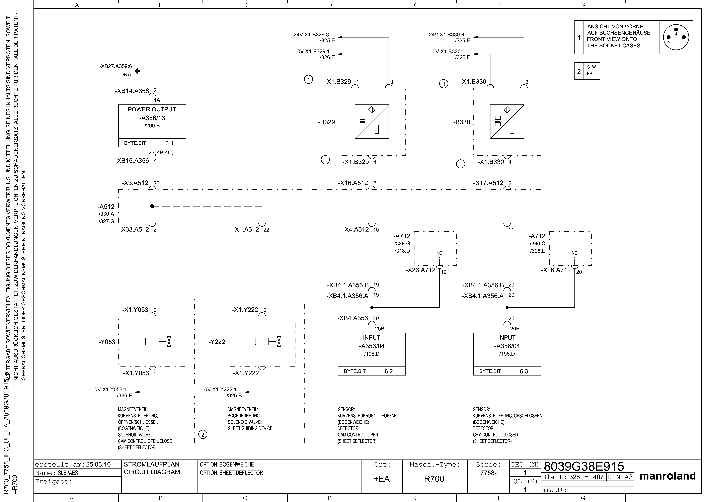

# +EA — Sheet 328 of 407 — OPTION: BOGENWEICHE

**OPTION: SHEET DEFLECTOR**

> Part of the manroland **R700** printing press IEC/UL circuit diagrams.
> Drawing class: **Stromlaufplan / Circuit diagram** (DIN A3).
> Document `+EA` covers the **Printing unit** machine section.

## At a glance

| Field | Value |
|---|---|
| Document | `+EA`  (8039G38E915) |
| Sheet | **328** of 407 |
| Section (DE) | OPTION: BOGENWEICHE |
| Section (EN) | OPTION: SHEET DEFLECTOR |
| Section type | CIRCUIT — Circuit diagram |
| Machine type | `R700` |
| Series | `7758` |
| Created | 25.03.10 |
| Replaces | — |
| Columns used | A, B, C, D, E, F, G, H |
| Path numbers | — |
| Labels on sheet | 137 |
| Cross-refs out | 15 |
| Cross-refs in | 42 |

**Previous:** [+EA sheet 327](SHEET_0327.md) · **Next:** [+EA sheet 329](SHEET_0329.md) · **Document TOC:** [_TOC.md](_TOC.md)  (+EA) · **Master TOC:** [all sheets](../_MASTER_TOC.md)

## Sheet image (300 DPI, exact vector render)



_Rendered directly from the PDF vector layer at 300 DPI (1-bit), no OCR and no resampling. Use it to confirm anything ambiguous in the text below._

## Cross-references on this sheet

Each entry is a wire leaving this sheet. The printed token is `/sheet.column`; the link resolves to that sheet inside the same document.

| Ref | Target sheet | Col | Path | Destination on target | Target section | From col |
|---|---|---|---|---|---|---|
| `/325.E` | [+EA sheet 325](SHEET_0325.md) | E | — | 24V.X1.B329:3 | OPTION: BOGENWEICHE | D |
| `/325.E` | [+EA sheet 325](SHEET_0325.md) | E | — | 24V.X1.B330:3 | OPTION: BOGENWEICHE | E |
| `/326.E` | [+EA sheet 326](SHEET_0326.md) | E | — | 0V.X1.B329:1 0V.X1.B330:1 | OPTION: BOGENWEICHE | E |
| `/326.F` | [+EA sheet 326](SHEET_0326.md) | F | — | 0V.X1.B329:1 0V.X1.B330:1 | OPTION: BOGENWEICHE | E |
| `/200.B` | [+EA sheet 200](SHEET_0200.md) | B | — | — | REFERENZMODUL | B |
| `/330.A` | [+EA sheet 330](SHEET_0330.md) | A | — | — | OPTION: BOGENWEICHE | A |
| `/327.G` | [+EA sheet 327](SHEET_0327.md) | G | — | — | OPTION: BOGENWEICHE | A |
| `/328.G` | [+EA sheet 328](SHEET_0328.md) | G | — | — | OPTION: BOGENWEICHE | E |
| `/318.D` | [+EA sheet 318](SHEET_0318.md) | D | — | — | OPTION: LOGISTIK, AUSLEGER | E |
| `/330.C` | [+EA sheet 330](SHEET_0330.md) | C | — | — | OPTION: BOGENWEICHE | F |
| `/328.E` | [+EA sheet 328](SHEET_0328.md) | E | — | — | OPTION: BOGENWEICHE | F |
| `/198.D` | [+EA sheet 198](SHEET_0198.md) | D | — | — | REFERENZMODUL | E |
| `/198.D` | [+EA sheet 198](SHEET_0198.md) | D | — | — | REFERENZMODUL | F |
| `/326.E` | [+EA sheet 326](SHEET_0326.md) | E | — | 0V.X1.Y053:1 0V.X1.Y222:1 | OPTION: BOGENWEICHE | B |
| `/326.B` | [+EA sheet 326](SHEET_0326.md) | B | — | 0V.X1.Y053:1 0V.X1.Y222:1 | OPTION: BOGENWEICHE | B |

### Incoming references (sheets that point here)

Every other sheet that sends a wire to this one. `Back-ref` is the token printed on *that* sheet; `Path` is its line number.

| From sheet | Cols | Back-ref | Path | Refs | What continues there |
|---|---|---|---|---|---|
| [+EA#198](SHEET_0198.md) | D | `/198.D` | — | 2 | — |
| [+EA#200](SHEET_0200.md) | B | `/200.B` | — | 1 | — |
| [+EA#211](SHEET_0211.md) | F | `/211.F` | — | 1 | — |
| [+EA#216](SHEET_0216.md) | H | `/216.H` | — | 3 | — |
| [+EA#217](SHEET_0217.md) | A | `/217.A` | — | 3 | — |
| [+EA#221](SHEET_0221.md) | G | `/221.G` | — | 2 | — |
| [+EA#222](SHEET_0222.md) | A | `/222.A` | — | 2 | — |
| [+EA#235](SHEET_0235.md) | E | `/235.E` | — | 1 | — |
| [+EA#237](SHEET_0237.md) | E, F, G | `/237.E`, `/237.F`, `/237.G` | — | 6 | — |
| [+EA#238](SHEET_0238.md) | A | `/238.A` | — | 2 | — |
| [+EA#259](SHEET_0259.md) | G | `/259.G` | — | 1 | — |
| [+EA#261](SHEET_0261.md) | A | `/261.A` | — | 1 | — |
| [+EA#262](SHEET_0262.md) | G | `/262.G` | — | 1 | — |
| [+EA#263](SHEET_0263.md) | C | `/263.C` | — | 1 | — |
| [+EA#270](SHEET_0270.md) | E | `/270.E` | — | 2 | — |
| [+EA#277](SHEET_0277.md) | F | `/277.F` | — | 1 | — |
| [+EA#318](SHEET_0318.md) | D | `/318.D` | — | 1 | — |
| [+EA#325](SHEET_0325.md) | E | `/325.E` | — | 2 | 24V.X1.B329:3; 24V.X1.B330:3 |
| [+EA#326](SHEET_0326.md) | A, E, F | `/326.A`, `/326.E`, `/326.F` | — | 4 | 0V.X1.B329:1; 0V.X1.B330:1; 0V.X1.Y222:1 |
| [+EA#327](SHEET_0327.md) | G | `/327.G` | — | 1 | — |
| [+EA#328](SHEET_0328.md) | E, F | `/328.E`, `/328.F` | — | 2 | — |
| [+EA#330](SHEET_0330.md) | A, C | `/330.A`, `/330.C` | — | 2 | — |


## Devices on this sheet

| Tag | Class | Class meaning (IEC) | Col | Sub | Terminal | Sign |
|---|---|---|---|---|---|---|
| `Y053` | Y | Magnetventil / solenoid valve, actuator | A | — | — | — |
| `Y222` | Y | Magnetventil / solenoid valve, actuator | C | — | — | — |
| `A356/13` | A | Baugruppe / assembly, module, PC board | B | 13 | — | — |
| `A512` | A | Baugruppe / assembly, module, PC board | A | — | — | — |
| `B329` | B | Umformer / transducer, sensor | D | — | — | — |
| `B330` | B | Umformer / transducer, sensor | F | — | — | — |
| `A356/04` | A | Baugruppe / assembly, module, PC board | E | 04 | — | — |
| `A356/04` | A | Baugruppe / assembly, module, PC board | F | 04 | — | — |
| `A712` | A | Baugruppe / assembly, module, PC board | E | — | — | — |
| `A712` | A | Baugruppe / assembly, module, PC board | F | — | — | — |
| `X1.Y053` | — | cross-device reference | B | — | — | — |
| `X1.Y053` | — | cross-device reference | B | — | — | — |
| `X1.Y222` | — | cross-device reference | C | — | — | — |
| `X1.Y222` | — | cross-device reference | C | — | — | — |
| `XB15.A356` | — | cross-device reference | B | — | — | — |
| `0.1` | — | cross-device reference | B | — | — | — |
| `XB14.A356` | — | cross-device reference | B | — | — | — |
| `XB27.A359:6` | — | cross-device reference | A | — | 6 | — |
| `X3.A512` | — | cross-device reference | B | — | — | — |
| `X33.A512` | — | cross-device reference | B | — | — | — |
| `X1.A512` | — | cross-device reference | C | — | — | — |
| `X1.B329` | — | cross-device reference | D | — | — | — |
| `X1.B329` | — | cross-device reference | D | — | — | — |
| `X1.B330` | — | cross-device reference | F | — | — | — |
| `X1.B330` | — | cross-device reference | F | — | — | — |
| `X16.A512` | — | cross-device reference | D | — | — | — |
| `X4.A512` | — | cross-device reference | D | — | — | — |
| `X17.A512` | — | cross-device reference | F | — | — | — |
| `6.2` | — | cross-device reference | E | — | — | — |
| `XB4.A356` | — | cross-device reference | D | — | — | — |
| `6.3` | — | cross-device reference | F | — | — | — |
| `XB4.1.A356.B` | — | cross-device reference | D | — | — | — |
| `XB4.1.A356.A` | — | cross-device reference | D | — | — | — |
| `XB4.1.A356.B` | — | cross-device reference | F | — | — | — |
| `XB4.1.A356.A` | — | cross-device reference | F | — | — | — |
| `X26.A712` | — | cross-device reference | E | — | — | — |
| `X26.A712` | — | cross-device reference | G | — | — | — |

## Potentials / nets

| Potential | Count | Columns | Attached devices | Terminals |
|---|---|---|---|---|
| `0V` | 4 | A, C, D, E | `B329`, `B330`, `X1`, `Y053`, `Y222` | `1` |
| `24V` | 2 | D, E | `B329`, `B330`, `X1` | `3` |


A potential such as `L24+/4` or `M24+` is a named supply/return rail; every place it appears on this sheet is electrically common.

## Wire-end annotations (grouped as printed)

A wire that continues elsewhere is annotated with a small cluster: the destination description, the path/line number `#NN`, and the `/sheet.column` cross reference. Each row below is one such cluster exactly as it is grouped on the drawing.

| Col | Y | Path | Cross-ref | Text on the wire |
|---|---|---|---|---|
| G | 40.7 | — | — | `FRONT VIEW ONTO ANSICHT VON VORNE AUF BUCHSENGEHÄUSE` |
| H | 54.0 | — | — | `4` |
| D | 54.1 | — | `/325.E` | `24V.X1.B329:3` |
| E | 54.1 | — | `/325.E` | `24V.X1.B330:3` |
| H | 58.4 | — | — | `1 3 1` |
| G | 72.5 | — | — | `THE SOCKET CASES` |
| E | 82.5 | — | `/326.E`, `/326.F` | `0V.X1.B329:1 0V.X1.B330:1` |
| A | 107.3 | — | — | `XB27.A359:6` |
| E | 109.6 | — | — | `1 2 PP S+W` |
| B | 121.5 | — | — | `+Ax` |
| D | 132.1 | — | — | `X1.B329 1 3` |
| F | 132.1 | — | — | `X1.B330 1 3` |
| E | 137.3 | — | — | `1` |
| B | 147.7 | — | — | `XB14.A356 2` |
| B | 164.0 | — | — | `4A` |
| B | 179.1 | — | — | `POWER OUTPUT` |
| B | 193.1 | — | — | `A356/13` |
| D | 200.1 | — | — | `B329` |
| F | 200.1 | — | — | `B330` |
| B | 206.8 | — | `/200.B` | — |
| B | 235.9 | — | — | `BYTE.BIT 0.1` |
| B | 251.9 | — | — | `4B(4C)` |
| B | 263.9 | — | — | `XB15.A356 2` |
| D | 264.8 | — | — | `1` |
| D | 266.8 | — | — | `X1.B329 4` |
| F | 266.8 | — | — | `X1.B330 4` |
| F | 271.9 | — | — | `1` |
| B | 302.2 | — | — | `X3.A512 22` |
| D | 302.2 | — | — | `X16.A512 2` |
| F | 302.2 | — | — | `X17.A512 2` |
| A | 341.9 | — | — | `A512` |
| A | 354.9 | — | `/330.A`, `/327.G` | — |
| B | 380.1 | — | — | `X33.A512 2` |
| C | 380.1 | — | — | `X1.A512 22` |
| D | 380.1 | — | — | `X4.A512 10` |
| F | 381.6 | — | — | `11` |
| E | 391.5 | — | — | `A712` |
| F | 391.5 | — | — | `A712` |
| E | 404.6 | — | `/328.G`, `/318.D` | — |
| F | 404.6 | — | `/330.C` | — |
| F | 417.0 | — | `/328.E` | — |
| F | 421.5 | — | — | `NC NC` |
| E | 448.2 | — | — | `X26.A712 19` |
| G | 448.2 | — | — | `X26.A712 20` |
| D | 473.7 | — | — | `XB4.1.A356.B 19` |
| F | 473.7 | — | — | `XB4.1.A356.B 20` |
| D | 490.7 | — | — | `XB4.1.A356.A 19` |
| F | 490.7 | — | — | `XB4.1.A356.A 20` |
| B | 514.9 | — | — | `X1.Y053 2` |
| C | 514.9 | — | — | `X1.Y222 2` |
| D | 529.0 | — | — | `XB4.A356 19` |
| F | 530.4 | — | — | `20` |
| E | 547.4 | — | — | `25B` |
| F | 547.4 | — | — | `26B` |
| D | 561.9 | — | — | `INPUT` |
| F | 561.9 | — | — | `INPUT` |
| A | 568.7 | — | — | `Y053` |
| C | 568.7 | — | — | `Y222` |
| E | 575.7 | — | — | `A356/04` |
| F | 575.7 | — | — | `A356/04` |
| E | 589.5 | — | `/198.D` | — |
| F | 589.5 | — | `/198.D` | — |
| D | 618.6 | — | — | `BYTE.BIT 6.2` |
| F | 618.6 | — | — | `BYTE.BIT 6.3` |
| B | 621.1 | — | — | `X1.Y053 1` |
| C | 621.1 | — | — | `X1.Y222 1` |
| B | 649.4 | — | `/326.E`, `/326.B` | `0V.X1.Y053:1 0V.X1.Y222:1` |
| B | 683.8 | — | — | `KURVENSTEUERUNG, MAGNETVENTIL:` |
| C | 683.8 | — | — | `BOGENFÜHRUNG MAGNETVENTIL:` |
| D | 683.8 | — | — | `KURVENSTEUERUNG, GEÖFFNET DETECTOR: (BOGENWEICHE) SENSOR:` |
| F | 683.8 | — | — | `KURVENSTEUERUNG, GESCHLOSSEN DETECTOR: (BOGENWEICHE) SENSOR:` |
| B | 705.0 | — | — | `(BOGENWEICHE) (SHEET DEFLECTOR) ÖFFNEN/SCHLIESSEN SOLENOID VALVE: CAM CONTROL, OPEN/CLOSE` |
| C | 705.0 | — | — | `SOLENOID VALVE: SHEET GUIDING DEVICE` |
| B | 726.0 | — | — | `2` |
| D | 726.3 | — | — | `(SHEET DEFLECTOR) CAM CONTROL, OPEN` |
| F | 726.3 | — | — | `(SHEET DEFLECTOR) CAM CONTROL, CLOSED` |


## Reconstructed tables

This sheet carries tabular content (pin map / terminal assignment / index). The grid below was rebuilt from the drawing's own rule lines, so each row is exactly one physical row of the table.

### Table 1 — 4 data rows × 2 columns (at x=198.4, y=175.7)

| POWER | OUTPUT A356/13 /200.B |
|---|---|
| `BYTE.BIT` | `0.1` |
| `XB15.A356 X3.A512` | `4B(4C) 2 22` |
| `X33.A512` | `2` |
| `X1.Y053 X1.Y053 /326.E MAGNETVENTIL: KURVENSTEUERUNG, ÖFFNEN/SCHLIESSEN (BOGENWEICHE) SOLENOID VALVE: CAM CONTROL,` | `2 1 OPEN/CLOSE` |


### Table 2 — 9 data rows × 14 columns (at x=439.4, y=34.0)

|  | 24V.X1.B329:3 |  |  |  |  |  | 24V.X1.B330:3 |  |  |  |  |  |  |
|---|---|---|---|---|---|---|---|---|---|---|---|---|---|
|  | `/325.E 0V.X1.B329:1` |  |  |  |  |  | `/325.E 0V.X1.B330:1` |  |  |  |  |  | `1` |
|  | `/326.E 1 X1.B329` |  | `1` |  | `3` |  | `/326.F X1.B330 1` |  | `1` |  | `3` |  | `2` |
|  | `B329` |  |  |  |  |  | `B330` |  |  |  |  |  |  |
|  | `1` | `X16.A512` | `X1.B329` | `4 2` |  |  | `1` | `X17.A512` | `X1.B330` | `4 2` |  |  |  |
| `22` |  | `XB4.1.A356.B XB4.1.A356.A` | `X4.A512` | `10 19 19` | `A712 /328.G /318.D` | `NC X26.A712` | `19` | `XB4.1.A356.B XB4.1.A356.A` |  | `11 20 20` | `A712 /330.C /328.E` | `NC X26.A712` | `20` |
| `2` |  | `XB4.A356` |  | `19 25B` |  |  |  |  |  | `20 26B` |  |  |  |
|  |  |  | `INPUT` | `A356/04 /198.D` |  |  |  |  | `INPUT` | `A356/04 /198.D` |  |  |  |
| `1` |  | `BYTE.BIT` |  | `6.2` |  |  |  | `BYTE.BIT` |  |  | `6.3` |  |  |
| `DEVICE` |  | `SENSOR: (BOGENWEICHE) DETECTOR: CAM (SHEET` | `KURVENSTEUERUNG, CONTROL, DEFLECTOR)` | `OPEN` | `GEÖFFNET` |  |  | `SENSOR: (BOGENWEICHE) DETECTOR: CAM (SHEET` | `KURVENSTEUERUNG, CONTROL, DEFLECTOR)` | `CLOSED` | `GESCHLOSSEN` |  |  |


## Notes and free text on this sheet

| Text | Col | Y (pt) |
|---|---|---|
| `MAGNETVENTIL:` | B | 683.76 |
| `KURVENSTEUERUNG,` | B | 694.41 |
| `ÖFFNEN/SCHLIESSEN` | B | 705.04 |
| `(BOGENWEICHE)` | B | 715.64 |
| `SOLENOID VALVE:` | B | 726.29 |
| `CAM CONTROL, OPEN/CLOSE` | B | 736.95 |
| `(SHEET DEFLECTOR)` | B | 747.58 |
| `MAGNETVENTIL:` | C | 683.76 |
| `BOGENFÜHRUNG` | C | 694.42 |
| `SOLENOID VALVE:` | C | 705.02 |
| `SHEET GUIDING DEVICE` | C | 715.67 |
| `4A` | B | 163.97 |
| `4B(4C)` | B | 251.89 |
| `POWER OUTPUT` | B | 179.14 |
| `BYTE.BIT` | B | 236.47 |
| `+Ax` | B | 121.54 |
| `25B` | E | 547.37 |
| `INPUT` | D | 561.9 |
| `BYTE.BIT` | D | 619.15 |
| `SENSOR:` | D | 683.75 |
| `KURVENSTEUERUNG, GEÖFFNET` | D | 694.41 |
| `(BOGENWEICHE)` | D | 705.01 |
| `DETECTOR:` | D | 715.65 |
| `CAM CONTROL, OPEN` | D | 726.32 |
| `(SHEET DEFLECTOR)` | D | 736.94 |
| `26B` | F | 547.37 |
| `INPUT` | F | 561.9 |
| `BYTE.BIT` | F | 619.15 |
| `SENSOR:` | F | 683.75 |
| `KURVENSTEUERUNG, GESCHLOSSEN` | F | 694.41 |
| `(BOGENWEICHE)` | F | 705.01 |
| `DETECTOR:` | F | 715.65 |
| `CAM CONTROL, CLOSED` | F | 726.33 |
| `(SHEET DEFLECTOR)` | F | 736.94 |
| `ANSICHT VON VORNE` | G | 40.67 |
| `AUF BUCHSENGEHÄUSE` | G | 51.3 |
| `FRONT VIEW ONTO` | G | 61.9 |
| `THE SOCKET CASES` | G | 72.55 |
| `S+W` | G | 109.62 |
| `PP` | G | 120.25 |
| `NC` | E | 421.53 |
| `NC` | G | 421.53 |

## Complete label inventory (exact text from the drawing)

Every text object inside the drawing area of this sheet, in DIN reading order (column A→H, then top→bottom). This is the authoritative list: if a string is not here it is not printed on this sheet.

| Col | Y | X | Dir | Type | Text |
|---|---|---|---|---|---|
| A | 107.3 | 166.7 | → | device ref | `XB27.A359:6` |
| A | 341.9 | 163.6 | → | device tag | `A512` |
| A | 354.9 | 165.8 | → | cross-reference | `/330.A` |
| A | 367.4 | 165.5 | → | cross-reference | `/327.G` |
| A | 568.7 | 165.5 | → | device tag | `Y053` |
| A | 649.4 | 158.5 | → | potential | `0V.X1.Y053:1` |
| B | 121.5 | 206.1 | → | text | `+Ax` |
| B | 147.7 | 192.8 | → | device ref | `XB14.A356` |
| B | 147.7 | 257.7 | → | number | `2` |
| B | 164.0 | 257.7 | → | text | `4A` |
| B | 179.1 | 214.3 | → | text | `POWER OUTPUT` |
| B | 193.1 | 233.7 | → | device tag | `A356/13` |
| B | 206.8 | 242.5 | → | cross-reference | `/200.B` |
| B | 235.9 | 277.5 | → | device ref | `0.1` |
| B | 236.5 | 208.3 | → | text | `BYTE.BIT` |
| B | 251.9 | 263.3 | → | text | `4B(4C)` |
| B | 263.9 | 257.7 | → | number | `2` |
| B | 264.6 | 192.8 | → | device ref | `XB15.A356` |
| B | 302.2 | 204.4 | → | device ref | `X3.A512` |
| B | 303.6 | 257.7 | → | number | `22` |
| B | 380.1 | 199.8 | → | device ref | `X33.A512` |
| B | 381.6 | 257.7 | → | number | `2` |
| B | 514.8 | 204.9 | → | device ref | `X1.Y053` |
| B | 516.2 | 257.7 | → | number | `2` |
| B | 621.1 | 206.4 | → | device ref | `X1.Y053` |
| B | 622.5 | 257.1 | → | number | `1` |
| B | 659.3 | 196.2 | → | cross-reference | `/326.E` |
| B | 683.8 | 197.9 | → | text | `MAGNETVENTIL:` |
| B | 694.4 | 197.6 | → | text | `KURVENSTEUERUNG,` |
| B | 705.0 | 198.1 | → | text | `ÖFFNEN/SCHLIESSEN` |
| B | 715.6 | 197.9 | → | text | `(BOGENWEICHE)` |
| B | 726.0 | 338.2 | → | number | `2` |
| B | 726.3 | 198.1 | → | text | `SOLENOID VALVE:` |
| B | 737.0 | 198.1 | → | text | `CAM CONTROL, OPEN/CLOSE` |
| B | 747.6 | 197.9 | → | text | `(SHEET DEFLECTOR)` |
| C | 380.2 | 390.0 | → | device ref | `X1.A512` |
| C | 381.6 | 441.9 | → | number | `22` |
| C | 514.8 | 389.2 | → | device ref | `X1.Y222` |
| C | 516.2 | 441.9 | → | number | `2` |
| C | 568.7 | 349.8 | → | device tag | `Y222` |
| C | 621.1 | 390.6 | → | device ref | `X1.Y222` |
| C | 622.5 | 441.4 | → | number | `1` |
| C | 649.4 | 342.7 | → | potential | `0V.X1.Y222:1` |
| C | 659.3 | 380.1 | → | cross-reference | `/326.B` |
| C | 683.8 | 382.1 | → | text | `MAGNETVENTIL:` |
| C | 694.4 | 381.8 | → | text | `BOGENFÜHRUNG` |
| C | 705.0 | 382.4 | → | text | `SOLENOID VALVE:` |
| C | 715.7 | 382.4 | → | text | `SHEET GUIDING DEVICE` |
| D | 54.1 | 489.5 | → | potential | `24V.X1.B329:3` |
| D | 64.0 | 536.3 | → | cross-reference | `/325.E` |
| D | 82.5 | 498.6 | → | potential | `0V.X1.B329:1` |
| D | 92.4 | 536.3 | → | cross-reference | `/326.E` |
| D | 130.2 | 515.6 | → | number | `1` |
| D | 132.1 | 544.5 | → | device ref | `X1.B329` |
| D | 133.6 | 597.3 | → | number | `1` |
| D | 200.1 | 533.5 | → | device tag | `B329` |
| D | 264.8 | 543.9 | → | number | `1` |
| D | 266.8 | 574.3 | → | device ref | `X1.B329` |
| D | 302.2 | 566.9 | → | device ref | `X16.A512` |
| D | 380.2 | 574.3 | → | device ref | `X4.A512` |
| D | 473.7 | 548.5 | → | device ref | `XB4.1.A356.B` |
| D | 491.4 | 547.7 | → | device ref | `XB4.1.A356.A` |
| D | 529.0 | 565.8 | → | device ref | `XB4.A356` |
| D | 561.9 | 608.7 | → | text | `INPUT` |
| D | 619.1 | 576.9 | → | text | `BYTE.BIT` |
| D | 683.7 | 566.6 | → | text | `SENSOR:` |
| D | 694.4 | 566.1 | → | text | `KURVENSTEUERUNG, GEÖFFNET` |
| D | 705.0 | 566.4 | → | text | `(BOGENWEICHE)` |
| D | 715.7 | 566.1 | → | text | `DETECTOR:` |
| D | 726.3 | 566.6 | → | text | `CAM CONTROL, OPEN` |
| D | 736.9 | 566.4 | → | text | `(SHEET DEFLECTOR)` |
| E | 54.1 | 716.3 | → | potential | `24V.X1.B330:3` |
| E | 82.5 | 725.4 | → | potential | `0V.X1.B330:1` |
| E | 133.6 | 654.5 | → | number | `3` |
| E | 137.3 | 742.3 | → | number | `1` |
| E | 268.2 | 626.2 | → | number | `4` |
| E | 303.6 | 626.2 | → | number | `2` |
| E | 381.6 | 625.6 | → | number | `10` |
| E | 391.5 | 659.6 | → | device tag | `A712` |
| E | 404.6 | 661.6 | → | cross-reference | `/328.G` |
| E | 417.0 | 661.9 | → | cross-reference | `/318.D` |
| E | 421.5 | 732.1 | → | text | `NC` |
| E | 448.2 | 680.3 | → | device ref | `X26.A712` |
| E | 452.5 | 739.0 | → | number | `19` |
| E | 473.7 | 625.6 | → | number | `19` |
| E | 490.7 | 625.6 | → | number | `19` |
| E | 530.4 | 625.6 | → | number | `19` |
| E | 547.4 | 629.0 | → | text | `25B` |
| E | 575.7 | 602.2 | → | device tag | `A356/04` |
| E | 589.5 | 610.9 | → | cross-reference | `/198.D` |
| E | 618.6 | 645.2 | → | device ref | `6.2` |
| F | 64.0 | 763.1 | → | cross-reference | `/325.E` |
| F | 92.4 | 763.4 | → | cross-reference | `/326.F` |
| F | 132.1 | 771.3 | → | device ref | `X1.B330` |
| F | 133.6 | 824.0 | → | number | `1` |
| F | 133.6 | 881.3 | → | number | `3` |
| F | 200.1 | 760.3 | → | device tag | `B330` |
| F | 266.8 | 801.1 | → | device ref | `X1.B330` |
| F | 268.2 | 852.9 | → | number | `4` |
| F | 271.9 | 770.7 | → | number | `1` |
| F | 302.2 | 793.7 | → | device ref | `X17.A512` |
| F | 303.6 | 852.9 | → | number | `2` |
| F | 381.6 | 852.4 | → | number | `11` |
| F | 391.5 | 886.4 | → | device tag | `A712` |
| F | 404.6 | 888.7 | → | cross-reference | `/330.C` |
| F | 417.0 | 889.2 | → | cross-reference | `/328.E` |
| F | 473.7 | 775.3 | → | device ref | `XB4.1.A356.B` |
| F | 473.7 | 852.9 | → | number | `20` |
| F | 490.7 | 852.9 | → | number | `20` |
| F | 491.4 | 774.4 | → | device ref | `XB4.1.A356.A` |
| F | 530.4 | 852.9 | → | number | `20` |
| F | 547.4 | 855.8 | → | text | `26B` |
| F | 561.9 | 835.5 | → | text | `INPUT` |
| F | 575.7 | 829.0 | → | device tag | `A356/04` |
| F | 589.5 | 837.6 | → | cross-reference | `/198.D` |
| F | 618.6 | 871.9 | → | device ref | `6.3` |
| F | 619.1 | 803.6 | → | text | `BYTE.BIT` |
| F | 683.7 | 793.4 | → | text | `SENSOR:` |
| F | 694.4 | 792.9 | → | text | `KURVENSTEUERUNG, GESCHLOSSEN` |
| F | 705.0 | 793.1 | → | text | `(BOGENWEICHE)` |
| F | 715.7 | 792.9 | → | text | `DETECTOR:` |
| F | 726.3 | 793.4 | → | text | `CAM CONTROL, CLOSED` |
| F | 736.9 | 793.1 | → | text | `(SHEET DEFLECTOR)` |
| G | 40.7 | 985.0 | → | text | `ANSICHT VON VORNE` |
| G | 51.3 | 985.0 | → | text | `AUF BUCHSENGEHÄUSE` |
| G | 58.4 | 968.3 | → | number | `1` |
| G | 61.9 | 984.2 | → | text | `FRONT VIEW ONTO` |
| G | 72.5 | 984.8 | → | text | `THE SOCKET CASES` |
| G | 109.6 | 984.8 | → | text | `S+W` |
| G | 115.1 | 968.0 | → | number | `2` |
| G | 120.3 | 984.2 | → | text | `PP` |
| G | 421.5 | 958.9 | → | text | `NC` |
| G | 448.2 | 907.1 | → | device ref | `X26.A712` |
| G | 452.5 | 966.3 | → | number | `20` |
| H | 54.0 | 1131.9 | → | number | `4` |
| H | 66.8 | 1119.1 | → | number | `3` |
| H | 66.8 | 1145.1 | → | number | `1` |

## Reading-order text block

The same content as a plain block, grouped by DIN column — convenient to paste or to match against a visual description.

```text
=== Column A ===
 107.3  166.7  devref       XB27.A359:6
 341.9  163.6  devtag       A512
 354.9  165.8  xref         /330.A
 367.4  165.5  xref         /327.G
 568.7  165.5  devtag       Y053
 649.4  158.5  net          0V.X1.Y053:1
=== Column B ===
 121.5  206.1  text         +Ax
 147.7  192.8  devref       XB14.A356
 147.7  257.7  numeric      2
 164.0  257.7  text         4A
 179.1  214.3  text         POWER OUTPUT
 193.1  233.7  devtag       A356/13
 206.8  242.5  xref         /200.B
 235.9  277.5  devref       0.1
 236.5  208.3  text         BYTE.BIT
 251.9  263.3  text         4B(4C)
 263.9  257.7  numeric      2
 264.6  192.8  devref       XB15.A356
 302.2  204.4  devref       X3.A512
 303.6  257.7  numeric      22
 380.1  199.8  devref       X33.A512
 381.6  257.7  numeric      2
 514.8  204.9  devref       X1.Y053
 516.2  257.7  numeric      2
 621.1  206.4  devref       X1.Y053
 622.5  257.1  numeric      1
 659.3  196.2  xref         /326.E
 683.8  197.9  text         MAGNETVENTIL:
 694.4  197.6  text         KURVENSTEUERUNG,
 705.0  198.1  text         ÖFFNEN/SCHLIESSEN
 715.6  197.9  text         (BOGENWEICHE)
 726.0  338.2  numeric      2
 726.3  198.1  text         SOLENOID VALVE:
 737.0  198.1  text         CAM CONTROL, OPEN/CLOSE
 747.6  197.9  text         (SHEET DEFLECTOR)
=== Column C ===
 380.2  390.0  devref       X1.A512
 381.6  441.9  numeric      22
 514.8  389.2  devref       X1.Y222
 516.2  441.9  numeric      2
 568.7  349.8  devtag       Y222
 621.1  390.6  devref       X1.Y222
 622.5  441.4  numeric      1
 649.4  342.7  net          0V.X1.Y222:1
 659.3  380.1  xref         /326.B
 683.8  382.1  text         MAGNETVENTIL:
 694.4  381.8  text         BOGENFÜHRUNG
 705.0  382.4  text         SOLENOID VALVE:
 715.7  382.4  text         SHEET GUIDING DEVICE
=== Column D ===
  54.1  489.5  net          24V.X1.B329:3
  64.0  536.3  xref         /325.E
  82.5  498.6  net          0V.X1.B329:1
  92.4  536.3  xref         /326.E
 130.2  515.6  numeric      1
 132.1  544.5  devref       X1.B329
 133.6  597.3  numeric      1
 200.1  533.5  devtag       B329
 264.8  543.9  numeric      1
 266.8  574.3  devref       X1.B329
 302.2  566.9  devref       X16.A512
 380.2  574.3  devref       X4.A512
 473.7  548.5  devref       XB4.1.A356.B
 491.4  547.7  devref       XB4.1.A356.A
 529.0  565.8  devref       XB4.A356
 561.9  608.7  text         INPUT
 619.1  576.9  text         BYTE.BIT
 683.7  566.6  text         SENSOR:
 694.4  566.1  text         KURVENSTEUERUNG, GEÖFFNET
 705.0  566.4  text         (BOGENWEICHE)
 715.7  566.1  text         DETECTOR:
 726.3  566.6  text         CAM CONTROL, OPEN
 736.9  566.4  text         (SHEET DEFLECTOR)
=== Column E ===
  54.1  716.3  net          24V.X1.B330:3
  82.5  725.4  net          0V.X1.B330:1
 133.6  654.5  numeric      3
 137.3  742.3  numeric      1
 268.2  626.2  numeric      4
 303.6  626.2  numeric      2
 381.6  625.6  numeric      10
 391.5  659.6  devtag       A712
 404.6  661.6  xref         /328.G
 417.0  661.9  xref         /318.D
 421.5  732.1  text         NC
 448.2  680.3  devref       X26.A712
 452.5  739.0  numeric      19
 473.7  625.6  numeric      19
 490.7  625.6  numeric      19
 530.4  625.6  numeric      19
 547.4  629.0  text         25B
 575.7  602.2  devtag       A356/04
 589.5  610.9  xref         /198.D
 618.6  645.2  devref       6.2
=== Column F ===
  64.0  763.1  xref         /325.E
  92.4  763.4  xref         /326.F
 132.1  771.3  devref       X1.B330
 133.6  824.0  numeric      1
 133.6  881.3  numeric      3
 200.1  760.3  devtag       B330
 266.8  801.1  devref       X1.B330
 268.2  852.9  numeric      4
 271.9  770.7  numeric      1
 302.2  793.7  devref       X17.A512
 303.6  852.9  numeric      2
 381.6  852.4  numeric      11
 391.5  886.4  devtag       A712
 404.6  888.7  xref         /330.C
 417.0  889.2  xref         /328.E
 473.7  775.3  devref       XB4.1.A356.B
 473.7  852.9  numeric      20
 490.7  852.9  numeric      20
 491.4  774.4  devref       XB4.1.A356.A
 530.4  852.9  numeric      20
 547.4  855.8  text         26B
 561.9  835.5  text         INPUT
 575.7  829.0  devtag       A356/04
 589.5  837.6  xref         /198.D
 618.6  871.9  devref       6.3
 619.1  803.6  text         BYTE.BIT
 683.7  793.4  text         SENSOR:
 694.4  792.9  text         KURVENSTEUERUNG, GESCHLOSSEN
 705.0  793.1  text         (BOGENWEICHE)
 715.7  792.9  text         DETECTOR:
 726.3  793.4  text         CAM CONTROL, CLOSED
 736.9  793.1  text         (SHEET DEFLECTOR)
=== Column G ===
  40.7  985.0  text         ANSICHT VON VORNE
  51.3  985.0  text         AUF BUCHSENGEHÄUSE
  58.4  968.3  numeric      1
  61.9  984.2  text         FRONT VIEW ONTO
  72.5  984.8  text         THE SOCKET CASES
 109.6  984.8  text         S+W
 115.1  968.0  numeric      2
 120.3  984.2  text         PP
 421.5  958.9  text         NC
 448.2  907.1  devref       X26.A712
 452.5  966.3  numeric      20
=== Column H ===
  54.0 1131.9  numeric      4
  66.8 1119.1  numeric      3
  66.8 1145.1  numeric      1
```

---
_Generated from the PDF vector text layer; no OCR. Source: `R700_7758_IEC_UL_EA_8039G38E915_p`, sheet 328._
