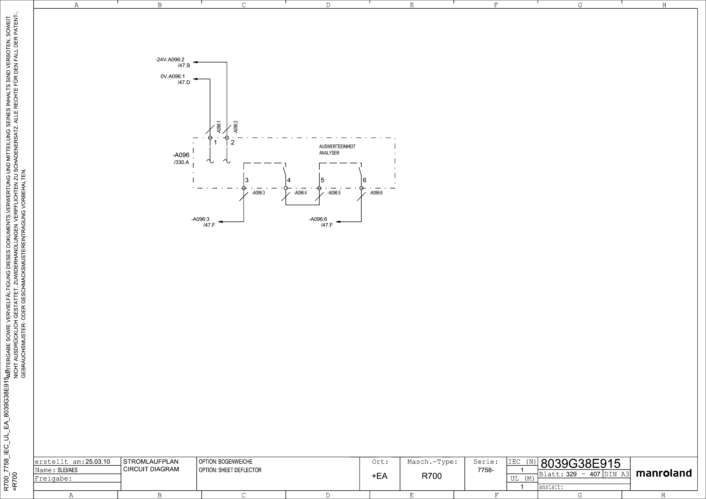

# +EA — Sheet 329 of 407 — OPTION: BOGENWEICHE

**OPTION: SHEET DEFLECTOR**

> Part of the manroland **R700** printing press IEC/UL circuit diagrams.
> Drawing class: **Stromlaufplan / Circuit diagram** (DIN A3).
> Document `+EA` covers the **Printing unit** machine section.

## At a glance

| Field | Value |
|---|---|
| Document | `+EA`  (8039G38E915) |
| Sheet | **329** of 407 |
| Section (DE) | OPTION: BOGENWEICHE |
| Section (EN) | OPTION: SHEET DEFLECTOR |
| Section type | CIRCUIT — Circuit diagram |
| Machine type | `R700` |
| Series | `7758` |
| Created | 25.03.10 |
| Replaces | — |
| Columns used | B, C, D, E |
| Path numbers | — |
| Labels on sheet | 24 |
| Cross-refs out | 5 |
| Cross-refs in | 5 |

**Previous:** [+EA sheet 328](SHEET_0328.md) · **Next:** [+EA sheet 330](SHEET_0330.md) · **Document TOC:** [_TOC.md](_TOC.md)  (+EA) · **Master TOC:** [all sheets](../_MASTER_TOC.md)

## Sheet image (300 DPI, exact vector render)



_Rendered directly from the PDF vector layer at 300 DPI (1-bit), no OCR and no resampling. Use it to confirm anything ambiguous in the text below._

## Cross-references on this sheet

Each entry is a wire leaving this sheet. The printed token is `/sheet.column`; the link resolves to that sheet inside the same document.

| Ref | Target sheet | Col | Path | Destination on target | Target section | From col |
|---|---|---|---|---|---|---|
| `/47.B` | [+EA sheet 47](SHEET_0047.md) | B | — | 24V.A096:2 | SCHUTZ | B |
| `/47.D` | [+EA sheet 47](SHEET_0047.md) | D | — | 0V.A096:1 | SCHUTZ | B |
| `/330.A` | [+EA sheet 330](SHEET_0330.md) | A | — | — | OPTION: BOGENWEICHE | B |
| `/47.F` | [+EA sheet 47](SHEET_0047.md) | F | — | A096:3 | SCHUTZ | C |
| `/47.F` | [+EA sheet 47](SHEET_0047.md) | F | — | A096:6 | SCHUTZ | D |

### Incoming references (sheets that point here)

Every other sheet that sends a wire to this one. `Back-ref` is the token printed on *that* sheet; `Path` is its line number.

| From sheet | Cols | Back-ref | Path | Refs | What continues there |
|---|---|---|---|---|---|
| [+EA#47](SHEET_0047.md) | B, D, F | `/47.B`, `/47.D`, `/47.F` | — | 4 | 0V.A096:1; 24V.A096:2 |
| [+EA#330](SHEET_0330.md) | B | `/330.B` | — | 1 | AUSWERTEEINHEIT ANALYSER |


## Devices on this sheet

| Tag | Class | Class meaning (IEC) | Col | Sub | Terminal | Sign |
|---|---|---|---|---|---|---|
| `A096` | A | Baugruppe / assembly, module, PC board | B | — | — | — |
| `A096:3` | A | Baugruppe / assembly, module, PC board | B | — | 3 | — |
| `A096:6` | A | Baugruppe / assembly, module, PC board | D | — | 6 | — |
| `A096:1` | A | Baugruppe / assembly, module, PC board | C | — | 1 | — |
| `A096:2` | A | Baugruppe / assembly, module, PC board | C | — | 2 | — |
| `A096:5` | A | Baugruppe / assembly, module, PC board | D | — | 5 | — |
| `A096:4` | A | Baugruppe / assembly, module, PC board | D | — | 4 | — |
| `A096:6` | A | Baugruppe / assembly, module, PC board | E | — | 6 | — |
| `A096:3` | A | Baugruppe / assembly, module, PC board | C | — | 3 | — |

## Potentials / nets

| Potential | Count | Columns | Attached devices | Terminals |
|---|---|---|---|---|
| `0V` | 1 | B | `A096` | `1` |
| `24V` | 1 | B | `A096` | `2` |


A potential such as `L24+/4` or `M24+` is a named supply/return rail; every place it appears on this sheet is electrically common.

## Wire-end annotations (grouped as printed)

A wire that continues elsewhere is annotated with a small cluster: the destination description, the path/line number `#NN`, and the `/sheet.column` cross reference. Each row below is one such cluster exactly as it is grouped on the drawing.

| Col | Y | Path | Cross-ref | Text on the wire |
|---|---|---|---|---|
| B | 96.7 | — | `/47.B` | `24V.A096:2` |
| B | 125.0 | — | `/47.D` | `0V.A096:1` |
| C | 203.3 | — | — | `A096:1` |
| C | 203.7 | — | — | `A096:2` |
| C | 235.6 | — | — | `1 2` |
| D | 244.4 | — | — | `AUSWERTEEINHEIT ANALYSER` |
| B | 256.8 | — | — | `A096` |
| B | 269.9 | — | `/330.A` | — |
| D | 299.3 | — | — | `3 4 5 6` |
| D | 322.4 | — | — | `A096:3 A096:4 A096:5 A096:6` |
| C | 366.0 | — | `/47.F` | `A096:3` |
| D | 366.0 | — | `/47.F` | `A096:6` |


## Reconstructed tables

This sheet carries tabular content (pin map / terminal assignment / index). The grid below was rebuilt from the drawing's own rule lines, so each row is exactly one physical row of the table.

### Table 1 — 5 data rows × 11 columns (at x=204.1, y=0.0) — **24V.A096:2 /47.B 0V.A096:1 /47.D A096 /330.A A096:1 1 A096:2 2 AUSWERTEEINHEIT ANALYSER 3 4 A096:3 A096:4 5 A096:5 6 A096:6 A096:3 /47.F A096:6 /47.F**

| STROMLAUFPLAN | OPTION: |  | BOGENWEICHE |  |  | Ort: | Masch. Type: | Serie: | IEC (N) | 8039G38E915 |
|---|---|---|---|---|---|---|---|---|---|---|
| `CIRCUIT DIAGRAM` |  |  |  |  |  |  |  |  |  |  |
|  | `OPTION:` | `SHEET` |  | `DEFLECTOR` |  |  |  | `7758` | `1` |  |
|  |  |  |  |  |  | `+EA` | `R700` |  |  | `Blatt: DIN A3 329 407` |
|  |  |  |  |  |  |  |  |  | `UL (M)` |  |
|  |  |  |  |  |  |  |  |  | `1` | `anstatt:` |


## Notes and free text on this sheet

| Text | Col | Y (pt) |
|---|---|---|
| `AUSWERTEEINHEIT` | D | 244.38 |
| `ANALYSER` | D | 255.04 |

## Complete label inventory (exact text from the drawing)

Every text object inside the drawing area of this sheet, in DIN reading order (column A→H, then top→bottom). This is the authoritative list: if a string is not here it is not printed on this sheet.

| Col | Y | X | Dir | Type | Text |
|---|---|---|---|---|---|
| B | 96.7 | 262.2 | → | potential | `24V.A096:2` |
| B | 106.5 | 299.9 | → | cross-reference | `/47.B` |
| B | 125.0 | 271.0 | → | potential | `0V.A096:1` |
| B | 134.9 | 299.6 | → | cross-reference | `/47.D` |
| B | 256.8 | 291.1 | → | device tag | `A096` |
| B | 269.9 | 293.4 | → | cross-reference | `/330.A` |
| B | 366.0 | 322.6 | → | device tag | `A096:3` |
| C | 203.3 | 366.2 | ↕ | device tag | `A096:1` |
| C | 203.7 | 394.6 | ↕ | device tag | `A096:2` |
| C | 235.5 | 360.3 | → | number | `1` |
| C | 235.5 | 389.5 | → | number | `2` |
| C | 299.3 | 413.3 | → | number | `3` |
| C | 322.4 | 424.9 | → | device tag | `A096:3` |
| C | 375.9 | 343.0 | → | cross-reference | `/47.F` |
| D | 244.4 | 538.6 | → | text | `AUSWERTEEINHEIT` |
| D | 255.0 | 538.6 | → | text | `ANALYSER` |
| D | 299.3 | 484.4 | → | number | `4` |
| D | 299.3 | 540.9 | → | number | `5` |
| D | 299.3 | 612.0 | → | number | `6` |
| D | 322.4 | 495.8 | → | device tag | `A096:4` |
| D | 322.4 | 552.5 | → | device tag | `A096:5` |
| D | 366.0 | 521.0 | → | device tag | `A096:6` |
| D | 375.9 | 541.4 | → | cross-reference | `/47.F` |
| E | 322.4 | 623.3 | → | device tag | `A096:6` |

## Reading-order text block

The same content as a plain block, grouped by DIN column — convenient to paste or to match against a visual description.

```text
=== Column B ===
  96.7  262.2  net          24V.A096:2
 106.5  299.9  xref         /47.B
 125.0  271.0  net          0V.A096:1
 134.9  299.6  xref         /47.D
 256.8  291.1  devtag       A096
 269.9  293.4  xref         /330.A
 366.0  322.6  devtag       A096:3
=== Column C ===
 203.3  366.2  devtag       A096:1
 203.7  394.6  devtag       A096:2
 235.5  360.3  numeric      1
 235.5  389.5  numeric      2
 299.3  413.3  numeric      3
 322.4  424.9  devtag       A096:3
 375.9  343.0  xref         /47.F
=== Column D ===
 244.4  538.6  text         AUSWERTEEINHEIT
 255.0  538.6  text         ANALYSER
 299.3  484.4  numeric      4
 299.3  540.9  numeric      5
 299.3  612.0  numeric      6
 322.4  495.8  devtag       A096:4
 322.4  552.5  devtag       A096:5
 366.0  521.0  devtag       A096:6
 375.9  541.4  xref         /47.F
=== Column E ===
 322.4  623.3  devtag       A096:6
```

---
_Generated from the PDF vector text layer; no OCR. Source: `R700_7758_IEC_UL_EA_8039G38E915_p`, sheet 329._
