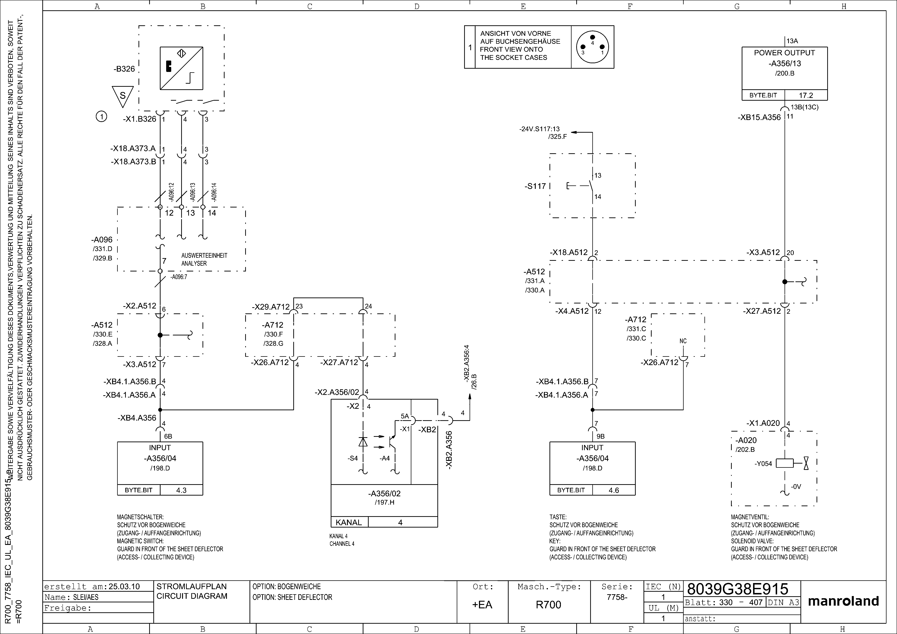

# +EA — Sheet 330 of 407 — OPTION: BOGENWEICHE

**OPTION: SHEET DEFLECTOR**

> Part of the manroland **R700** printing press IEC/UL circuit diagrams.
> Drawing class: **Stromlaufplan / Circuit diagram** (DIN A3).
> Document `+EA` covers the **Printing unit** machine section.

## At a glance

| Field | Value |
|---|---|
| Document | `+EA`  (8039G38E915) |
| Sheet | **330** of 407 |
| Section (DE) | OPTION: BOGENWEICHE |
| Section (EN) | OPTION: SHEET DEFLECTOR |
| Section type | CIRCUIT — Circuit diagram |
| Machine type | `R700` |
| Series | `7758` |
| Created | 25.03.10 |
| Replaces | — |
| Columns used | A, B, C, D, E, F, G, H |
| Path numbers | — |
| Labels on sheet | 152 |
| Cross-refs out | 17 |
| Cross-refs in | 47 |

**Previous:** [+EA sheet 329](SHEET_0329.md) · **Next:** [+EA sheet 331](SHEET_0331.md) · **Document TOC:** [_TOC.md](_TOC.md)  (+EA) · **Master TOC:** [all sheets](../_MASTER_TOC.md)

## Sheet image (300 DPI, exact vector render)



_Rendered directly from the PDF vector layer at 300 DPI (1-bit), no OCR and no resampling. Use it to confirm anything ambiguous in the text below._

## Cross-references on this sheet

Each entry is a wire leaving this sheet. The printed token is `/sheet.column`; the link resolves to that sheet inside the same document.

| Ref | Target sheet | Col | Path | Destination on target | Target section | From col |
|---|---|---|---|---|---|---|
| `/200.B` | [+EA sheet 200](SHEET_0200.md) | B | — | — | REFERENZMODUL | G |
| `/325.F` | [+EA sheet 325](SHEET_0325.md) | F | — | 24V.S117:13 | OPTION: BOGENWEICHE | E |
| `/331.D` | [+EA sheet 331](SHEET_0331.md) | D | — | AUSWERTEEINHEIT ANALYSER | OPTION: BOGENWEICHE | B |
| `/329.B` | [+EA sheet 329](SHEET_0329.md) | B | — | AUSWERTEEINHEIT ANALYSER | OPTION: BOGENWEICHE | B |
| `/331.A` | [+EA sheet 331](SHEET_0331.md) | A | — | — | OPTION: BOGENWEICHE | E |
| `/330.A` | [+EA sheet 330](SHEET_0330.md) | A | — | — | OPTION: BOGENWEICHE | E |
| `/331.C` | [+EA sheet 331](SHEET_0331.md) | C | — | — | OPTION: BOGENWEICHE | F |
| `/330.C` | [+EA sheet 330](SHEET_0330.md) | C | — | — | OPTION: BOGENWEICHE | F |
| `/330.E` | [+EA sheet 330](SHEET_0330.md) | E | — | — | OPTION: BOGENWEICHE | A |
| `/328.A` | [+EA sheet 328](SHEET_0328.md) | A | — | — | OPTION: BOGENWEICHE | A |
| `/330.F` | [+EA sheet 330](SHEET_0330.md) | F | — | — | OPTION: BOGENWEICHE | C |
| `/328.G` | [+EA sheet 328](SHEET_0328.md) | G | — | — | OPTION: BOGENWEICHE | C |
| `/26.B` | [+EA sheet 26](SHEET_0026.md) | B | — | XB2.A356:4 | BUSVERBINDUNGEN: SICHERHEITSBUS | E |
| `/202.B` | [+EA sheet 202](SHEET_0202.md) | B | — | A020 | REFERENZMODUL | G |
| `/198.D` | [+EA sheet 198](SHEET_0198.md) | D | — | — | REFERENZMODUL | B |
| `/198.D` | [+EA sheet 198](SHEET_0198.md) | D | — | — | REFERENZMODUL | F |
| `/197.H` | [+EA sheet 197](SHEET_0197.md) | H | — | — | REFERENZMODUL | D |

### Incoming references (sheets that point here)

Every other sheet that sends a wire to this one. `Back-ref` is the token printed on *that* sheet; `Path` is its line number.

| From sheet | Cols | Back-ref | Path | Refs | What continues there |
|---|---|---|---|---|---|
| [+EA#26](SHEET_0026.md) | B | `/26.B` | — | 1 | XB2.A356:4 |
| [+EA#197](SHEET_0197.md) | H | `/197.H` | — | 1 | — |
| [+EA#198](SHEET_0198.md) | D | `/198.D` | — | 2 | — |
| [+EA#200](SHEET_0200.md) | B | `/200.B` | — | 1 | — |
| [+EA#202](SHEET_0202.md) | B | `/202.B` | — | 1 | — |
| [+EA#206](SHEET_0206.md) | B | `/206.B` | — | 1 | — |
| [+EA#216](SHEET_0216.md) | G | `/216.G` | — | 3 | — |
| [+EA#225](SHEET_0225.md) | F | `/225.F` | — | 1 | — |
| [+EA#226](SHEET_0226.md) | E | `/226.E` | — | 1 | — |
| [+EA#230](SHEET_0230.md) | C | `/230.C` | — | 1 | — |
| [+EA#235](SHEET_0235.md) | E | `/235.E` | — | 2 | — |
| [+EA#237](SHEET_0237.md) | E, F, G | `/237.E`, `/237.F`, `/237.G` | — | 6 | — |
| [+EA#238](SHEET_0238.md) | A | `/238.A` | — | 1 | — |
| [+EA#261](SHEET_0261.md) | A | `/261.A` | — | 1 | — |
| [+EA#263](SHEET_0263.md) | E, F | `/263.E`, `/263.F` | — | 7 | — |
| [+EA#270](SHEET_0270.md) | E | `/270.E` | — | 2 | — |
| [+EA#271](SHEET_0271.md) | A, G | `/271.A`, `/271.G` | — | 2 | — |
| [+EA#274](SHEET_0274.md) | G | `/274.G` | — | 2 | — |
| [+EA#325](SHEET_0325.md) | F | `/325.F` | — | 1 | 24V.S117:13 |
| [+EA#328](SHEET_0328.md) | A, F | `/328.A`, `/328.F` | — | 2 | — |
| [+EA#329](SHEET_0329.md) | B | `/329.B` | — | 1 | — |
| [+EA#330](SHEET_0330.md) | A, C, E, F | `/330.A`, `/330.C`, `/330.E`, `/330.F` | — | 4 | — |
| [+EA#331](SHEET_0331.md) | A, C, D | `/331.A`, `/331.C`, `/331.D` | — | 3 | AUSWERTEEINHEIT ANALYSER |


## Devices on this sheet

| Tag | Class | Class meaning (IEC) | Col | Sub | Terminal | Sign |
|---|---|---|---|---|---|---|
| `A512` | A | Baugruppe / assembly, module, PC board | A | — | — | — |
| `A096` | A | Baugruppe / assembly, module, PC board | A | — | — | — |
| `A356/04` | A | Baugruppe / assembly, module, PC board | B | 04 | — | — |
| `B326` | B | Umformer / transducer, sensor | A | — | — | — |
| `A356/13` | A | Baugruppe / assembly, module, PC board | G | 13 | — | — |
| `A356/04` | A | Baugruppe / assembly, module, PC board | F | 04 | — | — |
| `Y054` | Y | Magnetventil / solenoid valve, actuator | G | — | — | — |
| `A020` | A | Baugruppe / assembly, module, PC board | G | — | — | — |
| `S4` | S | Schalter / switch | C | — | — | — |
| `A4` | A | Baugruppe / assembly, module, PC board | D | — | — | — |
| `X1` | X | Klemme / terminal, plug connector | D | — | — | — |
| `X2` | X | Klemme / terminal, plug connector | C | — | — | — |
| `XB2` | XB |  | D | — | — | — |
| `A356/02` | A | Baugruppe / assembly, module, PC board | D | 02 | — | — |
| `A712` | A | Baugruppe / assembly, module, PC board | C | — | — | — |
| `S117` | S | Schalter / switch | E | — | — | — |
| `A512` | A | Baugruppe / assembly, module, PC board | E | — | — | — |
| `A712` | A | Baugruppe / assembly, module, PC board | F | — | — | — |
| `A096:12` | A | Baugruppe / assembly, module, PC board | B | — | 12 | — |
| `A096:14` | A | Baugruppe / assembly, module, PC board | B | — | 14 | — |
| `A096:13` | A | Baugruppe / assembly, module, PC board | B | — | 13 | — |
| `A096:7` | A | Baugruppe / assembly, module, PC board | B | — | 7 | — |
| `X1.B326` | — | cross-device reference | A | — | — | — |
| `X2.A512` | — | cross-device reference | A | — | — | — |
| `X3.A512` | — | cross-device reference | A | — | — | — |
| `X18.A373.B` | — | cross-device reference | A | — | — | — |
| `X18.A373.A` | — | cross-device reference | A | — | — | — |
| `4.3` | — | cross-device reference | B | — | — | — |
| `XB4.A356` | — | cross-device reference | A | — | — | — |
| `17.2` | — | cross-device reference | H | — | — | — |
| `XB15.A356` | — | cross-device reference | G | — | — | — |
| `4.6` | — | cross-device reference | F | — | — | — |
| `X1.A020` | — | cross-device reference | G | — | — | — |
| `XB4.1.A356.B` | — | cross-device reference | A | — | — | — |
| `XB4.1.A356.A` | — | cross-device reference | A | — | — | — |
| `XB2.A356` | — | cross-device reference | D | — | — | — |
| `X29.A712` | — | cross-device reference | C | — | — | — |
| `X27.A712` | — | cross-device reference | C | — | — | — |
| `X26.A712` | — | cross-device reference | C | — | — | — |
| `X18.A512` | — | cross-device reference | E | — | — | — |
| `X4.A512` | — | cross-device reference | E | — | — | — |
| `X3.A512` | — | cross-device reference | G | — | — | — |
| `X27.A512` | — | cross-device reference | G | — | — | — |
| `X26.A712` | — | cross-device reference | F | — | — | — |
| `XB4.1.A356.B` | — | cross-device reference | E | — | — | — |
| `XB4.1.A356.A` | — | cross-device reference | E | — | — | — |
| `XB2.A356:4` | — | cross-device reference | D | — | 4 | — |

## Potentials / nets

| Potential | Count | Columns | Attached devices | Terminals |
|---|---|---|---|---|
| `0V` | 1 | H | — | — |
| `24V` | 1 | E | `S117` | `13` |


A potential such as `L24+/4` or `M24+` is a named supply/return rail; every place it appears on this sheet is electrically common.

## Wire-end annotations (grouped as printed)

A wire that continues elsewhere is annotated with a small cluster: the destination description, the path/line number `#NN`, and the `/sheet.column` cross reference. Each row below is one such cluster exactly as it is grouped on the drawing.

| Col | Y | Path | Cross-ref | Text on the wire |
|---|---|---|---|---|
| E | 40.7 | — | — | `FRONT VIEW ONTO ANSICHT VON VORNE AUF BUCHSENGEHÄUSE` |
| H | 50.6 | — | — | `13A` |
| F | 54.0 | — | — | `4` |
| E | 58.4 | — | — | `1 3 1` |
| G | 65.8 | — | — | `POWER OUTPUT` |
| E | 72.5 | — | — | `THE SOCKET CASES` |
| G | 79.7 | — | — | `A356/13` |
| A | 86.8 | — | — | `B326` |
| G | 93.5 | — | `/200.B` | — |
| A | 121.6 | — | — | `S` |
| G | 122.5 | — | — | `BYTE.BIT 17.2` |
| H | 138.5 | — | — | `13B(13C)` |
| G | 150.6 | — | — | `XB15.A356 11` |
| A | 151.4 | — | — | `1` |
| B | 153.4 | — | — | `X1.B326 1 4 3` |
| E | 167.5 | — | `/325.F` | `24V.S117:13` |
| B | 192.4 | — | — | `X18.A373.A 1 4 3` |
| B | 210.1 | — | — | `X18.A373.B 1 4 3` |
| F | 229.2 | — | — | `13` |
| E | 242.7 | — | — | `S117` |
| B | 242.8 | — | — | `A096:12` |
| B | 242.8 | — | — | `A096:13` |
| B | 242.8 | — | — | `A096:14` |
| F | 257.6 | — | — | `14` |
| B | 278.1 | — | — | `12 13 14` |
| A | 313.5 | — | — | `A096` |
| B | 326.6 | — | `/331.D`, `/329.B` | `AUSWERTEEINHEIT ANALYSER` |
| E | 330.5 | — | — | `X18.A512 2` |
| G | 330.6 | — | — | `X3.A512 20` |
| B | 341.9 | — | — | `7` |
| E | 356.1 | — | — | `A512` |
| B | 364.9 | — | — | `A096:7` |
| E | 369.1 | — | `/331.A`, `/330.A` | — |
| A | 401.4 | — | — | `X2.A512 6` |
| C | 402.8 | — | — | `X29.A712 23 24` |
| F | 408.5 | — | — | `X4.A512 12` |
| G | 408.5 | — | — | `X27.A512 2` |
| F | 419.8 | — | — | `A712` |
| A | 426.9 | — | — | `A512` |
| C | 426.9 | — | — | `A712` |
| F | 432.9 | — | `/331.C`, `/330.C` | — |
| A | 440.0 | — | `/330.E`, `/328.A` | — |
| C | 440.0 | — | `/330.F`, `/328.G` | — |
| F | 449.9 | — | — | `NC` |
| E | 457.8 | — | `/26.B` | `XB2.A356:4` |
| C | 476.5 | — | — | `X26.A712 4 X27.A712 4` |
| F | 476.5 | — | — | `X26.A712 7` |
| A | 479.4 | — | — | `X3.A512 7` |
| A | 502.1 | — | — | `XB4.1.A356.B 4` |
| E | 502.1 | — | — | `XB4.1.A356.B 7` |
| C | 516.2 | — | — | `X2.A356/02 4` |
| A | 519.1 | — | — | `XB4.1.A356.A 4` |
| E | 519.1 | — | — | `XB4.1.A356.A 7` |
| C | 534.7 | — | — | `X2` |
| D | 536.1 | — | — | `4 4` |
| D | 544.6 | — | — | `4` |
| D | 548.8 | — | — | `5A` |
| A | 550.2 | — | — | `XB4.A356 4` |
| G | 557.3 | — | — | `X1.A020 4` |
| F | 558.8 | — | — | `7` |
| D | 565.8 | — | — | `X1` |
| D | 565.8 | — | — | `XB2` |
| D | 572.0 | — | — | `XB2.A356` |
| G | 574.3 | — | — | `4` |
| B | 575.7 | — | — | `6B` |
| F | 575.7 | — | — | `9B` |
| G | 580.0 | — | `/202.B` | `A020` |
| B | 590.2 | — | — | `INPUT` |
| F | 590.2 | — | — | `INPUT` |
| B | 604.1 | — | — | `A356/04` |
| F | 604.1 | — | — | `A356/04` |
| D | 604.8 | — | — | `S4 A4` |
| G | 611.9 | — | — | `Y054` |
| B | 617.9 | — | `/198.D` | — |
| F | 617.9 | — | `/198.D` | — |
| H | 642.3 | — | — | `0V` |
| B | 646.9 | — | — | `BYTE.BIT 4.3` |
| F | 646.9 | — | — | `BYTE.BIT 4.6` |
| D | 650.9 | — | — | `A356/02` |
| D | 663.2 | — | `/197.H` | — |
| F | 683.7 | — | — | `KEY: (ZUGANG / AUFFANGEINRICHTUNG) TASTE: SCHUTZ VOR BOGENWEICHE` |
| B | 683.8 | — | — | `MAGNETSCHALTER: (ZUGANG / AUFFANGEINRICHTUNG) MAGNETIC SWITCH: (ACCESS / COLLECTING DEVICE) SCHUTZ VOR BOGENWEICHE GUARD IN FRONT OF THE SHEET DEFLECTOR` |
| G | 683.8 | — | — | `MAGNETVENTIL: (ZUGANG / AUFFANGEINRICHTUNG) (ACCESS / COLLECTING DEVICE) SCHUTZ VOR BOGENWEICHE SOLENOID VALVE: GUARD IN FRONT OF THE SHEET DEFLECTOR` |
| D | 689.1 | — | — | `KANAL 4` |
| C | 709.4 | — | — | `KANAL 4 CHANNEL 4` |
| F | 726.3 | — | — | `(ACCESS / COLLECTING DEVICE) GUARD IN FRONT OF THE SHEET DEFLECTOR` |


## Reconstructed tables

This sheet carries tabular content (pin map / terminal assignment / index). The grid below was rebuilt from the drawing's own rule lines, so each row is exactly one physical row of the table.

### Table 1 — 3 data rows × 3 columns (at x=155.9, y=62.4) — **B326**

| S X1.B326 X18.A373.A X18.A373.B X2.A512 X3.A512 XB4.1.A356.B XB4.1.A356.A | 1 1 1 A096:12 12 7 A096:7 6 7 4 4 | 4 4 4 A096:13 13 ANALYSER |
|---|---|---|
| `XB4.A356` | `4 6B` |  |
| `INPUT` | `A356/04 /198.D` |  |
| `BYTE.BIT` |  | `4.3` |


### Table 2 — 9 data rows × 11 columns (at x=389.8, y=34.0)

|  |  |  |  |  |  |  | ANSICHT VON VORNE AUF BUCHSENGEHÄUSE |  |  | 4 |
|---|---|---|---|---|---|---|---|---|---|---|
|  |  |  |  |  |  | `1` | `FRONT VIEW ONTO THE SOCKET CASES` |  | `3` | `1` |
|  |  |  |  |  |  |  | `24V.S117:13 S117 A512 /331.A /330.A` | `/325.F X18.A512` |  | `13 14 2` |
| `23 4` | `X27.A712 X2.A356/02` | `24 4 4` |  |  | `XB2.A356:4` | `/26.B` |  | `XB4.1.A356.B XB4.1.A356.A` | `X4.A512` | `12 7 7` |
|  | `X2` | `4` |  |  |  |  |  |  |  |  |
|  |  |  | `5A X1` | `XB2` | `4 4` |  |  |  |  | `7 9B` |
|  | `S4` | `A4` |  |  | `XB2.A356` |  |  |  | `INPUT` | `A356/04 /198.D` |
|  |  | `A356/02` |  |  |  |  |  | `BYTE.BIT` |  | `4.6` |
|  |  | `/197.H` |  |  |  |  |  |  |  |  |
|  | `KANAL` |  | `4` |  |  |  |  | `TASTE: SCHUTZ` | `VOR` | `BOGENWEICHE` |


### Table 3 — 8 data rows × 4 columns (at x=843.3, y=34.0) — **13A**

|  |  | POWER | OUTPUT A356/13 |
|---|---|---|---|
|  |  |  | `/200.B` |
|  |  | `BYTE.BIT` | `17.2` |
|  |  | `XB15.A356 X3.A512` | `13B(13C) 11 20` |
| `A712 /331.C /330.C NC X26.A712` | `7` | `X27.A512` | `2` |
|  |  | `X1.A020 A020` | `4 4` |
|  |  | `/202.B Y054` |  |
|  |  |  | `0V` |
|  | `SCHUTZ` | `MAGNETVENTIL: VOR BOGENWEICHE` |  |


## Notes and free text on this sheet

| Text | Col | Y (pt) |
|---|---|---|
| `AUSWERTEEINHEIT` | B | 336.5 |
| `ANALYSER` | B | 347.16 |
| `6B` | B | 575.7 |
| `INPUT` | B | 590.24 |
| `BYTE.BIT` | A | 647.49 |
| `MAGNETSCHALTER:` | A | 683.78 |
| `SCHUTZ VOR BOGENWEICHE` | B | 694.4 |
| `(ZUGANG / AUFFANGEINRICHTUNG)` | B | 705.06 |
| `MAGNETIC SWITCH:` | A | 715.64 |
| `GUARD IN FRONT OF THE SHEET DEFLECTOR` | B | 726.32 |
| `(ACCESS / COLLECTING DEVICE)` | B | 736.94 |
| `13A` | H | 50.6 |
| `13B(13C)` | H | 138.51 |
| `POWER OUTPUT` | G | 65.76 |
| `BYTE.BIT` | G | 123.08 |
| `9B` | F | 575.7 |
| `INPUT` | F | 590.24 |
| `BYTE.BIT` | E | 647.49 |
| `TASTE:` | E | 683.71 |
| `SCHUTZ VOR BOGENWEICHE` | F | 694.4 |
| `(ZUGANG / AUFFANGEINRICHTUNG)` | F | 705.06 |
| `KEY:` | E | 715.54 |
| `GUARD IN FRONT OF THE SHEET DEFLECTOR` | F | 726.32 |
| `(ACCESS / COLLECTING DEVICE)` | F | 736.94 |
| `MAGNETVENTIL:` | G | 683.76 |
| `SCHUTZ VOR BOGENWEICHE` | G | 694.4 |
| `(ZUGANG / AUFFANGEINRICHTUNG)` | G | 705.06 |
| `SOLENOID VALVE:` | G | 715.65 |
| `GUARD IN FRONT OF THE SHEET DEFLECTOR` | G | 726.32 |
| `(ACCESS / COLLECTING DEVICE)` | G | 736.94 |
| `KANAL 4` | C | 709.44 |
| `CHANNEL 4` | C | 719.39 |
| `5A` | D | 548.77 |
| `KANAL` | C | 689.12 |
| `X2.A356/02` | C | 516.21 |
| `S` | A | 121.56 |
| `ANSICHT VON VORNE` | E | 40.67 |
| `AUF BUCHSENGEHÄUSE` | E | 51.3 |
| `FRONT VIEW ONTO` | E | 61.9 |
| `THE SOCKET CASES` | E | 72.55 |
| `NC` | F | 449.88 |

## Complete label inventory (exact text from the drawing)

Every text object inside the drawing area of this sheet, in DIN reading order (column A→H, then top→bottom). This is the authoritative list: if a string is not here it is not printed on this sheet.

| Col | Y | X | Dir | Type | Text |
|---|---|---|---|---|---|
| A | 86.8 | 150.8 | → | device tag | `B326` |
| A | 121.6 | 158.9 | → | text | `S` |
| A | 151.4 | 132.9 | → | number | `1` |
| A | 153.4 | 163.3 | → | device ref | `X1.B326` |
| A | 192.4 | 146.6 | → | device ref | `X18.A373.A` |
| A | 210.1 | 147.4 | → | device ref | `X18.A373.B` |
| A | 313.5 | 121.0 | → | device tag | `A096` |
| A | 326.6 | 123.3 | → | cross-reference | `/331.D` |
| A | 339.0 | 123.6 | → | cross-reference | `/329.B` |
| A | 401.4 | 163.3 | → | device ref | `X2.A512` |
| A | 426.9 | 121.0 | → | device tag | `A512` |
| A | 440.0 | 123.9 | → | cross-reference | `/330.E` |
| A | 452.4 | 123.3 | → | cross-reference | `/328.A` |
| A | 479.4 | 163.3 | → | device ref | `X3.A512` |
| A | 502.1 | 137.5 | → | device ref | `XB4.1.A356.B` |
| A | 519.8 | 136.6 | → | device ref | `XB4.1.A356.A` |
| A | 550.2 | 156.2 | → | device ref | `XB4.A356` |
| A | 647.5 | 165.8 | → | text | `BYTE.BIT` |
| A | 683.8 | 155.3 | → | text | `MAGNETSCHALTER:` |
| A | 715.6 | 155.3 | → | text | `MAGNETIC SWITCH:` |
| B | 154.8 | 214.6 | → | number | `1` |
| B | 154.8 | 243.5 | → | number | `4` |
| B | 154.8 | 271.8 | → | number | `3` |
| B | 194.5 | 214.6 | → | number | `1` |
| B | 194.5 | 243.5 | → | number | `4` |
| B | 194.5 | 271.8 | → | number | `3` |
| B | 211.5 | 214.6 | → | number | `1` |
| B | 211.5 | 243.5 | → | number | `4` |
| B | 211.5 | 271.8 | → | number | `3` |
| B | 242.8 | 224.6 | ↕ | device tag | `A096:12` |
| B | 242.8 | 252.9 | ↕ | device tag | `A096:13` |
| B | 242.8 | 281.3 | ↕ | device tag | `A096:14` |
| B | 278.1 | 218.6 | → | number | `12` |
| B | 278.1 | 246.9 | → | number | `13` |
| B | 278.1 | 275.2 | → | number | `14` |
| B | 336.5 | 240.9 | → | text | `AUSWERTEEINHEIT` |
| B | 341.8 | 215.1 | → | number | `7` |
| B | 347.2 | 240.9 | → | text | `ANALYSER` |
| B | 364.9 | 226.5 | → | device tag | `A096:7` |
| B | 407.1 | 215.1 | → | number | `6` |
| B | 480.8 | 215.1 | → | number | `7` |
| B | 502.1 | 215.1 | → | number | `4` |
| B | 519.1 | 215.1 | → | number | `4` |
| B | 558.7 | 215.1 | → | number | `4` |
| B | 575.7 | 218.0 | → | text | `6B` |
| B | 590.2 | 197.7 | → | text | `INPUT` |
| B | 604.1 | 191.2 | → | device tag | `A356/04` |
| B | 617.9 | 199.8 | → | cross-reference | `/198.D` |
| B | 646.9 | 234.1 | → | device ref | `4.3` |
| B | 694.4 | 155.6 | → | text | `SCHUTZ VOR BOGENWEICHE` |
| B | 705.1 | 155.3 | → | text | `(ZUGANG / AUFFANGEINRICHTUNG)` |
| B | 726.3 | 155.6 | → | text | `GUARD IN FRONT OF THE SHEET DEFLECTOR` |
| B | 736.9 | 155.3 | → | text | `(ACCESS / COLLECTING DEVICE)` |
| C | 402.8 | 334.5 | → | device ref | `X29.A712` |
| C | 402.8 | 392.3 | → | number | `23` |
| C | 426.9 | 347.8 | → | device tag | `A712` |
| C | 440.0 | 350.9 | → | cross-reference | `/330.F` |
| C | 452.4 | 349.8 | → | cross-reference | `/328.G` |
| C | 476.5 | 333.1 | → | device ref | `X26.A712` |
| C | 476.5 | 425.2 | → | device ref | `X27.A712` |
| C | 480.8 | 392.3 | → | number | `4` |
| C | 516.2 | 417.8 | → | text | `X2.A356/02` |
| C | 534.7 | 460.3 | → | device tag | `X2` |
| C | 604.8 | 461.5 | → | device tag | `S4` |
| C | 689.1 | 445.6 | → | text | `KANAL` |
| C | 709.4 | 437.4 | → | text | `KANAL 4` |
| C | 719.4 | 437.7 | → | text | `CHANNEL 4` |
| D | 402.8 | 484.4 | → | number | `24` |
| D | 457.8 | 615.4 | ↕ | device ref | `XB2.A356:4` |
| D | 480.8 | 484.4 | → | number | `4` |
| D | 516.2 | 484.4 | → | number | `4` |
| D | 536.1 | 487.3 | → | number | `4` |
| D | 544.6 | 612.0 | → | number | `4` |
| D | 546.0 | 586.5 | → | number | `4` |
| D | 548.8 | 532.1 | → | text | `5A` |
| D | 565.8 | 530.9 | → | device tag | `X1` |
| D | 565.8 | 555.3 | → | device tag | `XB2` |
| D | 572.0 | 591.3 | ↕ | device ref | `XB2.A356` |
| D | 604.8 | 504.0 | → | device tag | `A4` |
| D | 650.9 | 488.8 | → | device tag | `A356/02` |
| D | 663.2 | 497.8 | → | cross-reference | `/197.H` |
| D | 689.1 | 528.7 | → | number | `4` |
| E | 40.7 | 637.8 | → | text | `ANSICHT VON VORNE` |
| E | 51.3 | 637.8 | → | text | `AUF BUCHSENGEHÄUSE` |
| E | 58.4 | 621.1 | → | number | `1` |
| E | 61.9 | 636.9 | → | text | `FRONT VIEW ONTO` |
| E | 72.5 | 637.5 | → | text | `THE SOCKET CASES` |
| E | 167.5 | 689.4 | → | potential | `24V.S117:13` |
| E | 177.4 | 727.9 | → | cross-reference | `/325.F` |
| E | 242.7 | 696.5 | → | device tag | `S117` |
| E | 330.5 | 729.9 | → | device ref | `X18.A512` |
| E | 356.1 | 695.1 | → | device tag | `A512` |
| E | 369.1 | 697.3 | → | cross-reference | `/331.A` |
| E | 381.5 | 697.3 | → | cross-reference | `/330.A` |
| E | 408.5 | 737.3 | → | device ref | `X4.A512` |
| E | 496.6 | 625.3 | ↕ | cross-reference | `/26.B` |
| E | 502.1 | 711.5 | → | device ref | `XB4.1.A356.B` |
| E | 519.8 | 710.6 | → | device ref | `XB4.1.A356.A` |
| E | 647.5 | 739.8 | → | text | `BYTE.BIT` |
| E | 683.7 | 729.6 | → | text | `TASTE:` |
| E | 715.5 | 729.1 | → | text | `KEY:` |
| F | 54.0 | 784.6 | → | number | `4` |
| F | 66.8 | 771.9 | → | number | `3` |
| F | 66.8 | 797.8 | → | number | `1` |
| F | 229.2 | 788.6 | → | number | `13` |
| F | 257.6 | 788.6 | → | number | `14` |
| F | 332.0 | 789.2 | → | number | `2` |
| F | 409.9 | 788.6 | → | number | `12` |
| F | 419.8 | 829.7 | → | device tag | `A712` |
| F | 432.9 | 832.0 | → | cross-reference | `/331.C` |
| F | 445.3 | 832.0 | → | cross-reference | `/330.C` |
| F | 449.9 | 902.2 | → | text | `NC` |
| F | 476.5 | 850.4 | → | device ref | `X26.A712` |
| F | 502.1 | 789.2 | → | number | `7` |
| F | 519.1 | 789.2 | → | number | `7` |
| F | 558.7 | 789.2 | → | number | `7` |
| F | 575.7 | 792.0 | → | text | `9B` |
| F | 590.2 | 771.7 | → | text | `INPUT` |
| F | 604.1 | 765.2 | → | device tag | `A356/04` |
| F | 617.9 | 773.9 | → | cross-reference | `/198.D` |
| F | 646.9 | 808.2 | → | device ref | `4.6` |
| F | 694.4 | 729.6 | → | text | `SCHUTZ VOR BOGENWEICHE` |
| F | 705.1 | 729.4 | → | text | `(ZUGANG / AUFFANGEINRICHTUNG)` |
| F | 726.3 | 729.6 | → | text | `GUARD IN FRONT OF THE SHEET DEFLECTOR` |
| F | 736.9 | 729.4 | → | text | `(ACCESS / COLLECTING DEVICE)` |
| G | 65.8 | 1000.9 | → | text | `POWER OUTPUT` |
| G | 79.7 | 1020.3 | → | device tag | `A356/13` |
| G | 93.5 | 1029.1 | → | cross-reference | `/200.B` |
| G | 123.1 | 995.0 | → | text | `BYTE.BIT` |
| G | 150.6 | 1043.7 | → | number | `11` |
| G | 151.2 | 979.4 | → | device ref | `XB15.A356` |
| G | 330.5 | 991.0 | → | device ref | `X3.A512` |
| G | 408.5 | 986.5 | → | device ref | `X27.A512` |
| G | 409.9 | 1044.3 | → | number | `2` |
| G | 480.8 | 909.6 | → | number | `7` |
| G | 557.3 | 991.0 | → | device ref | `X1.A020` |
| G | 558.7 | 1044.3 | → | number | `4` |
| G | 574.3 | 1044.3 | → | number | `4` |
| G | 580.0 | 976.3 | → | device tag | `A020` |
| G | 593.1 | 976.5 | → | cross-reference | `/202.B` |
| G | 611.9 | 1001.8 | → | device tag | `Y054` |
| G | 683.8 | 970.3 | → | text | `MAGNETVENTIL:` |
| G | 694.4 | 970.6 | → | text | `SCHUTZ VOR BOGENWEICHE` |
| G | 705.1 | 970.3 | → | text | `(ZUGANG / AUFFANGEINRICHTUNG)` |
| G | 715.7 | 970.6 | → | text | `SOLENOID VALVE:` |
| G | 726.3 | 970.6 | → | text | `GUARD IN FRONT OF THE SHEET DEFLECTOR` |
| G | 736.9 | 970.3 | → | text | `(ACCESS / COLLECTING DEVICE)` |
| H | 50.6 | 1043.7 | → | text | `13A` |
| H | 122.5 | 1060.3 | → | device ref | `17.2` |
| H | 138.5 | 1049.4 | → | text | `13B(13C)` |
| H | 332.0 | 1044.3 | → | number | `20` |
| H | 642.3 | 1050.0 | → | potential | `0V` |

## Reading-order text block

The same content as a plain block, grouped by DIN column — convenient to paste or to match against a visual description.

```text
=== Column A ===
  86.8  150.8  devtag       B326
 121.6  158.9  text         S
 151.4  132.9  numeric      1
 153.4  163.3  devref       X1.B326
 192.4  146.6  devref       X18.A373.A
 210.1  147.4  devref       X18.A373.B
 313.5  121.0  devtag       A096
 326.6  123.3  xref         /331.D
 339.0  123.6  xref         /329.B
 401.4  163.3  devref       X2.A512
 426.9  121.0  devtag       A512
 440.0  123.9  xref         /330.E
 452.4  123.3  xref         /328.A
 479.4  163.3  devref       X3.A512
 502.1  137.5  devref       XB4.1.A356.B
 519.8  136.6  devref       XB4.1.A356.A
 550.2  156.2  devref       XB4.A356
 647.5  165.8  text         BYTE.BIT
 683.8  155.3  text         MAGNETSCHALTER:
 715.6  155.3  text         MAGNETIC SWITCH:
=== Column B ===
 154.8  214.6  numeric      1
 154.8  243.5  numeric      4
 154.8  271.8  numeric      3
 194.5  214.6  numeric      1
 194.5  243.5  numeric      4
 194.5  271.8  numeric      3
 211.5  214.6  numeric      1
 211.5  243.5  numeric      4
 211.5  271.8  numeric      3
 242.8  224.6  devtag       A096:12
 242.8  252.9  devtag       A096:13
 242.8  281.3  devtag       A096:14
 278.1  218.6  numeric      12
 278.1  246.9  numeric      13
 278.1  275.2  numeric      14
 336.5  240.9  text         AUSWERTEEINHEIT
 341.8  215.1  numeric      7
 347.2  240.9  text         ANALYSER
 364.9  226.5  devtag       A096:7
 407.1  215.1  numeric      6
 480.8  215.1  numeric      7
 502.1  215.1  numeric      4
 519.1  215.1  numeric      4
 558.7  215.1  numeric      4
 575.7  218.0  text         6B
 590.2  197.7  text         INPUT
 604.1  191.2  devtag       A356/04
 617.9  199.8  xref         /198.D
 646.9  234.1  devref       4.3
 694.4  155.6  text         SCHUTZ VOR BOGENWEICHE
 705.1  155.3  text         (ZUGANG / AUFFANGEINRICHTUNG)
 726.3  155.6  text         GUARD IN FRONT OF THE SHEET DEFLECTOR
 736.9  155.3  text         (ACCESS / COLLECTING DEVICE)
=== Column C ===
 402.8  334.5  devref       X29.A712
 402.8  392.3  numeric      23
 426.9  347.8  devtag       A712
 440.0  350.9  xref         /330.F
 452.4  349.8  xref         /328.G
 476.5  333.1  devref       X26.A712
 476.5  425.2  devref       X27.A712
 480.8  392.3  numeric      4
 516.2  417.8  text         X2.A356/02
 534.7  460.3  devtag       X2
 604.8  461.5  devtag       S4
 689.1  445.6  text         KANAL
 709.4  437.4  text         KANAL 4
 719.4  437.7  text         CHANNEL 4
=== Column D ===
 402.8  484.4  numeric      24
 457.8  615.4  devref       XB2.A356:4
 480.8  484.4  numeric      4
 516.2  484.4  numeric      4
 536.1  487.3  numeric      4
 544.6  612.0  numeric      4
 546.0  586.5  numeric      4
 548.8  532.1  text         5A
 565.8  530.9  devtag       X1
 565.8  555.3  devtag       XB2
 572.0  591.3  devref       XB2.A356
 604.8  504.0  devtag       A4
 650.9  488.8  devtag       A356/02
 663.2  497.8  xref         /197.H
 689.1  528.7  numeric      4
=== Column E ===
  40.7  637.8  text         ANSICHT VON VORNE
  51.3  637.8  text         AUF BUCHSENGEHÄUSE
  58.4  621.1  numeric      1
  61.9  636.9  text         FRONT VIEW ONTO
  72.5  637.5  text         THE SOCKET CASES
 167.5  689.4  net          24V.S117:13
 177.4  727.9  xref         /325.F
 242.7  696.5  devtag       S117
 330.5  729.9  devref       X18.A512
 356.1  695.1  devtag       A512
 369.1  697.3  xref         /331.A
 381.5  697.3  xref         /330.A
 408.5  737.3  devref       X4.A512
 496.6  625.3  xref         /26.B
 502.1  711.5  devref       XB4.1.A356.B
 519.8  710.6  devref       XB4.1.A356.A
 647.5  739.8  text         BYTE.BIT
 683.7  729.6  text         TASTE:
 715.5  729.1  text         KEY:
=== Column F ===
  54.0  784.6  numeric      4
  66.8  771.9  numeric      3
  66.8  797.8  numeric      1
 229.2  788.6  numeric      13
 257.6  788.6  numeric      14
 332.0  789.2  numeric      2
 409.9  788.6  numeric      12
 419.8  829.7  devtag       A712
 432.9  832.0  xref         /331.C
 445.3  832.0  xref         /330.C
 449.9  902.2  text         NC
 476.5  850.4  devref       X26.A712
 502.1  789.2  numeric      7
 519.1  789.2  numeric      7
 558.7  789.2  numeric      7
 575.7  792.0  text         9B
 590.2  771.7  text         INPUT
 604.1  765.2  devtag       A356/04
 617.9  773.9  xref         /198.D
 646.9  808.2  devref       4.6
 694.4  729.6  text         SCHUTZ VOR BOGENWEICHE
 705.1  729.4  text         (ZUGANG / AUFFANGEINRICHTUNG)
 726.3  729.6  text         GUARD IN FRONT OF THE SHEET DEFLECTOR
 736.9  729.4  text         (ACCESS / COLLECTING DEVICE)
=== Column G ===
  65.8 1000.9  text         POWER OUTPUT
  79.7 1020.3  devtag       A356/13
  93.5 1029.1  xref         /200.B
 123.1  995.0  text         BYTE.BIT
 150.6 1043.7  numeric      11
 151.2  979.4  devref       XB15.A356
 330.5  991.0  devref       X3.A512
 408.5  986.5  devref       X27.A512
 409.9 1044.3  numeric      2
 480.8  909.6  numeric      7
 557.3  991.0  devref       X1.A020
 558.7 1044.3  numeric      4
 574.3 1044.3  numeric      4
 580.0  976.3  devtag       A020
 593.1  976.5  xref         /202.B
 611.9 1001.8  devtag       Y054
 683.8  970.3  text         MAGNETVENTIL:
 694.4  970.6  text         SCHUTZ VOR BOGENWEICHE
 705.1  970.3  text         (ZUGANG / AUFFANGEINRICHTUNG)
 715.7  970.6  text         SOLENOID VALVE:
 726.3  970.6  text         GUARD IN FRONT OF THE SHEET DEFLECTOR
 736.9  970.3  text         (ACCESS / COLLECTING DEVICE)
=== Column H ===
  50.6 1043.7  text         13A
 122.5 1060.3  devref       17.2
 138.5 1049.4  text         13B(13C)
 332.0 1044.3  numeric      20
 642.3 1050.0  net          0V
```

---
_Generated from the PDF vector text layer; no OCR. Source: `R700_7758_IEC_UL_EA_8039G38E915_p`, sheet 330._
