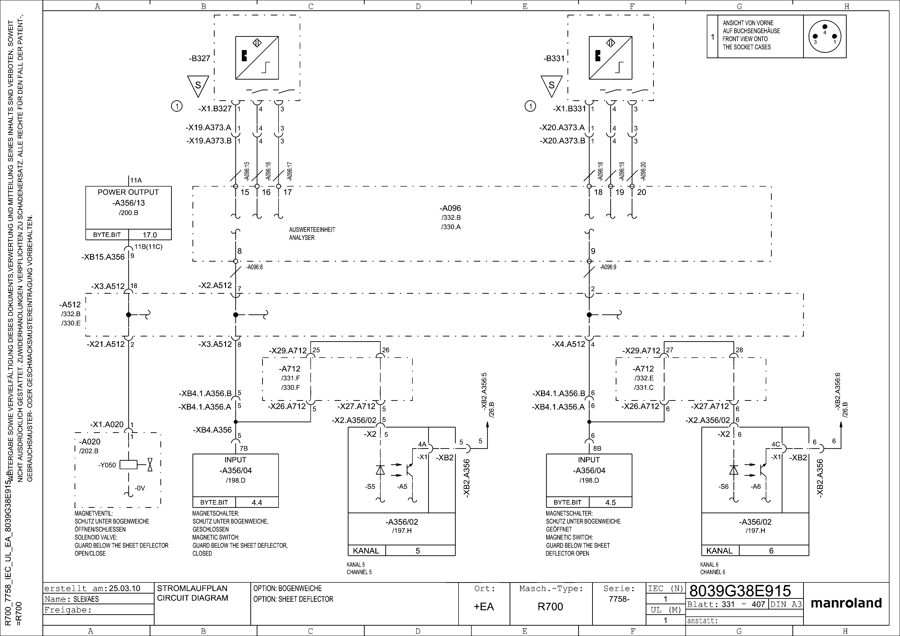

# +EA — Sheet 331 of 407 — OPTION: BOGENWEICHE

**OPTION: SHEET DEFLECTOR**

> Part of the manroland **R700** printing press IEC/UL circuit diagrams.
> Drawing class: **Stromlaufplan / Circuit diagram** (DIN A3).
> Document `+EA` covers the **Printing unit** machine section.

## At a glance

| Field | Value |
|---|---|
| Document | `+EA`  (8039G38E915) |
| Sheet | **331** of 407 |
| Section (DE) | OPTION: BOGENWEICHE |
| Section (EN) | OPTION: SHEET DEFLECTOR |
| Section type | CIRCUIT — Circuit diagram |
| Machine type | `R700` |
| Series | `7758` |
| Created | 25.03.10 |
| Replaces | — |
| Columns used | A, B, C, D, E, F, G, H |
| Path numbers | — |
| Labels on sheet | 190 |
| Cross-refs out | 16 |
| Cross-refs in | 60 |

**Previous:** [+EA sheet 330](SHEET_0330.md) · **Next:** [+EA sheet 332](SHEET_0332.md) · **Document TOC:** [_TOC.md](_TOC.md)  (+EA) · **Master TOC:** [all sheets](../_MASTER_TOC.md)

## Sheet image (300 DPI, exact vector render)



_Rendered directly from the PDF vector layer at 300 DPI (1-bit), no OCR and no resampling. Use it to confirm anything ambiguous in the text below._

## Cross-references on this sheet

Each entry is a wire leaving this sheet. The printed token is `/sheet.column`; the link resolves to that sheet inside the same document.

| Ref | Target sheet | Col | Path | Destination on target | Target section | From col |
|---|---|---|---|---|---|---|
| `/200.B` | [+EA sheet 200](SHEET_0200.md) | B | — | — | REFERENZMODUL | A |
| `/332.B` | [+EA sheet 332](SHEET_0332.md) | B | — | AUSWERTEEINHEIT ANALYSER | OPTION: BOGENWEICHE | D |
| `/330.A` | [+EA sheet 330](SHEET_0330.md) | A | — | AUSWERTEEINHEIT ANALYSER | OPTION: BOGENWEICHE | D |
| `/332.B` | [+EA sheet 332](SHEET_0332.md) | B | — | — | OPTION: BOGENWEICHE | A |
| `/330.E` | [+EA sheet 330](SHEET_0330.md) | E | — | — | OPTION: BOGENWEICHE | A |
| `/26.B` | [+EA sheet 26](SHEET_0026.md) | B | — | XB2.A356:5 | BUSVERBINDUNGEN: SICHERHEITSBUS | E |
| `/26.B` | [+EA sheet 26](SHEET_0026.md) | B | — | XB2.A356:6 | BUSVERBINDUNGEN: SICHERHEITSBUS | H |
| `/332.E` | [+EA sheet 332](SHEET_0332.md) | E | — | — | OPTION: BOGENWEICHE | F |
| `/331.C` | [+EA sheet 331](SHEET_0331.md) | C | — | — | OPTION: BOGENWEICHE | F |
| `/331.F` | [+EA sheet 331](SHEET_0331.md) | F | — | — | OPTION: BOGENWEICHE | C |
| `/330.F` | [+EA sheet 330](SHEET_0330.md) | F | — | — | OPTION: BOGENWEICHE | C |
| `/202.B` | [+EA sheet 202](SHEET_0202.md) | B | — | A020 | REFERENZMODUL | A |
| `/198.D` | [+EA sheet 198](SHEET_0198.md) | D | — | — | REFERENZMODUL | B |
| `/198.D` | [+EA sheet 198](SHEET_0198.md) | D | — | — | REFERENZMODUL | F |
| `/197.H` | [+EA sheet 197](SHEET_0197.md) | H | — | — | REFERENZMODUL | D |
| `/197.H` | [+EA sheet 197](SHEET_0197.md) | H | — | — | REFERENZMODUL | G |

### Incoming references (sheets that point here)

Every other sheet that sends a wire to this one. `Back-ref` is the token printed on *that* sheet; `Path` is its line number.

| From sheet | Cols | Back-ref | Path | Refs | What continues there |
|---|---|---|---|---|---|
| [+EA#26](SHEET_0026.md) | B | `/26.B` | — | 2 | XB2.A356:5; XB2.A356:6 |
| [+EA#197](SHEET_0197.md) | H | `/197.H` | — | 2 | — |
| [+EA#198](SHEET_0198.md) | D | `/198.D` | — | 2 | — |
| [+EA#200](SHEET_0200.md) | B | `/200.B` | — | 1 | — |
| [+EA#202](SHEET_0202.md) | B | `/202.B` | — | 1 | — |
| [+EA#206](SHEET_0206.md) | B | `/206.B` | — | 1 | — |
| [+EA#216](SHEET_0216.md) | H | `/216.H` | — | 3 | — |
| [+EA#217](SHEET_0217.md) | A | `/217.A` | — | 3 | — |
| [+EA#225](SHEET_0225.md) | F | `/225.F` | — | 2 | — |
| [+EA#226](SHEET_0226.md) | E | `/226.E` | — | 2 | — |
| [+EA#230](SHEET_0230.md) | C | `/230.C` | — | 2 | — |
| [+EA#235](SHEET_0235.md) | E | `/235.E` | — | 2 | — |
| [+EA#237](SHEET_0237.md) | E, F, G | `/237.E`, `/237.F`, `/237.G` | — | 6 | — |
| [+EA#238](SHEET_0238.md) | A | `/238.A` | — | 1 | — |
| [+EA#261](SHEET_0261.md) | A | `/261.A` | — | 1 | — |
| [+EA#263](SHEET_0263.md) | H | `/263.H` | — | 6 | — |
| [+EA#264](SHEET_0264.md) | A, B, E | `/264.A`, `/264.B`, `/264.E` | — | 7 | — |
| [+EA#270](SHEET_0270.md) | E | `/270.E` | — | 2 | — |
| [+EA#271](SHEET_0271.md) | G | `/271.G` | — | 2 | — |
| [+EA#274](SHEET_0274.md) | G, H | `/274.G`, `/274.H` | — | 4 | — |
| [+EA#330](SHEET_0330.md) | B, E, F | `/330.B`, `/330.E`, `/330.F` | — | 3 | AUSWERTEEINHEIT ANALYSER |
| [+EA#331](SHEET_0331.md) | C, F | `/331.C`, `/331.F` | — | 2 | — |
| [+EA#332](SHEET_0332.md) | A, D | `/332.A`, `/332.D` | — | 3 | — |


## Devices on this sheet

| Tag | Class | Class meaning (IEC) | Col | Sub | Terminal | Sign |
|---|---|---|---|---|---|---|
| `Y050` | Y | Magnetventil / solenoid valve, actuator | A | — | — | — |
| `A020` | A | Baugruppe / assembly, module, PC board | A | — | — | — |
| `A356/13` | A | Baugruppe / assembly, module, PC board | A | 13 | — | — |
| `A512` | A | Baugruppe / assembly, module, PC board | A | — | — | — |
| `A356/04` | A | Baugruppe / assembly, module, PC board | B | 04 | — | — |
| `B327` | B | Umformer / transducer, sensor | B | — | — | — |
| `A096` | A | Baugruppe / assembly, module, PC board | D | — | — | — |
| `A356/04` | A | Baugruppe / assembly, module, PC board | F | 04 | — | — |
| `B331` | B | Umformer / transducer, sensor | E | — | — | — |
| `A712` | A | Baugruppe / assembly, module, PC board | C | — | — | — |
| `S5` | S | Schalter / switch | D | — | — | — |
| `A5` | A | Baugruppe / assembly, module, PC board | D | — | — | — |
| `X1` | X | Klemme / terminal, plug connector | D | — | — | — |
| `X2` | X | Klemme / terminal, plug connector | D | — | — | — |
| `XB2` | XB |  | D | — | — | — |
| `A356/02` | A | Baugruppe / assembly, module, PC board | D | 02 | — | — |
| `A712` | A | Baugruppe / assembly, module, PC board | F | — | — | — |
| `S6` | S | Schalter / switch | G | — | — | — |
| `A6` | A | Baugruppe / assembly, module, PC board | G | — | — | — |
| `X1` | X | Klemme / terminal, plug connector | G | — | — | — |
| `X2` | X | Klemme / terminal, plug connector | G | — | — | — |
| `XB2` | XB |  | H | — | — | — |
| `A356/02` | A | Baugruppe / assembly, module, PC board | G | 02 | — | — |
| `A096:15` | A | Baugruppe / assembly, module, PC board | B | — | 15 | — |
| `A096:17` | A | Baugruppe / assembly, module, PC board | C | — | 17 | — |
| `A096:16` | A | Baugruppe / assembly, module, PC board | C | — | 16 | — |
| `A096:8` | A | Baugruppe / assembly, module, PC board | B | — | 8 | — |
| `A096:20` | A | Baugruppe / assembly, module, PC board | F | — | 20 | — |
| `A096:19` | A | Baugruppe / assembly, module, PC board | F | — | 19 | — |
| `A096:18` | A | Baugruppe / assembly, module, PC board | F | — | 18 | — |
| `A096:9` | A | Baugruppe / assembly, module, PC board | F | — | 9 | — |
| `X1.A020` | — | cross-device reference | A | — | — | — |
| `XB15.A356` | — | cross-device reference | A | — | — | — |
| `17.0` | — | cross-device reference | A | — | — | — |
| `X3.A512` | — | cross-device reference | A | — | — | — |
| `X21.A512` | — | cross-device reference | A | — | — | — |
| `4.4` | — | cross-device reference | B | — | — | — |
| `XB4.A356` | — | cross-device reference | B | — | — | — |
| `X1.B327` | — | cross-device reference | B | — | — | — |
| `X19.A373.B` | — | cross-device reference | B | — | — | — |
| `X19.A373.A` | — | cross-device reference | B | — | — | — |
| `X3.A512` | — | cross-device reference | B | — | — | — |
| `X2.A512` | — | cross-device reference | B | — | — | — |
| `4.5` | — | cross-device reference | F | — | — | — |
| `X1.B331` | — | cross-device reference | E | — | — | — |
| `X20.A373.B` | — | cross-device reference | E | — | — | — |
| `X20.A373.A` | — | cross-device reference | E | — | — | — |
| `X4.A512` | — | cross-device reference | E | — | — | — |
| `XB4.1.A356.B` | — | cross-device reference | B | — | — | — |
| `XB4.1.A356.A` | — | cross-device reference | B | — | — | — |
| `X29.A712` | — | cross-device reference | C | — | — | — |
| `X27.A712` | — | cross-device reference | C | — | — | — |
| `X26.A712` | — | cross-device reference | C | — | — | — |
| `XB2.A356` | — | cross-device reference | D | — | — | — |
| `X29.A712` | — | cross-device reference | F | — | — | — |
| `X27.A712` | — | cross-device reference | G | — | — | — |
| `X26.A712` | — | cross-device reference | F | — | — | — |
| `XB4.1.A356.B` | — | cross-device reference | E | — | — | — |
| `XB4.1.A356.A` | — | cross-device reference | E | — | — | — |
| `XB2.A356` | — | cross-device reference | H | — | — | — |
| `XB2.A356:6` | — | cross-device reference | H | — | 6 | — |
| `XB2.A356:5` | — | cross-device reference | E | — | 5 | — |

## Potentials / nets

| Potential | Count | Columns | Attached devices | Terminals |
|---|---|---|---|---|
| `0V` | 1 | A | — | — |


A potential such as `L24+/4` or `M24+` is a named supply/return rail; every place it appears on this sheet is electrically common.

## Wire-end annotations (grouped as printed)

A wire that continues elsewhere is annotated with a small cluster: the destination description, the path/line number `#NN`, and the `/sheet.column` cross reference. Each row below is one such cluster exactly as it is grouped on the drawing.

| Col | Y | Path | Cross-ref | Text on the wire |
|---|---|---|---|---|
| G | 27.6 | — | — | `FRONT VIEW ONTO ANSICHT VON VORNE AUF BUCHSENGEHÄUSE` |
| G | 39.9 | — | — | `1 THE SOCKET CASES 4` |
| H | 52.6 | — | — | `3 1` |
| B | 72.6 | — | — | `B327` |
| E | 72.6 | — | — | `B331` |
| B | 107.4 | — | — | `S` |
| E | 107.4 | — | — | `S` |
| B | 137.3 | — | — | `1` |
| E | 137.3 | — | — | `1` |
| B | 139.2 | — | — | `X1.B327 1 4 3` |
| F | 139.2 | — | — | `X1.B331 1 4 3` |
| B | 164.0 | — | — | `X19.A373.A 1 4 3` |
| F | 164.0 | — | — | `X20.A373.A 1 4 3` |
| B | 181.7 | — | — | `X19.A373.B 1 4 3` |
| F | 181.7 | — | — | `X20.A373.B 1 4 3` |
| B | 214.5 | — | — | `A096:15` |
| C | 214.5 | — | — | `A096:16` |
| C | 214.5 | — | — | `A096:17` |
| F | 214.5 | — | — | `A096:18` |
| F | 214.5 | — | — | `A096:19` |
| F | 214.5 | — | — | `A096:20` |
| A | 234.8 | — | — | `11A` |
| C | 249.7 | — | — | `15 16 17` |
| F | 249.7 | — | — | `18 19 20` |
| A | 250.0 | — | — | `POWER OUTPUT` |
| A | 263.9 | — | — | `A356/13` |
| D | 271.0 | — | — | `A096` |
| A | 277.7 | — | `/200.B` | — |
| D | 284.1 | — | `/332.B`, `/330.A` | `AUSWERTEEINHEIT ANALYSER` |
| A | 306.8 | — | — | `BYTE.BIT 17.0` |
| A | 322.8 | — | — | `11B(11C)` |
| B | 327.7 | — | — | `8` |
| F | 327.7 | — | — | `9` |
| A | 334.8 | — | — | `XB15.A356 9` |
| B | 350.7 | — | — | `A096:8` |
| F | 350.7 | — | — | `A096:9` |
| B | 373.1 | — | — | `X2.A512 7` |
| A | 374.5 | — | — | `X3.A512 18` |
| F | 378.8 | — | — | `2` |
| A | 398.6 | — | — | `A512` |
| A | 411.6 | — | `/332.B`, `/330.E` | — |
| A | 451.0 | — | — | `X21.A512 2` |
| B | 451.0 | — | — | `X3.A512 8` |
| E | 451.0 | — | — | `X4.A512 4` |
| C | 459.5 | — | — | `X29.A712 25 26` |
| F | 459.5 | — | — | `X29.A712 27 28` |
| C | 483.6 | — | — | `A712` |
| F | 483.6 | — | — | `A712` |
| E | 493.2 | — | `/26.B` | `XB2.A356:5` |
| H | 493.2 | — | `/26.B` | `XB2.A356:6` |
| C | 496.7 | — | `/331.F`, `/330.F` | — |
| F | 496.7 | — | `/332.E`, `/331.C` | — |
| B | 516.2 | — | — | `XB4.1.A356.B 5` |
| E | 516.2 | — | — | `XB4.1.A356.B 6` |
| B | 533.2 | — | — | `XB4.1.A356.A 5` |
| C | 533.2 | — | — | `X26.A712 5 X27.A712 5` |
| E | 533.2 | — | — | `XB4.1.A356.A 6` |
| F | 533.2 | — | — | `X26.A712 6 X27.A712 6` |
| C | 551.6 | — | — | `X2.A356/02 5` |
| G | 551.6 | — | — | `X2.A356/02 6` |
| A | 557.3 | — | — | `X1.A020 1` |
| B | 564.4 | — | — | `XB4.A356 5` |
| D | 570.1 | — | — | `X2` |
| G | 570.1 | — | — | `X2` |
| D | 571.5 | — | — | `5 5` |
| G | 571.5 | — | — | `6 6` |
| F | 572.9 | — | — | `6` |
| A | 574.3 | — | — | `1` |
| A | 580.0 | — | `/202.B` | `A020` |
| E | 580.0 | — | — | `5` |
| H | 580.0 | — | — | `6` |
| D | 584.2 | — | — | `4A` |
| G | 584.3 | — | — | `4C` |
| B | 589.9 | — | — | `7B` |
| F | 589.9 | — | — | `8B` |
| D | 601.2 | — | — | `X1` |
| G | 601.2 | — | — | `X1` |
| D | 601.3 | — | — | `XB2` |
| H | 601.3 | — | — | `XB2` |
| B | 604.4 | — | — | `INPUT` |
| F | 604.4 | — | — | `INPUT` |
| D | 607.5 | — | — | `XB2.A356` |
| H | 607.5 | — | — | `XB2.A356` |
| A | 611.9 | — | — | `Y050` |
| B | 618.3 | — | — | `A356/04` |
| F | 618.3 | — | — | `A356/04` |
| B | 632.1 | — | `/198.D` | — |
| F | 632.1 | — | `/198.D` | — |
| D | 640.2 | — | — | `S5 A5` |
| G | 640.2 | — | — | `S6 A6` |
| A | 642.3 | — | — | `0V` |
| B | 661.1 | — | — | `BYTE.BIT 4.4` |
| F | 661.1 | — | — | `BYTE.BIT 4.5` |
| A | 676.7 | — | — | `MAGNETVENTIL: SCHUTZ UNTER BOGENWEICHE ÖFFNEN/SCHLIESSEN SOLENOID VALVE: GUARD BELOW THE SHEET DEFLECTOR OPEN/CLOSE` |
| B | 676.7 | — | — | `MAGNETSCHALTER: MAGNETIC SWITCH: SCHUTZ UNTER BOGENWEICHE, GESCHLOSSEN GUARD BELOW THE SHEET DEFLECTOR, CLOSED` |
| F | 676.7 | — | — | `DEFLECTOR OPEN MAGNETSCHALTER: MAGNETIC SWITCH: SCHUTZ UNTER BOGENWEICHE GEÖFFNET GUARD BELOW THE SHEET` |
| D | 686.3 | — | — | `A356/02` |
| G | 686.3 | — | — | `A356/02` |
| D | 698.7 | — | `/197.H` | — |
| G | 698.7 | — | `/197.H` | — |
| D | 724.5 | — | — | `KANAL 5` |
| G | 724.5 | — | — | `KANAL 6` |
| C | 744.9 | — | — | `KANAL 5 CHANNEL 5` |
| G | 744.9 | — | — | `KANAL 6 CHANNEL 6` |


## Reconstructed tables

This sheet carries tabular content (pin map / terminal assignment / index). The grid below was rebuilt from the drawing's own rule lines, so each row is exactly one physical row of the table.

### Table 1 — 13 data rows × 24 columns (at x=113.4, y=19.8)

|  |  |  |  |  |  |  |  |  |  |  |  |  |  |  |  |  |  |  |  | ANSICHT AUF | VON VORNE BUCHSENGEHÄUSE |  |  |
|---|---|---|---|---|---|---|---|---|---|---|---|---|---|---|---|---|---|---|---|---|---|---|---|
|  |  |  |  |  |  |  |  |  |  |  |  |  |  |  |  |  |  |  | `1` | `FRONT THE` | `VIEW ONTO SOCKET CASES` |  |  |
|  |  |  | `B327` |  |  |  |  |  |  |  |  |  |  | `B331` |  |  |  |  |  |  |  |  |  |
|  | `11A` | `1` | `S X1.B327 X19.A373.A X19.A373.B` | `1 1 1 A096:15` | `4 4 4 A096:16` | `3 3 3 A096:17` |  |  |  |  |  |  | `1` | `S X1.B331 X20.A373.A X20.A373.B` | `1 1 1 A096:18` | `4 4 4 A096:19` | `3 3 3 A096:20` |  |  |  |  |  |  |
| `POWER` | `OUTPUT A356/13 /200.B` |  |  | `15` | `16` | `17` |  |  |  |  | `A096 /332.B /330.A` |  |  |  | `18` | `19` | `20` |  |  |  |  |  |  |
| `BYTE.BIT` | `17.0` |  |  |  |  | `ANALYSER` | `AUSWERTEEINHEIT` |  |  |  |  |  |  |  |  |  |  |  |  |  |  |  |  |
| `XB15.A356 X3.A512` | `11B(11C) 9 18` |  | `X2.A512` | `8 A096:8 7` |  |  |  |  |  |  |  |  |  |  | `9 A096:9 2` |  |  |  |  |  |  |  |  |
| `X21.A512` | `2` |  | `X3.A512 XB4.1.A356.B XB4.1.A356.A` | `8 5 5` |  | `X29.A712 A712 /331.F /330.F X26.A712` | `25 5` | `X27.A712 X2.A356/02` | `26 5 5` |  |  | `XB2.A356:5` | `/26.B` | `X4.A512 XB4.1.A356.B XB4.1.A356.A` | `4 6 6` |  | `X29.A712 A712 /332.E /331.C X26.A712` | `27 6` | `X27.A712 X2.A356/02` |  | `28 6 6` |  |  |
| `X1.A020` | `1` |  |  |  |  |  |  |  |  |  |  |  |  |  |  |  |  |  |  |  |  |  |  |
| `A020 /202.B` | `1` |  | `XB4.A356` | `5 7B` |  |  |  | `X2` | `5` | `4A` |  | `5 5` |  |  | `6 8B` |  |  |  |  | `X2` | `6` | `4C` |  |
| `Y050` | `0V` |  | `INPUT` | `A356/04 /198.D` |  |  |  | `S5` | `A5` | `X1` | `XB2` | `XB2.A356` |  | `INPUT` | `A356/04 /198.D` |  |  |  |  | `S6` | `A6` | `X1` | `XB2` |
|  |  |  | `BYTE.BIT` | `4.4` |  |  |  |  |  |  |  |  |  | `BYTE.BIT` | `4.5` |  |  |  |  |  |  |  |  |
| `MAGNETVENTIL: UNTER ÖFFNEN/SCHLIESSEN SOLENOID VALVE:` | `BOGENWEICHE` |  | `MAGNETSCHALTER: SCHUTZ UNTER GESCHLOSSEN MAGNETIC SWITCH:` | `BOGENWEICHE,` |  |  |  |  | `A356/02 /197.H` |  |  |  |  | `MAGNETSCHALTER: SCHUTZ UNTER GEÖFFNET MAGNETIC SWITCH:` | `BOGENWEICHE` |  |  |  |  |  | `A356/02 /197.H` |  |  |
| `BELOW THE OPEN/CLOSE` | `SHEET DEFLECTOR` |  | `GUARD BELOW THE CLOSED` | `SHEET` | `DEFLECTOR,` |  |  | `KANAL` |  | `5` |  |  |  | `GUARD BELOW THE DEFLECTOR OPEN` | `SHEET` |  |  |  |  | `KANAL` |  | `6` |  |


### Table 2 — 2 data rows × 2 columns (at x=1070.1, y=19.8) — **4 3 1**

| XB2.A356:6 | /26.B |
|---|---|
| `6 6` |  |
| `XB2.A356` |  |


## Notes and free text on this sheet

| Text | Col | Y (pt) |
|---|---|---|
| `MAGNETVENTIL:` | A | 676.68 |
| `SCHUTZ UNTER BOGENWEICHE` | A | 687.32 |
| `ÖFFNEN/SCHLIESSEN` | A | 697.95 |
| `SOLENOID VALVE:` | A | 708.57 |
| `GUARD BELOW THE SHEET DEFLECTOR` | A | 719.21 |
| `OPEN/CLOSE` | A | 729.84 |
| `11A` | A | 234.85 |
| `11B(11C)` | A | 322.76 |
| `POWER OUTPUT` | A | 250.01 |
| `BYTE.BIT` | A | 307.34 |
| `7B` | B | 589.88 |
| `INPUT` | B | 604.42 |
| `BYTE.BIT` | B | 661.67 |
| `MAGNETSCHALTER:` | B | 676.69 |
| `SCHUTZ UNTER BOGENWEICHE,` | B | 687.31 |
| `GESCHLOSSEN` | B | 697.95 |
| `MAGNETIC SWITCH:` | B | 708.56 |
| `GUARD BELOW THE SHEET DEFLECTOR,` | B | 719.21 |
| `CLOSED` | B | 729.86 |
| `AUSWERTEEINHEIT` | C | 301.07 |
| `ANALYSER` | C | 311.73 |
| `8B` | F | 589.88 |
| `INPUT` | F | 604.42 |
| `BYTE.BIT` | E | 661.67 |
| `MAGNETSCHALTER:` | E | 676.69 |
| `SCHUTZ UNTER BOGENWEICHE` | F | 687.32 |
| `GEÖFFNET` | E | 697.95 |
| `MAGNETIC SWITCH:` | E | 708.56 |
| `GUARD BELOW THE SHEET` | E | 719.2 |
| `DEFLECTOR OPEN` | E | 729.84 |
| `KANAL 5` | C | 744.88 |
| `CHANNEL 5` | C | 754.82 |
| `4A` | D | 584.21 |
| `KANAL` | D | 724.55 |
| `X2.A356/02` | C | 551.65 |
| `KANAL 6` | G | 744.88 |
| `CHANNEL 6` | G | 754.82 |
| `4C` | G | 584.27 |
| `KANAL` | G | 724.55 |
| `X2.A356/02` | G | 551.65 |
| `ANSICHT VON VORNE` | G | 27.56 |
| `AUF BUCHSENGEHÄUSE` | G | 38.19 |
| `FRONT VIEW ONTO` | G | 48.79 |
| `THE SOCKET CASES` | G | 59.44 |
| `S` | B | 107.39 |
| `S` | E | 107.39 |

## Complete label inventory (exact text from the drawing)

Every text object inside the drawing area of this sheet, in DIN reading order (column A→H, then top→bottom). This is the authoritative list: if a string is not here it is not printed on this sheet.

| Col | Y | X | Dir | Type | Text |
|---|---|---|---|---|---|
| A | 234.9 | 172.1 | → | text | `11A` |
| A | 250.0 | 129.3 | → | text | `POWER OUTPUT` |
| A | 263.9 | 148.7 | → | device tag | `A356/13` |
| A | 277.7 | 157.5 | → | cross-reference | `/200.B` |
| A | 306.8 | 188.6 | → | device ref | `17.0` |
| A | 307.3 | 123.3 | → | text | `BYTE.BIT` |
| A | 322.8 | 177.7 | → | text | `11B(11C)` |
| A | 334.8 | 172.6 | → | number | `9` |
| A | 335.5 | 107.7 | → | device ref | `XB15.A356` |
| A | 374.5 | 120.8 | → | device ref | `X3.A512` |
| A | 374.5 | 172.1 | → | number | `18` |
| A | 398.6 | 78.5 | → | device tag | `A512` |
| A | 411.6 | 81.1 | → | cross-reference | `/332.B` |
| A | 424.0 | 81.4 | → | cross-reference | `/330.E` |
| A | 451.0 | 114.8 | → | device ref | `X21.A512` |
| A | 452.5 | 172.6 | → | number | `2` |
| A | 557.3 | 119.3 | → | device ref | `X1.A020` |
| A | 558.7 | 172.1 | → | number | `1` |
| A | 574.3 | 172.1 | → | number | `1` |
| A | 580.0 | 104.6 | → | device tag | `A020` |
| A | 593.1 | 104.9 | → | cross-reference | `/202.B` |
| A | 611.9 | 130.1 | → | device tag | `Y050` |
| A | 642.3 | 178.3 | → | potential | `0V` |
| A | 676.7 | 98.6 | → | text | `MAGNETVENTIL:` |
| A | 687.3 | 98.9 | → | text | `SCHUTZ UNTER BOGENWEICHE` |
| A | 698.0 | 98.9 | → | text | `ÖFFNEN/SCHLIESSEN` |
| A | 708.6 | 98.9 | → | text | `SOLENOID VALVE:` |
| A | 719.2 | 98.9 | → | text | `GUARD BELOW THE SHEET DEFLECTOR` |
| A | 729.8 | 98.9 | → | text | `OPEN/CLOSE` |
| B | 72.6 | 250.0 | → | device tag | `B327` |
| B | 107.4 | 258.1 | → | text | `S` |
| B | 137.3 | 232.1 | → | number | `1` |
| B | 139.2 | 262.5 | → | device ref | `X1.B327` |
| B | 140.6 | 313.8 | → | number | `1` |
| B | 164.0 | 245.8 | → | device ref | `X19.A373.A` |
| B | 166.2 | 313.8 | → | number | `1` |
| B | 181.7 | 246.6 | → | device ref | `X19.A373.B` |
| B | 183.2 | 313.8 | → | number | `1` |
| B | 214.5 | 323.8 | ↕ | device tag | `A096:15` |
| B | 249.7 | 317.8 | → | number | `15` |
| B | 327.7 | 314.1 | → | number | `8` |
| B | 350.7 | 325.7 | → | device tag | `A096:8` |
| B | 373.1 | 262.5 | → | device ref | `X2.A512` |
| B | 378.7 | 314.4 | → | number | `7` |
| B | 451.0 | 262.5 | → | device ref | `X3.A512` |
| B | 452.5 | 314.4 | → | number | `8` |
| B | 516.2 | 236.7 | → | device ref | `XB4.1.A356.B` |
| B | 516.2 | 314.4 | → | number | `5` |
| B | 533.2 | 314.4 | → | number | `5` |
| B | 533.9 | 235.8 | → | device ref | `XB4.1.A356.A` |
| B | 564.4 | 255.4 | → | device ref | `XB4.A356` |
| B | 572.9 | 314.4 | → | number | `5` |
| B | 589.9 | 317.2 | → | text | `7B` |
| B | 604.4 | 296.9 | → | text | `INPUT` |
| B | 618.3 | 290.4 | → | device tag | `A356/04` |
| B | 632.1 | 299.1 | → | cross-reference | `/198.D` |
| B | 661.1 | 333.4 | → | device ref | `4.4` |
| B | 661.7 | 265.0 | → | text | `BYTE.BIT` |
| B | 676.7 | 254.6 | → | text | `MAGNETSCHALTER:` |
| B | 687.3 | 254.8 | → | text | `SCHUTZ UNTER BOGENWEICHE,` |
| B | 697.9 | 254.8 | → | text | `GESCHLOSSEN` |
| B | 708.6 | 254.6 | → | text | `MAGNETIC SWITCH:` |
| B | 719.2 | 254.8 | → | text | `GUARD BELOW THE SHEET DEFLECTOR,` |
| B | 729.9 | 254.8 | → | text | `CLOSED` |
| C | 140.6 | 342.7 | → | number | `4` |
| C | 140.6 | 371.1 | → | number | `3` |
| C | 166.2 | 342.7 | → | number | `4` |
| C | 166.2 | 371.1 | → | number | `3` |
| C | 183.2 | 342.7 | → | number | `4` |
| C | 183.2 | 371.1 | → | number | `3` |
| C | 214.5 | 352.1 | ↕ | device tag | `A096:16` |
| C | 214.5 | 380.5 | ↕ | device tag | `A096:17` |
| C | 249.7 | 346.1 | → | number | `16` |
| C | 249.7 | 374.5 | → | number | `17` |
| C | 301.1 | 382.7 | → | text | `AUSWERTEEINHEIT` |
| C | 311.7 | 382.7 | → | text | `ANALYSER` |
| C | 459.5 | 355.7 | → | device ref | `X29.A712` |
| C | 459.5 | 413.6 | → | number | `25` |
| C | 483.6 | 369.1 | → | device tag | `A712` |
| C | 496.7 | 372.2 | → | cross-reference | `/331.F` |
| C | 509.1 | 372.2 | → | cross-reference | `/330.F` |
| C | 533.2 | 354.3 | → | device ref | `X26.A712` |
| C | 533.2 | 446.5 | → | device ref | `X27.A712` |
| C | 537.5 | 413.6 | → | number | `5` |
| C | 551.6 | 439.1 | → | text | `X2.A356/02` |
| C | 744.9 | 458.6 | → | text | `KANAL 5` |
| C | 754.8 | 458.9 | → | text | `CHANNEL 5` |
| D | 271.0 | 581.7 | → | device tag | `A096` |
| D | 284.1 | 584.2 | → | cross-reference | `/332.B` |
| D | 296.5 | 583.9 | → | cross-reference | `/330.A` |
| D | 459.5 | 505.7 | → | number | `26` |
| D | 537.5 | 505.7 | → | number | `5` |
| D | 551.7 | 505.7 | → | number | `5` |
| D | 570.1 | 481.6 | → | device tag | `X2` |
| D | 571.5 | 508.5 | → | number | `5` |
| D | 581.4 | 607.7 | → | number | `5` |
| D | 584.2 | 553.3 | → | text | `4A` |
| D | 601.2 | 552.2 | → | device tag | `X1` |
| D | 601.3 | 576.6 | → | device tag | `XB2` |
| D | 607.5 | 612.6 | ↕ | device ref | `XB2.A356` |
| D | 640.2 | 482.7 | → | device tag | `S5` |
| D | 640.2 | 525.3 | → | device tag | `A5` |
| D | 686.3 | 510.1 | → | device tag | `A356/02` |
| D | 698.7 | 519.0 | → | cross-reference | `/197.H` |
| D | 724.5 | 549.8 | → | number | `5` |
| D | 724.6 | 466.9 | → | text | `KANAL` |
| E | 72.6 | 719.1 | → | device tag | `B331` |
| E | 107.4 | 725.8 | → | text | `S` |
| E | 137.3 | 699.8 | → | number | `1` |
| E | 139.2 | 731.6 | → | device ref | `X1.B331` |
| E | 164.0 | 713.5 | → | device ref | `X20.A373.A` |
| E | 181.7 | 714.3 | → | device ref | `X20.A373.B` |
| E | 451.0 | 730.2 | → | device ref | `X4.A512` |
| E | 493.2 | 636.7 | ↕ | device ref | `XB2.A356:5` |
| E | 516.2 | 704.4 | → | device ref | `XB4.1.A356.B` |
| E | 532.1 | 646.5 | ↕ | cross-reference | `/26.B` |
| E | 533.9 | 703.6 | → | device ref | `XB4.1.A356.A` |
| E | 580.0 | 633.3 | → | number | `5` |
| E | 661.7 | 732.8 | → | text | `BYTE.BIT` |
| E | 676.7 | 722.3 | → | text | `MAGNETSCHALTER:` |
| E | 698.0 | 722.6 | → | text | `GEÖFFNET` |
| E | 708.6 | 722.3 | → | text | `MAGNETIC SWITCH:` |
| E | 719.2 | 722.6 | → | text | `GUARD BELOW THE SHEET` |
| E | 729.8 | 722.0 | → | text | `DEFLECTOR OPEN` |
| F | 140.6 | 781.5 | → | number | `1` |
| F | 140.6 | 810.4 | → | number | `4` |
| F | 140.6 | 838.8 | → | number | `3` |
| F | 166.2 | 781.5 | → | number | `1` |
| F | 166.2 | 810.4 | → | number | `4` |
| F | 166.2 | 838.8 | → | number | `3` |
| F | 183.2 | 781.5 | → | number | `1` |
| F | 183.2 | 810.4 | → | number | `4` |
| F | 183.2 | 838.8 | → | number | `3` |
| F | 214.5 | 791.5 | ↕ | device tag | `A096:18` |
| F | 214.5 | 819.9 | ↕ | device tag | `A096:19` |
| F | 214.5 | 848.2 | ↕ | device tag | `A096:20` |
| F | 249.7 | 785.5 | → | number | `18` |
| F | 249.7 | 813.8 | → | number | `19` |
| F | 249.7 | 843.0 | → | number | `20` |
| F | 327.7 | 781.8 | → | number | `9` |
| F | 350.7 | 793.4 | → | device tag | `A096:9` |
| F | 378.7 | 782.1 | → | number | `2` |
| F | 452.5 | 782.1 | → | number | `4` |
| F | 459.5 | 823.5 | → | device ref | `X29.A712` |
| F | 459.5 | 881.3 | → | number | `27` |
| F | 483.6 | 836.8 | → | device tag | `A712` |
| F | 496.7 | 839.6 | → | cross-reference | `/332.E` |
| F | 509.1 | 839.1 | → | cross-reference | `/331.C` |
| F | 516.2 | 782.1 | → | number | `6` |
| F | 533.2 | 782.1 | → | number | `6` |
| F | 533.2 | 822.0 | → | device ref | `X26.A712` |
| F | 537.5 | 881.3 | → | number | `6` |
| F | 572.9 | 782.1 | → | number | `6` |
| F | 589.9 | 784.9 | → | text | `8B` |
| F | 604.4 | 764.6 | → | text | `INPUT` |
| F | 618.3 | 758.1 | → | device tag | `A356/04` |
| F | 632.1 | 766.8 | → | cross-reference | `/198.D` |
| F | 661.1 | 801.1 | → | device ref | `4.5` |
| F | 687.3 | 722.6 | → | text | `SCHUTZ UNTER BOGENWEICHE` |
| G | 27.6 | 956.7 | → | text | `ANSICHT VON VORNE` |
| G | 38.2 | 956.7 | → | text | `AUF BUCHSENGEHÄUSE` |
| G | 44.2 | 940.0 | → | number | `1` |
| G | 48.8 | 955.8 | → | text | `FRONT VIEW ONTO` |
| G | 59.4 | 956.4 | → | text | `THE SOCKET CASES` |
| G | 459.5 | 973.4 | → | number | `28` |
| G | 533.2 | 914.2 | → | device ref | `X27.A712` |
| G | 537.5 | 973.4 | → | number | `6` |
| G | 551.6 | 906.8 | → | text | `X2.A356/02` |
| G | 551.7 | 973.4 | → | number | `6` |
| G | 570.1 | 949.3 | → | device tag | `X2` |
| G | 571.5 | 976.3 | → | number | `6` |
| G | 584.3 | 1021.0 | → | text | `4C` |
| G | 601.2 | 1019.9 | → | device tag | `X1` |
| G | 640.2 | 950.5 | → | device tag | `S6` |
| G | 640.2 | 993.0 | → | device tag | `A6` |
| G | 686.3 | 977.8 | → | device tag | `A356/02` |
| G | 698.7 | 986.7 | → | cross-reference | `/197.H` |
| G | 724.5 | 1017.6 | → | number | `6` |
| G | 724.6 | 934.6 | → | text | `KANAL` |
| G | 744.9 | 926.4 | → | text | `KANAL 6` |
| G | 754.8 | 926.6 | → | text | `CHANNEL 6` |
| H | 39.9 | 1089.4 | → | number | `4` |
| H | 52.6 | 1076.6 | → | number | `3` |
| H | 52.6 | 1102.5 | → | number | `1` |
| H | 493.2 | 1104.4 | ↕ | device ref | `XB2.A356:6` |
| H | 532.1 | 1114.3 | ↕ | cross-reference | `/26.B` |
| H | 580.0 | 1101.0 | → | number | `6` |
| H | 581.4 | 1075.5 | → | number | `6` |
| H | 601.3 | 1044.3 | → | device tag | `XB2` |
| H | 607.5 | 1080.3 | ↕ | device ref | `XB2.A356` |

## Reading-order text block

The same content as a plain block, grouped by DIN column — convenient to paste or to match against a visual description.

```text
=== Column A ===
 234.9  172.1  text         11A
 250.0  129.3  text         POWER OUTPUT
 263.9  148.7  devtag       A356/13
 277.7  157.5  xref         /200.B
 306.8  188.6  devref       17.0
 307.3  123.3  text         BYTE.BIT
 322.8  177.7  text         11B(11C)
 334.8  172.6  numeric      9
 335.5  107.7  devref       XB15.A356
 374.5  120.8  devref       X3.A512
 374.5  172.1  numeric      18
 398.6   78.5  devtag       A512
 411.6   81.1  xref         /332.B
 424.0   81.4  xref         /330.E
 451.0  114.8  devref       X21.A512
 452.5  172.6  numeric      2
 557.3  119.3  devref       X1.A020
 558.7  172.1  numeric      1
 574.3  172.1  numeric      1
 580.0  104.6  devtag       A020
 593.1  104.9  xref         /202.B
 611.9  130.1  devtag       Y050
 642.3  178.3  net          0V
 676.7   98.6  text         MAGNETVENTIL:
 687.3   98.9  text         SCHUTZ UNTER BOGENWEICHE
 698.0   98.9  text         ÖFFNEN/SCHLIESSEN
 708.6   98.9  text         SOLENOID VALVE:
 719.2   98.9  text         GUARD BELOW THE SHEET DEFLECTOR
 729.8   98.9  text         OPEN/CLOSE
=== Column B ===
  72.6  250.0  devtag       B327
 107.4  258.1  text         S
 137.3  232.1  numeric      1
 139.2  262.5  devref       X1.B327
 140.6  313.8  numeric      1
 164.0  245.8  devref       X19.A373.A
 166.2  313.8  numeric      1
 181.7  246.6  devref       X19.A373.B
 183.2  313.8  numeric      1
 214.5  323.8  devtag       A096:15
 249.7  317.8  numeric      15
 327.7  314.1  numeric      8
 350.7  325.7  devtag       A096:8
 373.1  262.5  devref       X2.A512
 378.7  314.4  numeric      7
 451.0  262.5  devref       X3.A512
 452.5  314.4  numeric      8
 516.2  236.7  devref       XB4.1.A356.B
 516.2  314.4  numeric      5
 533.2  314.4  numeric      5
 533.9  235.8  devref       XB4.1.A356.A
 564.4  255.4  devref       XB4.A356
 572.9  314.4  numeric      5
 589.9  317.2  text         7B
 604.4  296.9  text         INPUT
 618.3  290.4  devtag       A356/04
 632.1  299.1  xref         /198.D
 661.1  333.4  devref       4.4
 661.7  265.0  text         BYTE.BIT
 676.7  254.6  text         MAGNETSCHALTER:
 687.3  254.8  text         SCHUTZ UNTER BOGENWEICHE,
 697.9  254.8  text         GESCHLOSSEN
 708.6  254.6  text         MAGNETIC SWITCH:
 719.2  254.8  text         GUARD BELOW THE SHEET DEFLECTOR,
 729.9  254.8  text         CLOSED
=== Column C ===
 140.6  342.7  numeric      4
 140.6  371.1  numeric      3
 166.2  342.7  numeric      4
 166.2  371.1  numeric      3
 183.2  342.7  numeric      4
 183.2  371.1  numeric      3
 214.5  352.1  devtag       A096:16
 214.5  380.5  devtag       A096:17
 249.7  346.1  numeric      16
 249.7  374.5  numeric      17
 301.1  382.7  text         AUSWERTEEINHEIT
 311.7  382.7  text         ANALYSER
 459.5  355.7  devref       X29.A712
 459.5  413.6  numeric      25
 483.6  369.1  devtag       A712
 496.7  372.2  xref         /331.F
 509.1  372.2  xref         /330.F
 533.2  354.3  devref       X26.A712
 533.2  446.5  devref       X27.A712
 537.5  413.6  numeric      5
 551.6  439.1  text         X2.A356/02
 744.9  458.6  text         KANAL 5
 754.8  458.9  text         CHANNEL 5
=== Column D ===
 271.0  581.7  devtag       A096
 284.1  584.2  xref         /332.B
 296.5  583.9  xref         /330.A
 459.5  505.7  numeric      26
 537.5  505.7  numeric      5
 551.7  505.7  numeric      5
 570.1  481.6  devtag       X2
 571.5  508.5  numeric      5
 581.4  607.7  numeric      5
 584.2  553.3  text         4A
 601.2  552.2  devtag       X1
 601.3  576.6  devtag       XB2
 607.5  612.6  devref       XB2.A356
 640.2  482.7  devtag       S5
 640.2  525.3  devtag       A5
 686.3  510.1  devtag       A356/02
 698.7  519.0  xref         /197.H
 724.5  549.8  numeric      5
 724.6  466.9  text         KANAL
=== Column E ===
  72.6  719.1  devtag       B331
 107.4  725.8  text         S
 137.3  699.8  numeric      1
 139.2  731.6  devref       X1.B331
 164.0  713.5  devref       X20.A373.A
 181.7  714.3  devref       X20.A373.B
 451.0  730.2  devref       X4.A512
 493.2  636.7  devref       XB2.A356:5
 516.2  704.4  devref       XB4.1.A356.B
 532.1  646.5  xref         /26.B
 533.9  703.6  devref       XB4.1.A356.A
 580.0  633.3  numeric      5
 661.7  732.8  text         BYTE.BIT
 676.7  722.3  text         MAGNETSCHALTER:
 698.0  722.6  text         GEÖFFNET
 708.6  722.3  text         MAGNETIC SWITCH:
 719.2  722.6  text         GUARD BELOW THE SHEET
 729.8  722.0  text         DEFLECTOR OPEN
=== Column F ===
 140.6  781.5  numeric      1
 140.6  810.4  numeric      4
 140.6  838.8  numeric      3
 166.2  781.5  numeric      1
 166.2  810.4  numeric      4
 166.2  838.8  numeric      3
 183.2  781.5  numeric      1
 183.2  810.4  numeric      4
 183.2  838.8  numeric      3
 214.5  791.5  devtag       A096:18
 214.5  819.9  devtag       A096:19
 214.5  848.2  devtag       A096:20
 249.7  785.5  numeric      18
 249.7  813.8  numeric      19
 249.7  843.0  numeric      20
 327.7  781.8  numeric      9
 350.7  793.4  devtag       A096:9
 378.7  782.1  numeric      2
 452.5  782.1  numeric      4
 459.5  823.5  devref       X29.A712
 459.5  881.3  numeric      27
 483.6  836.8  devtag       A712
 496.7  839.6  xref         /332.E
 509.1  839.1  xref         /331.C
 516.2  782.1  numeric      6
 533.2  782.1  numeric      6
 533.2  822.0  devref       X26.A712
 537.5  881.3  numeric      6
 572.9  782.1  numeric      6
 589.9  784.9  text         8B
 604.4  764.6  text         INPUT
 618.3  758.1  devtag       A356/04
 632.1  766.8  xref         /198.D
 661.1  801.1  devref       4.5
 687.3  722.6  text         SCHUTZ UNTER BOGENWEICHE
=== Column G ===
  27.6  956.7  text         ANSICHT VON VORNE
  38.2  956.7  text         AUF BUCHSENGEHÄUSE
  44.2  940.0  numeric      1
  48.8  955.8  text         FRONT VIEW ONTO
  59.4  956.4  text         THE SOCKET CASES
 459.5  973.4  numeric      28
 533.2  914.2  devref       X27.A712
 537.5  973.4  numeric      6
 551.6  906.8  text         X2.A356/02
 551.7  973.4  numeric      6
 570.1  949.3  devtag       X2
 571.5  976.3  numeric      6
 584.3 1021.0  text         4C
 601.2 1019.9  devtag       X1
 640.2  950.5  devtag       S6
 640.2  993.0  devtag       A6
 686.3  977.8  devtag       A356/02
 698.7  986.7  xref         /197.H
 724.5 1017.6  numeric      6
 724.6  934.6  text         KANAL
 744.9  926.4  text         KANAL 6
 754.8  926.6  text         CHANNEL 6
=== Column H ===
  39.9 1089.4  numeric      4
  52.6 1076.6  numeric      3
  52.6 1102.5  numeric      1
 493.2 1104.4  devref       XB2.A356:6
 532.1 1114.3  xref         /26.B
 580.0 1101.0  numeric      6
 581.4 1075.5  numeric      6
 601.3 1044.3  devtag       XB2
 607.5 1080.3  devref       XB2.A356
```

---
_Generated from the PDF vector text layer; no OCR. Source: `R700_7758_IEC_UL_EA_8039G38E915_p`, sheet 331._
