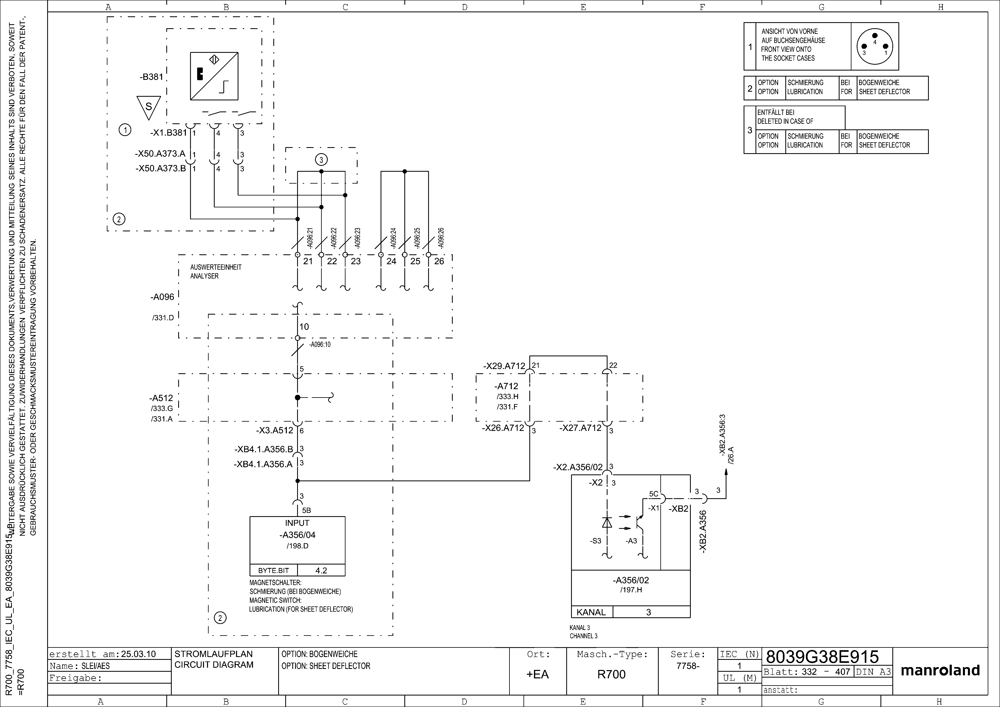

# +EA — Sheet 332 of 407 — OPTION: BOGENWEICHE

**OPTION: SHEET DEFLECTOR**

> Part of the manroland **R700** printing press IEC/UL circuit diagrams.
> Drawing class: **Stromlaufplan / Circuit diagram** (DIN A3).
> Document `+EA` covers the **Printing unit** machine section.

## At a glance

| Field | Value |
|---|---|
| Document | `+EA`  (8039G38E915) |
| Sheet | **332** of 407 |
| Section (DE) | OPTION: BOGENWEICHE |
| Section (EN) | OPTION: SHEET DEFLECTOR |
| Section type | CIRCUIT — Circuit diagram |
| Machine type | `R700` |
| Series | `7758` |
| Created | 25.03.10 |
| Replaces | — |
| Columns used | A, B, C, D, E, F, G, H |
| Path numbers | — |
| Labels on sheet | 115 |
| Cross-refs out | 8 |
| Cross-refs in | 28 |

**Previous:** [+EA sheet 331](SHEET_0331.md) · **Next:** [+EA sheet 333](SHEET_0333.md) · **Document TOC:** [_TOC.md](_TOC.md)  (+EA) · **Master TOC:** [all sheets](../_MASTER_TOC.md)

## Sheet image (300 DPI, exact vector render)



_Rendered directly from the PDF vector layer at 300 DPI (1-bit), no OCR and no resampling. Use it to confirm anything ambiguous in the text below._

## Cross-references on this sheet

Each entry is a wire leaving this sheet. The printed token is `/sheet.column`; the link resolves to that sheet inside the same document.

| Ref | Target sheet | Col | Path | Destination on target | Target section | From col |
|---|---|---|---|---|---|---|
| `/331.D` | [+EA sheet 331](SHEET_0331.md) | D | — | — | OPTION: BOGENWEICHE | A |
| `/333.H` | [+EA sheet 333](SHEET_0333.md) | H | — | — | OPTION: BOGENWEICHE | D |
| `/331.F` | [+EA sheet 331](SHEET_0331.md) | F | — | — | OPTION: BOGENWEICHE | D |
| `/333.G` | [+EA sheet 333](SHEET_0333.md) | G | — | — | OPTION: BOGENWEICHE | A |
| `/331.A` | [+EA sheet 331](SHEET_0331.md) | A | — | — | OPTION: BOGENWEICHE | A |
| `/26.A` | [+EA sheet 26](SHEET_0026.md) | A | — | XB2.A356:3 | BUSVERBINDUNGEN: SICHERHEITSBUS | F |
| `/198.D` | [+EA sheet 198](SHEET_0198.md) | D | — | — | REFERENZMODUL | C |
| `/197.H` | [+EA sheet 197](SHEET_0197.md) | H | — | — | REFERENZMODUL | E |

### Incoming references (sheets that point here)

Every other sheet that sends a wire to this one. `Back-ref` is the token printed on *that* sheet; `Path` is its line number.

| From sheet | Cols | Back-ref | Path | Refs | What continues there |
|---|---|---|---|---|---|
| [+EA#26](SHEET_0026.md) | A | `/26.A` | — | 1 | XB2.A356:3 |
| [+EA#197](SHEET_0197.md) | H | `/197.H` | — | 1 | — |
| [+EA#198](SHEET_0198.md) | D | `/198.D` | — | 1 | — |
| [+EA#217](SHEET_0217.md) | F | `/217.F` | — | 3 | — |
| [+EA#225](SHEET_0225.md) | F | `/225.F` | — | 1 | — |
| [+EA#226](SHEET_0226.md) | E | `/226.E` | — | 1 | — |
| [+EA#230](SHEET_0230.md) | C | `/230.C` | — | 1 | — |
| [+EA#235](SHEET_0235.md) | E | `/235.E` | — | 1 | — |
| [+EA#237](SHEET_0237.md) | E, F, G | `/237.E`, `/237.F`, `/237.G` | — | 3 | — |
| [+EA#270](SHEET_0270.md) | E | `/270.E` | — | 1 | — |
| [+EA#271](SHEET_0271.md) | G | `/271.G` | — | 1 | — |
| [+EA#274](SHEET_0274.md) | G | `/274.G` | — | 2 | — |
| [+EA#282](SHEET_0282.md) | E | `/282.E` | — | 6 | — |
| [+EA#331](SHEET_0331.md) | A, D, F | `/331.A`, `/331.D`, `/331.F` | — | 3 | AUSWERTEEINHEIT ANALYSER |
| [+EA#333](SHEET_0333.md) | G, H | `/333.G`, `/333.H` | — | 2 | — |


## Devices on this sheet

| Tag | Class | Class meaning (IEC) | Col | Sub | Terminal | Sign |
|---|---|---|---|---|---|---|
| `A356/04` | A | Baugruppe / assembly, module, PC board | C | 04 | — | — |
| `B381` | B | Umformer / transducer, sensor | A | — | — | — |
| `A096` | A | Baugruppe / assembly, module, PC board | A | — | — | — |
| `A512` | A | Baugruppe / assembly, module, PC board | A | — | — | — |
| `S3` | S | Schalter / switch | E | — | — | — |
| `A3` | A | Baugruppe / assembly, module, PC board | E | — | — | — |
| `X1` | X | Klemme / terminal, plug connector | F | — | — | — |
| `X2` | X | Klemme / terminal, plug connector | E | — | — | — |
| `XB2` | XB |  | F | — | — | — |
| `A356/02` | A | Baugruppe / assembly, module, PC board | E | 02 | — | — |
| `A712` | A | Baugruppe / assembly, module, PC board | D | — | — | — |
| `A096:21` | A | Baugruppe / assembly, module, PC board | C | — | 21 | — |
| `A096:23` | A | Baugruppe / assembly, module, PC board | C | — | 23 | — |
| `A096:22` | A | Baugruppe / assembly, module, PC board | C | — | 22 | — |
| `A096:24` | A | Baugruppe / assembly, module, PC board | C | — | 24 | — |
| `A096:26` | A | Baugruppe / assembly, module, PC board | D | — | 26 | — |
| `A096:25` | A | Baugruppe / assembly, module, PC board | D | — | 25 | — |
| `A096:10` | A | Baugruppe / assembly, module, PC board | C | — | 10 | — |
| `4.2` | — | cross-device reference | C | — | — | — |
| `X1.B381` | — | cross-device reference | B | — | — | — |
| `X50.A373.B` | — | cross-device reference | A | — | — | — |
| `X50.A373.A` | — | cross-device reference | A | — | — | — |
| `X3.A512` | — | cross-device reference | B | — | — | — |
| `XB4.1.A356.B` | — | cross-device reference | B | — | — | — |
| `XB4.1.A356.A` | — | cross-device reference | B | — | — | — |
| `XB2.A356` | — | cross-device reference | F | — | — | — |
| `X29.A712` | — | cross-device reference | D | — | — | — |
| `X27.A712` | — | cross-device reference | E | — | — | — |
| `X26.A712` | — | cross-device reference | D | — | — | — |
| `XB2.A356:3` | — | cross-device reference | F | — | 3 | — |

## Potentials / nets

_No named potentials on this sheet._

## Wire-end annotations (grouped as printed)

A wire that continues elsewhere is annotated with a small cluster: the destination description, the path/line number `#NN`, and the `/sheet.column` cross reference. Each row below is one such cluster exactly as it is grouped on the drawing.

| Col | Y | Path | Cross-ref | Text on the wire |
|---|---|---|---|---|
| G | 34.6 | — | — | `FRONT VIEW ONTO ANSICHT VON VORNE AUF BUCHSENGEHÄUSE` |
| G | 47.0 | — | — | `1 THE SOCKET CASES 4` |
| G | 59.7 | — | — | `3` |
| H | 59.7 | — | — | `1` |
| A | 86.8 | — | — | `B381` |
| G | 95.4 | — | — | `BEI FOR` |
| G | 95.5 | — | — | `BOGENWEICHE` |
| G | 95.6 | — | — | `2 OPTION OPTION` |
| G | 95.6 | — | — | `LUBRICATION SCHMIERUNG` |
| H | 106.2 | — | — | `SHEET DEFLECTOR` |
| A | 121.6 | — | — | `S` |
| G | 131.0 | — | — | `ENTFÄLLT BEI DELETED IN CASE OF` |
| F | 150.5 | — | — | `3` |
| A | 151.4 | — | — | `1` |
| B | 153.4 | — | — | `X1.B381 1 4 3` |
| G | 159.2 | — | — | `BEI FOR` |
| G | 159.3 | — | — | `OPTION OPTION` |
| G | 159.3 | — | — | `BOGENWEICHE` |
| G | 159.4 | — | — | `LUBRICATION SCHMIERUNG` |
| H | 170.0 | — | — | `SHEET DEFLECTOR` |
| B | 178.2 | — | — | `X50.A373.A 1 4 3` |
| C | 187.4 | — | — | `3` |
| B | 195.9 | — | — | `X50.A373.B 1 4 3` |
| A | 258.2 | — | — | `2` |
| C | 270.8 | — | — | `A096:21` |
| C | 271.1 | — | — | `A096:22` |
| C | 271.2 | — | — | `A096:23` |
| C | 271.2 | — | — | `A096:24` |
| D | 271.2 | — | — | `A096:25` |
| D | 271.2 | — | — | `A096:26` |
| C | 306.4 | — | — | `21 22 23 24 25 26` |
| B | 315.2 | — | — | `AUSWERTEEINHEIT ANALYSER` |
| A | 349.0 | — | — | `A096` |
| A | 374.5 | — | `/331.D` | — |
| C | 384.4 | — | — | `10` |
| C | 407.4 | — | — | `A096:10` |
| E | 431.2 | — | — | `X29.A712 21 22` |
| C | 435.4 | — | — | `5` |
| D | 455.3 | — | — | `A712` |
| D | 468.4 | — | `/333.H`, `/331.F` | — |
| A | 469.4 | — | — | `A512` |
| A | 482.5 | — | `/333.G`, `/331.A` | — |
| F | 493.2 | — | `/26.A` | `XB2.A356:3` |
| E | 504.9 | — | — | `X26.A712 3 X27.A712 3` |
| B | 507.7 | — | — | `X3.A512 6` |
| B | 530.4 | — | — | `XB4.1.A356.B 3` |
| B | 547.4 | — | — | `XB4.1.A356.A 3` |
| E | 551.6 | — | — | `X2.A356/02 3` |
| E | 570.1 | — | — | `X2` |
| F | 571.5 | — | — | `3 3` |
| F | 580.0 | — | — | `3` |
| F | 584.3 | — | — | `5C` |
| C | 587.1 | — | — | `3` |
| F | 601.2 | — | — | `X1` |
| F | 601.3 | — | — | `XB2` |
| C | 604.0 | — | — | `5B` |
| F | 607.5 | — | — | `XB2.A356` |
| C | 618.6 | — | — | `INPUT` |
| C | 632.4 | — | — | `A356/04` |
| E | 640.2 | — | — | `S3 A3` |
| C | 646.2 | — | `/198.D` | — |
| C | 675.3 | — | — | `BYTE.BIT 4.2` |
| E | 686.3 | — | — | `A356/02` |
| C | 690.9 | — | — | `LUBRICATION (FOR SHEET DEFLECTOR) MAGNETSCHALTER: MAGNETIC SWITCH: SCHMIERUNG (BEI BOGENWEICHE)` |
| E | 698.7 | — | `/197.H` | — |
| E | 724.5 | — | — | `KANAL 3` |
| B | 733.0 | — | — | `2` |
| E | 744.9 | — | — | `KANAL 3 CHANNEL 3` |


## Reconstructed tables

This sheet carries tabular content (pin map / terminal assignment / index). The grid below was rebuilt from the drawing's own rule lines, so each row is exactly one physical row of the table.

### Table 1 — 4 data rows × 9 columns (at x=226.8, y=62.4)

| 1 1 1 | 4 4 4 | 3 3 3 |  | 3 |  |  |  |  |
|---|---|---|---|---|---|---|---|---|
| `ANALYSER` | `AUSWERTEEINHEIT` |  | `X3.A512 XB4.1.A356.B XB4.1.A356.A` | `A096:21 21 10 A096:10 5 6 3 3` | `A096:22 22` | `A096:23 23` | `A096:24 24` | `A096:25 25` |
|  |  |  |  | `3 5B` |  |  |  |  |
|  |  |  | `INPUT` | `A356/04 /198.D` |  |  |  |  |
|  |  |  | `BYTE.BIT` | `4.2` |  |  |  |  |


### Table 2 — 3 data rows × 7 columns (at x=630.7, y=26.9) — **1 2 3**

| 21 3 | X27.A712 X2.A356/02 | 22 3 3 |  |  | XB2.A356:3 | /26.A |
|---|---|---|---|---|---|---|
|  | `X2 S3` | `3 A3` | `5C X1` | `XB2` | `3 3 XB2.A356` |  |
|  |  | `A356/02 /197.H` |  |  |  |  |
|  | `KANAL` |  | `3` |  |  |  |


## Notes and free text on this sheet

| Text | Col | Y (pt) |
|---|---|---|
| `5B` | C | 604.05 |
| `INPUT` | C | 618.59 |
| `BYTE.BIT` | B | 675.84 |
| `MAGNETSCHALTER:` | B | 690.86 |
| `SCHMIERUNG (BEI BOGENWEICHE)` | C | 701.49 |
| `MAGNETIC SWITCH:` | B | 712.1 |
| `LUBRICATION (FOR SHEET DEFLECTOR)` | C | 722.77 |
| `AUSWERTEEINHEIT` | B | 315.24 |
| `ANALYSER` | B | 325.9 |
| `KANAL 3` | E | 744.88 |
| `CHANNEL 3` | E | 754.82 |
| `5C` | F | 584.27 |
| `KANAL` | E | 724.55 |
| `X2.A356/02` | E | 551.65 |
| `S` | A | 121.56 |
| `ANSICHT VON VORNE` | G | 34.65 |
| `AUF BUCHSENGEHÄUSE` | G | 45.28 |
| `FRONT VIEW ONTO` | G | 55.87 |
| `THE SOCKET CASES` | G | 66.52 |
| `OPTION` | G | 95.56 |
| `SCHMIERUNG` | G | 95.61 |
| `LUBRICATION` | G | 106.21 |
| `BEI` | G | 95.41 |
| `FOR` | G | 106.18 |
| `BOGENWEICHE` | G | 95.54 |
| `SHEET DEFLECTOR` | H | 106.22 |
| `ENTFÄLLT BEI` | G | 130.98 |
| `DELETED IN CASE OF` | G | 141.64 |

## Complete label inventory (exact text from the drawing)

Every text object inside the drawing area of this sheet, in DIN reading order (column A→H, then top→bottom). This is the authoritative list: if a string is not here it is not printed on this sheet.

| Col | Y | X | Dir | Type | Text |
|---|---|---|---|---|---|
| A | 86.8 | 166.4 | → | device tag | `B381` |
| A | 121.6 | 173.1 | → | text | `S` |
| A | 151.4 | 147.1 | → | number | `1` |
| A | 178.2 | 160.7 | → | device ref | `X50.A373.A` |
| A | 195.9 | 161.6 | → | device ref | `X50.A373.B` |
| A | 258.2 | 139.7 | → | number | `2` |
| A | 349.0 | 179.1 | → | device tag | `A096` |
| A | 374.5 | 181.4 | → | cross-reference | `/331.D` |
| A | 469.4 | 177.7 | → | device tag | `A512` |
| A | 482.5 | 179.7 | → | cross-reference | `/333.G` |
| A | 494.9 | 180.0 | → | cross-reference | `/331.A` |
| B | 153.4 | 178.9 | → | device ref | `X1.B381` |
| B | 154.8 | 228.8 | → | number | `1` |
| B | 154.8 | 257.7 | → | number | `4` |
| B | 154.8 | 286.0 | → | number | `3` |
| B | 180.3 | 228.8 | → | number | `1` |
| B | 180.3 | 257.7 | → | number | `4` |
| B | 180.3 | 286.0 | → | number | `3` |
| B | 197.3 | 228.8 | → | number | `1` |
| B | 197.3 | 257.7 | → | number | `4` |
| B | 197.3 | 286.0 | → | number | `3` |
| B | 315.2 | 226.8 | → | text | `AUSWERTEEINHEIT` |
| B | 325.9 | 226.8 | → | text | `ANALYSER` |
| B | 507.7 | 305.0 | → | device ref | `X3.A512` |
| B | 530.4 | 279.2 | → | device ref | `XB4.1.A356.B` |
| B | 548.1 | 278.4 | → | device ref | `XB4.1.A356.A` |
| B | 675.8 | 307.6 | → | text | `BYTE.BIT` |
| B | 690.9 | 297.1 | → | text | `MAGNETSCHALTER:` |
| B | 712.1 | 297.1 | → | text | `MAGNETIC SWITCH:` |
| B | 733.0 | 260.2 | → | number | `2` |
| C | 187.4 | 380.7 | → | number | `3` |
| C | 270.8 | 366.3 | ↕ | device tag | `A096:21` |
| C | 271.1 | 394.6 | ↕ | device tag | `A096:22` |
| C | 271.2 | 423.0 | ↕ | device tag | `A096:23` |
| C | 271.2 | 465.5 | ↕ | device tag | `A096:24` |
| C | 306.4 | 361.1 | → | number | `21` |
| C | 306.4 | 389.5 | → | number | `22` |
| C | 306.4 | 417.8 | → | number | `23` |
| C | 306.4 | 460.3 | → | number | `24` |
| C | 384.4 | 356.0 | → | number | `10` |
| C | 407.4 | 368.2 | → | device tag | `A096:10` |
| C | 435.4 | 356.9 | → | number | `5` |
| C | 509.1 | 356.9 | → | number | `6` |
| C | 530.4 | 356.9 | → | number | `3` |
| C | 547.4 | 356.9 | → | number | `3` |
| C | 587.1 | 356.9 | → | number | `3` |
| C | 604.0 | 359.7 | → | text | `5B` |
| C | 618.6 | 339.4 | → | text | `INPUT` |
| C | 632.4 | 332.9 | → | device tag | `A356/04` |
| C | 646.2 | 341.6 | → | cross-reference | `/198.D` |
| C | 675.3 | 375.9 | → | device ref | `4.2` |
| C | 701.5 | 297.4 | → | text | `SCHMIERUNG (BEI BOGENWEICHE)` |
| C | 722.8 | 296.8 | → | text | `LUBRICATION (FOR SHEET DEFLECTOR)` |
| D | 271.2 | 493.9 | ↕ | device tag | `A096:25` |
| D | 271.2 | 522.2 | ↕ | device tag | `A096:26` |
| D | 306.4 | 488.7 | → | number | `25` |
| D | 306.4 | 517.0 | → | number | `26` |
| D | 431.2 | 575.4 | → | device ref | `X29.A712` |
| D | 455.3 | 588.8 | → | device tag | `A712` |
| D | 468.4 | 591.6 | → | cross-reference | `/333.H` |
| D | 480.7 | 591.9 | → | cross-reference | `/331.F` |
| D | 504.9 | 574.0 | → | device ref | `X26.A712` |
| E | 431.2 | 633.3 | → | number | `21` |
| E | 431.2 | 725.4 | → | number | `22` |
| E | 504.9 | 666.1 | → | device ref | `X27.A712` |
| E | 509.1 | 633.3 | → | number | `3` |
| E | 509.1 | 725.4 | → | number | `3` |
| E | 551.6 | 658.8 | → | text | `X2.A356/02` |
| E | 551.7 | 725.4 | → | number | `3` |
| E | 570.1 | 701.3 | → | device tag | `X2` |
| E | 571.5 | 728.2 | → | number | `3` |
| E | 640.2 | 702.4 | → | device tag | `S3` |
| E | 640.2 | 744.9 | → | device tag | `A3` |
| E | 686.3 | 729.8 | → | device tag | `A356/02` |
| E | 698.7 | 738.7 | → | cross-reference | `/197.H` |
| E | 724.6 | 686.6 | → | text | `KANAL` |
| E | 744.9 | 678.3 | → | text | `KANAL 3` |
| E | 754.8 | 678.6 | → | text | `CHANNEL 3` |
| F | 51.3 | 890.4 | → | number | `1` |
| F | 100.9 | 890.1 | → | number | `2` |
| F | 150.5 | 889.9 | → | number | `3` |
| F | 493.2 | 856.3 | ↕ | device ref | `XB2.A356:3` |
| F | 532.1 | 866.2 | ↕ | cross-reference | `/26.A` |
| F | 580.0 | 852.9 | → | number | `3` |
| F | 581.4 | 827.4 | → | number | `3` |
| F | 584.3 | 773.0 | → | text | `5C` |
| F | 601.2 | 771.9 | → | device tag | `X1` |
| F | 601.3 | 796.3 | → | device tag | `XB2` |
| F | 607.5 | 832.3 | ↕ | device ref | `XB2.A356` |
| F | 724.5 | 769.5 | → | number | `3` |
| G | 34.6 | 907.1 | → | text | `ANSICHT VON VORNE` |
| G | 45.3 | 907.1 | → | text | `AUF BUCHSENGEHÄUSE` |
| G | 47.0 | 1039.7 | → | number | `4` |
| G | 55.9 | 906.2 | → | text | `FRONT VIEW ONTO` |
| G | 59.7 | 1027.0 | → | number | `3` |
| G | 66.5 | 906.8 | → | text | `THE SOCKET CASES` |
| G | 95.4 | 1001.2 | → | text | `BEI` |
| G | 95.5 | 1022.5 | → | text | `BOGENWEICHE` |
| G | 95.6 | 902.6 | → | text | `OPTION` |
| G | 95.6 | 938.0 | → | text | `SCHMIERUNG` |
| G | 106.2 | 902.6 | → | text | `OPTION` |
| G | 106.2 | 937.4 | → | text | `LUBRICATION` |
| G | 106.2 | 1001.2 | → | text | `FOR` |
| G | 131.0 | 902.0 | → | text | `ENTFÄLLT BEI` |
| G | 141.6 | 902.0 | → | text | `DELETED IN CASE OF` |
| G | 159.2 | 1001.2 | → | text | `BEI` |
| G | 159.3 | 902.6 | → | text | `OPTION` |
| G | 159.3 | 1022.5 | → | text | `BOGENWEICHE` |
| G | 159.4 | 938.0 | → | text | `SCHMIERUNG` |
| G | 170.0 | 902.6 | → | text | `OPTION` |
| G | 170.0 | 937.4 | → | text | `LUBRICATION` |
| G | 170.0 | 1001.2 | → | text | `FOR` |
| H | 59.7 | 1052.9 | → | number | `1` |
| H | 106.2 | 1023.0 | → | text | `SHEET DEFLECTOR` |
| H | 170.0 | 1023.0 | → | text | `SHEET DEFLECTOR` |

## Reading-order text block

The same content as a plain block, grouped by DIN column — convenient to paste or to match against a visual description.

```text
=== Column A ===
  86.8  166.4  devtag       B381
 121.6  173.1  text         S
 151.4  147.1  numeric      1
 178.2  160.7  devref       X50.A373.A
 195.9  161.6  devref       X50.A373.B
 258.2  139.7  numeric      2
 349.0  179.1  devtag       A096
 374.5  181.4  xref         /331.D
 469.4  177.7  devtag       A512
 482.5  179.7  xref         /333.G
 494.9  180.0  xref         /331.A
=== Column B ===
 153.4  178.9  devref       X1.B381
 154.8  228.8  numeric      1
 154.8  257.7  numeric      4
 154.8  286.0  numeric      3
 180.3  228.8  numeric      1
 180.3  257.7  numeric      4
 180.3  286.0  numeric      3
 197.3  228.8  numeric      1
 197.3  257.7  numeric      4
 197.3  286.0  numeric      3
 315.2  226.8  text         AUSWERTEEINHEIT
 325.9  226.8  text         ANALYSER
 507.7  305.0  devref       X3.A512
 530.4  279.2  devref       XB4.1.A356.B
 548.1  278.4  devref       XB4.1.A356.A
 675.8  307.6  text         BYTE.BIT
 690.9  297.1  text         MAGNETSCHALTER:
 712.1  297.1  text         MAGNETIC SWITCH:
 733.0  260.2  numeric      2
=== Column C ===
 187.4  380.7  numeric      3
 270.8  366.3  devtag       A096:21
 271.1  394.6  devtag       A096:22
 271.2  423.0  devtag       A096:23
 271.2  465.5  devtag       A096:24
 306.4  361.1  numeric      21
 306.4  389.5  numeric      22
 306.4  417.8  numeric      23
 306.4  460.3  numeric      24
 384.4  356.0  numeric      10
 407.4  368.2  devtag       A096:10
 435.4  356.9  numeric      5
 509.1  356.9  numeric      6
 530.4  356.9  numeric      3
 547.4  356.9  numeric      3
 587.1  356.9  numeric      3
 604.0  359.7  text         5B
 618.6  339.4  text         INPUT
 632.4  332.9  devtag       A356/04
 646.2  341.6  xref         /198.D
 675.3  375.9  devref       4.2
 701.5  297.4  text         SCHMIERUNG (BEI BOGENWEICHE)
 722.8  296.8  text         LUBRICATION (FOR SHEET DEFLECTOR)
=== Column D ===
 271.2  493.9  devtag       A096:25
 271.2  522.2  devtag       A096:26
 306.4  488.7  numeric      25
 306.4  517.0  numeric      26
 431.2  575.4  devref       X29.A712
 455.3  588.8  devtag       A712
 468.4  591.6  xref         /333.H
 480.7  591.9  xref         /331.F
 504.9  574.0  devref       X26.A712
=== Column E ===
 431.2  633.3  numeric      21
 431.2  725.4  numeric      22
 504.9  666.1  devref       X27.A712
 509.1  633.3  numeric      3
 509.1  725.4  numeric      3
 551.6  658.8  text         X2.A356/02
 551.7  725.4  numeric      3
 570.1  701.3  devtag       X2
 571.5  728.2  numeric      3
 640.2  702.4  devtag       S3
 640.2  744.9  devtag       A3
 686.3  729.8  devtag       A356/02
 698.7  738.7  xref         /197.H
 724.6  686.6  text         KANAL
 744.9  678.3  text         KANAL 3
 754.8  678.6  text         CHANNEL 3
=== Column F ===
  51.3  890.4  numeric      1
 100.9  890.1  numeric      2
 150.5  889.9  numeric      3
 493.2  856.3  devref       XB2.A356:3
 532.1  866.2  xref         /26.A
 580.0  852.9  numeric      3
 581.4  827.4  numeric      3
 584.3  773.0  text         5C
 601.2  771.9  devtag       X1
 601.3  796.3  devtag       XB2
 607.5  832.3  devref       XB2.A356
 724.5  769.5  numeric      3
=== Column G ===
  34.6  907.1  text         ANSICHT VON VORNE
  45.3  907.1  text         AUF BUCHSENGEHÄUSE
  47.0 1039.7  numeric      4
  55.9  906.2  text         FRONT VIEW ONTO
  59.7 1027.0  numeric      3
  66.5  906.8  text         THE SOCKET CASES
  95.4 1001.2  text         BEI
  95.5 1022.5  text         BOGENWEICHE
  95.6  902.6  text         OPTION
  95.6  938.0  text         SCHMIERUNG
 106.2  902.6  text         OPTION
 106.2  937.4  text         LUBRICATION
 106.2 1001.2  text         FOR
 131.0  902.0  text         ENTFÄLLT BEI
 141.6  902.0  text         DELETED IN CASE OF
 159.2 1001.2  text         BEI
 159.3  902.6  text         OPTION
 159.3 1022.5  text         BOGENWEICHE
 159.4  938.0  text         SCHMIERUNG
 170.0  902.6  text         OPTION
 170.0  937.4  text         LUBRICATION
 170.0 1001.2  text         FOR
=== Column H ===
  59.7 1052.9  numeric      1
 106.2 1023.0  text         SHEET DEFLECTOR
 170.0 1023.0  text         SHEET DEFLECTOR
```

---
_Generated from the PDF vector text layer; no OCR. Source: `R700_7758_IEC_UL_EA_8039G38E915_p`, sheet 332._
