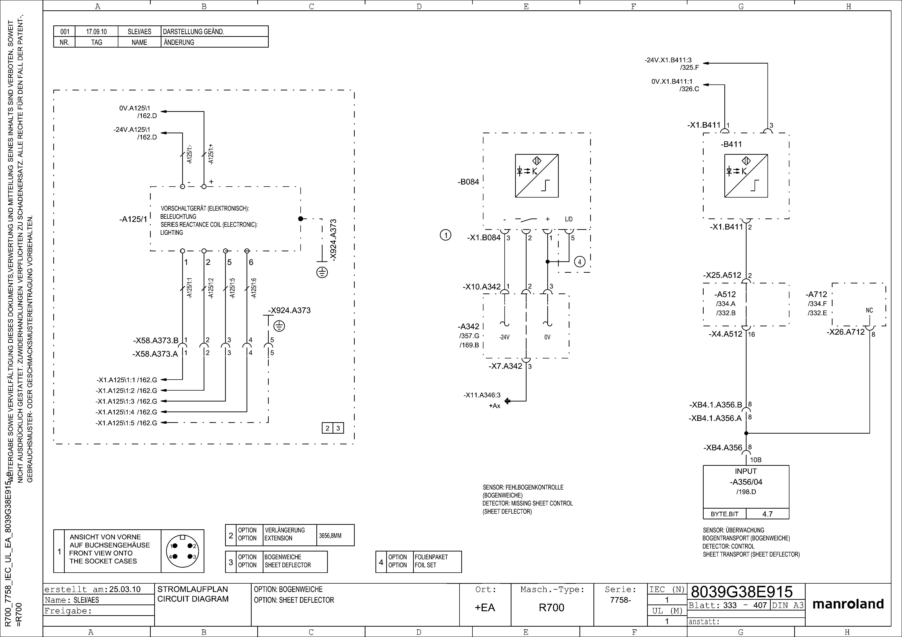

# +EA — Sheet 333 of 407 — OPTION: BOGENWEICHE

**OPTION: SHEET DEFLECTOR**

> Part of the manroland **R700** printing press IEC/UL circuit diagrams.
> Drawing class: **Stromlaufplan / Circuit diagram** (DIN A3).
> Document `+EA` covers the **Printing unit** machine section.

## At a glance

| Field | Value |
|---|---|
| Document | `+EA`  (8039G38E915) |
| Sheet | **333** of 407 |
| Section (DE) | OPTION: BOGENWEICHE |
| Section (EN) | OPTION: SHEET DEFLECTOR |
| Section type | CIRCUIT — Circuit diagram |
| Machine type | `R700` |
| Series | `7758` |
| Created | 25.03.10 |
| Replaces | — |
| Columns used | A, B, C, D, E, F, G, H |
| Path numbers | — |
| Labels on sheet | 145 |
| Cross-refs out | 16 |
| Cross-refs in | 43 |

**Previous:** [+EA sheet 332](SHEET_0332.md) · **Next:** [+EA sheet 334](SHEET_0334.md) · **Document TOC:** [_TOC.md](_TOC.md)  (+EA) · **Master TOC:** [all sheets](../_MASTER_TOC.md)

## Sheet image (300 DPI, exact vector render)



_Rendered directly from the PDF vector layer at 300 DPI (1-bit), no OCR and no resampling. Use it to confirm anything ambiguous in the text below._

## Cross-references on this sheet

Each entry is a wire leaving this sheet. The printed token is `/sheet.column`; the link resolves to that sheet inside the same document.

| Ref | Target sheet | Col | Path | Destination on target | Target section | From col |
|---|---|---|---|---|---|---|
| `/325.F` | [+EA sheet 325](SHEET_0325.md) | F | — | 24V.X1.B411:3 | OPTION: BOGENWEICHE | F |
| `/326.C` | [+EA sheet 326](SHEET_0326.md) | C | — | 0V.X1.B411:1 | OPTION: BOGENWEICHE | F |
| `/162.D` | [+EA sheet 162](SHEET_0162.md) | D | — | 0V.A125\1 | VERLÄNGERUNG 1828,4MM | A |
| `/162.D` | [+EA sheet 162](SHEET_0162.md) | D | — | 24V.A125\1 | VERLÄNGERUNG 1828,4MM | A |
| `/334.A` | [+EA sheet 334](SHEET_0334.md) | A | — | — | OPTION: BOGENWEICHE | G |
| `/332.B` | [+EA sheet 332](SHEET_0332.md) | B | — | — | OPTION: BOGENWEICHE | G |
| `/334.F` | [+EA sheet 334](SHEET_0334.md) | F | — | — | OPTION: BOGENWEICHE | H |
| `/332.E` | [+EA sheet 332](SHEET_0332.md) | E | — | — | OPTION: BOGENWEICHE | H |
| `/357.G` | [+EA sheet 357](SHEET_0357.md) | G | — | — | OPTION: AUFLAGENZÄHLER / GUTBOGENZÄHLER | D |
| `/169.B` | [+EA sheet 169](SHEET_0169.md) | B | — | — | RESERVE | D |
| `/162.G` | [+EA sheet 162](SHEET_0162.md) | G | — | X1.A125\1:1 | VERLÄNGERUNG 1828,4MM | A |
| `/162.G` | [+EA sheet 162](SHEET_0162.md) | G | — | X1.A125\1:2 | VERLÄNGERUNG 1828,4MM | A |
| `/162.G` | [+EA sheet 162](SHEET_0162.md) | G | — | X1.A125\1:3 | VERLÄNGERUNG 1828,4MM | A |
| `/162.G` | [+EA sheet 162](SHEET_0162.md) | G | — | X1.A125\1:4 | VERLÄNGERUNG 1828,4MM | A |
| `/162.G` | [+EA sheet 162](SHEET_0162.md) | G | — | X1.A125\1:5 | VERLÄNGERUNG 1828,4MM | A |
| `/198.D` | [+EA sheet 198](SHEET_0198.md) | D | — | — | REFERENZMODUL | G |

### Incoming references (sheets that point here)

Every other sheet that sends a wire to this one. `Back-ref` is the token printed on *that* sheet; `Path` is its line number.

| From sheet | Cols | Back-ref | Path | Refs | What continues there |
|---|---|---|---|---|---|
| [+EA#162](SHEET_0162.md) | B, D, H | `/162.B`, `/162.D`, `/162.H` | — | 7 | 0V.A125:+; X1.A125\1:1; X1.A125\1:2; X1.A125\1:3; X1.A125\1:4; X1.A125\1:5 |
| [+EA#169](SHEET_0169.md) | B | `/169.B` | — | 1 | — |
| [+EA#198](SHEET_0198.md) | D | `/198.D` | — | 1 | — |
| [+EA#214](SHEET_0214.md) | F | `/214.F` | — | 4 | — |
| [+EA#217](SHEET_0217.md) | G | `/217.G` | — | 3 | — |
| [+EA#237](SHEET_0237.md) | E, F, G | `/237.E`, `/237.F`, `/237.G` | — | 3 | — |
| [+EA#238](SHEET_0238.md) | A | `/238.A` | — | 1 | — |
| [+EA#247](SHEET_0247.md) | C | `/247.C` | — | 1 | — |
| [+EA#254](SHEET_0254.md) | B | `/254.B` | — | 3 | — |
| [+EA#268](SHEET_0268.md) | B | `/268.B` | — | 1 | — |
| [+EA#270](SHEET_0270.md) | E | `/270.E` | — | 1 | — |
| [+EA#283](SHEET_0283.md) | F | `/283.F` | — | 10 | — |
| [+EA#325](SHEET_0325.md) | F | `/325.F` | — | 1 | 24V.X1.B411:3 |
| [+EA#326](SHEET_0326.md) | C | `/326.C` | — | 1 | — |
| [+EA#332](SHEET_0332.md) | A, D | `/332.A`, `/332.D` | — | 2 | — |
| [+EA#334](SHEET_0334.md) | A, F | `/334.A`, `/334.F` | — | 2 | — |
| [+EA#357](SHEET_0357.md) | G | `/357.G` | — | 1 | — |


## Devices on this sheet

| Tag | Class | Class meaning (IEC) | Col | Sub | Terminal | Sign |
|---|---|---|---|---|---|---|
| `A125/1` | A | Baugruppe / assembly, module, PC board | A | 1 | — | — |
| `B411` | B | Umformer / transducer, sensor | G | — | — | — |
| `A512` | A | Baugruppe / assembly, module, PC board | G | — | — | — |
| `A356/04` | A | Baugruppe / assembly, module, PC board | G | 04 | — | — |
| `A712` | A | Baugruppe / assembly, module, PC board | H | — | — | — |
| `B084` | B | Umformer / transducer, sensor | D | — | — | — |
| `A342` | A | Baugruppe / assembly, module, PC board | D | — | — | — |
| `A125/1:1` | A | Baugruppe / assembly, module, PC board | B | 1 | 1 | — |
| `A125/1:5` | A | Baugruppe / assembly, module, PC board | B | 1 | 5 | — |
| `A125/1:2` | A | Baugruppe / assembly, module, PC board | B | 1 | 2 | — |
| `A125/1:6` | A | Baugruppe / assembly, module, PC board | B | 1 | 6 | — |
| `X58.A373.B` | — | cross-device reference | B | — | — | — |
| `X58.A373.A` | — | cross-device reference | B | — | — | — |
| `X1.B411` | — | cross-device reference | G | — | — | — |
| `X1.B411` | — | cross-device reference | G | — | — | — |
| `X25.A512` | — | cross-device reference | G | — | — | — |
| `4.7` | — | cross-device reference | G | — | — | — |
| `XB4.A356` | — | cross-device reference | G | — | — | — |
| `XB4.1.A356.B` | — | cross-device reference | G | — | — | — |
| `XB4.1.A356.A` | — | cross-device reference | G | — | — | — |
| `X4.A512` | — | cross-device reference | G | — | — | — |
| `X26.A712` | — | cross-device reference | H | — | — | — |
| `X1.B084` | — | cross-device reference | E | — | — | — |
| `X10.A342` | — | cross-device reference | E | — | — | — |
| `X7.A342` | — | cross-device reference | E | — | — | — |
| `X11.A346:3` | — | cross-device reference | E | — | 3 | — |
| `NR.` | — | cross-device reference | A | — | — | — |
| `17.09.10` | — | cross-device reference | A | — | — | — |
| `X1.A125\1:5` | — | cross-device reference | A | — | 5 | — |
| `X1.A125\1:3` | — | cross-device reference | A | — | 3 | — |
| `X1.A125\1:2` | — | cross-device reference | A | — | 2 | — |
| `X1.A125\1:1` | — | cross-device reference | A | — | 1 | — |
| `X1.A125\1:4` | — | cross-device reference | A | — | 4 | — |
| `X924.A373` | — | cross-device reference | C | — | — | — |
| `X924.A373` | — | cross-device reference | C | — | — | — |

## Potentials / nets

| Potential | Count | Columns | Attached devices | Terminals |
|---|---|---|---|---|
| `0V` | 3 | A, E, F | `A125\1`, `B411`, `X1` | `1` |
| `24V` | 3 | A, E, F | `A125\1`, `B411`, `X1` | `3` |


A potential such as `L24+/4` or `M24+` is a named supply/return rail; every place it appears on this sheet is electrically common.

## Wire-end annotations (grouped as printed)

A wire that continues elsewhere is annotated with a small cluster: the destination description, the path/line number `#NN`, and the `/sheet.column` cross reference. Each row below is one such cluster exactly as it is grouped on the drawing.

| Col | Y | Path | Cross-ref | Text on the wire |
|---|---|---|---|---|
| A | 38.5 | — | — | `001 17.09.10 SLEI/AES DARSTELLUNG GEÄND.` |
| A | 52.7 | — | — | `NR. TAG NAME ÄNDERUNG` |
| F | 75.4 | — | `/325.F` | `24V.X1.B411:3` |
| F | 103.7 | — | `/326.C` | `0V.X1.B411:1` |
| A | 139.2 | — | `/162.D` | `0V.A125\1` |
| G | 160.5 | — | — | `X1.B411 1 3` |
| A | 167.5 | — | `/162.D` | `24V.A125\1` |
| G | 186.0 | — | — | `B411` |
| B | 190.2 | — | — | `A125/1:+` |
| B | 191.2 | — | — | `A125/1:1 A125/1:` |
| B | 235.6 | — | — | `+` |
| D | 235.6 | — | — | `B084` |
| B | 272.8 | — | — | `BELEUCHTUNG VORSCHALTGERÄT (ELEKTRONISCH):` |
| A | 285.2 | — | — | `A125/1` |
| E | 285.2 | — | — | `+` |
| E | 286.9 | — | — | `L/D` |
| C | 289.3 | — | — | `X924.A373` |
| B | 294.0 | — | — | `LIGHTING SERIES REACTANCE COIL (ELECTRONIC):` |
| G | 295.1 | — | — | `X1.B411 2` |
| D | 307.3 | — | — | `1` |
| E | 309.3 | — | — | `X1.B084 3 2 1` |
| E | 310.7 | — | — | `5` |
| B | 341.9 | — | — | `1 2 5 6` |
| F | 343.3 | — | — | `4` |
| G | 358.9 | — | — | `X25.A512 2` |
| B | 367.5 | — | — | `A125/1:2` |
| B | 367.7 | — | — | `A125/1:5` |
| B | 367.7 | — | — | `A125/1:6` |
| E | 374.5 | — | — | `X10.A342 1 2` |
| E | 374.5 | — | — | `3` |
| G | 384.4 | — | — | `A512` |
| H | 384.4 | — | — | `A712` |
| G | 397.5 | — | `/334.A`, `/332.B` | — |
| H | 397.5 | — | `/334.F`, `/332.E` | — |
| C | 405.7 | — | — | `X924.A373` |
| H | 407.4 | — | — | `NC` |
| D | 426.9 | — | — | `A342` |
| H | 434.0 | — | — | `X26.A712 8` |
| G | 436.8 | — | — | `X4.A512 16` |
| D | 440.0 | — | `/357.G` | — |
| E | 442.8 | — | — | `24V 0V` |
| B | 445.4 | — | — | `X58.A373.B 1` |
| B | 445.4 | — | — | `2` |
| B | 445.4 | — | — | `3` |
| B | 445.4 | — | — | `4` |
| C | 445.4 | — | — | `5` |
| D | 452.4 | — | `/169.B` | — |
| B | 462.4 | — | — | `X58.A373.A 1` |
| B | 462.4 | — | — | `2` |
| B | 462.4 | — | — | `3` |
| B | 462.4 | — | — | `4` |
| C | 462.4 | — | — | `5` |
| E | 479.4 | — | — | `X7.A342 3` |
| A | 498.5 | — | `/162.G` | `X1.A125\1:1` |
| A | 512.6 | — | `/162.G` | `X1.A125\1:2` |
| E | 518.3 | — | — | `X11.A346:3` |
| A | 526.8 | — | `/162.G` | `X1.A125\1:3` |
| G | 530.4 | — | — | `XB4.1.A356.B 8` |
| E | 532.6 | — | — | `+Ax` |
| A | 541.0 | — | `/162.G` | `X1.A125\1:4` |
| G | 547.4 | — | — | `XB4.1.A356.A 8` |
| A | 555.2 | — | `/162.G` | `X1.A125\1:5` |
| C | 562.3 | — | — | `2 3` |
| G | 587.1 | — | — | `XB4.A356 8` |
| G | 604.1 | — | — | `10B` |
| G | 618.6 | — | — | `INPUT` |
| G | 632.4 | — | — | `A356/04` |
| E | 641.3 | — | — | `DETECTOR: MISSING SHEET CONTROL (BOGENWEICHE) (SHEET DEFLECTOR) SENSOR: FEHLBOGENKONTROLLE` |
| G | 646.2 | — | `/198.D` | — |
| G | 675.3 | — | — | `BYTE.BIT 4.7` |
| B | 697.9 | — | — | `2 OPTION OPTION` |
| G | 697.9 | — | — | `BOGENTRANSPORT (BOGENWEICHE) DETECTOR: CONTROL SENSOR: ÜBERWACHUNG` |
| C | 698.0 | — | — | `EXTENSION VERLÄNGERUNG 3656,8MM` |
| A | 706.1 | — | — | `FRONT VIEW ONTO ANSICHT VON VORNE AUF BUCHSENGEHÄUSE` |
| A | 718.8 | — | — | `1 1 2` |
| G | 729.9 | — | — | `SHEET TRANSPORT (SHEET DEFLECTOR)` |
| B | 732.9 | — | — | `4 3` |
| C | 733.3 | — | — | `BOGENWEICHE` |
| B | 733.4 | — | — | `3 OPTION OPTION` |
| D | 733.4 | — | — | `4 OPTION OPTION` |
| D | 733.4 | — | — | `FOLIENPAKET FOIL SET` |
| A | 738.0 | — | — | `THE SOCKET CASES` |
| C | 744.0 | — | — | `SHEET DEFLECTOR` |


## Reconstructed tables

This sheet carries tabular content (pin map / terminal assignment / index). The grid below was rebuilt from the drawing's own rule lines, so each row is exactly one physical row of the table.

### Table 1 — 1 data rows × 6 columns (at x=212.6, y=147.4)

| BELEUCHTUNG SERIES LIGHTING | A125/1: VORSCHALTGERÄT REACTANCE 1 A125/1:1 1 1 | A125/1:+ + COIL 2 A125/1:2 2 2 | (ELEKTRONISCH): (ELECTRONIC): 5 A125/1:5 3 3 | 6 A125/1:6 4 4 | X924.A373 5 5 |
|---|---|---|---|---|---|
| `1 4` | `2 3` |  | `2 3` | `OPTION OPTION OPTION OPTION` | `VERLÄNGERUNG EXTENSION BOGENWEICHE SHEET DEFLECTOR` |


### Table 2 — 4 data rows × 5 columns (at x=928.3, y=83.6)

| X1.B411 | 1 B411 |  | 3 |  |
|---|---|---|---|---|
| `X25.A512 XB4.1.A356.B XB4.1.A356.A` | `X1.B411 A512 /334.A /332.B X4.A512` | `2 2 16 8 8` |  | `A712 /334.F NC /332.E X26.A712` |
| `XB4.A356` |  | `8 10B` |  |  |
|  | `INPUT` | `A356/04 /198.D` |  |  |
| `BYTE.BIT` |  | `4.7` |  |  |


## Notes and free text on this sheet

| Text | Col | Y (pt) |
|---|---|---|
| `VORSCHALTGERÄT (ELEKTRONISCH):` | B | 272.76 |
| `BELEUCHTUNG` | B | 283.39 |
| `SERIES REACTANCE COIL (ELECTRONIC):` | B | 294.02 |
| `LIGHTING` | B | 304.63 |
| `10B` | G | 604.07 |
| `INPUT` | G | 618.59 |
| `BYTE.BIT` | G | 675.84 |
| `SENSOR: ÜBERWACHUNG` | G | 697.94 |
| `BOGENTRANSPORT (BOGENWEICHE)` | G | 708.57 |
| `DETECTOR: CONTROL` | G | 719.23 |
| `SHEET TRANSPORT (SHEET DEFLECTOR)` | G | 729.85 |
| `SENSOR: FEHLBOGENKONTROLLE` | E | 641.26 |
| `(BOGENWEICHE)` | E | 651.86 |
| `DETECTOR: MISSING SHEET CONTROL` | E | 662.53 |
| `(SHEET DEFLECTOR)` | E | 673.16 |
| `+Ax` | E | 532.56 |
| `TAG` | A | 52.78 |
| `NAME` | A | 52.76 |
| `ÄNDERUNG` | B | 52.82 |
| `SLEI/AES` | A | 38.64 |
| `DARSTELLUNG GEÄND.` | B | 38.63 |
| `ANSICHT VON VORNE` | A | 706.1 |
| `AUF BUCHSENGEHÄUSE` | A | 716.73 |
| `FRONT VIEW ONTO` | A | 727.33 |
| `THE SOCKET CASES` | A | 737.98 |
| `OPTION` | B | 697.92 |
| `VERLÄNGERUNG` | C | 697.97 |
| `EXTENSION` | C | 708.54 |
| `3656,8MM` | C | 705.07 |
| `BOGENWEICHE` | C | 733.33 |
| `SHEET DEFLECTOR` | C | 744.02 |
| `A125/1:+` | B | 190.25 |
| `A125/1:` | B | 191.23 |
| `OPTION` | D | 733.35 |
| `FOLIENPAKET` | D | 733.36 |
| `FOIL SET` | D | 743.97 |
| `NC` | H | 407.36 |
| `L/D` | E | 286.86 |

## Complete label inventory (exact text from the drawing)

Every text object inside the drawing area of this sheet, in DIN reading order (column A→H, then top→bottom). This is the authoritative list: if a string is not here it is not printed on this sheet.

| Col | Y | X | Dir | Type | Text |
|---|---|---|---|---|---|
| A | 38.5 | 79.8 | → | number | `001` |
| A | 38.6 | 113.6 | → | device ref | `17.09.10` |
| A | 38.6 | 168.7 | → | text | `SLEI/AES` |
| A | 52.7 | 78.9 | → | device ref | `NR.` |
| A | 52.8 | 120.4 | → | text | `TAG` |
| A | 52.8 | 173.8 | → | text | `NAME` |
| A | 139.2 | 157.6 | → | potential | `0V.A125\1` |
| A | 149.1 | 181.4 | → | cross-reference | `/162.D` |
| A | 167.5 | 150.0 | → | potential | `24V.A125\1` |
| A | 177.5 | 181.4 | → | cross-reference | `/162.D` |
| A | 285.2 | 157.6 | → | device tag | `A125/1` |
| A | 498.5 | 127.6 | → | device ref | `X1.A125\1:1` |
| A | 498.5 | 181.1 | → | cross-reference | `/162.G` |
| A | 512.6 | 126.4 | → | device ref | `X1.A125\1:2` |
| A | 512.6 | 181.1 | → | cross-reference | `/162.G` |
| A | 526.8 | 126.1 | → | device ref | `X1.A125\1:3` |
| A | 526.8 | 181.1 | → | cross-reference | `/162.G` |
| A | 541.0 | 126.1 | → | device ref | `X1.A125\1:4` |
| A | 541.0 | 181.1 | → | cross-reference | `/162.G` |
| A | 555.2 | 126.1 | → | device ref | `X1.A125\1:5` |
| A | 555.2 | 181.1 | → | cross-reference | `/162.G` |
| A | 706.1 | 92.1 | → | text | `ANSICHT VON VORNE` |
| A | 716.7 | 92.1 | → | text | `AUF BUCHSENGEHÄUSE` |
| A | 724.5 | 75.4 | → | number | `1` |
| A | 727.3 | 91.3 | → | text | `FRONT VIEW ONTO` |
| A | 738.0 | 91.8 | → | text | `THE SOCKET CASES` |
| B | 38.6 | 215.3 | → | text | `DARSTELLUNG GEÄND.` |
| B | 52.8 | 216.4 | → | text | `ÄNDERUNG` |
| B | 190.2 | 275.6 | ↕ | text | `A125/1:+` |
| B | 191.2 | 247.2 | ↕ | text | `A125/1:` |
| B | 235.6 | 275.8 | → | number | `+` |
| B | 272.8 | 212.6 | → | text | `VORSCHALTGERÄT (ELEKTRONISCH):` |
| B | 283.4 | 211.7 | → | text | `BELEUCHTUNG` |
| B | 294.0 | 212.3 | → | text | `SERIES REACTANCE COIL (ELECTRONIC):` |
| B | 304.6 | 211.7 | → | text | `LIGHTING` |
| B | 341.8 | 242.6 | → | number | `1` |
| B | 341.8 | 271.8 | → | number | `2` |
| B | 341.8 | 299.9 | → | number | `5` |
| B | 341.8 | 328.5 | → | number | `6` |
| B | 366.8 | 247.2 | ↕ | device tag | `A125/1:1` |
| B | 367.5 | 275.6 | ↕ | device tag | `A125/1:2` |
| B | 367.7 | 303.9 | ↕ | device tag | `A125/1:5` |
| B | 367.7 | 332.3 | ↕ | device tag | `A125/1:6` |
| B | 445.4 | 175.7 | → | device ref | `X58.A373.B` |
| B | 445.4 | 242.9 | → | number | `1` |
| B | 445.4 | 271.8 | → | number | `2` |
| B | 445.4 | 300.2 | → | number | `3` |
| B | 445.4 | 328.5 | → | number | `4` |
| B | 462.4 | 242.9 | → | number | `1` |
| B | 462.4 | 271.8 | → | number | `2` |
| B | 462.4 | 300.2 | → | number | `3` |
| B | 462.4 | 328.5 | → | number | `4` |
| B | 463.1 | 174.9 | → | device ref | `X58.A373.A` |
| B | 697.9 | 314.4 | → | text | `OPTION` |
| B | 703.3 | 301.9 | → | number | `2` |
| B | 708.6 | 314.4 | → | text | `OPTION` |
| B | 718.8 | 224.2 | → | number | `1` |
| B | 718.8 | 254.8 | → | number | `2` |
| B | 732.9 | 223.1 | → | number | `4` |
| B | 732.9 | 254.8 | → | number | `3` |
| B | 733.4 | 314.4 | → | text | `OPTION` |
| B | 738.7 | 301.7 | → | number | `3` |
| B | 744.0 | 314.4 | → | text | `OPTION` |
| C | 289.3 | 435.4 | ↕ | device ref | `X924.A373` |
| C | 405.7 | 354.0 | → | device ref | `X924.A373` |
| C | 445.4 | 356.9 | → | number | `5` |
| C | 462.4 | 356.9 | → | number | `5` |
| C | 562.3 | 430.0 | → | number | `2` |
| C | 562.3 | 444.0 | → | number | `3` |
| C | 698.0 | 350.1 | → | text | `VERLÄNGERUNG` |
| C | 705.1 | 421.4 | → | text | `3656,8MM` |
| C | 708.5 | 349.2 | → | text | `EXTENSION` |
| C | 733.3 | 349.2 | → | text | `BOGENWEICHE` |
| C | 744.0 | 349.8 | → | text | `SHEET DEFLECTOR` |
| D | 235.6 | 604.3 | → | device tag | `B084` |
| D | 307.3 | 586.4 | → | number | `1` |
| D | 426.9 | 604.3 | → | device tag | `A342` |
| D | 440.0 | 606.3 | → | cross-reference | `/357.G` |
| D | 452.4 | 606.9 | → | cross-reference | `/169.B` |
| D | 733.4 | 512.8 | → | text | `OPTION` |
| D | 733.4 | 547.7 | → | text | `FOLIENPAKET` |
| D | 738.7 | 500.3 | → | number | `4` |
| D | 744.0 | 512.8 | → | text | `OPTION` |
| D | 744.0 | 547.7 | → | text | `FOIL SET` |
| E | 285.2 | 719.9 | → | number | `+` |
| E | 286.9 | 745.9 | → | text | `L/D` |
| E | 309.3 | 616.8 | → | device ref | `X1.B084` |
| E | 310.7 | 668.7 | → | number | `3` |
| E | 310.7 | 697.0 | → | number | `2` |
| E | 310.7 | 724.8 | → | number | `1` |
| E | 310.7 | 753.7 | → | number | `5` |
| E | 374.5 | 610.9 | → | device ref | `X10.A342` |
| E | 374.5 | 668.1 | → | number | `1` |
| E | 374.5 | 697.0 | → | number | `2` |
| E | 374.5 | 725.4 | → | number | `3` |
| E | 442.8 | 659.4 | → | potential | `24V` |
| E | 442.8 | 718.8 | → | potential | `0V` |
| E | 479.4 | 645.2 | → | device ref | `X7.A342` |
| E | 480.8 | 697.0 | → | number | `3` |
| E | 518.3 | 612.0 | → | device ref | `X11.A346:3` |
| E | 532.6 | 645.4 | → | text | `+Ax` |
| E | 641.3 | 637.5 | → | text | `SENSOR: FEHLBOGENKONTROLLE` |
| E | 651.9 | 637.2 | → | text | `(BOGENWEICHE)` |
| E | 662.5 | 636.9 | → | text | `DETECTOR: MISSING SHEET CONTROL` |
| E | 673.2 | 637.2 | → | text | `(SHEET DEFLECTOR)` |
| F | 75.4 | 851.0 | → | potential | `24V.X1.B411:3` |
| F | 103.7 | 860.0 | → | potential | `0V.X1.B411:1` |
| F | 343.3 | 763.4 | → | number | `4` |
| G | 85.3 | 898.0 | → | cross-reference | `/325.F` |
| G | 113.7 | 897.2 | → | cross-reference | `/326.C` |
| G | 160.5 | 907.4 | → | device ref | `X1.B411` |
| G | 161.9 | 958.7 | → | number | `1` |
| G | 161.9 | 1015.9 | → | number | `3` |
| G | 186.0 | 951.6 | → | device tag | `B411` |
| G | 295.1 | 937.1 | → | device ref | `X1.B411` |
| G | 296.5 | 987.6 | → | number | `2` |
| G | 358.9 | 928.3 | → | device ref | `X25.A512` |
| G | 360.3 | 987.6 | → | number | `2` |
| G | 384.4 | 943.1 | → | device tag | `A512` |
| G | 397.5 | 945.4 | → | cross-reference | `/334.A` |
| G | 409.9 | 945.6 | → | cross-reference | `/332.B` |
| G | 436.8 | 935.7 | → | device ref | `X4.A512` |
| G | 438.3 | 987.0 | → | number | `16` |
| G | 530.4 | 909.9 | → | device ref | `XB4.1.A356.B` |
| G | 530.4 | 987.6 | → | number | `8` |
| G | 547.4 | 987.6 | → | number | `8` |
| G | 548.1 | 909.1 | → | device ref | `XB4.1.A356.A` |
| G | 587.1 | 928.6 | → | device ref | `XB4.A356` |
| G | 587.1 | 987.6 | → | number | `8` |
| G | 604.1 | 989.9 | → | text | `10B` |
| G | 618.6 | 970.2 | → | text | `INPUT` |
| G | 632.4 | 963.6 | → | device tag | `A356/04` |
| G | 646.2 | 972.3 | → | cross-reference | `/198.D` |
| G | 675.3 | 1006.6 | → | device ref | `4.7` |
| G | 675.8 | 938.3 | → | text | `BYTE.BIT` |
| G | 697.9 | 928.1 | → | text | `SENSOR: ÜBERWACHUNG` |
| G | 708.6 | 927.5 | → | text | `BOGENTRANSPORT (BOGENWEICHE)` |
| G | 719.2 | 927.5 | → | text | `DETECTOR: CONTROL` |
| G | 729.9 | 928.1 | → | text | `SHEET TRANSPORT (SHEET DEFLECTOR)` |
| H | 384.4 | 1063.6 | → | device tag | `A712` |
| H | 397.5 | 1066.7 | → | cross-reference | `/334.F` |
| H | 407.4 | 1143.2 | → | text | `NC` |
| H | 409.9 | 1066.4 | → | cross-reference | `/332.E` |
| H | 434.0 | 1091.3 | → | device ref | `X26.A712` |
| H | 438.3 | 1150.6 | → | number | `8` |

## Reading-order text block

The same content as a plain block, grouped by DIN column — convenient to paste or to match against a visual description.

```text
=== Column A ===
  38.5   79.8  numeric      001
  38.6  113.6  devref       17.09.10
  38.6  168.7  text         SLEI/AES
  52.7   78.9  devref       NR.
  52.8  120.4  text         TAG
  52.8  173.8  text         NAME
 139.2  157.6  net          0V.A125\1
 149.1  181.4  xref         /162.D
 167.5  150.0  net          24V.A125\1
 177.5  181.4  xref         /162.D
 285.2  157.6  devtag       A125/1
 498.5  127.6  devref       X1.A125\1:1
 498.5  181.1  xref         /162.G
 512.6  126.4  devref       X1.A125\1:2
 512.6  181.1  xref         /162.G
 526.8  126.1  devref       X1.A125\1:3
 526.8  181.1  xref         /162.G
 541.0  126.1  devref       X1.A125\1:4
 541.0  181.1  xref         /162.G
 555.2  126.1  devref       X1.A125\1:5
 555.2  181.1  xref         /162.G
 706.1   92.1  text         ANSICHT VON VORNE
 716.7   92.1  text         AUF BUCHSENGEHÄUSE
 724.5   75.4  numeric      1
 727.3   91.3  text         FRONT VIEW ONTO
 738.0   91.8  text         THE SOCKET CASES
=== Column B ===
  38.6  215.3  text         DARSTELLUNG GEÄND.
  52.8  216.4  text         ÄNDERUNG
 190.2  275.6  text         A125/1:+
 191.2  247.2  text         A125/1:
 235.6  275.8  numeric      +
 272.8  212.6  text         VORSCHALTGERÄT (ELEKTRONISCH):
 283.4  211.7  text         BELEUCHTUNG
 294.0  212.3  text         SERIES REACTANCE COIL (ELECTRONIC):
 304.6  211.7  text         LIGHTING
 341.8  242.6  numeric      1
 341.8  271.8  numeric      2
 341.8  299.9  numeric      5
 341.8  328.5  numeric      6
 366.8  247.2  devtag       A125/1:1
 367.5  275.6  devtag       A125/1:2
 367.7  303.9  devtag       A125/1:5
 367.7  332.3  devtag       A125/1:6
 445.4  175.7  devref       X58.A373.B
 445.4  242.9  numeric      1
 445.4  271.8  numeric      2
 445.4  300.2  numeric      3
 445.4  328.5  numeric      4
 462.4  242.9  numeric      1
 462.4  271.8  numeric      2
 462.4  300.2  numeric      3
 462.4  328.5  numeric      4
 463.1  174.9  devref       X58.A373.A
 697.9  314.4  text         OPTION
 703.3  301.9  numeric      2
 708.6  314.4  text         OPTION
 718.8  224.2  numeric      1
 718.8  254.8  numeric      2
 732.9  223.1  numeric      4
 732.9  254.8  numeric      3
 733.4  314.4  text         OPTION
 738.7  301.7  numeric      3
 744.0  314.4  text         OPTION
=== Column C ===
 289.3  435.4  devref       X924.A373
 405.7  354.0  devref       X924.A373
 445.4  356.9  numeric      5
 462.4  356.9  numeric      5
 562.3  430.0  numeric      2
 562.3  444.0  numeric      3
 698.0  350.1  text         VERLÄNGERUNG
 705.1  421.4  text         3656,8MM
 708.5  349.2  text         EXTENSION
 733.3  349.2  text         BOGENWEICHE
 744.0  349.8  text         SHEET DEFLECTOR
=== Column D ===
 235.6  604.3  devtag       B084
 307.3  586.4  numeric      1
 426.9  604.3  devtag       A342
 440.0  606.3  xref         /357.G
 452.4  606.9  xref         /169.B
 733.4  512.8  text         OPTION
 733.4  547.7  text         FOLIENPAKET
 738.7  500.3  numeric      4
 744.0  512.8  text         OPTION
 744.0  547.7  text         FOIL SET
=== Column E ===
 285.2  719.9  numeric      +
 286.9  745.9  text         L/D
 309.3  616.8  devref       X1.B084
 310.7  668.7  numeric      3
 310.7  697.0  numeric      2
 310.7  724.8  numeric      1
 310.7  753.7  numeric      5
 374.5  610.9  devref       X10.A342
 374.5  668.1  numeric      1
 374.5  697.0  numeric      2
 374.5  725.4  numeric      3
 442.8  659.4  net          24V
 442.8  718.8  net          0V
 479.4  645.2  devref       X7.A342
 480.8  697.0  numeric      3
 518.3  612.0  devref       X11.A346:3
 532.6  645.4  text         +Ax
 641.3  637.5  text         SENSOR: FEHLBOGENKONTROLLE
 651.9  637.2  text         (BOGENWEICHE)
 662.5  636.9  text         DETECTOR: MISSING SHEET CONTROL
 673.2  637.2  text         (SHEET DEFLECTOR)
=== Column F ===
  75.4  851.0  net          24V.X1.B411:3
 103.7  860.0  net          0V.X1.B411:1
 343.3  763.4  numeric      4
=== Column G ===
  85.3  898.0  xref         /325.F
 113.7  897.2  xref         /326.C
 160.5  907.4  devref       X1.B411
 161.9  958.7  numeric      1
 161.9 1015.9  numeric      3
 186.0  951.6  devtag       B411
 295.1  937.1  devref       X1.B411
 296.5  987.6  numeric      2
 358.9  928.3  devref       X25.A512
 360.3  987.6  numeric      2
 384.4  943.1  devtag       A512
 397.5  945.4  xref         /334.A
 409.9  945.6  xref         /332.B
 436.8  935.7  devref       X4.A512
 438.3  987.0  numeric      16
 530.4  909.9  devref       XB4.1.A356.B
 530.4  987.6  numeric      8
 547.4  987.6  numeric      8
 548.1  909.1  devref       XB4.1.A356.A
 587.1  928.6  devref       XB4.A356
 587.1  987.6  numeric      8
 604.1  989.9  text         10B
 618.6  970.2  text         INPUT
 632.4  963.6  devtag       A356/04
 646.2  972.3  xref         /198.D
 675.3 1006.6  devref       4.7
 675.8  938.3  text         BYTE.BIT
 697.9  928.1  text         SENSOR: ÜBERWACHUNG
 708.6  927.5  text         BOGENTRANSPORT (BOGENWEICHE)
 719.2  927.5  text         DETECTOR: CONTROL
 729.9  928.1  text         SHEET TRANSPORT (SHEET DEFLECTOR)
=== Column H ===
 384.4 1063.6  devtag       A712
 397.5 1066.7  xref         /334.F
 407.4 1143.2  text         NC
 409.9 1066.4  xref         /332.E
 434.0 1091.3  devref       X26.A712
 438.3 1150.6  numeric      8
```

---
_Generated from the PDF vector text layer; no OCR. Source: `R700_7758_IEC_UL_EA_8039G38E915_p`, sheet 333._
