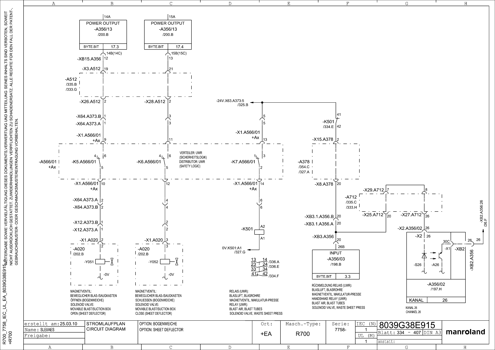

# +EA — Sheet 334 of 407 — OPTION: BOGENWEICHE

**OPTION: SHEET DEFLECTOR**

> Part of the manroland **R700** printing press IEC/UL circuit diagrams.
> Drawing class: **Stromlaufplan / Circuit diagram** (DIN A3).
> Document `+EA` covers the **Printing unit** machine section.

## At a glance

| Field | Value |
|---|---|
| Document | `+EA`  (8039G38E915) |
| Sheet | **334** of 407 |
| Section (DE) | OPTION: BOGENWEICHE |
| Section (EN) | OPTION: SHEET DEFLECTOR |
| Section type | CIRCUIT — Circuit diagram |
| Machine type | `R700` |
| Series | `7758` |
| Created | 25.03.10 |
| Replaces | — |
| Columns used | A, B, C, D, E, F, G, H |
| Path numbers | — |
| Labels on sheet | 190 |
| Cross-refs out | 19 |
| Cross-refs in | 60 |

**Previous:** [+EA sheet 333](SHEET_0333.md) · **Next:** [+EA sheet 335](SHEET_0335.md) · **Document TOC:** [_TOC.md](_TOC.md)  (+EA) · **Master TOC:** [all sheets](../_MASTER_TOC.md)

## Sheet image (300 DPI, exact vector render)



_Rendered directly from the PDF vector layer at 300 DPI (1-bit), no OCR and no resampling. Use it to confirm anything ambiguous in the text below._

## Cross-references on this sheet

Each entry is a wire leaving this sheet. The printed token is `/sheet.column`; the link resolves to that sheet inside the same document.

| Ref | Target sheet | Col | Path | Destination on target | Target section | From col |
|---|---|---|---|---|---|---|
| `/200.B` | [+EA sheet 200](SHEET_0200.md) | B | — | — | REFERENZMODUL | B |
| `/200.B` | [+EA sheet 200](SHEET_0200.md) | B | — | — | REFERENZMODUL | C |
| `/335.B` | [+EA sheet 335](SHEET_0335.md) | B | — | — | OPTION: BOGENWEICHE | A |
| `/333.G` | [+EA sheet 333](SHEET_0333.md) | G | — | — | OPTION: BOGENWEICHE | A |
| `/325.B` | [+EA sheet 325](SHEET_0325.md) | B | — | 24V.X63.A373:5 | OPTION: BOGENWEICHE | D |
| `/334.E` | [+EA sheet 334](SHEET_0334.md) | E | — | — | OPTION: BOGENWEICHE | F |
| `/354.C` | [+EA sheet 354](SHEET_0354.md) | C | — | — | OPTION: VORBEREITUNG: PUDERABSAUGUNG | E |
| `/327.A` | [+EA sheet 327](SHEET_0327.md) | A | — | — | OPTION: BOGENWEICHE | E |
| `/26.F` | [+EA sheet 26](SHEET_0026.md) | F | — | XB2.A356:26 | BUSVERBINDUNGEN: SICHERHEITSBUS | H |
| `/335.C` | [+EA sheet 335](SHEET_0335.md) | C | — | — | OPTION: BOGENWEICHE | F |
| `/333.H` | [+EA sheet 333](SHEET_0333.md) | H | — | — | OPTION: BOGENWEICHE | F |
| `/327.G` | [+EA sheet 327](SHEET_0327.md) | G | — | 0V.K501:A1 | OPTION: BOGENWEICHE | D |
| `/202.B` | [+EA sheet 202](SHEET_0202.md) | B | — | A020 | REFERENZMODUL | A |
| `/202.B` | [+EA sheet 202](SHEET_0202.md) | B | — | A020 | REFERENZMODUL | C |
| `/336.A` | [+EA sheet 336](SHEET_0336.md) | A | — | — | OPTION: BOGENWEICHE | E |
| `/336.E` | [+EA sheet 336](SHEET_0336.md) | E | — | — | OPTION: BOGENWEICHE | E |
| `/198.B` | [+EA sheet 198](SHEET_0198.md) | B | — | — | REFERENZMODUL | F |
| `/334.F` | [+EA sheet 334](SHEET_0334.md) | F | — | — | OPTION: BOGENWEICHE | E |
| `/197.H` | [+EA sheet 197](SHEET_0197.md) | H | — | — | REFERENZMODUL | H |

### Incoming references (sheets that point here)

Every other sheet that sends a wire to this one. `Back-ref` is the token printed on *that* sheet; `Path` is its line number.

| From sheet | Cols | Back-ref | Path | Refs | What continues there |
|---|---|---|---|---|---|
| [+EA#26](SHEET_0026.md) | F | `/26.F` | — | 1 | XB2.A356:26 |
| [+EA#197](SHEET_0197.md) | H | `/197.H` | — | 1 | — |
| [+EA#198](SHEET_0198.md) | B | `/198.B` | — | 1 | — |
| [+EA#200](SHEET_0200.md) | B | `/200.B` | — | 2 | — |
| [+EA#202](SHEET_0202.md) | B | `/202.B` | — | 2 | — |
| [+EA#206](SHEET_0206.md) | B | `/206.B` | — | 2 | — |
| [+EA#211](SHEET_0211.md) | H | `/211.H` | — | 6 | — |
| [+EA#225](SHEET_0225.md) | G | `/225.G` | — | 1 | — |
| [+EA#226](SHEET_0226.md) | F | `/226.F` | — | 1 | — |
| [+EA#234](SHEET_0234.md) | H | `/234.H` | — | 1 | — |
| [+EA#235](SHEET_0235.md) | A, B, E | `/235.A`, `/235.B`, `/235.E` | — | 4 | — |
| [+EA#250](SHEET_0250.md) | D | `/250.D` | — | 1 | — |
| [+EA#257](SHEET_0257.md) | F | `/257.F` | — | 4 | — |
| [+EA#261](SHEET_0261.md) | A, B | `/261.A`, `/261.B` | — | 3 | — |
| [+EA#268](SHEET_0268.md) | F | `/268.F` | — | 1 | — |
| [+EA#269](SHEET_0269.md) | G | `/269.G` | — | 1 | — |
| [+EA#271](SHEET_0271.md) | H | `/271.H` | — | 1 | — |
| [+EA#272](SHEET_0272.md) | F | `/272.F` | — | 1 | — |
| [+EA#274](SHEET_0274.md) | G | `/274.G` | — | 2 | — |
| [+EA#284](SHEET_0284.md) | C, E | `/284.C`, `/284.E` | — | 12 | — |
| [+EA#325](SHEET_0325.md) | B | `/325.B` | — | 1 | 24V.X63.A373:5 |
| [+EA#327](SHEET_0327.md) | A, G | `/327.A`, `/327.G` | — | 2 | — |
| [+EA#333](SHEET_0333.md) | G, H | `/333.G`, `/333.H` | — | 2 | — |
| [+EA#334](SHEET_0334.md) | E, F | `/334.E`, `/334.F` | — | 2 | — |
| [+EA#335](SHEET_0335.md) | B, C | `/335.B`, `/335.C` | — | 2 | — |
| [+EA#336](SHEET_0336.md) | A, E | `/336.A`, `/336.E` | — | 2 | — |
| [+EA#354](SHEET_0354.md) | C | `/354.C` | — | 1 | — |


## Devices on this sheet

| Tag | Class | Class meaning (IEC) | Col | Sub | Terminal | Sign |
|---|---|---|---|---|---|---|
| `A566/01` | A | Baugruppe / assembly, module, PC board | A | 01 | — | — |
| `Y051` | Y | Magnetventil / solenoid valve, actuator | B | — | — | — |
| `A020` | A | Baugruppe / assembly, module, PC board | A | — | — | — |
| `Y052` | Y | Magnetventil / solenoid valve, actuator | C | — | — | — |
| `A020` | A | Baugruppe / assembly, module, PC board | C | — | — | — |
| `A512` | A | Baugruppe / assembly, module, PC board | A | — | — | — |
| `A356/13` | A | Baugruppe / assembly, module, PC board | B | 13 | — | — |
| `A356/13` | A | Baugruppe / assembly, module, PC board | C | 13 | — | — |
| `A2` | A | Baugruppe / assembly, module, PC board | E | — | — | — |
| `A1` | A | Baugruppe / assembly, module, PC board | E | — | — | — |
| `K501` | K | Relais / relay, contactor | D | — | — | — |
| `K501` | K | Relais / relay, contactor | F | — | — | — |
| `A356/03` | A | Baugruppe / assembly, module, PC board | F | 03 | — | — |
| `A378` | A | Baugruppe / assembly, module, PC board | E | — | — | — |
| `S26` | S | Schalter / switch | G | — | — | — |
| `A26` | A | Baugruppe / assembly, module, PC board | G | — | — | — |
| `X1` | X | Klemme / terminal, plug connector | H | — | — | — |
| `X2` | X | Klemme / terminal, plug connector | G | — | — | — |
| `XB2` | XB |  | H | — | — | — |
| `A356/02` | A | Baugruppe / assembly, module, PC board | G | 02 | — | — |
| `A712` | A | Baugruppe / assembly, module, PC board | F | — | — | — |
| `X1.A020` | — | cross-device reference | B | — | — | — |
| `X12.A373.B` | — | cross-device reference | B | — | — | — |
| `X12.A373.A` | — | cross-device reference | B | — | — | — |
| `X1.A020` | — | cross-device reference | C | — | — | — |
| `X64.A373.B` | — | cross-device reference | B | — | — | — |
| `X64.A373.A` | — | cross-device reference | B | — | — | — |
| `X3.A512` | — | cross-device reference | B | — | — | — |
| `X26.A512` | — | cross-device reference | B | — | — | — |
| `X28.A512` | — | cross-device reference | C | — | — | — |
| `17.3` | — | cross-device reference | B | — | — | — |
| `XB15.A356` | — | cross-device reference | B | — | — | — |
| `17.4` | — | cross-device reference | C | — | — | — |
| `3.3` | — | cross-device reference | F | — | — | — |
| `XB3.A356` | — | cross-device reference | F | — | — | — |
| `X8.A378` | — | cross-device reference | F | — | — | — |
| `X15.A378` | — | cross-device reference | F | — | — | — |
| `X64.A373.B` | — | cross-device reference | B | — | — | — |
| `X64.A373.A` | — | cross-device reference | B | — | — | — |
| `XB3.1.A356.B` | — | cross-device reference | F | — | — | — |
| `XB3.1.A356.A` | — | cross-device reference | F | — | — | — |
| `XB2.A356` | — | cross-device reference | H | — | — | — |
| `X29.A712` | — | cross-device reference | F | — | — | — |
| `X27.A712` | — | cross-device reference | G | — | — | — |
| `X25.A712` | — | cross-device reference | F | — | — | — |
| `XB2.A356:26` | — | cross-device reference | H | — | 26 | — |

## Potentials / nets

| Potential | Count | Columns | Attached devices | Terminals |
|---|---|---|---|---|
| `0V` | 3 | B, C, D | `K501` | `A1` |
| `24V` | 1 | D | `A373`, `X63` | `5` |


A potential such as `L24+/4` or `M24+` is a named supply/return rail; every place it appears on this sheet is electrically common.

## Wire-end annotations (grouped as printed)

A wire that continues elsewhere is annotated with a small cluster: the destination description, the path/line number `#NN`, and the `/sheet.column` cross reference. Each row below is one such cluster exactly as it is grouped on the drawing.

| Col | Y | Path | Cross-ref | Text on the wire |
|---|---|---|---|---|
| B | 36.4 | — | — | `14A` |
| C | 36.4 | — | — | `15A` |
| B | 51.6 | — | — | `POWER OUTPUT` |
| C | 51.6 | — | — | `POWER OUTPUT` |
| B | 65.5 | — | — | `A356/13` |
| C | 65.5 | — | — | `A356/13` |
| B | 79.3 | — | `/200.B` | — |
| C | 79.3 | — | `/200.B` | — |
| B | 108.3 | — | — | `BYTE.BIT 17.3` |
| C | 108.3 | — | — | `BYTE.BIT 17.4` |
| B | 124.3 | — | — | `14B(14C)` |
| C | 124.3 | — | — | `15B(15C)` |
| B | 136.4 | — | — | `XB15.A356 12` |
| C | 136.4 | — | — | `13` |
| B | 160.5 | — | — | `X3.A512 19` |
| C | 161.9 | — | — | `21` |
| A | 186.0 | — | — | `A512` |
| A | 199.0 | — | `/335.B`, `/333.G` | — |
| D | 238.4 | — | `/325.B` | `24V.X63.A373:5` |
| B | 239.8 | — | — | `X26.A512 2` |
| C | 239.8 | — | — | `X28.A512 2` |
| F | 271.7 | — | — | `41` |
| B | 275.3 | — | — | `X64.A373.B 1` |
| C | 275.3 | — | — | `3` |
| E | 275.3 | — | — | `5` |
| F | 288.0 | — | — | `K501 42` |
| B | 292.3 | — | — | `X64.A373.A 1` |
| C | 292.3 | — | — | `3` |
| E | 292.3 | — | — | `5` |
| F | 301.1 | — | `/334.E` | — |
| D | 313.5 | — | — | `X1.A566/01` |
| B | 320.6 | — | — | `X1.A566/01 9` |
| D | 326.3 | — | — | `+Ax` |
| F | 330.5 | — | — | `X15.A378 2` |
| C | 332.0 | — | — | `11` |
| E | 332.0 | — | — | `13` |
| B | 333.4 | — | — | `+Ax` |
| C | 364.9 | — | — | `DISTRIBUTOR: UWR (SICHERHEITSLOGIK) (SAFETY LOGIC) VERTEILER: UWR` |
| B | 370.9 | — | — | `K5.A566/01 6` |
| B | 370.9 | — | — | `4` |
| C | 370.9 | — | — | `K6.A566/01 6` |
| C | 370.9 | — | — | `4` |
| D | 370.9 | — | — | `K7.A566/01 3` |
| D | 370.9 | — | — | `1` |
| A | 384.4 | — | — | `A566/01` |
| E | 384.4 | — | — | `A378` |
| A | 397.2 | — | — | `+Ax` |
| E | 397.5 | — | `/354.C`, `/327.A` | — |
| B | 399.3 | — | — | `5` |
| C | 399.3 | — | — | `5` |
| E | 399.3 | — | — | `2` |
| B | 436.8 | — | — | `X1.A566/01 10` |
| D | 436.8 | — | — | `X1.A566/01 14` |
| C | 438.3 | — | — | `12` |
| F | 438.3 | — | — | `X8.A378 20` |
| B | 449.6 | — | — | `+Ax` |
| D | 449.6 | — | — | `+Ax` |
| G | 452.4 | — | — | `X29.A712 7 8` |
| F | 469.4 | — | — | `A712` |
| B | 475.8 | — | — | `X64.A373.A 2` |
| C | 478.0 | — | — | `4` |
| E | 478.0 | — | — | `6` |
| H | 481.3 | — | `/26.F` | `XB2.A356:26` |
| F | 482.5 | — | `/335.C` | — |
| B | 493.5 | — | — | `X64.A373.B 2` |
| F | 494.9 | — | `/333.H` | — |
| C | 495.0 | — | — | `4` |
| E | 495.0 | — | — | `6` |
| G | 512.0 | — | — | `X25.A712 20 X27.A712 26` |
| F | 516.2 | — | — | `XB3.1.A356.B 20` |
| B | 530.4 | — | — | `X12.A373.B 1` |
| C | 530.4 | — | — | `2` |
| F | 533.2 | — | — | `XB3.1.A356.A 20` |
| E | 541.0 | — | — | `A2` |
| G | 544.6 | — | — | `X2.A356/02 26` |
| D | 546.0 | — | — | `K501` |
| B | 547.4 | — | — | `X12.A373.A 1` |
| C | 547.4 | — | — | `2` |
| G | 563.0 | — | — | `X2` |
| F | 564.4 | — | — | `XB3.A356 20` |
| H | 564.4 | — | — | `26 26` |
| E | 569.3 | — | — | `A1` |
| B | 572.9 | — | — | `X1.A020 2` |
| C | 572.9 | — | — | `X1.A020 3` |
| H | 572.9 | — | — | `26` |
| H | 577.2 | — | — | `30C` |
| B | 588.5 | — | — | `2` |
| C | 588.5 | — | — | `3` |
| F | 589.9 | — | — | `26B` |
| D | 592.7 | — | `/327.G` | `0V.K501:A1` |
| H | 594.1 | — | — | `X1` |
| A | 594.2 | — | `/202.B` | `A020` |
| C | 594.2 | — | `/202.B` | `A020` |
| H | 594.2 | — | — | `XB2` |
| H | 600.4 | — | — | `XB2.A356` |
| F | 604.4 | — | — | `INPUT` |
| F | 618.3 | — | — | `A356/03` |
| D | 619.6 | — | — | `13 14` |
| B | 626.0 | — | — | `Y051` |
| C | 626.0 | — | — | `Y052` |
| E | 626.0 | — | `/336.A`, `/336.E` | — |
| E | 631.0 | — | — | `23 33 34 24` |
| F | 632.0 | — | `/198.B` | — |
| G | 633.1 | — | — | `S26 A26` |
| E | 653.7 | — | — | `41 42` |
| B | 656.5 | — | — | `0V` |
| C | 656.5 | — | — | `0V` |
| E | 660.0 | — | `/334.F` | — |
| F | 661.1 | — | — | `BYTE.BIT 3.3` |
| G | 679.2 | — | — | `A356/02` |
| F | 683.8 | — | — | `RÜCKMELDUNG RELAIS (UWR): BLASLUFT, BLASROHRE HANDSHAKE RELAY (UWR): BLAST AIR, BLAST TUBES MAGNETVENTIL, MAKULATUR PRESSE` |
| H | 691.6 | — | `/197.H` | — |
| B | 697.9 | — | — | `BEWEGLICHER BLAS /SAUGKASTEN MAGNETVENTIL:` |
| C | 697.9 | — | — | `BEWEGLICHER BLAS /SAUGKASTEN MAGNETVENTIL:` |
| D | 697.9 | — | — | `RELAIS (UWR): BLASLUFT, BLASROHRE RELAY (UWR): BLAST AIR, BLAST TUBES MAGNETVENTIL, MAKULATUR PRESSE` |
| G | 717.4 | — | — | `KANAL 26` |
| B | 719.2 | — | — | `MOVABLE BLAST/SUCTION BOX ÖFFNEN (BOGENWEICHE) SOLENOID VALVE: OPEN (SHEET DEFLECTOR)` |
| C | 719.2 | — | — | `MOVABLE BLAST/SUCTION BOX SCHLIESSEN (BOGENWEICHE) SOLENOID VALVE: CLOSE (SHEET DEFLECTOR)` |
| F | 736.9 | — | — | `SOLENOID VALVE, WASTE SHEET PRESS` |
| G | 737.8 | — | — | `KANAL 26 CHANNEL 26` |
| D | 751.1 | — | — | `SOLENOID VALVE, WASTE SHEET PRESS` |


## Reconstructed tables

This sheet carries tabular content (pin map / terminal assignment / index). The grid below was rebuilt from the drawing's own rule lines, so each row is exactly one physical row of the table.

### Table 1 — 2 data rows × 1 columns (at x=191.3, y=48.2)

| C1 |
|---|
| `POWER` |
| `BYTE.BIT` |


### Table 2 — 2 data rows × 1 columns (at x=248.0, y=48.2)

| C1 |
|---|
| `OUTPUT A356/13 /200.B` |
| `17.3` |


### Table 3 — 2 data rows × 1 columns (at x=347.2, y=48.2)

| C1 |
|---|
| `POWER` |
| `BYTE.BIT` |


### Table 4 — 2 data rows × 1 columns (at x=403.9, y=48.2)

| C1 |
|---|
| `OUTPUT A356/13 /200.B` |
| `17.4` |


### Table 5 — 6 data rows × 9 columns (at x=751.2, y=246.6)

| K501 /334.E X15.A378 X8.A378 | 41 42 2 20 |  |  |  |  |  |  |  |
|---|---|---|---|---|---|---|---|---|
| `XB3.1.A356.B XB3.1.A356.A` | `A712 /335.C /333.H 20 20` | `X29.A712 X25.A712` | `7 20` | `X27.A712 X2.A356/02` | `8 26 26` |  |  | `XB2.A356:26` |
| `XB3.A356` | `20 26B` |  |  | `X2` | `26` | `30C X1` | `XB2` | `26 26` |
| `INPUT` | `A356/03 /198.B` |  |  | `S26` | `A26` |  |  | `XB2.A356` |
| `BYTE.BIT` | `3.3` |  |  |  |  |  |  |  |
| `RÜCKMELDUNG BLASLUFT, BLASROHRE MAGNETVENTIL,` | `RELAIS (UWR): MAKULATUR PRESSE` |  |  |  | `A356/02 /197.H` |  |  |  |
| `HANDSHAKE RELAY` | `(UWR):` |  |  | `KANAL` |  | `26` |  |  |


## Notes and free text on this sheet

| Text | Col | Y (pt) |
|---|---|---|
| `+Ax` | A | 397.19 |
| `VERTEILER: UWR` | C | 364.85 |
| `(SICHERHEITSLOGIK)` | C | 375.51 |
| `DISTRIBUTOR: UWR` | C | 386.12 |
| `(SAFETY LOGIC)` | C | 396.76 |
| `MAGNETVENTIL:` | A | 697.94 |
| `BEWEGLICHER BLAS /SAUGKASTEN` | B | 708.56 |
| `ÖFFNEN (BOGENWEICHE)` | B | 719.2 |
| `SOLENOID VALVE:` | A | 729.83 |
| `MOVABLE BLAST/SUCTION BOX` | B | 740.48 |
| `OPEN (SHEET DEFLECTOR)` | B | 751.12 |
| `K5.A566/01` | B | 384.4 |
| `X1.A566/01` | B | 320.62 |
| `+Ax` | B | 333.41 |
| `MAGNETVENTIL:` | C | 697.94 |
| `BEWEGLICHER BLAS /SAUGKASTEN` | C | 708.56 |
| `SCHLIESSEN (BOGENWEICHE)` | C | 719.2 |
| `SOLENOID VALVE:` | C | 729.83 |
| `MOVABLE BLAST/SUCTION BOX` | C | 740.48 |
| `CLOSE (SHEET DEFLECTOR)` | C | 751.12 |
| `K6.A566/01` | C | 384.4 |
| `14A` | B | 36.43 |
| `14B(14C)` | B | 124.34 |
| `POWER OUTPUT` | B | 51.59 |
| `BYTE.BIT` | B | 108.91 |
| `15A` | C | 36.43 |
| `15B(15C)` | C | 124.34 |
| `POWER OUTPUT` | C | 51.59 |
| `BYTE.BIT` | C | 108.91 |
| `K7.A566/01` | D | 384.4 |
| `X1.A566/01` | D | 313.54 |
| `+Ax` | D | 326.32 |
| `RELAIS (UWR):` | D | 697.9 |
| `BLASLUFT, BLASROHRE` | D | 708.57 |
| `MAGNETVENTIL, MAKULATUR PRESSE` | D | 719.22 |
| `RELAY (UWR):` | D | 729.8 |
| `BLAST AIR, BLAST TUBES` | D | 740.45 |
| `SOLENOID VALVE, WASTE SHEET PRESS` | D | 751.08 |
| `26B` | F | 589.89 |
| `INPUT` | F | 604.42 |
| `BYTE.BIT` | F | 661.67 |
| `RÜCKMELDUNG RELAIS (UWR):` | F | 683.77 |
| `BLASLUFT, BLASROHRE` | F | 694.4 |
| `MAGNETVENTIL, MAKULATUR PRESSE` | F | 705.05 |
| `HANDSHAKE RELAY (UWR):` | F | 715.65 |
| `BLAST AIR, BLAST TUBES` | F | 726.28 |
| `SOLENOID VALVE, WASTE SHEET PRESS` | F | 736.91 |
| `KANAL 26` | G | 737.79 |
| `CHANNEL 26` | G | 747.74 |
| `30C` | H | 577.18 |
| `KANAL` | G | 717.46 |
| `X2.A356/02` | G | 544.56 |

## Complete label inventory (exact text from the drawing)

Every text object inside the drawing area of this sheet, in DIN reading order (column A→H, then top→bottom). This is the authoritative list: if a string is not here it is not printed on this sheet.

| Col | Y | X | Dir | Type | Text |
|---|---|---|---|---|---|
| A | 186.0 | 156.5 | → | device tag | `A512` |
| A | 199.0 | 159.0 | → | cross-reference | `/335.B` |
| A | 211.5 | 158.5 | → | cross-reference | `/333.G` |
| A | 384.4 | 93.5 | → | device tag | `A566/01` |
| A | 397.2 | 116.2 | → | text | `+Ax` |
| A | 594.2 | 175.5 | → | device tag | `A020` |
| A | 607.2 | 175.7 | → | cross-reference | `/202.B` |
| A | 697.9 | 169.5 | → | text | `MAGNETVENTIL:` |
| A | 729.8 | 169.8 | → | text | `SOLENOID VALVE:` |
| B | 36.4 | 250.0 | → | text | `14A` |
| B | 51.6 | 207.2 | → | text | `POWER OUTPUT` |
| B | 65.5 | 226.6 | → | device tag | `A356/13` |
| B | 79.3 | 235.4 | → | cross-reference | `/200.B` |
| B | 108.3 | 266.6 | → | device ref | `17.3` |
| B | 108.9 | 201.3 | → | text | `BYTE.BIT` |
| B | 124.3 | 255.7 | → | text | `14B(14C)` |
| B | 136.4 | 250.0 | → | number | `12` |
| B | 137.1 | 185.7 | → | device ref | `XB15.A356` |
| B | 160.5 | 197.3 | → | device ref | `X3.A512` |
| B | 161.9 | 250.0 | → | number | `19` |
| B | 239.8 | 191.3 | → | device ref | `X26.A512` |
| B | 239.9 | 250.6 | → | number | `2` |
| B | 275.3 | 182.8 | → | device ref | `X64.A373.B` |
| B | 275.3 | 250.0 | → | number | `1` |
| B | 292.3 | 250.0 | → | number | `1` |
| B | 293.0 | 182.0 | → | device ref | `X64.A373.A` |
| B | 320.6 | 184.0 | → | text | `X1.A566/01` |
| B | 332.0 | 250.6 | → | number | `9` |
| B | 333.4 | 222.5 | → | text | `+Ax` |
| B | 371.0 | 226.5 | → | number | `4` |
| B | 371.0 | 250.6 | → | number | `6` |
| B | 384.4 | 172.6 | → | text | `K5.A566/01` |
| B | 399.3 | 243.5 | → | number | `5` |
| B | 436.8 | 178.3 | → | text | `X1.A566/01` |
| B | 438.3 | 242.9 | → | number | `10` |
| B | 449.6 | 216.9 | → | text | `+Ax` |
| B | 475.8 | 174.9 | → | device ref | `X64.A373.A` |
| B | 478.0 | 243.5 | → | number | `2` |
| B | 493.5 | 175.7 | → | device ref | `X64.A373.B` |
| B | 495.0 | 243.5 | → | number | `2` |
| B | 530.4 | 175.7 | → | device ref | `X12.A373.B` |
| B | 530.4 | 242.9 | → | number | `1` |
| B | 547.4 | 242.9 | → | number | `1` |
| B | 548.1 | 174.9 | → | device ref | `X12.A373.A` |
| B | 572.9 | 191.6 | → | device ref | `X1.A020` |
| B | 572.9 | 243.5 | → | number | `2` |
| B | 588.5 | 243.5 | → | number | `2` |
| B | 626.1 | 202.4 | → | device tag | `Y051` |
| B | 656.5 | 249.2 | → | potential | `0V` |
| B | 708.6 | 169.2 | → | text | `BEWEGLICHER BLAS /SAUGKASTEN` |
| B | 719.2 | 169.8 | → | text | `ÖFFNEN (BOGENWEICHE)` |
| B | 740.5 | 169.5 | → | text | `MOVABLE BLAST/SUCTION BOX` |
| B | 751.1 | 169.8 | → | text | `OPEN (SHEET DEFLECTOR)` |
| C | 36.4 | 405.9 | → | text | `15A` |
| C | 51.6 | 363.1 | → | text | `POWER OUTPUT` |
| C | 65.5 | 382.5 | → | device tag | `A356/13` |
| C | 79.3 | 391.3 | → | cross-reference | `/200.B` |
| C | 108.3 | 422.5 | → | device ref | `17.4` |
| C | 108.9 | 357.2 | → | text | `BYTE.BIT` |
| C | 124.3 | 411.6 | → | text | `15B(15C)` |
| C | 136.4 | 405.9 | → | number | `13` |
| C | 161.9 | 406.5 | → | number | `21` |
| C | 239.8 | 347.2 | → | device ref | `X28.A512` |
| C | 239.9 | 406.5 | → | number | `2` |
| C | 275.3 | 406.5 | → | number | `3` |
| C | 292.3 | 406.5 | → | number | `3` |
| C | 332.0 | 405.9 | → | number | `11` |
| C | 364.9 | 432.3 | → | text | `VERTEILER: UWR` |
| C | 371.0 | 382.4 | → | number | `4` |
| C | 371.0 | 406.5 | → | number | `6` |
| C | 375.5 | 431.7 | → | text | `(SICHERHEITSLOGIK)` |
| C | 384.4 | 328.5 | → | text | `K6.A566/01` |
| C | 386.1 | 431.4 | → | text | `DISTRIBUTOR: UWR` |
| C | 396.8 | 431.7 | → | text | `(SAFETY LOGIC)` |
| C | 399.3 | 399.4 | → | number | `5` |
| C | 438.3 | 398.8 | → | number | `12` |
| C | 478.0 | 399.4 | → | number | `4` |
| C | 495.0 | 399.4 | → | number | `4` |
| C | 530.4 | 399.4 | → | number | `2` |
| C | 547.4 | 399.4 | → | number | `2` |
| C | 572.9 | 347.5 | → | device ref | `X1.A020` |
| C | 572.9 | 399.4 | → | number | `3` |
| C | 588.5 | 399.4 | → | number | `3` |
| C | 594.2 | 331.4 | → | device tag | `A020` |
| C | 607.2 | 331.7 | → | cross-reference | `/202.B` |
| C | 626.1 | 357.2 | → | device tag | `Y052` |
| C | 656.5 | 405.1 | → | potential | `0V` |
| C | 697.9 | 325.4 | → | text | `MAGNETVENTIL:` |
| C | 708.6 | 325.1 | → | text | `BEWEGLICHER BLAS /SAUGKASTEN` |
| C | 719.2 | 325.7 | → | text | `SCHLIESSEN (BOGENWEICHE)` |
| C | 729.8 | 325.7 | → | text | `SOLENOID VALVE:` |
| C | 740.5 | 325.4 | → | text | `MOVABLE BLAST/SUCTION BOX` |
| C | 751.1 | 325.7 | → | text | `CLOSE (SHEET DEFLECTOR)` |
| D | 238.4 | 520.2 | → | potential | `24V.X63.A373:5` |
| D | 248.3 | 571.5 | → | cross-reference | `/325.B` |
| D | 313.5 | 566.6 | → | text | `X1.A566/01` |
| D | 326.3 | 605.2 | → | text | `+Ax` |
| D | 371.0 | 610.6 | → | number | `1` |
| D | 384.4 | 555.3 | → | text | `K7.A566/01` |
| D | 436.8 | 561.0 | → | text | `X1.A566/01` |
| D | 449.6 | 599.5 | → | text | `+Ax` |
| D | 546.0 | 580.3 | → | device tag | `K501` |
| D | 592.7 | 534.3 | → | potential | `0V.K501:A1` |
| D | 602.6 | 563.8 | → | cross-reference | `/327.G` |
| D | 619.6 | 603.8 | → | number | `13` |
| D | 631.0 | 603.8 | → | number | `23` |
| D | 642.3 | 603.8 | → | number | `33` |
| D | 653.7 | 605.2 | → | number | `41` |
| D | 697.9 | 551.9 | → | text | `RELAIS (UWR):` |
| D | 708.6 | 551.9 | → | text | `BLASLUFT, BLASROHRE` |
| D | 719.2 | 552.2 | → | text | `MAGNETVENTIL, MAKULATUR PRESSE` |
| D | 729.8 | 551.9 | → | text | `RELAY (UWR):` |
| D | 740.4 | 551.9 | → | text | `BLAST AIR, BLAST TUBES` |
| D | 751.1 | 552.5 | → | text | `SOLENOID VALVE, WASTE SHEET PRESS` |
| E | 275.3 | 633.3 | → | number | `5` |
| E | 292.3 | 633.3 | → | number | `5` |
| E | 332.0 | 632.7 | → | number | `13` |
| E | 371.0 | 633.3 | → | number | `3` |
| E | 384.4 | 716.3 | → | device tag | `A378` |
| E | 397.5 | 718.6 | → | cross-reference | `/354.C` |
| E | 399.3 | 626.2 | → | number | `2` |
| E | 409.9 | 718.6 | → | cross-reference | `/327.A` |
| E | 438.3 | 625.6 | → | number | `14` |
| E | 478.0 | 626.2 | → | number | `6` |
| E | 495.0 | 626.2 | → | number | `6` |
| E | 541.0 | 626.5 | → | device tag | `A2` |
| E | 569.3 | 626.5 | → | device tag | `A1` |
| E | 619.6 | 631.0 | → | number | `14` |
| E | 626.0 | 646.3 | → | cross-reference | `/336.A` |
| E | 631.0 | 631.8 | → | number | `24` |
| E | 637.4 | 646.3 | → | cross-reference | `/336.E` |
| E | 642.3 | 631.6 | → | number | `34` |
| E | 653.7 | 631.8 | → | number | `42` |
| E | 660.0 | 646.3 | → | cross-reference | `/334.F` |
| F | 271.7 | 810.4 | → | number | `41` |
| F | 288.0 | 775.8 | → | device tag | `K501` |
| F | 300.1 | 810.4 | → | number | `42` |
| F | 301.1 | 777.3 | → | cross-reference | `/334.E` |
| F | 330.5 | 751.2 | → | device ref | `X15.A378` |
| F | 332.0 | 810.4 | → | number | `2` |
| F | 438.3 | 757.1 | → | device ref | `X8.A378` |
| F | 438.3 | 810.4 | → | number | `20` |
| F | 452.4 | 873.1 | → | device ref | `X29.A712` |
| F | 469.4 | 829.7 | → | device tag | `A712` |
| F | 482.5 | 832.0 | → | cross-reference | `/335.C` |
| F | 494.9 | 832.5 | → | cross-reference | `/333.H` |
| F | 512.0 | 871.7 | → | device ref | `X25.A712` |
| F | 516.2 | 732.8 | → | device ref | `XB3.1.A356.B` |
| F | 516.2 | 810.4 | → | number | `20` |
| F | 533.2 | 810.4 | → | number | `20` |
| F | 533.9 | 731.9 | → | device ref | `XB3.1.A356.A` |
| F | 564.4 | 751.5 | → | device ref | `XB3.A356` |
| F | 572.9 | 810.4 | → | number | `20` |
| F | 589.9 | 813.3 | → | text | `26B` |
| F | 604.4 | 793.0 | → | text | `INPUT` |
| F | 618.3 | 786.5 | → | device tag | `A356/03` |
| F | 632.0 | 795.3 | → | cross-reference | `/198.B` |
| F | 661.1 | 829.4 | → | device ref | `3.3` |
| F | 661.7 | 761.1 | → | text | `BYTE.BIT` |
| F | 683.8 | 750.3 | → | text | `RÜCKMELDUNG RELAIS (UWR):` |
| F | 694.4 | 750.3 | → | text | `BLASLUFT, BLASROHRE` |
| F | 705.0 | 750.6 | → | text | `MAGNETVENTIL, MAKULATUR PRESSE` |
| F | 715.7 | 750.3 | → | text | `HANDSHAKE RELAY (UWR):` |
| F | 726.3 | 750.3 | → | text | `BLAST AIR, BLAST TUBES` |
| F | 736.9 | 750.9 | → | text | `SOLENOID VALVE, WASTE SHEET PRESS` |
| G | 452.5 | 930.9 | → | number | `7` |
| G | 452.5 | 1023.0 | → | number | `8` |
| G | 512.0 | 963.8 | → | device ref | `X27.A712` |
| G | 516.2 | 930.9 | → | number | `20` |
| G | 516.2 | 1023.0 | → | number | `26` |
| G | 544.6 | 956.4 | → | text | `X2.A356/02` |
| G | 544.6 | 1023.0 | → | number | `26` |
| G | 563.0 | 998.9 | → | device tag | `X2` |
| G | 564.4 | 1025.9 | → | number | `26` |
| G | 633.1 | 995.2 | → | device tag | `S26` |
| G | 633.1 | 1037.8 | → | device tag | `A26` |
| G | 679.2 | 1027.4 | → | device tag | `A356/02` |
| G | 717.5 | 984.2 | → | text | `KANAL` |
| G | 737.8 | 976.0 | → | text | `KANAL 26` |
| G | 747.7 | 976.3 | → | text | `CHANNEL 26` |
| H | 481.3 | 1154.0 | ↕ | device ref | `XB2.A356:26` |
| H | 525.5 | 1163.9 | ↕ | cross-reference | `/26.F` |
| H | 572.9 | 1145.8 | → | number | `26` |
| H | 574.3 | 1125.1 | → | number | `26` |
| H | 577.2 | 1065.8 | → | text | `30C` |
| H | 594.2 | 1069.5 | → | device tag | `X1` |
| H | 594.2 | 1093.9 | → | device tag | `XB2` |
| H | 600.4 | 1129.9 | ↕ | device ref | `XB2.A356` |
| H | 691.6 | 1036.3 | → | cross-reference | `/197.H` |
| H | 717.4 | 1064.3 | → | number | `26` |

## Reading-order text block

The same content as a plain block, grouped by DIN column — convenient to paste or to match against a visual description.

```text
=== Column A ===
 186.0  156.5  devtag       A512
 199.0  159.0  xref         /335.B
 211.5  158.5  xref         /333.G
 384.4   93.5  devtag       A566/01
 397.2  116.2  text         +Ax
 594.2  175.5  devtag       A020
 607.2  175.7  xref         /202.B
 697.9  169.5  text         MAGNETVENTIL:
 729.8  169.8  text         SOLENOID VALVE:
=== Column B ===
  36.4  250.0  text         14A
  51.6  207.2  text         POWER OUTPUT
  65.5  226.6  devtag       A356/13
  79.3  235.4  xref         /200.B
 108.3  266.6  devref       17.3
 108.9  201.3  text         BYTE.BIT
 124.3  255.7  text         14B(14C)
 136.4  250.0  numeric      12
 137.1  185.7  devref       XB15.A356
 160.5  197.3  devref       X3.A512
 161.9  250.0  numeric      19
 239.8  191.3  devref       X26.A512
 239.9  250.6  numeric      2
 275.3  182.8  devref       X64.A373.B
 275.3  250.0  numeric      1
 292.3  250.0  numeric      1
 293.0  182.0  devref       X64.A373.A
 320.6  184.0  text         X1.A566/01
 332.0  250.6  numeric      9
 333.4  222.5  text         +Ax
 371.0  226.5  numeric      4
 371.0  250.6  numeric      6
 384.4  172.6  text         K5.A566/01
 399.3  243.5  numeric      5
 436.8  178.3  text         X1.A566/01
 438.3  242.9  numeric      10
 449.6  216.9  text         +Ax
 475.8  174.9  devref       X64.A373.A
 478.0  243.5  numeric      2
 493.5  175.7  devref       X64.A373.B
 495.0  243.5  numeric      2
 530.4  175.7  devref       X12.A373.B
 530.4  242.9  numeric      1
 547.4  242.9  numeric      1
 548.1  174.9  devref       X12.A373.A
 572.9  191.6  devref       X1.A020
 572.9  243.5  numeric      2
 588.5  243.5  numeric      2
 626.1  202.4  devtag       Y051
 656.5  249.2  net          0V
 708.6  169.2  text         BEWEGLICHER BLAS /SAUGKASTEN
 719.2  169.8  text         ÖFFNEN (BOGENWEICHE)
 740.5  169.5  text         MOVABLE BLAST/SUCTION BOX
 751.1  169.8  text         OPEN (SHEET DEFLECTOR)
=== Column C ===
  36.4  405.9  text         15A
  51.6  363.1  text         POWER OUTPUT
  65.5  382.5  devtag       A356/13
  79.3  391.3  xref         /200.B
 108.3  422.5  devref       17.4
 108.9  357.2  text         BYTE.BIT
 124.3  411.6  text         15B(15C)
 136.4  405.9  numeric      13
 161.9  406.5  numeric      21
 239.8  347.2  devref       X28.A512
 239.9  406.5  numeric      2
 275.3  406.5  numeric      3
 292.3  406.5  numeric      3
 332.0  405.9  numeric      11
 364.9  432.3  text         VERTEILER: UWR
 371.0  382.4  numeric      4
 371.0  406.5  numeric      6
 375.5  431.7  text         (SICHERHEITSLOGIK)
 384.4  328.5  text         K6.A566/01
 386.1  431.4  text         DISTRIBUTOR: UWR
 396.8  431.7  text         (SAFETY LOGIC)
 399.3  399.4  numeric      5
 438.3  398.8  numeric      12
 478.0  399.4  numeric      4
 495.0  399.4  numeric      4
 530.4  399.4  numeric      2
 547.4  399.4  numeric      2
 572.9  347.5  devref       X1.A020
 572.9  399.4  numeric      3
 588.5  399.4  numeric      3
 594.2  331.4  devtag       A020
 607.2  331.7  xref         /202.B
 626.1  357.2  devtag       Y052
 656.5  405.1  net          0V
 697.9  325.4  text         MAGNETVENTIL:
 708.6  325.1  text         BEWEGLICHER BLAS /SAUGKASTEN
 719.2  325.7  text         SCHLIESSEN (BOGENWEICHE)
 729.8  325.7  text         SOLENOID VALVE:
 740.5  325.4  text         MOVABLE BLAST/SUCTION BOX
 751.1  325.7  text         CLOSE (SHEET DEFLECTOR)
=== Column D ===
 238.4  520.2  net          24V.X63.A373:5
 248.3  571.5  xref         /325.B
 313.5  566.6  text         X1.A566/01
 326.3  605.2  text         +Ax
 371.0  610.6  numeric      1
 384.4  555.3  text         K7.A566/01
 436.8  561.0  text         X1.A566/01
 449.6  599.5  text         +Ax
 546.0  580.3  devtag       K501
 592.7  534.3  net          0V.K501:A1
 602.6  563.8  xref         /327.G
 619.6  603.8  numeric      13
 631.0  603.8  numeric      23
 642.3  603.8  numeric      33
 653.7  605.2  numeric      41
 697.9  551.9  text         RELAIS (UWR):
 708.6  551.9  text         BLASLUFT, BLASROHRE
 719.2  552.2  text         MAGNETVENTIL, MAKULATUR PRESSE
 729.8  551.9  text         RELAY (UWR):
 740.4  551.9  text         BLAST AIR, BLAST TUBES
 751.1  552.5  text         SOLENOID VALVE, WASTE SHEET PRESS
=== Column E ===
 275.3  633.3  numeric      5
 292.3  633.3  numeric      5
 332.0  632.7  numeric      13
 371.0  633.3  numeric      3
 384.4  716.3  devtag       A378
 397.5  718.6  xref         /354.C
 399.3  626.2  numeric      2
 409.9  718.6  xref         /327.A
 438.3  625.6  numeric      14
 478.0  626.2  numeric      6
 495.0  626.2  numeric      6
 541.0  626.5  devtag       A2
 569.3  626.5  devtag       A1
 619.6  631.0  numeric      14
 626.0  646.3  xref         /336.A
 631.0  631.8  numeric      24
 637.4  646.3  xref         /336.E
 642.3  631.6  numeric      34
 653.7  631.8  numeric      42
 660.0  646.3  xref         /334.F
=== Column F ===
 271.7  810.4  numeric      41
 288.0  775.8  devtag       K501
 300.1  810.4  numeric      42
 301.1  777.3  xref         /334.E
 330.5  751.2  devref       X15.A378
 332.0  810.4  numeric      2
 438.3  757.1  devref       X8.A378
 438.3  810.4  numeric      20
 452.4  873.1  devref       X29.A712
 469.4  829.7  devtag       A712
 482.5  832.0  xref         /335.C
 494.9  832.5  xref         /333.H
 512.0  871.7  devref       X25.A712
 516.2  732.8  devref       XB3.1.A356.B
 516.2  810.4  numeric      20
 533.2  810.4  numeric      20
 533.9  731.9  devref       XB3.1.A356.A
 564.4  751.5  devref       XB3.A356
 572.9  810.4  numeric      20
 589.9  813.3  text         26B
 604.4  793.0  text         INPUT
 618.3  786.5  devtag       A356/03
 632.0  795.3  xref         /198.B
 661.1  829.4  devref       3.3
 661.7  761.1  text         BYTE.BIT
 683.8  750.3  text         RÜCKMELDUNG RELAIS (UWR):
 694.4  750.3  text         BLASLUFT, BLASROHRE
 705.0  750.6  text         MAGNETVENTIL, MAKULATUR PRESSE
 715.7  750.3  text         HANDSHAKE RELAY (UWR):
 726.3  750.3  text         BLAST AIR, BLAST TUBES
 736.9  750.9  text         SOLENOID VALVE, WASTE SHEET PRESS
=== Column G ===
 452.5  930.9  numeric      7
 452.5 1023.0  numeric      8
 512.0  963.8  devref       X27.A712
 516.2  930.9  numeric      20
 516.2 1023.0  numeric      26
 544.6  956.4  text         X2.A356/02
 544.6 1023.0  numeric      26
 563.0  998.9  devtag       X2
 564.4 1025.9  numeric      26
 633.1  995.2  devtag       S26
 633.1 1037.8  devtag       A26
 679.2 1027.4  devtag       A356/02
 717.5  984.2  text         KANAL
 737.8  976.0  text         KANAL 26
 747.7  976.3  text         CHANNEL 26
=== Column H ===
 481.3 1154.0  devref       XB2.A356:26
 525.5 1163.9  xref         /26.F
 572.9 1145.8  numeric      26
 574.3 1125.1  numeric      26
 577.2 1065.8  text         30C
 594.2 1069.5  devtag       X1
 594.2 1093.9  devtag       XB2
 600.4 1129.9  devref       XB2.A356
 691.6 1036.3  xref         /197.H
 717.4 1064.3  numeric      26
```

---
_Generated from the PDF vector text layer; no OCR. Source: `R700_7758_IEC_UL_EA_8039G38E915_p`, sheet 334._
