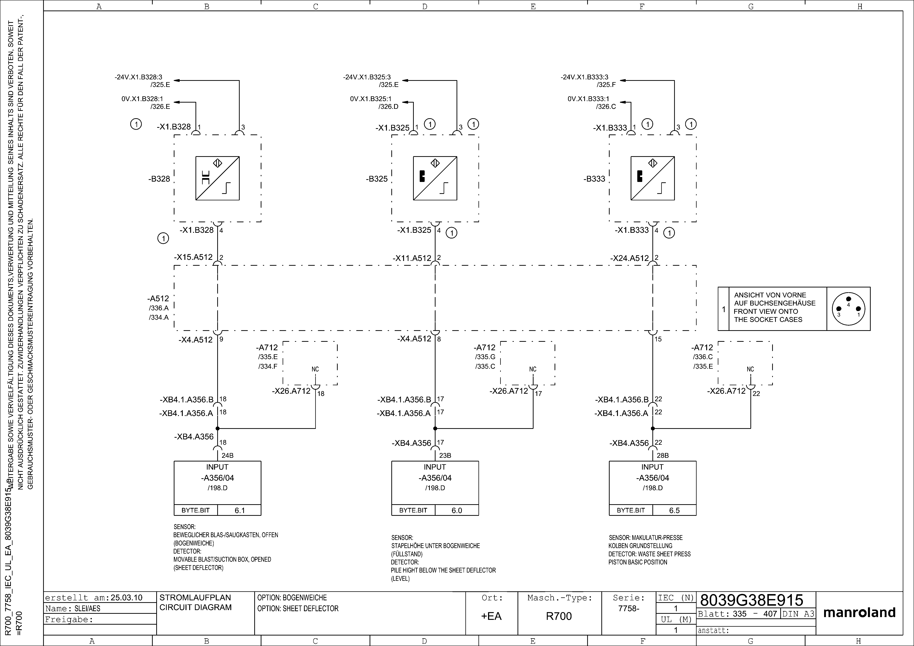

# +EA — Sheet 335 of 407 — OPTION: BOGENWEICHE

**OPTION: SHEET DEFLECTOR**

> Part of the manroland **R700** printing press IEC/UL circuit diagrams.
> Drawing class: **Stromlaufplan / Circuit diagram** (DIN A3).
> Document `+EA` covers the **Printing unit** machine section.

## At a glance

| Field | Value |
|---|---|
| Document | `+EA`  (8039G38E915) |
| Sheet | **335** of 407 |
| Section (DE) | OPTION: BOGENWEICHE |
| Section (EN) | OPTION: SHEET DEFLECTOR |
| Section type | CIRCUIT — Circuit diagram |
| Machine type | `R700` |
| Series | `7758` |
| Created | 25.03.10 |
| Replaces | — |
| Columns used | A, B, C, D, E, F, G, H |
| Path numbers | — |
| Labels on sheet | 130 |
| Cross-refs out | 17 |
| Cross-refs in | 44 |

**Previous:** [+EA sheet 334](SHEET_0334.md) · **Next:** [+EA sheet 336](SHEET_0336.md) · **Document TOC:** [_TOC.md](_TOC.md)  (+EA) · **Master TOC:** [all sheets](../_MASTER_TOC.md)

## Sheet image (300 DPI, exact vector render)



_Rendered directly from the PDF vector layer at 300 DPI (1-bit), no OCR and no resampling. Use it to confirm anything ambiguous in the text below._

## Cross-references on this sheet

Each entry is a wire leaving this sheet. The printed token is `/sheet.column`; the link resolves to that sheet inside the same document.

| Ref | Target sheet | Col | Path | Destination on target | Target section | From col |
|---|---|---|---|---|---|---|
| `/325.E` | [+EA sheet 325](SHEET_0325.md) | E | — | 24V.X1.B328:3 | OPTION: BOGENWEICHE | A |
| `/325.E` | [+EA sheet 325](SHEET_0325.md) | E | — | 24V.X1.B325:3 | OPTION: BOGENWEICHE | D |
| `/325.F` | [+EA sheet 325](SHEET_0325.md) | F | — | 24V.X1.B333:3 | OPTION: BOGENWEICHE | F |
| `/326.E` | [+EA sheet 326](SHEET_0326.md) | E | — | 0V.X1.B328:1 0V.X1.B325:1 0V.X1.B333:1 | OPTION: BOGENWEICHE | C |
| `/326.D` | [+EA sheet 326](SHEET_0326.md) | D | — | 0V.X1.B328:1 0V.X1.B325:1 0V.X1.B333:1 | OPTION: BOGENWEICHE | C |
| `/326.C` | [+EA sheet 326](SHEET_0326.md) | C | — | 0V.X1.B328:1 0V.X1.B325:1 0V.X1.B333:1 | OPTION: BOGENWEICHE | C |
| `/336.A` | [+EA sheet 336](SHEET_0336.md) | A | — | — | OPTION: BOGENWEICHE | B |
| `/334.A` | [+EA sheet 334](SHEET_0334.md) | A | — | — | OPTION: BOGENWEICHE | B |
| `/335.E` | [+EA sheet 335](SHEET_0335.md) | E | — | — | OPTION: BOGENWEICHE | C |
| `/334.F` | [+EA sheet 334](SHEET_0334.md) | F | — | — | OPTION: BOGENWEICHE | C |
| `/335.G` | [+EA sheet 335](SHEET_0335.md) | G | — | — | OPTION: BOGENWEICHE | E |
| `/335.C` | [+EA sheet 335](SHEET_0335.md) | C | — | — | OPTION: BOGENWEICHE | E |
| `/336.C` | [+EA sheet 336](SHEET_0336.md) | C | — | — | OPTION: BOGENWEICHE | G |
| `/335.E` | [+EA sheet 335](SHEET_0335.md) | E | — | — | OPTION: BOGENWEICHE | G |
| `/198.D` | [+EA sheet 198](SHEET_0198.md) | D | — | — | REFERENZMODUL | B |
| `/198.D` | [+EA sheet 198](SHEET_0198.md) | D | — | — | REFERENZMODUL | D |
| `/198.D` | [+EA sheet 198](SHEET_0198.md) | D | — | — | REFERENZMODUL | F |

### Incoming references (sheets that point here)

Every other sheet that sends a wire to this one. `Back-ref` is the token printed on *that* sheet; `Path` is its line number.

| From sheet | Cols | Back-ref | Path | Refs | What continues there |
|---|---|---|---|---|---|
| [+EA#198](SHEET_0198.md) | D | `/198.D` | — | 3 | — |
| [+EA#216](SHEET_0216.md) | G, H | `/216.G`, `/216.H` | — | 6 | — |
| [+EA#217](SHEET_0217.md) | A | `/217.A` | — | 3 | — |
| [+EA#237](SHEET_0237.md) | E, F, G | `/237.E`, `/237.F`, `/237.G` | — | 9 | — |
| [+EA#238](SHEET_0238.md) | A | `/238.A` | — | 3 | — |
| [+EA#256](SHEET_0256.md) | F | `/256.F` | — | 1 | — |
| [+EA#261](SHEET_0261.md) | B | `/261.B` | — | 1 | — |
| [+EA#266](SHEET_0266.md) | G | `/266.G` | — | 1 | — |
| [+EA#270](SHEET_0270.md) | E | `/270.E` | — | 3 | — |
| [+EA#325](SHEET_0325.md) | E, F | `/325.E`, `/325.F` | — | 3 | 24V.X1.B325:3; 24V.X1.B328:3; 24V.X1.B333:3 |
| [+EA#326](SHEET_0326.md) | C, D, E | `/326.C`, `/326.D`, `/326.E` | — | 3 | 0V.X1.B325:1 0V.X1.B007\2:1; 0V.X1.B328:1 |
| [+EA#334](SHEET_0334.md) | A, F | `/334.A`, `/334.F` | — | 2 | — |
| [+EA#335](SHEET_0335.md) | C, E, G | `/335.C`, `/335.E`, `/335.G` | — | 4 | — |
| [+EA#336](SHEET_0336.md) | A, C | `/336.A`, `/336.C` | — | 2 | — |


## Devices on this sheet

| Tag | Class | Class meaning (IEC) | Col | Sub | Terminal | Sign |
|---|---|---|---|---|---|---|
| `A356/04` | A | Baugruppe / assembly, module, PC board | B | 04 | — | — |
| `B328` | B | Umformer / transducer, sensor | B | — | — | — |
| `A512` | A | Baugruppe / assembly, module, PC board | B | — | — | — |
| `A356/04` | A | Baugruppe / assembly, module, PC board | F | 04 | — | — |
| `B333` | B | Umformer / transducer, sensor | F | — | — | — |
| `A356/04` | A | Baugruppe / assembly, module, PC board | D | 04 | — | — |
| `B325` | B | Umformer / transducer, sensor | D | — | — | — |
| `A712` | A | Baugruppe / assembly, module, PC board | C | — | — | — |
| `A712` | A | Baugruppe / assembly, module, PC board | E | — | — | — |
| `A712` | A | Baugruppe / assembly, module, PC board | G | — | — | — |
| `6.1` | — | cross-device reference | B | — | — | — |
| `XB4.A356` | — | cross-device reference | B | — | — | — |
| `X4.A512` | — | cross-device reference | B | — | — | — |
| `X1.B328` | — | cross-device reference | B | — | — | — |
| `X1.B328` | — | cross-device reference | B | — | — | — |
| `X15.A512` | — | cross-device reference | B | — | — | — |
| `6.5` | — | cross-device reference | F | — | — | — |
| `XB4.A356` | — | cross-device reference | F | — | — | — |
| `X24.A512` | — | cross-device reference | F | — | — | — |
| `X1.B333` | — | cross-device reference | F | — | — | — |
| `X1.B333` | — | cross-device reference | F | — | — | — |
| `6.0` | — | cross-device reference | D | — | — | — |
| `XB4.A356` | — | cross-device reference | D | — | — | — |
| `X11.A512` | — | cross-device reference | D | — | — | — |
| `X4.A512` | — | cross-device reference | D | — | — | — |
| `X1.B325` | — | cross-device reference | D | — | — | — |
| `X1.B325` | — | cross-device reference | D | — | — | — |
| `X26.A712` | — | cross-device reference | C | — | — | — |
| `XB4.1.A356.B` | — | cross-device reference | B | — | — | — |
| `XB4.1.A356.A` | — | cross-device reference | B | — | — | — |
| `X26.A712` | — | cross-device reference | E | — | — | — |
| `XB4.1.A356.B` | — | cross-device reference | D | — | — | — |
| `XB4.1.A356.A` | — | cross-device reference | D | — | — | — |
| `X26.A712` | — | cross-device reference | G | — | — | — |
| `XB4.1.A356.B` | — | cross-device reference | F | — | — | — |
| `XB4.1.A356.A` | — | cross-device reference | F | — | — | — |

## Potentials / nets

| Potential | Count | Columns | Attached devices | Terminals |
|---|---|---|---|---|
| `0V` | 3 | A, D, F | `B325`, `B328`, `B333`, `X1` | `1` |
| `24V` | 3 | A, C, E | `B325`, `B328`, `B333`, `X1` | `3` |


A potential such as `L24+/4` or `M24+` is a named supply/return rail; every place it appears on this sheet is electrically common.

## Wire-end annotations (grouped as printed)

A wire that continues elsewhere is annotated with a small cluster: the destination description, the path/line number `#NN`, and the `/sheet.column` cross reference. Each row below is one such cluster exactly as it is grouped on the drawing.

| Col | Y | Path | Cross-ref | Text on the wire |
|---|---|---|---|---|
| A | 96.7 | — | `/325.E` | `24V.X1.B328:3` |
| D | 96.7 | — | `/325.E` | `24V.X1.B325:3` |
| F | 96.7 | — | `/325.F` | `24V.X1.B333:3` |
| C | 125.0 | — | `/326.E`, `/326.D`, `/326.C` | `0V.X1.B328:1 0V.X1.B325:1 0V.X1.B333:1` |
| D | 158.5 | — | — | `1 1` |
| D | 158.5 | — | — | `1` |
| E | 158.5 | — | — | `1 1` |
| B | 160.5 | — | — | `X1.B328 1 3` |
| D | 161.9 | — | — | `X1.B325 1 3` |
| F | 161.9 | — | — | `X1.B333 1 3` |
| B | 228.5 | — | — | `B328` |
| D | 228.5 | — | — | `B325` |
| F | 228.5 | — | — | `B333` |
| B | 295.1 | — | — | `X1.B328 4` |
| D | 295.1 | — | — | `X1.B325 4` |
| F | 295.1 | — | — | `X1.B333 4` |
| D | 300.2 | — | — | `1` |
| F | 300.2 | — | — | `1` |
| B | 307.3 | — | — | `1` |
| B | 330.5 | — | — | `X15.A512 2` |
| D | 332.0 | — | — | `X11.A512 2` |
| F | 332.0 | — | — | `X24.A512 2` |
| G | 380.8 | — | — | `FRONT VIEW ONTO ANSICHT VON VORNE AUF BUCHSENGEHÄUSE` |
| B | 384.4 | — | — | `A512` |
| H | 394.2 | — | — | `4` |
| B | 397.5 | — | `/336.A`, `/334.A` | — |
| G | 398.5 | — | — | `1 3 1` |
| G | 412.7 | — | — | `THE SOCKET CASES` |
| D | 436.8 | — | — | `X4.A512 8` |
| B | 438.3 | — | — | `X4.A512 9` |
| F | 438.3 | — | — | `15` |
| C | 448.2 | — | — | `A712` |
| E | 448.2 | — | — | `A712` |
| G | 448.2 | — | — | `A712` |
| C | 461.2 | — | `/335.E`, `/334.F` | — |
| E | 461.3 | — | `/335.G`, `/335.C` | — |
| G | 461.3 | — | `/336.C` | — |
| G | 473.6 | — | `/335.E` | — |
| E | 478.2 | — | — | `NC NC NC` |
| B | 504.9 | — | — | `XB4.1.A356.B 18 X26.A712 18` |
| D | 504.9 | — | — | `XB4.1.A356.B 17 X26.A712 17` |
| F | 504.9 | — | — | `XB4.1.A356.B 22 X26.A712 22` |
| B | 533.2 | — | — | `XB4.1.A356.A 18` |
| D | 533.2 | — | — | `XB4.1.A356.A 17` |
| F | 533.2 | — | — | `XB4.1.A356.A 22` |
| B | 564.4 | — | — | `XB4.A356 18` |
| D | 572.9 | — | — | `XB4.A356 17` |
| F | 572.9 | — | — | `XB4.A356 22` |
| B | 589.9 | — | — | `24B` |
| D | 589.9 | — | — | `23B` |
| F | 589.9 | — | — | `28B` |
| B | 604.4 | — | — | `INPUT` |
| D | 604.4 | — | — | `INPUT` |
| F | 604.4 | — | — | `INPUT` |
| B | 618.3 | — | — | `A356/04` |
| D | 618.3 | — | — | `A356/04` |
| F | 618.3 | — | — | `A356/04` |
| B | 632.1 | — | `/198.D` | — |
| D | 632.1 | — | `/198.D` | — |
| F | 632.1 | — | `/198.D` | — |
| B | 661.1 | — | — | `BYTE.BIT 6.1` |
| D | 661.1 | — | — | `BYTE.BIT 6.0` |
| F | 661.1 | — | — | `BYTE.BIT 6.5` |
| B | 683.8 | — | — | `BEWEGLICHER BLAS /SAUGKASTEN, OFFEN DETECTOR: (BOGENWEICHE) MOVABLE BLAST/SUCTION BOX, OPENED (SHEET DEFLECTOR) SENSOR:` |
| D | 697.9 | — | — | `DETECTOR: PILE HIGHT BELOW THE SHEET DEFLECTOR (FÜLLSTAND) (LEVEL) SENSOR: STAPELHÖHE UNTER BOGENWEICHE` |
| F | 698.0 | — | — | `KOLBEN GRUNDSTELLUNG DETECTOR: WASTE SHEET PRESS PISTON BASIC POSITION SENSOR: MAKULATUR PRESSE` |


## Reconstructed tables

This sheet carries tabular content (pin map / terminal assignment / index). The grid below was rebuilt from the drawing's own rule lines, so each row is exactly one physical row of the table.

### Table 1 — 7 data rows × 20 columns (at x=226.8, y=104.9)

|  | 1 |  | 3 |  | /325.E 0V.X1.B325:1 /326.D | X1.B325 | 1 1 |  | 1 3 |  | /325.F 0V.X1.B333:1 /326.C | X1.B333 | 1 1 |  | 1 3 |  |  |  |  |
|---|---|---|---|---|---|---|---|---|---|---|---|---|---|---|---|---|---|---|---|
|  |  |  |  |  | `B325` |  |  |  |  |  | `B333` |  |  |  |  |  |  |  |  |
| `X15.A512` | `X1.B328` | `4 2` |  |  |  | `X11.A512` | `X1.B325` | `4 1 2` |  |  |  | `X24.A512` | `X1.B333` | `4 1 2` |  |  |  |  |  |
|  |  |  |  |  |  |  |  |  |  |  |  |  |  |  |  | `1` | `ANSICHT AUF FRONT THE` | `VON VORNE BUCHSENGEHÄUSE VIEW ONTO SOCKET CASES` | `4 3 1` |
| `X4.A512 XB4.1.A356.B XB4.1.A356.A` |  | `9 18 18` |  | `A712 /335.E /334.F NC X26.A712` | `18` | `XB4.1.A356.B XB4.1.A356.A` | `X4.A512` | `8 17 17` |  | `A712 /335.G /335.C NC X26.A712` | `17` | `XB4.1.A356.B XB4.1.A356.A` |  | `15 22 22` |  | `A712 /336.C /335.E X26.A712` | `NC` | `22` |  |
| `XB4.A356` |  | `18 24B` |  |  |  | `XB4.A356` |  | `17 23B` |  |  |  | `XB4.A356` |  | `22 28B` |  |  |  |  |  |
|  | `INPUT` | `A356/04 /198.D` |  |  |  |  | `INPUT` | `A356/04 /198.D` |  |  |  |  | `INPUT` | `A356/04 /198.D` |  |  |  |  |  |
| `BYTE.BIT` |  |  | `6.1` |  |  | `BYTE.BIT` |  | `6.0` |  |  |  | `BYTE.BIT` |  |  | `6.5` |  |  |  |  |


## Notes and free text on this sheet

| Text | Col | Y (pt) |
|---|---|---|
| `24B` | B | 589.89 |
| `INPUT` | B | 604.42 |
| `BYTE.BIT` | B | 661.67 |
| `SENSOR:` | B | 683.75 |
| `BEWEGLICHER BLAS /SAUGKASTEN, OFFEN` | B | 694.39 |
| `(BOGENWEICHE)` | B | 705.01 |
| `DETECTOR:` | B | 715.65 |
| `MOVABLE BLAST/SUCTION BOX, OPENED` | B | 726.3 |
| `(SHEET DEFLECTOR)` | B | 736.94 |
| `28B` | F | 589.89 |
| `INPUT` | F | 604.42 |
| `BYTE.BIT` | F | 661.67 |
| `SENSOR: MAKULATUR PRESSE` | F | 697.95 |
| `KOLBEN GRUNDSTELLUNG` | F | 708.59 |
| `DETECTOR: WASTE SHEET PRESS` | F | 719.18 |
| `PISTON BASIC POSITION` | F | 729.82 |
| `23B` | D | 589.89 |
| `INPUT` | D | 604.42 |
| `BYTE.BIT` | D | 661.67 |
| `SENSOR:` | D | 697.92 |
| `STAPELHÖHE UNTER BOGENWEICHE` | D | 708.57 |
| `(FÜLLSTAND)` | D | 719.23 |
| `DETECTOR:` | D | 729.82 |
| `PILE HIGHT BELOW THE SHEET DEFLECTOR` | D | 740.47 |
| `(LEVEL)` | D | 751.09 |
| `ANSICHT VON VORNE` | G | 380.83 |
| `AUF BUCHSENGEHÄUSE` | G | 391.46 |
| `FRONT VIEW ONTO` | G | 402.06 |
| `THE SOCKET CASES` | G | 412.7 |
| `NC` | C | 478.22 |
| `NC` | E | 478.22 |
| `NC` | G | 478.22 |

## Complete label inventory (exact text from the drawing)

Every text object inside the drawing area of this sheet, in DIN reading order (column A→H, then top→bottom). This is the authoritative list: if a string is not here it is not printed on this sheet.

| Col | Y | X | Dir | Type | Text |
|---|---|---|---|---|---|
| A | 96.7 | 149.4 | → | potential | `24V.X1.B328:3` |
| A | 125.0 | 158.5 | → | potential | `0V.X1.B328:1` |
| A | 158.5 | 175.4 | → | number | `1` |
| B | 106.6 | 196.2 | → | cross-reference | `/325.E` |
| B | 134.9 | 196.2 | → | cross-reference | `/326.E` |
| B | 160.5 | 204.4 | → | device ref | `X1.B328` |
| B | 161.9 | 257.1 | → | number | `1` |
| B | 161.9 | 314.4 | → | number | `3` |
| B | 228.5 | 193.3 | → | device tag | `B328` |
| B | 295.1 | 234.1 | → | device ref | `X1.B328` |
| B | 296.5 | 286.0 | → | number | `4` |
| B | 307.3 | 210.8 | → | number | `1` |
| B | 330.5 | 226.8 | → | device ref | `X15.A512` |
| B | 332.0 | 286.0 | → | number | `2` |
| B | 384.4 | 191.9 | → | device tag | `A512` |
| B | 397.5 | 194.2 | → | cross-reference | `/336.A` |
| B | 409.9 | 194.2 | → | cross-reference | `/334.A` |
| B | 438.3 | 232.7 | → | device ref | `X4.A512` |
| B | 438.3 | 286.0 | → | number | `9` |
| B | 516.2 | 208.3 | → | device ref | `XB4.1.A356.B` |
| B | 516.2 | 285.4 | → | number | `18` |
| B | 533.2 | 285.4 | → | number | `18` |
| B | 533.9 | 207.5 | → | device ref | `XB4.1.A356.A` |
| B | 564.4 | 227.1 | → | device ref | `XB4.A356` |
| B | 572.9 | 285.4 | → | number | `18` |
| B | 589.9 | 288.9 | → | text | `24B` |
| B | 604.4 | 268.6 | → | text | `INPUT` |
| B | 618.3 | 262.1 | → | device tag | `A356/04` |
| B | 632.1 | 270.7 | → | cross-reference | `/198.D` |
| B | 661.1 | 305.9 | → | device ref | `6.1` |
| B | 661.7 | 236.7 | → | text | `BYTE.BIT` |
| B | 683.7 | 226.5 | → | text | `SENSOR:` |
| B | 694.4 | 225.9 | → | text | `BEWEGLICHER BLAS /SAUGKASTEN, OFFEN` |
| B | 705.0 | 226.2 | → | text | `(BOGENWEICHE)` |
| B | 715.7 | 225.9 | → | text | `DETECTOR:` |
| B | 726.3 | 226.2 | → | text | `MOVABLE BLAST/SUCTION BOX, OPENED` |
| B | 736.9 | 226.2 | → | text | `(SHEET DEFLECTOR)` |
| C | 96.7 | 447.0 | → | potential | `24V.X1.B325:3` |
| C | 448.2 | 333.6 | → | device tag | `A712` |
| C | 461.2 | 336.5 | → | cross-reference | `/335.E` |
| C | 473.7 | 336.8 | → | cross-reference | `/334.F` |
| C | 478.2 | 406.1 | → | text | `NC` |
| C | 504.9 | 354.3 | → | device ref | `X26.A712` |
| C | 509.1 | 413.0 | → | number | `18` |
| D | 106.6 | 493.8 | → | cross-reference | `/325.E` |
| D | 125.0 | 456.1 | → | potential | `0V.X1.B325:1` |
| D | 134.9 | 493.2 | → | cross-reference | `/326.D` |
| D | 158.5 | 558.1 | → | number | `1` |
| D | 158.5 | 614.8 | → | number | `1` |
| D | 161.9 | 489.3 | → | device ref | `X1.B325` |
| D | 161.9 | 540.6 | → | number | `1` |
| D | 161.9 | 597.8 | → | number | `3` |
| D | 228.5 | 476.8 | → | device tag | `B325` |
| D | 295.1 | 517.6 | → | device ref | `X1.B325` |
| D | 296.5 | 569.5 | → | number | `4` |
| D | 300.2 | 586.4 | → | number | `1` |
| D | 332.0 | 511.7 | → | device ref | `X11.A512` |
| D | 332.0 | 569.5 | → | number | `2` |
| D | 436.8 | 517.6 | → | device ref | `X4.A512` |
| D | 438.3 | 569.5 | → | number | `8` |
| D | 516.2 | 491.8 | → | device ref | `XB4.1.A356.B` |
| D | 516.2 | 568.9 | → | number | `17` |
| D | 533.2 | 568.9 | → | number | `17` |
| D | 533.9 | 491.0 | → | device ref | `XB4.1.A356.A` |
| D | 572.9 | 510.5 | → | device ref | `XB4.A356` |
| D | 572.9 | 568.9 | → | number | `17` |
| D | 589.9 | 572.3 | → | text | `23B` |
| D | 604.4 | 552.0 | → | text | `INPUT` |
| D | 618.3 | 545.5 | → | device tag | `A356/04` |
| D | 632.1 | 554.2 | → | cross-reference | `/198.D` |
| D | 661.1 | 588.5 | → | device ref | `6.0` |
| D | 661.7 | 520.2 | → | text | `BYTE.BIT` |
| D | 697.9 | 510.0 | → | text | `SENSOR:` |
| D | 708.6 | 510.0 | → | text | `STAPELHÖHE UNTER BOGENWEICHE` |
| D | 719.2 | 509.7 | → | text | `(FÜLLSTAND)` |
| D | 729.8 | 509.4 | → | text | `DETECTOR:` |
| D | 740.5 | 509.4 | → | text | `PILE HIGHT BELOW THE SHEET DEFLECTOR` |
| D | 751.1 | 509.7 | → | text | `(LEVEL)` |
| E | 96.7 | 730.5 | → | potential | `24V.X1.B333:3` |
| E | 448.2 | 617.1 | → | device tag | `A712` |
| E | 461.3 | 619.1 | → | cross-reference | `/335.G` |
| E | 473.7 | 619.4 | → | cross-reference | `/335.C` |
| E | 478.2 | 689.6 | → | text | `NC` |
| E | 504.9 | 637.8 | → | device ref | `X26.A712` |
| E | 509.1 | 696.5 | → | number | `17` |
| F | 106.6 | 777.5 | → | cross-reference | `/325.F` |
| F | 125.0 | 739.6 | → | potential | `0V.X1.B333:1` |
| F | 134.9 | 776.7 | → | cross-reference | `/326.C` |
| F | 158.5 | 841.6 | → | number | `1` |
| F | 158.5 | 898.2 | → | number | `1` |
| F | 161.9 | 772.7 | → | device ref | `X1.B333` |
| F | 161.9 | 824.0 | → | number | `1` |
| F | 161.9 | 881.3 | → | number | `3` |
| F | 228.5 | 760.3 | → | device tag | `B333` |
| F | 295.1 | 801.1 | → | device ref | `X1.B333` |
| F | 296.5 | 852.9 | → | number | `4` |
| F | 300.2 | 869.9 | → | number | `1` |
| F | 332.0 | 795.1 | → | device ref | `X24.A512` |
| F | 332.0 | 852.9 | → | number | `2` |
| F | 438.3 | 852.4 | → | number | `15` |
| F | 516.2 | 775.3 | → | device ref | `XB4.1.A356.B` |
| F | 516.2 | 852.9 | → | number | `22` |
| F | 533.2 | 852.9 | → | number | `22` |
| F | 533.9 | 774.4 | → | device ref | `XB4.1.A356.A` |
| F | 572.9 | 794.0 | → | device ref | `XB4.A356` |
| F | 572.9 | 852.9 | → | number | `22` |
| F | 589.9 | 855.8 | → | text | `28B` |
| F | 604.4 | 835.5 | → | text | `INPUT` |
| F | 618.3 | 829.0 | → | device tag | `A356/04` |
| F | 632.1 | 837.6 | → | cross-reference | `/198.D` |
| F | 661.1 | 871.9 | → | device ref | `6.5` |
| F | 661.7 | 803.6 | → | text | `BYTE.BIT` |
| F | 698.0 | 793.4 | → | text | `SENSOR: MAKULATUR PRESSE` |
| F | 708.6 | 792.9 | → | text | `KOLBEN GRUNDSTELLUNG` |
| F | 719.2 | 792.9 | → | text | `DETECTOR: WASTE SHEET PRESS` |
| F | 729.8 | 792.9 | → | text | `PISTON BASIC POSITION` |
| G | 380.8 | 956.7 | → | text | `ANSICHT VON VORNE` |
| G | 391.5 | 956.7 | → | text | `AUF BUCHSENGEHÄUSE` |
| G | 398.5 | 940.0 | → | number | `1` |
| G | 402.1 | 955.8 | → | text | `FRONT VIEW ONTO` |
| G | 412.7 | 956.4 | → | text | `THE SOCKET CASES` |
| G | 448.2 | 900.6 | → | device tag | `A712` |
| G | 461.3 | 902.8 | → | cross-reference | `/336.C` |
| G | 473.6 | 903.4 | → | cross-reference | `/335.E` |
| G | 478.2 | 973.1 | → | text | `NC` |
| G | 504.9 | 921.3 | → | device ref | `X26.A712` |
| G | 509.1 | 980.5 | → | number | `22` |
| H | 394.2 | 1103.5 | → | number | `4` |
| H | 407.0 | 1090.8 | → | number | `3` |
| H | 407.0 | 1116.7 | → | number | `1` |

## Reading-order text block

The same content as a plain block, grouped by DIN column — convenient to paste or to match against a visual description.

```text
=== Column A ===
  96.7  149.4  net          24V.X1.B328:3
 125.0  158.5  net          0V.X1.B328:1
 158.5  175.4  numeric      1
=== Column B ===
 106.6  196.2  xref         /325.E
 134.9  196.2  xref         /326.E
 160.5  204.4  devref       X1.B328
 161.9  257.1  numeric      1
 161.9  314.4  numeric      3
 228.5  193.3  devtag       B328
 295.1  234.1  devref       X1.B328
 296.5  286.0  numeric      4
 307.3  210.8  numeric      1
 330.5  226.8  devref       X15.A512
 332.0  286.0  numeric      2
 384.4  191.9  devtag       A512
 397.5  194.2  xref         /336.A
 409.9  194.2  xref         /334.A
 438.3  232.7  devref       X4.A512
 438.3  286.0  numeric      9
 516.2  208.3  devref       XB4.1.A356.B
 516.2  285.4  numeric      18
 533.2  285.4  numeric      18
 533.9  207.5  devref       XB4.1.A356.A
 564.4  227.1  devref       XB4.A356
 572.9  285.4  numeric      18
 589.9  288.9  text         24B
 604.4  268.6  text         INPUT
 618.3  262.1  devtag       A356/04
 632.1  270.7  xref         /198.D
 661.1  305.9  devref       6.1
 661.7  236.7  text         BYTE.BIT
 683.7  226.5  text         SENSOR:
 694.4  225.9  text         BEWEGLICHER BLAS /SAUGKASTEN, OFFEN
 705.0  226.2  text         (BOGENWEICHE)
 715.7  225.9  text         DETECTOR:
 726.3  226.2  text         MOVABLE BLAST/SUCTION BOX, OPENED
 736.9  226.2  text         (SHEET DEFLECTOR)
=== Column C ===
  96.7  447.0  net          24V.X1.B325:3
 448.2  333.6  devtag       A712
 461.2  336.5  xref         /335.E
 473.7  336.8  xref         /334.F
 478.2  406.1  text         NC
 504.9  354.3  devref       X26.A712
 509.1  413.0  numeric      18
=== Column D ===
 106.6  493.8  xref         /325.E
 125.0  456.1  net          0V.X1.B325:1
 134.9  493.2  xref         /326.D
 158.5  558.1  numeric      1
 158.5  614.8  numeric      1
 161.9  489.3  devref       X1.B325
 161.9  540.6  numeric      1
 161.9  597.8  numeric      3
 228.5  476.8  devtag       B325
 295.1  517.6  devref       X1.B325
 296.5  569.5  numeric      4
 300.2  586.4  numeric      1
 332.0  511.7  devref       X11.A512
 332.0  569.5  numeric      2
 436.8  517.6  devref       X4.A512
 438.3  569.5  numeric      8
 516.2  491.8  devref       XB4.1.A356.B
 516.2  568.9  numeric      17
 533.2  568.9  numeric      17
 533.9  491.0  devref       XB4.1.A356.A
 572.9  510.5  devref       XB4.A356
 572.9  568.9  numeric      17
 589.9  572.3  text         23B
 604.4  552.0  text         INPUT
 618.3  545.5  devtag       A356/04
 632.1  554.2  xref         /198.D
 661.1  588.5  devref       6.0
 661.7  520.2  text         BYTE.BIT
 697.9  510.0  text         SENSOR:
 708.6  510.0  text         STAPELHÖHE UNTER BOGENWEICHE
 719.2  509.7  text         (FÜLLSTAND)
 729.8  509.4  text         DETECTOR:
 740.5  509.4  text         PILE HIGHT BELOW THE SHEET DEFLECTOR
 751.1  509.7  text         (LEVEL)
=== Column E ===
  96.7  730.5  net          24V.X1.B333:3
 448.2  617.1  devtag       A712
 461.3  619.1  xref         /335.G
 473.7  619.4  xref         /335.C
 478.2  689.6  text         NC
 504.9  637.8  devref       X26.A712
 509.1  696.5  numeric      17
=== Column F ===
 106.6  777.5  xref         /325.F
 125.0  739.6  net          0V.X1.B333:1
 134.9  776.7  xref         /326.C
 158.5  841.6  numeric      1
 158.5  898.2  numeric      1
 161.9  772.7  devref       X1.B333
 161.9  824.0  numeric      1
 161.9  881.3  numeric      3
 228.5  760.3  devtag       B333
 295.1  801.1  devref       X1.B333
 296.5  852.9  numeric      4
 300.2  869.9  numeric      1
 332.0  795.1  devref       X24.A512
 332.0  852.9  numeric      2
 438.3  852.4  numeric      15
 516.2  775.3  devref       XB4.1.A356.B
 516.2  852.9  numeric      22
 533.2  852.9  numeric      22
 533.9  774.4  devref       XB4.1.A356.A
 572.9  794.0  devref       XB4.A356
 572.9  852.9  numeric      22
 589.9  855.8  text         28B
 604.4  835.5  text         INPUT
 618.3  829.0  devtag       A356/04
 632.1  837.6  xref         /198.D
 661.1  871.9  devref       6.5
 661.7  803.6  text         BYTE.BIT
 698.0  793.4  text         SENSOR: MAKULATUR PRESSE
 708.6  792.9  text         KOLBEN GRUNDSTELLUNG
 719.2  792.9  text         DETECTOR: WASTE SHEET PRESS
 729.8  792.9  text         PISTON BASIC POSITION
=== Column G ===
 380.8  956.7  text         ANSICHT VON VORNE
 391.5  956.7  text         AUF BUCHSENGEHÄUSE
 398.5  940.0  numeric      1
 402.1  955.8  text         FRONT VIEW ONTO
 412.7  956.4  text         THE SOCKET CASES
 448.2  900.6  devtag       A712
 461.3  902.8  xref         /336.C
 473.6  903.4  xref         /335.E
 478.2  973.1  text         NC
 504.9  921.3  devref       X26.A712
 509.1  980.5  numeric      22
=== Column H ===
 394.2 1103.5  numeric      4
 407.0 1090.8  numeric      3
 407.0 1116.7  numeric      1
```

---
_Generated from the PDF vector text layer; no OCR. Source: `R700_7758_IEC_UL_EA_8039G38E915_p`, sheet 335._
