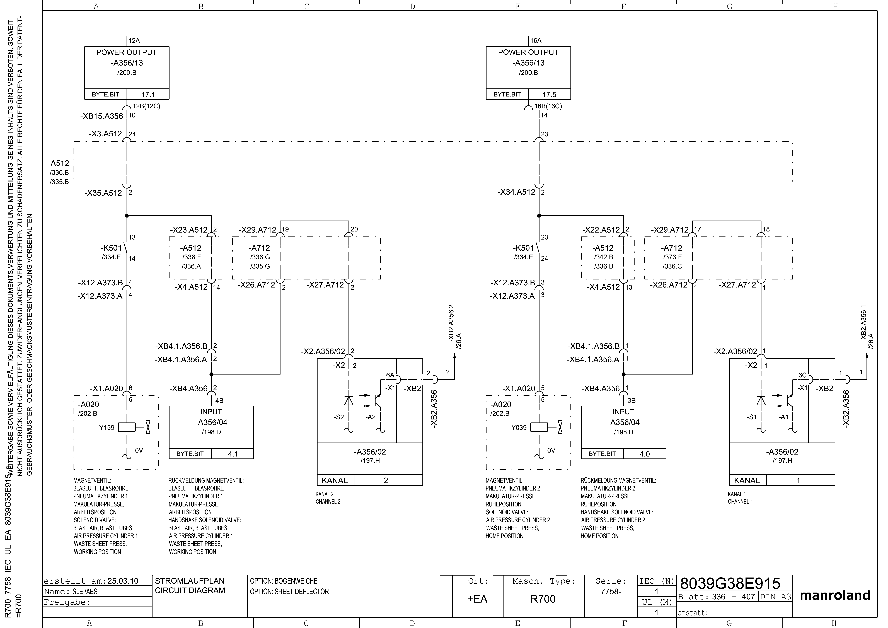

# +EA — Sheet 336 of 407 — OPTION: BOGENWEICHE

**OPTION: SHEET DEFLECTOR**

> Part of the manroland **R700** printing press IEC/UL circuit diagrams.
> Drawing class: **Stromlaufplan / Circuit diagram** (DIN A3).
> Document `+EA` covers the **Printing unit** machine section.

## At a glance

| Field | Value |
|---|---|
| Document | `+EA`  (8039G38E915) |
| Sheet | **336** of 407 |
| Section (DE) | OPTION: BOGENWEICHE |
| Section (EN) | OPTION: SHEET DEFLECTOR |
| Section type | CIRCUIT — Circuit diagram |
| Machine type | `R700` |
| Series | `7758` |
| Created | 25.03.10 |
| Replaces | — |
| Columns used | A, B, C, D, E, F, G, H |
| Path numbers | — |
| Labels on sheet | 191 |
| Cross-refs out | 22 |
| Cross-refs in | 56 |

**Previous:** [+EA sheet 335](SHEET_0335.md) · **Next:** [+EA sheet 337](SHEET_0337.md) · **Document TOC:** [_TOC.md](_TOC.md)  (+EA) · **Master TOC:** [all sheets](../_MASTER_TOC.md)

## Sheet image (300 DPI, exact vector render)



_Rendered directly from the PDF vector layer at 300 DPI (1-bit), no OCR and no resampling. Use it to confirm anything ambiguous in the text below._

## Cross-references on this sheet

Each entry is a wire leaving this sheet. The printed token is `/sheet.column`; the link resolves to that sheet inside the same document.

| Ref | Target sheet | Col | Path | Destination on target | Target section | From col |
|---|---|---|---|---|---|---|
| `/200.B` | [+EA sheet 200](SHEET_0200.md) | B | — | — | REFERENZMODUL | A |
| `/200.B` | [+EA sheet 200](SHEET_0200.md) | B | — | — | REFERENZMODUL | E |
| `/336.B` | [+EA sheet 336](SHEET_0336.md) | B | — | — | OPTION: BOGENWEICHE | A |
| `/335.B` | [+EA sheet 335](SHEET_0335.md) | B | — | — | OPTION: BOGENWEICHE | A |
| `/334.E` | [+EA sheet 334](SHEET_0334.md) | E | — | — | OPTION: BOGENWEICHE | A |
| `/334.E` | [+EA sheet 334](SHEET_0334.md) | E | — | — | OPTION: BOGENWEICHE | E |
| `/342.B` | [+EA sheet 342](SHEET_0342.md) | B | — | — | OPTION: BOGENWEICHE | F |
| `/336.B` | [+EA sheet 336](SHEET_0336.md) | B | — | — | OPTION: BOGENWEICHE | F |
| `/336.F` | [+EA sheet 336](SHEET_0336.md) | F | — | — | OPTION: BOGENWEICHE | B |
| `/336.A` | [+EA sheet 336](SHEET_0336.md) | A | — | — | OPTION: BOGENWEICHE | B |
| `/336.G` | [+EA sheet 336](SHEET_0336.md) | G | — | — | OPTION: BOGENWEICHE | C |
| `/335.G` | [+EA sheet 335](SHEET_0335.md) | G | — | — | OPTION: BOGENWEICHE | C |
| `/373.F` | [+EA sheet 373](SHEET_0373.md) | F | — | — | OPTION: ENDTROCKNER 1 VORBEREITUNG; | F |
| `/336.C` | [+EA sheet 336](SHEET_0336.md) | C | — | — | OPTION: BOGENWEICHE | F |
| `/26.A` | [+EA sheet 26](SHEET_0026.md) | A | — | XB2.A356:2 | BUSVERBINDUNGEN: SICHERHEITSBUS | D |
| `/26.A` | [+EA sheet 26](SHEET_0026.md) | A | — | XB2.A356:1 | BUSVERBINDUNGEN: SICHERHEITSBUS | H |
| `/202.B` | [+EA sheet 202](SHEET_0202.md) | B | — | A020 | REFERENZMODUL | A |
| `/202.B` | [+EA sheet 202](SHEET_0202.md) | B | — | A020 | REFERENZMODUL | E |
| `/198.D` | [+EA sheet 198](SHEET_0198.md) | D | — | — | REFERENZMODUL | B |
| `/198.D` | [+EA sheet 198](SHEET_0198.md) | D | — | — | REFERENZMODUL | F |
| `/197.H` | [+EA sheet 197](SHEET_0197.md) | H | — | — | REFERENZMODUL | D |
| `/197.H` | [+EA sheet 197](SHEET_0197.md) | H | — | — | REFERENZMODUL | H |

### Incoming references (sheets that point here)

Every other sheet that sends a wire to this one. `Back-ref` is the token printed on *that* sheet; `Path` is its line number.

| From sheet | Cols | Back-ref | Path | Refs | What continues there |
|---|---|---|---|---|---|
| [+EA#26](SHEET_0026.md) | A | `/26.A` | — | 2 | XB2.A356:1; XB2.A356:2 |
| [+EA#197](SHEET_0197.md) | H | `/197.H` | — | 2 | — |
| [+EA#198](SHEET_0198.md) | D | `/198.D` | — | 2 | — |
| [+EA#200](SHEET_0200.md) | B | `/200.B` | — | 2 | — |
| [+EA#202](SHEET_0202.md) | B | `/202.B` | — | 2 | — |
| [+EA#206](SHEET_0206.md) | B | `/206.B` | — | 2 | — |
| [+EA#225](SHEET_0225.md) | F | `/225.F` | — | 2 | — |
| [+EA#226](SHEET_0226.md) | E | `/226.E` | — | 2 | — |
| [+EA#235](SHEET_0235.md) | E | `/235.E` | — | 2 | — |
| [+EA#237](SHEET_0237.md) | E, F, G | `/237.E`, `/237.F`, `/237.G` | — | 6 | — |
| [+EA#238](SHEET_0238.md) | A | `/238.A` | — | 2 | — |
| [+EA#257](SHEET_0257.md) | F | `/257.F` | — | 4 | — |
| [+EA#261](SHEET_0261.md) | A | `/261.A` | — | 2 | — |
| [+EA#264](SHEET_0264.md) | H | `/264.H` | — | 1 | — |
| [+EA#265](SHEET_0265.md) | E | `/265.E` | — | 1 | — |
| [+EA#270](SHEET_0270.md) | E | `/270.E` | — | 2 | — |
| [+EA#271](SHEET_0271.md) | G | `/271.G` | — | 2 | — |
| [+EA#274](SHEET_0274.md) | G | `/274.G` | — | 4 | — |
| [+EA#278](SHEET_0278.md) | B, G | `/278.B`, `/278.G` | — | 2 | — |
| [+EA#334](SHEET_0334.md) | E | `/334.E` | — | 2 | — |
| [+EA#335](SHEET_0335.md) | B, G | `/335.B`, `/335.G` | — | 2 | — |
| [+EA#336](SHEET_0336.md) | A, B, C, F | `/336.A`, `/336.B`, `/336.C`, `/336.F` | — | 6 | — |
| [+EA#342](SHEET_0342.md) | B | `/342.B` | — | 1 | — |
| [+EA#373](SHEET_0373.md) | F | `/373.F` | — | 1 | — |


## Devices on this sheet

| Tag | Class | Class meaning (IEC) | Col | Sub | Terminal | Sign |
|---|---|---|---|---|---|---|
| `A356/13` | A | Baugruppe / assembly, module, PC board | E | 13 | — | — |
| `Y039` | Y | Magnetventil / solenoid valve, actuator | E | — | — | — |
| `A020` | A | Baugruppe / assembly, module, PC board | E | — | — | — |
| `A356/04` | A | Baugruppe / assembly, module, PC board | F | 04 | — | — |
| `K501` | K | Relais / relay, contactor | E | — | — | — |
| `A512` | A | Baugruppe / assembly, module, PC board | F | — | — | — |
| `S1` | S | Schalter / switch | G | — | — | — |
| `A1` | A | Baugruppe / assembly, module, PC board | H | — | — | — |
| `X1` | X | Klemme / terminal, plug connector | H | — | — | — |
| `X2` | X | Klemme / terminal, plug connector | G | — | — | — |
| `XB2` | XB |  | H | — | — | — |
| `A356/02` | A | Baugruppe / assembly, module, PC board | G | 02 | — | — |
| `A712` | A | Baugruppe / assembly, module, PC board | F | — | — | — |
| `Y159` | Y | Magnetventil / solenoid valve, actuator | A | — | — | — |
| `A020` | A | Baugruppe / assembly, module, PC board | A | — | — | — |
| `A356/13` | A | Baugruppe / assembly, module, PC board | A | 13 | — | — |
| `A356/04` | A | Baugruppe / assembly, module, PC board | B | 04 | — | — |
| `K501` | K | Relais / relay, contactor | A | — | — | — |
| `A512` | A | Baugruppe / assembly, module, PC board | A | — | — | — |
| `A512` | A | Baugruppe / assembly, module, PC board | B | — | — | — |
| `S2` | S | Schalter / switch | C | — | — | — |
| `A2` | A | Baugruppe / assembly, module, PC board | D | — | — | — |
| `X1` | X | Klemme / terminal, plug connector | D | — | — | — |
| `X2` | X | Klemme / terminal, plug connector | C | — | — | — |
| `XB2` | XB |  | D | — | — | — |
| `A356/02` | A | Baugruppe / assembly, module, PC board | D | 02 | — | — |
| `A712` | A | Baugruppe / assembly, module, PC board | C | — | — | — |
| `17.5` | — | cross-device reference | E | — | — | — |
| `X1.A020` | — | cross-device reference | E | — | — | — |
| `4.0` | — | cross-device reference | F | — | — | — |
| `XB4.A356` | — | cross-device reference | F | — | — | — |
| `X34.A512` | — | cross-device reference | E | — | — | — |
| `X12.A373.B` | — | cross-device reference | E | — | — | — |
| `X12.A373.A` | — | cross-device reference | E | — | — | — |
| `X22.A512` | — | cross-device reference | F | — | — | — |
| `X4.A512` | — | cross-device reference | F | — | — | — |
| `XB4.1.A356.B` | — | cross-device reference | F | — | — | — |
| `XB4.1.A356.A` | — | cross-device reference | F | — | — | — |
| `XB2.A356` | — | cross-device reference | H | — | — | — |
| `X29.A712` | — | cross-device reference | F | — | — | — |
| `X27.A712` | — | cross-device reference | G | — | — | — |
| `X26.A712` | — | cross-device reference | F | — | — | — |
| `X1.A020` | — | cross-device reference | A | — | — | — |
| `XB15.A356` | — | cross-device reference | A | — | — | — |
| `17.1` | — | cross-device reference | A | — | — | — |
| `4.1` | — | cross-device reference | B | — | — | — |
| `XB4.A356` | — | cross-device reference | B | — | — | — |
| `X3.A512` | — | cross-device reference | A | — | — | — |
| `X35.A512` | — | cross-device reference | A | — | — | — |
| `X12.A373.B` | — | cross-device reference | A | — | — | — |
| `X12.A373.A` | — | cross-device reference | A | — | — | — |
| `X23.A512` | — | cross-device reference | B | — | — | — |
| `X4.A512` | — | cross-device reference | B | — | — | — |
| `XB4.1.A356.B` | — | cross-device reference | B | — | — | — |
| `XB4.1.A356.A` | — | cross-device reference | B | — | — | — |
| `X29.A712` | — | cross-device reference | C | — | — | — |
| `X27.A712` | — | cross-device reference | C | — | — | — |
| `X26.A712` | — | cross-device reference | C | — | — | — |
| `XB2.A356` | — | cross-device reference | D | — | — | — |
| `XB2.A356:1` | — | cross-device reference | H | — | 1 | — |
| `XB2.A356:2` | — | cross-device reference | D | — | 2 | — |

## Potentials / nets

| Potential | Count | Columns | Attached devices | Terminals |
|---|---|---|---|---|
| `0V` | 2 | A, E | — | — |


A potential such as `L24+/4` or `M24+` is a named supply/return rail; every place it appears on this sheet is electrically common.

## Wire-end annotations (grouped as printed)

A wire that continues elsewhere is annotated with a small cluster: the destination description, the path/line number `#NN`, and the `/sheet.column` cross reference. Each row below is one such cluster exactly as it is grouped on the drawing.

| Col | Y | Path | Cross-ref | Text on the wire |
|---|---|---|---|---|
| A | 50.6 | — | — | `12A` |
| E | 50.6 | — | — | `16A` |
| A | 65.8 | — | — | `POWER OUTPUT` |
| E | 65.8 | — | — | `POWER OUTPUT` |
| A | 79.7 | — | — | `A356/13` |
| E | 79.7 | — | — | `A356/13` |
| A | 93.5 | — | `/200.B` | — |
| E | 93.5 | — | `/200.B` | — |
| A | 122.5 | — | — | `BYTE.BIT 17.1` |
| E | 122.5 | — | — | `BYTE.BIT 17.5` |
| A | 138.5 | — | — | `12B(12C)` |
| E | 138.5 | — | — | `16B(16C)` |
| A | 150.6 | — | — | `XB15.A356 10` |
| E | 150.6 | — | — | `14` |
| A | 174.6 | — | — | `X3.A512 24` |
| E | 176.1 | — | — | `23` |
| A | 214.3 | — | — | `A512` |
| A | 227.4 | — | `/336.B`, `/335.B` | — |
| E | 252.6 | — | — | `X34.A512 2` |
| A | 254.0 | — | — | `X35.A512 2` |
| B | 303.6 | — | — | `X23.A512 2` |
| C | 303.6 | — | — | `X29.A712 19 20` |
| F | 303.6 | — | — | `X22.A512 2` |
| G | 303.6 | — | — | `X29.A712 17 18` |
| A | 314.3 | — | — | `13` |
| E | 314.3 | — | — | `23` |
| A | 327.7 | — | — | `K501 14` |
| B | 327.7 | — | — | `A512` |
| C | 327.7 | — | — | `A712` |
| E | 327.7 | — | — | `K501 24` |
| F | 327.7 | — | — | `A512` |
| F | 327.7 | — | — | `A712` |
| A | 340.8 | — | `/334.E` | — |
| B | 340.8 | — | `/336.F`, `/336.A` | — |
| C | 340.8 | — | `/336.G`, `/335.G` | — |
| E | 340.8 | — | `/334.E` | — |
| F | 340.8 | — | `/342.B`, `/336.B` | — |
| F | 340.8 | — | `/373.F`, `/336.C` | — |
| A | 374.5 | — | — | `X12.A373.B 4` |
| E | 374.5 | — | — | `X12.A373.B 3` |
| C | 377.3 | — | — | `X26.A712 2 X27.A712 2` |
| G | 377.3 | — | — | `X26.A712 1 X27.A712 1` |
| B | 380.1 | — | — | `X4.A512 14` |
| F | 380.1 | — | — | `X4.A512 13` |
| A | 391.5 | — | — | `X12.A373.A 4` |
| E | 391.5 | — | — | `X12.A373.A 3` |
| D | 408.2 | — | `/26.A` | `XB2.A356:2` |
| H | 408.2 | — | `/26.A` | `XB2.A356:1` |
| B | 459.5 | — | — | `XB4.1.A356.B 2` |
| F | 459.5 | — | — | `XB4.1.A356.B 1` |
| C | 466.6 | — | — | `X2.A356/02 2` |
| G | 466.6 | — | — | `X2.A356/02 1` |
| B | 476.5 | — | — | `XB4.1.A356.A 2` |
| F | 476.5 | — | — | `XB4.1.A356.A 1` |
| C | 485.1 | — | — | `X2` |
| G | 485.1 | — | — | `X2` |
| D | 486.5 | — | — | `2 2` |
| H | 486.5 | — | — | `1 1` |
| D | 495.0 | — | — | `2` |
| H | 495.0 | — | — | `1` |
| D | 499.2 | — | — | `6A` |
| H | 499.2 | — | — | `6C` |
| A | 516.2 | — | — | `X1.A020 6` |
| B | 516.2 | — | — | `XB4.A356 2` |
| D | 516.2 | — | — | `X1` |
| D | 516.2 | — | — | `XB2` |
| E | 516.2 | — | — | `X1.A020 5` |
| F | 516.2 | — | — | `XB4.A356 1` |
| H | 516.2 | — | — | `X1` |
| H | 516.2 | — | — | `XB2` |
| D | 522.4 | — | — | `XB2.A356` |
| H | 522.4 | — | — | `XB2.A356` |
| A | 531.8 | — | — | `6` |
| E | 531.8 | — | — | `5` |
| B | 533.2 | — | — | `4B` |
| F | 533.2 | — | — | `3B` |
| A | 537.5 | — | `/202.B` | `A020` |
| E | 537.5 | — | `/202.B` | `A020` |
| B | 547.7 | — | — | `INPUT` |
| F | 547.7 | — | — | `INPUT` |
| C | 555.2 | — | — | `S2 A2` |
| G | 555.2 | — | — | `S1 A1` |
| B | 561.6 | — | — | `A356/04` |
| F | 561.6 | — | — | `A356/04` |
| A | 569.4 | — | — | `Y159` |
| E | 569.4 | — | — | `Y039` |
| B | 575.4 | — | `/198.D` | — |
| F | 575.4 | — | `/198.D` | — |
| A | 599.8 | — | — | `0V` |
| E | 599.8 | — | — | `0V` |
| D | 601.2 | — | — | `A356/02` |
| G | 601.2 | — | — | `A356/02` |
| B | 604.4 | — | — | `BYTE.BIT 4.1` |
| F | 604.4 | — | — | `BYTE.BIT 4.0` |
| D | 613.6 | — | `/197.H` | — |
| H | 613.6 | — | `/197.H` | — |
| C | 639.5 | — | — | `KANAL 2` |
| G | 639.5 | — | — | `KANAL 1` |
| A | 641.2 | — | — | `BLASLUFT, BLASROHRE PNEUMATIKZYLINDER 1 MAGNETVENTIL: MAKULATUR PRESSE,` |
| E | 641.2 | — | — | `PNEUMATIKZYLINDER 2 RUHEPOSITION MAGNETVENTIL: MAKULATUR PRESSE,` |
| B | 641.3 | — | — | `RÜCKMELDUNG MAGNETVENTIL: BLASLUFT, BLASROHRE PNEUMATIKZYLINDER 1 MAKULATUR PRESSE,` |
| F | 641.3 | — | — | `RÜCKMELDUNG MAGNETVENTIL: PNEUMATIKZYLINDER 2 RUHEPOSITION HANDSHAKE SOLENOID VALVE: MAKULATUR PRESSE,` |
| C | 659.8 | — | — | `KANAL 2 CHANNEL 2` |
| G | 659.8 | — | — | `KANAL 1 CHANNEL 1` |
| A | 683.8 | — | — | `BLAST AIR, BLAST TUBES SOLENOID VALVE: ARBEITSPOSITION` |
| B | 683.8 | — | — | `HANDSHAKE SOLENOID VALVE: BLAST AIR, BLAST TUBES ARBEITSPOSITION` |
| E | 683.8 | — | — | `HOME POSITION SOLENOID VALVE: AIR PRESSURE CYLINDER 2 WASTE SHEET PRESS,` |
| F | 694.4 | — | — | `HOME POSITION AIR PRESSURE CYLINDER 2 WASTE SHEET PRESS,` |
| A | 715.7 | — | — | `AIR PRESSURE CYLINDER 1 WASTE SHEET PRESS, WORKING POSITION` |
| B | 715.7 | — | — | `AIR PRESSURE CYLINDER 1 WASTE SHEET PRESS, WORKING POSITION` |


## Reconstructed tables

This sheet carries tabular content (pin map / terminal assignment / index). The grid below was rebuilt from the drawing's own rule lines, so each row is exactly one physical row of the table.

### Table 1 — 9 data rows × 15 columns (at x=113.4, y=62.4)

| POWER | OUTPUT A356/13 /200.B |  |  |  |  |  |  |  |  |  |  | POWER | A356/13 /200.B | OUTPUT |
|---|---|---|---|---|---|---|---|---|---|---|---|---|---|---|
| `BYTE.BIT` | `17.1` |  |  |  |  |  |  |  |  |  |  | `BYTE.BIT` |  | `17.5` |
| `XB15.A356 X3.A512 X35.A512` | `12B(12C) 10 24 2` |  |  |  |  |  |  |  |  |  |  | `X34.A512` |  | `16B(16C) 14 23 2` |
| `K501 /334.E X12.A373.B X12.A373.A` | `13 14 4 4` | `X23.A512 A512 /336.F /336.A X4.A512 XB4.1.A356.B` | `2 14 2` | `X29.A712 A712 /336.G /335.G X26.A712` | `19 2` | `X27.A712 X2.A356/02` | `20 2 2` |  |  | `XB2.A356:2` | `/26.A` | `K501 /334.E X12.A373.B X12.A373.A` |  | `23 24 3 3` |
|  |  | `XB4.1.A356.A` | `2` |  |  | `X2` | `2` |  |  | `2 2` |  |  |  |  |
| `X1.A020 A020` | `6 6` | `XB4.A356` | `2 4B` |  |  |  |  | `6A X1` | `XB2` |  |  | `X1.A020 A020` |  | `5 5` |
| `/202.B Y159` |  | `INPUT` | `A356/04 /198.D` |  |  | `S2` | `A2` |  |  | `XB2.A356` |  | `/202.B Y039` |  |  |
|  | `0V` | `BYTE.BIT` | `4.1` |  |  |  | `A356/02` |  |  |  |  |  |  | `0V` |
|  |  |  |  |  |  |  | `/197.H` |  |  |  |  |  |  |  |
| `MAGNETVENTIL:` |  | `RÜCKMELDUNG` | `MAGNETVENTIL:` |  |  | `KANAL` |  | `2` |  |  |  | `MAGNETVENTIL:` |  |  |


### Table 2 — 6 data rows × 9 columns (at x=779.5, y=62.4)

| X22.A512 A512 /342.B /336.B X4.A512 XB4.1.A356.B | 2 13 1 | X29.A712 A712 /373.F /336.C X26.A712 | 17 1 | X27.A712 X2.A356/02 | 18 1 1 |  |  | XB2.A356:1 |
|---|---|---|---|---|---|---|---|---|
| `XB4.1.A356.A` | `1` |  |  | `X2` | `1` |  |  | `1 1` |
| `XB4.A356` | `1 3B` |  |  |  |  | `6C X1` | `XB2` |  |
| `INPUT` | `A356/04 /198.D` |  |  | `S1` | `A1` |  |  | `XB2.A356` |
| `BYTE.BIT` | `4.0` |  |  |  | `A356/02` |  |  |  |
|  |  |  |  |  | `/197.H` |  |  |  |
| `RÜCKMELDUNG` | `MAGNETVENTIL:` |  |  | `KANAL` |  | `1` |  |  |


## Notes and free text on this sheet

| Text | Col | Y (pt) |
|---|---|---|
| `16A` | E | 50.6 |
| `16B(16C)` | E | 138.51 |
| `POWER OUTPUT` | E | 65.76 |
| `BYTE.BIT` | E | 123.08 |
| `MAGNETVENTIL:` | E | 641.24 |
| `PNEUMATIKZYLINDER 2` | E | 651.89 |
| `MAKULATUR PRESSE,` | E | 662.52 |
| `RUHEPOSITION` | E | 673.14 |
| `SOLENOID VALVE:` | E | 683.77 |
| `AIR PRESSURE CYLINDER 2` | E | 694.42 |
| `WASTE SHEET PRESS,` | E | 705 |
| `HOME POSITION` | E | 715.67 |
| `3B` | F | 533.18 |
| `INPUT` | F | 547.72 |
| `BYTE.BIT` | F | 604.97 |
| `RÜCKMELDUNG MAGNETVENTIL:` | F | 641.27 |
| `PNEUMATIKZYLINDER 2` | F | 651.89 |
| `MAKULATUR PRESSE,` | F | 662.52 |
| `RUHEPOSITION` | F | 673.14 |
| `HANDSHAKE SOLENOID VALVE:` | F | 683.77 |
| `AIR PRESSURE CYLINDER 2` | F | 694.42 |
| `WASTE SHEET PRESS,` | F | 705 |
| `HOME POSITION` | F | 715.67 |
| `KANAL 1` | G | 659.8 |
| `CHANNEL 1` | G | 669.75 |
| `6C` | H | 499.23 |
| `KANAL` | G | 639.51 |
| `X2.A356/02` | G | 466.61 |
| `MAGNETVENTIL:` | A | 641.24 |
| `BLASLUFT, BLASROHRE` | A | 651.88 |
| `PNEUMATIKZYLINDER 1` | A | 662.51 |
| `MAKULATUR PRESSE,` | A | 673.15 |
| `ARBEITSPOSITION` | A | 683.77 |
| `SOLENOID VALVE:` | A | 694.4 |
| `BLAST AIR, BLAST TUBES` | A | 705.02 |
| `AIR PRESSURE CYLINDER 1` | A | 715.68 |
| `WASTE SHEET PRESS,` | A | 726.27 |
| `WORKING POSITION` | A | 736.92 |
| `12A` | A | 50.6 |
| `12B(12C)` | A | 138.51 |
| `POWER OUTPUT` | A | 65.76 |
| `BYTE.BIT` | A | 123.08 |
| `4B` | B | 533.18 |
| `INPUT` | B | 547.72 |
| `BYTE.BIT` | B | 604.97 |
| `RÜCKMELDUNG MAGNETVENTIL:` | B | 641.27 |
| `BLASLUFT, BLASROHRE` | B | 651.88 |
| `PNEUMATIKZYLINDER 1` | B | 662.51 |
| `MAKULATUR PRESSE,` | B | 673.15 |
| `ARBEITSPOSITION` | B | 683.77 |
| `HANDSHAKE SOLENOID VALVE:` | B | 694.41 |
| `BLAST AIR, BLAST TUBES` | B | 705.02 |
| `AIR PRESSURE CYLINDER 1` | B | 715.68 |
| `WASTE SHEET PRESS,` | B | 726.27 |
| `WORKING POSITION` | B | 736.92 |
| `KANAL 2` | C | 659.83 |
| `CHANNEL 2` | C | 669.77 |
| `6A` | D | 499.17 |
| `KANAL` | C | 639.51 |
| `X2.A356/02` | C | 466.61 |

## Complete label inventory (exact text from the drawing)

Every text object inside the drawing area of this sheet, in DIN reading order (column A→H, then top→bottom). This is the authoritative list: if a string is not here it is not printed on this sheet.

| Col | Y | X | Dir | Type | Text |
|---|---|---|---|---|---|
| A | 50.6 | 172.1 | → | text | `12A` |
| A | 65.8 | 129.3 | → | text | `POWER OUTPUT` |
| A | 79.7 | 148.7 | → | device tag | `A356/13` |
| A | 93.5 | 157.5 | → | cross-reference | `/200.B` |
| A | 122.5 | 189.5 | → | device ref | `17.1` |
| A | 123.1 | 123.3 | → | text | `BYTE.BIT` |
| A | 138.5 | 177.7 | → | text | `12B(12C)` |
| A | 150.6 | 172.1 | → | number | `10` |
| A | 151.2 | 107.7 | → | device ref | `XB15.A356` |
| A | 174.6 | 119.3 | → | device ref | `X3.A512` |
| A | 176.1 | 172.6 | → | number | `24` |
| A | 214.3 | 64.3 | → | device tag | `A512` |
| A | 227.4 | 66.9 | → | cross-reference | `/336.B` |
| A | 239.8 | 66.9 | → | cross-reference | `/335.B` |
| A | 254.0 | 113.4 | → | device ref | `X35.A512` |
| A | 254.0 | 172.6 | → | number | `2` |
| A | 314.3 | 172.1 | → | number | `13` |
| A | 327.7 | 135.2 | → | device tag | `K501` |
| A | 340.8 | 136.6 | → | cross-reference | `/334.E` |
| A | 342.6 | 172.1 | → | number | `14` |
| A | 374.5 | 104.9 | → | device ref | `X12.A373.B` |
| A | 374.5 | 172.6 | → | number | `4` |
| A | 391.5 | 172.6 | → | number | `4` |
| A | 392.2 | 104.0 | → | device ref | `X12.A373.A` |
| A | 516.2 | 120.8 | → | device ref | `X1.A020` |
| A | 516.2 | 172.6 | → | number | `6` |
| A | 531.8 | 172.6 | → | number | `6` |
| A | 537.5 | 104.6 | → | device tag | `A020` |
| A | 550.5 | 104.9 | → | cross-reference | `/202.B` |
| A | 569.4 | 130.1 | → | device tag | `Y159` |
| A | 599.8 | 178.3 | → | potential | `0V` |
| A | 641.2 | 98.6 | → | text | `MAGNETVENTIL:` |
| A | 651.9 | 98.4 | → | text | `BLASLUFT, BLASROHRE` |
| A | 662.5 | 98.4 | → | text | `PNEUMATIKZYLINDER 1` |
| A | 673.2 | 98.6 | → | text | `MAKULATUR PRESSE,` |
| A | 683.8 | 99.2 | → | text | `ARBEITSPOSITION` |
| A | 694.4 | 98.9 | → | text | `SOLENOID VALVE:` |
| A | 705.0 | 98.4 | → | text | `BLAST AIR, BLAST TUBES` |
| A | 715.7 | 99.2 | → | text | `AIR PRESSURE CYLINDER 1` |
| A | 726.3 | 99.2 | → | text | `WASTE SHEET PRESS,` |
| A | 736.9 | 99.2 | → | text | `WORKING POSITION` |
| B | 303.6 | 228.2 | → | device ref | `X23.A512` |
| B | 303.6 | 286.0 | → | number | `2` |
| B | 327.7 | 241.5 | → | device tag | `A512` |
| B | 340.8 | 244.6 | → | cross-reference | `/336.F` |
| B | 353.2 | 243.8 | → | cross-reference | `/336.A` |
| B | 380.2 | 234.1 | → | device ref | `X4.A512` |
| B | 381.6 | 285.4 | → | number | `14` |
| B | 459.5 | 208.3 | → | device ref | `XB4.1.A356.B` |
| B | 459.5 | 286.0 | → | number | `2` |
| B | 476.5 | 286.0 | → | number | `2` |
| B | 477.2 | 207.5 | → | device ref | `XB4.1.A356.A` |
| B | 516.2 | 227.1 | → | device ref | `XB4.A356` |
| B | 516.2 | 286.0 | → | number | `2` |
| B | 533.2 | 288.9 | → | text | `4B` |
| B | 547.7 | 268.6 | → | text | `INPUT` |
| B | 561.6 | 262.1 | → | device tag | `A356/04` |
| B | 575.4 | 270.7 | → | cross-reference | `/198.D` |
| B | 604.4 | 305.9 | → | device ref | `4.1` |
| B | 605.0 | 236.7 | → | text | `BYTE.BIT` |
| B | 641.3 | 225.9 | → | text | `RÜCKMELDUNG MAGNETVENTIL:` |
| B | 651.9 | 225.9 | → | text | `BLASLUFT, BLASROHRE` |
| B | 662.5 | 225.9 | → | text | `PNEUMATIKZYLINDER 1` |
| B | 673.2 | 226.2 | → | text | `MAKULATUR PRESSE,` |
| B | 683.8 | 226.8 | → | text | `ARBEITSPOSITION` |
| B | 694.4 | 225.9 | → | text | `HANDSHAKE SOLENOID VALVE:` |
| B | 705.0 | 225.9 | → | text | `BLAST AIR, BLAST TUBES` |
| B | 715.7 | 226.8 | → | text | `AIR PRESSURE CYLINDER 1` |
| B | 726.3 | 226.8 | → | text | `WASTE SHEET PRESS,` |
| B | 736.9 | 226.8 | → | text | `WORKING POSITION` |
| C | 303.6 | 320.3 | → | device ref | `X29.A712` |
| C | 303.6 | 377.6 | → | number | `19` |
| C | 303.6 | 470.3 | → | number | `20` |
| C | 327.7 | 333.6 | → | device tag | `A712` |
| C | 340.8 | 335.6 | → | cross-reference | `/336.G` |
| C | 353.2 | 335.6 | → | cross-reference | `/335.G` |
| C | 377.3 | 318.9 | → | device ref | `X26.A712` |
| C | 377.3 | 411.0 | → | device ref | `X27.A712` |
| C | 381.6 | 378.1 | → | number | `2` |
| C | 381.6 | 470.3 | → | number | `2` |
| C | 466.6 | 403.7 | → | text | `X2.A356/02` |
| C | 466.6 | 470.3 | → | number | `2` |
| C | 485.0 | 446.2 | → | device tag | `X2` |
| C | 486.5 | 473.1 | → | number | `2` |
| C | 555.2 | 447.6 | → | device tag | `S2` |
| C | 639.5 | 431.4 | → | text | `KANAL` |
| C | 659.8 | 423.2 | → | text | `KANAL 2` |
| C | 669.8 | 423.5 | → | text | `CHANNEL 2` |
| D | 408.2 | 601.2 | ↕ | device ref | `XB2.A356:2` |
| D | 447.0 | 611.1 | ↕ | cross-reference | `/26.A` |
| D | 495.0 | 598.1 | → | number | `2` |
| D | 496.4 | 572.3 | → | number | `2` |
| D | 499.2 | 517.9 | → | text | `6A` |
| D | 516.2 | 516.8 | → | device tag | `X1` |
| D | 516.2 | 541.1 | → | device tag | `XB2` |
| D | 522.4 | 577.2 | ↕ | device ref | `XB2.A356` |
| D | 555.2 | 490.1 | → | device tag | `A2` |
| D | 601.2 | 474.7 | → | device tag | `A356/02` |
| D | 613.6 | 483.6 | → | cross-reference | `/197.H` |
| D | 639.5 | 514.5 | → | number | `2` |
| E | 50.6 | 710.6 | → | text | `16A` |
| E | 65.8 | 667.8 | → | text | `POWER OUTPUT` |
| E | 79.7 | 687.3 | → | device tag | `A356/13` |
| E | 93.5 | 696.0 | → | cross-reference | `/200.B` |
| E | 122.5 | 727.2 | → | device ref | `17.5` |
| E | 123.1 | 661.9 | → | text | `BYTE.BIT` |
| E | 138.5 | 716.3 | → | text | `16B(16C)` |
| E | 150.6 | 724.8 | → | number | `14` |
| E | 176.1 | 725.4 | → | number | `23` |
| E | 252.6 | 667.6 | → | device ref | `X34.A512` |
| E | 254.0 | 725.4 | → | number | `2` |
| E | 314.3 | 725.4 | → | number | `23` |
| E | 327.7 | 688.0 | → | device tag | `K501` |
| E | 340.8 | 689.4 | → | cross-reference | `/334.E` |
| E | 342.6 | 725.4 | → | number | `24` |
| E | 374.5 | 657.6 | → | device ref | `X12.A373.B` |
| E | 374.5 | 725.4 | → | number | `3` |
| E | 391.5 | 725.4 | → | number | `3` |
| E | 392.2 | 656.8 | → | device ref | `X12.A373.A` |
| E | 516.2 | 673.5 | → | device ref | `X1.A020` |
| E | 516.2 | 725.4 | → | number | `5` |
| E | 531.8 | 725.4 | → | number | `5` |
| E | 537.5 | 657.4 | → | device tag | `A020` |
| E | 550.5 | 657.6 | → | cross-reference | `/202.B` |
| E | 569.4 | 682.9 | → | device tag | `Y039` |
| E | 599.8 | 731.1 | → | potential | `0V` |
| E | 641.2 | 651.4 | → | text | `MAGNETVENTIL:` |
| E | 651.9 | 651.1 | → | text | `PNEUMATIKZYLINDER 2` |
| E | 662.5 | 651.4 | → | text | `MAKULATUR PRESSE,` |
| E | 673.1 | 651.1 | → | text | `RUHEPOSITION` |
| E | 683.8 | 651.7 | → | text | `SOLENOID VALVE:` |
| E | 694.4 | 652.0 | → | text | `AIR PRESSURE CYLINDER 2` |
| E | 705.0 | 652.0 | → | text | `WASTE SHEET PRESS,` |
| E | 715.7 | 651.1 | → | text | `HOME POSITION` |
| F | 303.6 | 780.9 | → | device ref | `X22.A512` |
| F | 303.6 | 838.8 | → | number | `2` |
| F | 303.6 | 873.1 | → | device ref | `X29.A712` |
| F | 327.7 | 794.3 | → | device tag | `A512` |
| F | 327.7 | 886.4 | → | device tag | `A712` |
| F | 340.8 | 796.8 | → | cross-reference | `/342.B` |
| F | 340.8 | 889.5 | → | cross-reference | `/373.F` |
| F | 353.2 | 796.8 | → | cross-reference | `/336.B` |
| F | 353.2 | 888.7 | → | cross-reference | `/336.C` |
| F | 377.3 | 871.7 | → | device ref | `X26.A712` |
| F | 380.2 | 786.9 | → | device ref | `X4.A512` |
| F | 381.6 | 838.2 | → | number | `13` |
| F | 459.5 | 761.1 | → | device ref | `XB4.1.A356.B` |
| F | 459.5 | 838.2 | → | number | `1` |
| F | 476.5 | 838.2 | → | number | `1` |
| F | 477.2 | 760.3 | → | device ref | `XB4.1.A356.A` |
| F | 516.2 | 779.8 | → | device ref | `XB4.A356` |
| F | 516.2 | 838.2 | → | number | `1` |
| F | 533.2 | 841.6 | → | text | `3B` |
| F | 547.7 | 821.3 | → | text | `INPUT` |
| F | 561.6 | 814.8 | → | device tag | `A356/04` |
| F | 575.4 | 823.5 | → | cross-reference | `/198.D` |
| F | 604.4 | 857.8 | → | device ref | `4.0` |
| F | 605.0 | 789.4 | → | text | `BYTE.BIT` |
| F | 641.3 | 778.7 | → | text | `RÜCKMELDUNG MAGNETVENTIL:` |
| F | 651.9 | 778.7 | → | text | `PNEUMATIKZYLINDER 2` |
| F | 662.5 | 779.0 | → | text | `MAKULATUR PRESSE,` |
| F | 673.1 | 778.7 | → | text | `RUHEPOSITION` |
| F | 683.8 | 778.7 | → | text | `HANDSHAKE SOLENOID VALVE:` |
| F | 694.4 | 779.5 | → | text | `AIR PRESSURE CYLINDER 2` |
| F | 705.0 | 779.5 | → | text | `WASTE SHEET PRESS,` |
| F | 715.7 | 778.7 | → | text | `HOME POSITION` |
| G | 303.6 | 930.3 | → | number | `17` |
| G | 303.6 | 1022.5 | → | number | `18` |
| G | 377.3 | 963.8 | → | device ref | `X27.A712` |
| G | 381.6 | 930.3 | → | number | `1` |
| G | 381.6 | 1022.5 | → | number | `1` |
| G | 466.6 | 956.4 | → | text | `X2.A356/02` |
| G | 466.6 | 1022.5 | → | number | `1` |
| G | 485.0 | 998.9 | → | device tag | `X2` |
| G | 486.5 | 1025.3 | → | number | `1` |
| G | 555.2 | 1001.5 | → | device tag | `S1` |
| G | 601.2 | 1027.4 | → | device tag | `A356/02` |
| G | 639.5 | 984.2 | → | text | `KANAL` |
| G | 659.8 | 976.0 | → | text | `KANAL 1` |
| G | 669.8 | 976.3 | → | text | `CHANNEL 1` |
| H | 408.2 | 1154.0 | ↕ | device ref | `XB2.A356:1` |
| H | 447.0 | 1163.9 | ↕ | cross-reference | `/26.A` |
| H | 495.0 | 1152.0 | → | number | `1` |
| H | 496.4 | 1124.5 | → | number | `1` |
| H | 499.2 | 1070.6 | → | text | `6C` |
| H | 516.2 | 1069.5 | → | device tag | `X1` |
| H | 516.2 | 1093.9 | → | device tag | `XB2` |
| H | 522.4 | 1129.9 | ↕ | device ref | `XB2.A356` |
| H | 555.2 | 1044.0 | → | device tag | `A1` |
| H | 613.6 | 1036.3 | → | cross-reference | `/197.H` |
| H | 639.5 | 1067.5 | → | number | `1` |

## Reading-order text block

The same content as a plain block, grouped by DIN column — convenient to paste or to match against a visual description.

```text
=== Column A ===
  50.6  172.1  text         12A
  65.8  129.3  text         POWER OUTPUT
  79.7  148.7  devtag       A356/13
  93.5  157.5  xref         /200.B
 122.5  189.5  devref       17.1
 123.1  123.3  text         BYTE.BIT
 138.5  177.7  text         12B(12C)
 150.6  172.1  numeric      10
 151.2  107.7  devref       XB15.A356
 174.6  119.3  devref       X3.A512
 176.1  172.6  numeric      24
 214.3   64.3  devtag       A512
 227.4   66.9  xref         /336.B
 239.8   66.9  xref         /335.B
 254.0  113.4  devref       X35.A512
 254.0  172.6  numeric      2
 314.3  172.1  numeric      13
 327.7  135.2  devtag       K501
 340.8  136.6  xref         /334.E
 342.6  172.1  numeric      14
 374.5  104.9  devref       X12.A373.B
 374.5  172.6  numeric      4
 391.5  172.6  numeric      4
 392.2  104.0  devref       X12.A373.A
 516.2  120.8  devref       X1.A020
 516.2  172.6  numeric      6
 531.8  172.6  numeric      6
 537.5  104.6  devtag       A020
 550.5  104.9  xref         /202.B
 569.4  130.1  devtag       Y159
 599.8  178.3  net          0V
 641.2   98.6  text         MAGNETVENTIL:
 651.9   98.4  text         BLASLUFT, BLASROHRE
 662.5   98.4  text         PNEUMATIKZYLINDER 1
 673.2   98.6  text         MAKULATUR PRESSE,
 683.8   99.2  text         ARBEITSPOSITION
 694.4   98.9  text         SOLENOID VALVE:
 705.0   98.4  text         BLAST AIR, BLAST TUBES
 715.7   99.2  text         AIR PRESSURE CYLINDER 1
 726.3   99.2  text         WASTE SHEET PRESS,
 736.9   99.2  text         WORKING POSITION
=== Column B ===
 303.6  228.2  devref       X23.A512
 303.6  286.0  numeric      2
 327.7  241.5  devtag       A512
 340.8  244.6  xref         /336.F
 353.2  243.8  xref         /336.A
 380.2  234.1  devref       X4.A512
 381.6  285.4  numeric      14
 459.5  208.3  devref       XB4.1.A356.B
 459.5  286.0  numeric      2
 476.5  286.0  numeric      2
 477.2  207.5  devref       XB4.1.A356.A
 516.2  227.1  devref       XB4.A356
 516.2  286.0  numeric      2
 533.2  288.9  text         4B
 547.7  268.6  text         INPUT
 561.6  262.1  devtag       A356/04
 575.4  270.7  xref         /198.D
 604.4  305.9  devref       4.1
 605.0  236.7  text         BYTE.BIT
 641.3  225.9  text         RÜCKMELDUNG MAGNETVENTIL:
 651.9  225.9  text         BLASLUFT, BLASROHRE
 662.5  225.9  text         PNEUMATIKZYLINDER 1
 673.2  226.2  text         MAKULATUR PRESSE,
 683.8  226.8  text         ARBEITSPOSITION
 694.4  225.9  text         HANDSHAKE SOLENOID VALVE:
 705.0  225.9  text         BLAST AIR, BLAST TUBES
 715.7  226.8  text         AIR PRESSURE CYLINDER 1
 726.3  226.8  text         WASTE SHEET PRESS,
 736.9  226.8  text         WORKING POSITION
=== Column C ===
 303.6  320.3  devref       X29.A712
 303.6  377.6  numeric      19
 303.6  470.3  numeric      20
 327.7  333.6  devtag       A712
 340.8  335.6  xref         /336.G
 353.2  335.6  xref         /335.G
 377.3  318.9  devref       X26.A712
 377.3  411.0  devref       X27.A712
 381.6  378.1  numeric      2
 381.6  470.3  numeric      2
 466.6  403.7  text         X2.A356/02
 466.6  470.3  numeric      2
 485.0  446.2  devtag       X2
 486.5  473.1  numeric      2
 555.2  447.6  devtag       S2
 639.5  431.4  text         KANAL
 659.8  423.2  text         KANAL 2
 669.8  423.5  text         CHANNEL 2
=== Column D ===
 408.2  601.2  devref       XB2.A356:2
 447.0  611.1  xref         /26.A
 495.0  598.1  numeric      2
 496.4  572.3  numeric      2
 499.2  517.9  text         6A
 516.2  516.8  devtag       X1
 516.2  541.1  devtag       XB2
 522.4  577.2  devref       XB2.A356
 555.2  490.1  devtag       A2
 601.2  474.7  devtag       A356/02
 613.6  483.6  xref         /197.H
 639.5  514.5  numeric      2
=== Column E ===
  50.6  710.6  text         16A
  65.8  667.8  text         POWER OUTPUT
  79.7  687.3  devtag       A356/13
  93.5  696.0  xref         /200.B
 122.5  727.2  devref       17.5
 123.1  661.9  text         BYTE.BIT
 138.5  716.3  text         16B(16C)
 150.6  724.8  numeric      14
 176.1  725.4  numeric      23
 252.6  667.6  devref       X34.A512
 254.0  725.4  numeric      2
 314.3  725.4  numeric      23
 327.7  688.0  devtag       K501
 340.8  689.4  xref         /334.E
 342.6  725.4  numeric      24
 374.5  657.6  devref       X12.A373.B
 374.5  725.4  numeric      3
 391.5  725.4  numeric      3
 392.2  656.8  devref       X12.A373.A
 516.2  673.5  devref       X1.A020
 516.2  725.4  numeric      5
 531.8  725.4  numeric      5
 537.5  657.4  devtag       A020
 550.5  657.6  xref         /202.B
 569.4  682.9  devtag       Y039
 599.8  731.1  net          0V
 641.2  651.4  text         MAGNETVENTIL:
 651.9  651.1  text         PNEUMATIKZYLINDER 2
 662.5  651.4  text         MAKULATUR PRESSE,
 673.1  651.1  text         RUHEPOSITION
 683.8  651.7  text         SOLENOID VALVE:
 694.4  652.0  text         AIR PRESSURE CYLINDER 2
 705.0  652.0  text         WASTE SHEET PRESS,
 715.7  651.1  text         HOME POSITION
=== Column F ===
 303.6  780.9  devref       X22.A512
 303.6  838.8  numeric      2
 303.6  873.1  devref       X29.A712
 327.7  794.3  devtag       A512
 327.7  886.4  devtag       A712
 340.8  796.8  xref         /342.B
 340.8  889.5  xref         /373.F
 353.2  796.8  xref         /336.B
 353.2  888.7  xref         /336.C
 377.3  871.7  devref       X26.A712
 380.2  786.9  devref       X4.A512
 381.6  838.2  numeric      13
 459.5  761.1  devref       XB4.1.A356.B
 459.5  838.2  numeric      1
 476.5  838.2  numeric      1
 477.2  760.3  devref       XB4.1.A356.A
 516.2  779.8  devref       XB4.A356
 516.2  838.2  numeric      1
 533.2  841.6  text         3B
 547.7  821.3  text         INPUT
 561.6  814.8  devtag       A356/04
 575.4  823.5  xref         /198.D
 604.4  857.8  devref       4.0
 605.0  789.4  text         BYTE.BIT
 641.3  778.7  text         RÜCKMELDUNG MAGNETVENTIL:
 651.9  778.7  text         PNEUMATIKZYLINDER 2
 662.5  779.0  text         MAKULATUR PRESSE,
 673.1  778.7  text         RUHEPOSITION
 683.8  778.7  text         HANDSHAKE SOLENOID VALVE:
 694.4  779.5  text         AIR PRESSURE CYLINDER 2
 705.0  779.5  text         WASTE SHEET PRESS,
 715.7  778.7  text         HOME POSITION
=== Column G ===
 303.6  930.3  numeric      17
 303.6 1022.5  numeric      18
 377.3  963.8  devref       X27.A712
 381.6  930.3  numeric      1
 381.6 1022.5  numeric      1
 466.6  956.4  text         X2.A356/02
 466.6 1022.5  numeric      1
 485.0  998.9  devtag       X2
 486.5 1025.3  numeric      1
 555.2 1001.5  devtag       S1
 601.2 1027.4  devtag       A356/02
 639.5  984.2  text         KANAL
 659.8  976.0  text         KANAL 1
 669.8  976.3  text         CHANNEL 1
=== Column H ===
 408.2 1154.0  devref       XB2.A356:1
 447.0 1163.9  xref         /26.A
 495.0 1152.0  numeric      1
 496.4 1124.5  numeric      1
 499.2 1070.6  text         6C
 516.2 1069.5  devtag       X1
 516.2 1093.9  devtag       XB2
 522.4 1129.9  devref       XB2.A356
 555.2 1044.0  devtag       A1
 613.6 1036.3  xref         /197.H
 639.5 1067.5  numeric      1
```

---
_Generated from the PDF vector text layer; no OCR. Source: `R700_7758_IEC_UL_EA_8039G38E915_p`, sheet 336._
