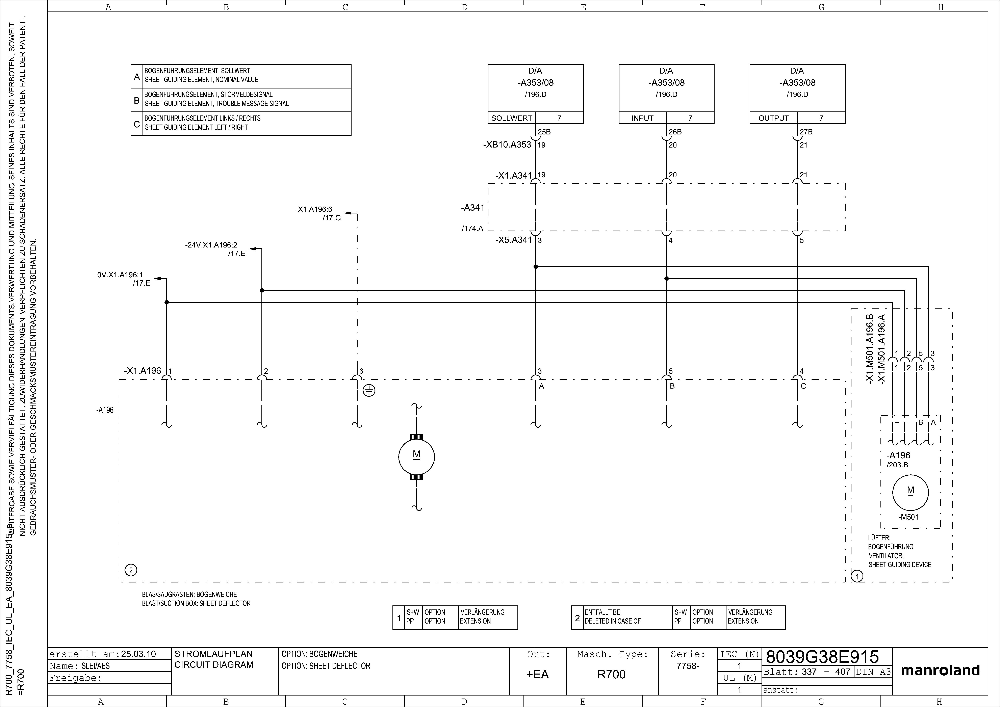

# +EA — Sheet 337 of 407 — OPTION: BOGENWEICHE

**OPTION: SHEET DEFLECTOR**

> Part of the manroland **R700** printing press IEC/UL circuit diagrams.
> Drawing class: **Stromlaufplan / Circuit diagram** (DIN A3).
> Document `+EA` covers the **Printing unit** machine section.

## At a glance

| Field | Value |
|---|---|
| Document | `+EA`  (8039G38E915) |
| Sheet | **337** of 407 |
| Section (DE) | OPTION: BOGENWEICHE |
| Section (EN) | OPTION: SHEET DEFLECTOR |
| Section type | CIRCUIT — Circuit diagram |
| Machine type | `R700` |
| Series | `7758` |
| Created | 25.03.10 |
| Replaces | — |
| Columns used | A, B, C, D, E, F, G, H |
| Path numbers | — |
| Labels on sheet | 100 |
| Cross-refs out | 8 |
| Cross-refs in | 31 |

**Previous:** [+EA sheet 336](SHEET_0336.md) · **Next:** [+EA sheet 338](SHEET_0338.md) · **Document TOC:** [_TOC.md](_TOC.md)  (+EA) · **Master TOC:** [all sheets](../_MASTER_TOC.md)

## Sheet image (300 DPI, exact vector render)



_Rendered directly from the PDF vector layer at 300 DPI (1-bit), no OCR and no resampling. Use it to confirm anything ambiguous in the text below._

## Cross-references on this sheet

Each entry is a wire leaving this sheet. The printed token is `/sheet.column`; the link resolves to that sheet inside the same document.

| Ref | Target sheet | Col | Path | Destination on target | Target section | From col |
|---|---|---|---|---|---|---|
| `/196.D` | [+EA sheet 196](SHEET_0196.md) | D | — | — | REFERENZMODUL | E |
| `/196.D` | [+EA sheet 196](SHEET_0196.md) | D | — | — | REFERENZMODUL | F |
| `/196.D` | [+EA sheet 196](SHEET_0196.md) | D | — | — | REFERENZMODUL | G |
| `/17.G` | [+EA sheet 17](SHEET_0017.md) | G | — | X1.A196:6 | SPANNUNGSVERSORGUNG: 400V, 24V | C |
| `/174.A` | [+EA sheet 174](SHEET_0174.md) | A | — | — | RESERVE | D |
| `/17.E` | [+EA sheet 17](SHEET_0017.md) | E | — | 24V.X1.A196:2 | SPANNUNGSVERSORGUNG: 400V, 24V | B |
| `/17.E` | [+EA sheet 17](SHEET_0017.md) | E | — | 0V.X1.A196:1 | SPANNUNGSVERSORGUNG: 400V, 24V | A |
| `/203.B` | [+EA sheet 203](SHEET_0203.md) | B | — | A196 | REFERENZMODUL | H |

### Incoming references (sheets that point here)

Every other sheet that sends a wire to this one. `Back-ref` is the token printed on *that* sheet; `Path` is its line number.

| From sheet | Cols | Back-ref | Path | Refs | What continues there |
|---|---|---|---|---|---|
| [+EA#17](SHEET_0017.md) | E, G | `/17.E`, `/17.G` | — | 3 | 0V.X1.A196:1 |
| [+EA#174](SHEET_0174.md) | A | `/174.A` | — | 1 | — |
| [+EA#196](SHEET_0196.md) | D | `/196.D` | — | 3 | — |
| [+EA#203](SHEET_0203.md) | B | `/203.B` | — | 1 | — |
| [+EA#207](SHEET_0207.md) | C | `/207.C` | — | 6 | — |
| [+EA#209](SHEET_0209.md) | A | `/209.A` | — | 3 | — |
| [+EA#218](SHEET_0218.md) | H | `/218.H` | — | 8 | — |
| [+EA#240](SHEET_0240.md) | B | `/240.B` | — | 3 | — |
| [+EA#254](SHEET_0254.md) | C | `/254.C` | — | 3 | — |


## Devices on this sheet

| Tag | Class | Class meaning (IEC) | Col | Sub | Terminal | Sign |
|---|---|---|---|---|---|---|
| `A353/08` | A | Baugruppe / assembly, module, PC board | E | 08 | — | — |
| `A353/08` | A | Baugruppe / assembly, module, PC board | G | 08 | — | — |
| `A353/08` | A | Baugruppe / assembly, module, PC board | F | 08 | — | — |
| `A341` | A | Baugruppe / assembly, module, PC board | D | — | — | — |
| `A196` | A | Baugruppe / assembly, module, PC board | H | — | — | — |
| `A196` | A | Baugruppe / assembly, module, PC board | A | — | — | — |
| `XB10.A353` | — | cross-device reference | D | — | — | — |
| `X1.A341` | — | cross-device reference | D | — | — | — |
| `X5.A341` | — | cross-device reference | D | — | — | — |
| `X1.A196` | — | cross-device reference | A | — | — | — |
| `X1.M501.A196.B` | — | cross-device reference | G | — | — | — |
| `X1.M501.A196.A` | — | cross-device reference | H | — | — | — |
| `X1.A196:6` | — | cross-device reference | C | — | 6 | — |

## Potentials / nets

| Potential | Count | Columns | Attached devices | Terminals |
|---|---|---|---|---|
| `0V` | 1 | A | `A196`, `X1` | `1` |
| `24V` | 1 | B | `A196`, `X1` | `2` |
| `M501` | 1 | H | — | — |


A potential such as `L24+/4` or `M24+` is a named supply/return rail; every place it appears on this sheet is electrically common.

## Wire-end annotations (grouped as printed)

A wire that continues elsewhere is annotated with a small cluster: the destination description, the path/line number `#NN`, and the `/sheet.column` cross reference. Each row below is one such cluster exactly as it is grouped on the drawing.

| Col | Y | Path | Cross-ref | Text on the wire |
|---|---|---|---|---|
| E | 80.0 | — | — | `D/A` |
| F | 80.0 | — | — | `D/A` |
| G | 80.0 | — | — | `D/A` |
| B | 81.4 | — | — | `BOGENFÜHRUNGSELEMENT, SOLLWERT` |
| B | 86.8 | — | — | `A SHEET GUIDING ELEMENT, NOMINAL VALUE` |
| E | 93.8 | — | — | `A353/08` |
| F | 93.8 | — | — | `A353/08` |
| G | 93.8 | — | — | `A353/08` |
| E | 108.7 | — | `/196.D` | — |
| F | 108.7 | — | `/196.D` | — |
| G | 108.7 | — | `/196.D` | — |
| B | 109.8 | — | — | `BOGENFÜHRUNGSELEMENT, STÖRMELDESIGNAL` |
| B | 115.1 | — | — | `B SHEET GUIDING ELEMENT, TROUBLE MESSAGE SIGNAL` |
| E | 137.0 | — | — | `SOLLWERT 7` |
| F | 137.1 | — | — | `INPUT 7` |
| G | 137.1 | — | — | `OUTPUT 7` |
| B | 138.1 | — | — | `BOGENFÜHRUNGSELEMENT LINKS / RECHTS` |
| B | 143.5 | — | — | `C SHEET GUIDING ELEMENT LEFT / RIGHT` |
| E | 153.4 | — | — | `25B` |
| F | 153.4 | — | — | `26B` |
| G | 153.4 | — | — | `27B` |
| D | 167.6 | — | — | `XB10.A353 19` |
| F | 169.0 | — | — | `20` |
| G | 169.0 | — | — | `21` |
| F | 204.4 | — | — | `X1.A341 19 20 21` |
| D | 242.7 | — | — | `A341` |
| C | 245.5 | — | `/17.G` | `X1.A196:6` |
| D | 268.1 | — | `/174.A` | — |
| F | 280.9 | — | — | `X5.A341 3 4 5` |
| B | 288.0 | — | `/17.E` | `24V.X1.A196:2` |
| A | 323.4 | — | `/17.E` | `0V.X1.A196:1` |
| G | 373.6 | — | — | `X1.M501.A196.B` |
| H | 374.5 | — | — | `X1.M501.A196.A` |
| H | 417.0 | — | — | `1` |
| H | 417.0 | — | — | `2 5 3` |
| H | 434.0 | — | — | `1` |
| H | 434.0 | — | — | `2 5 3` |
| B | 436.8 | — | — | `X1.A196 1 2 6` |
| F | 438.3 | — | — | `3 5 4` |
| F | 455.9 | — | — | `A B C` |
| A | 484.9 | — | — | `A196` |
| H | 499.1 | — | — | `+ B A` |
| D | 535.8 | — | — | `M` |
| H | 537.5 | — | `/203.B` | `A196` |
| H | 578.6 | — | — | `M` |
| H | 611.9 | — | — | `M501` |
| H | 637.7 | — | — | `LÜFTER: BOGENFÜHRUNG` |
| H | 659.0 | — | — | `SHEET GUIDING DEVICE VENTILATOR:` |
| A | 676.4 | — | — | `2` |
| G | 682.9 | — | — | `1` |
| B | 705.0 | — | — | `BLAS/SAUGKASTEN: BOGENWEICHE BLAST/SUCTION BOX: SHEET DEFLECTOR` |
| D | 726.1 | — | — | `1 PP S+W OPTION OPTION` |
| F | 726.1 | — | — | `PP S+W` |
| D | 726.3 | — | — | `EXTENSION VERLÄNGERUNG` |
| F | 726.3 | — | — | `2 ENTFÄLLT BEI DELETED IN CASE OF EXTENSION VERLÄNGERUNG` |
| F | 726.3 | — | — | `OPTION OPTION` |


## Reconstructed tables

This sheet carries tabular content (pin map / terminal assignment / index). The grid below was rebuilt from the drawing's own rule lines, so each row is exactly one physical row of the table.

### Table 1 — 3 data rows × 2 columns (at x=581.1, y=76.5)

| D/A | A353/08 /196.D |
|---|---|
| `SOLLWERT` | `7` |
| `XB10.A353 X1.A341 X5.A341` | `25B 19 19 3` |
|  | `3 A` |


### Table 2 — 3 data rows × 2 columns (at x=737.0, y=76.5)

| D/A | A353/08 /196.D |
|---|---|
| `INPUT` | `7` |
|  | `26B 20 20 4` |
|  | `5 B` |


### Table 3 — 4 data rows × 8 columns (at x=892.9, y=76.5)

| D/A | A353/08 /196.D |  |  |  |  |  |  |
|---|---|---|---|---|---|---|---|
| `OUTPUT` | `7` |  |  |  |  |  |  |
|  | `27B 21 21 5` |  |  |  |  |  |  |
|  | `4 C` | `X1.M501.A196.B` | `X1.M501.A196.A` | `1 1` | `2 2` | `5 5` | `3 3` |
|  |  |  |  | `+ A196 /203.B` | `M M501` | `B` | `A` |


## Notes and free text on this sheet

| Text | Col | Y (pt) |
|---|---|---|
| `25B` | E | 153.36 |
| `D/A` | E | 79.96 |
| `SOLLWERT` | D | 137 |
| `27B` | G | 153.36 |
| `D/A` | G | 79.96 |
| `OUTPUT` | G | 137.06 |
| `26B` | F | 153.36 |
| `D/A` | F | 79.96 |
| `INPUT` | E | 137.05 |
| `M` | D | 535.83 |
| `M` | H | 578.6 |
| `LÜFTER:` | G | 637.68 |
| `BOGENFÜHRUNG` | H | 648.36 |
| `VENTILATOR:` | H | 658.97 |
| `SHEET GUIDING DEVICE` | H | 669.61 |
| `B` | H | 499.12 |
| `A` | H | 499.12 |
| `BOGENFÜHRUNGSELEMENT, SOLLWERT` | B | 81.41 |
| `SHEET GUIDING ELEMENT, NOMINAL VALUE` | B | 92.05 |
| `A` | A | 86.76 |
| `BOGENFÜHRUNGSELEMENT, STÖRMELDESIGNAL` | B | 109.78 |
| `SHEET GUIDING ELEMENT, TROUBLE MESSAGE SIGNAL` | B | 120.4 |
| `B` | A | 115.1 |
| `BOGENFÜHRUNGSELEMENT LINKS / RECHTS` | B | 138.11 |
| `SHEET GUIDING ELEMENT LEFT / RIGHT` | B | 148.74 |
| `C` | A | 143.46 |
| `S+W` | D | 726.15 |
| `PP` | D | 736.79 |
| `OPTION` | D | 726.27 |
| `VERLÄNGERUNG` | D | 726.31 |
| `EXTENSION` | D | 736.89 |
| `S+W` | F | 726.15 |
| `PP` | F | 736.79 |
| `OPTION` | F | 726.27 |
| `VERLÄNGERUNG` | F | 726.31 |
| `EXTENSION` | F | 736.89 |
| `ENTFÄLLT BEI` | E | 726.26 |
| `DELETED IN CASE OF` | E | 736.91 |
| `BLAS/SAUGKASTEN: BOGENWEICHE` | B | 705.01 |
| `BLAST/SUCTION BOX: SHEET DEFLECTOR` | B | 715.66 |
| `A` | E | 455.89 |
| `B` | F | 455.89 |
| `C` | G | 456.01 |

## Complete label inventory (exact text from the drawing)

Every text object inside the drawing area of this sheet, in DIN reading order (column A→H, then top→bottom). This is the authoritative list: if a string is not here it is not printed on this sheet.

| Col | Y | X | Dir | Type | Text |
|---|---|---|---|---|---|
| A | 86.8 | 159.4 | → | text | `A` |
| A | 115.1 | 159.3 | → | text | `B` |
| A | 143.5 | 159.2 | → | text | `C` |
| A | 323.4 | 115.9 | → | potential | `0V.X1.A196:1` |
| A | 333.3 | 158.5 | → | cross-reference | `/17.E` |
| A | 436.8 | 147.7 | → | device ref | `X1.A196` |
| A | 484.9 | 114.8 | → | device tag | `A196` |
| A | 676.4 | 153.9 | → | number | `2` |
| B | 81.4 | 172.1 | → | text | `BOGENFÜHRUNGSELEMENT, SOLLWERT` |
| B | 92.1 | 172.6 | → | text | `SHEET GUIDING ELEMENT, NOMINAL VALUE` |
| B | 109.8 | 172.1 | → | text | `BOGENFÜHRUNGSELEMENT, STÖRMELDESIGNAL` |
| B | 120.4 | 172.6 | → | text | `SHEET GUIDING ELEMENT, TROUBLE MESSAGE SIGNAL` |
| B | 138.1 | 172.1 | → | text | `BOGENFÜHRUNGSELEMENT LINKS / RECHTS` |
| B | 148.7 | 172.6 | → | text | `SHEET GUIDING ELEMENT LEFT / RIGHT` |
| B | 288.0 | 220.5 | → | potential | `24V.X1.A196:2` |
| B | 297.9 | 271.8 | → | cross-reference | `/17.E` |
| B | 438.3 | 200.4 | → | number | `1` |
| B | 438.3 | 314.4 | → | number | `2` |
| B | 705.0 | 169.2 | → | text | `BLAS/SAUGKASTEN: BOGENWEICHE` |
| B | 715.7 | 169.2 | → | text | `BLAST/SUCTION BOX: SHEET DEFLECTOR` |
| C | 245.5 | 351.8 | → | device ref | `X1.A196:6` |
| C | 255.4 | 384.4 | → | cross-reference | `/17.G` |
| C | 438.3 | 427.7 | → | number | `6` |
| C | 731.6 | 472.3 | → | number | `1` |
| D | 137.0 | 584.9 | → | text | `SOLLWERT` |
| D | 167.5 | 575.4 | → | device ref | `XB10.A353` |
| D | 204.4 | 589.9 | → | device ref | `X1.A341` |
| D | 242.7 | 549.1 | → | device tag | `A341` |
| D | 268.1 | 549.9 | → | cross-reference | `/174.A` |
| D | 280.9 | 589.9 | → | device ref | `X5.A341` |
| D | 535.8 | 491.4 | → | text | `M` |
| D | 726.2 | 484.4 | → | text | `S+W` |
| D | 726.3 | 505.7 | → | text | `OPTION` |
| D | 726.3 | 548.5 | → | text | `VERLÄNGERUNG` |
| D | 736.8 | 483.9 | → | text | `PP` |
| D | 736.9 | 505.7 | → | text | `OPTION` |
| D | 736.9 | 547.7 | → | text | `EXTENSION` |
| E | 80.0 | 629.0 | → | text | `D/A` |
| E | 93.8 | 616.4 | → | device tag | `A353/08` |
| E | 108.7 | 625.0 | → | cross-reference | `/196.D` |
| E | 137.0 | 751.9 | → | text | `INPUT` |
| E | 137.1 | 663.7 | → | number | `7` |
| E | 153.4 | 640.3 | → | text | `25B` |
| E | 169.0 | 639.8 | → | number | `19` |
| E | 204.4 | 639.8 | → | number | `19` |
| E | 282.4 | 640.3 | → | number | `3` |
| E | 438.3 | 640.3 | → | number | `3` |
| E | 455.9 | 641.9 | → | text | `A` |
| E | 726.3 | 696.5 | → | text | `ENTFÄLLT BEI` |
| E | 731.6 | 684.6 | → | number | `2` |
| E | 736.9 | 696.5 | → | text | `DELETED IN CASE OF` |
| F | 80.0 | 784.9 | → | text | `D/A` |
| F | 93.8 | 772.3 | → | device tag | `A353/08` |
| F | 108.7 | 780.9 | → | cross-reference | `/196.D` |
| F | 137.1 | 819.6 | → | number | `7` |
| F | 153.4 | 796.3 | → | text | `26B` |
| F | 169.0 | 796.3 | → | number | `20` |
| F | 204.4 | 796.3 | → | number | `20` |
| F | 282.4 | 796.3 | → | number | `4` |
| F | 438.3 | 796.3 | → | number | `5` |
| F | 455.9 | 797.5 | → | text | `B` |
| F | 726.2 | 803.3 | → | text | `S+W` |
| F | 726.3 | 824.6 | → | text | `OPTION` |
| F | 726.3 | 867.4 | → | text | `VERLÄNGERUNG` |
| F | 736.8 | 802.8 | → | text | `PP` |
| F | 736.9 | 824.6 | → | text | `OPTION` |
| F | 736.9 | 866.6 | → | text | `EXTENSION` |
| G | 80.0 | 940.8 | → | text | `D/A` |
| G | 93.8 | 928.2 | → | device tag | `A353/08` |
| G | 108.7 | 936.9 | → | cross-reference | `/196.D` |
| G | 137.1 | 903.3 | → | text | `OUTPUT` |
| G | 137.1 | 975.5 | → | number | `7` |
| G | 153.4 | 952.2 | → | text | `27B` |
| G | 169.0 | 952.2 | → | number | `21` |
| G | 204.4 | 952.2 | → | number | `21` |
| G | 282.4 | 952.2 | → | number | `5` |
| G | 373.6 | 1030.7 | ↕ | device ref | `X1.M501.A196.B` |
| G | 438.3 | 952.2 | → | number | `4` |
| G | 456.0 | 953.6 | → | text | `C` |
| G | 637.7 | 1033.8 | → | text | `LÜFTER:` |
| G | 682.9 | 1018.7 | → | number | `1` |
| H | 374.5 | 1044.9 | ↕ | device ref | `X1.M501.A196.A` |
| H | 417.0 | 1065.0 | → | number | `1` |
| H | 417.0 | 1079.7 | → | number | `2` |
| H | 417.0 | 1093.9 | → | number | `5` |
| H | 417.0 | 1108.1 | → | number | `3` |
| H | 434.0 | 1065.0 | → | number | `1` |
| H | 434.0 | 1079.7 | → | number | `2` |
| H | 434.0 | 1093.9 | → | number | `5` |
| H | 434.0 | 1108.1 | → | number | `3` |
| H | 499.1 | 1093.3 | → | text | `B` |
| H | 499.1 | 1108.3 | → | text | `A` |
| H | 499.2 | 1065.5 | → | number | `+` |
| H | 537.5 | 1055.6 | → | device tag | `A196` |
| H | 549.8 | 1055.9 | → | cross-reference | `/203.B` |
| H | 578.6 | 1079.9 | → | text | `M` |
| H | 611.9 | 1069.8 | → | potential | `M501` |
| H | 648.4 | 1033.8 | → | text | `BOGENFÜHRUNG` |
| H | 659.0 | 1034.6 | → | text | `VENTILATOR:` |
| H | 669.6 | 1034.4 | → | text | `SHEET GUIDING DEVICE` |

## Reading-order text block

The same content as a plain block, grouped by DIN column — convenient to paste or to match against a visual description.

```text
=== Column A ===
  86.8  159.4  text         A
 115.1  159.3  text         B
 143.5  159.2  text         C
 323.4  115.9  net          0V.X1.A196:1
 333.3  158.5  xref         /17.E
 436.8  147.7  devref       X1.A196
 484.9  114.8  devtag       A196
 676.4  153.9  numeric      2
=== Column B ===
  81.4  172.1  text         BOGENFÜHRUNGSELEMENT, SOLLWERT
  92.1  172.6  text         SHEET GUIDING ELEMENT, NOMINAL VALUE
 109.8  172.1  text         BOGENFÜHRUNGSELEMENT, STÖRMELDESIGNAL
 120.4  172.6  text         SHEET GUIDING ELEMENT, TROUBLE MESSAGE SIGNAL
 138.1  172.1  text         BOGENFÜHRUNGSELEMENT LINKS / RECHTS
 148.7  172.6  text         SHEET GUIDING ELEMENT LEFT / RIGHT
 288.0  220.5  net          24V.X1.A196:2
 297.9  271.8  xref         /17.E
 438.3  200.4  numeric      1
 438.3  314.4  numeric      2
 705.0  169.2  text         BLAS/SAUGKASTEN: BOGENWEICHE
 715.7  169.2  text         BLAST/SUCTION BOX: SHEET DEFLECTOR
=== Column C ===
 245.5  351.8  devref       X1.A196:6
 255.4  384.4  xref         /17.G
 438.3  427.7  numeric      6
 731.6  472.3  numeric      1
=== Column D ===
 137.0  584.9  text         SOLLWERT
 167.5  575.4  devref       XB10.A353
 204.4  589.9  devref       X1.A341
 242.7  549.1  devtag       A341
 268.1  549.9  xref         /174.A
 280.9  589.9  devref       X5.A341
 535.8  491.4  text         M
 726.2  484.4  text         S+W
 726.3  505.7  text         OPTION
 726.3  548.5  text         VERLÄNGERUNG
 736.8  483.9  text         PP
 736.9  505.7  text         OPTION
 736.9  547.7  text         EXTENSION
=== Column E ===
  80.0  629.0  text         D/A
  93.8  616.4  devtag       A353/08
 108.7  625.0  xref         /196.D
 137.0  751.9  text         INPUT
 137.1  663.7  numeric      7
 153.4  640.3  text         25B
 169.0  639.8  numeric      19
 204.4  639.8  numeric      19
 282.4  640.3  numeric      3
 438.3  640.3  numeric      3
 455.9  641.9  text         A
 726.3  696.5  text         ENTFÄLLT BEI
 731.6  684.6  numeric      2
 736.9  696.5  text         DELETED IN CASE OF
=== Column F ===
  80.0  784.9  text         D/A
  93.8  772.3  devtag       A353/08
 108.7  780.9  xref         /196.D
 137.1  819.6  numeric      7
 153.4  796.3  text         26B
 169.0  796.3  numeric      20
 204.4  796.3  numeric      20
 282.4  796.3  numeric      4
 438.3  796.3  numeric      5
 455.9  797.5  text         B
 726.2  803.3  text         S+W
 726.3  824.6  text         OPTION
 726.3  867.4  text         VERLÄNGERUNG
 736.8  802.8  text         PP
 736.9  824.6  text         OPTION
 736.9  866.6  text         EXTENSION
=== Column G ===
  80.0  940.8  text         D/A
  93.8  928.2  devtag       A353/08
 108.7  936.9  xref         /196.D
 137.1  903.3  text         OUTPUT
 137.1  975.5  numeric      7
 153.4  952.2  text         27B
 169.0  952.2  numeric      21
 204.4  952.2  numeric      21
 282.4  952.2  numeric      5
 373.6 1030.7  devref       X1.M501.A196.B
 438.3  952.2  numeric      4
 456.0  953.6  text         C
 637.7 1033.8  text         LÜFTER:
 682.9 1018.7  numeric      1
=== Column H ===
 374.5 1044.9  devref       X1.M501.A196.A
 417.0 1065.0  numeric      1
 417.0 1079.7  numeric      2
 417.0 1093.9  numeric      5
 417.0 1108.1  numeric      3
 434.0 1065.0  numeric      1
 434.0 1079.7  numeric      2
 434.0 1093.9  numeric      5
 434.0 1108.1  numeric      3
 499.1 1093.3  text         B
 499.1 1108.3  text         A
 499.2 1065.5  numeric      +
 537.5 1055.6  devtag       A196
 549.8 1055.9  xref         /203.B
 578.6 1079.9  text         M
 611.9 1069.8  net          M501
 648.4 1033.8  text         BOGENFÜHRUNG
 659.0 1034.6  text         VENTILATOR:
 669.6 1034.4  text         SHEET GUIDING DEVICE
```

---
_Generated from the PDF vector text layer; no OCR. Source: `R700_7758_IEC_UL_EA_8039G38E915_p`, sheet 337._
