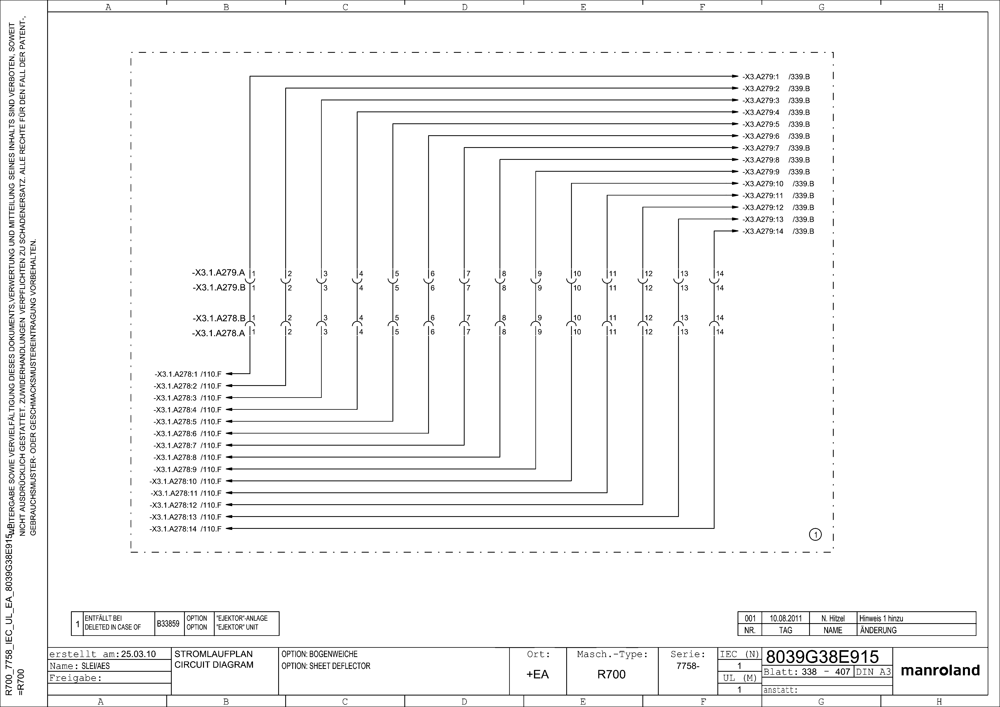

# +EA — Sheet 338 of 407 — OPTION: BOGENWEICHE

**OPTION: SHEET DEFLECTOR**

> Part of the manroland **R700** printing press IEC/UL circuit diagrams.
> Drawing class: **Stromlaufplan / Circuit diagram** (DIN A3).
> Document `+EA` covers the **Printing unit** machine section.

## At a glance

| Field | Value |
|---|---|
| Document | `+EA`  (8039G38E915) |
| Sheet | **338** of 407 |
| Section (DE) | OPTION: BOGENWEICHE |
| Section (EN) | OPTION: SHEET DEFLECTOR |
| Section type | CIRCUIT — Circuit diagram |
| Machine type | `R700` |
| Series | `7758` |
| Created | 25.03.10 |
| Replaces | — |
| Columns used | A, B, C, D, E, F, G, H |
| Path numbers | — |
| Labels on sheet | 133 |
| Cross-refs out | 28 |
| Cross-refs in | 84 |

**Previous:** [+EA sheet 337](SHEET_0337.md) · **Next:** [+EA sheet 339](SHEET_0339.md) · **Document TOC:** [_TOC.md](_TOC.md)  (+EA) · **Master TOC:** [all sheets](../_MASTER_TOC.md)

## Sheet image (300 DPI, exact vector render)



_Rendered directly from the PDF vector layer at 300 DPI (1-bit), no OCR and no resampling. Use it to confirm anything ambiguous in the text below._

## Cross-references on this sheet

Each entry is a wire leaving this sheet. The printed token is `/sheet.column`; the link resolves to that sheet inside the same document.

| Ref | Target sheet | Col | Path | Destination on target | Target section | From col |
|---|---|---|---|---|---|---|
| `/339.B` | [+EA sheet 339](SHEET_0339.md) | B | — | X3.A279:1 | OPTION: BOGENWEICHE | G |
| `/339.B` | [+EA sheet 339](SHEET_0339.md) | B | — | X3.A279:2 | OPTION: BOGENWEICHE | G |
| `/339.B` | [+EA sheet 339](SHEET_0339.md) | B | — | X3.A279:3 | OPTION: BOGENWEICHE | G |
| `/339.B` | [+EA sheet 339](SHEET_0339.md) | B | — | X3.A279:4 | OPTION: BOGENWEICHE | G |
| `/339.B` | [+EA sheet 339](SHEET_0339.md) | B | — | X3.A279:5 | OPTION: BOGENWEICHE | G |
| `/339.B` | [+EA sheet 339](SHEET_0339.md) | B | — | X3.A279:6 | OPTION: BOGENWEICHE | G |
| `/339.B` | [+EA sheet 339](SHEET_0339.md) | B | — | X3.A279:7 | OPTION: BOGENWEICHE | G |
| `/339.B` | [+EA sheet 339](SHEET_0339.md) | B | — | X3.A279:8 | OPTION: BOGENWEICHE | G |
| `/339.B` | [+EA sheet 339](SHEET_0339.md) | B | — | X3.A279:9 | OPTION: BOGENWEICHE | G |
| `/339.B` | [+EA sheet 339](SHEET_0339.md) | B | — | X3.A279:10 | OPTION: BOGENWEICHE | G |
| `/339.B` | [+EA sheet 339](SHEET_0339.md) | B | — | X3.A279:11 | OPTION: BOGENWEICHE | G |
| `/339.B` | [+EA sheet 339](SHEET_0339.md) | B | — | X3.A279:12 | OPTION: BOGENWEICHE | G |
| `/339.B` | [+EA sheet 339](SHEET_0339.md) | B | — | X3.A279:13 | OPTION: BOGENWEICHE | G |
| `/339.B` | [+EA sheet 339](SHEET_0339.md) | B | — | X3.A279:14 | OPTION: BOGENWEICHE | G |
| `/110.F` | [+EA sheet 110](SHEET_0110.md) | F | — | X3.1.A278:1 | BLAS/SAUGLUFT MIT MOTORVENTILEINSTELLUNG | B |
| `/110.F` | [+EA sheet 110](SHEET_0110.md) | F | — | X3.1.A278:2 | BLAS/SAUGLUFT MIT MOTORVENTILEINSTELLUNG | B |
| `/110.F` | [+EA sheet 110](SHEET_0110.md) | F | — | X3.1.A278:3 | BLAS/SAUGLUFT MIT MOTORVENTILEINSTELLUNG | B |
| `/110.F` | [+EA sheet 110](SHEET_0110.md) | F | — | X3.1.A278:4 | BLAS/SAUGLUFT MIT MOTORVENTILEINSTELLUNG | B |
| `/110.F` | [+EA sheet 110](SHEET_0110.md) | F | — | X3.1.A278:5 | BLAS/SAUGLUFT MIT MOTORVENTILEINSTELLUNG | B |
| `/110.F` | [+EA sheet 110](SHEET_0110.md) | F | — | X3.1.A278:6 | BLAS/SAUGLUFT MIT MOTORVENTILEINSTELLUNG | B |
| `/110.F` | [+EA sheet 110](SHEET_0110.md) | F | — | X3.1.A278:7 | BLAS/SAUGLUFT MIT MOTORVENTILEINSTELLUNG | B |
| `/110.F` | [+EA sheet 110](SHEET_0110.md) | F | — | X3.1.A278:8 | BLAS/SAUGLUFT MIT MOTORVENTILEINSTELLUNG | B |
| `/110.F` | [+EA sheet 110](SHEET_0110.md) | F | — | X3.1.A278:9 | BLAS/SAUGLUFT MIT MOTORVENTILEINSTELLUNG | B |
| `/110.F` | [+EA sheet 110](SHEET_0110.md) | F | — | X3.1.A278:10 | BLAS/SAUGLUFT MIT MOTORVENTILEINSTELLUNG | B |
| `/110.F` | [+EA sheet 110](SHEET_0110.md) | F | — | X3.1.A278:11 | BLAS/SAUGLUFT MIT MOTORVENTILEINSTELLUNG | B |
| `/110.F` | [+EA sheet 110](SHEET_0110.md) | F | — | X3.1.A278:12 | BLAS/SAUGLUFT MIT MOTORVENTILEINSTELLUNG | B |
| `/110.F` | [+EA sheet 110](SHEET_0110.md) | F | — | X3.1.A278:13 | BLAS/SAUGLUFT MIT MOTORVENTILEINSTELLUNG | B |
| `/110.F` | [+EA sheet 110](SHEET_0110.md) | F | — | X3.1.A278:14 | BLAS/SAUGLUFT MIT MOTORVENTILEINSTELLUNG | B |

### Incoming references (sheets that point here)

Every other sheet that sends a wire to this one. `Back-ref` is the token printed on *that* sheet; `Path` is its line number.

| From sheet | Cols | Back-ref | Path | Refs | What continues there |
|---|---|---|---|---|---|
| [+EA#110](SHEET_0110.md) | G | `/110.G` | — | 14 | X3.1.A278:1; X3.1.A278:10; X3.1.A278:11; X3.1.A278:12; X3.1.A278:13; X3.1.A278:14; X3.1.A278:2; X3.1.A278:3; X3.1.A278:4; X3.1.A278:5; X3.1.A278:6; X3.1.A278:7; |
| [+EA#233](SHEET_0233.md) | D, E | `/233.D`, `/233.E` | — | 56 | — |
| [+EA#339](SHEET_0339.md) | B, D | `/339.B`, `/339.D` | — | 14 | X3.A279:1; X3.A279:10 X3.A280:10; X3.A279:11; X3.A279:12; X3.A279:13; X3.A279:14; X3.A279:2; X3.A279:3; X3.A279:4; X3.A279:5; X3.A279:6; X3.A279:7; X3.A279:8; X |


## Devices on this sheet

| Tag | Class | Class meaning (IEC) | Col | Sub | Terminal | Sign |
|---|---|---|---|---|---|---|
| `X3.1.A279.A` | — | cross-device reference | B | — | — | — |
| `X3.1.A279.B` | — | cross-device reference | B | — | — | — |
| `X3.1.A278.A` | — | cross-device reference | B | — | — | — |
| `X3.1.A278.B` | — | cross-device reference | B | — | — | — |
| `X3.1.A278:13` | — | cross-device reference | B | — | 13 | — |
| `X3.1.A278:12` | — | cross-device reference | B | — | 12 | — |
| `X3.1.A278:14` | — | cross-device reference | B | — | 14 | — |
| `X3.1.A278:1` | — | cross-device reference | B | — | 1 | — |
| `X3.1.A278:2` | — | cross-device reference | B | — | 2 | — |
| `X3.1.A278:11` | — | cross-device reference | B | — | 11 | — |
| `X3.1.A278:10` | — | cross-device reference | B | — | 10 | — |
| `X3.1.A278:9` | — | cross-device reference | B | — | 9 | — |
| `X3.1.A278:8` | — | cross-device reference | B | — | 8 | — |
| `X3.1.A278:3` | — | cross-device reference | B | — | 3 | — |
| `X3.1.A278:7` | — | cross-device reference | B | — | 7 | — |
| `X3.1.A278:6` | — | cross-device reference | B | — | 6 | — |
| `X3.1.A278:5` | — | cross-device reference | B | — | 5 | — |
| `X3.1.A278:4` | — | cross-device reference | B | — | 4 | — |
| `X3.A279:14` | — | cross-device reference | G | — | 14 | — |
| `X3.A279:8` | — | cross-device reference | F | — | 8 | — |
| `X3.A279:7` | — | cross-device reference | F | — | 7 | — |
| `X3.A279:6` | — | cross-device reference | F | — | 6 | — |
| `X3.A279:5` | — | cross-device reference | F | — | 5 | — |
| `X3.A279:9` | — | cross-device reference | F | — | 9 | — |
| `X3.A279:13` | — | cross-device reference | G | — | 13 | — |
| `X3.A279:12` | — | cross-device reference | G | — | 12 | — |
| `X3.A279:11` | — | cross-device reference | G | — | 11 | — |
| `X3.A279:10` | — | cross-device reference | G | — | 10 | — |
| `X3.A279:4` | — | cross-device reference | F | — | 4 | — |
| `X3.A279:3` | — | cross-device reference | F | — | 3 | — |
| `X3.A279:2` | — | cross-device reference | F | — | 2 | — |
| `X3.A279:1` | — | cross-device reference | F | — | 1 | — |
| `NR.` | — | cross-device reference | F | — | — | — |
| `10.08.2011` | — | cross-device reference | G | — | — | — |

## Potentials / nets

_No named potentials on this sheet._

## Wire-end annotations (grouped as printed)

A wire that continues elsewhere is annotated with a small cluster: the destination description, the path/line number `#NN`, and the `/sheet.column` cross reference. Each row below is one such cluster exactly as it is grouped on the drawing.

| Col | Y | Path | Cross-ref | Text on the wire |
|---|---|---|---|---|
| G | 87.4 | — | `/339.B` | `X3.A279:1` |
| G | 101.6 | — | `/339.B` | `X3.A279:2` |
| G | 115.8 | — | `/339.B` | `X3.A279:3` |
| G | 129.9 | — | `/339.B` | `X3.A279:4` |
| G | 144.1 | — | `/339.B` | `X3.A279:5` |
| G | 158.3 | — | `/339.B` | `X3.A279:6` |
| G | 172.5 | — | `/339.B` | `X3.A279:7` |
| G | 186.6 | — | `/339.B` | `X3.A279:8` |
| G | 200.8 | — | `/339.B` | `X3.A279:9` |
| G | 215.0 | — | `/339.B` | `X3.A279:10` |
| G | 229.2 | — | `/339.B` | `X3.A279:11` |
| G | 243.3 | — | `/339.B` | `X3.A279:12` |
| G | 257.5 | — | `/339.B` | `X3.A279:13` |
| G | 271.7 | — | `/339.B` | `X3.A279:14` |
| C | 319.9 | — | — | `X3.1.A279.A 1 2 3 4 5` |
| D | 322.1 | — | — | `6 7 8 9 10` |
| F | 322.1 | — | — | `11 12 13 14` |
| C | 337.6 | — | — | `X3.1.A279.B 1 2 3 5` |
| E | 339.1 | — | — | `4 11 12 13 14` |
| D | 339.1 | — | — | `6 7 8 9 10` |
| B | 374.5 | — | — | `X3.1.A278.B 1 3` |
| C | 374.5 | — | — | `2` |
| D | 374.5 | — | — | `4 5 6 13` |
| D | 374.5 | — | — | `7` |
| D | 374.5 | — | — | `8` |
| E | 374.5 | — | — | `9 11` |
| E | 374.5 | — | — | `10` |
| F | 374.5 | — | — | `12` |
| F | 374.5 | — | — | `14` |
| B | 391.5 | — | — | `X3.1.A278.A 1` |
| C | 391.5 | — | — | `2 3` |
| D | 391.5 | — | — | `4 5 6 7` |
| D | 391.5 | — | — | `8` |
| E | 391.5 | — | — | `9` |
| E | 391.5 | — | — | `10 11` |
| F | 391.5 | — | — | `12` |
| F | 391.5 | — | — | `13` |
| F | 391.5 | — | — | `14` |
| B | 441.8 | — | `/110.F` | `X3.1.A278:1` |
| B | 455.9 | — | `/110.F` | `X3.1.A278:2` |
| B | 470.1 | — | `/110.F` | `X3.1.A278:3` |
| B | 484.3 | — | `/110.F` | `X3.1.A278:4` |
| B | 498.5 | — | `/110.F` | `X3.1.A278:5` |
| B | 512.6 | — | `/110.F` | `X3.1.A278:6` |
| B | 526.8 | — | `/110.F` | `X3.1.A278:7` |
| B | 541.0 | — | `/110.F` | `X3.1.A278:8` |
| B | 555.2 | — | `/110.F` | `X3.1.A278:9` |
| B | 569.3 | — | `/110.F` | `X3.1.A278:10` |
| B | 583.5 | — | `/110.F` | `X3.1.A278:11` |
| B | 597.7 | — | `/110.F` | `X3.1.A278:12` |
| B | 611.9 | — | `/110.F` | `X3.1.A278:13` |
| B | 626.0 | — | `/110.F` | `X3.1.A278:14` |
| G | 633.3 | — | — | `1` |
| D | 732.7 | — | — | `1 ENTFÄLLT BEI DELETED IN CASE OF B33859 001 10.08.2011 N. Hitzel Hinweis 1 hinzu` |
| B | 733.4 | — | — | `OPTION OPTION` |
| B | 733.4 | — | — | `"EJEKTOR" ANLAGE "EJEKTOR" UNIT` |
| G | 747.0 | — | — | `NR. TAG NAME ÄNDERUNG` |


## Reconstructed tables

This sheet carries tabular content (pin map / terminal assignment / index). The grid below was rebuilt from the drawing's own rule lines, so each row is exactly one physical row of the table.

### Table 1 — 31 data rows × 21 columns (at x=204.1, y=0.0)

|  |  |  |  |  |  |  |  |  |  |  |  |  |  |  |  |  |  |  | X3.A279:1 | /339.B |
|---|---|---|---|---|---|---|---|---|---|---|---|---|---|---|---|---|---|---|---|---|
|  |  |  |  |  |  |  |  |  |  |  |  |  |  |  |  |  |  |  | `X3.A279:2` | `/339.B` |
|  |  |  |  |  |  |  |  |  |  |  |  |  |  |  |  |  |  |  | `X3.A279:3` | `/339.B` |
|  |  |  |  |  |  |  |  |  |  |  |  |  |  |  |  |  |  |  | `X3.A279:4` | `/339.B` |
|  |  |  |  |  |  |  |  |  |  |  |  |  |  |  |  |  |  |  | `X3.A279:5` | `/339.B` |
|  |  |  |  |  |  |  |  |  |  |  |  |  |  |  |  |  |  |  | `X3.A279:6` | `/339.B` |
|  |  |  |  |  |  |  |  |  |  |  |  |  |  |  |  |  |  |  | `X3.A279:7` | `/339.B` |
|  |  |  |  |  |  |  |  |  |  |  |  |  |  |  |  |  |  |  | `X3.A279:8` | `/339.B` |
|  |  |  |  |  |  |  |  |  |  |  |  |  |  |  |  |  |  |  | `X3.A279:9` | `/339.B` |
|  |  |  |  |  |  |  |  |  |  |  |  |  |  |  |  |  |  |  |  | `/339.B X3.A279:10` |
|  |  |  |  |  |  |  |  |  |  |  |  |  |  |  |  |  |  |  |  | `/339.B X3.A279:11` |
|  |  |  |  |  |  |  |  |  |  |  |  |  |  |  |  |  |  |  |  | `/339.B X3.A279:12` |
| `X3.1.A279.A X3.1.A279.B X3.1.A278.B X3.1.A278.A /110.F X3.1.A278:1` | `1 1 1 1` |  | `2 2 2 2` | `3 3 3 3` | `4 4 4 4` | `5 5 5 5` | `6 6 6 6` | `7 7 7 7` | `8 8 8 8` |  | `9 9 9 9` |  | `10 10 10 10` | `11 11 11 11` | `12 12 12 12` |  | `13 13 13 13` |  | `14 14 14 14` | `/339.B X3.A279:13 /339.B X3.A279:14` |
| `/110.F X3.1.A278:2` |  |  |  |  |  |  |  |  |  |  |  |  |  |  |  |  |  |  |  |  |
| `/110.F X3.1.A278:3` |  |  |  |  |  |  |  |  |  |  |  |  |  |  |  |  |  |  |  |  |
| `/110.F X3.1.A278:4` |  |  |  |  |  |  |  |  |  |  |  |  |  |  |  |  |  |  |  |  |
| `/110.F X3.1.A278:5` |  |  |  |  |  |  |  |  |  |  |  |  |  |  |  |  |  |  |  |  |
| `/110.F X3.1.A278:6` |  |  |  |  |  |  |  |  |  |  |  |  |  |  |  |  |  |  |  |  |
| `/110.F X3.1.A278:7` |  |  |  |  |  |  |  |  |  |  |  |  |  |  |  |  |  |  |  |  |
| `/110.F X3.1.A278:8` |  |  |  |  |  |  |  |  |  |  |  |  |  |  |  |  |  |  |  |  |
| `/110.F X3.1.A278:9` |  |  |  |  |  |  |  |  |  |  |  |  |  |  |  |  |  |  |  |  |
| `/110.F X3.1.A278:10` |  |  |  |  |  |  |  |  |  |  |  |  |  |  |  |  |  |  |  |  |
| `/110.F X3.1.A278:11` |  |  |  |  |  |  |  |  |  |  |  |  |  |  |  |  |  |  |  |  |
| `/110.F X3.1.A278:12` |  |  |  |  |  |  |  |  |  |  |  |  |  |  |  |  |  |  |  |  |
| `/110.F X3.1.A278:13` |  |  |  |  |  |  |  |  |  |  |  |  |  |  |  |  |  |  |  |  |
| `/110.F X3.1.A278:14 OPTION "EJEKTOR" ANLAGE OPTION "EJEKTOR"` | `UNIT` |  |  |  |  |  |  |  |  |  |  |  |  |  |  |  |  |  | `001 NR.` | `1 10.08.2011 Hinweis 1 N. Hitzel NAME TAG ÄNDERUNG` |
| `STROMLAUFPLAN` |  |  | `OPTION:` | `BOGENWEICHE` |  |  |  |  |  |  | `Ort:` |  |  | `Masch. Type:` |  |  | `Serie:` |  | `IEC (N)` | `8039G38E915` |
| `CIRCUIT DIAGRAM` |  |  |  |  |  |  |  |  |  |  |  |  |  |  |  |  |  |  |  |  |
|  |  |  | `OPTION: SHEET` | `DEFLECTOR` |  |  |  |  |  |  |  |  |  |  |  |  | `7758` |  | `1` |  |
|  |  |  |  |  |  |  |  |  |  |  | `+EA` |  |  | `R700` |  |  |  |  |  | `Blatt: DIN A3 338 407` |
|  |  |  |  |  |  |  |  |  |  |  |  |  |  |  |  |  |  |  | `UL (M)` |  |
|  |  |  |  |  |  |  |  |  |  |  |  |  |  |  |  |  |  |  | `1` | `anstatt:` |


## Notes and free text on this sheet

| Text | Col | Y (pt) |
|---|---|---|
| `TAG` | G | 747.05 |
| `NAME` | G | 747.05 |
| `ÄNDERUNG` | G | 747.11 |
| `N. Hitzel` | G | 733.02 |
| `Hinweis 1 hinzu` | H | 732.98 |
| `ENTFÄLLT BEI` | A | 733.35 |
| `DELETED IN CASE OF` | A | 744 |
| `B33859` | B | 739.23 |
| `OPTION` | B | 733.35 |
| `"EJEKTOR" ANLAGE` | B | 733.38 |
| `"EJEKTOR" UNIT` | B | 744.01 |

## Complete label inventory (exact text from the drawing)

Every text object inside the drawing area of this sheet, in DIN reading order (column A→H, then top→bottom). This is the authoritative list: if a string is not here it is not printed on this sheet.

| Col | Y | X | Dir | Type | Text |
|---|---|---|---|---|---|
| A | 733.3 | 101.2 | → | text | `ENTFÄLLT BEI` |
| A | 738.7 | 89.6 | → | number | `1` |
| A | 744.0 | 101.2 | → | text | `DELETED IN CASE OF` |
| B | 319.9 | 228.8 | → | device ref | `X3.1.A279.A` |
| B | 322.1 | 299.6 | → | number | `1` |
| B | 337.6 | 229.6 | → | device ref | `X3.1.A279.B` |
| B | 339.1 | 299.6 | → | number | `1` |
| B | 374.5 | 229.6 | → | device ref | `X3.1.A278.B` |
| B | 374.5 | 299.6 | → | number | `1` |
| B | 391.5 | 299.6 | → | number | `1` |
| B | 392.2 | 228.8 | → | device ref | `X3.1.A278.A` |
| B | 441.8 | 184.3 | → | device ref | `X3.1.A278:1` |
| B | 441.8 | 239.0 | → | cross-reference | `/110.F` |
| B | 455.9 | 183.1 | → | device ref | `X3.1.A278:2` |
| B | 455.9 | 239.0 | → | cross-reference | `/110.F` |
| B | 470.1 | 182.8 | → | device ref | `X3.1.A278:3` |
| B | 470.1 | 239.0 | → | cross-reference | `/110.F` |
| B | 484.3 | 182.8 | → | device ref | `X3.1.A278:4` |
| B | 484.3 | 239.0 | → | cross-reference | `/110.F` |
| B | 498.5 | 182.8 | → | device ref | `X3.1.A278:5` |
| B | 498.5 | 239.0 | → | cross-reference | `/110.F` |
| B | 512.6 | 182.8 | → | device ref | `X3.1.A278:6` |
| B | 512.6 | 239.0 | → | cross-reference | `/110.F` |
| B | 526.8 | 182.8 | → | device ref | `X3.1.A278:7` |
| B | 526.8 | 239.0 | → | cross-reference | `/110.F` |
| B | 541.0 | 182.8 | → | device ref | `X3.1.A278:8` |
| B | 541.0 | 239.0 | → | cross-reference | `/110.F` |
| B | 555.2 | 182.8 | → | device ref | `X3.1.A278:9` |
| B | 555.2 | 239.0 | → | cross-reference | `/110.F` |
| B | 569.3 | 178.0 | → | device ref | `X3.1.A278:10` |
| B | 569.3 | 239.0 | → | cross-reference | `/110.F` |
| B | 583.5 | 179.4 | → | device ref | `X3.1.A278:11` |
| B | 583.5 | 239.0 | → | cross-reference | `/110.F` |
| B | 597.7 | 178.3 | → | device ref | `X3.1.A278:12` |
| B | 597.7 | 239.0 | → | cross-reference | `/110.F` |
| B | 611.8 | 239.0 | → | cross-reference | `/110.F` |
| B | 611.9 | 178.0 | → | device ref | `X3.1.A278:13` |
| B | 626.0 | 178.0 | → | device ref | `X3.1.A278:14` |
| B | 626.0 | 239.0 | → | cross-reference | `/110.F` |
| B | 733.4 | 222.2 | → | text | `OPTION` |
| B | 733.4 | 257.7 | → | text | `"EJEKTOR" ANLAGE` |
| B | 739.2 | 186.9 | → | text | `B33859` |
| B | 744.0 | 222.2 | → | text | `OPTION` |
| B | 744.0 | 257.7 | → | text | `"EJEKTOR" UNIT` |
| C | 322.1 | 342.7 | → | number | `2` |
| C | 322.1 | 385.2 | → | number | `3` |
| C | 322.1 | 427.7 | → | number | `4` |
| C | 322.1 | 470.3 | → | number | `5` |
| C | 339.1 | 342.7 | → | number | `2` |
| C | 339.1 | 385.2 | → | number | `3` |
| C | 339.1 | 427.7 | → | number | `4` |
| C | 339.1 | 470.3 | → | number | `5` |
| C | 374.5 | 342.7 | → | number | `2` |
| C | 374.5 | 385.2 | → | number | `3` |
| C | 374.5 | 427.7 | → | number | `4` |
| C | 374.5 | 470.3 | → | number | `5` |
| C | 391.5 | 342.7 | → | number | `2` |
| C | 391.5 | 385.2 | → | number | `3` |
| C | 391.5 | 427.7 | → | number | `4` |
| C | 391.5 | 470.3 | → | number | `5` |
| D | 322.1 | 512.8 | → | number | `6` |
| D | 322.1 | 555.3 | → | number | `7` |
| D | 322.1 | 597.8 | → | number | `8` |
| D | 339.1 | 512.8 | → | number | `6` |
| D | 339.1 | 555.3 | → | number | `7` |
| D | 339.1 | 597.8 | → | number | `8` |
| D | 374.5 | 512.8 | → | number | `6` |
| D | 374.5 | 555.3 | → | number | `7` |
| D | 374.5 | 597.8 | → | number | `8` |
| D | 391.5 | 512.8 | → | number | `6` |
| D | 391.5 | 555.3 | → | number | `7` |
| D | 391.5 | 597.8 | → | number | `8` |
| E | 322.1 | 640.3 | → | number | `9` |
| E | 322.1 | 682.3 | → | number | `10` |
| E | 322.1 | 724.8 | → | number | `11` |
| E | 339.1 | 640.3 | → | number | `9` |
| E | 339.1 | 682.3 | → | number | `10` |
| E | 339.1 | 724.8 | → | number | `11` |
| E | 374.5 | 640.3 | → | number | `9` |
| E | 374.5 | 682.3 | → | number | `10` |
| E | 374.5 | 724.8 | → | number | `11` |
| E | 391.5 | 640.3 | → | number | `9` |
| E | 391.5 | 682.3 | → | number | `10` |
| E | 391.5 | 724.8 | → | number | `11` |
| F | 87.4 | 884.1 | → | device ref | `X3.A279:1` |
| F | 101.6 | 884.1 | → | device ref | `X3.A279:2` |
| F | 115.8 | 884.1 | → | device ref | `X3.A279:3` |
| F | 130.0 | 884.1 | → | device ref | `X3.A279:4` |
| F | 144.1 | 884.1 | → | device ref | `X3.A279:5` |
| F | 158.3 | 884.1 | → | device ref | `X3.A279:6` |
| F | 172.5 | 884.1 | → | device ref | `X3.A279:7` |
| F | 186.7 | 884.1 | → | device ref | `X3.A279:8` |
| F | 200.8 | 884.1 | → | device ref | `X3.A279:9` |
| F | 322.1 | 767.3 | → | number | `12` |
| F | 322.1 | 809.9 | → | number | `13` |
| F | 322.1 | 852.4 | → | number | `14` |
| F | 339.1 | 767.3 | → | number | `12` |
| F | 339.1 | 809.9 | → | number | `13` |
| F | 339.1 | 852.4 | → | number | `14` |
| F | 374.5 | 767.3 | → | number | `12` |
| F | 374.5 | 809.9 | → | number | `13` |
| F | 374.5 | 852.4 | → | number | `14` |
| F | 391.5 | 767.3 | → | number | `12` |
| F | 391.5 | 809.9 | → | number | `13` |
| F | 391.5 | 852.4 | → | number | `14` |
| F | 732.7 | 886.9 | → | number | `001` |
| F | 747.0 | 886.3 | → | device ref | `NR.` |
| G | 87.4 | 939.0 | → | cross-reference | `/339.B` |
| G | 101.6 | 939.0 | → | cross-reference | `/339.B` |
| G | 115.8 | 939.0 | → | cross-reference | `/339.B` |
| G | 129.9 | 939.0 | → | cross-reference | `/339.B` |
| G | 144.1 | 939.0 | → | cross-reference | `/339.B` |
| G | 158.3 | 939.0 | → | cross-reference | `/339.B` |
| G | 172.5 | 939.0 | → | cross-reference | `/339.B` |
| G | 186.6 | 939.0 | → | cross-reference | `/339.B` |
| G | 200.8 | 939.0 | → | cross-reference | `/339.B` |
| G | 215.0 | 884.1 | → | device ref | `X3.A279:10` |
| G | 215.0 | 943.9 | → | cross-reference | `/339.B` |
| G | 229.2 | 884.1 | → | device ref | `X3.A279:11` |
| G | 229.2 | 943.9 | → | cross-reference | `/339.B` |
| G | 243.3 | 943.9 | → | cross-reference | `/339.B` |
| G | 243.4 | 884.1 | → | device ref | `X3.A279:12` |
| G | 257.5 | 884.1 | → | device ref | `X3.A279:13` |
| G | 257.5 | 943.9 | → | cross-reference | `/339.B` |
| G | 271.7 | 884.1 | → | device ref | `X3.A279:14` |
| G | 271.7 | 943.9 | → | cross-reference | `/339.B` |
| G | 633.3 | 969.1 | → | number | `1` |
| G | 732.8 | 916.5 | → | device ref | `10.08.2011` |
| G | 733.0 | 978.1 | → | text | `N. Hitzel` |
| G | 747.0 | 980.9 | → | text | `NAME` |
| G | 747.1 | 927.7 | → | text | `TAG` |
| G | 747.1 | 1024.4 | → | text | `ÄNDERUNG` |
| H | 733.0 | 1023.3 | → | text | `Hinweis 1 hinzu` |

## Reading-order text block

The same content as a plain block, grouped by DIN column — convenient to paste or to match against a visual description.

```text
=== Column A ===
 733.3  101.2  text         ENTFÄLLT BEI
 738.7   89.6  numeric      1
 744.0  101.2  text         DELETED IN CASE OF
=== Column B ===
 319.9  228.8  devref       X3.1.A279.A
 322.1  299.6  numeric      1
 337.6  229.6  devref       X3.1.A279.B
 339.1  299.6  numeric      1
 374.5  229.6  devref       X3.1.A278.B
 374.5  299.6  numeric      1
 391.5  299.6  numeric      1
 392.2  228.8  devref       X3.1.A278.A
 441.8  184.3  devref       X3.1.A278:1
 441.8  239.0  xref         /110.F
 455.9  183.1  devref       X3.1.A278:2
 455.9  239.0  xref         /110.F
 470.1  182.8  devref       X3.1.A278:3
 470.1  239.0  xref         /110.F
 484.3  182.8  devref       X3.1.A278:4
 484.3  239.0  xref         /110.F
 498.5  182.8  devref       X3.1.A278:5
 498.5  239.0  xref         /110.F
 512.6  182.8  devref       X3.1.A278:6
 512.6  239.0  xref         /110.F
 526.8  182.8  devref       X3.1.A278:7
 526.8  239.0  xref         /110.F
 541.0  182.8  devref       X3.1.A278:8
 541.0  239.0  xref         /110.F
 555.2  182.8  devref       X3.1.A278:9
 555.2  239.0  xref         /110.F
 569.3  178.0  devref       X3.1.A278:10
 569.3  239.0  xref         /110.F
 583.5  179.4  devref       X3.1.A278:11
 583.5  239.0  xref         /110.F
 597.7  178.3  devref       X3.1.A278:12
 597.7  239.0  xref         /110.F
 611.8  239.0  xref         /110.F
 611.9  178.0  devref       X3.1.A278:13
 626.0  178.0  devref       X3.1.A278:14
 626.0  239.0  xref         /110.F
 733.4  222.2  text         OPTION
 733.4  257.7  text         "EJEKTOR" ANLAGE
 739.2  186.9  text         B33859
 744.0  222.2  text         OPTION
 744.0  257.7  text         "EJEKTOR" UNIT
=== Column C ===
 322.1  342.7  numeric      2
 322.1  385.2  numeric      3
 322.1  427.7  numeric      4
 322.1  470.3  numeric      5
 339.1  342.7  numeric      2
 339.1  385.2  numeric      3
 339.1  427.7  numeric      4
 339.1  470.3  numeric      5
 374.5  342.7  numeric      2
 374.5  385.2  numeric      3
 374.5  427.7  numeric      4
 374.5  470.3  numeric      5
 391.5  342.7  numeric      2
 391.5  385.2  numeric      3
 391.5  427.7  numeric      4
 391.5  470.3  numeric      5
=== Column D ===
 322.1  512.8  numeric      6
 322.1  555.3  numeric      7
 322.1  597.8  numeric      8
 339.1  512.8  numeric      6
 339.1  555.3  numeric      7
 339.1  597.8  numeric      8
 374.5  512.8  numeric      6
 374.5  555.3  numeric      7
 374.5  597.8  numeric      8
 391.5  512.8  numeric      6
 391.5  555.3  numeric      7
 391.5  597.8  numeric      8
=== Column E ===
 322.1  640.3  numeric      9
 322.1  682.3  numeric      10
 322.1  724.8  numeric      11
 339.1  640.3  numeric      9
 339.1  682.3  numeric      10
 339.1  724.8  numeric      11
 374.5  640.3  numeric      9
 374.5  682.3  numeric      10
 374.5  724.8  numeric      11
 391.5  640.3  numeric      9
 391.5  682.3  numeric      10
 391.5  724.8  numeric      11
=== Column F ===
  87.4  884.1  devref       X3.A279:1
 101.6  884.1  devref       X3.A279:2
 115.8  884.1  devref       X3.A279:3
 130.0  884.1  devref       X3.A279:4
 144.1  884.1  devref       X3.A279:5
 158.3  884.1  devref       X3.A279:6
 172.5  884.1  devref       X3.A279:7
 186.7  884.1  devref       X3.A279:8
 200.8  884.1  devref       X3.A279:9
 322.1  767.3  numeric      12
 322.1  809.9  numeric      13
 322.1  852.4  numeric      14
 339.1  767.3  numeric      12
 339.1  809.9  numeric      13
 339.1  852.4  numeric      14
 374.5  767.3  numeric      12
 374.5  809.9  numeric      13
 374.5  852.4  numeric      14
 391.5  767.3  numeric      12
 391.5  809.9  numeric      13
 391.5  852.4  numeric      14
 732.7  886.9  numeric      001
 747.0  886.3  devref       NR.
=== Column G ===
  87.4  939.0  xref         /339.B
 101.6  939.0  xref         /339.B
 115.8  939.0  xref         /339.B
 129.9  939.0  xref         /339.B
 144.1  939.0  xref         /339.B
 158.3  939.0  xref         /339.B
 172.5  939.0  xref         /339.B
 186.6  939.0  xref         /339.B
 200.8  939.0  xref         /339.B
 215.0  884.1  devref       X3.A279:10
 215.0  943.9  xref         /339.B
 229.2  884.1  devref       X3.A279:11
 229.2  943.9  xref         /339.B
 243.3  943.9  xref         /339.B
 243.4  884.1  devref       X3.A279:12
 257.5  884.1  devref       X3.A279:13
 257.5  943.9  xref         /339.B
 271.7  884.1  devref       X3.A279:14
 271.7  943.9  xref         /339.B
 633.3  969.1  numeric      1
 732.8  916.5  devref       10.08.2011
 733.0  978.1  text         N. Hitzel
 747.0  980.9  text         NAME
 747.1  927.7  text         TAG
 747.1 1024.4  text         ÄNDERUNG
=== Column H ===
 733.0 1023.3  text         Hinweis 1 hinzu
```

---
_Generated from the PDF vector text layer; no OCR. Source: `R700_7758_IEC_UL_EA_8039G38E915_p`, sheet 338._
