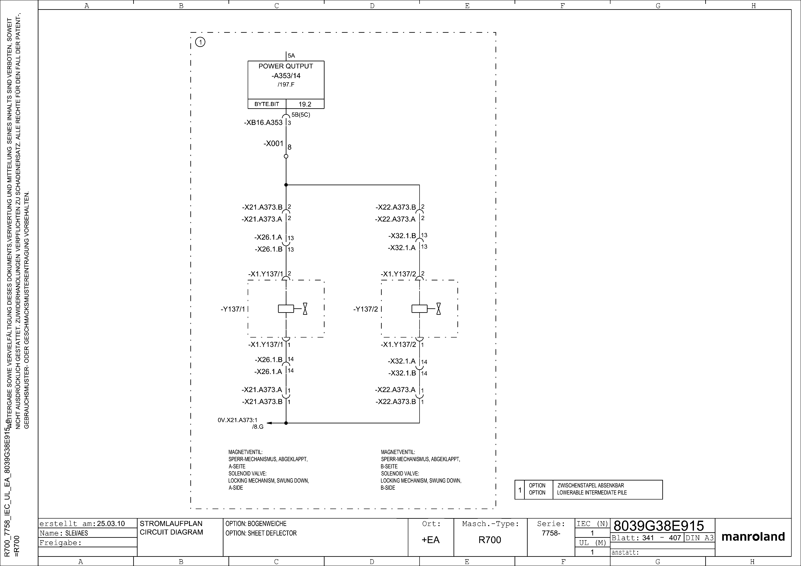

# +EA — Sheet 341 of 407 — OPTION: BOGENWEICHE

**OPTION: SHEET DEFLECTOR**

> Part of the manroland **R700** printing press IEC/UL circuit diagrams.
> Drawing class: **Stromlaufplan / Circuit diagram** (DIN A3).
> Document `+EA` covers the **Printing unit** machine section.

## At a glance

| Field | Value |
|---|---|
| Document | `+EA`  (8039G38E915) |
| Sheet | **341** of 407 |
| Section (DE) | OPTION: BOGENWEICHE |
| Section (EN) | OPTION: SHEET DEFLECTOR |
| Section type | CIRCUIT — Circuit diagram |
| Machine type | `R700` |
| Series | `7758` |
| Created | 25.03.10 |
| Replaces | — |
| Columns used | B, C, D, E, F |
| Path numbers | — |
| Labels on sheet | 73 |
| Cross-refs out | 2 |
| Cross-refs in | 23 |

**Previous:** [+EA sheet 340](SHEET_0340.md) · **Next:** [+EA sheet 342](SHEET_0342.md) · **Document TOC:** [_TOC.md](_TOC.md)  (+EA) · **Master TOC:** [all sheets](../_MASTER_TOC.md)

## Sheet image (300 DPI, exact vector render)



_Rendered directly from the PDF vector layer at 300 DPI (1-bit), no OCR and no resampling. Use it to confirm anything ambiguous in the text below._

## Cross-references on this sheet

Each entry is a wire leaving this sheet. The printed token is `/sheet.column`; the link resolves to that sheet inside the same document.

| Ref | Target sheet | Col | Path | Destination on target | Target section | From col |
|---|---|---|---|---|---|---|
| `/197.F` | [+EA sheet 197](SHEET_0197.md) | F | — | — | REFERENZMODUL | C |
| `/8.G` | [+EA sheet 8](SHEET_0008.md) | G | — | 0V.X21.A373:1 | SPANNUNGSVERSORGUNG: 400V, 24V | C |

### Incoming references (sheets that point here)

Every other sheet that sends a wire to this one. `Back-ref` is the token printed on *that* sheet; `Path` is its line number.

| From sheet | Cols | Back-ref | Path | Refs | What continues there |
|---|---|---|---|---|---|
| [+EA#8](SHEET_0008.md) | G | `/8.G` | — | 1 | 0V.X21.A373:1 |
| [+EA#197](SHEET_0197.md) | F | `/197.F` | — | 1 | — |
| [+EA#221](SHEET_0221.md) | G | `/221.G` | — | 4 | — |
| [+EA#261](SHEET_0261.md) | G | `/261.G` | — | 1 | — |
| [+EA#264](SHEET_0264.md) | E, H | `/264.E`, `/264.H` | — | 8 | — |
| [+EA#270](SHEET_0270.md) | A, B | `/270.A`, `/270.B` | — | 4 | — |
| [+EA#276](SHEET_0276.md) | C | `/276.C` | — | 4 | — |


## Devices on this sheet

| Tag | Class | Class meaning (IEC) | Col | Sub | Terminal | Sign |
|---|---|---|---|---|---|---|
| `Y137/1` | Y | Magnetventil / solenoid valve, actuator | C | 1 | — | — |
| `Y137/2` | Y | Magnetventil / solenoid valve, actuator | D | 2 | — | — |
| `A353/14` | A | Baugruppe / assembly, module, PC board | C | 14 | — | — |
| `X001` | X | Klemme / terminal, plug connector | C | — | — | — |
| `X21.A373.B` | — | cross-device reference | C | — | — | — |
| `X21.A373.A` | — | cross-device reference | C | — | — | — |
| `X22.A373.B` | — | cross-device reference | D | — | — | — |
| `X22.A373.A` | — | cross-device reference | D | — | — | — |
| `X21.A373.B` | — | cross-device reference | C | — | — | — |
| `X22.A373.B` | — | cross-device reference | D | — | — | — |
| `X22.A373.A` | — | cross-device reference | D | — | — | — |
| `X21.A373.A` | — | cross-device reference | C | — | — | — |
| `X26.1.B` | — | cross-device reference | C | — | — | — |
| `X26.1.A` | — | cross-device reference | C | — | — | — |
| `X26.1.B` | — | cross-device reference | C | — | — | — |
| `X26.1.A` | — | cross-device reference | C | — | — | — |
| `X32.1.B` | — | cross-device reference | D | — | — | — |
| `X32.1.A` | — | cross-device reference | D | — | — | — |
| `X32.1.B` | — | cross-device reference | D | — | — | — |
| `X32.1.A` | — | cross-device reference | D | — | — | — |
| `19.2` | — | cross-device reference | C | — | — | — |
| `XB16.A353` | — | cross-device reference | C | — | — | — |

## Potentials / nets

| Potential | Count | Columns | Attached devices | Terminals |
|---|---|---|---|---|
| `0V` | 1 | C | `A373`, `X21` | `1` |


A potential such as `L24+/4` or `M24+` is a named supply/return rail; every place it appears on this sheet is electrically common.

## Wire-end annotations (grouped as printed)

A wire that continues elsewhere is annotated with a small cluster: the destination description, the path/line number `#NN`, and the `/sheet.column` cross reference. Each row below is one such cluster exactly as it is grouped on the drawing.

| Col | Y | Path | Cross-ref | Text on the wire |
|---|---|---|---|---|
| B | 59.3 | — | — | `1` |
| C | 78.9 | — | — | `5A` |
| C | 94.1 | — | — | `POWER QUTPUT` |
| C | 108.0 | — | — | `A353/14` |
| C | 121.8 | — | `/197.F` | — |
| C | 150.9 | — | — | `BYTE.BIT 19.2` |
| C | 166.8 | — | — | `5B(5C)` |
| C | 177.5 | — | — | `XB16.A353 3` |
| C | 208.4 | — | — | `X001 8` |
| C | 303.6 | — | — | `X21.A373.B 2` |
| D | 303.6 | — | — | `X22.A373.B 2` |
| C | 320.6 | — | — | `X21.A373.A 2` |
| D | 320.6 | — | — | `X22.A373.A 2` |
| D | 346.1 | — | — | `X32.1.B 13` |
| C | 348.3 | — | — | `X26.1.A 13` |
| D | 363.2 | — | — | `X32.1.A 13` |
| C | 366.0 | — | — | `X26.1.B 13` |
| C | 402.8 | — | — | `X1.Y137/1 2` |
| D | 402.8 | — | — | `X1.Y137/2 2` |
| C | 455.3 | — | — | `Y137/1` |
| D | 455.3 | — | — | `Y137/2` |
| C | 507.8 | — | — | `X1.Y137/1 1` |
| D | 507.8 | — | — | `X1.Y137/2 1` |
| C | 530.4 | — | — | `X26.1.B 14` |
| D | 532.5 | — | — | `X32.1.A 14` |
| C | 547.4 | — | — | `X26.1.A 14` |
| D | 550.2 | — | — | `X32.1.B 14` |
| D | 575.0 | — | — | `X21.A373.A 1 X22.A373.A 1` |
| D | 592.8 | — | — | `X21.A373.B 1 X22.A373.B 1` |
| C | 621.1 | — | `/8.G` | `0V.X21.A373:1` |
| C | 669.6 | — | — | `LOCKING MECHANISM, SWUNG DOWN, MAGNETVENTIL: SPERR MECHANISMUS, ABGEKLAPPT, SOLENOID VALVE: A SEITE` |
| E | 669.6 | — | — | `B SEITE MAGNETVENTIL: SPERR MECHANISMUS, ABGEKLAPPT,` |
| E | 701.5 | — | — | `LOCKING MECHANISM, SWUNG DOWN, B SIDE SOLENOID VALVE:` |
| F | 719.2 | — | — | `1 OPTION OPTION LOWERABLE INTERMEDIATE PILE ZWISCHENSTAPEL ABSENKBAR` |
| C | 722.7 | — | — | `A SIDE` |


## Reconstructed tables

This sheet carries tabular content (pin map / terminal assignment / index). The grid below was rebuilt from the drawing's own rule lines, so each row is exactly one physical row of the table.

### Table 1 — 3 data rows × 2 columns (at x=368.5, y=90.7)

| POWER | QUTPUT A353/14 /197.F |
|---|---|
| `BYTE.BIT` | `19.2` |
| `XB16.A353 X001` | `5B(5C) 3 8` |
| `X21.A373.B X21.A373.A X26.1.A X26.1.B X1.Y137/1 X1.Y137/1 X26.1.B X26.1.A X21.A373.A X21.A373.B` | `2 2 13 13 2 1 14 14 1 1` |


## Notes and free text on this sheet

| Text | Col | Y (pt) |
|---|---|---|
| `MAGNETVENTIL:` | C | 669.59 |
| `SPERR MECHANISMUS, ABGEKLAPPT,` | C | 680.23 |
| `A SEITE` | C | 690.83 |
| `SOLENOID VALVE:` | C | 701.48 |
| `LOCKING MECHANISM, SWUNG DOWN,` | C | 712.12 |
| `A SIDE` | C | 722.74 |
| `X1.Y137/1` | C | 507.76 |
| `MAGNETVENTIL:` | D | 669.59 |
| `SPERR MECHANISMUS, ABGEKLAPPT,` | E | 680.23 |
| `B SEITE` | D | 690.8 |
| `SOLENOID VALVE:` | D | 701.48 |
| `LOCKING MECHANISM, SWUNG DOWN,` | E | 712.12 |
| `B SIDE` | D | 722.71 |
| `X1.Y137/2` | D | 507.76 |
| `5A` | C | 78.93 |
| `5B(5C)` | C | 166.85 |
| `POWER QUTPUT` | C | 94.1 |
| `BYTE.BIT` | C | 151.43 |
| `OPTION` | F | 719.18 |
| `ZWISCHENSTAPEL ABSENKBAR` | F | 719.19 |
| `LOWERABLE INTERMEDIATE PILE` | F | 729.82 |

## Complete label inventory (exact text from the drawing)

Every text object inside the drawing area of this sheet, in DIN reading order (column A→H, then top→bottom). This is the authoritative list: if a string is not here it is not printed on this sheet.

| Col | Y | X | Dir | Type | Text |
|---|---|---|---|---|---|
| B | 59.3 | 295.9 | → | number | `1` |
| C | 78.9 | 427.7 | → | text | `5A` |
| C | 94.1 | 384.4 | → | text | `POWER QUTPUT` |
| C | 108.0 | 403.8 | → | device tag | `A353/14` |
| C | 121.8 | 412.9 | → | cross-reference | `/197.F` |
| C | 150.9 | 443.8 | → | device ref | `19.2` |
| C | 151.4 | 378.4 | → | text | `BYTE.BIT` |
| C | 166.9 | 433.4 | → | text | `5B(5C)` |
| C | 177.5 | 362.8 | → | device ref | `XB16.A353` |
| C | 178.9 | 427.7 | → | number | `3` |
| C | 208.4 | 391.7 | → | device tag | `X001` |
| C | 214.3 | 427.5 | → | number | `8` |
| C | 303.6 | 360.0 | → | device ref | `X21.A373.B` |
| C | 303.6 | 427.7 | → | number | `2` |
| C | 320.6 | 427.7 | → | number | `2` |
| C | 321.3 | 359.1 | → | device ref | `X21.A373.A` |
| C | 348.3 | 378.1 | → | device ref | `X26.1.A` |
| C | 350.4 | 427.2 | → | number | `13` |
| C | 366.0 | 379.0 | → | device ref | `X26.1.B` |
| C | 367.4 | 427.2 | → | number | `13` |
| C | 402.8 | 427.7 | → | number | `2` |
| C | 402.9 | 369.1 | → | text | `X1.Y137/1` |
| C | 455.3 | 328.3 | → | device tag | `Y137/1` |
| C | 507.8 | 369.1 | → | text | `X1.Y137/1` |
| C | 509.1 | 427.2 | → | number | `1` |
| C | 530.4 | 379.0 | → | device ref | `X26.1.B` |
| C | 530.4 | 427.2 | → | number | `14` |
| C | 547.4 | 427.2 | → | number | `14` |
| C | 548.1 | 378.1 | → | device ref | `X26.1.A` |
| C | 575.0 | 359.1 | → | device ref | `X21.A373.A` |
| C | 577.2 | 427.2 | → | number | `1` |
| C | 592.8 | 360.0 | → | device ref | `X21.A373.B` |
| C | 594.2 | 427.2 | → | number | `1` |
| C | 621.1 | 323.7 | → | potential | `0V.X21.A373:1` |
| C | 631.0 | 375.0 | → | cross-reference | `/8.G` |
| C | 669.6 | 339.6 | → | text | `MAGNETVENTIL:` |
| C | 680.2 | 339.9 | → | text | `SPERR MECHANISMUS, ABGEKLAPPT,` |
| C | 690.8 | 340.2 | → | text | `A SEITE` |
| C | 701.5 | 339.9 | → | text | `SOLENOID VALVE:` |
| C | 712.1 | 339.3 | → | text | `LOCKING MECHANISM, SWUNG DOWN,` |
| C | 722.7 | 340.2 | → | text | `A SIDE` |
| D | 303.6 | 558.4 | → | device ref | `X22.A373.B` |
| D | 321.3 | 557.6 | → | device ref | `X22.A373.A` |
| D | 346.2 | 577.4 | → | device ref | `X32.1.B` |
| D | 363.9 | 576.6 | → | device ref | `X32.1.A` |
| D | 402.9 | 566.1 | → | text | `X1.Y137/2` |
| D | 455.3 | 525.3 | → | device tag | `Y137/2` |
| D | 507.8 | 566.1 | → | text | `X1.Y137/2` |
| D | 532.5 | 576.6 | → | device ref | `X32.1.A` |
| D | 550.2 | 577.4 | → | device ref | `X32.1.B` |
| D | 575.0 | 557.6 | → | device ref | `X22.A373.A` |
| D | 592.8 | 558.4 | → | device ref | `X22.A373.B` |
| D | 669.6 | 566.4 | → | text | `MAGNETVENTIL:` |
| D | 690.8 | 566.1 | → | text | `B SEITE` |
| D | 701.5 | 566.6 | → | text | `SOLENOID VALVE:` |
| D | 722.7 | 566.1 | → | text | `B SIDE` |
| E | 303.6 | 626.2 | → | number | `2` |
| E | 320.6 | 626.2 | → | number | `2` |
| E | 346.2 | 625.6 | → | number | `13` |
| E | 363.2 | 625.6 | → | number | `13` |
| E | 402.8 | 626.2 | → | number | `2` |
| E | 509.1 | 625.6 | → | number | `1` |
| E | 534.7 | 625.6 | → | number | `14` |
| E | 551.7 | 625.6 | → | number | `14` |
| E | 577.2 | 625.6 | → | number | `1` |
| E | 594.2 | 625.6 | → | number | `1` |
| E | 680.2 | 566.6 | → | text | `SPERR MECHANISMUS, ABGEKLAPPT,` |
| E | 712.1 | 566.1 | → | text | `LOCKING MECHANISM, SWUNG DOWN,` |
| F | 719.2 | 786.3 | → | text | `OPTION` |
| F | 719.2 | 829.1 | → | text | `ZWISCHENSTAPEL ABSENKBAR` |
| F | 724.5 | 769.9 | → | number | `1` |
| F | 729.8 | 786.3 | → | text | `OPTION` |
| F | 729.8 | 828.3 | → | text | `LOWERABLE INTERMEDIATE PILE` |

## Reading-order text block

The same content as a plain block, grouped by DIN column — convenient to paste or to match against a visual description.

```text
=== Column B ===
  59.3  295.9  numeric      1
=== Column C ===
  78.9  427.7  text         5A
  94.1  384.4  text         POWER QUTPUT
 108.0  403.8  devtag       A353/14
 121.8  412.9  xref         /197.F
 150.9  443.8  devref       19.2
 151.4  378.4  text         BYTE.BIT
 166.9  433.4  text         5B(5C)
 177.5  362.8  devref       XB16.A353
 178.9  427.7  numeric      3
 208.4  391.7  devtag       X001
 214.3  427.5  numeric      8
 303.6  360.0  devref       X21.A373.B
 303.6  427.7  numeric      2
 320.6  427.7  numeric      2
 321.3  359.1  devref       X21.A373.A
 348.3  378.1  devref       X26.1.A
 350.4  427.2  numeric      13
 366.0  379.0  devref       X26.1.B
 367.4  427.2  numeric      13
 402.8  427.7  numeric      2
 402.9  369.1  text         X1.Y137/1
 455.3  328.3  devtag       Y137/1
 507.8  369.1  text         X1.Y137/1
 509.1  427.2  numeric      1
 530.4  379.0  devref       X26.1.B
 530.4  427.2  numeric      14
 547.4  427.2  numeric      14
 548.1  378.1  devref       X26.1.A
 575.0  359.1  devref       X21.A373.A
 577.2  427.2  numeric      1
 592.8  360.0  devref       X21.A373.B
 594.2  427.2  numeric      1
 621.1  323.7  net          0V.X21.A373:1
 631.0  375.0  xref         /8.G
 669.6  339.6  text         MAGNETVENTIL:
 680.2  339.9  text         SPERR MECHANISMUS, ABGEKLAPPT,
 690.8  340.2  text         A SEITE
 701.5  339.9  text         SOLENOID VALVE:
 712.1  339.3  text         LOCKING MECHANISM, SWUNG DOWN,
 722.7  340.2  text         A SIDE
=== Column D ===
 303.6  558.4  devref       X22.A373.B
 321.3  557.6  devref       X22.A373.A
 346.2  577.4  devref       X32.1.B
 363.9  576.6  devref       X32.1.A
 402.9  566.1  text         X1.Y137/2
 455.3  525.3  devtag       Y137/2
 507.8  566.1  text         X1.Y137/2
 532.5  576.6  devref       X32.1.A
 550.2  577.4  devref       X32.1.B
 575.0  557.6  devref       X22.A373.A
 592.8  558.4  devref       X22.A373.B
 669.6  566.4  text         MAGNETVENTIL:
 690.8  566.1  text         B SEITE
 701.5  566.6  text         SOLENOID VALVE:
 722.7  566.1  text         B SIDE
=== Column E ===
 303.6  626.2  numeric      2
 320.6  626.2  numeric      2
 346.2  625.6  numeric      13
 363.2  625.6  numeric      13
 402.8  626.2  numeric      2
 509.1  625.6  numeric      1
 534.7  625.6  numeric      14
 551.7  625.6  numeric      14
 577.2  625.6  numeric      1
 594.2  625.6  numeric      1
 680.2  566.6  text         SPERR MECHANISMUS, ABGEKLAPPT,
 712.1  566.1  text         LOCKING MECHANISM, SWUNG DOWN,
=== Column F ===
 719.2  786.3  text         OPTION
 719.2  829.1  text         ZWISCHENSTAPEL ABSENKBAR
 724.5  769.9  numeric      1
 729.8  786.3  text         OPTION
 729.8  828.3  text         LOWERABLE INTERMEDIATE PILE
```

---
_Generated from the PDF vector text layer; no OCR. Source: `R700_7758_IEC_UL_EA_8039G38E915_p`, sheet 341._
