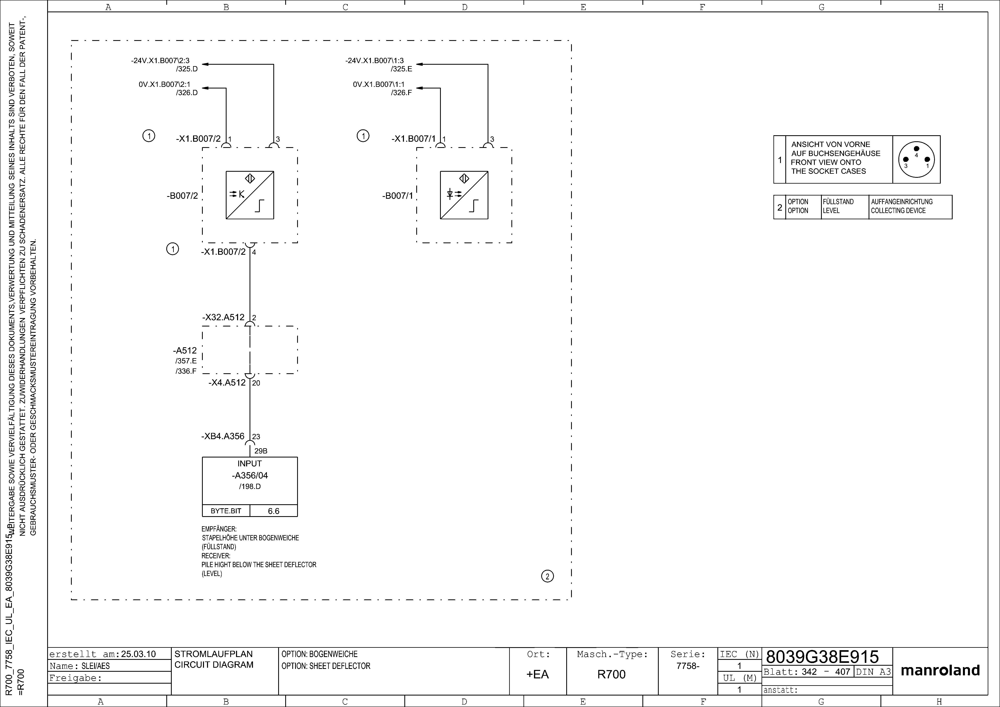

# +EA — Sheet 342 of 407 — OPTION: BOGENWEICHE

**OPTION: SHEET DEFLECTOR**

> Part of the manroland **R700** printing press IEC/UL circuit diagrams.
> Drawing class: **Stromlaufplan / Circuit diagram** (DIN A3).
> Document `+EA` covers the **Printing unit** machine section.

## At a glance

| Field | Value |
|---|---|
| Document | `+EA`  (8039G38E915) |
| Sheet | **342** of 407 |
| Section (DE) | OPTION: BOGENWEICHE |
| Section (EN) | OPTION: SHEET DEFLECTOR |
| Section type | CIRCUIT — Circuit diagram |
| Machine type | `R700` |
| Series | `7758` |
| Created | 25.03.10 |
| Replaces | — |
| Columns used | A, B, C, D, E, G, H |
| Path numbers | — |
| Labels on sheet | 58 |
| Cross-refs out | 7 |
| Cross-refs in | 15 |

**Previous:** [+EA sheet 341](SHEET_0341.md) · **Next:** [+EA sheet 343](SHEET_0343.md) · **Document TOC:** [_TOC.md](_TOC.md)  (+EA) · **Master TOC:** [all sheets](../_MASTER_TOC.md)

## Sheet image (300 DPI, exact vector render)



_Rendered directly from the PDF vector layer at 300 DPI (1-bit), no OCR and no resampling. Use it to confirm anything ambiguous in the text below._

## Cross-references on this sheet

Each entry is a wire leaving this sheet. The printed token is `/sheet.column`; the link resolves to that sheet inside the same document.

| Ref | Target sheet | Col | Path | Destination on target | Target section | From col |
|---|---|---|---|---|---|---|
| `/325.E` | [+EA sheet 325](SHEET_0325.md) | E | — | 24V.X1.B007\2:3 24V.X1.B007\1:3 | OPTION: BOGENWEICHE | B |
| `/325.D` | [+EA sheet 325](SHEET_0325.md) | D | — | 24V.X1.B007\2:3 24V.X1.B007\1:3 | OPTION: BOGENWEICHE | B |
| `/326.F` | [+EA sheet 326](SHEET_0326.md) | F | — | 0V.X1.B007\2:1 0V.X1.B007\1:1 | OPTION: BOGENWEICHE | B |
| `/326.D` | [+EA sheet 326](SHEET_0326.md) | D | — | 0V.X1.B007\2:1 0V.X1.B007\1:1 | OPTION: BOGENWEICHE | B |
| `/357.E` | [+EA sheet 357](SHEET_0357.md) | E | — | — | OPTION: AUFLAGENZÄHLER / GUTBOGENZÄHLER | B |
| `/336.F` | [+EA sheet 336](SHEET_0336.md) | F | — | — | OPTION: BOGENWEICHE | B |
| `/198.D` | [+EA sheet 198](SHEET_0198.md) | D | — | — | REFERENZMODUL | B |

### Incoming references (sheets that point here)

Every other sheet that sends a wire to this one. `Back-ref` is the token printed on *that* sheet; `Path` is its line number.

| From sheet | Cols | Back-ref | Path | Refs | What continues there |
|---|---|---|---|---|---|
| [+EA#198](SHEET_0198.md) | D | `/198.D` | — | 1 | — |
| [+EA#214](SHEET_0214.md) | C | `/214.C` | — | 5 | — |
| [+EA#237](SHEET_0237.md) | E | `/237.E` | — | 1 | — |
| [+EA#238](SHEET_0238.md) | A | `/238.A` | — | 1 | — |
| [+EA#276](SHEET_0276.md) | H | `/276.H` | — | 1 | — |
| [+EA#325](SHEET_0325.md) | D, E | `/325.D`, `/325.E` | — | 2 | — |
| [+EA#326](SHEET_0326.md) | D, F | `/326.D`, `/326.F` | — | 2 | — |
| [+EA#336](SHEET_0336.md) | F | `/336.F` | — | 1 | — |
| [+EA#357](SHEET_0357.md) | E | `/357.E` | — | 1 | — |


## Devices on this sheet

| Tag | Class | Class meaning (IEC) | Col | Sub | Terminal | Sign |
|---|---|---|---|---|---|---|
| `A356/04` | A | Baugruppe / assembly, module, PC board | B | 04 | — | — |
| `A512` | A | Baugruppe / assembly, module, PC board | B | — | — | — |
| `B007/2` | B | Umformer / transducer, sensor | B | 2 | — | — |
| `B007/1` | B | Umformer / transducer, sensor | C | 1 | — | — |
| `X32.A512` | — | cross-device reference | B | — | — | — |
| `X4.A512` | — | cross-device reference | B | — | — | — |
| `6.6` | — | cross-device reference | B | — | — | — |
| `XB4.A356` | — | cross-device reference | B | — | — | — |

## Potentials / nets

| Potential | Count | Columns | Attached devices | Terminals |
|---|---|---|---|---|
| `0V` | 2 | A, C | `B007\1`, `B007\2`, `X1` | `1` |
| `24V` | 2 | A, C | `B007\1`, `B007\2`, `X1` | `3` |


A potential such as `L24+/4` or `M24+` is a named supply/return rail; every place it appears on this sheet is electrically common.

## Wire-end annotations (grouped as printed)

A wire that continues elsewhere is annotated with a small cluster: the destination description, the path/line number `#NN`, and the `/sheet.column` cross reference. Each row below is one such cluster exactly as it is grouped on the drawing.

| Col | Y | Path | Cross-ref | Text on the wire |
|---|---|---|---|---|
| B | 68.3 | — | `/325.E`, `/325.D` | `24V.X1.B007\2:3 24V.X1.B007\1:3` |
| B | 96.6 | — | `/326.F`, `/326.D` | `0V.X1.B007\2:1 0V.X1.B007\1:1` |
| B | 158.5 | — | — | `1 1` |
| B | 160.5 | — | — | `X1.B007/2 1 3` |
| D | 160.5 | — | — | `X1.B007/1 1 3` |
| G | 168.2 | — | — | `FRONT VIEW ONTO ANSICHT VON VORNE AUF BUCHSENGEHÄUSE` |
| H | 181.6 | — | — | `4` |
| G | 185.9 | — | — | `1 3 1` |
| G | 200.1 | — | — | `THE SOCKET CASES` |
| B | 228.5 | — | — | `B007/2` |
| C | 228.5 | — | — | `B007/1` |
| G | 237.3 | — | — | `2 OPTION OPTION` |
| G | 237.3 | — | — | `FÜLLSTAND LEVEL` |
| H | 237.3 | — | — | `COLLECTING DEVICE AUFFANGEINRICHTUNG` |
| B | 293.2 | — | — | `1` |
| B | 295.1 | — | — | `X1.B007/2 4` |
| B | 373.1 | — | — | `X32.A512 2` |
| B | 412.7 | — | — | `A512` |
| B | 425.8 | — | `/357.E`, `/336.F` | — |
| B | 451.0 | — | — | `X4.A512 20` |
| B | 514.8 | — | — | `XB4.A356 23` |
| B | 533.2 | — | — | `29B` |
| B | 547.7 | — | — | `INPUT` |
| B | 561.6 | — | — | `A356/04` |
| B | 575.4 | — | `/198.D` | — |
| B | 604.4 | — | — | `BYTE.BIT 6.6` |
| B | 627.1 | — | — | `EMPFÄNGER:` |
| B | 637.7 | — | — | `RECEIVER: PILE HIGHT BELOW THE SHEET DEFLECTOR (FÜLLSTAND) (LEVEL) STAPELHÖHE UNTER BOGENWEICHE` |
| E | 683.4 | — | — | `2` |


## Reconstructed tables

This sheet carries tabular content (pin map / terminal assignment / index). The grid below was rebuilt from the drawing's own rule lines, so each row is exactly one physical row of the table.

### Table 1 — 3 data rows × 4 columns (at x=240.9, y=76.5)

|  | 1 |  | 3 |
|---|---|---|---|
| `X1.B007/2 X32.A512 XB4.A356` | `X4.A512` | `4 2 20 23 29B` |  |
|  | `INPUT` | `A356/04 /198.D` |  |
| `BYTE.BIT` |  | `6.6` |  |


## Notes and free text on this sheet

| Text | Col | Y (pt) |
|---|---|---|
| `29B` | B | 533.2 |
| `INPUT` | B | 547.72 |
| `BYTE.BIT` | B | 604.97 |
| `EMPFÄNGER:` | B | 627.06 |
| `STAPELHÖHE UNTER BOGENWEICHE` | B | 637.71 |
| `(FÜLLSTAND)` | B | 648.36 |
| `RECEIVER:` | B | 658.94 |
| `PILE HIGHT BELOW THE SHEET DEFLECTOR` | B | 669.6 |
| `(LEVEL)` | B | 680.22 |
| `X1.B007/2` | B | 160.47 |
| `X1.B007/1` | D | 160.47 |
| `ANSICHT VON VORNE` | G | 168.23 |
| `AUF BUCHSENGEHÄUSE` | G | 178.86 |
| `FRONT VIEW ONTO` | G | 189.46 |
| `THE SOCKET CASES` | G | 200.1 |
| `OPTION` | G | 237.29 |
| `FÜLLSTAND` | G | 237.32 |
| `LEVEL` | G | 247.9 |
| `AUFFANGEINRICHTUNG` | H | 237.34 |
| `COLLECTING DEVICE` | H | 247.96 |

## Complete label inventory (exact text from the drawing)

Every text object inside the drawing area of this sheet, in DIN reading order (column A→H, then top→bottom). This is the authoritative list: if a string is not here it is not printed on this sheet.

| Col | Y | X | Dir | Type | Text |
|---|---|---|---|---|---|
| A | 68.3 | 156.2 | → | potential | `24V.X1.B007\2:3` |
| A | 96.6 | 165.3 | → | potential | `0V.X1.B007\2:1` |
| A | 158.5 | 175.4 | → | number | `1` |
| B | 78.2 | 209.8 | → | cross-reference | `/325.D` |
| B | 106.6 | 209.8 | → | cross-reference | `/326.D` |
| B | 160.5 | 209.8 | → | text | `X1.B007/2` |
| B | 161.9 | 271.3 | → | number | `1` |
| B | 161.9 | 328.5 | → | number | `3` |
| B | 228.5 | 198.7 | → | device tag | `B007/2` |
| B | 293.2 | 203.8 | → | number | `1` |
| B | 295.1 | 239.5 | → | text | `X1.B007/2` |
| B | 296.5 | 300.2 | → | number | `4` |
| B | 373.1 | 240.9 | → | device ref | `X32.A512` |
| B | 374.5 | 300.2 | → | number | `2` |
| B | 412.7 | 206.1 | → | device tag | `A512` |
| B | 425.8 | 208.9 | → | cross-reference | `/357.E` |
| B | 438.2 | 209.2 | → | cross-reference | `/336.F` |
| B | 451.0 | 248.3 | → | device ref | `X4.A512` |
| B | 452.5 | 300.2 | → | number | `20` |
| B | 514.8 | 239.8 | → | device ref | `XB4.A356` |
| B | 516.2 | 300.2 | → | number | `23` |
| B | 533.2 | 303.0 | → | text | `29B` |
| B | 547.7 | 282.8 | → | text | `INPUT` |
| B | 561.6 | 276.2 | → | device tag | `A356/04` |
| B | 575.4 | 284.9 | → | cross-reference | `/198.D` |
| B | 604.4 | 319.2 | → | device ref | `6.6` |
| B | 605.0 | 250.9 | → | text | `BYTE.BIT` |
| B | 627.1 | 240.1 | → | text | `EMPFÄNGER:` |
| B | 637.7 | 240.7 | → | text | `STAPELHÖHE UNTER BOGENWEICHE` |
| B | 648.4 | 240.4 | → | text | `(FÜLLSTAND)` |
| B | 658.9 | 240.1 | → | text | `RECEIVER:` |
| B | 669.6 | 240.1 | → | text | `PILE HIGHT BELOW THE SHEET DEFLECTOR` |
| B | 680.2 | 240.4 | → | text | `(LEVEL)` |
| C | 68.3 | 411.3 | → | potential | `24V.X1.B007\1:3` |
| C | 78.2 | 465.4 | → | cross-reference | `/325.E` |
| C | 96.6 | 420.4 | → | potential | `0V.X1.B007\1:1` |
| C | 106.6 | 465.7 | → | cross-reference | `/326.F` |
| C | 158.5 | 430.5 | → | number | `1` |
| C | 228.5 | 455.2 | → | device tag | `B007/1` |
| D | 160.5 | 466.3 | → | text | `X1.B007/1` |
| D | 161.9 | 526.4 | → | number | `1` |
| D | 161.9 | 583.7 | → | number | `3` |
| E | 683.4 | 650.0 | → | number | `2` |
| G | 168.2 | 942.5 | → | text | `ANSICHT VON VORNE` |
| G | 178.9 | 942.5 | → | text | `AUF BUCHSENGEHÄUSE` |
| G | 185.9 | 925.8 | → | number | `1` |
| G | 189.5 | 941.7 | → | text | `FRONT VIEW ONTO` |
| G | 200.1 | 942.2 | → | text | `THE SOCKET CASES` |
| G | 237.3 | 938.0 | → | text | `OPTION` |
| G | 237.3 | 979.9 | → | text | `FÜLLSTAND` |
| G | 242.6 | 925.5 | → | number | `2` |
| G | 247.9 | 938.0 | → | text | `OPTION` |
| G | 247.9 | 979.9 | → | text | `LEVEL` |
| H | 181.6 | 1089.4 | → | number | `4` |
| H | 194.4 | 1076.6 | → | number | `3` |
| H | 194.4 | 1102.5 | → | number | `1` |
| H | 237.3 | 1037.5 | → | text | `AUFFANGEINRICHTUNG` |
| H | 248.0 | 1037.2 | → | text | `COLLECTING DEVICE` |

## Reading-order text block

The same content as a plain block, grouped by DIN column — convenient to paste or to match against a visual description.

```text
=== Column A ===
  68.3  156.2  net          24V.X1.B007\2:3
  96.6  165.3  net          0V.X1.B007\2:1
 158.5  175.4  numeric      1
=== Column B ===
  78.2  209.8  xref         /325.D
 106.6  209.8  xref         /326.D
 160.5  209.8  text         X1.B007/2
 161.9  271.3  numeric      1
 161.9  328.5  numeric      3
 228.5  198.7  devtag       B007/2
 293.2  203.8  numeric      1
 295.1  239.5  text         X1.B007/2
 296.5  300.2  numeric      4
 373.1  240.9  devref       X32.A512
 374.5  300.2  numeric      2
 412.7  206.1  devtag       A512
 425.8  208.9  xref         /357.E
 438.2  209.2  xref         /336.F
 451.0  248.3  devref       X4.A512
 452.5  300.2  numeric      20
 514.8  239.8  devref       XB4.A356
 516.2  300.2  numeric      23
 533.2  303.0  text         29B
 547.7  282.8  text         INPUT
 561.6  276.2  devtag       A356/04
 575.4  284.9  xref         /198.D
 604.4  319.2  devref       6.6
 605.0  250.9  text         BYTE.BIT
 627.1  240.1  text         EMPFÄNGER:
 637.7  240.7  text         STAPELHÖHE UNTER BOGENWEICHE
 648.4  240.4  text         (FÜLLSTAND)
 658.9  240.1  text         RECEIVER:
 669.6  240.1  text         PILE HIGHT BELOW THE SHEET DEFLECTOR
 680.2  240.4  text         (LEVEL)
=== Column C ===
  68.3  411.3  net          24V.X1.B007\1:3
  78.2  465.4  xref         /325.E
  96.6  420.4  net          0V.X1.B007\1:1
 106.6  465.7  xref         /326.F
 158.5  430.5  numeric      1
 228.5  455.2  devtag       B007/1
=== Column D ===
 160.5  466.3  text         X1.B007/1
 161.9  526.4  numeric      1
 161.9  583.7  numeric      3
=== Column E ===
 683.4  650.0  numeric      2
=== Column G ===
 168.2  942.5  text         ANSICHT VON VORNE
 178.9  942.5  text         AUF BUCHSENGEHÄUSE
 185.9  925.8  numeric      1
 189.5  941.7  text         FRONT VIEW ONTO
 200.1  942.2  text         THE SOCKET CASES
 237.3  938.0  text         OPTION
 237.3  979.9  text         FÜLLSTAND
 242.6  925.5  numeric      2
 247.9  938.0  text         OPTION
 247.9  979.9  text         LEVEL
=== Column H ===
 181.6 1089.4  numeric      4
 194.4 1076.6  numeric      3
 194.4 1102.5  numeric      1
 237.3 1037.5  text         AUFFANGEINRICHTUNG
 248.0 1037.2  text         COLLECTING DEVICE
```

---
_Generated from the PDF vector text layer; no OCR. Source: `R700_7758_IEC_UL_EA_8039G38E915_p`, sheet 342._
