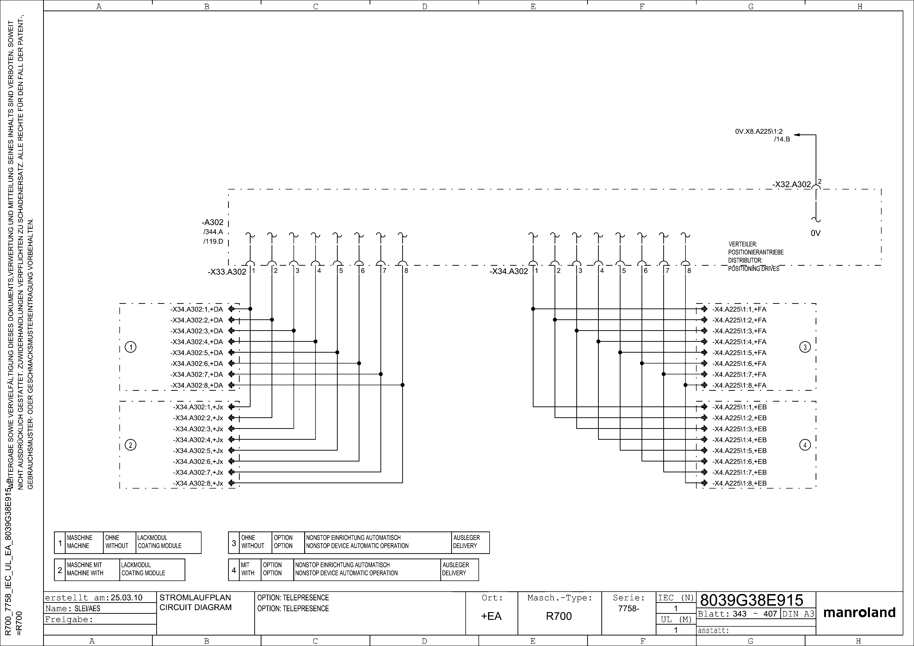

# +EA — Sheet 343 of 407 — OPTION: TELEPRESENCE

**OPTION: TELEPRESENCE**

> Part of the manroland **R700** printing press IEC/UL circuit diagrams.
> Drawing class: **Stromlaufplan / Circuit diagram** (DIN A3).
> Document `+EA` covers the **Printing unit** machine section.

## At a glance

| Field | Value |
|---|---|
| Document | `+EA`  (8039G38E915) |
| Sheet | **343** of 407 |
| Section (DE) | OPTION: TELEPRESENCE |
| Section (EN) | OPTION: TELEPRESENCE |
| Section type | CIRCUIT — Circuit diagram |
| Machine type | `R700` |
| Series | `7758` |
| Created | 25.03.10 |
| Replaces | — |
| Columns used | A, B, C, D, E, F, G, H |
| Path numbers | — |
| Labels on sheet | 96 |
| Cross-refs out | 3 |
| Cross-refs in | 20 |

**Previous:** [+EA sheet 342](SHEET_0342.md) · **Next:** [+EA sheet 344](SHEET_0344.md) · **Document TOC:** [_TOC.md](_TOC.md)  (+EA) · **Master TOC:** [all sheets](../_MASTER_TOC.md)

## Sheet image (300 DPI, exact vector render)



_Rendered directly from the PDF vector layer at 300 DPI (1-bit), no OCR and no resampling. Use it to confirm anything ambiguous in the text below._

## Cross-references on this sheet

Each entry is a wire leaving this sheet. The printed token is `/sheet.column`; the link resolves to that sheet inside the same document.

| Ref | Target sheet | Col | Path | Destination on target | Target section | From col |
|---|---|---|---|---|---|---|
| `/14.B` | [+EA sheet 14](SHEET_0014.md) | B | — | 0V.X8.A225\1:2 | SPANNUNGSVERSORGUNG: 400V, 24V | G |
| `/344.A` | [+EA sheet 344](SHEET_0344.md) | A | — | VERTEILER: POSITIONIERANTRIEBE DISTRIBUTOR: POSITIONING DRIVES | OPTION: TELEPRESENCE | E |
| `/119.D` | [+EA sheet 119](SHEET_0119.md) | D | — | VERTEILER: POSITIONIERANTRIEBE DISTRIBUTOR: POSITIONING DRIVES | PROZESSMAGAZIN: HANDTERMINAL | E |

### Incoming references (sheets that point here)

Every other sheet that sends a wire to this one. `Back-ref` is the token printed on *that* sheet; `Path` is its line number.

| From sheet | Cols | Back-ref | Path | Refs | What continues there |
|---|---|---|---|---|---|
| [+EA#14](SHEET_0014.md) | B | `/14.B` | — | 1 | — |
| [+EA#119](SHEET_0119.md) | D | `/119.D` | — | 1 | — |
| [+EA#276](SHEET_0276.md) | F | `/276.F` | — | 1 | — |
| [+EA#277](SHEET_0277.md) | C, H | `/277.C`, `/277.H` | — | 16 | — |
| [+EA#344](SHEET_0344.md) | A | `/344.A` | — | 1 | VERTEILER: POSITIONIERANTRIEBE DISTRIBUTOR: POSITIONING DRIVES |


## Devices on this sheet

| Tag | Class | Class meaning (IEC) | Col | Sub | Terminal | Sign |
|---|---|---|---|---|---|---|
| `A302` | A | Baugruppe / assembly, module, PC board | B | — | — | — |
| `X33.A302` | — | cross-device reference | B | — | — | — |
| `X34.A302` | — | cross-device reference | E | — | — | — |
| `X32.A302` | — | cross-device reference | G | — | — | — |

## Potentials / nets

| Potential | Count | Columns | Attached devices | Terminals |
|---|---|---|---|---|
| `0V` | 2 | G, H | `A225\1`, `X8` | `2` |


A potential such as `L24+/4` or `M24+` is a named supply/return rail; every place it appears on this sheet is electrically common.

## Wire-end annotations (grouped as printed)

A wire that continues elsewhere is annotated with a small cluster: the destination description, the path/line number `#NN`, and the `/sheet.column` cross reference. Each row below is one such cluster exactly as it is grouped on the drawing.

| Col | Y | Path | Cross-ref | Text on the wire |
|---|---|---|---|---|
| G | 167.5 | — | `/14.B` | `0V.X8.A225\1:2` |
| G | 232.8 | — | — | `X32.A302 2` |
| B | 285.2 | — | — | `A302` |
| E | 298.3 | — | `/344.A`, `/119.D` | `POSITIONIERANTRIEBE DISTRIBUTOR: POSITIONING DRIVES VERTEILER:` |
| H | 299.3 | — | — | `0V` |
| D | 349.0 | — | — | `X33.A302 1 2 3 4 5 6 7 8 X34.A302 1 2 3 4 5 6 7 8` |
| G | 399.2 | — | — | `X4.A225\1:1,+FA` |
| B | 399.3 | — | — | `X34.A302:1,+DA` |
| B | 413.4 | — | — | `X34.A302:2,+DA` |
| G | 413.4 | — | — | `X4.A225\1:2,+FA` |
| B | 427.6 | — | — | `X34.A302:3,+DA` |
| G | 427.6 | — | — | `X4.A225\1:3,+FA` |
| B | 441.8 | — | — | `X34.A302:4,+DA` |
| G | 441.8 | — | — | `X4.A225\1:4,+FA` |
| A | 449.1 | — | — | `1` |
| G | 449.6 | — | — | `3` |
| B | 455.9 | — | — | `X34.A302:5,+DA` |
| G | 455.9 | — | — | `X4.A225\1:5,+FA` |
| B | 470.1 | — | — | `X34.A302:6,+DA` |
| G | 470.1 | — | — | `X4.A225\1:6,+FA` |
| B | 484.3 | — | — | `X34.A302:7,+DA` |
| G | 484.3 | — | — | `X4.A225\1:7,+FA` |
| B | 498.5 | — | — | `X34.A302:8,+DA` |
| G | 498.5 | — | — | `X4.A225\1:8,+FA` |
| B | 526.8 | — | — | `X34.A302:1,+Jx` |
| G | 526.8 | — | — | `X4.A225\1:1,+EB` |
| B | 541.0 | — | — | `X34.A302:2,+Jx` |
| G | 541.0 | — | — | `X4.A225\1:2,+EB` |
| G | 555.1 | — | — | `X4.A225\1:3,+EB` |
| B | 555.2 | — | — | `X34.A302:3,+Jx` |
| G | 569.3 | — | — | `X4.A225\1:4,+EB` |
| B | 569.4 | — | — | `X34.A302:4,+Jx` |
| D | 577.1 | — | — | `2 4` |
| B | 583.5 | — | — | `X34.A302:5,+Jx` |
| G | 583.5 | — | — | `X4.A225\1:5,+EB` |
| B | 597.7 | — | — | `X34.A302:6,+Jx` |
| G | 597.7 | — | — | `X4.A225\1:6,+EB` |
| G | 611.8 | — | — | `X4.A225\1:7,+EB` |
| B | 611.9 | — | — | `X34.A302:7,+Jx` |
| B | 626.0 | — | — | `X34.A302:8,+Jx` |
| G | 626.0 | — | — | `X4.A225\1:8,+EB` |
| A | 697.9 | — | — | `OHNE WITHOUT` |
| B | 697.9 | — | — | `OHNE WITHOUT` |
| C | 697.9 | — | — | `OPTION OPTION` |
| A | 698.0 | — | — | `1 MASCHINE MACHINE` |
| A | 698.0 | — | — | `LACKMODUL` |
| C | 698.0 | — | — | `NONSTOP EINRICHTUNG AUTOMATISCH NONSTOP DEVICE AUTOMATIC OPERATION` |
| D | 698.0 | — | — | `DELIVERY AUSLEGER` |
| B | 703.3 | — | — | `COATING MODULE 3` |
| A | 733.4 | — | — | `2 MASCHINE MIT MACHINE WITH` |
| A | 733.4 | — | — | `LACKMODUL` |
| B | 733.4 | — | — | `MIT` |
| C | 733.4 | — | — | `OPTION OPTION` |
| C | 733.4 | — | — | `NONSTOP EINRICHTUNG AUTOMATISCH NONSTOP DEVICE AUTOMATIC OPERATION` |
| D | 733.4 | — | — | `DELIVERY AUSLEGER` |
| B | 738.7 | — | — | `4` |
| B | 743.9 | — | — | `WITH` |
| A | 744.0 | — | — | `COATING MODULE` |


## Reconstructed tables

This sheet carries tabular content (pin map / terminal assignment / index). The grid below was rebuilt from the drawing's own rule lines, so each row is exactly one physical row of the table.

### Table 1 — 22 data rows × 23 columns (at x=204.1, y=0.0)

| A302 /344.A /119.D X33.A302 | 1 |  | 2 | 3 | 4 | 5 | 6 | 7 | 8 | X34.A302 |  | 1 | 2 | 3 |  | 4 | 5 | 6 |  | 7 | 8 | 0V.X8.A225\1:2 /14.B X32.A302 0V VERTEILER: POSITIONIERANTRIEBE DISTRIBUTOR: POSITIONING DRIVES |
|---|---|---|---|---|---|---|---|---|---|---|---|---|---|---|---|---|---|---|---|---|---|---|
| `X34.A302:1,+DA` |  |  |  |  |  |  |  |  |  |  |  |  |  |  |  |  |  |  |  |  |  | `X4.A225\1:1,+FA` |
| `X34.A302:2,+DA` |  |  |  |  |  |  |  |  |  |  |  |  |  |  |  |  |  |  |  |  |  | `X4.A225\1:2,+FA` |
| `X34.A302:3,+DA` |  |  |  |  |  |  |  |  |  |  |  |  |  |  |  |  |  |  |  |  |  | `X4.A225\1:3,+FA` |
| `X34.A302:4,+DA` |  |  |  |  |  |  |  |  |  |  |  |  |  |  |  |  |  |  |  |  |  | `X4.A225\1:4,+FA 3` |
| `X34.A302:5,+DA` |  |  |  |  |  |  |  |  |  |  |  |  |  |  |  |  |  |  |  |  |  | `X4.A225\1:5,+FA` |
| `X34.A302:6,+DA` |  |  |  |  |  |  |  |  |  |  |  |  |  |  |  |  |  |  |  |  |  | `X4.A225\1:6,+FA` |
| `X34.A302:7,+DA` |  |  |  |  |  |  |  |  |  |  |  |  |  |  |  |  |  |  |  |  |  | `X4.A225\1:7,+FA` |
| `X34.A302:8,+DA` |  |  |  |  |  |  |  |  |  |  |  |  |  |  |  |  |  |  |  |  |  | `X4.A225\1:8,+FA` |
| `X34.A302:1,+Jx` |  |  |  |  |  |  |  |  |  |  |  |  |  |  |  |  |  |  |  |  |  | `X4.A225\1:1,+EB` |
| `X34.A302:2,+Jx` |  |  |  |  |  |  |  |  |  |  |  |  |  |  |  |  |  |  |  |  |  | `X4.A225\1:2,+EB` |
| `X34.A302:3,+Jx` |  |  |  |  |  |  |  |  |  |  |  |  |  |  |  |  |  |  |  |  |  | `X4.A225\1:3,+EB` |
| `X34.A302:4,+Jx` |  |  |  |  |  |  |  |  |  |  |  |  |  |  |  |  |  |  |  |  |  | `X4.A225\1:4,+EB 4` |
| `X34.A302:5,+Jx` |  |  |  |  |  |  |  |  |  |  |  |  |  |  |  |  |  |  |  |  |  | `X4.A225\1:5,+EB` |
| `X34.A302:6,+Jx` |  |  |  |  |  |  |  |  |  |  |  |  |  |  |  |  |  |  |  |  |  | `X4.A225\1:6,+EB` |
| `X34.A302:7,+Jx` |  |  |  |  |  |  |  |  |  |  |  |  |  |  |  |  |  |  |  |  |  | `X4.A225\1:7,+EB` |
| `X34.A302:8,+Jx OHNE 3 MODULE MIT 4 WITH` | `WITHOUT` |  | `OPTION OPTION OPTION OPTION` | `NONSTOP NONSTOP` | `NONSTOP NONSTOP EINRICHTUNG DEVICE` | `EINRICHTUNG DEVICE AUTOMATIC` | `AUTOMATIC AUTOMATISCH` | `AUTOMATISCH OPERATION OPERATION` | `DELIVERY AUSLEGER DELIVERY` | `AUSLEGER` |  |  |  |  |  |  |  |  |  |  |  | `X4.A225\1:8,+EB` |
| `STROMLAUFPLAN` |  | `OPTION:` |  | `TELEPRESENCE` |  |  |  |  |  | `Ort:` |  |  | `Masch. Type:` |  |  |  | `Serie:` |  |  | `IEC` | `(N)` | `8039G38E915` |
| `CIRCUIT DIAGRAM` |  |  |  |  |  |  |  |  |  |  |  |  |  |  |  |  |  |  |  |  |  |  |
|  |  | `OPTION:` |  | `TELEPRESENCE` |  |  |  |  |  |  |  |  |  |  |  |  | `7758` |  |  | `1` |  |  |
|  |  |  |  |  |  |  |  |  |  | `+EA` |  |  | `R700` |  |  |  |  |  |  |  |  | `Blatt: DIN A3 343 407` |
|  |  |  |  |  |  |  |  |  |  |  |  |  |  |  |  |  |  |  |  | `UL (M)` |  |  |
|  |  |  |  |  |  |  |  |  |  |  |  |  |  |  |  |  |  |  |  | `1` |  | `anstatt:` |


## Notes and free text on this sheet

| Text | Col | Y (pt) |
|---|---|---|
| `X34.A302:1,+DA` | B | 399.26 |
| `X34.A302:2,+DA` | B | 413.43 |
| `X34.A302:3,+DA` | B | 427.6 |
| `X34.A302:4,+DA` | B | 441.78 |
| `X34.A302:5,+DA` | B | 455.95 |
| `X34.A302:6,+DA` | B | 470.12 |
| `X34.A302:7,+DA` | B | 484.29 |
| `X34.A302:8,+DA` | B | 498.47 |
| `VERTEILER:` | G | 315.25 |
| `POSITIONIERANTRIEBE` | G | 325.89 |
| `DISTRIBUTOR:` | G | 336.52 |
| `POSITIONING DRIVES` | G | 347.15 |
| `X4.A225\1:1,+FA` | G | 399.24 |
| `X4.A225\1:2,+FA` | G | 413.42 |
| `X4.A225\1:3,+FA` | G | 427.59 |
| `X4.A225\1:4,+FA` | G | 441.76 |
| `X4.A225\1:5,+FA` | G | 455.94 |
| `X4.A225\1:6,+FA` | G | 470.11 |
| `X4.A225\1:7,+FA` | G | 484.28 |
| `X4.A225\1:8,+FA` | G | 498.46 |
| `X34.A302:1,+Jx` | B | 526.83 |
| `X34.A302:2,+Jx` | B | 541 |
| `X34.A302:3,+Jx` | B | 555.18 |
| `X34.A302:4,+Jx` | B | 569.35 |
| `X34.A302:5,+Jx` | B | 583.52 |
| `X34.A302:6,+Jx` | B | 597.69 |
| `X34.A302:7,+Jx` | B | 611.87 |
| `X34.A302:8,+Jx` | B | 626.04 |
| `X4.A225\1:1,+EB` | G | 526.8 |
| `X4.A225\1:2,+EB` | G | 540.97 |
| `X4.A225\1:3,+EB` | G | 555.15 |
| `X4.A225\1:4,+EB` | G | 569.32 |
| `X4.A225\1:5,+EB` | G | 583.49 |
| `X4.A225\1:6,+EB` | G | 597.67 |
| `X4.A225\1:7,+EB` | G | 611.84 |
| `X4.A225\1:8,+EB` | G | 626.01 |
| `MASCHINE` | A | 697.95 |
| `MACHINE` | A | 708.58 |
| `MASCHINE MIT` | A | 733.39 |
| `MACHINE WITH` | A | 743.98 |
| `LACKMODUL` | A | 733.4 |
| `COATING MODULE` | A | 744.03 |
| `OHNE` | A | 697.94 |
| `WITHOUT` | A | 708.54 |
| `COATING MODULE` | B | 708.6 |
| `OHNE` | B | 697.94 |
| `WITHOUT` | B | 708.54 |
| `OPTION` | C | 697.92 |
| `NONSTOP EINRICHTUNG AUTOMATISCH` | C | 697.96 |
| `NONSTOP DEVICE AUTOMATIC OPERATION` | C | 708.58 |
| `AUSLEGER` | D | 697.95 |
| `DELIVERY` | D | 708.56 |
| `MIT` | B | 733.35 |
| `WITH` | B | 743.89 |

## Complete label inventory (exact text from the drawing)

Every text object inside the drawing area of this sheet, in DIN reading order (column A→H, then top→bottom). This is the authoritative list: if a string is not here it is not printed on this sheet.

| Col | Y | X | Dir | Type | Text |
|---|---|---|---|---|---|
| A | 449.1 | 168.3 | → | number | `1` |
| A | 577.1 | 168.1 | → | number | `2` |
| A | 697.9 | 87.3 | → | text | `MASCHINE` |
| A | 697.9 | 137.2 | → | text | `OHNE` |
| A | 698.0 | 179.1 | → | text | `LACKMODUL` |
| A | 703.3 | 75.4 | → | number | `1` |
| A | 708.5 | 137.5 | → | text | `WITHOUT` |
| A | 708.6 | 87.3 | → | text | `MACHINE` |
| A | 733.4 | 87.3 | → | text | `MASCHINE MIT` |
| A | 733.4 | 157.9 | → | text | `LACKMODUL` |
| A | 738.7 | 75.1 | → | number | `2` |
| A | 744.0 | 87.3 | → | text | `MACHINE WITH` |
| A | 744.0 | 158.5 | → | text | `COATING MODULE` |
| B | 285.2 | 262.8 | → | device tag | `A302` |
| B | 298.3 | 265.0 | → | cross-reference | `/344.A` |
| B | 310.7 | 265.0 | → | cross-reference | `/119.D` |
| B | 349.0 | 328.0 | → | number | `1` |
| B | 349.7 | 270.7 | → | device ref | `X33.A302` |
| B | 399.3 | 222.0 | → | text | `X34.A302:1,+DA` |
| B | 413.4 | 222.0 | → | text | `X34.A302:2,+DA` |
| B | 427.6 | 222.0 | → | text | `X34.A302:3,+DA` |
| B | 441.8 | 222.0 | → | text | `X34.A302:4,+DA` |
| B | 455.9 | 222.0 | → | text | `X34.A302:5,+DA` |
| B | 470.1 | 222.0 | → | text | `X34.A302:6,+DA` |
| B | 484.3 | 222.0 | → | text | `X34.A302:7,+DA` |
| B | 498.5 | 222.0 | → | text | `X34.A302:8,+DA` |
| B | 526.8 | 225.6 | → | text | `X34.A302:1,+Jx` |
| B | 541.0 | 225.6 | → | text | `X34.A302:2,+Jx` |
| B | 555.2 | 225.6 | → | text | `X34.A302:3,+Jx` |
| B | 569.3 | 225.6 | → | text | `X34.A302:4,+Jx` |
| B | 583.5 | 225.6 | → | text | `X34.A302:5,+Jx` |
| B | 597.7 | 225.6 | → | text | `X34.A302:6,+Jx` |
| B | 611.9 | 225.6 | → | text | `X34.A302:7,+Jx` |
| B | 626.0 | 225.6 | → | text | `X34.A302:8,+Jx` |
| B | 697.9 | 314.4 | → | text | `OHNE` |
| B | 703.3 | 301.7 | → | number | `3` |
| B | 708.5 | 314.6 | → | text | `WITHOUT` |
| B | 708.6 | 179.7 | → | text | `COATING MODULE` |
| B | 733.4 | 314.1 | → | text | `MIT` |
| B | 738.7 | 301.9 | → | number | `4` |
| B | 743.9 | 314.6 | → | text | `WITH` |
| C | 349.0 | 356.9 | → | number | `2` |
| C | 349.0 | 385.2 | → | number | `3` |
| C | 349.0 | 413.6 | → | number | `4` |
| C | 349.0 | 441.9 | → | number | `5` |
| C | 349.0 | 470.3 | → | number | `6` |
| C | 697.9 | 356.9 | → | text | `OPTION` |
| C | 698.0 | 398.8 | → | text | `NONSTOP EINRICHTUNG AUTOMATISCH` |
| C | 708.6 | 356.9 | → | text | `OPTION` |
| C | 708.6 | 398.8 | → | text | `NONSTOP DEVICE AUTOMATIC OPERATION` |
| C | 733.4 | 342.7 | → | text | `OPTION` |
| C | 733.4 | 384.7 | → | text | `NONSTOP EINRICHTUNG AUTOMATISCH` |
| C | 744.0 | 342.7 | → | text | `OPTION` |
| C | 744.0 | 384.7 | → | text | `NONSTOP DEVICE AUTOMATIC OPERATION` |
| D | 349.0 | 498.6 | → | number | `7` |
| D | 349.0 | 527.0 | → | number | `8` |
| D | 698.0 | 591.0 | → | text | `AUSLEGER` |
| D | 708.6 | 590.2 | → | text | `DELIVERY` |
| D | 733.4 | 576.9 | → | text | `AUSLEGER` |
| D | 744.0 | 576.0 | → | text | `DELIVERY` |
| E | 349.0 | 637.8 | → | device ref | `X34.A302` |
| E | 349.0 | 696.5 | → | number | `1` |
| E | 349.0 | 725.4 | → | number | `2` |
| E | 349.0 | 753.7 | → | number | `3` |
| F | 349.0 | 782.1 | → | number | `4` |
| F | 349.0 | 810.4 | → | number | `5` |
| F | 349.0 | 838.8 | → | number | `6` |
| F | 349.0 | 867.1 | → | number | `7` |
| F | 349.0 | 895.5 | → | number | `8` |
| G | 167.5 | 957.8 | → | potential | `0V.X8.A225\1:2` |
| G | 177.4 | 1008.6 | → | cross-reference | `/14.B` |
| G | 235.6 | 1006.3 | → | device ref | `X32.A302` |
| G | 315.2 | 949.6 | → | text | `VERTEILER:` |
| G | 325.9 | 948.8 | → | text | `POSITIONIERANTRIEBE` |
| G | 336.5 | 948.8 | → | text | `DISTRIBUTOR:` |
| G | 347.2 | 948.8 | → | text | `POSITIONING DRIVES` |
| G | 399.2 | 928.1 | → | text | `X4.A225\1:1,+FA` |
| G | 413.4 | 928.1 | → | text | `X4.A225\1:2,+FA` |
| G | 427.6 | 928.1 | → | text | `X4.A225\1:3,+FA` |
| G | 441.8 | 928.1 | → | text | `X4.A225\1:4,+FA` |
| G | 449.6 | 1046.8 | → | number | `3` |
| G | 455.9 | 928.1 | → | text | `X4.A225\1:5,+FA` |
| G | 470.1 | 928.1 | → | text | `X4.A225\1:6,+FA` |
| G | 484.3 | 928.1 | → | text | `X4.A225\1:7,+FA` |
| G | 498.5 | 928.1 | → | text | `X4.A225\1:8,+FA` |
| G | 526.8 | 928.1 | → | text | `X4.A225\1:1,+EB` |
| G | 541.0 | 928.1 | → | text | `X4.A225\1:2,+EB` |
| G | 555.1 | 928.1 | → | text | `X4.A225\1:3,+EB` |
| G | 569.3 | 928.1 | → | text | `X4.A225\1:4,+EB` |
| G | 577.1 | 1046.8 | → | number | `4` |
| G | 583.5 | 928.1 | → | text | `X4.A225\1:5,+EB` |
| G | 597.7 | 928.1 | → | text | `X4.A225\1:6,+EB` |
| G | 611.8 | 928.1 | → | text | `X4.A225\1:7,+EB` |
| G | 626.0 | 928.1 | → | text | `X4.A225\1:8,+EB` |
| H | 232.8 | 1065.5 | → | number | `2` |
| H | 299.3 | 1056.2 | → | potential | `0V` |

## Reading-order text block

The same content as a plain block, grouped by DIN column — convenient to paste or to match against a visual description.

```text
=== Column A ===
 449.1  168.3  numeric      1
 577.1  168.1  numeric      2
 697.9   87.3  text         MASCHINE
 697.9  137.2  text         OHNE
 698.0  179.1  text         LACKMODUL
 703.3   75.4  numeric      1
 708.5  137.5  text         WITHOUT
 708.6   87.3  text         MACHINE
 733.4   87.3  text         MASCHINE MIT
 733.4  157.9  text         LACKMODUL
 738.7   75.1  numeric      2
 744.0   87.3  text         MACHINE WITH
 744.0  158.5  text         COATING MODULE
=== Column B ===
 285.2  262.8  devtag       A302
 298.3  265.0  xref         /344.A
 310.7  265.0  xref         /119.D
 349.0  328.0  numeric      1
 349.7  270.7  devref       X33.A302
 399.3  222.0  text         X34.A302:1,+DA
 413.4  222.0  text         X34.A302:2,+DA
 427.6  222.0  text         X34.A302:3,+DA
 441.8  222.0  text         X34.A302:4,+DA
 455.9  222.0  text         X34.A302:5,+DA
 470.1  222.0  text         X34.A302:6,+DA
 484.3  222.0  text         X34.A302:7,+DA
 498.5  222.0  text         X34.A302:8,+DA
 526.8  225.6  text         X34.A302:1,+Jx
 541.0  225.6  text         X34.A302:2,+Jx
 555.2  225.6  text         X34.A302:3,+Jx
 569.3  225.6  text         X34.A302:4,+Jx
 583.5  225.6  text         X34.A302:5,+Jx
 597.7  225.6  text         X34.A302:6,+Jx
 611.9  225.6  text         X34.A302:7,+Jx
 626.0  225.6  text         X34.A302:8,+Jx
 697.9  314.4  text         OHNE
 703.3  301.7  numeric      3
 708.5  314.6  text         WITHOUT
 708.6  179.7  text         COATING MODULE
 733.4  314.1  text         MIT
 738.7  301.9  numeric      4
 743.9  314.6  text         WITH
=== Column C ===
 349.0  356.9  numeric      2
 349.0  385.2  numeric      3
 349.0  413.6  numeric      4
 349.0  441.9  numeric      5
 349.0  470.3  numeric      6
 697.9  356.9  text         OPTION
 698.0  398.8  text         NONSTOP EINRICHTUNG AUTOMATISCH
 708.6  356.9  text         OPTION
 708.6  398.8  text         NONSTOP DEVICE AUTOMATIC OPERATION
 733.4  342.7  text         OPTION
 733.4  384.7  text         NONSTOP EINRICHTUNG AUTOMATISCH
 744.0  342.7  text         OPTION
 744.0  384.7  text         NONSTOP DEVICE AUTOMATIC OPERATION
=== Column D ===
 349.0  498.6  numeric      7
 349.0  527.0  numeric      8
 698.0  591.0  text         AUSLEGER
 708.6  590.2  text         DELIVERY
 733.4  576.9  text         AUSLEGER
 744.0  576.0  text         DELIVERY
=== Column E ===
 349.0  637.8  devref       X34.A302
 349.0  696.5  numeric      1
 349.0  725.4  numeric      2
 349.0  753.7  numeric      3
=== Column F ===
 349.0  782.1  numeric      4
 349.0  810.4  numeric      5
 349.0  838.8  numeric      6
 349.0  867.1  numeric      7
 349.0  895.5  numeric      8
=== Column G ===
 167.5  957.8  net          0V.X8.A225\1:2
 177.4 1008.6  xref         /14.B
 235.6 1006.3  devref       X32.A302
 315.2  949.6  text         VERTEILER:
 325.9  948.8  text         POSITIONIERANTRIEBE
 336.5  948.8  text         DISTRIBUTOR:
 347.2  948.8  text         POSITIONING DRIVES
 399.2  928.1  text         X4.A225\1:1,+FA
 413.4  928.1  text         X4.A225\1:2,+FA
 427.6  928.1  text         X4.A225\1:3,+FA
 441.8  928.1  text         X4.A225\1:4,+FA
 449.6 1046.8  numeric      3
 455.9  928.1  text         X4.A225\1:5,+FA
 470.1  928.1  text         X4.A225\1:6,+FA
 484.3  928.1  text         X4.A225\1:7,+FA
 498.5  928.1  text         X4.A225\1:8,+FA
 526.8  928.1  text         X4.A225\1:1,+EB
 541.0  928.1  text         X4.A225\1:2,+EB
 555.1  928.1  text         X4.A225\1:3,+EB
 569.3  928.1  text         X4.A225\1:4,+EB
 577.1 1046.8  numeric      4
 583.5  928.1  text         X4.A225\1:5,+EB
 597.7  928.1  text         X4.A225\1:6,+EB
 611.8  928.1  text         X4.A225\1:7,+EB
 626.0  928.1  text         X4.A225\1:8,+EB
=== Column H ===
 232.8 1065.5  numeric      2
 299.3 1056.2  net          0V
```

---
_Generated from the PDF vector text layer; no OCR. Source: `R700_7758_IEC_UL_EA_8039G38E915_p`, sheet 343._
