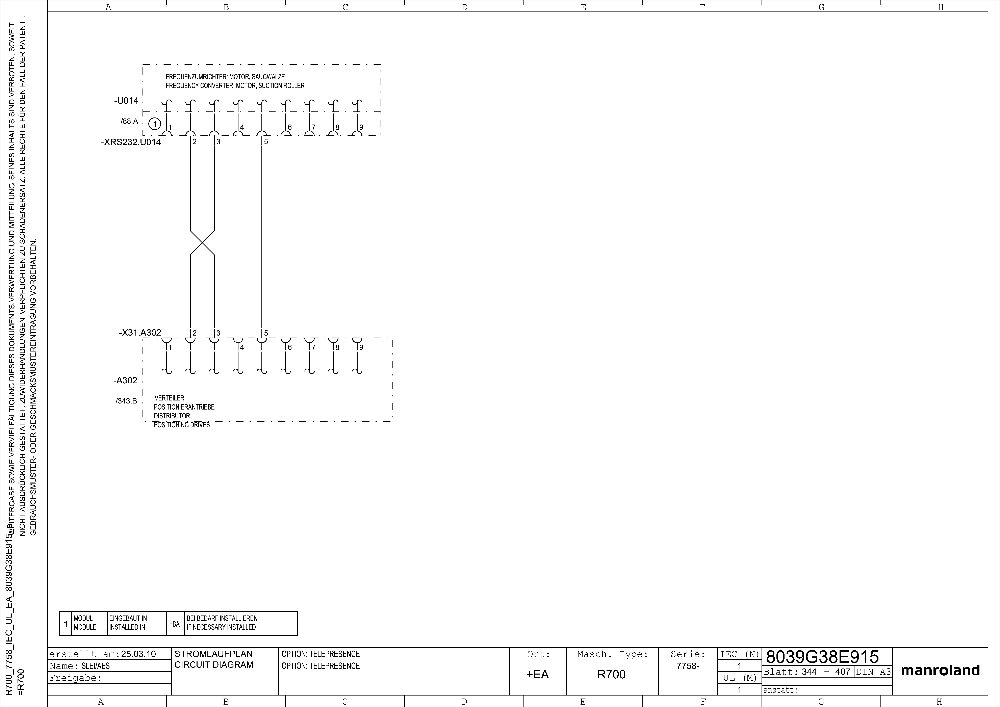

# +EA — Sheet 344 of 407 — OPTION: TELEPRESENCE

**OPTION: TELEPRESENCE**

> Part of the manroland **R700** printing press IEC/UL circuit diagrams.
> Drawing class: **Stromlaufplan / Circuit diagram** (DIN A3).
> Document `+EA` covers the **Printing unit** machine section.

## At a glance

| Field | Value |
|---|---|
| Document | `+EA`  (8039G38E915) |
| Sheet | **344** of 407 |
| Section (DE) | OPTION: TELEPRESENCE |
| Section (EN) | OPTION: TELEPRESENCE |
| Section type | CIRCUIT — Circuit diagram |
| Machine type | `R700` |
| Series | `7758` |
| Created | 25.03.10 |
| Replaces | — |
| Columns used | A, B, C |
| Path numbers | — |
| Labels on sheet | 39 |
| Cross-refs out | 2 |
| Cross-refs in | 20 |

**Previous:** [+EA sheet 343](SHEET_0343.md) · **Next:** [+EA sheet 345](SHEET_0345.md) · **Document TOC:** [_TOC.md](_TOC.md)  (+EA) · **Master TOC:** [all sheets](../_MASTER_TOC.md)

## Sheet image (300 DPI, exact vector render)



_Rendered directly from the PDF vector layer at 300 DPI (1-bit), no OCR and no resampling. Use it to confirm anything ambiguous in the text below._

## Cross-references on this sheet

Each entry is a wire leaving this sheet. The printed token is `/sheet.column`; the link resolves to that sheet inside the same document.

| Ref | Target sheet | Col | Path | Destination on target | Target section | From col |
|---|---|---|---|---|---|---|
| `/88.A` | [+EA sheet 88](SHEET_0088.md) | A | — | — | SAUGWALZE | A |
| `/343.B` | [+EA sheet 343](SHEET_0343.md) | B | — | VERTEILER: POSITIONIERANTRIEBE DISTRIBUTOR: POSITIONING DRIVES | OPTION: TELEPRESENCE | A |

### Incoming references (sheets that point here)

Every other sheet that sends a wire to this one. `Back-ref` is the token printed on *that* sheet; `Path` is its line number.

| From sheet | Cols | Back-ref | Path | Refs | What continues there |
|---|---|---|---|---|---|
| [+EA#88](SHEET_0088.md) | A | `/88.A` | — | 1 | — |
| [+EA#275](SHEET_0275.md) | H | `/275.H` | — | 9 | — |
| [+EA#289](SHEET_0289.md) | F | `/289.F` | — | 9 | — |
| [+EA#343](SHEET_0343.md) | E | `/343.E` | — | 1 | VERTEILER: POSITIONIERANTRIEBE DISTRIBUTOR: POSITIONING DRIVES |


## Devices on this sheet

| Tag | Class | Class meaning (IEC) | Col | Sub | Terminal | Sign |
|---|---|---|---|---|---|---|
| `A302` | A | Baugruppe / assembly, module, PC board | A | — | — | — |
| `U014` | U | Umrichter / frequency converter | A | — | — | — |
| `X31.A302` | — | cross-device reference | A | — | — | — |
| `XRS232.U014` | — | cross-device reference | A | — | — | — |

## Potentials / nets

_No named potentials on this sheet._

## Wire-end annotations (grouped as printed)

A wire that continues elsewhere is annotated with a small cluster: the destination description, the path/line number `#NN`, and the `/sheet.column` cross reference. Each row below is one such cluster exactly as it is grouped on the drawing.

| Col | Y | Path | Cross-ref | Text on the wire |
|---|---|---|---|---|
| B | 88.5 | — | — | `FREQUENZUMRICHTER: MOTOR, SAUGWALZE FREQUENCY CONVERTER: MOTOR, SUCTION ROLLER` |
| A | 115.1 | — | — | `U014` |
| A | 140.6 | — | `/88.A` | — |
| A | 144.3 | — | — | `1` |
| B | 147.7 | — | — | `1` |
| B | 147.7 | — | — | `4` |
| C | 147.7 | — | — | `6 7 8 9` |
| A | 164.7 | — | — | `XRS232.U014 2 3` |
| B | 164.7 | — | — | `5` |
| B | 391.5 | — | — | `X31.A302 2 3 5` |
| B | 409.9 | — | — | `1 4 6 7 8 9` |
| A | 448.2 | — | — | `A302` |
| A | 471.1 | — | `/343.B` | `POSITIONIERANTRIEBE DISTRIBUTOR: POSITIONING DRIVES VERTEILER:` |
| A | 733.4 | — | — | `1 MODUL MODULE` |
| A | 733.4 | — | — | `EINGEBAUT IN INSTALLED IN +BA` |
| B | 733.4 | — | — | `BEI BEDARF INSTALLIEREN IF NECESSARY INSTALLED` |


## Reconstructed tables

This sheet carries tabular content (pin map / terminal assignment / index). The grid below was rebuilt from the drawing's own rule lines, so each row is exactly one physical row of the table.

### Table 1 — 5 data rows × 10 columns (at x=204.1, y=0.0) — **FREQUENCY FREQUENZUMRICHTER: MOTOR, CONVERTER: MOTOR, SAUGWALZE SUCTION ROLLER POSITIONIERANTRIEBE DISTRIBUTOR: +BA IF 2 2 DRIVES BEI BEDARF NECESSARY 4 3 3 4 INSTALLIEREN INSTALLED 5 5 6 7 8 9 6 7 8 9**

|  | STROMLAUFPLAN |  |  | OPTION: TELEPRESENCE | Ort: | Masch. Type: | Serie: | IEC (N) | 8039G38E915 |
|---|---|---|---|---|---|---|---|---|---|
|  | `CIRCUIT` | `DIAGRAM` |  |  |  |  |  |  |  |
|  |  |  |  | `OPTION: TELEPRESENCE` |  |  | `7758` | `1` |  |
|  |  |  |  |  | `+EA` | `R700` |  |  | `Blatt: DIN A3 344 407` |
|  |  |  |  |  |  |  |  | `UL (M)` |  |
|  |  |  |  |  |  |  |  | `1` | `anstatt:` |


## Notes and free text on this sheet

| Text | Col | Y (pt) |
|---|---|---|
| `VERTEILER:` | B | 471.15 |
| `POSITIONIERANTRIEBE` | B | 481.79 |
| `DISTRIBUTOR:` | B | 492.42 |
| `POSITIONING DRIVES` | B | 503.06 |
| `FREQUENZUMRICHTER: MOTOR, SAUGWALZE` | B | 88.5 |
| `FREQUENCY CONVERTER: MOTOR, SUCTION ROLLER` | B | 99.15 |
| `MODUL` | A | 733.41 |
| `MODULE` | A | 744.03 |
| `EINGEBAUT IN` | A | 733.35 |
| `INSTALLED IN` | A | 743.99 |
| `+BA` | B | 740.44 |
| `BEI BEDARF INSTALLIEREN` | B | 733.36 |
| `IF NECESSARY INSTALLED` | B | 744 |

## Complete label inventory (exact text from the drawing)

Every text object inside the drawing area of this sheet, in DIN reading order (column A→H, then top→bottom). This is the authoritative list: if a string is not here it is not printed on this sheet.

| Col | Y | X | Dir | Type | Text |
|---|---|---|---|---|---|
| A | 115.1 | 136.1 | → | device tag | `U014` |
| A | 140.6 | 143.7 | → | cross-reference | `/88.A` |
| A | 144.3 | 182.5 | → | number | `1` |
| A | 164.7 | 120.5 | → | device ref | `XRS232.U014` |
| A | 391.5 | 141.7 | → | device ref | `X31.A302` |
| A | 448.2 | 135.2 | → | device tag | `A302` |
| A | 473.6 | 137.8 | → | cross-reference | `/343.B` |
| A | 733.3 | 130.3 | → | text | `EINGEBAUT IN` |
| A | 733.4 | 88.0 | → | text | `MODUL` |
| A | 738.7 | 75.4 | → | number | `1` |
| A | 744.0 | 88.0 | → | text | `MODULE` |
| A | 744.0 | 130.3 | → | text | `INSTALLED IN` |
| B | 88.5 | 197.6 | → | text | `FREQUENZUMRICHTER: MOTOR, SAUGWALZE` |
| B | 99.1 | 197.6 | → | text | `FREQUENCY CONVERTER: MOTOR, SUCTION ROLLER` |
| B | 147.7 | 200.4 | → | number | `1` |
| B | 147.7 | 286.0 | → | number | `4` |
| B | 164.7 | 229.3 | → | number | `2` |
| B | 164.7 | 257.7 | → | number | `3` |
| B | 164.7 | 314.4 | → | number | `5` |
| B | 392.9 | 229.3 | → | number | `2` |
| B | 392.9 | 257.7 | → | number | `3` |
| B | 392.9 | 314.4 | → | number | `5` |
| B | 409.9 | 200.4 | → | number | `1` |
| B | 409.9 | 286.0 | → | number | `4` |
| B | 471.2 | 184.3 | → | text | `VERTEILER:` |
| B | 481.8 | 183.4 | → | text | `POSITIONIERANTRIEBE` |
| B | 492.4 | 183.4 | → | text | `DISTRIBUTOR:` |
| B | 503.1 | 183.4 | → | text | `POSITIONING DRIVES` |
| B | 733.4 | 222.4 | → | text | `BEI BEDARF INSTALLIEREN` |
| B | 740.4 | 201.7 | → | text | `+BA` |
| B | 744.0 | 222.4 | → | text | `IF NECESSARY INSTALLED` |
| C | 147.7 | 342.7 | → | number | `6` |
| C | 147.7 | 371.1 | → | number | `7` |
| C | 147.7 | 399.4 | → | number | `8` |
| C | 147.7 | 427.7 | → | number | `9` |
| C | 409.9 | 342.7 | → | number | `6` |
| C | 409.9 | 371.1 | → | number | `7` |
| C | 409.9 | 399.4 | → | number | `8` |
| C | 409.9 | 427.7 | → | number | `9` |

## Reading-order text block

The same content as a plain block, grouped by DIN column — convenient to paste or to match against a visual description.

```text
=== Column A ===
 115.1  136.1  devtag       U014
 140.6  143.7  xref         /88.A
 144.3  182.5  numeric      1
 164.7  120.5  devref       XRS232.U014
 391.5  141.7  devref       X31.A302
 448.2  135.2  devtag       A302
 473.6  137.8  xref         /343.B
 733.3  130.3  text         EINGEBAUT IN
 733.4   88.0  text         MODUL
 738.7   75.4  numeric      1
 744.0   88.0  text         MODULE
 744.0  130.3  text         INSTALLED IN
=== Column B ===
  88.5  197.6  text         FREQUENZUMRICHTER: MOTOR, SAUGWALZE
  99.1  197.6  text         FREQUENCY CONVERTER: MOTOR, SUCTION ROLLER
 147.7  200.4  numeric      1
 147.7  286.0  numeric      4
 164.7  229.3  numeric      2
 164.7  257.7  numeric      3
 164.7  314.4  numeric      5
 392.9  229.3  numeric      2
 392.9  257.7  numeric      3
 392.9  314.4  numeric      5
 409.9  200.4  numeric      1
 409.9  286.0  numeric      4
 471.2  184.3  text         VERTEILER:
 481.8  183.4  text         POSITIONIERANTRIEBE
 492.4  183.4  text         DISTRIBUTOR:
 503.1  183.4  text         POSITIONING DRIVES
 733.4  222.4  text         BEI BEDARF INSTALLIEREN
 740.4  201.7  text         +BA
 744.0  222.4  text         IF NECESSARY INSTALLED
=== Column C ===
 147.7  342.7  numeric      6
 147.7  371.1  numeric      7
 147.7  399.4  numeric      8
 147.7  427.7  numeric      9
 409.9  342.7  numeric      6
 409.9  371.1  numeric      7
 409.9  399.4  numeric      8
 409.9  427.7  numeric      9
```

---
_Generated from the PDF vector text layer; no OCR. Source: `R700_7758_IEC_UL_EA_8039G38E915_p`, sheet 344._
