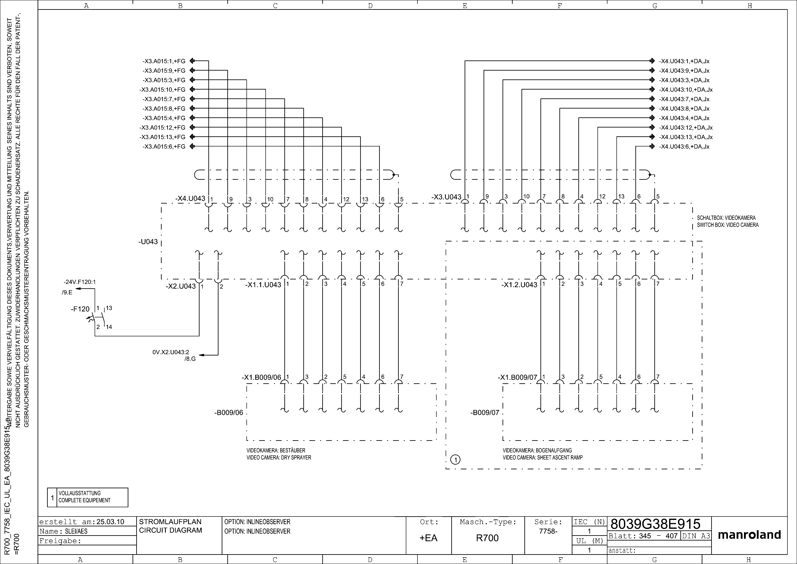

# +EA — Sheet 345 of 407 — OPTION: INLINEOBSERVER

**OPTION: INLINEOBSERVER**

> Part of the manroland **R700** printing press IEC/UL circuit diagrams.
> Drawing class: **Stromlaufplan / Circuit diagram** (DIN A3).
> Document `+EA` covers the **Printing unit** machine section.

## At a glance

| Field | Value |
|---|---|
| Document | `+EA`  (8039G38E915) |
| Sheet | **345** of 407 |
| Section (DE) | OPTION: INLINEOBSERVER |
| Section (EN) | OPTION: INLINEOBSERVER |
| Section type | CIRCUIT — Circuit diagram |
| Machine type | `R700` |
| Series | `7758` |
| Created | 25.03.10 |
| Replaces | — |
| Columns used | A, B, C, D, E, F, G, H |
| Path numbers | — |
| Labels on sheet | 101 |
| Cross-refs out | 2 |
| Cross-refs in | 54 |

**Previous:** [+EA sheet 344](SHEET_0344.md) · **Next:** [+EA sheet 346](SHEET_0346.md) · **Document TOC:** [_TOC.md](_TOC.md)  (+EA) · **Master TOC:** [all sheets](../_MASTER_TOC.md)

## Sheet image (300 DPI, exact vector render)



_Rendered directly from the PDF vector layer at 300 DPI (1-bit), no OCR and no resampling. Use it to confirm anything ambiguous in the text below._

## Cross-references on this sheet

Each entry is a wire leaving this sheet. The printed token is `/sheet.column`; the link resolves to that sheet inside the same document.

| Ref | Target sheet | Col | Path | Destination on target | Target section | From col |
|---|---|---|---|---|---|---|
| `/9.E` | [+EA sheet 9](SHEET_0009.md) | E | — | — | SPANNUNGSVERSORGUNG: 400V, 24V | A |
| `/8.G` | [+EA sheet 8](SHEET_0008.md) | G | — | 0V.X2.U043:2 | SPANNUNGSVERSORGUNG: 400V, 24V | B |

### Incoming references (sheets that point here)

Every other sheet that sends a wire to this one. `Back-ref` is the token printed on *that* sheet; `Path` is its line number.

| From sheet | Cols | Back-ref | Path | Refs | What continues there |
|---|---|---|---|---|---|
| [+EA#8](SHEET_0008.md) | G | `/8.G` | — | 1 | 0V.X2.U043:2 |
| [+EA#9](SHEET_0009.md) | E | `/9.E` | — | 1 | — |
| [+EA#214](SHEET_0214.md) | E | `/214.E` | — | 14 | — |
| [+EA#221](SHEET_0221.md) | F | `/221.F` | — | 14 | — |
| [+EA#230](SHEET_0230.md) | H | `/230.H` | — | 2 | — |
| [+EA#235](SHEET_0235.md) | H | `/235.H` | — | 11 | — |
| [+EA#238](SHEET_0238.md) | F | `/238.F` | — | 11 | — |


## Devices on this sheet

| Tag | Class | Class meaning (IEC) | Col | Sub | Terminal | Sign |
|---|---|---|---|---|---|---|
| `U043` | U | Umrichter / frequency converter | B | — | — | — |
| `B009/07` | B | Umformer / transducer, sensor | E | 07 | — | — |
| `B009/06` | B | Umformer / transducer, sensor | C | 06 | — | — |
| `F120` | F | Schutz / protection device (fuse, circuit breaker) | A | — | — | — |
| `X4.U043` | — | cross-device reference | B | — | — | — |
| `X3.U043` | — | cross-device reference | E | — | — | — |
| `X1.2.U043` | — | cross-device reference | F | — | — | — |
| `X2.U043` | — | cross-device reference | B | — | — | — |
| `X1.1.U043` | — | cross-device reference | C | — | — | — |

## Potentials / nets

| Potential | Count | Columns | Attached devices | Terminals |
|---|---|---|---|---|
| `0V` | 1 | B | `U043`, `X2` | `2` |
| `24V` | 1 | A | `F120` | `1` |


A potential such as `L24+/4` or `M24+` is a named supply/return rail; every place it appears on this sheet is electrically common.

## Wire-end annotations (grouped as printed)

A wire that continues elsewhere is annotated with a small cluster: the destination description, the path/line number `#NN`, and the `/sheet.column` cross reference. Each row below is one such cluster exactly as it is grouped on the drawing.

| Col | Y | Path | Cross-ref | Text on the wire |
|---|---|---|---|---|
| B | 87.4 | — | — | `X3.A015:1,+FG` |
| G | 87.5 | — | — | `X4.U043:1,+DA,Jx` |
| B | 101.6 | — | — | `X3.A015:9,+FG` |
| G | 101.6 | — | — | `X4.U043:9,+DA,Jx` |
| B | 115.8 | — | — | `X3.A015:3,+FG` |
| G | 115.8 | — | — | `X4.U043:3,+DA,Jx` |
| B | 130.0 | — | — | `X3.A015:10,+FG` |
| G | 130.0 | — | — | `X4.U043:10,+DA,Jx` |
| B | 144.1 | — | — | `X3.A015:7,+FG` |
| G | 144.2 | — | — | `X4.U043:7,+DA,Jx` |
| B | 158.3 | — | — | `X3.A015:8,+FG` |
| G | 158.3 | — | — | `X4.U043:8,+DA,Jx` |
| B | 172.5 | — | — | `X3.A015:4,+FG` |
| G | 172.5 | — | — | `X4.U043:4,+DA,Jx` |
| B | 186.7 | — | — | `X3.A015:12,+FG` |
| G | 186.7 | — | — | `X4.U043:12,+DA,Jx` |
| B | 200.8 | — | — | `X3.A015:13,+FG` |
| G | 200.8 | — | — | `X4.U043:13,+DA,Jx` |
| B | 215.0 | — | — | `X3.A015:6,+FG` |
| G | 215.0 | — | — | `X4.U043:6,+DA,Jx` |
| D | 289.4 | — | — | `X4.U043 1 9 3 10 7 8 4 12 13 6 5 X3.U043 1 9 3 10 7 8 4 12 13 6 5` |
| H | 322.4 | — | — | `SCHALTBOX: VIDEOKAMERA SWITCH BOX: VIDEO CAMERA` |
| B | 356.1 | — | — | `U043` |
| A | 417.0 | — | — | `24V.F120:1` |
| D | 419.9 | — | — | `X1.1.U043 1 2 3 4 5 6 7` |
| F | 419.9 | — | — | `X1.2.U043 1 2 3 4 5 6 7` |
| B | 422.7 | — | — | `X2.U043 1 2` |
| A | 432.5 | — | `/9.E` | — |
| A | 456.0 | — | — | `1` |
| A | 456.0 | — | — | `13` |
| A | 456.7 | — | — | `F120` |
| A | 484.3 | — | — | `2` |
| A | 484.3 | — | — | `14` |
| B | 521.9 | — | `/8.G` | `0V.X2.U043:2` |
| C | 558.7 | — | — | `X1.B009/06 1 3 2 5 4 6 7` |
| F | 558.7 | — | — | `X1.B009/07 1 3 2 5 4 6 7` |
| C | 611.2 | — | — | `B009/06` |
| E | 611.2 | — | — | `B009/07` |
| C | 669.6 | — | — | `VIDEOKAMERA: BESTÄUBER VIDEO CAMERA: DRY SPRAYER` |
| F | 669.6 | — | — | `VIDEOKAMERA: BOGENAUFGANG VIDEO CAMERA: SHEET ASCENT RAMP` |
| E | 682.9 | — | — | `1` |
| A | 733.4 | — | — | `COMPLETE EQUIPEMENT VOLLAUSSTATTUNG` |
| A | 738.7 | — | — | `1` |


## Reconstructed tables

This sheet carries tabular content (pin map / terminal assignment / index). The grid below was rebuilt from the drawing's own rule lines, so each row is exactly one physical row of the table.

### Table 1 — 17 data rows × 32 columns (at x=141.7, y=0.0)

|  | X3.A015:1,+FG |  |  |  |  |  |  |  |  |  |  |  |  |  |  |  |  |  |  |  |  |  |  |  |  |  |  |  |  |  | X4.U043:1,+DA,Jx |
|---|---|---|---|---|---|---|---|---|---|---|---|---|---|---|---|---|---|---|---|---|---|---|---|---|---|---|---|---|---|---|---|
|  | `X3.A015:9,+FG` |  |  |  |  |  |  |  |  |  |  |  |  |  |  |  |  |  |  |  |  |  |  |  |  |  |  |  |  |  | `X4.U043:9,+DA,Jx` |
|  | `X3.A015:3,+FG` |  |  |  |  |  |  |  |  |  |  |  |  |  |  |  |  |  |  |  |  |  |  |  |  |  |  |  |  |  | `X4.U043:3,+DA,Jx` |
|  | `X3.A015:10,+FG` |  |  |  |  |  |  |  |  |  |  |  |  |  |  |  |  |  |  |  |  |  |  |  |  |  |  |  |  |  | `X4.U043:10,+DA,Jx` |
|  | `X3.A015:7,+FG` |  |  |  |  |  |  |  |  |  |  |  |  |  |  |  |  |  |  |  |  |  |  |  |  |  |  |  |  |  | `X4.U043:7,+DA,Jx` |
|  | `X3.A015:8,+FG` |  |  |  |  |  |  |  |  |  |  |  |  |  |  |  |  |  |  |  |  |  |  |  |  |  |  |  |  |  | `X4.U043:8,+DA,Jx` |
|  | `X3.A015:4,+FG` |  |  |  |  |  |  |  |  |  |  |  |  |  |  |  |  |  |  |  |  |  |  |  |  |  |  |  |  |  | `X4.U043:4,+DA,Jx` |
|  | `X3.A015:12,+FG` |  |  |  |  |  |  |  |  |  |  |  |  |  |  |  |  |  |  |  |  |  |  |  |  |  |  |  |  |  | `X4.U043:12,+DA,Jx` |
|  | `X3.A015:13,+FG` |  |  |  |  |  |  |  |  |  |  |  |  |  |  |  |  |  |  |  |  |  |  |  |  |  |  |  |  |  | `X4.U043:13,+DA,Jx` |
|  | `X3.A015:6,+FG` |  |  |  |  |  |  |  |  |  |  |  |  |  |  |  |  |  |  |  |  |  |  |  |  |  |  |  |  |  | `X4.U043:6,+DA,Jx` |
| `1 13 2 14` | `X4.U043 U043 X2.U043` | `1` | `1` | `2` |  | `9` | `3 X1.1.U043` | `10` | `7 1` | `8 2` | `4 3` | `12 4` | `13 5` | `6 6` | `5 7` | `X3.U043` |  | `1` | `9` | `3 X1.2.U043` |  | `10` | `7 1` | `8 2` |  | `4 3` | `12 4` |  | `13 5` | `6 6` | `5 SCHALTBOX: SWITCH 7` |
| `EQUIPEMENT` | `0V.X2.U043:2 /8.G` |  |  |  |  | `B009/06` | `X1.B009/06 VIDEOKAMERA: VIDEO` | `CAMERA:` | `1 BESTÄUBER DRY SPRAYER` | `3` | `2` | `5` | `4` | `6` | `7` |  | `1` |  | `B009/07` | `X1.B009/07 VIDEOKAMERA: VIDEO` |  | `CAMERA:` | `1 BOGENAUFGANG SHEET` | `3 ASCENT` | `RAMP` | `2` | `5` |  | `4` | `6` | `7` |
| `25.03.10` | `STROMLAUFPLAN` |  |  |  |  | `OPTION:` |  | `INLINEOBSERVER` |  |  |  |  |  |  |  | `Ort:` |  |  | `Masch. Type:` |  |  |  | `Serie:` |  |  | `IEC` | `(N)` |  |  |  | `8039G38E915` |
|  | `CIRCUIT DIAGRAM` |  |  |  |  |  |  |  |  |  |  |  |  |  |  |  |  |  |  |  |  |  |  |  |  |  |  |  |  |  |  |
|  |  |  |  |  |  | `OPTION:` |  | `INLINEOBSERVER` |  |  |  |  |  |  |  |  |  |  |  |  |  |  | `7758` |  |  | `1` |  |  |  |  |  |
|  |  |  |  |  |  |  |  |  |  |  |  |  |  |  |  | `+EA` |  |  | `R700` |  |  |  |  |  |  |  |  |  | `Blatt:` | `345` | `DIN A3 407` |
|  |  |  |  |  |  |  |  |  |  |  |  |  |  |  |  |  |  |  |  |  |  |  |  |  |  | `UL (M)` |  |  |  |  |  |
|  |  |  |  |  |  |  |  |  |  |  |  |  |  |  |  |  |  |  |  |  |  |  |  |  |  | `1` |  |  | `anstatt:` |  |  |


## Notes and free text on this sheet

| Text | Col | Y (pt) |
|---|---|---|
| `SCHALTBOX: VIDEOKAMERA` | H | 322.36 |
| `SWITCH BOX: VIDEO CAMERA` | H | 332.97 |
| `X4.U043:13,+DA,Jx` | G | 200.85 |
| `X1.B009/07` | F | 558.73 |
| `VIDEOKAMERA: BOGENAUFGANG` | F | 669.61 |
| `VIDEO CAMERA: SHEET ASCENT RAMP` | F | 680.24 |
| `X4.U043:6,+DA,Jx` | G | 215.02 |
| `X4.U043:12,+DA,Jx` | G | 186.67 |
| `X4.U043:4,+DA,Jx` | G | 172.5 |
| `X4.U043:7,+DA,Jx` | G | 144.15 |
| `X4.U043:1,+DA,Jx` | G | 87.46 |
| `X4.U043:9,+DA,Jx` | G | 101.63 |
| `X4.U043:3,+DA,Jx` | G | 115.8 |
| `X4.U043:10,+DA,Jx` | G | 129.98 |
| `X4.U043:8,+DA,Jx` | G | 158.32 |
| `X3.A015:4,+FG` | B | 172.48 |
| `X3.A015:13,+FG` | B | 200.83 |
| `X3.A015:6,+FG` | B | 215 |
| `X3.A015:12,+FG` | B | 186.66 |
| `X3.A015:8,+FG` | B | 158.31 |
| `X3.A015:7,+FG` | B | 144.13 |
| `X3.A015:10,+FG` | B | 129.96 |
| `X3.A015:3,+FG` | B | 115.79 |
| `X3.A015:1,+FG` | B | 87.44 |
| `X3.A015:9,+FG` | B | 101.61 |
| `X1.B009/06` | C | 558.73 |
| `VIDEOKAMERA: BESTÄUBER` | C | 669.6 |
| `VIDEO CAMERA: DRY SPRAYER` | C | 680.24 |
| `VOLLAUSSTATTUNG` | A | 733.39 |
| `COMPLETE EQUIPEMENT` | A | 744.02 |

## Complete label inventory (exact text from the drawing)

Every text object inside the drawing area of this sheet, in DIN reading order (column A→H, then top→bottom). This is the authoritative list: if a string is not here it is not printed on this sheet.

| Col | Y | X | Dir | Type | Text |
|---|---|---|---|---|---|
| A | 417.0 | 95.2 | → | potential | `24V.F120:1` |
| A | 432.5 | 92.4 | → | cross-reference | `/9.E` |
| A | 456.0 | 143.7 | → | number | `1` |
| A | 456.0 | 157.9 | → | number | `13` |
| A | 456.7 | 106.0 | → | device tag | `F120` |
| A | 484.3 | 144.3 | → | number | `2` |
| A | 484.3 | 157.9 | → | number | `14` |
| A | 733.4 | 87.9 | → | text | `VOLLAUSSTATTUNG` |
| A | 738.7 | 75.4 | → | number | `1` |
| A | 744.0 | 87.6 | → | text | `COMPLETE EQUIPEMENT` |
| B | 87.4 | 213.2 | → | text | `X3.A015:1,+FG` |
| B | 101.6 | 213.2 | → | text | `X3.A015:9,+FG` |
| B | 115.8 | 213.2 | → | text | `X3.A015:3,+FG` |
| B | 130.0 | 208.3 | → | text | `X3.A015:10,+FG` |
| B | 144.1 | 213.2 | → | text | `X3.A015:7,+FG` |
| B | 158.3 | 213.2 | → | text | `X3.A015:8,+FG` |
| B | 172.5 | 213.2 | → | text | `X3.A015:4,+FG` |
| B | 186.7 | 208.3 | → | text | `X3.A015:12,+FG` |
| B | 200.8 | 208.3 | → | text | `X3.A015:13,+FG` |
| B | 215.0 | 213.2 | → | text | `X3.A015:6,+FG` |
| B | 291.6 | 261.9 | → | device ref | `X4.U043` |
| B | 293.7 | 313.8 | → | number | `1` |
| B | 356.1 | 206.9 | → | device tag | `U043` |
| B | 422.7 | 247.7 | → | device ref | `X2.U043` |
| B | 424.1 | 299.6 | → | number | `1` |
| B | 424.1 | 328.5 | → | number | `2` |
| B | 521.9 | 227.9 | → | potential | `0V.X2.U043:2` |
| B | 531.7 | 275.8 | → | cross-reference | `/8.G` |
| C | 293.7 | 342.7 | → | number | `9` |
| C | 293.7 | 371.1 | → | number | `3` |
| C | 293.7 | 398.8 | → | number | `10` |
| C | 293.7 | 427.7 | → | number | `7` |
| C | 293.7 | 456.1 | → | number | `8` |
| C | 419.9 | 427.2 | → | number | `1` |
| C | 419.9 | 456.1 | → | number | `2` |
| C | 420.6 | 366.5 | → | device ref | `X1.1.U043` |
| C | 558.7 | 361.1 | → | text | `X1.B009/06` |
| C | 558.7 | 427.2 | → | number | `1` |
| C | 558.7 | 456.1 | → | number | `3` |
| C | 611.2 | 320.3 | → | device tag | `B009/06` |
| C | 669.6 | 368.5 | → | text | `VIDEOKAMERA: BESTÄUBER` |
| C | 680.2 | 368.5 | → | text | `VIDEO CAMERA: DRY SPRAYER` |
| D | 293.7 | 484.4 | → | number | `4` |
| D | 293.7 | 512.2 | → | number | `12` |
| D | 293.7 | 540.6 | → | number | `13` |
| D | 293.7 | 569.5 | → | number | `6` |
| D | 293.7 | 597.8 | → | number | `5` |
| D | 419.9 | 484.4 | → | number | `3` |
| D | 419.9 | 512.8 | → | number | `4` |
| D | 419.9 | 541.1 | → | number | `5` |
| D | 419.9 | 569.5 | → | number | `6` |
| D | 419.9 | 597.8 | → | number | `7` |
| D | 558.7 | 484.4 | → | number | `2` |
| D | 558.7 | 512.8 | → | number | `5` |
| D | 558.7 | 541.1 | → | number | `4` |
| D | 558.7 | 569.5 | → | number | `6` |
| D | 558.7 | 597.8 | → | number | `7` |
| E | 289.4 | 644.6 | → | device ref | `X3.U043` |
| E | 289.5 | 696.5 | → | number | `1` |
| E | 289.5 | 725.4 | → | number | `9` |
| E | 289.5 | 753.7 | → | number | `3` |
| E | 611.2 | 703.0 | → | device tag | `B009/07` |
| E | 682.9 | 678.6 | → | number | `1` |
| F | 289.5 | 781.5 | → | number | `10` |
| F | 289.5 | 810.4 | → | number | `7` |
| F | 289.5 | 838.8 | → | number | `8` |
| F | 289.5 | 867.1 | → | number | `4` |
| F | 289.5 | 894.9 | → | number | `12` |
| F | 419.9 | 809.9 | → | number | `1` |
| F | 419.9 | 838.8 | → | number | `2` |
| F | 419.9 | 867.1 | → | number | `3` |
| F | 419.9 | 895.5 | → | number | `4` |
| F | 420.6 | 749.2 | → | device ref | `X1.2.U043` |
| F | 558.7 | 743.8 | → | text | `X1.B009/07` |
| F | 558.7 | 809.9 | → | number | `1` |
| F | 558.7 | 838.8 | → | number | `3` |
| F | 558.7 | 867.1 | → | number | `2` |
| F | 558.7 | 895.5 | → | number | `5` |
| F | 669.6 | 751.2 | → | text | `VIDEOKAMERA: BOGENAUFGANG` |
| F | 680.2 | 751.2 | → | text | `VIDEO CAMERA: SHEET ASCENT RAMP` |
| G | 87.5 | 984.8 | → | text | `X4.U043:1,+DA,Jx` |
| G | 101.6 | 984.8 | → | text | `X4.U043:9,+DA,Jx` |
| G | 115.8 | 984.8 | → | text | `X4.U043:3,+DA,Jx` |
| G | 130.0 | 984.8 | → | text | `X4.U043:10,+DA,Jx` |
| G | 144.2 | 984.8 | → | text | `X4.U043:7,+DA,Jx` |
| G | 158.3 | 984.8 | → | text | `X4.U043:8,+DA,Jx` |
| G | 172.5 | 984.8 | → | text | `X4.U043:4,+DA,Jx` |
| G | 186.7 | 984.8 | → | text | `X4.U043:12,+DA,Jx` |
| G | 200.8 | 984.8 | → | text | `X4.U043:13,+DA,Jx` |
| G | 215.0 | 984.8 | → | text | `X4.U043:6,+DA,Jx` |
| G | 289.5 | 923.2 | → | number | `13` |
| G | 289.5 | 952.2 | → | number | `6` |
| G | 289.5 | 980.5 | → | number | `5` |
| G | 419.9 | 923.8 | → | number | `5` |
| G | 419.9 | 952.2 | → | number | `6` |
| G | 419.9 | 980.5 | → | number | `7` |
| G | 558.7 | 923.8 | → | number | `4` |
| G | 558.7 | 952.2 | → | number | `6` |
| G | 558.7 | 980.5 | → | number | `7` |
| H | 322.4 | 1041.4 | → | text | `SCHALTBOX: VIDEOKAMERA` |
| H | 333.0 | 1041.4 | → | text | `SWITCH BOX: VIDEO CAMERA` |

## Reading-order text block

The same content as a plain block, grouped by DIN column — convenient to paste or to match against a visual description.

```text
=== Column A ===
 417.0   95.2  net          24V.F120:1
 432.5   92.4  xref         /9.E
 456.0  143.7  numeric      1
 456.0  157.9  numeric      13
 456.7  106.0  devtag       F120
 484.3  144.3  numeric      2
 484.3  157.9  numeric      14
 733.4   87.9  text         VOLLAUSSTATTUNG
 738.7   75.4  numeric      1
 744.0   87.6  text         COMPLETE EQUIPEMENT
=== Column B ===
  87.4  213.2  text         X3.A015:1,+FG
 101.6  213.2  text         X3.A015:9,+FG
 115.8  213.2  text         X3.A015:3,+FG
 130.0  208.3  text         X3.A015:10,+FG
 144.1  213.2  text         X3.A015:7,+FG
 158.3  213.2  text         X3.A015:8,+FG
 172.5  213.2  text         X3.A015:4,+FG
 186.7  208.3  text         X3.A015:12,+FG
 200.8  208.3  text         X3.A015:13,+FG
 215.0  213.2  text         X3.A015:6,+FG
 291.6  261.9  devref       X4.U043
 293.7  313.8  numeric      1
 356.1  206.9  devtag       U043
 422.7  247.7  devref       X2.U043
 424.1  299.6  numeric      1
 424.1  328.5  numeric      2
 521.9  227.9  net          0V.X2.U043:2
 531.7  275.8  xref         /8.G
=== Column C ===
 293.7  342.7  numeric      9
 293.7  371.1  numeric      3
 293.7  398.8  numeric      10
 293.7  427.7  numeric      7
 293.7  456.1  numeric      8
 419.9  427.2  numeric      1
 419.9  456.1  numeric      2
 420.6  366.5  devref       X1.1.U043
 558.7  361.1  text         X1.B009/06
 558.7  427.2  numeric      1
 558.7  456.1  numeric      3
 611.2  320.3  devtag       B009/06
 669.6  368.5  text         VIDEOKAMERA: BESTÄUBER
 680.2  368.5  text         VIDEO CAMERA: DRY SPRAYER
=== Column D ===
 293.7  484.4  numeric      4
 293.7  512.2  numeric      12
 293.7  540.6  numeric      13
 293.7  569.5  numeric      6
 293.7  597.8  numeric      5
 419.9  484.4  numeric      3
 419.9  512.8  numeric      4
 419.9  541.1  numeric      5
 419.9  569.5  numeric      6
 419.9  597.8  numeric      7
 558.7  484.4  numeric      2
 558.7  512.8  numeric      5
 558.7  541.1  numeric      4
 558.7  569.5  numeric      6
 558.7  597.8  numeric      7
=== Column E ===
 289.4  644.6  devref       X3.U043
 289.5  696.5  numeric      1
 289.5  725.4  numeric      9
 289.5  753.7  numeric      3
 611.2  703.0  devtag       B009/07
 682.9  678.6  numeric      1
=== Column F ===
 289.5  781.5  numeric      10
 289.5  810.4  numeric      7
 289.5  838.8  numeric      8
 289.5  867.1  numeric      4
 289.5  894.9  numeric      12
 419.9  809.9  numeric      1
 419.9  838.8  numeric      2
 419.9  867.1  numeric      3
 419.9  895.5  numeric      4
 420.6  749.2  devref       X1.2.U043
 558.7  743.8  text         X1.B009/07
 558.7  809.9  numeric      1
 558.7  838.8  numeric      3
 558.7  867.1  numeric      2
 558.7  895.5  numeric      5
 669.6  751.2  text         VIDEOKAMERA: BOGENAUFGANG
 680.2  751.2  text         VIDEO CAMERA: SHEET ASCENT RAMP
=== Column G ===
  87.5  984.8  text         X4.U043:1,+DA,Jx
 101.6  984.8  text         X4.U043:9,+DA,Jx
 115.8  984.8  text         X4.U043:3,+DA,Jx
 130.0  984.8  text         X4.U043:10,+DA,Jx
 144.2  984.8  text         X4.U043:7,+DA,Jx
 158.3  984.8  text         X4.U043:8,+DA,Jx
 172.5  984.8  text         X4.U043:4,+DA,Jx
 186.7  984.8  text         X4.U043:12,+DA,Jx
 200.8  984.8  text         X4.U043:13,+DA,Jx
 215.0  984.8  text         X4.U043:6,+DA,Jx
 289.5  923.2  numeric      13
 289.5  952.2  numeric      6
 289.5  980.5  numeric      5
 419.9  923.8  numeric      5
 419.9  952.2  numeric      6
 419.9  980.5  numeric      7
 558.7  923.8  numeric      4
 558.7  952.2  numeric      6
 558.7  980.5  numeric      7
=== Column H ===
 322.4 1041.4  text         SCHALTBOX: VIDEOKAMERA
 333.0 1041.4  text         SWITCH BOX: VIDEO CAMERA
```

---
_Generated from the PDF vector text layer; no OCR. Source: `R700_7758_IEC_UL_EA_8039G38E915_p`, sheet 345._
