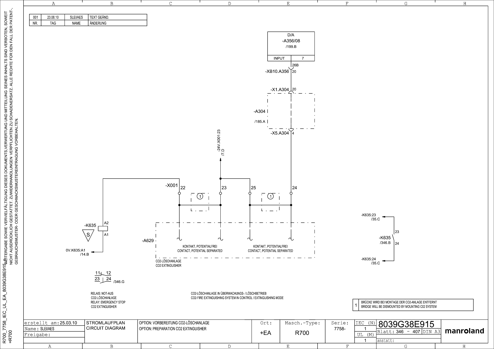

# +EA — Sheet 346 of 407 — OPTION: VORBEREITUNG CO2 LÖSCHANLAGE

**OPTION: PREPARATION CO2 EXTINGUISHER**

> Part of the manroland **R700** printing press IEC/UL circuit diagrams.
> Drawing class: **Stromlaufplan / Circuit diagram** (DIN A3).
> Document `+EA` covers the **Printing unit** machine section.

## At a glance

| Field | Value |
|---|---|
| Document | `+EA`  (8039G38E915) |
| Sheet | **346** of 407 |
| Section (DE) | OPTION: VORBEREITUNG CO2 LÖSCHANLAGE |
| Section (EN) | OPTION: PREPARATION CO2 EXTINGUISHER |
| Section type | CIRCUIT — Circuit diagram |
| Machine type | `R700` |
| Series | `7758` |
| Created | 25.03.10 |
| Replaces | — |
| Columns used | A, B, C, D, E, F, G |
| Path numbers | — |
| Labels on sheet | 66 |
| Cross-refs out | 8 |
| Cross-refs in | 11 |

**Previous:** [+EA sheet 345](SHEET_0345.md) · **Next:** [+EA sheet 347](SHEET_0347.md) · **Document TOC:** [_TOC.md](_TOC.md)  (+EA) · **Master TOC:** [all sheets](../_MASTER_TOC.md)

## Sheet image (300 DPI, exact vector render)



_Rendered directly from the PDF vector layer at 300 DPI (1-bit), no OCR and no resampling. Use it to confirm anything ambiguous in the text below._

## Cross-references on this sheet

Each entry is a wire leaving this sheet. The printed token is `/sheet.column`; the link resolves to that sheet inside the same document.

| Ref | Target sheet | Col | Path | Destination on target | Target section | From col |
|---|---|---|---|---|---|---|
| `/199.B` | [+EA sheet 199](SHEET_0199.md) | B | — | — | REFERENZMODUL | E |
| `/185.A` | [+EA sheet 185](SHEET_0185.md) | A | — | — | RESERVE | E |
| `/7.D` | [+EA sheet 7](SHEET_0007.md) | D | — | 24V.X001:23 | SPANNUNGSVERSORGUNG: 400V, 24V | D |
| `/35.C` | [+EA sheet 35](SHEET_0035.md) | C | — | K635:23 | BUSVERBINDUNGEN: NOT AUS | F |
| `/346.B` | [+EA sheet 346](SHEET_0346.md) | B | — | — | OPTION: VORBEREITUNG CO2 LÖSCHANLAGE | G |
| `/14.B` | [+EA sheet 14](SHEET_0014.md) | B | — | 0V.K635:A1 | SPANNUNGSVERSORGUNG: 400V, 24V | A |
| `/35.C` | [+EA sheet 35](SHEET_0035.md) | C | — | K635:24 | BUSVERBINDUNGEN: NOT AUS | F |
| `/346.G` | [+EA sheet 346](SHEET_0346.md) | G | — | — | OPTION: VORBEREITUNG CO2 LÖSCHANLAGE | B |

### Incoming references (sheets that point here)

Every other sheet that sends a wire to this one. `Back-ref` is the token printed on *that* sheet; `Path` is its line number.

| From sheet | Cols | Back-ref | Path | Refs | What continues there |
|---|---|---|---|---|---|
| [+EA#7](SHEET_0007.md) | D | `/7.D` | — | 1 | 24V.X001:23 |
| [+EA#14](SHEET_0014.md) | B | `/14.B` | — | 1 | 0V.K635:A1 |
| [+EA#35](SHEET_0035.md) | D | `/35.D` | — | 2 | K635:23; K635:24 |
| [+EA#185](SHEET_0185.md) | A | `/185.A` | — | 1 | — |
| [+EA#199](SHEET_0199.md) | B | `/199.B` | — | 1 | — |
| [+EA#208](SHEET_0208.md) | C | `/208.C` | — | 1 | — |
| [+EA#240](SHEET_0240.md) | A | `/240.A` | — | 1 | — |
| [+EA#254](SHEET_0254.md) | E | `/254.E` | — | 1 | — |
| [+EA#346](SHEET_0346.md) | B, G | `/346.B`, `/346.G` | — | 2 | — |


## Devices on this sheet

| Tag | Class | Class meaning (IEC) | Col | Sub | Terminal | Sign |
|---|---|---|---|---|---|---|
| `K635` | K | Relais / relay, contactor | G | — | — | — |
| `X001` | X | Klemme / terminal, plug connector | C | — | — | — |
| `A2` | A | Baugruppe / assembly, module, PC board | B | — | — | — |
| `A1` | A | Baugruppe / assembly, module, PC board | B | — | — | — |
| `K635` | K | Relais / relay, contactor | B | — | — | — |
| `A356/08` | A | Baugruppe / assembly, module, PC board | E | 08 | — | — |
| `A304` | A | Baugruppe / assembly, module, PC board | E | — | — | — |
| `A629` | A | Baugruppe / assembly, module, PC board | C | — | — | — |
| `K635:23` | K | Relais / relay, contactor | F | — | 23 | — |
| `K635:24` | K | Relais / relay, contactor | F | — | 24 | — |
| `XB10.A356` | — | cross-device reference | E | — | — | — |
| `X1.A304` | — | cross-device reference | E | — | — | — |
| `X5.A304` | — | cross-device reference | E | — | — | — |
| `NR.` | — | cross-device reference | A | — | — | — |
| `23.08.10` | — | cross-device reference | A | — | — | — |

## Potentials / nets

| Potential | Count | Columns | Attached devices | Terminals |
|---|---|---|---|---|
| `0V` | 1 | A | `K635` | `A1` |
| `24V` | 1 | D | `X001` | `23` |


A potential such as `L24+/4` or `M24+` is a named supply/return rail; every place it appears on this sheet is electrically common.

## Wire-end annotations (grouped as printed)

A wire that continues elsewhere is annotated with a small cluster: the destination description, the path/line number `#NN`, and the `/sheet.column` cross reference. Each row below is one such cluster exactly as it is grouped on the drawing.

| Col | Y | Path | Cross-ref | Text on the wire |
|---|---|---|---|---|
| A | 38.5 | — | — | `001 23.08.10 SLEI/AES TEXT GEÄND.` |
| A | 52.7 | — | — | `NR. TAG NAME ÄNDERUNG` |
| E | 80.0 | — | — | `D/A` |
| E | 93.8 | — | — | `A356/08` |
| E | 108.7 | — | `/199.B` | — |
| E | 137.1 | — | — | `INPUT 7` |
| E | 153.4 | — | — | `26B` |
| E | 167.6 | — | — | `XB10.A356 20` |
| E | 211.5 | — | — | `X1.A304 20` |
| E | 263.9 | — | — | `A304` |
| E | 289.4 | — | `/185.A` | — |
| D | 312.4 | — | `/7.D` | `24V.X001:23` |
| E | 316.4 | — | — | `X5.A304 4` |
| C | 442.3 | — | — | `X001 22 23` |
| E | 448.1 | — | — | `25 24` |
| D | 470.3 | — | — | `1` |
| E | 470.3 | — | — | `1` |
| F | 514.8 | — | `/35.C` | `K635:23` |
| B | 533.9 | — | — | `A2` |
| B | 538.9 | — | — | `K635` |
| G | 555.2 | — | — | `23` |
| B | 560.9 | — | — | `S` |
| B | 562.2 | — | — | `A1` |
| G | 568.6 | — | — | `K635 24` |
| C | 575.7 | — | — | `A629` |
| G | 581.7 | — | `/346.B` | — |
| C | 591.6 | — | — | `CONTACT, POTENTIAL SEPARATED KONTAKT, POTENTIALFREI` |
| E | 591.6 | — | — | `CONTACT, POTENTIAL SEPARATED KONTAKT, POTENTIALFREI` |
| A | 599.8 | — | `/14.B` | `0V.K635:A1` |
| F | 621.1 | — | `/35.C` | `K635:24` |
| C | 627.1 | — | — | `CO2 LÖSCHANLAGE CO2 EXTINGUISHER` |
| B | 653.7 | — | — | `23 11 12 24` |
| B | 675.6 | — | `/346.G` | — |
| B | 705.0 | — | — | `RELAIS: NOT AUS` |
| D | 705.0 | — | — | `CO2 LÖSCHANLAGE IN ÜBERWACHUNGS / LÖSCHBETRIEB CO2 FIRE EXTINGUISHING SYSTEM IN CONTROL / EXTINGUISHING MODE` |
| B | 715.7 | — | — | `RELAY: EMERGENCY STOP CO2 LÖSCHANLAGE` |
| G | 726.3 | — | — | `1 BRÜCKE WIRD BEI MONTAGE DER CO2 ANLAGE ENTFERNT BRIDGE WILL BE DISMOUNTED BY MOUNTING C02 SYSTEM` |
| B | 736.9 | — | — | `CO2 EXTINGUISHER` |


## Reconstructed tables

This sheet carries tabular content (pin map / terminal assignment / index). The grid below was rebuilt from the drawing's own rule lines, so each row is exactly one physical row of the table.

### Table 1 — 3 data rows × 5 columns (at x=432.3, y=76.5)

|  |  |  | D/A | A356/08 /199.B |
|---|---|---|---|---|
|  |  |  | `INPUT` | `7` |
| `24V.X001:23` | `/7.D` | `A304 /185.A` | `XB10.A356 X1.A304 X5.A304` | `26B 20 20 4` |
| `22 1` | `23` | `25` | `1` | `24` |


## Notes and free text on this sheet

| Text | Col | Y (pt) |
|---|---|---|
| `RELAIS: NOT AUS` | B | 705.02 |
| `CO2 LÖSCHANLAGE` | B | 715.69 |
| `RELAY: EMERGENCY STOP` | B | 726.29 |
| `CO2 EXTINGUISHER` | B | 736.94 |
| `26B` | E | 153.36 |
| `D/A` | E | 79.96 |
| `INPUT` | E | 137.05 |
| `CO2 LÖSCHANLAGE IN ÜBERWACHUNGS / LÖSCHBETRIEB` | D | 705.04 |
| `CO2 FIRE EXTINGUISHING SYSTEM IN CONTROL / EXTINGUISHING MODE` | D | 715.68 |
| `CO2 LÖSCHANLAGE` | C | 627.1 |
| `CO2 EXTINGUISHER` | C | 637.72 |
| `TAG` | A | 52.78 |
| `NAME` | A | 52.76 |
| `ÄNDERUNG` | B | 52.82 |
| `SLEI/AES` | A | 38.64 |
| `TEXT GEÄND.` | B | 38.62 |
| `S` | B | 560.93 |
| `KONTAKT, POTENTIALFREI` | C | 591.63 |
| `CONTACT, POTENTIAL SEPARATED` | C | 602.28 |
| `BRÜCKE WIRD BEI MONTAGE DER CO2 ANLAGE ENTFERNT` | G | 726.29 |
| `BRIDGE WILL BE DISMOUNTED BY MOUNTING C02 SYSTEM` | G | 736.93 |
| `KONTAKT, POTENTIALFREI` | E | 591.63 |
| `CONTACT, POTENTIAL SEPARATED` | E | 602.28 |

## Complete label inventory (exact text from the drawing)

Every text object inside the drawing area of this sheet, in DIN reading order (column A→H, then top→bottom). This is the authoritative list: if a string is not here it is not printed on this sheet.

| Col | Y | X | Dir | Type | Text |
|---|---|---|---|---|---|
| A | 38.5 | 79.8 | → | number | `001` |
| A | 38.6 | 168.7 | → | text | `SLEI/AES` |
| A | 38.7 | 114.0 | → | device ref | `23.08.10` |
| A | 52.7 | 78.9 | → | device ref | `NR.` |
| A | 52.8 | 120.4 | → | text | `TAG` |
| A | 52.8 | 173.8 | → | text | `NAME` |
| A | 599.8 | 158.7 | → | potential | `0V.K635:A1` |
| B | 38.6 | 215.9 | → | text | `TEXT GEÄND.` |
| B | 52.8 | 216.4 | → | text | `ÄNDERUNG` |
| B | 533.9 | 250.9 | → | device tag | `A2` |
| B | 538.9 | 203.2 | → | device tag | `K635` |
| B | 560.9 | 208.5 | → | text | `S` |
| B | 562.2 | 250.9 | → | device tag | `A1` |
| B | 609.7 | 193.6 | → | cross-reference | `/14.B` |
| B | 653.7 | 229.6 | → | number | `11` |
| B | 653.7 | 255.4 | → | number | `12` |
| B | 667.8 | 228.2 | → | number | `23` |
| B | 667.8 | 256.3 | → | number | `24` |
| B | 675.6 | 273.5 | → | cross-reference | `/346.G` |
| B | 705.0 | 218.8 | → | text | `RELAIS: NOT AUS` |
| B | 715.7 | 219.4 | → | text | `CO2 LÖSCHANLAGE` |
| B | 726.3 | 218.8 | → | text | `RELAY: EMERGENCY STOP` |
| B | 736.9 | 219.4 | → | text | `CO2 EXTINGUISHER` |
| C | 442.3 | 398.8 | → | device tag | `X001` |
| C | 448.1 | 434.8 | → | number | `22` |
| C | 575.7 | 342.1 | → | device tag | `A629` |
| C | 591.6 | 440.5 | → | text | `KONTAKT, POTENTIALFREI` |
| C | 602.3 | 427.7 | → | text | `CONTACT, POTENTIAL SEPARATED` |
| C | 627.1 | 375.3 | → | text | `CO2 LÖSCHANLAGE` |
| C | 637.7 | 375.3 | → | text | `CO2 EXTINGUISHER` |
| D | 312.4 | 523.3 | ↕ | potential | `24V.X001:23` |
| D | 359.4 | 533.2 | ↕ | cross-reference | `/7.D` |
| D | 448.1 | 534.0 | → | number | `23` |
| D | 448.1 | 604.9 | → | number | `25` |
| D | 470.3 | 480.1 | → | number | `1` |
| D | 705.0 | 460.3 | → | text | `CO2 LÖSCHANLAGE IN ÜBERWACHUNGS / LÖSCHBETRIEB` |
| D | 715.7 | 460.3 | → | text | `CO2 FIRE EXTINGUISHING SYSTEM IN CONTROL / EXTINGUISHING MODE` |
| E | 80.0 | 692.8 | → | text | `D/A` |
| E | 93.8 | 680.2 | → | device tag | `A356/08` |
| E | 108.7 | 689.0 | → | cross-reference | `/199.B` |
| E | 137.0 | 659.8 | → | text | `INPUT` |
| E | 137.1 | 727.5 | → | number | `7` |
| E | 153.4 | 704.1 | → | text | `26B` |
| E | 167.5 | 639.2 | → | device ref | `XB10.A356` |
| E | 169.0 | 704.1 | → | number | `20` |
| E | 211.5 | 652.3 | → | device ref | `X1.A304` |
| E | 211.5 | 704.1 | → | number | `20` |
| E | 263.9 | 611.4 | → | device tag | `A304` |
| E | 289.4 | 613.7 | → | cross-reference | `/185.A` |
| E | 316.4 | 652.3 | → | device ref | `X5.A304` |
| E | 317.8 | 704.1 | → | number | `4` |
| E | 448.1 | 704.1 | → | number | `24` |
| E | 470.3 | 650.2 | → | number | `1` |
| E | 591.6 | 610.6 | → | text | `KONTAKT, POTENTIALFREI` |
| E | 602.3 | 597.7 | → | text | `CONTACT, POTENTIAL SEPARATED` |
| F | 514.8 | 870.5 | → | device tag | `K635:23` |
| F | 524.7 | 894.9 | → | cross-reference | `/35.C` |
| F | 621.1 | 870.5 | → | device tag | `K635:24` |
| F | 631.0 | 894.9 | → | cross-reference | `/35.C` |
| F | 731.6 | 854.9 | → | number | `1` |
| G | 555.2 | 952.2 | → | number | `23` |
| G | 568.6 | 913.3 | → | device tag | `K635` |
| G | 581.7 | 915.9 | → | cross-reference | `/346.B` |
| G | 583.6 | 952.2 | → | number | `24` |
| G | 726.3 | 870.8 | → | text | `BRÜCKE WIRD BEI MONTAGE DER CO2 ANLAGE ENTFERNT` |
| G | 736.9 | 870.8 | → | text | `BRIDGE WILL BE DISMOUNTED BY MOUNTING C02 SYSTEM` |

## Reading-order text block

The same content as a plain block, grouped by DIN column — convenient to paste or to match against a visual description.

```text
=== Column A ===
  38.5   79.8  numeric      001
  38.6  168.7  text         SLEI/AES
  38.7  114.0  devref       23.08.10
  52.7   78.9  devref       NR.
  52.8  120.4  text         TAG
  52.8  173.8  text         NAME
 599.8  158.7  net          0V.K635:A1
=== Column B ===
  38.6  215.9  text         TEXT GEÄND.
  52.8  216.4  text         ÄNDERUNG
 533.9  250.9  devtag       A2
 538.9  203.2  devtag       K635
 560.9  208.5  text         S
 562.2  250.9  devtag       A1
 609.7  193.6  xref         /14.B
 653.7  229.6  numeric      11
 653.7  255.4  numeric      12
 667.8  228.2  numeric      23
 667.8  256.3  numeric      24
 675.6  273.5  xref         /346.G
 705.0  218.8  text         RELAIS: NOT AUS
 715.7  219.4  text         CO2 LÖSCHANLAGE
 726.3  218.8  text         RELAY: EMERGENCY STOP
 736.9  219.4  text         CO2 EXTINGUISHER
=== Column C ===
 442.3  398.8  devtag       X001
 448.1  434.8  numeric      22
 575.7  342.1  devtag       A629
 591.6  440.5  text         KONTAKT, POTENTIALFREI
 602.3  427.7  text         CONTACT, POTENTIAL SEPARATED
 627.1  375.3  text         CO2 LÖSCHANLAGE
 637.7  375.3  text         CO2 EXTINGUISHER
=== Column D ===
 312.4  523.3  net          24V.X001:23
 359.4  533.2  xref         /7.D
 448.1  534.0  numeric      23
 448.1  604.9  numeric      25
 470.3  480.1  numeric      1
 705.0  460.3  text         CO2 LÖSCHANLAGE IN ÜBERWACHUNGS / LÖSCHBETRIEB
 715.7  460.3  text         CO2 FIRE EXTINGUISHING SYSTEM IN CONTROL / EXTINGUISHING MODE
=== Column E ===
  80.0  692.8  text         D/A
  93.8  680.2  devtag       A356/08
 108.7  689.0  xref         /199.B
 137.0  659.8  text         INPUT
 137.1  727.5  numeric      7
 153.4  704.1  text         26B
 167.5  639.2  devref       XB10.A356
 169.0  704.1  numeric      20
 211.5  652.3  devref       X1.A304
 211.5  704.1  numeric      20
 263.9  611.4  devtag       A304
 289.4  613.7  xref         /185.A
 316.4  652.3  devref       X5.A304
 317.8  704.1  numeric      4
 448.1  704.1  numeric      24
 470.3  650.2  numeric      1
 591.6  610.6  text         KONTAKT, POTENTIALFREI
 602.3  597.7  text         CONTACT, POTENTIAL SEPARATED
=== Column F ===
 514.8  870.5  devtag       K635:23
 524.7  894.9  xref         /35.C
 621.1  870.5  devtag       K635:24
 631.0  894.9  xref         /35.C
 731.6  854.9  numeric      1
=== Column G ===
 555.2  952.2  numeric      23
 568.6  913.3  devtag       K635
 581.7  915.9  xref         /346.B
 583.6  952.2  numeric      24
 726.3  870.8  text         BRÜCKE WIRD BEI MONTAGE DER CO2 ANLAGE ENTFERNT
 736.9  870.8  text         BRIDGE WILL BE DISMOUNTED BY MOUNTING C02 SYSTEM
```

---
_Generated from the PDF vector text layer; no OCR. Source: `R700_7758_IEC_UL_EA_8039G38E915_p`, sheet 346._
