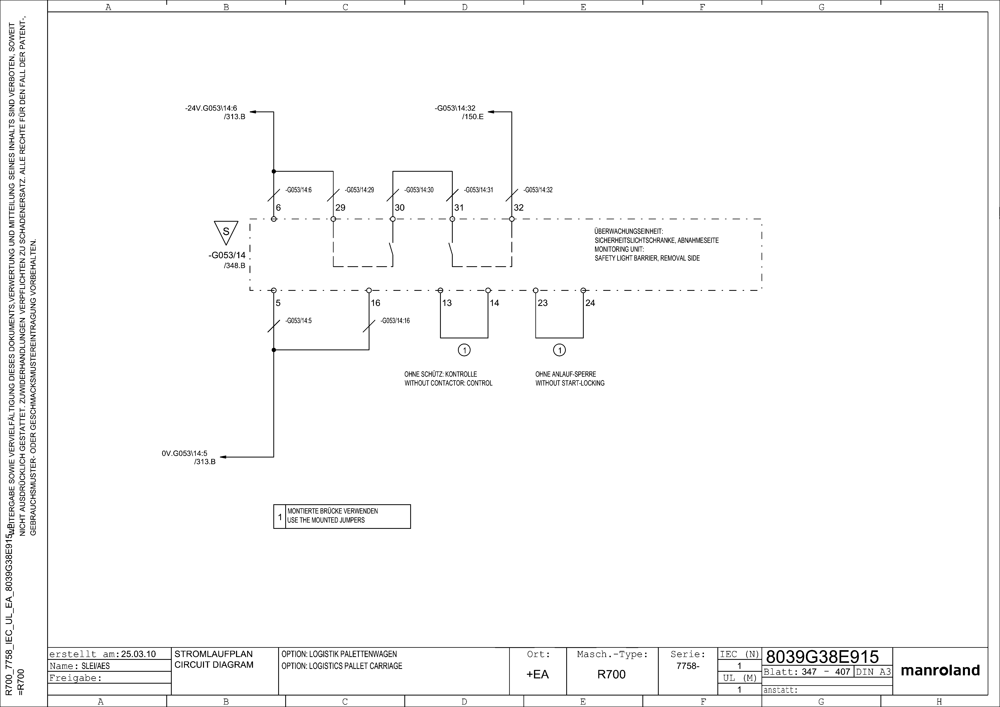

# +EA — Sheet 347 of 407 — OPTION: LOGISTIK PALETTENWAGEN

**OPTION: LOGISTICS PALLET CARRIAGE**

> Part of the manroland **R700** printing press IEC/UL circuit diagrams.
> Drawing class: **Stromlaufplan / Circuit diagram** (DIN A3).
> Document `+EA` covers the **Printing unit** machine section.

## At a glance

| Field | Value |
|---|---|
| Document | `+EA`  (8039G38E915) |
| Sheet | **347** of 407 |
| Section (DE) | OPTION: LOGISTIK PALETTENWAGEN |
| Section (EN) | OPTION: LOGISTICS PALLET CARRIAGE |
| Section type | CIRCUIT — Circuit diagram |
| Machine type | `R700` |
| Series | `7758` |
| Created | 25.03.10 |
| Replaces | — |
| Columns used | B, C, D, E, F |
| Path numbers | — |
| Labels on sheet | 40 |
| Cross-refs out | 4 |
| Cross-refs in | 4 |

**Previous:** [+EA sheet 346](SHEET_0346.md) · **Next:** [+EA sheet 348](SHEET_0348.md) · **Document TOC:** [_TOC.md](_TOC.md)  (+EA) · **Master TOC:** [all sheets](../_MASTER_TOC.md)

## Sheet image (300 DPI, exact vector render)



_Rendered directly from the PDF vector layer at 300 DPI (1-bit), no OCR and no resampling. Use it to confirm anything ambiguous in the text below._

## Cross-references on this sheet

Each entry is a wire leaving this sheet. The printed token is `/sheet.column`; the link resolves to that sheet inside the same document.

| Ref | Target sheet | Col | Path | Destination on target | Target section | From col |
|---|---|---|---|---|---|---|
| `/313.B` | [+EA sheet 313](SHEET_0313.md) | B | — | 24V.G053\14:6 G053\14:32 | OPTION: LOGISTIK, AUSLEGER | C |
| `/150.E` | [+EA sheet 150](SHEET_0150.md) | E | — | 24V.G053\14:6 G053\14:32 | ZUGANGSABSICHERUNG | C |
| `/348.B` | [+EA sheet 348](SHEET_0348.md) | B | — | — | OPTION: LOGISTIK PALETTENWAGEN | B |
| `/313.B` | [+EA sheet 313](SHEET_0313.md) | B | — | 0V.G053\14:5 | OPTION: LOGISTIK, AUSLEGER | B |

### Incoming references (sheets that point here)

Every other sheet that sends a wire to this one. `Back-ref` is the token printed on *that* sheet; `Path` is its line number.

| From sheet | Cols | Back-ref | Path | Refs | What continues there |
|---|---|---|---|---|---|
| [+EA#150](SHEET_0150.md) | E | `/150.E` | — | 1 | — |
| [+EA#313](SHEET_0313.md) | B | `/313.B` | — | 2 | — |
| [+EA#348](SHEET_0348.md) | B | `/348.B` | — | 1 | — |


## Devices on this sheet

| Tag | Class | Class meaning (IEC) | Col | Sub | Terminal | Sign |
|---|---|---|---|---|---|---|
| `G053/14` | G | Stromversorgung / power supply | B | 14 | — | — |
| `G053/14:6` | G | Stromversorgung / power supply | C | 14 | 6 | — |
| `G053/14:29` | G | Stromversorgung / power supply | C | 14 | 29 | — |
| `G053/14:30` | G | Stromversorgung / power supply | D | 14 | 30 | — |
| `G053/14:32` | G | Stromversorgung / power supply | E | 14 | 32 | — |
| `G053/14:31` | G | Stromversorgung / power supply | D | 14 | 31 | — |
| `G053/14:5` | G | Stromversorgung / power supply | C | 14 | 5 | — |
| `G053/14:16` | G | Stromversorgung / power supply | C | 14 | 16 | — |

## Potentials / nets

| Potential | Count | Columns | Attached devices | Terminals |
|---|---|---|---|---|
| `0V` | 1 | B | `G053\14` | `5` |
| `24V` | 1 | B | `G053\14` | `6` |


A potential such as `L24+/4` or `M24+` is a named supply/return rail; every place it appears on this sheet is electrically common.

## Wire-end annotations (grouped as printed)

A wire that continues elsewhere is annotated with a small cluster: the destination description, the path/line number `#NN`, and the `/sheet.column` cross reference. Each row below is one such cluster exactly as it is grouped on the drawing.

| Col | Y | Path | Cross-ref | Text on the wire |
|---|---|---|---|---|
| C | 125.0 | — | `/313.B`, `/150.E` | `24V.G053\14:6 G053\14:32` |
| D | 223.1 | — | — | `G053/14:6 G053/14:29 G053/14:30 G053/14:31 G053/14:32` |
| C | 242.6 | — | — | `6 29 30 31 32` |
| B | 270.4 | — | — | `S` |
| E | 272.7 | — | — | `ÜBERWACHUNGSEINHEIT:` |
| F | 283.4 | — | — | `MONITORING UNIT: SICHERHEITSLICHTSCHRANKE, ABNAHMESEITE SAFETY LIGHT BARRIER, REMOVAL SIDE` |
| B | 299.4 | — | — | `G053/14` |
| B | 312.4 | — | `/348.B` | — |
| B | 356.0 | — | — | `5` |
| D | 356.0 | — | — | `16 13 14 23 24` |
| C | 379.1 | — | — | `G053/14:5 G053/14:16` |
| D | 413.6 | — | — | `1` |
| E | 413.6 | — | — | `1` |
| D | 442.8 | — | — | `OHNE SCHÜTZ: KONTROLLE WITHOUT CONTACTOR: CONTROL` |
| E | 442.8 | — | — | `OHNE ANLAUF SPERRE WITHOUT START LOCKING` |
| B | 536.0 | — | `/313.B` | `0V.G053\14:5` |
| C | 605.8 | — | — | `1 USE THE MOUNTED JUMPERS MONTIERTE BRÜCKE VERWENDEN` |


## Reconstructed tables

This sheet carries tabular content (pin map / terminal assignment / index). The grid below was rebuilt from the drawing's own rule lines, so each row is exactly one physical row of the table.

### Table 1 — 2 data rows × 9 columns (at x=326.0, y=204.1)

| G053/14:6 6 | G053/14:29 29 |  | G053/14:30 30 |  | G053/14:31 31 |  | 32 | G053/14:32 |
|---|---|---|---|---|---|---|---|---|
| `5 G053/14:5` |  | `16` | `G053/14:16` | `13` |  | `14` |  | `23` |
|  |  |  | `OHNE SCHÜTZ: WITHOUT` | `CONTACTOR:` | `1 KONTROLLE CONTROL` |  |  | `1 OHNE ANLAUF SPERRE WITHOUT START LOCKING` |


## Notes and free text on this sheet

| Text | Col | Y (pt) |
|---|---|---|
| `ÜBERWACHUNGSEINHEIT:` | E | 272.73 |
| `SICHERHEITSLICHTSCHRANKE, ABNAHMESEITE` | F | 283.39 |
| `MONITORING UNIT:` | E | 294.02 |
| `SAFETY LIGHT BARRIER, REMOVAL SIDE` | F | 304.64 |
| `G053\14:32` | D | 125.03 |
| `OHNE ANLAUF SPERRE` | E | 442.84 |
| `WITHOUT START LOCKING` | E | 453.46 |
| `OHNE SCHÜTZ: KONTROLLE` | D | 442.84 |
| `WITHOUT CONTACTOR: CONTROL` | D | 453.47 |
| `MONTIERTE BRÜCKE VERWENDEN` | C | 605.81 |
| `USE THE MOUNTED JUMPERS` | C | 616.46 |
| `S` | B | 270.38 |

## Complete label inventory (exact text from the drawing)

Every text object inside the drawing area of this sheet, in DIN reading order (column A→H, then top→bottom). This is the authoritative list: if a string is not here it is not printed on this sheet.

| Col | Y | X | Dir | Type | Text |
|---|---|---|---|---|---|
| B | 125.0 | 220.5 | → | potential | `24V.G053\14:6` |
| B | 134.9 | 266.7 | → | cross-reference | `/313.B` |
| B | 242.6 | 328.5 | → | number | `6` |
| B | 270.4 | 265.2 | → | text | `S` |
| B | 299.4 | 248.3 | → | device tag | `G053/14` |
| B | 312.4 | 266.7 | → | cross-reference | `/348.B` |
| B | 356.0 | 328.3 | → | number | `5` |
| B | 536.0 | 192.8 | → | potential | `0V.G053\14:5` |
| B | 545.9 | 231.3 | → | cross-reference | `/313.B` |
| B | 611.1 | 330.5 | → | number | `1` |
| C | 223.2 | 339.9 | → | device tag | `G053/14:6` |
| C | 223.2 | 410.7 | → | device tag | `G053/14:29` |
| C | 242.6 | 399.4 | → | number | `29` |
| C | 242.6 | 470.0 | → | number | `30` |
| C | 356.0 | 441.1 | → | number | `16` |
| C | 379.1 | 339.9 | → | device tag | `G053/14:5` |
| C | 379.1 | 453.3 | → | device tag | `G053/14:16` |
| C | 605.8 | 342.4 | → | text | `MONTIERTE BRÜCKE VERWENDEN` |
| C | 616.5 | 342.1 | → | text | `USE THE MOUNTED JUMPERS` |
| D | 125.0 | 517.6 | → | text | `G053\14:32` |
| D | 134.9 | 550.5 | → | cross-reference | `/150.E` |
| D | 223.1 | 552.5 | → | device tag | `G053/14:31` |
| D | 223.2 | 481.6 | → | device tag | `G053/14:30` |
| D | 242.6 | 540.9 | → | number | `31` |
| D | 242.6 | 611.7 | → | number | `32` |
| D | 356.0 | 526.1 | → | number | `13` |
| D | 356.0 | 582.8 | → | number | `14` |
| D | 413.6 | 551.0 | → | number | `1` |
| D | 442.8 | 481.6 | → | text | `OHNE SCHÜTZ: KONTROLLE` |
| D | 453.5 | 481.9 | → | text | `WITHOUT CONTACTOR: CONTROL` |
| E | 223.2 | 623.3 | → | device tag | `G053/14:32` |
| E | 272.7 | 707.8 | → | text | `ÜBERWACHUNGSEINHEIT:` |
| E | 294.0 | 708.1 | → | text | `MONITORING UNIT:` |
| E | 356.0 | 640.3 | → | number | `23` |
| E | 356.0 | 697.0 | → | number | `24` |
| E | 413.6 | 664.4 | → | number | `1` |
| E | 442.8 | 637.5 | → | text | `OHNE ANLAUF SPERRE` |
| E | 453.5 | 637.8 | → | text | `WITHOUT START LOCKING` |
| F | 283.4 | 708.4 | → | text | `SICHERHEITSLICHTSCHRANKE, ABNAHMESEITE` |
| F | 304.6 | 708.4 | → | text | `SAFETY LIGHT BARRIER, REMOVAL SIDE` |

## Reading-order text block

The same content as a plain block, grouped by DIN column — convenient to paste or to match against a visual description.

```text
=== Column B ===
 125.0  220.5  net          24V.G053\14:6
 134.9  266.7  xref         /313.B
 242.6  328.5  numeric      6
 270.4  265.2  text         S
 299.4  248.3  devtag       G053/14
 312.4  266.7  xref         /348.B
 356.0  328.3  numeric      5
 536.0  192.8  net          0V.G053\14:5
 545.9  231.3  xref         /313.B
 611.1  330.5  numeric      1
=== Column C ===
 223.2  339.9  devtag       G053/14:6
 223.2  410.7  devtag       G053/14:29
 242.6  399.4  numeric      29
 242.6  470.0  numeric      30
 356.0  441.1  numeric      16
 379.1  339.9  devtag       G053/14:5
 379.1  453.3  devtag       G053/14:16
 605.8  342.4  text         MONTIERTE BRÜCKE VERWENDEN
 616.5  342.1  text         USE THE MOUNTED JUMPERS
=== Column D ===
 125.0  517.6  text         G053\14:32
 134.9  550.5  xref         /150.E
 223.1  552.5  devtag       G053/14:31
 223.2  481.6  devtag       G053/14:30
 242.6  540.9  numeric      31
 242.6  611.7  numeric      32
 356.0  526.1  numeric      13
 356.0  582.8  numeric      14
 413.6  551.0  numeric      1
 442.8  481.6  text         OHNE SCHÜTZ: KONTROLLE
 453.5  481.9  text         WITHOUT CONTACTOR: CONTROL
=== Column E ===
 223.2  623.3  devtag       G053/14:32
 272.7  707.8  text         ÜBERWACHUNGSEINHEIT:
 294.0  708.1  text         MONITORING UNIT:
 356.0  640.3  numeric      23
 356.0  697.0  numeric      24
 413.6  664.4  numeric      1
 442.8  637.5  text         OHNE ANLAUF SPERRE
 453.5  637.8  text         WITHOUT START LOCKING
=== Column F ===
 283.4  708.4  text         SICHERHEITSLICHTSCHRANKE, ABNAHMESEITE
 304.6  708.4  text         SAFETY LIGHT BARRIER, REMOVAL SIDE
```

---
_Generated from the PDF vector text layer; no OCR. Source: `R700_7758_IEC_UL_EA_8039G38E915_p`, sheet 347._
