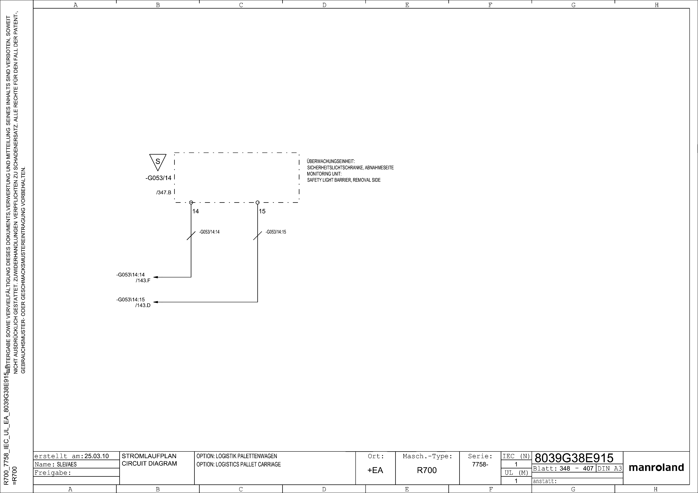

# +EA — Sheet 348 of 407 — OPTION: LOGISTIK PALETTENWAGEN

**OPTION: LOGISTICS PALLET CARRIAGE**

> Part of the manroland **R700** printing press IEC/UL circuit diagrams.
> Drawing class: **Stromlaufplan / Circuit diagram** (DIN A3).
> Document `+EA` covers the **Printing unit** machine section.

## At a glance

| Field | Value |
|---|---|
| Document | `+EA`  (8039G38E915) |
| Sheet | **348** of 407 |
| Section (DE) | OPTION: LOGISTIK PALETTENWAGEN |
| Section (EN) | OPTION: LOGISTICS PALLET CARRIAGE |
| Section type | CIRCUIT — Circuit diagram |
| Machine type | `R700` |
| Series | `7758` |
| Created | 25.03.10 |
| Replaces | — |
| Columns used | B, C, D |
| Path numbers | — |
| Labels on sheet | 15 |
| Cross-refs out | 3 |
| Cross-refs in | 3 |

**Previous:** [+EA sheet 347](SHEET_0347.md) · **Next:** [+EA sheet 349](SHEET_0349.md) · **Document TOC:** [_TOC.md](_TOC.md)  (+EA) · **Master TOC:** [all sheets](../_MASTER_TOC.md)

## Sheet image (300 DPI, exact vector render)



_Rendered directly from the PDF vector layer at 300 DPI (1-bit), no OCR and no resampling. Use it to confirm anything ambiguous in the text below._

## Cross-references on this sheet

Each entry is a wire leaving this sheet. The printed token is `/sheet.column`; the link resolves to that sheet inside the same document.

| Ref | Target sheet | Col | Path | Destination on target | Target section | From col |
|---|---|---|---|---|---|---|
| `/347.B` | [+EA sheet 347](SHEET_0347.md) | B | — | — | OPTION: LOGISTIK PALETTENWAGEN | B |
| `/143.F` | [+EA sheet 143](SHEET_0143.md) | F | — | G053\14:14 | ZUGANGSABSICHERUNG | B |
| `/143.D` | [+EA sheet 143](SHEET_0143.md) | D | — | G053\14:15 | ZUGANGSABSICHERUNG | B |

### Incoming references (sheets that point here)

Every other sheet that sends a wire to this one. `Back-ref` is the token printed on *that* sheet; `Path` is its line number.

| From sheet | Cols | Back-ref | Path | Refs | What continues there |
|---|---|---|---|---|---|
| [+EA#143](SHEET_0143.md) | D, G | `/143.D`, `/143.G` | — | 2 | — |
| [+EA#347](SHEET_0347.md) | B | `/347.B` | — | 1 | — |


## Devices on this sheet

| Tag | Class | Class meaning (IEC) | Col | Sub | Terminal | Sign |
|---|---|---|---|---|---|---|
| `G053/14` | G | Stromversorgung / power supply | B | 14 | — | — |
| `G053/14:14` | G | Stromversorgung / power supply | C | 14 | 14 | — |
| `G053/14:15` | G | Stromversorgung / power supply | C | 14 | 15 | — |

## Potentials / nets

_No named potentials on this sheet._

## Wire-end annotations (grouped as printed)

A wire that continues elsewhere is annotated with a small cluster: the destination description, the path/line number `#NN`, and the `/sheet.column` cross reference. Each row below is one such cluster exactly as it is grouped on the drawing.

| Col | Y | Path | Cross-ref | Text on the wire |
|---|---|---|---|---|
| B | 270.4 | — | — | `S` |
| D | 272.7 | — | — | `ÜBERWACHUNGSEINHEIT:` |
| D | 283.4 | — | — | `MONITORING UNIT: SICHERHEITSLICHTSCHRANKE, ABNAHMESEITE SAFETY LIGHT BARRIER, REMOVAL SIDE` |
| B | 299.4 | — | — | `G053/14` |
| B | 324.8 | — | `/347.B` | — |
| C | 356.0 | — | — | `14 15` |
| C | 393.2 | — | — | `G053/14:14 G053/14:15` |
| B | 465.2 | — | `/143.F` | `G053\14:14` |
| B | 507.7 | — | `/143.D` | `G053\14:15` |


## Reconstructed tables

This sheet carries tabular content (pin map / terminal assignment / index). The grid below was rebuilt from the drawing's own rule lines, so each row is exactly one physical row of the table.

### Table 1 — 5 data rows × 9 columns (at x=204.1, y=0.0) — **S G053/14 /347.B G053\14:14 14 G053/14:14 ÜBERWACHUNGSEINHEIT: SICHERHEITSLICHTSCHRANKE, MONITORING UNIT: SAFETY LIGHT BARRIER, 15 G053/14:15 ABNAHMESEITE REMOVAL SIDE /143.F G053\14:15 /143.D**

| STROMLAUFPLAN |  | OPTION: LOGISTIK PALETTENWAGEN |  | Ort: | Masch. Type: | Serie: | IEC (N) | 8039G38E915 |
|---|---|---|---|---|---|---|---|---|
| `CIRCUIT DIAGRAM` |  |  |  |  |  |  |  |  |
|  |  | `OPTION: LOGISTICS PALLET` | `CARRIAGE` |  |  | `7758` | `1` |  |
|  |  |  |  | `+EA` | `R700` |  |  | `Blatt: DIN A3 348 407` |
|  |  |  |  |  |  |  | `UL (M)` |  |
|  |  |  |  |  |  |  | `1` | `anstatt:` |


## Notes and free text on this sheet

| Text | Col | Y (pt) |
|---|---|---|
| `ÜBERWACHUNGSEINHEIT:` | D | 272.73 |
| `SICHERHEITSLICHTSCHRANKE, ABNAHMESEITE` | D | 283.39 |
| `MONITORING UNIT:` | D | 294.02 |
| `SAFETY LIGHT BARRIER, REMOVAL SIDE` | D | 304.64 |
| `G053\14:15` | B | 507.71 |
| `G053\14:14` | B | 465.19 |
| `S` | B | 270.38 |

## Complete label inventory (exact text from the drawing)

Every text object inside the drawing area of this sheet, in DIN reading order (column A→H, then top→bottom). This is the authoritative list: if a string is not here it is not printed on this sheet.

| Col | Y | X | Dir | Type | Text |
|---|---|---|---|---|---|
| B | 270.4 | 265.2 | → | text | `S` |
| B | 299.4 | 248.3 | → | device tag | `G053/14` |
| B | 324.8 | 266.7 | → | cross-reference | `/347.B` |
| B | 356.0 | 327.7 | → | number | `14` |
| B | 465.2 | 198.4 | → | text | `G053\14:14` |
| B | 475.1 | 231.9 | → | cross-reference | `/143.F` |
| B | 507.7 | 198.4 | → | text | `G053\14:15` |
| B | 517.6 | 231.0 | → | cross-reference | `/143.D` |
| C | 356.0 | 441.1 | → | number | `15` |
| C | 393.2 | 339.9 | → | device tag | `G053/14:14` |
| C | 393.2 | 453.3 | → | device tag | `G053/14:15` |
| D | 272.7 | 523.6 | → | text | `ÜBERWACHUNGSEINHEIT:` |
| D | 283.4 | 524.1 | → | text | `SICHERHEITSLICHTSCHRANKE, ABNAHMESEITE` |
| D | 294.0 | 523.8 | → | text | `MONITORING UNIT:` |
| D | 304.6 | 524.1 | → | text | `SAFETY LIGHT BARRIER, REMOVAL SIDE` |

## Reading-order text block

The same content as a plain block, grouped by DIN column — convenient to paste or to match against a visual description.

```text
=== Column B ===
 270.4  265.2  text         S
 299.4  248.3  devtag       G053/14
 324.8  266.7  xref         /347.B
 356.0  327.7  numeric      14
 465.2  198.4  text         G053\14:14
 475.1  231.9  xref         /143.F
 507.7  198.4  text         G053\14:15
 517.6  231.0  xref         /143.D
=== Column C ===
 356.0  441.1  numeric      15
 393.2  339.9  devtag       G053/14:14
 393.2  453.3  devtag       G053/14:15
=== Column D ===
 272.7  523.6  text         ÜBERWACHUNGSEINHEIT:
 283.4  524.1  text         SICHERHEITSLICHTSCHRANKE, ABNAHMESEITE
 294.0  523.8  text         MONITORING UNIT:
 304.6  524.1  text         SAFETY LIGHT BARRIER, REMOVAL SIDE
```

---
_Generated from the PDF vector text layer; no OCR. Source: `R700_7758_IEC_UL_EA_8039G38E915_p`, sheet 348._
