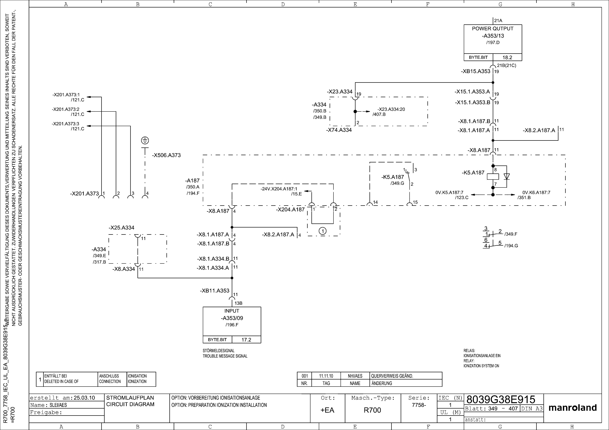

# +EA — Sheet 349 of 407 — OPTION: VORBEREITUNG IONISATIONSANLAGE

**OPTION: PREPARATION IONIZATION INSTALLATION**

> Part of the manroland **R700** printing press IEC/UL circuit diagrams.
> Drawing class: **Stromlaufplan / Circuit diagram** (DIN A3).
> Document `+EA` covers the **Printing unit** machine section.

## At a glance

| Field | Value |
|---|---|
| Document | `+EA`  (8039G38E915) |
| Sheet | **349** of 407 |
| Section (DE) | OPTION: VORBEREITUNG IONISATIONSANLAGE |
| Section (EN) | OPTION: PREPARATION IONIZATION INSTALLATION |
| Section type | CIRCUIT — Circuit diagram |
| Machine type | `R700` |
| Series | `7758` |
| Created | 25.03.10 |
| Replaces | — |
| Columns used | A, B, C, D, E, F, G, H |
| Path numbers | — |
| Labels on sheet | 121 |
| Cross-refs out | 18 |
| Cross-refs in | 44 |

**Previous:** [+EA sheet 348](SHEET_0348.md) · **Next:** [+EA sheet 350](SHEET_0350.md) · **Document TOC:** [_TOC.md](_TOC.md)  (+EA) · **Master TOC:** [all sheets](../_MASTER_TOC.md)

## Sheet image (300 DPI, exact vector render)



_Rendered directly from the PDF vector layer at 300 DPI (1-bit), no OCR and no resampling. Use it to confirm anything ambiguous in the text below._

## Cross-references on this sheet

Each entry is a wire leaving this sheet. The printed token is `/sheet.column`; the link resolves to that sheet inside the same document.

| Ref | Target sheet | Col | Path | Destination on target | Target section | From col |
|---|---|---|---|---|---|---|
| `/197.D` | [+EA sheet 197](SHEET_0197.md) | D | — | — | REFERENZMODUL | G |
| `/121.C` | [+EA sheet 121](SHEET_0121.md) | C | — | X201.A373:1 | TROCKENBESTÄUBER | A |
| `/121.C` | [+EA sheet 121](SHEET_0121.md) | C | — | X201.A373:2 | TROCKENBESTÄUBER | A |
| `/350.B` | [+EA sheet 350](SHEET_0350.md) | B | — | — | OPTION: VORBEREITUNG: PUDERABSAUGUNG | E |
| `/349.B` | [+EA sheet 349](SHEET_0349.md) | B | — | — | OPTION: VORBEREITUNG IONISATIONSANLAGE | E |
| `/407.B` | [+EA sheet 407](SHEET_0407.md) | B | — | — | OPTION: AIR STATION | E |
| `/121.C` | [+EA sheet 121](SHEET_0121.md) | C | — | X201.A373:3 | TROCKENBESTÄUBER | A |
| `/349.G` | [+EA sheet 349](SHEET_0349.md) | G | — | — | OPTION: VORBEREITUNG IONISATIONSANLAGE | F |
| `/350.A` | [+EA sheet 350](SHEET_0350.md) | A | — | — | OPTION: VORBEREITUNG: PUDERABSAUGUNG | C |
| `/15.E` | [+EA sheet 15](SHEET_0015.md) | E | — | 24V.X204.A187:1 | SPANNUNGSVERSORGUNG: 400V, 24V | D |
| `/351.B` | [+EA sheet 351](SHEET_0351.md) | B | — | 0V.K5.A187:7 | OPTION: VORBEREITUNG: PUDERABSAUGUNG | G |
| `/123.C` | [+EA sheet 123](SHEET_0123.md) | C | — | 0V.K5.A187:7 | TROCKENBESTÄUBER | G |
| `/194.F` | [+EA sheet 194](SHEET_0194.md) | F | — | — | RESERVE | C |
| `/349.F` | [+EA sheet 349](SHEET_0349.md) | F | — | — | OPTION: VORBEREITUNG IONISATIONSANLAGE | G |
| `/194.G` | [+EA sheet 194](SHEET_0194.md) | G | — | — | RESERVE | G |
| `/349.E` | [+EA sheet 349](SHEET_0349.md) | E | — | — | OPTION: VORBEREITUNG IONISATIONSANLAGE | A |
| `/317.B` | [+EA sheet 317](SHEET_0317.md) | B | — | — | OPTION: LOGISTIK, AUSLEGER | A |
| `/196.F` | [+EA sheet 196](SHEET_0196.md) | F | — | — | REFERENZMODUL | C |

### Incoming references (sheets that point here)

Every other sheet that sends a wire to this one. `Back-ref` is the token printed on *that* sheet; `Path` is its line number.

| From sheet | Cols | Back-ref | Path | Refs | What continues there |
|---|---|---|---|---|---|
| [+EA#15](SHEET_0015.md) | F | `/15.F` | — | 1 | 24V.X204.A187:1 |
| [+EA#121](SHEET_0121.md) | D | `/121.D` | — | 3 | X201.A373:1; X201.A373:2; X201.A373:3 |
| [+EA#123](SHEET_0123.md) | B | `/123.B` | — | 1 | 0V.K4.A187:7 |
| [+EA#194](SHEET_0194.md) | F, G | `/194.F`, `/194.G` | — | 2 | — |
| [+EA#196](SHEET_0196.md) | F | `/196.F` | — | 1 | — |
| [+EA#197](SHEET_0197.md) | D | `/197.D` | — | 1 | — |
| [+EA#248](SHEET_0248.md) | C, E, F, G | `/248.C`, `/248.E`, `/248.F`, `/248.G` | — | 8 | — |
| [+EA#249](SHEET_0249.md) | D, E, F | `/249.D`, `/249.E`, `/249.F` | — | 3 | — |
| [+EA#256](SHEET_0256.md) | A | `/256.A` | — | 1 | — |
| [+EA#260](SHEET_0260.md) | F, G, H | `/260.F`, `/260.G`, `/260.H` | — | 3 | — |
| [+EA#265](SHEET_0265.md) | A | `/265.A` | — | 1 | — |
| [+EA#267](SHEET_0267.md) | B | `/267.B` | — | 1 | — |
| [+EA#285](SHEET_0285.md) | F | `/285.F` | — | 1 | — |
| [+EA#286](SHEET_0286.md) | H | `/286.H` | — | 4 | — |
| [+EA#287](SHEET_0287.md) | E | `/287.E` | — | 4 | — |
| [+EA#317](SHEET_0317.md) | B | `/317.B` | — | 1 | — |
| [+EA#349](SHEET_0349.md) | A, E, F, G | `/349.A`, `/349.E`, `/349.F`, `/349.G` | — | 4 | — |
| [+EA#350](SHEET_0350.md) | A, B | `/350.A`, `/350.B` | — | 2 | — |
| [+EA#351](SHEET_0351.md) | B | `/351.B` | — | 1 | 0V.K6.A187:7 |
| [+EA#407](SHEET_0407.md) | B | `/407.B` | — | 1 | X23.A334:20 |


## Devices on this sheet

| Tag | Class | Class meaning (IEC) | Col | Sub | Terminal | Sign |
|---|---|---|---|---|---|---|
| `A334` | A | Baugruppe / assembly, module, PC board | A | — | — | — |
| `A353/09` | A | Baugruppe / assembly, module, PC board | C | 09 | — | — |
| `A334` | A | Baugruppe / assembly, module, PC board | E | — | — | — |
| `A187` | A | Baugruppe / assembly, module, PC board | C | — | — | — |
| `A353/13` | A | Baugruppe / assembly, module, PC board | G | 13 | — | — |
| `X201.A373` | — | cross-device reference | A | — | — | — |
| `X8.A334` | — | cross-device reference | B | — | — | — |
| `17.2` | — | cross-device reference | C | — | — | — |
| `XB11.A353` | — | cross-device reference | C | — | — | — |
| `X8.A187` | — | cross-device reference | C | — | — | — |
| `X204.A187` | — | cross-device reference | D | — | — | — |
| `K5.A187` | — | cross-device reference | F | — | — | — |
| `X8.A187` | — | cross-device reference | G | — | — | — |
| `K5.A187` | — | cross-device reference | G | — | — | — |
| `18.2` | — | cross-device reference | G | — | — | — |
| `XB15.A353` | — | cross-device reference | G | — | — | — |
| `X8.1.A334.B` | — | cross-device reference | C | — | — | — |
| `X8.1.A334.A` | — | cross-device reference | C | — | — | — |
| `X15.1.A353.B` | — | cross-device reference | G | — | — | — |
| `X15.1.A353.A` | — | cross-device reference | G | — | — | — |
| `X8.1.A187.A` | — | cross-device reference | G | — | — | — |
| `X8.1.A187.B` | — | cross-device reference | G | — | — | — |
| `X8.2.A187.A` | — | cross-device reference | H | — | — | — |
| `X8.1.A187.B` | — | cross-device reference | C | — | — | — |
| `X8.1.A187.A` | — | cross-device reference | C | — | — | — |
| `X8.2.A187.A` | — | cross-device reference | D | — | — | — |
| `X23.A334` | — | cross-device reference | E | — | — | — |
| `NR.` | — | cross-device reference | D | — | — | — |
| `11.11.10` | — | cross-device reference | E | — | — | — |
| `X201.A373:3` | — | cross-device reference | A | — | 3 | — |
| `X201.A373:2` | — | cross-device reference | A | — | 2 | — |
| `X201.A373:1` | — | cross-device reference | A | — | 1 | — |
| `X23.A334:20` | — | cross-device reference | E | — | 20 | — |
| `X506.A373` | — | cross-device reference | B | — | — | — |
| `X25.A334` | — | cross-device reference | B | — | — | — |
| `X74.A334` | — | cross-device reference | E | — | — | — |

## Potentials / nets

| Potential | Count | Columns | Attached devices | Terminals |
|---|---|---|---|---|
| `0V` | 2 | F, G | `A187`, `K5`, `K6` | `7` |
| `24V` | 1 | D | `A187`, `X204` | `1` |


A potential such as `L24+/4` or `M24+` is a named supply/return rail; every place it appears on this sheet is electrically common.

## Wire-end annotations (grouped as printed)

A wire that continues elsewhere is annotated with a small cluster: the destination description, the path/line number `#NN`, and the `/sheet.column` cross reference. Each row below is one such cluster exactly as it is grouped on the drawing.

| Col | Y | Path | Cross-ref | Text on the wire |
|---|---|---|---|---|
| G | 36.4 | — | — | `21A` |
| G | 51.6 | — | — | `POWER QUTPUT` |
| G | 65.5 | — | — | `A353/13` |
| G | 79.3 | — | `/197.D` | — |
| G | 108.3 | — | — | `BYTE.BIT 18.2` |
| G | 124.3 | — | — | `21B(21C)` |
| G | 134.9 | — | — | `XB15.A353 19` |
| E | 174.6 | — | — | `X23.A334 19` |
| G | 174.7 | — | — | `X15.1.A353.A 19` |
| A | 181.7 | — | `/121.C` | `X201.A373:1` |
| G | 195.9 | — | — | `X15.1.A353.B 19` |
| E | 200.1 | — | — | `A334` |
| A | 210.1 | — | `/121.C` | `X201.A373:2` |
| E | 210.1 | — | — | `X23.A334:20` |
| E | 213.2 | — | `/350.B`, `/349.B` | — |
| E | 219.9 | — | `/407.B` | — |
| G | 232.8 | — | — | `X8.1.A187.B 11` |
| E | 236.3 | — | — | `X74.A334 2` |
| A | 238.4 | — | `/121.C` | `X201.A373:3` |
| G | 249.8 | — | — | `X8.1.A187.A 11` |
| H | 249.8 | — | — | `X8.2.A187.A 11` |
| G | 289.4 | — | — | `X8.A187 11` |
| B | 299.4 | — | — | `X506.A373` |
| F | 328.4 | — | — | `K5.A187 3` |
| F | 328.4 | — | — | `1` |
| G | 328.4 | — | — | `8` |
| G | 333.4 | — | — | `K5.A187` |
| C | 349.0 | — | — | `A187` |
| F | 355.0 | — | `/349.G` | — |
| F | 356.8 | — | — | `2` |
| G | 356.8 | — | — | `7` |
| C | 362.0 | — | `/350.A` | — |
| D | 365.9 | — | `/15.E` | `24V.X204.A187:1` |
| G | 373.0 | — | `/351.B`, `/123.C` | `0V.K5.A187:7` |
| G | 373.0 | — | — | `0V.K6.A187:7` |
| C | 374.4 | — | `/194.F` | — |
| B | 374.5 | — | — | `X201.A373 1 2 3 4` |
| F | 392.2 | — | — | `14 15` |
| D | 405.7 | — | — | `X8.A187 4 X204.A187 1 2` |
| B | 441.1 | — | — | `X25.A334` |
| G | 442.5 | — | — | `3 6 4 1` |
| G | 448.1 | — | — | `2` |
| E | 449.1 | — | — | `1` |
| G | 454.5 | — | `/349.F` | — |
| D | 454.6 | — | — | `X8.1.A187.A 4 X8.2.A187.A 4` |
| B | 463.1 | — | — | `11` |
| G | 470.8 | — | — | `5` |
| C | 472.3 | — | — | `X8.1.A187.B 4` |
| G | 477.2 | — | `/194.G` | — |
| A | 483.6 | — | — | `A334` |
| A | 496.7 | — | `/349.E`, `/317.B` | — |
| C | 502.1 | — | — | `X8.1.A334.B 11` |
| C | 519.1 | — | — | `X8.1.A334.A 11` |
| B | 521.9 | — | — | `X8.A334 11` |
| C | 564.4 | — | — | `XB11.A353 11` |
| C | 589.9 | — | — | `13B` |
| C | 604.4 | — | — | `INPUT` |
| C | 618.3 | — | — | `A353/09` |
| C | 632.0 | — | `/196.F` | — |
| C | 661.1 | — | — | `BYTE.BIT 17.2` |
| C | 683.8 | — | — | `STÖRMELDESIGNAL TROUBLE MESSAGE SIGNAL` |
| G | 683.9 | — | — | `RELAIS: IONISATIONSANLAGE EIN RELAY: IONIZATION SYSTEM ON` |
| E | 733.0 | — | — | `001 11.11.10 NHI/AES QUERVERWEIS GEÄND.` |
| B | 733.3 | — | — | `IONISATION IONIZATION` |
| A | 733.4 | — | — | `1 ENTFÄLLT BEI DELETED IN CASE OF` |
| B | 733.4 | — | — | `CONNECTION ANSCHLUSS` |
| E | 747.1 | — | — | `NR. TAG NAME ÄNDERUNG` |


## Reconstructed tables

This sheet carries tabular content (pin map / terminal assignment / index). The grid below was rebuilt from the drawing's own rule lines, so each row is exactly one physical row of the table.

### Table 1 — 11 data rows × 11 columns (at x=396.9, y=48.2)

|  |  |  |  |  |  |  |  | POWER | QUTPUT A353/13 /197.D |  |
|---|---|---|---|---|---|---|---|---|---|---|
|  |  |  |  |  |  |  |  | `BYTE.BIT` |  | `18.2` |
|  |  |  |  |  |  |  |  | `XB15.A353` | `21B(21C) 19` |  |
|  |  |  | `A334 /350.B /349.B` | `X23.A334 X74.A334` | `19 2` | `X23.A334:20 /407.B` |  | `X15.1.A353.A X15.1.A353.B X8.1.A187.B X8.1.A187.A` | `19 19 11 11` |  |
|  |  |  |  |  |  |  |  | `X8.A187` | `11` |  |
|  |  |  |  |  |  | `1 K5.A187 /349.G` | `3` | `K5.A187` | `8` |  |
|  |  | `24V.X204.A187:1 /15.E` |  |  |  |  | `2 0V.K5.A187:7` |  | `7` |  |
| `X8.A187` | `4` | `X204.A187` | `1` | `2` |  | `14` | `/123.C 15` |  |  |  |
| `X8.1.A187.A X8.1.A187.B X8.1.A334.B X8.1.A334.A` | `4 4 11 11` | `X8.2.A187.A 4` | `1` |  |  |  |  | `3 1 6 4` | `2 5` | `/349.F /194.G` |
| `XB11.A353` | `11 13B` |  |  |  |  |  |  |  |  |  |
| `INPUT` | `A353/09 /196.F` |  |  |  |  |  |  |  |  |  |
| `BYTE.BIT` | `17.2` |  |  |  |  |  |  |  |  |  |


## Notes and free text on this sheet

| Text | Col | Y (pt) |
|---|---|---|
| `13B` | C | 589.89 |
| `INPUT` | C | 604.42 |
| `BYTE.BIT` | C | 661.67 |
| `STÖRMELDESIGNAL` | C | 683.79 |
| `TROUBLE MESSAGE SIGNAL` | C | 694.41 |
| `21A` | G | 36.43 |
| `21B(21C)` | G | 124.34 |
| `POWER QUTPUT` | G | 51.59 |
| `BYTE.BIT` | G | 108.91 |
| `RELAIS:` | G | 683.94 |
| `IONISATIONSANLAGE EIN` | G | 693.89 |
| `RELAY:` | G | 703.81 |
| `IONIZATION SYSTEM ON` | G | 713.77 |
| `TAG` | E | 747.27 |
| `NAME` | E | 747.25 |
| `ÄNDERUNG` | E | 747.31 |
| `NHI/AES` | E | 733.11 |
| `QUERVERWEIS GEÄND.` | F | 733.1 |
| `ENTFÄLLT BEI` | A | 733.35 |
| `DELETED IN CASE OF` | A | 744 |
| `ANSCHLUSS` | B | 733.39 |
| `CONNECTION` | B | 744.03 |
| `IONISATION` | B | 733.34 |
| `IONIZATION` | B | 743.98 |

## Complete label inventory (exact text from the drawing)

Every text object inside the drawing area of this sheet, in DIN reading order (column A→H, then top→bottom). This is the authoritative list: if a string is not here it is not printed on this sheet.

| Col | Y | X | Dir | Type | Text |
|---|---|---|---|---|---|
| A | 181.7 | 102.6 | → | device ref | `X201.A373:1` |
| A | 191.6 | 138.9 | → | cross-reference | `/121.C` |
| A | 210.1 | 101.5 | → | device ref | `X201.A373:2` |
| A | 220.0 | 138.9 | → | cross-reference | `/121.C` |
| A | 238.4 | 101.2 | → | device ref | `X201.A373:3` |
| A | 248.3 | 138.9 | → | cross-reference | `/121.C` |
| A | 374.5 | 137.2 | → | device ref | `X201.A373` |
| A | 483.6 | 179.1 | → | device tag | `A334` |
| A | 496.7 | 182.0 | → | cross-reference | `/349.E` |
| A | 509.1 | 181.7 | → | cross-reference | `/317.B` |
| A | 733.3 | 87.0 | → | text | `ENTFÄLLT BEI` |
| A | 738.7 | 75.4 | → | number | `1` |
| A | 744.0 | 87.0 | → | text | `DELETED IN CASE OF` |
| B | 299.4 | 297.4 | → | device ref | `X506.A373` |
| B | 374.5 | 200.4 | → | number | `1` |
| B | 374.5 | 229.3 | → | number | `2` |
| B | 374.5 | 257.7 | → | number | `3` |
| B | 374.5 | 286.0 | → | number | `4` |
| B | 441.1 | 212.6 | → | device ref | `X25.A334` |
| B | 463.1 | 275.5 | → | number | `11` |
| B | 521.9 | 220.0 | → | device ref | `X8.A334` |
| B | 523.3 | 271.3 | → | number | `11` |
| B | 733.3 | 250.0 | → | text | `IONISATION` |
| B | 733.4 | 194.2 | → | text | `ANSCHLUSS` |
| B | 744.0 | 193.9 | → | text | `CONNECTION` |
| B | 744.0 | 250.0 | → | text | `IONIZATION` |
| C | 349.0 | 362.0 | → | device tag | `A187` |
| C | 362.0 | 364.3 | → | cross-reference | `/350.A` |
| C | 374.4 | 365.1 | → | cross-reference | `/194.F` |
| C | 408.5 | 404.2 | → | device ref | `X8.A187` |
| C | 409.9 | 456.1 | → | number | `4` |
| C | 454.6 | 384.7 | → | device ref | `X8.1.A187.A` |
| C | 456.7 | 456.1 | → | number | `4` |
| C | 472.3 | 385.5 | → | device ref | `X8.1.A187.B` |
| C | 473.7 | 456.1 | → | number | `4` |
| C | 502.1 | 385.5 | → | device ref | `X8.1.A334.B` |
| C | 502.1 | 455.5 | → | number | `11` |
| C | 519.1 | 455.5 | → | number | `11` |
| C | 519.8 | 384.7 | → | device ref | `X8.1.A334.A` |
| C | 564.4 | 391.2 | → | device ref | `XB11.A353` |
| C | 572.9 | 455.5 | → | number | `11` |
| C | 589.9 | 458.4 | → | text | `13B` |
| C | 604.4 | 438.7 | → | text | `INPUT` |
| C | 618.3 | 432.1 | → | device tag | `A353/09` |
| C | 632.0 | 441.2 | → | cross-reference | `/196.F` |
| C | 661.1 | 472.1 | → | device ref | `17.2` |
| C | 661.7 | 406.8 | → | text | `BYTE.BIT` |
| C | 683.8 | 396.6 | → | text | `STÖRMELDESIGNAL` |
| C | 694.4 | 396.6 | → | text | `TROUBLE MESSAGE SIGNAL` |
| D | 366.0 | 509.7 | → | potential | `24V.X204.A187:1` |
| D | 375.8 | 569.5 | → | cross-reference | `/15.E` |
| D | 405.7 | 539.7 | → | device ref | `X204.A187` |
| D | 405.7 | 611.4 | → | number | `1` |
| D | 454.6 | 512.2 | → | device ref | `X8.2.A187.A` |
| D | 456.7 | 583.7 | → | number | `4` |
| D | 733.0 | 590.1 | → | number | `001` |
| D | 747.1 | 589.1 | → | device ref | `NR.` |
| E | 174.6 | 639.2 | → | device ref | `X23.A334` |
| E | 180.3 | 696.5 | → | number | `19` |
| E | 200.1 | 610.0 | → | device tag | `A334` |
| E | 210.1 | 738.1 | → | device ref | `X23.A334:20` |
| E | 213.2 | 612.6 | → | cross-reference | `/350.B` |
| E | 219.9 | 728.5 | → | cross-reference | `/407.B` |
| E | 225.6 | 612.6 | → | cross-reference | `/349.B` |
| E | 236.3 | 697.3 | → | number | `2` |
| E | 249.8 | 637.8 | → | device ref | `X74.A334` |
| E | 392.2 | 729.1 | → | number | `14` |
| E | 405.7 | 654.5 | → | number | `2` |
| E | 449.1 | 629.0 | → | number | `1` |
| E | 733.1 | 623.9 | → | device ref | `11.11.10` |
| E | 733.1 | 680.3 | → | text | `NHI/AES` |
| E | 747.3 | 630.7 | → | text | `TAG` |
| E | 747.3 | 684.1 | → | text | `NAME` |
| E | 747.3 | 726.7 | → | text | `ÄNDERUNG` |
| F | 328.4 | 787.7 | → | number | `1` |
| F | 328.4 | 810.4 | → | number | `3` |
| F | 341.9 | 745.8 | → | device ref | `K5.A187` |
| F | 355.0 | 763.7 | → | cross-reference | `/349.G` |
| F | 356.8 | 803.3 | → | number | `2` |
| F | 373.0 | 851.5 | → | potential | `0V.K5.A187:7` |
| F | 383.0 | 890.1 | → | cross-reference | `/123.C` |
| F | 392.2 | 807.0 | → | number | `15` |
| F | 733.1 | 725.8 | → | text | `QUERVERWEIS GEÄND.` |
| G | 36.4 | 966.3 | → | text | `21A` |
| G | 51.6 | 923.0 | → | text | `POWER QUTPUT` |
| G | 65.5 | 942.4 | → | device tag | `A353/13` |
| G | 79.3 | 951.0 | → | cross-reference | `/197.D` |
| G | 108.3 | 982.3 | → | device ref | `18.2` |
| G | 108.9 | 917.0 | → | text | `BYTE.BIT` |
| G | 124.3 | 972.0 | → | text | `21B(21C)` |
| G | 134.9 | 901.4 | → | device ref | `XB15.A353` |
| G | 136.4 | 965.8 | → | number | `19` |
| G | 174.6 | 888.9 | → | device ref | `X15.1.A353.A` |
| G | 180.3 | 965.8 | → | number | `19` |
| G | 195.9 | 889.8 | → | device ref | `X15.1.A353.B` |
| G | 197.3 | 965.8 | → | number | `19` |
| G | 232.8 | 895.7 | → | device ref | `X8.1.A187.B` |
| G | 232.8 | 965.8 | → | number | `11` |
| G | 249.8 | 965.8 | → | number | `11` |
| G | 250.5 | 894.9 | → | device ref | `X8.1.A187.A` |
| G | 289.4 | 914.5 | → | device ref | `X8.A187` |
| G | 289.5 | 965.8 | → | number | `11` |
| G | 328.4 | 966.3 | → | number | `8` |
| G | 333.4 | 903.1 | → | device ref | `K5.A187` |
| G | 356.8 | 966.3 | → | number | `7` |
| G | 373.0 | 1021.6 | → | potential | `0V.K6.A187:7` |
| G | 382.9 | 1012.0 | → | cross-reference | `/351.B` |
| G | 442.5 | 947.1 | → | number | `3` |
| G | 448.1 | 974.8 | → | number | `2` |
| G | 453.8 | 948.5 | → | number | `1` |
| G | 454.5 | 986.5 | → | cross-reference | `/349.F` |
| G | 465.2 | 947.1 | → | number | `6` |
| G | 470.8 | 974.6 | → | number | `5` |
| G | 476.5 | 947.1 | → | number | `4` |
| G | 477.2 | 986.5 | → | cross-reference | `/194.G` |
| G | 683.9 | 906.5 | → | text | `RELAIS:` |
| G | 693.9 | 906.5 | → | text | `IONISATIONSANLAGE EIN` |
| G | 703.8 | 906.5 | → | text | `RELAY:` |
| G | 713.8 | 906.5 | → | text | `IONIZATION SYSTEM ON` |
| H | 249.8 | 1093.3 | → | number | `11` |
| H | 250.5 | 1022.5 | → | device ref | `X8.2.A187.A` |

## Reading-order text block

The same content as a plain block, grouped by DIN column — convenient to paste or to match against a visual description.

```text
=== Column A ===
 181.7  102.6  devref       X201.A373:1
 191.6  138.9  xref         /121.C
 210.1  101.5  devref       X201.A373:2
 220.0  138.9  xref         /121.C
 238.4  101.2  devref       X201.A373:3
 248.3  138.9  xref         /121.C
 374.5  137.2  devref       X201.A373
 483.6  179.1  devtag       A334
 496.7  182.0  xref         /349.E
 509.1  181.7  xref         /317.B
 733.3   87.0  text         ENTFÄLLT BEI
 738.7   75.4  numeric      1
 744.0   87.0  text         DELETED IN CASE OF
=== Column B ===
 299.4  297.4  devref       X506.A373
 374.5  200.4  numeric      1
 374.5  229.3  numeric      2
 374.5  257.7  numeric      3
 374.5  286.0  numeric      4
 441.1  212.6  devref       X25.A334
 463.1  275.5  numeric      11
 521.9  220.0  devref       X8.A334
 523.3  271.3  numeric      11
 733.3  250.0  text         IONISATION
 733.4  194.2  text         ANSCHLUSS
 744.0  193.9  text         CONNECTION
 744.0  250.0  text         IONIZATION
=== Column C ===
 349.0  362.0  devtag       A187
 362.0  364.3  xref         /350.A
 374.4  365.1  xref         /194.F
 408.5  404.2  devref       X8.A187
 409.9  456.1  numeric      4
 454.6  384.7  devref       X8.1.A187.A
 456.7  456.1  numeric      4
 472.3  385.5  devref       X8.1.A187.B
 473.7  456.1  numeric      4
 502.1  385.5  devref       X8.1.A334.B
 502.1  455.5  numeric      11
 519.1  455.5  numeric      11
 519.8  384.7  devref       X8.1.A334.A
 564.4  391.2  devref       XB11.A353
 572.9  455.5  numeric      11
 589.9  458.4  text         13B
 604.4  438.7  text         INPUT
 618.3  432.1  devtag       A353/09
 632.0  441.2  xref         /196.F
 661.1  472.1  devref       17.2
 661.7  406.8  text         BYTE.BIT
 683.8  396.6  text         STÖRMELDESIGNAL
 694.4  396.6  text         TROUBLE MESSAGE SIGNAL
=== Column D ===
 366.0  509.7  net          24V.X204.A187:1
 375.8  569.5  xref         /15.E
 405.7  539.7  devref       X204.A187
 405.7  611.4  numeric      1
 454.6  512.2  devref       X8.2.A187.A
 456.7  583.7  numeric      4
 733.0  590.1  numeric      001
 747.1  589.1  devref       NR.
=== Column E ===
 174.6  639.2  devref       X23.A334
 180.3  696.5  numeric      19
 200.1  610.0  devtag       A334
 210.1  738.1  devref       X23.A334:20
 213.2  612.6  xref         /350.B
 219.9  728.5  xref         /407.B
 225.6  612.6  xref         /349.B
 236.3  697.3  numeric      2
 249.8  637.8  devref       X74.A334
 392.2  729.1  numeric      14
 405.7  654.5  numeric      2
 449.1  629.0  numeric      1
 733.1  623.9  devref       11.11.10
 733.1  680.3  text         NHI/AES
 747.3  630.7  text         TAG
 747.3  684.1  text         NAME
 747.3  726.7  text         ÄNDERUNG
=== Column F ===
 328.4  787.7  numeric      1
 328.4  810.4  numeric      3
 341.9  745.8  devref       K5.A187
 355.0  763.7  xref         /349.G
 356.8  803.3  numeric      2
 373.0  851.5  net          0V.K5.A187:7
 383.0  890.1  xref         /123.C
 392.2  807.0  numeric      15
 733.1  725.8  text         QUERVERWEIS GEÄND.
=== Column G ===
  36.4  966.3  text         21A
  51.6  923.0  text         POWER QUTPUT
  65.5  942.4  devtag       A353/13
  79.3  951.0  xref         /197.D
 108.3  982.3  devref       18.2
 108.9  917.0  text         BYTE.BIT
 124.3  972.0  text         21B(21C)
 134.9  901.4  devref       XB15.A353
 136.4  965.8  numeric      19
 174.6  888.9  devref       X15.1.A353.A
 180.3  965.8  numeric      19
 195.9  889.8  devref       X15.1.A353.B
 197.3  965.8  numeric      19
 232.8  895.7  devref       X8.1.A187.B
 232.8  965.8  numeric      11
 249.8  965.8  numeric      11
 250.5  894.9  devref       X8.1.A187.A
 289.4  914.5  devref       X8.A187
 289.5  965.8  numeric      11
 328.4  966.3  numeric      8
 333.4  903.1  devref       K5.A187
 356.8  966.3  numeric      7
 373.0 1021.6  net          0V.K6.A187:7
 382.9 1012.0  xref         /351.B
 442.5  947.1  numeric      3
 448.1  974.8  numeric      2
 453.8  948.5  numeric      1
 454.5  986.5  xref         /349.F
 465.2  947.1  numeric      6
 470.8  974.6  numeric      5
 476.5  947.1  numeric      4
 477.2  986.5  xref         /194.G
 683.9  906.5  text         RELAIS:
 693.9  906.5  text         IONISATIONSANLAGE EIN
 703.8  906.5  text         RELAY:
 713.8  906.5  text         IONIZATION SYSTEM ON
=== Column H ===
 249.8 1093.3  numeric      11
 250.5 1022.5  devref       X8.2.A187.A
```

---
_Generated from the PDF vector text layer; no OCR. Source: `R700_7758_IEC_UL_EA_8039G38E915_p`, sheet 349._
