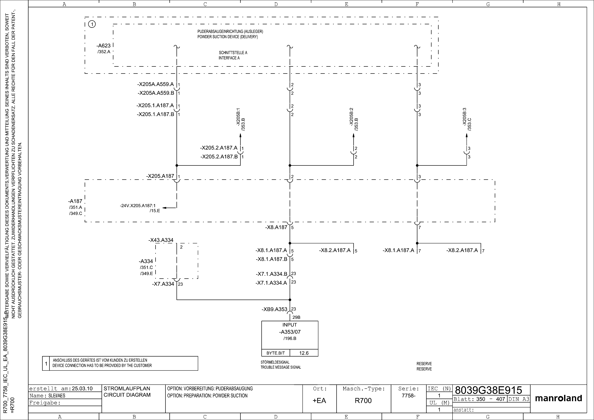

# +EA — Sheet 350 of 407 — OPTION: VORBEREITUNG: PUDERABSAUGUNG

**OPTION: PREPARATION: POWDER SUCTION**

> Part of the manroland **R700** printing press IEC/UL circuit diagrams.
> Drawing class: **Stromlaufplan / Circuit diagram** (DIN A3).
> Document `+EA` covers the **Printing unit** machine section.

## At a glance

| Field | Value |
|---|---|
| Document | `+EA`  (8039G38E915) |
| Sheet | **350** of 407 |
| Section (DE) | OPTION: VORBEREITUNG: PUDERABSAUGUNG |
| Section (EN) | OPTION: PREPARATION: POWDER SUCTION |
| Section type | CIRCUIT — Circuit diagram |
| Machine type | `R700` |
| Series | `7758` |
| Created | 25.03.10 |
| Replaces | — |
| Columns used | A, B, C, D, E, F, G |
| Path numbers | — |
| Labels on sheet | 85 |
| Cross-refs out | 10 |
| Cross-refs in | 43 |

**Previous:** [+EA sheet 349](SHEET_0349.md) · **Next:** [+EA sheet 351](SHEET_0351.md) · **Document TOC:** [_TOC.md](_TOC.md)  (+EA) · **Master TOC:** [all sheets](../_MASTER_TOC.md)

## Sheet image (300 DPI, exact vector render)



_Rendered directly from the PDF vector layer at 300 DPI (1-bit), no OCR and no resampling. Use it to confirm anything ambiguous in the text below._

## Cross-references on this sheet

Each entry is a wire leaving this sheet. The printed token is `/sheet.column`; the link resolves to that sheet inside the same document.

| Ref | Target sheet | Col | Path | Destination on target | Target section | From col |
|---|---|---|---|---|---|---|
| `/352.A` | [+EA sheet 352](SHEET_0352.md) | A | — | — | OPTION: VORBEREITUNG: PUDERABSAUGUNG | B |
| `/353.B` | [+EA sheet 353](SHEET_0353.md) | B | — | X205B:1 | OPTION: VORBEREITUNG: PUDERABSAUGUNG | D |
| `/353.B` | [+EA sheet 353](SHEET_0353.md) | B | — | X205B:2 | OPTION: VORBEREITUNG: PUDERABSAUGUNG | E |
| `/353.C` | [+EA sheet 353](SHEET_0353.md) | C | — | X205B:3 | OPTION: VORBEREITUNG: PUDERABSAUGUNG | G |
| `/15.E` | [+EA sheet 15](SHEET_0015.md) | E | — | 24V.X205.A187:1 | SPANNUNGSVERSORGUNG: 400V, 24V | B |
| `/351.A` | [+EA sheet 351](SHEET_0351.md) | A | — | — | OPTION: VORBEREITUNG: PUDERABSAUGUNG | A |
| `/349.C` | [+EA sheet 349](SHEET_0349.md) | C | — | — | OPTION: VORBEREITUNG IONISATIONSANLAGE | A |
| `/351.C` | [+EA sheet 351](SHEET_0351.md) | C | — | — | OPTION: VORBEREITUNG: PUDERABSAUGUNG | B |
| `/349.E` | [+EA sheet 349](SHEET_0349.md) | E | — | — | OPTION: VORBEREITUNG IONISATIONSANLAGE | B |
| `/196.B` | [+EA sheet 196](SHEET_0196.md) | B | — | — | REFERENZMODUL | D |

### Incoming references (sheets that point here)

Every other sheet that sends a wire to this one. `Back-ref` is the token printed on *that* sheet; `Path` is its line number.

| From sheet | Cols | Back-ref | Path | Refs | What continues there |
|---|---|---|---|---|---|
| [+EA#15](SHEET_0015.md) | F | `/15.F` | — | 1 | 24V.X205.A187:1 |
| [+EA#196](SHEET_0196.md) | B | `/196.B` | — | 1 | — |
| [+EA#246](SHEET_0246.md) | F, G, H | `/246.F`, `/246.G`, `/246.H` | — | 3 | — |
| [+EA#248](SHEET_0248.md) | C, E, F, G | `/248.C`, `/248.E`, `/248.F`, `/248.G` | — | 7 | — |
| [+EA#252](SHEET_0252.md) | C | `/252.C` | — | 1 | — |
| [+EA#281](SHEET_0281.md) | C | `/281.C` | — | 1 | — |
| [+EA#287](SHEET_0287.md) | F, G, H | `/287.F`, `/287.G`, `/287.H` | — | 15 | — |
| [+EA#288](SHEET_0288.md) | A, B | `/288.A`, `/288.B` | — | 6 | — |
| [+EA#349](SHEET_0349.md) | C, E | `/349.C`, `/349.E` | — | 2 | — |
| [+EA#351](SHEET_0351.md) | A, C | `/351.A`, `/351.C` | — | 2 | — |
| [+EA#352](SHEET_0352.md) | A | `/352.A` | — | 1 | — |
| [+EA#353](SHEET_0353.md) | B, C | `/353.B`, `/353.C` | — | 3 | X205B:1; X205B:2; X205B:3 |


## Devices on this sheet

| Tag | Class | Class meaning (IEC) | Col | Sub | Terminal | Sign |
|---|---|---|---|---|---|---|
| `A623` | A | Baugruppe / assembly, module, PC board | B | — | — | — |
| `A187` | A | Baugruppe / assembly, module, PC board | A | — | — | — |
| `A353/07` | A | Baugruppe / assembly, module, PC board | D | 07 | — | — |
| `A334` | A | Baugruppe / assembly, module, PC board | B | — | — | — |
| `X205.A187` | — | cross-device reference | B | — | — | — |
| `X8.A187` | — | cross-device reference | D | — | — | — |
| `12.6` | — | cross-device reference | D | — | — | — |
| `XB9.A353` | — | cross-device reference | D | — | — | — |
| `X7.1.A334.B` | — | cross-device reference | D | — | — | — |
| `X7.1.A334.A` | — | cross-device reference | D | — | — | — |
| `X8.1.A187.B` | — | cross-device reference | D | — | — | — |
| `X8.1.A187.A` | — | cross-device reference | D | — | — | — |
| `X8.2.A187.A` | — | cross-device reference | E | — | — | — |
| `X7.A334` | — | cross-device reference | B | — | — | — |
| `X8.1.A187.A` | — | cross-device reference | F | — | — | — |
| `X8.2.A187.A` | — | cross-device reference | G | — | — | — |
| `X205.2.A187.B` | — | cross-device reference | C | — | — | — |
| `X205.1.A187.B` | — | cross-device reference | B | — | — | — |
| `X205.1.A187.A` | — | cross-device reference | B | — | — | — |
| `X205.2.A187.A` | — | cross-device reference | C | — | — | — |
| `X205A.A559.B` | — | cross-device reference | B | — | — | — |
| `X205A.A559.A` | — | cross-device reference | B | — | — | — |
| `X43.A334` | — | cross-device reference | B | — | — | — |

## Potentials / nets

| Potential | Count | Columns | Attached devices | Terminals |
|---|---|---|---|---|
| `24V` | 1 | B | `A187`, `X205` | `1` |


A potential such as `L24+/4` or `M24+` is a named supply/return rail; every place it appears on this sheet is electrically common.

## Wire-end annotations (grouped as printed)

A wire that continues elsewhere is annotated with a small cluster: the destination description, the path/line number `#NN`, and the `/sheet.column` cross reference. Each row below is one such cluster exactly as it is grouped on the drawing.

| Col | Y | Path | Cross-ref | Text on the wire |
|---|---|---|---|---|
| A | 45.1 | — | — | `1` |
| C | 60.2 | — | — | `PUDERABSAUGEINRICHTUNG (AUSLEGER) POWDER SUCTION DEVICE (DELIVERY)` |
| B | 86.8 | — | — | `A623` |
| B | 99.8 | — | `/352.A` | — |
| C | 102.7 | — | — | `INTERFACE A SCHNITTSTELLE A` |
| B | 164.0 | — | — | `X205A.A559.A 1` |
| D | 166.2 | — | — | `2` |
| F | 166.2 | — | — | `3` |
| B | 181.7 | — | — | `X205A.A559.B 1` |
| D | 183.2 | — | — | `2` |
| F | 183.2 | — | — | `3` |
| C | 206.5 | — | — | `X205.1.A187.A 1 2` |
| F | 208.7 | — | — | `3` |
| D | 216.0 | — | `/353.B` | `X205B:1` |
| E | 216.0 | — | `/353.B` | `X205B:2` |
| G | 216.0 | — | `/353.C` | `X205B:3` |
| B | 224.2 | — | — | `X205.1.A187.B 1` |
| E | 225.7 | — | — | `2 3` |
| D | 291.6 | — | — | `X205.2.A187.A 1 2` |
| G | 293.7 | — | — | `3` |
| D | 309.3 | — | — | `X205.2.A187.B 1 2` |
| G | 310.7 | — | — | `3` |
| B | 348.2 | — | — | `X205.A187 1` |
| D | 350.4 | — | — | `2` |
| F | 350.4 | — | — | `3` |
| A | 398.6 | — | — | `A187` |
| B | 408.5 | — | `/15.E` | `24V.X205.A187:1` |
| A | 411.6 | — | `/351.A`, `/349.C` | — |
| D | 451.0 | — | — | `X8.A187 5` |
| F | 452.4 | — | — | `7` |
| B | 476.5 | — | — | `X43.A334 2` |
| D | 497.1 | — | — | `X8.1.A187.A 5 X8.2.A187.A 5` |
| F | 497.1 | — | — | `X8.1.A187.A 7 X8.2.A187.A 7` |
| D | 514.8 | — | — | `X8.1.A187.B 5` |
| B | 519.0 | — | — | `A334` |
| B | 532.1 | — | `/351.C` | — |
| B | 544.5 | — | `/349.E` | — |
| D | 544.6 | — | — | `X7.1.A334.B 23` |
| D | 561.6 | — | — | `X7.1.A334.A 23` |
| B | 564.4 | — | — | `X7.A334 23` |
| D | 615.4 | — | — | `XB9.A353 23` |
| D | 632.4 | — | — | `29B` |
| D | 646.9 | — | — | `INPUT` |
| D | 660.8 | — | — | `A353/07` |
| D | 674.5 | — | `/196.B` | — |
| D | 703.6 | — | — | `BYTE.BIT 12.6` |
| C | 719.2 | — | — | `1 DEVICE CONNECTION HAS TO BE PROVIDED BY THE CUSTOMER ANSCHLUSS DES GERÄTES IST VOM KUNDEN ZU ERSTELLEN RESERVE RESERVE` |
| D | 723.6 | — | — | `STÖRMELDESIGNAL TROUBLE MESSAGE SIGNAL` |


## Reconstructed tables

This sheet carries tabular content (pin map / terminal assignment / index). The grid below was rebuilt from the drawing's own rule lines, so each row is exactly one physical row of the table.

### Table 1 — 4 data rows × 2 columns (at x=524.4, y=331.7)

| X8.A187 | 2 5 |
|---|---|
| `X8.1.A187.A X8.1.A187.B X7.1.A334.B X7.1.A334.A` | `5 5 23 23` |
| `XB9.A353` | `23 29B` |
| `INPUT` | `A353/07 /196.B` |
| `BYTE.BIT` | `12.6` |


## Notes and free text on this sheet

| Text | Col | Y (pt) |
|---|---|---|
| `PUDERABSAUGEINRICHTUNG (AUSLEGER)` | C | 60.16 |
| `POWDER SUCTION DEVICE (DELIVERY)` | C | 70.77 |
| `29B` | D | 632.41 |
| `INPUT` | D | 646.94 |
| `BYTE.BIT` | D | 704.19 |
| `STÖRMELDESIGNAL` | D | 723.62 |
| `TROUBLE MESSAGE SIGNAL` | D | 733.58 |
| `X205B:1` | C | 216 |
| `X205B:2` | E | 216 |
| `X205B:3` | G | 216 |
| `SCHNITTSTELLE A` | C | 102.67 |
| `INTERFACE A` | C | 113.29 |
| `ANSCHLUSS DES GERÄTES IST VOM KUNDEN ZU ERSTELLEN` | B | 719.21 |
| `DEVICE CONNECTION HAS TO BE PROVIDED BY THE CUSTOMER` | B | 729.84 |
| `RESERVE` | F | 726.25 |

## Complete label inventory (exact text from the drawing)

Every text object inside the drawing area of this sheet, in DIN reading order (column A→H, then top→bottom). This is the authoritative list: if a string is not here it is not printed on this sheet.

| Col | Y | X | Dir | Type | Text |
|---|---|---|---|---|---|
| A | 45.1 | 182.5 | → | number | `1` |
| A | 398.6 | 136.6 | → | device tag | `A187` |
| A | 411.6 | 138.9 | → | cross-reference | `/351.A` |
| A | 424.1 | 138.9 | → | cross-reference | `/349.C` |
| A | 724.5 | 89.6 | → | number | `1` |
| B | 86.8 | 193.3 | → | device tag | `A623` |
| B | 99.8 | 195.6 | → | cross-reference | `/352.A` |
| B | 164.0 | 275.2 | → | device ref | `X205A.A559.A` |
| B | 181.7 | 276.1 | → | device ref | `X205A.A559.B` |
| B | 206.5 | 273.5 | → | device ref | `X205.1.A187.A` |
| B | 224.2 | 274.4 | → | device ref | `X205.1.A187.B` |
| B | 348.3 | 293.1 | → | device ref | `X205.A187` |
| B | 408.5 | 240.4 | → | potential | `24V.X205.A187:1` |
| B | 418.4 | 300.2 | → | cross-reference | `/15.E` |
| B | 476.5 | 297.6 | → | device ref | `X43.A334` |
| B | 519.0 | 278.4 | → | device tag | `A334` |
| B | 532.1 | 280.6 | → | cross-reference | `/351.C` |
| B | 544.5 | 281.2 | → | cross-reference | `/349.E` |
| B | 564.4 | 305.0 | → | device ref | `X7.A334` |
| B | 719.2 | 106.3 | → | text | `ANSCHLUSS DES GERÄTES IST VOM KUNDEN ZU ERSTELLEN` |
| B | 729.8 | 105.4 | → | text | `DEVICE CONNECTION HAS TO BE PROVIDED BY THE CUSTOMER` |
| C | 60.2 | 396.0 | → | text | `PUDERABSAUGEINRICHTUNG (AUSLEGER)` |
| C | 70.8 | 396.0 | → | text | `POWDER SUCTION DEVICE (DELIVERY)` |
| C | 102.7 | 439.1 | → | text | `SCHNITTSTELLE A` |
| C | 113.3 | 438.5 | → | text | `INTERFACE A` |
| C | 166.2 | 356.3 | → | number | `1` |
| C | 183.2 | 356.3 | → | number | `1` |
| C | 208.7 | 356.3 | → | number | `1` |
| C | 216.0 | 473.7 | ↕ | text | `X205B:1` |
| C | 225.7 | 356.3 | → | number | `1` |
| C | 291.6 | 401.1 | → | device ref | `X205.2.A187.A` |
| C | 309.3 | 402.0 | → | device ref | `X205.2.A187.B` |
| C | 350.4 | 356.3 | → | number | `1` |
| C | 491.4 | 361.1 | → | number | `2` |
| C | 565.8 | 356.9 | → | number | `23` |
| D | 166.2 | 583.7 | → | number | `2` |
| D | 183.2 | 583.7 | → | number | `2` |
| D | 208.7 | 583.7 | → | number | `2` |
| D | 225.7 | 583.7 | → | number | `2` |
| D | 236.7 | 483.6 | ↕ | cross-reference | `/353.B` |
| D | 293.7 | 483.9 | → | number | `1` |
| D | 310.7 | 483.9 | → | number | `1` |
| D | 350.4 | 583.7 | → | number | `2` |
| D | 451.0 | 531.8 | → | device ref | `X8.A187` |
| D | 452.5 | 583.7 | → | number | `5` |
| D | 497.1 | 512.2 | → | device ref | `X8.1.A187.A` |
| D | 499.2 | 583.7 | → | number | `5` |
| D | 514.8 | 513.1 | → | device ref | `X8.1.A187.B` |
| D | 516.2 | 583.7 | → | number | `5` |
| D | 544.6 | 513.1 | → | device ref | `X7.1.A334.B` |
| D | 544.6 | 583.7 | → | number | `23` |
| D | 561.6 | 583.7 | → | number | `23` |
| D | 562.3 | 512.2 | → | device ref | `X7.1.A334.A` |
| D | 615.4 | 524.7 | → | device ref | `XB9.A353` |
| D | 615.4 | 583.7 | → | number | `23` |
| D | 632.4 | 586.5 | → | text | `29B` |
| D | 646.9 | 566.2 | → | text | `INPUT` |
| D | 660.8 | 559.7 | → | device tag | `A353/07` |
| D | 674.6 | 568.5 | → | cross-reference | `/196.B` |
| D | 703.6 | 599.7 | → | device ref | `12.6` |
| D | 704.2 | 534.3 | → | text | `BYTE.BIT` |
| D | 723.6 | 522.7 | → | text | `STÖRMELDESIGNAL` |
| D | 733.6 | 522.7 | → | text | `TROUBLE MESSAGE SIGNAL` |
| E | 216.0 | 700.4 | ↕ | text | `X205B:2` |
| E | 236.7 | 710.3 | ↕ | cross-reference | `/353.B` |
| E | 293.7 | 711.2 | → | number | `2` |
| E | 310.7 | 711.2 | → | number | `2` |
| E | 497.1 | 639.8 | → | device ref | `X8.2.A187.A` |
| E | 499.2 | 711.2 | → | number | `5` |
| F | 166.2 | 838.8 | → | number | `3` |
| F | 183.2 | 838.8 | → | number | `3` |
| F | 208.7 | 838.8 | → | number | `3` |
| F | 225.7 | 838.8 | → | number | `3` |
| F | 350.4 | 838.8 | → | number | `3` |
| F | 452.5 | 838.8 | → | number | `7` |
| F | 497.1 | 767.3 | → | device ref | `X8.1.A187.A` |
| F | 499.2 | 838.8 | → | number | `7` |
| F | 726.3 | 835.4 | → | text | `RESERVE` |
| F | 736.9 | 835.4 | → | text | `RESERVE` |
| G | 216.0 | 927.2 | ↕ | text | `X205B:3` |
| G | 236.4 | 937.1 | ↕ | cross-reference | `/353.C` |
| G | 293.7 | 938.0 | → | number | `3` |
| G | 310.7 | 938.0 | → | number | `3` |
| G | 497.1 | 894.9 | → | device ref | `X8.2.A187.A` |
| G | 499.2 | 966.3 | → | number | `7` |

## Reading-order text block

The same content as a plain block, grouped by DIN column — convenient to paste or to match against a visual description.

```text
=== Column A ===
  45.1  182.5  numeric      1
 398.6  136.6  devtag       A187
 411.6  138.9  xref         /351.A
 424.1  138.9  xref         /349.C
 724.5   89.6  numeric      1
=== Column B ===
  86.8  193.3  devtag       A623
  99.8  195.6  xref         /352.A
 164.0  275.2  devref       X205A.A559.A
 181.7  276.1  devref       X205A.A559.B
 206.5  273.5  devref       X205.1.A187.A
 224.2  274.4  devref       X205.1.A187.B
 348.3  293.1  devref       X205.A187
 408.5  240.4  net          24V.X205.A187:1
 418.4  300.2  xref         /15.E
 476.5  297.6  devref       X43.A334
 519.0  278.4  devtag       A334
 532.1  280.6  xref         /351.C
 544.5  281.2  xref         /349.E
 564.4  305.0  devref       X7.A334
 719.2  106.3  text         ANSCHLUSS DES GERÄTES IST VOM KUNDEN ZU ERSTELLEN
 729.8  105.4  text         DEVICE CONNECTION HAS TO BE PROVIDED BY THE CUSTOMER
=== Column C ===
  60.2  396.0  text         PUDERABSAUGEINRICHTUNG (AUSLEGER)
  70.8  396.0  text         POWDER SUCTION DEVICE (DELIVERY)
 102.7  439.1  text         SCHNITTSTELLE A
 113.3  438.5  text         INTERFACE A
 166.2  356.3  numeric      1
 183.2  356.3  numeric      1
 208.7  356.3  numeric      1
 216.0  473.7  text         X205B:1
 225.7  356.3  numeric      1
 291.6  401.1  devref       X205.2.A187.A
 309.3  402.0  devref       X205.2.A187.B
 350.4  356.3  numeric      1
 491.4  361.1  numeric      2
 565.8  356.9  numeric      23
=== Column D ===
 166.2  583.7  numeric      2
 183.2  583.7  numeric      2
 208.7  583.7  numeric      2
 225.7  583.7  numeric      2
 236.7  483.6  xref         /353.B
 293.7  483.9  numeric      1
 310.7  483.9  numeric      1
 350.4  583.7  numeric      2
 451.0  531.8  devref       X8.A187
 452.5  583.7  numeric      5
 497.1  512.2  devref       X8.1.A187.A
 499.2  583.7  numeric      5
 514.8  513.1  devref       X8.1.A187.B
 516.2  583.7  numeric      5
 544.6  513.1  devref       X7.1.A334.B
 544.6  583.7  numeric      23
 561.6  583.7  numeric      23
 562.3  512.2  devref       X7.1.A334.A
 615.4  524.7  devref       XB9.A353
 615.4  583.7  numeric      23
 632.4  586.5  text         29B
 646.9  566.2  text         INPUT
 660.8  559.7  devtag       A353/07
 674.6  568.5  xref         /196.B
 703.6  599.7  devref       12.6
 704.2  534.3  text         BYTE.BIT
 723.6  522.7  text         STÖRMELDESIGNAL
 733.6  522.7  text         TROUBLE MESSAGE SIGNAL
=== Column E ===
 216.0  700.4  text         X205B:2
 236.7  710.3  xref         /353.B
 293.7  711.2  numeric      2
 310.7  711.2  numeric      2
 497.1  639.8  devref       X8.2.A187.A
 499.2  711.2  numeric      5
=== Column F ===
 166.2  838.8  numeric      3
 183.2  838.8  numeric      3
 208.7  838.8  numeric      3
 225.7  838.8  numeric      3
 350.4  838.8  numeric      3
 452.5  838.8  numeric      7
 497.1  767.3  devref       X8.1.A187.A
 499.2  838.8  numeric      7
 726.3  835.4  text         RESERVE
 736.9  835.4  text         RESERVE
=== Column G ===
 216.0  927.2  text         X205B:3
 236.4  937.1  xref         /353.C
 293.7  938.0  numeric      3
 310.7  938.0  numeric      3
 497.1  894.9  devref       X8.2.A187.A
 499.2  966.3  numeric      7
```

---
_Generated from the PDF vector text layer; no OCR. Source: `R700_7758_IEC_UL_EA_8039G38E915_p`, sheet 350._
