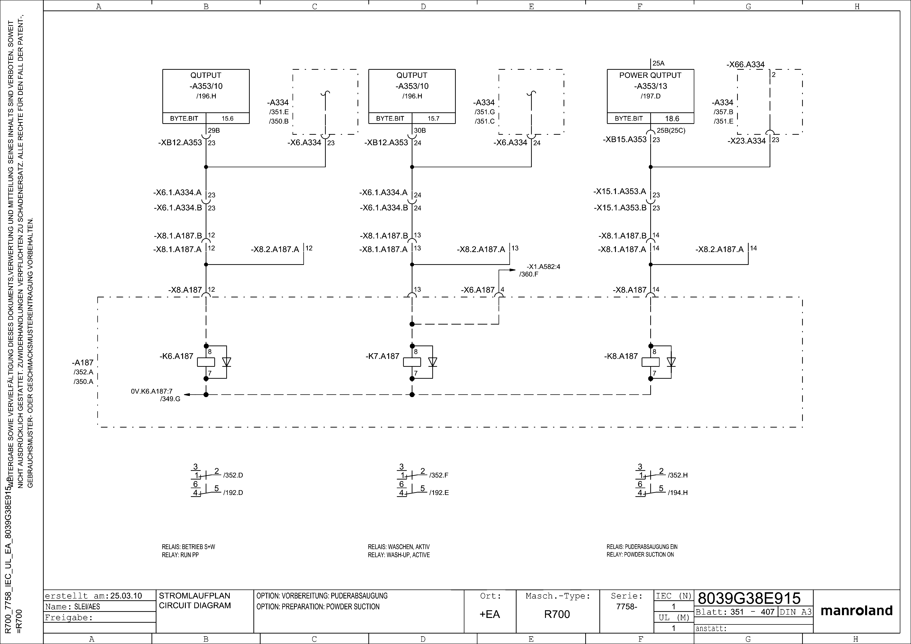

# +EA — Sheet 351 of 407 — OPTION: VORBEREITUNG: PUDERABSAUGUNG

**OPTION: PREPARATION: POWDER SUCTION**

> Part of the manroland **R700** printing press IEC/UL circuit diagrams.
> Drawing class: **Stromlaufplan / Circuit diagram** (DIN A3).
> Document `+EA` covers the **Printing unit** machine section.

## At a glance

| Field | Value |
|---|---|
| Document | `+EA`  (8039G38E915) |
| Sheet | **351** of 407 |
| Section (DE) | OPTION: VORBEREITUNG: PUDERABSAUGUNG |
| Section (EN) | OPTION: PREPARATION: POWDER SUCTION |
| Section type | CIRCUIT — Circuit diagram |
| Machine type | `R700` |
| Series | `7758` |
| Created | 25.03.10 |
| Replaces | — |
| Columns used | A, B, C, D, E, F, G |
| Path numbers | — |
| Labels on sheet | 125 |
| Cross-refs out | 19 |
| Cross-refs in | 45 |

**Previous:** [+EA sheet 350](SHEET_0350.md) · **Next:** [+EA sheet 352](SHEET_0352.md) · **Document TOC:** [_TOC.md](_TOC.md)  (+EA) · **Master TOC:** [all sheets](../_MASTER_TOC.md)

## Sheet image (300 DPI, exact vector render)



_Rendered directly from the PDF vector layer at 300 DPI (1-bit), no OCR and no resampling. Use it to confirm anything ambiguous in the text below._

## Cross-references on this sheet

Each entry is a wire leaving this sheet. The printed token is `/sheet.column`; the link resolves to that sheet inside the same document.

| Ref | Target sheet | Col | Path | Destination on target | Target section | From col |
|---|---|---|---|---|---|---|
| `/196.H` | [+EA sheet 196](SHEET_0196.md) | H | — | — | REFERENZMODUL | B |
| `/196.H` | [+EA sheet 196](SHEET_0196.md) | H | — | — | REFERENZMODUL | D |
| `/197.D` | [+EA sheet 197](SHEET_0197.md) | D | — | — | REFERENZMODUL | F |
| `/351.E` | [+EA sheet 351](SHEET_0351.md) | E | — | — | OPTION: VORBEREITUNG: PUDERABSAUGUNG | C |
| `/350.B` | [+EA sheet 350](SHEET_0350.md) | B | — | — | OPTION: VORBEREITUNG: PUDERABSAUGUNG | C |
| `/357.B` | [+EA sheet 357](SHEET_0357.md) | B | — | — | OPTION: AUFLAGENZÄHLER / GUTBOGENZÄHLER | G |
| `/351.E` | [+EA sheet 351](SHEET_0351.md) | E | — | — | OPTION: VORBEREITUNG: PUDERABSAUGUNG | G |
| `/351.G` | [+EA sheet 351](SHEET_0351.md) | G | — | — | OPTION: VORBEREITUNG: PUDERABSAUGUNG | E |
| `/351.C` | [+EA sheet 351](SHEET_0351.md) | C | — | — | OPTION: VORBEREITUNG: PUDERABSAUGUNG | E |
| `/360.F` | [+EA sheet 360](SHEET_0360.md) | F | — | — | OPTION: | E |
| `/352.A` | [+EA sheet 352](SHEET_0352.md) | A | — | — | OPTION: VORBEREITUNG: PUDERABSAUGUNG | A |
| `/350.A` | [+EA sheet 350](SHEET_0350.md) | A | — | — | OPTION: VORBEREITUNG: PUDERABSAUGUNG | A |
| `/349.G` | [+EA sheet 349](SHEET_0349.md) | G | — | 0V.K6.A187:7 | OPTION: VORBEREITUNG IONISATIONSANLAGE | B |
| `/352.F` | [+EA sheet 352](SHEET_0352.md) | F | — | — | OPTION: VORBEREITUNG: PUDERABSAUGUNG | D |
| `/352.D` | [+EA sheet 352](SHEET_0352.md) | D | — | — | OPTION: VORBEREITUNG: PUDERABSAUGUNG | B |
| `/352.H` | [+EA sheet 352](SHEET_0352.md) | H | — | — | OPTION: VORBEREITUNG: PUDERABSAUGUNG | F |
| `/192.E` | [+EA sheet 192](SHEET_0192.md) | E | — | — | RESERVE | D |
| `/192.D` | [+EA sheet 192](SHEET_0192.md) | D | — | — | RESERVE | B |
| `/194.H` | [+EA sheet 194](SHEET_0194.md) | H | — | — | RESERVE | F |

### Incoming references (sheets that point here)

Every other sheet that sends a wire to this one. `Back-ref` is the token printed on *that* sheet; `Path` is its line number.

| From sheet | Cols | Back-ref | Path | Refs | What continues there |
|---|---|---|---|---|---|
| [+EA#192](SHEET_0192.md) | D, E | `/192.D`, `/192.E` | — | 2 | — |
| [+EA#194](SHEET_0194.md) | H | `/194.H` | — | 1 | — |
| [+EA#196](SHEET_0196.md) | H | `/196.H` | — | 2 | — |
| [+EA#197](SHEET_0197.md) | D | `/197.D` | — | 1 | — |
| [+EA#243](SHEET_0243.md) | G | `/243.G` | — | 1 | — |
| [+EA#244](SHEET_0244.md) | F, G, H | `/244.F`, `/244.G`, `/244.H` | — | 6 | — |
| [+EA#248](SHEET_0248.md) | C, E, F, G | `/248.C`, `/248.E`, `/248.F`, `/248.G` | — | 12 | — |
| [+EA#257](SHEET_0257.md) | C | `/257.C` | — | 2 | — |
| [+EA#260](SHEET_0260.md) | F, G, H | `/260.F`, `/260.G`, `/260.H` | — | 3 | — |
| [+EA#265](SHEET_0265.md) | A | `/265.A` | — | 1 | — |
| [+EA#284](SHEET_0284.md) | G | `/284.G` | — | 1 | — |
| [+EA#349](SHEET_0349.md) | G | `/349.G` | — | 1 | 0V.K5.A187:7 |
| [+EA#350](SHEET_0350.md) | A, B | `/350.A`, `/350.B` | — | 2 | — |
| [+EA#351](SHEET_0351.md) | C, E, G | `/351.C`, `/351.E`, `/351.G` | — | 4 | — |
| [+EA#352](SHEET_0352.md) | A, D, F, G | `/352.A`, `/352.D`, `/352.F`, `/352.G` | — | 4 | — |
| [+EA#357](SHEET_0357.md) | B | `/357.B` | — | 1 | — |
| [+EA#360](SHEET_0360.md) | F | `/360.F` | — | 1 | X1.A582:4 |


## Devices on this sheet

| Tag | Class | Class meaning (IEC) | Col | Sub | Terminal | Sign |
|---|---|---|---|---|---|---|
| `A353/13` | A | Baugruppe / assembly, module, PC board | F | 13 | — | — |
| `A353/10` | A | Baugruppe / assembly, module, PC board | B | 10 | — | — |
| `A353/10` | A | Baugruppe / assembly, module, PC board | D | 10 | — | — |
| `A334` | A | Baugruppe / assembly, module, PC board | E | — | — | — |
| `A334` | A | Baugruppe / assembly, module, PC board | G | — | — | — |
| `A334` | A | Baugruppe / assembly, module, PC board | C | — | — | — |
| `A187` | A | Baugruppe / assembly, module, PC board | A | — | — | — |
| `X15.1.A353.B` | — | cross-device reference | F | — | — | — |
| `X15.1.A353.A` | — | cross-device reference | F | — | — | — |
| `18.6` | — | cross-device reference | F | — | — | — |
| `XB15.A353` | — | cross-device reference | F | — | — | — |
| `15.6` | — | cross-device reference | B | — | — | — |
| `XB12.A353` | — | cross-device reference | B | — | — | — |
| `X6.1.A334.B` | — | cross-device reference | B | — | — | — |
| `X6.1.A334.A` | — | cross-device reference | B | — | — | — |
| `15.7` | — | cross-device reference | D | — | — | — |
| `XB12.A353` | — | cross-device reference | D | — | — | — |
| `X6.1.A334.B` | — | cross-device reference | D | — | — | — |
| `X6.1.A334.A` | — | cross-device reference | D | — | — | — |
| `X6.A334` | — | cross-device reference | E | — | — | — |
| `X6.A334` | — | cross-device reference | C | — | — | — |
| `X23.A334` | — | cross-device reference | G | — | — | — |
| `K6.A187` | — | cross-device reference | B | — | — | — |
| `X8.A187` | — | cross-device reference | B | — | — | — |
| `X8.A187` | — | cross-device reference | F | — | — | — |
| `K8.A187` | — | cross-device reference | F | — | — | — |
| `K7.A187` | — | cross-device reference | D | — | — | — |
| `X6.A187` | — | cross-device reference | E | — | — | — |
| `X8.1.A187.A` | — | cross-device reference | B | — | — | — |
| `X8.1.A187.B` | — | cross-device reference | B | — | — | — |
| `X8.2.A187.A` | — | cross-device reference | C | — | — | — |
| `X8.1.A187.A` | — | cross-device reference | D | — | — | — |
| `X8.1.A187.B` | — | cross-device reference | D | — | — | — |
| `X8.2.A187.A` | — | cross-device reference | E | — | — | — |
| `X8.1.A187.A` | — | cross-device reference | F | — | — | — |
| `X8.1.A187.B` | — | cross-device reference | F | — | — | — |
| `X8.2.A187.A` | — | cross-device reference | G | — | — | — |
| `X1.A582:4` | — | cross-device reference | E | — | 4 | — |
| `X66.A334` | — | cross-device reference | G | — | — | — |

## Potentials / nets

| Potential | Count | Columns | Attached devices | Terminals |
|---|---|---|---|---|
| `0V` | 1 | A | `A187`, `K6` | `7` |


A potential such as `L24+/4` or `M24+` is a named supply/return rail; every place it appears on this sheet is electrically common.

## Wire-end annotations (grouped as printed)

A wire that continues elsewhere is annotated with a small cluster: the destination description, the path/line number `#NN`, and the `/sheet.column` cross reference. Each row below is one such cluster exactly as it is grouped on the drawing.

| Col | Y | Path | Cross-ref | Text on the wire |
|---|---|---|---|---|
| F | 79.0 | — | — | `25A` |
| G | 79.7 | — | — | `X66.A334` |
| G | 93.9 | — | — | `2` |
| F | 94.1 | — | — | `POWER QUTPUT` |
| B | 94.2 | — | — | `QUTPUT` |
| D | 94.2 | — | — | `QUTPUT` |
| B | 108.0 | — | — | `A353/10` |
| D | 108.0 | — | — | `A353/10` |
| F | 108.0 | — | — | `A353/13` |
| B | 121.8 | — | `/196.H` | — |
| D | 121.8 | — | `/196.H` | — |
| F | 121.8 | — | `/197.D` | — |
| C | 129.3 | — | — | `A334` |
| E | 129.3 | — | — | `A334` |
| G | 129.3 | — | — | `A334` |
| C | 142.3 | — | `/351.E`, `/350.B` | — |
| G | 142.3 | — | `/357.B`, `/351.E` | — |
| E | 142.4 | — | `/351.G`, `/351.C` | — |
| F | 150.9 | — | — | `BYTE.BIT 18.6` |
| B | 151.4 | — | — | `BYTE.BIT 15.6` |
| D | 151.4 | — | — | `BYTE.BIT 15.7` |
| D | 166.8 | — | — | `29B XB15.A353 23` |
| D | 166.8 | — | — | `30B` |
| F | 166.9 | — | — | `25B(25C)` |
| G | 178.9 | — | — | `X23.A334 23` |
| B | 181.7 | — | — | `XB12.A353 23` |
| C | 181.7 | — | — | `X6.A334 23` |
| D | 181.7 | — | — | `XB12.A353 24` |
| E | 181.7 | — | — | `X6.A334 24` |
| F | 245.5 | — | — | `X15.1.A353.A 23` |
| B | 246.9 | — | — | `X6.1.A334.A 23` |
| D | 246.9 | — | — | `X6.1.A334.A 24` |
| B | 266.8 | — | — | `X6.1.A334.B 23` |
| D | 266.8 | — | — | `X6.1.A334.B 24` |
| F | 266.8 | — | — | `X15.1.A353.B 23` |
| B | 303.6 | — | — | `X8.1.A187.B 12` |
| D | 303.6 | — | — | `X8.1.A187.B 13` |
| F | 303.6 | — | — | `X8.1.A187.B 14` |
| B | 320.6 | — | — | `X8.1.A187.A 12` |
| C | 320.6 | — | — | `X8.2.A187.A 12 X8.1.A187.A 13` |
| E | 320.6 | — | — | `X8.2.A187.A 13 X8.1.A187.A 14` |
| G | 320.6 | — | — | `X8.2.A187.A 14` |
| E | 344.7 | — | — | `X1.A582:4` |
| E | 354.6 | — | `/360.F` | — |
| D | 374.5 | — | — | `X8.A187 12 X8.A187 14` |
| D | 374.5 | — | — | `13` |
| E | 374.5 | — | — | `X6.A187 4` |
| B | 456.0 | — | — | `8` |
| D | 456.0 | — | — | `8` |
| F | 456.0 | — | — | `8` |
| B | 460.9 | — | — | `K6.A187` |
| D | 460.9 | — | — | `K7.A187` |
| F | 460.9 | — | — | `K8.A187` |
| A | 469.4 | — | — | `A187` |
| A | 482.5 | — | `/352.A`, `/350.A` | — |
| B | 484.3 | — | — | `7` |
| D | 484.3 | — | — | `7` |
| F | 484.3 | — | — | `7` |
| B | 507.7 | — | `/349.G` | `0V.K6.A187:7` |
| B | 605.5 | — | — | `3 6 4 1` |
| D | 605.5 | — | — | `3 6 4 1` |
| F | 605.5 | — | — | `3 6 4 1` |
| B | 611.1 | — | — | `2` |
| D | 611.1 | — | — | `2` |
| F | 611.1 | — | — | `2` |
| B | 617.5 | — | `/352.D` | — |
| D | 617.5 | — | `/352.F` | — |
| F | 617.5 | — | `/352.H` | — |
| B | 633.8 | — | — | `5` |
| D | 633.8 | — | — | `5` |
| F | 633.8 | — | — | `5` |
| B | 640.2 | — | `/192.D` | — |
| D | 640.2 | — | `/192.E` | — |
| F | 640.2 | — | `/194.H` | — |
| B | 712.1 | — | — | `RELAIS: BETRIEB S+W RELAY: RUN PP` |
| D | 712.1 | — | — | `RELAIS: WASCHEN, AKTIV RELAY: WASH UP, ACTIVE` |
| F | 712.3 | — | — | `RELAIS: PUDERABSAUGUNG EIN RELAY: POWDER SUCTION ON` |


## Reconstructed tables

This sheet carries tabular content (pin map / terminal assignment / index). The grid below was rebuilt from the drawing's own rule lines, so each row is exactly one physical row of the table.

### Table 1 — 5 data rows × 15 columns (at x=212.6, y=90.7)

| QUTPUT | A353/10 /196.H |  | A334 /351.E |  | QUTPUT | A353/10 /196.H |  | A334 /351.G |  |  | POWER | QUTPUT A353/13 /197.D |  | A334 /357.B |
|---|---|---|---|---|---|---|---|---|---|---|---|---|---|---|
| `BYTE.BIT` |  | `15.6` | `/350.B` |  | `BYTE.BIT` |  | `15.7` | `/351.C` |  |  | `BYTE.BIT` |  | `18.6` | `/351.E` |
| `XB12.A353` | `29B 23` |  | `X6.A334` | `23` | `XB12.A353` | `30B 24` |  |  | `X6.A334` | `24` | `XB15.A353` | `25B(25C) 23` |  | `X23.A334` |
| `X6.1.A334.A X6.1.A334.B X8.1.A187.B X8.1.A187.A` | `23 23 12 12` |  | `12 X8.2.A187.A` |  | `X6.1.A334.A X6.1.A334.B X8.1.A187.B X8.1.A187.A` | `24 24 13 13` |  | `X8.2.A187.A` | `13` |  | `X15.1.A353.A X15.1.A353.B X8.1.A187.B X8.1.A187.A` | `23 23 14 14` |  | `14 X8.2.A187.A` |
| `X8.A187` | `12` |  |  |  |  | `13` |  | `X6.A187` | `/360.F 4` | `X1.A582:4` | `X8.A187` | `14` |  |  |
| `K6.A187` | `8 7` |  |  |  | `K7.A187` | `8 7` |  |  |  |  | `K8.A187` | `8 7` |  |  |


## Notes and free text on this sheet

| Text | Col | Y (pt) |
|---|---|---|
| `25A` | F | 78.95 |
| `25B(25C)` | F | 166.86 |
| `POWER QUTPUT` | F | 94.1 |
| `BYTE.BIT` | F | 151.43 |
| `RELAIS: PUDERABSAUGUNG EIN` | F | 712.29 |
| `RELAY: POWDER SUCTION ON` | F | 722.2 |
| `29B` | B | 166.82 |
| `QUTPUT` | B | 94.16 |
| `BYTE.BIT` | B | 151.43 |
| `RELAIS: BETRIEB S+W` | B | 712.07 |
| `RELAY: RUN PP` | B | 722.74 |
| `30B` | D | 166.82 |
| `QUTPUT` | D | 94.16 |
| `BYTE.BIT` | D | 151.43 |
| `RELAIS: WASCHEN, AKTIV` | D | 712.08 |
| `RELAY: WASH UP, ACTIVE` | D | 722.71 |

## Complete label inventory (exact text from the drawing)

Every text object inside the drawing area of this sheet, in DIN reading order (column A→H, then top→bottom). This is the authoritative list: if a string is not here it is not printed on this sheet.

| Col | Y | X | Dir | Type | Text |
|---|---|---|---|---|---|
| A | 469.4 | 94.1 | → | device tag | `A187` |
| A | 482.5 | 96.4 | → | cross-reference | `/352.A` |
| A | 494.9 | 96.4 | → | cross-reference | `/350.A` |
| A | 507.7 | 171.2 | → | potential | `0V.K6.A187:7` |
| B | 94.2 | 249.0 | → | text | `QUTPUT` |
| B | 108.0 | 247.9 | → | device tag | `A353/10` |
| B | 121.8 | 256.8 | → | cross-reference | `/196.H` |
| B | 151.4 | 222.5 | → | text | `BYTE.BIT` |
| B | 151.5 | 289.4 | → | device ref | `15.6` |
| B | 166.8 | 271.8 | → | text | `29B` |
| B | 181.7 | 206.9 | → | device ref | `XB12.A353` |
| B | 183.2 | 271.8 | → | number | `23` |
| B | 246.9 | 200.4 | → | device ref | `X6.1.A334.A` |
| B | 251.2 | 271.8 | → | number | `23` |
| B | 266.8 | 201.3 | → | device ref | `X6.1.A334.B` |
| B | 268.2 | 271.8 | → | number | `23` |
| B | 303.6 | 201.3 | → | device ref | `X8.1.A187.B` |
| B | 303.6 | 271.3 | → | number | `12` |
| B | 320.6 | 271.3 | → | number | `12` |
| B | 321.3 | 200.4 | → | device ref | `X8.1.A187.A` |
| B | 374.5 | 220.0 | → | device ref | `X8.A187` |
| B | 374.5 | 271.3 | → | number | `12` |
| B | 456.0 | 271.8 | → | number | `8` |
| B | 460.9 | 208.6 | → | device ref | `K6.A187` |
| B | 484.3 | 271.8 | → | number | `7` |
| B | 517.6 | 209.5 | → | cross-reference | `/349.G` |
| B | 605.5 | 252.6 | → | number | `3` |
| B | 611.1 | 280.3 | → | number | `2` |
| B | 616.8 | 254.0 | → | number | `1` |
| B | 617.5 | 292.0 | → | cross-reference | `/352.D` |
| B | 628.1 | 252.6 | → | number | `6` |
| B | 633.8 | 280.1 | → | number | `5` |
| B | 639.5 | 252.6 | → | number | `4` |
| B | 640.2 | 292.0 | → | cross-reference | `/192.D` |
| B | 712.1 | 211.7 | → | text | `RELAIS: BETRIEB S+W` |
| B | 722.7 | 211.7 | → | text | `RELAY: RUN PP` |
| C | 129.3 | 349.2 | → | device tag | `A334` |
| C | 142.4 | 352.1 | → | cross-reference | `/351.E` |
| C | 154.8 | 351.8 | → | cross-reference | `/350.B` |
| C | 181.7 | 375.9 | → | device ref | `X6.A334` |
| C | 183.2 | 427.7 | → | number | `23` |
| C | 320.6 | 398.8 | → | number | `12` |
| C | 321.3 | 328.0 | → | device ref | `X8.2.A187.A` |
| D | 94.2 | 518.3 | → | text | `QUTPUT` |
| D | 108.0 | 517.2 | → | device tag | `A353/10` |
| D | 121.8 | 526.1 | → | cross-reference | `/196.H` |
| D | 151.4 | 491.8 | → | text | `BYTE.BIT` |
| D | 151.5 | 558.7 | → | device ref | `15.7` |
| D | 166.8 | 541.1 | → | text | `30B` |
| D | 181.7 | 476.2 | → | device ref | `XB12.A353` |
| D | 183.2 | 541.1 | → | number | `24` |
| D | 246.9 | 469.7 | → | device ref | `X6.1.A334.A` |
| D | 251.2 | 541.1 | → | number | `24` |
| D | 266.8 | 470.6 | → | device ref | `X6.1.A334.B` |
| D | 268.2 | 541.1 | → | number | `24` |
| D | 303.6 | 470.6 | → | device ref | `X8.1.A187.B` |
| D | 303.6 | 540.6 | → | number | `13` |
| D | 320.6 | 540.6 | → | number | `13` |
| D | 321.3 | 469.7 | → | device ref | `X8.1.A187.A` |
| D | 374.5 | 540.6 | → | number | `13` |
| D | 456.0 | 541.1 | → | number | `8` |
| D | 460.9 | 477.9 | → | device ref | `K7.A187` |
| D | 484.3 | 541.1 | → | number | `7` |
| D | 605.5 | 521.9 | → | number | `3` |
| D | 611.1 | 549.6 | → | number | `2` |
| D | 616.8 | 523.3 | → | number | `1` |
| D | 617.5 | 561.3 | → | cross-reference | `/352.F` |
| D | 628.1 | 521.9 | → | number | `6` |
| D | 633.8 | 549.4 | → | number | `5` |
| D | 639.5 | 521.9 | → | number | `4` |
| D | 640.2 | 561.3 | → | cross-reference | `/192.E` |
| D | 712.1 | 481.0 | → | text | `RELAIS: WASCHEN, AKTIV` |
| D | 722.7 | 481.0 | → | text | `RELAY: WASH UP, ACTIVE` |
| E | 129.3 | 618.5 | → | device tag | `A334` |
| E | 142.4 | 620.5 | → | cross-reference | `/351.G` |
| E | 154.8 | 620.8 | → | cross-reference | `/351.C` |
| E | 181.7 | 645.2 | → | device ref | `X6.A334` |
| E | 183.2 | 697.0 | → | number | `24` |
| E | 320.6 | 668.1 | → | number | `13` |
| E | 321.3 | 597.3 | → | device ref | `X8.2.A187.A` |
| E | 344.7 | 688.5 | → | device ref | `X1.A582:4` |
| E | 354.6 | 678.9 | → | cross-reference | `/360.F` |
| E | 374.5 | 602.6 | → | device ref | `X6.A187` |
| E | 374.5 | 654.5 | → | number | `4` |
| F | 78.9 | 852.9 | → | text | `25A` |
| F | 94.1 | 809.6 | → | text | `POWER QUTPUT` |
| F | 108.0 | 829.0 | → | device tag | `A353/13` |
| F | 121.8 | 837.6 | → | cross-reference | `/197.D` |
| F | 150.9 | 869.0 | → | device ref | `18.6` |
| F | 151.4 | 803.6 | → | text | `BYTE.BIT` |
| F | 166.9 | 858.6 | → | text | `25B(25C)` |
| F | 177.5 | 788.0 | → | device ref | `XB15.A353` |
| F | 178.9 | 852.9 | → | number | `23` |
| F | 245.5 | 775.6 | → | device ref | `X15.1.A353.A` |
| F | 251.2 | 852.9 | → | number | `23` |
| F | 266.8 | 776.4 | → | device ref | `X15.1.A353.B` |
| F | 268.2 | 852.9 | → | number | `23` |
| F | 303.6 | 782.4 | → | device ref | `X8.1.A187.B` |
| F | 303.6 | 852.4 | → | number | `14` |
| F | 320.6 | 852.4 | → | number | `14` |
| F | 321.3 | 781.5 | → | device ref | `X8.1.A187.A` |
| F | 374.5 | 801.1 | → | device ref | `X8.A187` |
| F | 374.5 | 852.4 | → | number | `14` |
| F | 456.0 | 852.9 | → | number | `8` |
| F | 460.9 | 789.7 | → | device ref | `K8.A187` |
| F | 484.3 | 852.9 | → | number | `7` |
| F | 605.5 | 833.7 | → | number | `3` |
| F | 611.1 | 861.4 | → | number | `2` |
| F | 616.8 | 835.1 | → | number | `1` |
| F | 617.5 | 873.1 | → | cross-reference | `/352.H` |
| F | 628.1 | 833.7 | → | number | `6` |
| F | 633.8 | 861.2 | → | number | `5` |
| F | 639.5 | 833.7 | → | number | `4` |
| F | 640.2 | 873.1 | → | cross-reference | `/194.H` |
| F | 712.3 | 793.1 | → | text | `RELAIS: PUDERABSAUGUNG EIN` |
| F | 722.2 | 793.1 | → | text | `RELAY: POWDER SUCTION ON` |
| G | 79.7 | 949.6 | → | device ref | `X66.A334` |
| G | 93.9 | 1008.9 | → | number | `2` |
| G | 129.3 | 930.3 | → | device tag | `A334` |
| G | 142.4 | 932.9 | → | cross-reference | `/357.B` |
| G | 154.8 | 933.2 | → | cross-reference | `/351.E` |
| G | 178.9 | 1008.9 | → | number | `23` |
| G | 179.6 | 951.0 | → | device ref | `X23.A334` |
| G | 320.6 | 979.9 | → | number | `14` |
| G | 321.3 | 909.1 | → | device ref | `X8.2.A187.A` |

## Reading-order text block

The same content as a plain block, grouped by DIN column — convenient to paste or to match against a visual description.

```text
=== Column A ===
 469.4   94.1  devtag       A187
 482.5   96.4  xref         /352.A
 494.9   96.4  xref         /350.A
 507.7  171.2  net          0V.K6.A187:7
=== Column B ===
  94.2  249.0  text         QUTPUT
 108.0  247.9  devtag       A353/10
 121.8  256.8  xref         /196.H
 151.4  222.5  text         BYTE.BIT
 151.5  289.4  devref       15.6
 166.8  271.8  text         29B
 181.7  206.9  devref       XB12.A353
 183.2  271.8  numeric      23
 246.9  200.4  devref       X6.1.A334.A
 251.2  271.8  numeric      23
 266.8  201.3  devref       X6.1.A334.B
 268.2  271.8  numeric      23
 303.6  201.3  devref       X8.1.A187.B
 303.6  271.3  numeric      12
 320.6  271.3  numeric      12
 321.3  200.4  devref       X8.1.A187.A
 374.5  220.0  devref       X8.A187
 374.5  271.3  numeric      12
 456.0  271.8  numeric      8
 460.9  208.6  devref       K6.A187
 484.3  271.8  numeric      7
 517.6  209.5  xref         /349.G
 605.5  252.6  numeric      3
 611.1  280.3  numeric      2
 616.8  254.0  numeric      1
 617.5  292.0  xref         /352.D
 628.1  252.6  numeric      6
 633.8  280.1  numeric      5
 639.5  252.6  numeric      4
 640.2  292.0  xref         /192.D
 712.1  211.7  text         RELAIS: BETRIEB S+W
 722.7  211.7  text         RELAY: RUN PP
=== Column C ===
 129.3  349.2  devtag       A334
 142.4  352.1  xref         /351.E
 154.8  351.8  xref         /350.B
 181.7  375.9  devref       X6.A334
 183.2  427.7  numeric      23
 320.6  398.8  numeric      12
 321.3  328.0  devref       X8.2.A187.A
=== Column D ===
  94.2  518.3  text         QUTPUT
 108.0  517.2  devtag       A353/10
 121.8  526.1  xref         /196.H
 151.4  491.8  text         BYTE.BIT
 151.5  558.7  devref       15.7
 166.8  541.1  text         30B
 181.7  476.2  devref       XB12.A353
 183.2  541.1  numeric      24
 246.9  469.7  devref       X6.1.A334.A
 251.2  541.1  numeric      24
 266.8  470.6  devref       X6.1.A334.B
 268.2  541.1  numeric      24
 303.6  470.6  devref       X8.1.A187.B
 303.6  540.6  numeric      13
 320.6  540.6  numeric      13
 321.3  469.7  devref       X8.1.A187.A
 374.5  540.6  numeric      13
 456.0  541.1  numeric      8
 460.9  477.9  devref       K7.A187
 484.3  541.1  numeric      7
 605.5  521.9  numeric      3
 611.1  549.6  numeric      2
 616.8  523.3  numeric      1
 617.5  561.3  xref         /352.F
 628.1  521.9  numeric      6
 633.8  549.4  numeric      5
 639.5  521.9  numeric      4
 640.2  561.3  xref         /192.E
 712.1  481.0  text         RELAIS: WASCHEN, AKTIV
 722.7  481.0  text         RELAY: WASH UP, ACTIVE
=== Column E ===
 129.3  618.5  devtag       A334
 142.4  620.5  xref         /351.G
 154.8  620.8  xref         /351.C
 181.7  645.2  devref       X6.A334
 183.2  697.0  numeric      24
 320.6  668.1  numeric      13
 321.3  597.3  devref       X8.2.A187.A
 344.7  688.5  devref       X1.A582:4
 354.6  678.9  xref         /360.F
 374.5  602.6  devref       X6.A187
 374.5  654.5  numeric      4
=== Column F ===
  78.9  852.9  text         25A
  94.1  809.6  text         POWER QUTPUT
 108.0  829.0  devtag       A353/13
 121.8  837.6  xref         /197.D
 150.9  869.0  devref       18.6
 151.4  803.6  text         BYTE.BIT
 166.9  858.6  text         25B(25C)
 177.5  788.0  devref       XB15.A353
 178.9  852.9  numeric      23
 245.5  775.6  devref       X15.1.A353.A
 251.2  852.9  numeric      23
 266.8  776.4  devref       X15.1.A353.B
 268.2  852.9  numeric      23
 303.6  782.4  devref       X8.1.A187.B
 303.6  852.4  numeric      14
 320.6  852.4  numeric      14
 321.3  781.5  devref       X8.1.A187.A
 374.5  801.1  devref       X8.A187
 374.5  852.4  numeric      14
 456.0  852.9  numeric      8
 460.9  789.7  devref       K8.A187
 484.3  852.9  numeric      7
 605.5  833.7  numeric      3
 611.1  861.4  numeric      2
 616.8  835.1  numeric      1
 617.5  873.1  xref         /352.H
 628.1  833.7  numeric      6
 633.8  861.2  numeric      5
 639.5  833.7  numeric      4
 640.2  873.1  xref         /194.H
 712.3  793.1  text         RELAIS: PUDERABSAUGUNG EIN
 722.2  793.1  text         RELAY: POWDER SUCTION ON
=== Column G ===
  79.7  949.6  devref       X66.A334
  93.9 1008.9  numeric      2
 129.3  930.3  devtag       A334
 142.4  932.9  xref         /357.B
 154.8  933.2  xref         /351.E
 178.9 1008.9  numeric      23
 179.6  951.0  devref       X23.A334
 320.6  979.9  numeric      14
 321.3  909.1  devref       X8.2.A187.A
```

---
_Generated from the PDF vector text layer; no OCR. Source: `R700_7758_IEC_UL_EA_8039G38E915_p`, sheet 351._
