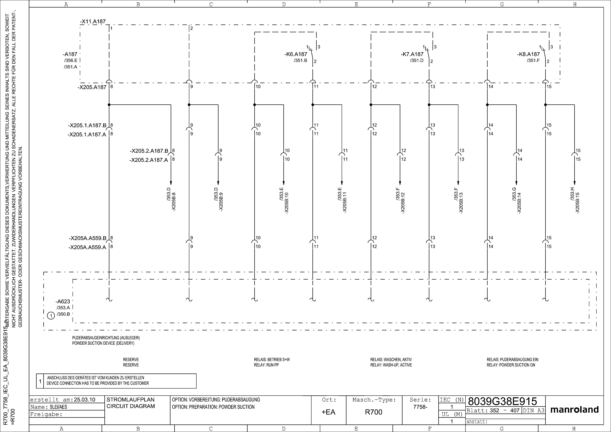

# +EA — Sheet 352 of 407 — OPTION: VORBEREITUNG: PUDERABSAUGUNG

**OPTION: PREPARATION: POWDER SUCTION**

> Part of the manroland **R700** printing press IEC/UL circuit diagrams.
> Drawing class: **Stromlaufplan / Circuit diagram** (DIN A3).
> Document `+EA` covers the **Printing unit** machine section.

## At a glance

| Field | Value |
|---|---|
| Document | `+EA`  (8039G38E915) |
| Sheet | **352** of 407 |
| Section (DE) | OPTION: VORBEREITUNG: PUDERABSAUGUNG |
| Section (EN) | OPTION: PREPARATION: POWDER SUCTION |
| Section type | CIRCUIT — Circuit diagram |
| Machine type | `R700` |
| Series | `7758` |
| Created | 25.03.10 |
| Replaces | — |
| Columns used | A, B, C, D, E, F, G, H |
| Path numbers | — |
| Labels on sheet | 117 |
| Cross-refs out | 15 |
| Cross-refs in | 71 |

**Previous:** [+EA sheet 351](SHEET_0351.md) · **Next:** [+EA sheet 353](SHEET_0353.md) · **Document TOC:** [_TOC.md](_TOC.md)  (+EA) · **Master TOC:** [all sheets](../_MASTER_TOC.md)

## Sheet image (300 DPI, exact vector render)



_Rendered directly from the PDF vector layer at 300 DPI (1-bit), no OCR and no resampling. Use it to confirm anything ambiguous in the text below._

## Cross-references on this sheet

Each entry is a wire leaving this sheet. The printed token is `/sheet.column`; the link resolves to that sheet inside the same document.

| Ref | Target sheet | Col | Path | Destination on target | Target section | From col |
|---|---|---|---|---|---|---|
| `/356.E` | [+EA sheet 356](SHEET_0356.md) | E | — | — | OPTION: VORBEREITUNG: PUDERABSAUGUNG | A |
| `/351.A` | [+EA sheet 351](SHEET_0351.md) | A | — | — | OPTION: VORBEREITUNG: PUDERABSAUGUNG | A |
| `/351.B` | [+EA sheet 351](SHEET_0351.md) | B | — | — | OPTION: VORBEREITUNG: PUDERABSAUGUNG | D |
| `/351.F` | [+EA sheet 351](SHEET_0351.md) | F | — | — | OPTION: VORBEREITUNG: PUDERABSAUGUNG | G |
| `/351.D` | [+EA sheet 351](SHEET_0351.md) | D | — | — | OPTION: VORBEREITUNG: PUDERABSAUGUNG | F |
| `/353.H` | [+EA sheet 353](SHEET_0353.md) | H | — | — | OPTION: VORBEREITUNG: PUDERABSAUGUNG | H |
| `/353.E` | [+EA sheet 353](SHEET_0353.md) | E | — | — | OPTION: VORBEREITUNG: PUDERABSAUGUNG | D |
| `/353.E` | [+EA sheet 353](SHEET_0353.md) | E | — | — | OPTION: VORBEREITUNG: PUDERABSAUGUNG | E |
| `/353.G` | [+EA sheet 353](SHEET_0353.md) | G | — | — | OPTION: VORBEREITUNG: PUDERABSAUGUNG | G |
| `/353.D` | [+EA sheet 353](SHEET_0353.md) | D | — | — | OPTION: VORBEREITUNG: PUDERABSAUGUNG | B |
| `/353.D` | [+EA sheet 353](SHEET_0353.md) | D | — | — | OPTION: VORBEREITUNG: PUDERABSAUGUNG | C |
| `/353.F` | [+EA sheet 353](SHEET_0353.md) | F | — | — | OPTION: VORBEREITUNG: PUDERABSAUGUNG | F |
| `/353.F` | [+EA sheet 353](SHEET_0353.md) | F | — | — | OPTION: VORBEREITUNG: PUDERABSAUGUNG | F |
| `/353.A` | [+EA sheet 353](SHEET_0353.md) | A | — | — | OPTION: VORBEREITUNG: PUDERABSAUGUNG | A |
| `/350.B` | [+EA sheet 350](SHEET_0350.md) | B | — | — | OPTION: VORBEREITUNG: PUDERABSAUGUNG | A |

### Incoming references (sheets that point here)

Every other sheet that sends a wire to this one. `Back-ref` is the token printed on *that* sheet; `Path` is its line number.

| From sheet | Cols | Back-ref | Path | Refs | What continues there |
|---|---|---|---|---|---|
| [+EA#255](SHEET_0255.md) | E | `/255.E` | — | 2 | — |
| [+EA#287](SHEET_0287.md) | F, G, H | `/287.F`, `/287.G`, `/287.H` | — | 38 | — |
| [+EA#288](SHEET_0288.md) | A, B | `/288.A`, `/288.B` | — | 16 | — |
| [+EA#350](SHEET_0350.md) | B | `/350.B` | — | 1 | — |
| [+EA#351](SHEET_0351.md) | A, B, D, F | `/351.A`, `/351.B`, `/351.D`, `/351.F` | — | 4 | — |
| [+EA#353](SHEET_0353.md) | A, D, E, F, G, H | `/353.A`, `/353.D`, `/353.E`, `/353.F`, `/353.G`, `/353.H` | — | 9 | X205B:10; X205B:11; X205B:12; X205B:13; X205B:14; X205B:15; X205B:8; X205B:9 |
| [+EA#356](SHEET_0356.md) | E | `/356.E` | — | 1 | — |


## Devices on this sheet

| Tag | Class | Class meaning (IEC) | Col | Sub | Terminal | Sign |
|---|---|---|---|---|---|---|
| `A187` | A | Baugruppe / assembly, module, PC board | A | — | — | — |
| `A623` | A | Baugruppe / assembly, module, PC board | A | — | — | — |
| `X205.A187` | — | cross-device reference | A | — | — | — |
| `X205.1.A187.B` | — | cross-device reference | A | — | — | — |
| `X205.1.A187.A` | — | cross-device reference | A | — | — | — |
| `X205.2.A187.B` | — | cross-device reference | B | — | — | — |
| `X205.2.A187.A` | — | cross-device reference | B | — | — | — |
| `X205A.A559.B` | — | cross-device reference | A | — | — | — |
| `K6.A187` | — | cross-device reference | D | — | — | — |
| `K7.A187` | — | cross-device reference | F | — | — | — |
| `K8.A187` | — | cross-device reference | G | — | — | — |
| `X205A.A559.A` | — | cross-device reference | A | — | — | — |
| `X11.A187` | — | cross-device reference | A | — | — | — |

## Potentials / nets

_No named potentials on this sheet._

## Wire-end annotations (grouped as printed)

A wire that continues elsewhere is annotated with a small cluster: the destination description, the path/line number `#NN`, and the `/sheet.column` cross reference. Each row below is one such cluster exactly as it is grouped on the drawing.

| Col | Y | Path | Cross-ref | Text on the wire |
|---|---|---|---|---|
| A | 37.1 | — | — | `X11.A187` |
| B | 51.4 | — | — | `1` |
| C | 51.4 | — | — | `2` |
| D | 87.5 | — | — | `K6.A187 3` |
| D | 87.5 | — | — | `1` |
| F | 87.5 | — | — | `K7.A187 3` |
| F | 87.5 | — | — | `1` |
| G | 87.5 | — | — | `K8.A187 3` |
| H | 87.5 | — | — | `1` |
| A | 100.9 | — | — | `A187` |
| A | 114.0 | — | `/356.E`, `/351.A` | — |
| D | 114.0 | — | `/351.B` | — |
| F | 114.0 | — | `/351.D` | — |
| G | 114.0 | — | `/351.F` | — |
| D | 115.8 | — | — | `2` |
| F | 115.8 | — | — | `2` |
| H | 115.8 | — | — | `2` |
| A | 164.7 | — | — | `X205.A187 8` |
| E | 164.7 | — | — | `9 10 12 14` |
| D | 164.7 | — | — | `11` |
| F | 164.7 | — | — | `13` |
| H | 164.7 | — | — | `15` |
| A | 239.8 | — | — | `X205.1.A187.B 8` |
| C | 239.8 | — | — | `9` |
| D | 239.8 | — | — | `10` |
| D | 239.8 | — | — | `11` |
| E | 239.8 | — | — | `12` |
| F | 239.8 | — | — | `13` |
| G | 239.8 | — | — | `14` |
| H | 239.8 | — | — | `15` |
| A | 256.9 | — | — | `X205.1.A187.A 8` |
| C | 256.9 | — | — | `9` |
| D | 256.9 | — | — | `10` |
| D | 256.9 | — | — | `11` |
| E | 256.9 | — | — | `12` |
| F | 256.9 | — | — | `13` |
| G | 256.9 | — | — | `14` |
| H | 256.9 | — | — | `15` |
| B | 289.4 | — | — | `X205.2.A187.B 8` |
| C | 289.5 | — | — | `9` |
| D | 289.5 | — | — | `10` |
| E | 289.5 | — | — | `11` |
| F | 289.5 | — | — | `12` |
| F | 289.5 | — | — | `13` |
| G | 289.5 | — | — | `14` |
| H | 289.5 | — | — | `15` |
| B | 306.5 | — | — | `X205.2.A187.A 8` |
| C | 306.5 | — | — | `9` |
| D | 306.5 | — | — | `10` |
| E | 306.5 | — | — | `11` |
| F | 306.5 | — | — | `12` |
| F | 306.5 | — | — | `13` |
| G | 306.5 | — | — | `14` |
| H | 306.5 | — | — | `15` |
| H | 364.8 | — | `/353.H` | — |
| D | 365.1 | — | `/353.E` | — |
| E | 365.1 | — | `/353.E` | — |
| G | 365.1 | — | `/353.G` | — |
| B | 365.4 | — | `/353.D` | — |
| C | 365.4 | — | `/353.D` | — |
| F | 365.4 | — | `/353.F` | — |
| F | 365.4 | — | `/353.F` | — |
| E | 373.9 | — | — | `X205B:11` |
| F | 375.0 | — | — | `X205B:12` |
| B | 375.3 | — | — | `X205B:8` |
| C | 375.3 | — | — | `X205B:9` |
| D | 375.3 | — | — | `X205B:10` |
| F | 375.3 | — | — | `X205B:13` |
| G | 375.3 | — | — | `X205B:14` |
| H | 375.3 | — | — | `X205B:15` |
| B | 459.5 | — | — | `X205A.A559.B 8 9` |
| D | 459.5 | — | — | `10` |
| D | 459.5 | — | — | `11` |
| E | 459.5 | — | — | `12` |
| F | 459.5 | — | — | `13` |
| G | 459.5 | — | — | `14` |
| H | 459.5 | — | — | `15` |
| D | 476.5 | — | — | `X205A.A559.A 8 9 15` |
| D | 476.5 | — | — | `10` |
| D | 476.5 | — | — | `11` |
| E | 476.5 | — | — | `12` |
| F | 476.5 | — | — | `13` |
| G | 476.5 | — | — | `14` |
| A | 582.8 | — | — | `A623` |
| A | 595.9 | — | `/353.A`, `/350.B` | — |
| A | 612.1 | — | — | `1` |
| B | 655.4 | — | — | `PUDERABSAUGEINRICHTUNG (AUSLEGER) POWDER SUCTION DEVICE (DELIVERY)` |
| E | 697.9 | — | — | `RESERVE RESERVE RELAIS: PUDERABSAUGUNG EIN RELAY: POWDER SUCTION ON` |
| D | 697.9 | — | — | `RELAIS: BETRIEB S+W RELAY: RUN PP` |
| E | 697.9 | — | — | `RELAIS: WASCHEN, AKTIV RELAY: WASH UP, ACTIVE` |
| A | 733.4 | — | — | `1 DEVICE CONNECTION HAS TO BE PROVIDED BY THE CUSTOMER ANSCHLUSS DES GERÄTES IST VOM KUNDEN ZU ERSTELLEN` |


## Reconstructed tables

This sheet carries tabular content (pin map / terminal assignment / index). The grid below was rebuilt from the drawing's own rule lines, so each row is exactly one physical row of the table.

### Table 1 — 5 data rows × 23 columns (at x=204.1, y=0.0) — **1 2 8 9 10 1 K6.A187 /351.B 2 11 3 12 1 K7.A187 /351.D 2 13 14 1 K8.A187 /351.F 2 15 PROVIDED 8 8 X205.2.A187.B X205.2.A187.A /353.D 8 8 (AUSLEGER) DEVICE (DELIVERY) RESERVE RESERVE KUNDEN ZU ERSTELLEN BY THE CUSTOMER 8 8 X205B:8 9 9 /353.D 9 9 9 9 X205B:9 10 10 /353.E 10 10 RELAIS: BETRIEB RELAY: RUN PP 10 10 X205B:10 S+W 11 11 11 11 /353.E 11 11 X205B:11 12 12 /353.F 12 12 RELAIS: WASCHEN, RELAY: WASH UP, 12 12 X205B:12 AKTIV ACTIVE 13 13 13 13 /353.F 13 13 X205B:13 14 14 /353.G 14 14 RELAIS: PUDERABSAUGUNG RELAY: POWDER 14 14 X205B:14 EIN SUCTION ON 15 15 15 15 /353.H**

|  | STROMLAUFPLAN | OPTION: | VORBEREITUNG: | PUDERABSAUGUNG |  |  |  | Ort: |  |  | Masch. Type: |  | Serie: |  |  | IEC | (N) |  | 8039G38E915 |  |  |  |
|---|---|---|---|---|---|---|---|---|---|---|---|---|---|---|---|---|---|---|---|---|---|---|
|  | `CIRCUIT DIAGRAM` |  |  |  |  |  |  |  |  |  |  |  |  |  |  |  |  |  |  |  |  |  |
|  |  | `OPTION:` | `PREPARATION:` | `POWDER SUCTION` |  |  |  |  |  |  |  |  | `7758` |  |  | `1` |  |  |  |  |  |  |
|  |  |  |  |  |  |  |  | `+EA` |  |  | `R700` |  |  |  |  |  |  | `Blatt:` | `352 407` | `DIN A3` |  |  |
|  |  |  |  |  |  |  |  |  |  |  |  |  |  |  |  | `UL (M)` |  |  |  |  |  |  |
|  |  |  |  |  |  |  |  |  |  |  |  |  |  |  |  | `1` |  | `anstatt:` |  |  |  |  |


## Notes and free text on this sheet

| Text | Col | Y (pt) |
|---|---|---|
| `PUDERABSAUGEINRICHTUNG (AUSLEGER)` | B | 655.44 |
| `POWDER SUCTION DEVICE (DELIVERY)` | B | 666.05 |
| `X205B:10` | D | 375.31 |
| `X205B:9` | C | 375.31 |
| `X205B:8` | B | 375.31 |
| `X205B:11` | E | 373.89 |
| `X205B:15` | H | 375.31 |
| `X205B:14` | G | 375.31 |
| `X205B:13` | F | 375.31 |
| `X205B:12` | F | 375.03 |
| `ANSCHLUSS DES GERÄTES IST VOM KUNDEN ZU ERSTELLEN` | A | 733.39 |
| `DEVICE CONNECTION HAS TO BE PROVIDED BY THE CUSTOMER` | A | 744.02 |
| `RELAIS: BETRIEB S+W` | D | 697.9 |
| `RELAY: RUN PP` | D | 708.56 |
| `RELAIS: WASCHEN, AKTIV` | E | 697.91 |
| `RELAY: WASH UP, ACTIVE` | E | 708.54 |
| `RELAIS: PUDERABSAUGUNG EIN` | G | 697.94 |
| `RELAY: POWDER SUCTION ON` | G | 708.56 |
| `RESERVE` | B | 697.91 |

## Complete label inventory (exact text from the drawing)

Every text object inside the drawing area of this sheet, in DIN reading order (column A→H, then top→bottom). This is the authoritative list: if a string is not here it is not printed on this sheet.

| Col | Y | X | Dir | Type | Text |
|---|---|---|---|---|---|
| A | 37.2 | 155.9 | → | device ref | `X11.A187` |
| A | 100.9 | 122.5 | → | device tag | `A187` |
| A | 114.0 | 125.3 | → | cross-reference | `/356.E` |
| A | 126.4 | 124.7 | → | cross-reference | `/351.A` |
| A | 165.4 | 151.4 | → | device ref | `X205.A187` |
| A | 239.8 | 132.7 | → | device ref | `X205.1.A187.B` |
| A | 257.6 | 131.8 | → | device ref | `X205.1.A187.A` |
| A | 459.5 | 134.4 | → | device ref | `X205A.A559.B` |
| A | 477.2 | 133.5 | → | device ref | `X205A.A559.A` |
| A | 582.8 | 108.3 | → | device tag | `A623` |
| A | 595.9 | 110.6 | → | cross-reference | `/353.A` |
| A | 608.3 | 110.8 | → | cross-reference | `/350.B` |
| A | 612.1 | 97.5 | → | number | `1` |
| A | 733.4 | 92.1 | → | text | `ANSCHLUSS DES GERÄTES IST VOM KUNDEN ZU ERSTELLEN` |
| A | 738.7 | 75.4 | → | number | `1` |
| A | 744.0 | 91.3 | → | text | `DEVICE CONNECTION HAS TO BE PROVIDED BY THE CUSTOMER` |
| B | 51.3 | 214.6 | → | number | `1` |
| B | 164.7 | 215.1 | → | number | `8` |
| B | 239.9 | 215.1 | → | number | `8` |
| B | 256.9 | 215.1 | → | number | `8` |
| B | 289.4 | 253.1 | → | device ref | `X205.2.A187.B` |
| B | 289.5 | 335.6 | → | number | `8` |
| B | 306.5 | 335.6 | → | number | `8` |
| B | 307.2 | 252.3 | → | device ref | `X205.2.A187.A` |
| B | 365.4 | 324.9 | ↕ | cross-reference | `/353.D` |
| B | 375.3 | 334.8 | ↕ | text | `X205B:8` |
| B | 459.5 | 215.1 | → | number | `8` |
| B | 476.5 | 215.1 | → | number | `8` |
| B | 655.4 | 140.9 | → | text | `PUDERABSAUGEINRICHTUNG (AUSLEGER)` |
| B | 666.0 | 140.9 | → | text | `POWDER SUCTION DEVICE (DELIVERY)` |
| B | 697.9 | 240.1 | → | text | `RESERVE` |
| B | 708.5 | 240.1 | → | text | `RESERVE` |
| C | 51.3 | 371.1 | → | number | `2` |
| C | 164.7 | 371.1 | → | number | `9` |
| C | 239.9 | 371.1 | → | number | `9` |
| C | 256.9 | 371.1 | → | number | `9` |
| C | 289.5 | 427.7 | → | number | `9` |
| C | 306.5 | 427.7 | → | number | `9` |
| C | 365.4 | 417.0 | ↕ | cross-reference | `/353.D` |
| C | 375.3 | 426.9 | ↕ | text | `X205B:9` |
| C | 459.5 | 371.1 | → | number | `9` |
| C | 476.5 | 371.1 | → | number | `9` |
| D | 87.5 | 596.4 | → | number | `1` |
| D | 87.5 | 619.1 | → | number | `3` |
| D | 100.9 | 554.5 | → | device ref | `K6.A187` |
| D | 114.0 | 572.9 | → | cross-reference | `/351.B` |
| D | 115.8 | 612.0 | → | number | `2` |
| D | 164.7 | 498.0 | → | number | `10` |
| D | 164.7 | 611.4 | → | number | `11` |
| D | 239.9 | 498.0 | → | number | `10` |
| D | 239.9 | 611.4 | → | number | `11` |
| D | 256.9 | 498.0 | → | number | `10` |
| D | 256.9 | 611.4 | → | number | `11` |
| D | 289.5 | 554.7 | → | number | `10` |
| D | 306.5 | 554.7 | → | number | `10` |
| D | 365.1 | 544.5 | ↕ | cross-reference | `/353.E` |
| D | 375.3 | 554.5 | ↕ | text | `X205B:10` |
| D | 459.5 | 498.0 | → | number | `10` |
| D | 459.5 | 611.4 | → | number | `11` |
| D | 476.5 | 498.0 | → | number | `10` |
| D | 476.5 | 611.4 | → | number | `11` |
| D | 697.9 | 495.2 | → | text | `RELAIS: BETRIEB S+W` |
| D | 708.6 | 495.2 | → | text | `RELAY: RUN PP` |
| E | 164.7 | 724.8 | → | number | `12` |
| E | 239.9 | 724.8 | → | number | `12` |
| E | 256.9 | 724.8 | → | number | `12` |
| E | 289.5 | 668.1 | → | number | `11` |
| E | 306.5 | 668.1 | → | number | `11` |
| E | 365.1 | 657.9 | ↕ | cross-reference | `/353.E` |
| E | 373.9 | 667.8 | ↕ | text | `X205B:11` |
| E | 459.5 | 724.8 | → | number | `12` |
| E | 476.5 | 724.8 | → | number | `12` |
| E | 697.9 | 722.0 | → | text | `RELAIS: WASCHEN, AKTIV` |
| E | 708.5 | 722.0 | → | text | `RELAY: WASH UP, ACTIVE` |
| F | 87.5 | 823.2 | → | number | `1` |
| F | 87.5 | 845.9 | → | number | `3` |
| F | 100.9 | 781.2 | → | device ref | `K7.A187` |
| F | 114.0 | 799.4 | → | cross-reference | `/351.D` |
| F | 115.8 | 838.8 | → | number | `2` |
| F | 164.7 | 838.2 | → | number | `13` |
| F | 239.9 | 838.2 | → | number | `13` |
| F | 256.9 | 838.2 | → | number | `13` |
| F | 289.5 | 781.5 | → | number | `12` |
| F | 289.5 | 894.9 | → | number | `13` |
| F | 306.5 | 781.5 | → | number | `12` |
| F | 306.5 | 894.9 | → | number | `13` |
| F | 365.4 | 771.3 | ↕ | cross-reference | `/353.F` |
| F | 365.4 | 884.7 | ↕ | cross-reference | `/353.F` |
| F | 375.0 | 781.2 | ↕ | text | `X205B:12` |
| F | 375.3 | 894.6 | ↕ | text | `X205B:13` |
| F | 459.5 | 838.2 | → | number | `13` |
| F | 476.5 | 838.2 | → | number | `13` |
| G | 100.9 | 1008.0 | → | device ref | `K8.A187` |
| G | 114.0 | 1027.0 | → | cross-reference | `/351.F` |
| G | 164.7 | 951.6 | → | number | `14` |
| G | 239.9 | 951.6 | → | number | `14` |
| G | 256.9 | 951.6 | → | number | `14` |
| G | 289.5 | 1008.3 | → | number | `14` |
| G | 306.5 | 1008.3 | → | number | `14` |
| G | 365.1 | 998.1 | ↕ | cross-reference | `/353.G` |
| G | 375.3 | 1008.0 | ↕ | text | `X205B:14` |
| G | 459.5 | 951.6 | → | number | `14` |
| G | 476.5 | 951.6 | → | number | `14` |
| G | 697.9 | 948.8 | → | text | `RELAIS: PUDERABSAUGUNG EIN` |
| G | 708.6 | 948.8 | → | text | `RELAY: POWDER SUCTION ON` |
| H | 87.5 | 1050.0 | → | number | `1` |
| H | 87.5 | 1072.6 | → | number | `3` |
| H | 115.8 | 1065.5 | → | number | `2` |
| H | 164.7 | 1065.0 | → | number | `15` |
| H | 239.9 | 1065.0 | → | number | `15` |
| H | 256.9 | 1065.0 | → | number | `15` |
| H | 289.5 | 1121.7 | → | number | `15` |
| H | 306.5 | 1121.7 | → | number | `15` |
| H | 364.8 | 1111.5 | ↕ | cross-reference | `/353.H` |
| H | 375.3 | 1121.4 | ↕ | text | `X205B:15` |
| H | 459.5 | 1065.0 | → | number | `15` |
| H | 476.5 | 1065.0 | → | number | `15` |

## Reading-order text block

The same content as a plain block, grouped by DIN column — convenient to paste or to match against a visual description.

```text
=== Column A ===
  37.2  155.9  devref       X11.A187
 100.9  122.5  devtag       A187
 114.0  125.3  xref         /356.E
 126.4  124.7  xref         /351.A
 165.4  151.4  devref       X205.A187
 239.8  132.7  devref       X205.1.A187.B
 257.6  131.8  devref       X205.1.A187.A
 459.5  134.4  devref       X205A.A559.B
 477.2  133.5  devref       X205A.A559.A
 582.8  108.3  devtag       A623
 595.9  110.6  xref         /353.A
 608.3  110.8  xref         /350.B
 612.1   97.5  numeric      1
 733.4   92.1  text         ANSCHLUSS DES GERÄTES IST VOM KUNDEN ZU ERSTELLEN
 738.7   75.4  numeric      1
 744.0   91.3  text         DEVICE CONNECTION HAS TO BE PROVIDED BY THE CUSTOMER
=== Column B ===
  51.3  214.6  numeric      1
 164.7  215.1  numeric      8
 239.9  215.1  numeric      8
 256.9  215.1  numeric      8
 289.4  253.1  devref       X205.2.A187.B
 289.5  335.6  numeric      8
 306.5  335.6  numeric      8
 307.2  252.3  devref       X205.2.A187.A
 365.4  324.9  xref         /353.D
 375.3  334.8  text         X205B:8
 459.5  215.1  numeric      8
 476.5  215.1  numeric      8
 655.4  140.9  text         PUDERABSAUGEINRICHTUNG (AUSLEGER)
 666.0  140.9  text         POWDER SUCTION DEVICE (DELIVERY)
 697.9  240.1  text         RESERVE
 708.5  240.1  text         RESERVE
=== Column C ===
  51.3  371.1  numeric      2
 164.7  371.1  numeric      9
 239.9  371.1  numeric      9
 256.9  371.1  numeric      9
 289.5  427.7  numeric      9
 306.5  427.7  numeric      9
 365.4  417.0  xref         /353.D
 375.3  426.9  text         X205B:9
 459.5  371.1  numeric      9
 476.5  371.1  numeric      9
=== Column D ===
  87.5  596.4  numeric      1
  87.5  619.1  numeric      3
 100.9  554.5  devref       K6.A187
 114.0  572.9  xref         /351.B
 115.8  612.0  numeric      2
 164.7  498.0  numeric      10
 164.7  611.4  numeric      11
 239.9  498.0  numeric      10
 239.9  611.4  numeric      11
 256.9  498.0  numeric      10
 256.9  611.4  numeric      11
 289.5  554.7  numeric      10
 306.5  554.7  numeric      10
 365.1  544.5  xref         /353.E
 375.3  554.5  text         X205B:10
 459.5  498.0  numeric      10
 459.5  611.4  numeric      11
 476.5  498.0  numeric      10
 476.5  611.4  numeric      11
 697.9  495.2  text         RELAIS: BETRIEB S+W
 708.6  495.2  text         RELAY: RUN PP
=== Column E ===
 164.7  724.8  numeric      12
 239.9  724.8  numeric      12
 256.9  724.8  numeric      12
 289.5  668.1  numeric      11
 306.5  668.1  numeric      11
 365.1  657.9  xref         /353.E
 373.9  667.8  text         X205B:11
 459.5  724.8  numeric      12
 476.5  724.8  numeric      12
 697.9  722.0  text         RELAIS: WASCHEN, AKTIV
 708.5  722.0  text         RELAY: WASH UP, ACTIVE
=== Column F ===
  87.5  823.2  numeric      1
  87.5  845.9  numeric      3
 100.9  781.2  devref       K7.A187
 114.0  799.4  xref         /351.D
 115.8  838.8  numeric      2
 164.7  838.2  numeric      13
 239.9  838.2  numeric      13
 256.9  838.2  numeric      13
 289.5  781.5  numeric      12
 289.5  894.9  numeric      13
 306.5  781.5  numeric      12
 306.5  894.9  numeric      13
 365.4  771.3  xref         /353.F
 365.4  884.7  xref         /353.F
 375.0  781.2  text         X205B:12
 375.3  894.6  text         X205B:13
 459.5  838.2  numeric      13
 476.5  838.2  numeric      13
=== Column G ===
 100.9 1008.0  devref       K8.A187
 114.0 1027.0  xref         /351.F
 164.7  951.6  numeric      14
 239.9  951.6  numeric      14
 256.9  951.6  numeric      14
 289.5 1008.3  numeric      14
 306.5 1008.3  numeric      14
 365.1  998.1  xref         /353.G
 375.3 1008.0  text         X205B:14
 459.5  951.6  numeric      14
 476.5  951.6  numeric      14
 697.9  948.8  text         RELAIS: PUDERABSAUGUNG EIN
 708.6  948.8  text         RELAY: POWDER SUCTION ON
=== Column H ===
  87.5 1050.0  numeric      1
  87.5 1072.6  numeric      3
 115.8 1065.5  numeric      2
 164.7 1065.0  numeric      15
 239.9 1065.0  numeric      15
 256.9 1065.0  numeric      15
 289.5 1121.7  numeric      15
 306.5 1121.7  numeric      15
 364.8 1111.5  xref         /353.H
 375.3 1121.4  text         X205B:15
 459.5 1065.0  numeric      15
 476.5 1065.0  numeric      15
```

---
_Generated from the PDF vector text layer; no OCR. Source: `R700_7758_IEC_UL_EA_8039G38E915_p`, sheet 352._
