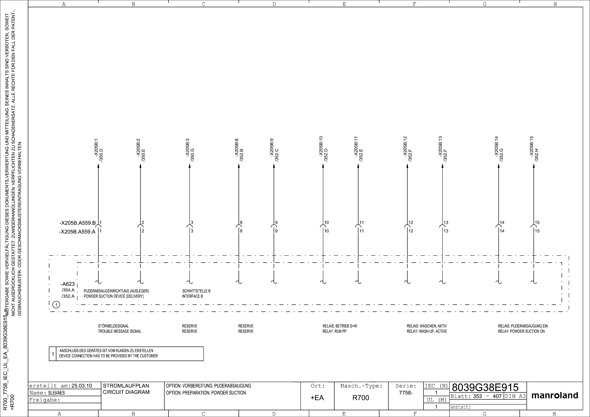

# +EA — Sheet 353 of 407 — OPTION: VORBEREITUNG: PUDERABSAUGUNG

**OPTION: PREPARATION: POWDER SUCTION**

> Part of the manroland **R700** printing press IEC/UL circuit diagrams.
> Drawing class: **Stromlaufplan / Circuit diagram** (DIN A3).
> Document `+EA` covers the **Printing unit** machine section.

## At a glance

| Field | Value |
|---|---|
| Document | `+EA`  (8039G38E915) |
| Sheet | **353** of 407 |
| Section (DE) | OPTION: VORBEREITUNG: PUDERABSAUGUNG |
| Section (EN) | OPTION: PREPARATION: POWDER SUCTION |
| Section type | CIRCUIT — Circuit diagram |
| Machine type | `R700` |
| Series | `7758` |
| Created | 25.03.10 |
| Replaces | — |
| Columns used | A, B, C, D, E, F, G, H |
| Path numbers | — |
| Labels on sheet | 69 |
| Cross-refs out | 13 |
| Cross-refs in | 35 |

**Previous:** [+EA sheet 352](SHEET_0352.md) · **Next:** [+EA sheet 354](SHEET_0354.md) · **Document TOC:** [_TOC.md](_TOC.md)  (+EA) · **Master TOC:** [all sheets](../_MASTER_TOC.md)

## Sheet image (300 DPI, exact vector render)



_Rendered directly from the PDF vector layer at 300 DPI (1-bit), no OCR and no resampling. Use it to confirm anything ambiguous in the text below._

## Cross-references on this sheet

Each entry is a wire leaving this sheet. The printed token is `/sheet.column`; the link resolves to that sheet inside the same document.

| Ref | Target sheet | Col | Path | Destination on target | Target section | From col |
|---|---|---|---|---|---|---|
| `/352.D` | [+EA sheet 352](SHEET_0352.md) | D | — | X205B:10 | OPTION: VORBEREITUNG: PUDERABSAUGUNG | E |
| `/352.E` | [+EA sheet 352](SHEET_0352.md) | E | — | X205B:11 | OPTION: VORBEREITUNG: PUDERABSAUGUNG | E |
| `/352.F` | [+EA sheet 352](SHEET_0352.md) | F | — | X205B:12 | OPTION: VORBEREITUNG: PUDERABSAUGUNG | F |
| `/352.F` | [+EA sheet 352](SHEET_0352.md) | F | — | X205B:13 | OPTION: VORBEREITUNG: PUDERABSAUGUNG | F |
| `/352.G` | [+EA sheet 352](SHEET_0352.md) | G | — | X205B:14 | OPTION: VORBEREITUNG: PUDERABSAUGUNG | G |
| `/352.H` | [+EA sheet 352](SHEET_0352.md) | H | — | X205B:15 | OPTION: VORBEREITUNG: PUDERABSAUGUNG | H |
| `/350.D` | [+EA sheet 350](SHEET_0350.md) | D | — | X205B:1 | OPTION: VORBEREITUNG: PUDERABSAUGUNG | B |
| `/350.E` | [+EA sheet 350](SHEET_0350.md) | E | — | X205B:2 | OPTION: VORBEREITUNG: PUDERABSAUGUNG | B |
| `/350.G` | [+EA sheet 350](SHEET_0350.md) | G | — | X205B:3 | OPTION: VORBEREITUNG: PUDERABSAUGUNG | C |
| `/352.B` | [+EA sheet 352](SHEET_0352.md) | B | — | X205B:8 | OPTION: VORBEREITUNG: PUDERABSAUGUNG | D |
| `/352.C` | [+EA sheet 352](SHEET_0352.md) | C | — | X205B:9 | OPTION: VORBEREITUNG: PUDERABSAUGUNG | D |
| `/354.A` | [+EA sheet 354](SHEET_0354.md) | A | — | — | OPTION: VORBEREITUNG: PUDERABSAUGUNG | A |
| `/352.A` | [+EA sheet 352](SHEET_0352.md) | A | — | — | OPTION: VORBEREITUNG: PUDERABSAUGUNG | A |

### Incoming references (sheets that point here)

Every other sheet that sends a wire to this one. `Back-ref` is the token printed on *that* sheet; `Path` is its line number.

| From sheet | Cols | Back-ref | Path | Refs | What continues there |
|---|---|---|---|---|---|
| [+EA#288](SHEET_0288.md) | D, E | `/288.D`, `/288.E` | — | 22 | — |
| [+EA#350](SHEET_0350.md) | D, E, G | `/350.D`, `/350.E`, `/350.G` | — | 3 | X205B:1; X205B:2; X205B:3 |
| [+EA#352](SHEET_0352.md) | A, B, C, D, E, F, G, H | `/352.A`, `/352.B`, `/352.C`, `/352.D`, `/352.E`, `/352.F`, `/352.G`, `/352.H` | — | 9 | — |
| [+EA#354](SHEET_0354.md) | A | `/354.A` | — | 1 | — |


## Devices on this sheet

| Tag | Class | Class meaning (IEC) | Col | Sub | Terminal | Sign |
|---|---|---|---|---|---|---|
| `A623` | A | Baugruppe / assembly, module, PC board | A | — | — | — |
| `X205B.A559.B` | — | cross-device reference | A | — | — | — |
| `X205B.A559.A` | — | cross-device reference | A | — | — | — |

## Potentials / nets

_No named potentials on this sheet._

## Wire-end annotations (grouped as printed)

A wire that continues elsewhere is annotated with a small cluster: the destination description, the path/line number `#NN`, and the `/sheet.column` cross reference. Each row below is one such cluster exactly as it is grouped on the drawing.

| Col | Y | Path | Cross-ref | Text on the wire |
|---|---|---|---|---|
| E | 275.0 | — | `/352.D` | `X205B:10` |
| E | 275.0 | — | `/352.E` | `X205B:11` |
| F | 275.0 | — | `/352.F` | `X205B:12` |
| F | 275.0 | — | `/352.F` | `X205B:13` |
| G | 275.0 | — | `/352.G` | `X205B:14` |
| H | 275.0 | — | `/352.H` | `X205B:15` |
| B | 279.8 | — | `/350.D` | `X205B:1` |
| B | 279.8 | — | `/350.E` | `X205B:2` |
| C | 279.8 | — | `/350.G` | `X205B:3` |
| D | 279.8 | — | `/352.B` | `X205B:8` |
| D | 279.8 | — | `/352.C` | `X205B:9` |
| A | 445.4 | — | — | `X205B.A559.B 1` |
| B | 445.4 | — | — | `2` |
| C | 445.4 | — | — | `3` |
| D | 445.4 | — | — | `8` |
| D | 445.4 | — | — | `9` |
| E | 445.4 | — | — | `10` |
| E | 445.4 | — | — | `11` |
| F | 445.4 | — | — | `12` |
| F | 445.4 | — | — | `13` |
| G | 445.4 | — | — | `14` |
| H | 445.4 | — | — | `15` |
| A | 462.4 | — | — | `X205B.A559.A 1` |
| B | 462.4 | — | — | `2` |
| C | 462.4 | — | — | `3` |
| D | 462.4 | — | — | `8` |
| D | 462.4 | — | — | `9` |
| E | 462.4 | — | — | `10` |
| E | 462.4 | — | — | `11` |
| F | 462.4 | — | — | `12` |
| F | 462.4 | — | — | `13` |
| G | 462.4 | — | — | `14` |
| H | 462.4 | — | — | `15` |
| A | 568.6 | — | — | `A623` |
| A | 581.7 | — | `/354.A`, `/352.A` | — |
| B | 584.6 | — | — | `PUDERABSAUGEINRICHTUNG (AUSLEGER) POWDER SUCTION DEVICE (DELIVERY)` |
| C | 584.6 | — | — | `INTERFACE B SCHNITTSTELLE B` |
| A | 612.1 | — | — | `1` |
| B | 655.4 | — | — | `STÖRMELDESIGNAL TROUBLE MESSAGE SIGNAL` |
| C | 655.4 | — | — | `RESERVE RESERVE` |
| F | 655.4 | — | — | `RESERVE RESERVE RELAIS: PUDERABSAUGUNG EIN RELAY: POWDER SUCTION ON` |
| E | 655.4 | — | — | `RELAIS: BETRIEB S+W RELAY: RUN PP` |
| F | 655.4 | — | — | `RELAIS: WASCHEN, AKTIV RELAY: WASH UP, ACTIVE` |
| B | 705.0 | — | — | `1 DEVICE CONNECTION HAS TO BE PROVIDED BY THE CUSTOMER ANSCHLUSS DES GERÄTES IST VOM KUNDEN ZU ERSTELLEN` |


## Reconstructed tables

This sheet carries tabular content (pin map / terminal assignment / index). The grid below was rebuilt from the drawing's own rule lines, so each row is exactly one physical row of the table.

### Table 1 — 6 data rows × 18 columns (at x=198.4, y=0.0)

| 1 1 | X205B:2 /350.D PUDERABSAUGEINRICHTUNG (AUSLEGER) SUCTION DEVICE (DELIVERY) STÖRMELDESIGNAL TROUBLE MESSAGE SIGNAL IST VOM KUNDEN ZU TO BE PROVIDED BY THE | /350.E 2 2 ERSTELLEN CUSTOMER | X205B:3 | X205B:8 /350.G 3 3 SCHNITTSTELLE B INTERFACE B RESERVE RESERVE | X205B:9 /352.B 8 8 RESERVE RESERVE | /352.C 9 9 | X205B:10 | /352.D 10 10 RELAIS: RELAY: | X205B:11 BETRIEB S+W RUN PP | /352.E 11 11 | X205B:12 | /352.F 12 12 RELAIS: RELAY: | X205B:13 WASCHEN, AKTIV WASH UP, ACTIVE | /352.F 13 13 | X205B:14 | /352.G 14 14 RELAIS: PUDERABSAUGUNG RELAY: POWDER | X205B:15 SUCTION |
|---|---|---|---|---|---|---|---|---|---|---|---|---|---|---|---|---|---|
|  | `STROMLAUFPLAN` |  | `OPTION:` | `VORBEREITUNG: PUDERABSAUGUNG` |  |  | `Ort:` |  |  | `Masch. Type:` | `Serie:` |  | `IEC` | `(N)` | `8039G38E915` |  |  |
|  | `CIRCUIT DIAGRAM` |  |  |  |  |  |  |  |  |  |  |  |  |  |  |  |  |
|  |  |  | `OPTION:` | `PREPARATION: POWDER SUCTION` |  |  |  |  |  |  | `7758` |  | `1` |  |  |  |  |
|  |  |  |  |  |  |  | `+EA` |  |  | `R700` |  |  |  |  | `Blatt: 353 407` | `DIN A3` |  |
|  |  |  |  |  |  |  |  |  |  |  |  |  | `UL (M)` |  |  |  |  |
|  |  |  |  |  |  |  |  |  |  |  |  |  | `1` |  | `anstatt:` |  |  |


## Notes and free text on this sheet

| Text | Col | Y (pt) |
|---|---|---|
| `PUDERABSAUGEINRICHTUNG (AUSLEGER)` | B | 584.57 |
| `POWDER SUCTION DEVICE (DELIVERY)` | B | 595.18 |
| `X205B:1` | A | 279.78 |
| `X205B:2` | B | 279.78 |
| `X205B:10` | E | 274.96 |
| `X205B:9` | D | 279.78 |
| `X205B:8` | C | 279.78 |
| `X205B:3` | C | 279.78 |
| `X205B:11` | E | 274.96 |
| `X205B:15` | H | 274.96 |
| `X205B:14` | G | 274.96 |
| `X205B:13` | F | 274.96 |
| `X205B:12` | F | 274.96 |
| `STÖRMELDESIGNAL` | B | 655.44 |
| `TROUBLE MESSAGE SIGNAL` | B | 666.06 |
| `RELAIS: BETRIEB S+W` | E | 655.38 |
| `RELAY: RUN PP` | E | 666.04 |
| `ANSCHLUSS DES GERÄTES IST VOM KUNDEN ZU ERSTELLEN` | B | 705.04 |
| `DEVICE CONNECTION HAS TO BE PROVIDED BY THE CUSTOMER` | B | 715.67 |
| `RESERVE` | C | 655.39 |
| `SCHNITTSTELLE B` | C | 584.56 |
| `INTERFACE B` | C | 595.17 |
| `RELAIS: WASCHEN, AKTIV` | F | 655.39 |
| `RELAY: WASH UP, ACTIVE` | F | 666.02 |
| `RELAIS: PUDERABSAUGUNG EIN` | H | 655.42 |
| `RELAY: POWDER SUCTION ON` | H | 666.04 |
| `RESERVE` | D | 655.39 |

## Complete label inventory (exact text from the drawing)

Every text object inside the drawing area of this sheet, in DIN reading order (column A→H, then top→bottom). This is the authoritative list: if a string is not here it is not printed on this sheet.

| Col | Y | X | Dir | Type | Text |
|---|---|---|---|---|---|
| A | 279.8 | 190.2 | ↕ | text | `X205B:1` |
| A | 445.3 | 120.2 | → | device ref | `X205B.A559.B` |
| A | 463.1 | 119.3 | → | device ref | `X205B.A559.A` |
| A | 568.6 | 122.5 | → | device tag | `A623` |
| A | 581.7 | 124.7 | → | cross-reference | `/354.A` |
| A | 594.1 | 124.7 | → | cross-reference | `/352.A` |
| A | 612.1 | 111.6 | → | number | `1` |
| A | 710.3 | 103.7 | → | number | `1` |
| B | 279.8 | 275.2 | ↕ | text | `X205B:2` |
| B | 300.2 | 200.1 | ↕ | cross-reference | `/350.D` |
| B | 300.5 | 285.1 | ↕ | cross-reference | `/350.E` |
| B | 445.4 | 200.4 | → | number | `1` |
| B | 445.4 | 286.0 | → | number | `2` |
| B | 462.4 | 200.4 | → | number | `1` |
| B | 462.4 | 286.0 | → | number | `2` |
| B | 584.6 | 169.2 | → | text | `PUDERABSAUGEINRICHTUNG (AUSLEGER)` |
| B | 595.2 | 169.2 | → | text | `POWDER SUCTION DEVICE (DELIVERY)` |
| B | 655.4 | 198.1 | → | text | `STÖRMELDESIGNAL` |
| B | 666.1 | 198.1 | → | text | `TROUBLE MESSAGE SIGNAL` |
| B | 705.0 | 120.5 | → | text | `ANSCHLUSS DES GERÄTES IST VOM KUNDEN ZU ERSTELLEN` |
| B | 715.7 | 119.6 | → | text | `DEVICE CONNECTION HAS TO BE PROVIDED BY THE CUSTOMER` |
| C | 279.8 | 374.5 | ↕ | text | `X205B:3` |
| C | 279.8 | 473.7 | ↕ | text | `X205B:8` |
| C | 299.6 | 384.4 | ↕ | cross-reference | `/350.G` |
| C | 445.4 | 385.2 | → | number | `3` |
| C | 462.4 | 385.2 | → | number | `3` |
| C | 584.6 | 368.2 | → | text | `SCHNITTSTELLE B` |
| C | 595.2 | 367.7 | → | text | `INTERFACE B` |
| C | 655.4 | 367.7 | → | text | `RESERVE` |
| C | 666.0 | 367.7 | → | text | `RESERVE` |
| D | 279.8 | 544.5 | ↕ | text | `X205B:9` |
| D | 300.2 | 554.5 | ↕ | cross-reference | `/352.C` |
| D | 300.5 | 483.6 | ↕ | cross-reference | `/352.B` |
| D | 445.4 | 484.4 | → | number | `8` |
| D | 445.4 | 555.3 | → | number | `9` |
| D | 462.4 | 484.4 | → | number | `8` |
| D | 462.4 | 555.3 | → | number | `9` |
| D | 655.4 | 481.0 | → | text | `RESERVE` |
| D | 666.0 | 481.0 | → | text | `RESERVE` |
| E | 275.0 | 643.8 | ↕ | text | `X205B:10` |
| E | 275.0 | 714.6 | ↕ | text | `X205B:11` |
| E | 300.2 | 653.7 | ↕ | cross-reference | `/352.D` |
| E | 300.5 | 724.5 | ↕ | cross-reference | `/352.E` |
| E | 445.4 | 654.0 | → | number | `10` |
| E | 445.4 | 724.8 | → | number | `11` |
| E | 462.4 | 654.0 | → | number | `10` |
| E | 462.4 | 724.8 | → | number | `11` |
| E | 655.4 | 651.1 | → | text | `RELAIS: BETRIEB S+W` |
| E | 666.0 | 651.1 | → | text | `RELAY: RUN PP` |
| F | 275.0 | 813.8 | ↕ | text | `X205B:12` |
| F | 275.0 | 884.7 | ↕ | text | `X205B:13` |
| F | 301.0 | 823.7 | ↕ | cross-reference | `/352.F` |
| F | 301.0 | 894.6 | ↕ | cross-reference | `/352.F` |
| F | 445.4 | 824.0 | → | number | `12` |
| F | 445.4 | 894.9 | → | number | `13` |
| F | 462.4 | 824.0 | → | number | `12` |
| F | 462.4 | 894.9 | → | number | `13` |
| F | 655.4 | 821.2 | → | text | `RELAIS: WASCHEN, AKTIV` |
| F | 666.0 | 821.2 | → | text | `RELAY: WASH UP, ACTIVE` |
| G | 275.0 | 998.1 | ↕ | text | `X205B:14` |
| G | 299.6 | 1008.0 | ↕ | cross-reference | `/352.G` |
| G | 445.4 | 1008.3 | → | number | `14` |
| G | 462.4 | 1008.3 | → | number | `14` |
| H | 275.0 | 1069.0 | ↕ | text | `X205B:15` |
| H | 300.2 | 1078.9 | ↕ | cross-reference | `/352.H` |
| H | 445.4 | 1079.1 | → | number | `15` |
| H | 462.4 | 1079.1 | → | number | `15` |
| H | 655.4 | 1005.4 | → | text | `RELAIS: PUDERABSAUGUNG EIN` |
| H | 666.0 | 1005.4 | → | text | `RELAY: POWDER SUCTION ON` |

## Reading-order text block

The same content as a plain block, grouped by DIN column — convenient to paste or to match against a visual description.

```text
=== Column A ===
 279.8  190.2  text         X205B:1
 445.3  120.2  devref       X205B.A559.B
 463.1  119.3  devref       X205B.A559.A
 568.6  122.5  devtag       A623
 581.7  124.7  xref         /354.A
 594.1  124.7  xref         /352.A
 612.1  111.6  numeric      1
 710.3  103.7  numeric      1
=== Column B ===
 279.8  275.2  text         X205B:2
 300.2  200.1  xref         /350.D
 300.5  285.1  xref         /350.E
 445.4  200.4  numeric      1
 445.4  286.0  numeric      2
 462.4  200.4  numeric      1
 462.4  286.0  numeric      2
 584.6  169.2  text         PUDERABSAUGEINRICHTUNG (AUSLEGER)
 595.2  169.2  text         POWDER SUCTION DEVICE (DELIVERY)
 655.4  198.1  text         STÖRMELDESIGNAL
 666.1  198.1  text         TROUBLE MESSAGE SIGNAL
 705.0  120.5  text         ANSCHLUSS DES GERÄTES IST VOM KUNDEN ZU ERSTELLEN
 715.7  119.6  text         DEVICE CONNECTION HAS TO BE PROVIDED BY THE CUSTOMER
=== Column C ===
 279.8  374.5  text         X205B:3
 279.8  473.7  text         X205B:8
 299.6  384.4  xref         /350.G
 445.4  385.2  numeric      3
 462.4  385.2  numeric      3
 584.6  368.2  text         SCHNITTSTELLE B
 595.2  367.7  text         INTERFACE B
 655.4  367.7  text         RESERVE
 666.0  367.7  text         RESERVE
=== Column D ===
 279.8  544.5  text         X205B:9
 300.2  554.5  xref         /352.C
 300.5  483.6  xref         /352.B
 445.4  484.4  numeric      8
 445.4  555.3  numeric      9
 462.4  484.4  numeric      8
 462.4  555.3  numeric      9
 655.4  481.0  text         RESERVE
 666.0  481.0  text         RESERVE
=== Column E ===
 275.0  643.8  text         X205B:10
 275.0  714.6  text         X205B:11
 300.2  653.7  xref         /352.D
 300.5  724.5  xref         /352.E
 445.4  654.0  numeric      10
 445.4  724.8  numeric      11
 462.4  654.0  numeric      10
 462.4  724.8  numeric      11
 655.4  651.1  text         RELAIS: BETRIEB S+W
 666.0  651.1  text         RELAY: RUN PP
=== Column F ===
 275.0  813.8  text         X205B:12
 275.0  884.7  text         X205B:13
 301.0  823.7  xref         /352.F
 301.0  894.6  xref         /352.F
 445.4  824.0  numeric      12
 445.4  894.9  numeric      13
 462.4  824.0  numeric      12
 462.4  894.9  numeric      13
 655.4  821.2  text         RELAIS: WASCHEN, AKTIV
 666.0  821.2  text         RELAY: WASH UP, ACTIVE
=== Column G ===
 275.0  998.1  text         X205B:14
 299.6 1008.0  xref         /352.G
 445.4 1008.3  numeric      14
 462.4 1008.3  numeric      14
=== Column H ===
 275.0 1069.0  text         X205B:15
 300.2 1078.9  xref         /352.H
 445.4 1079.1  numeric      15
 462.4 1079.1  numeric      15
 655.4 1005.4  text         RELAIS: PUDERABSAUGUNG EIN
 666.0 1005.4  text         RELAY: POWDER SUCTION ON
```

---
_Generated from the PDF vector text layer; no OCR. Source: `R700_7758_IEC_UL_EA_8039G38E915_p`, sheet 353._
