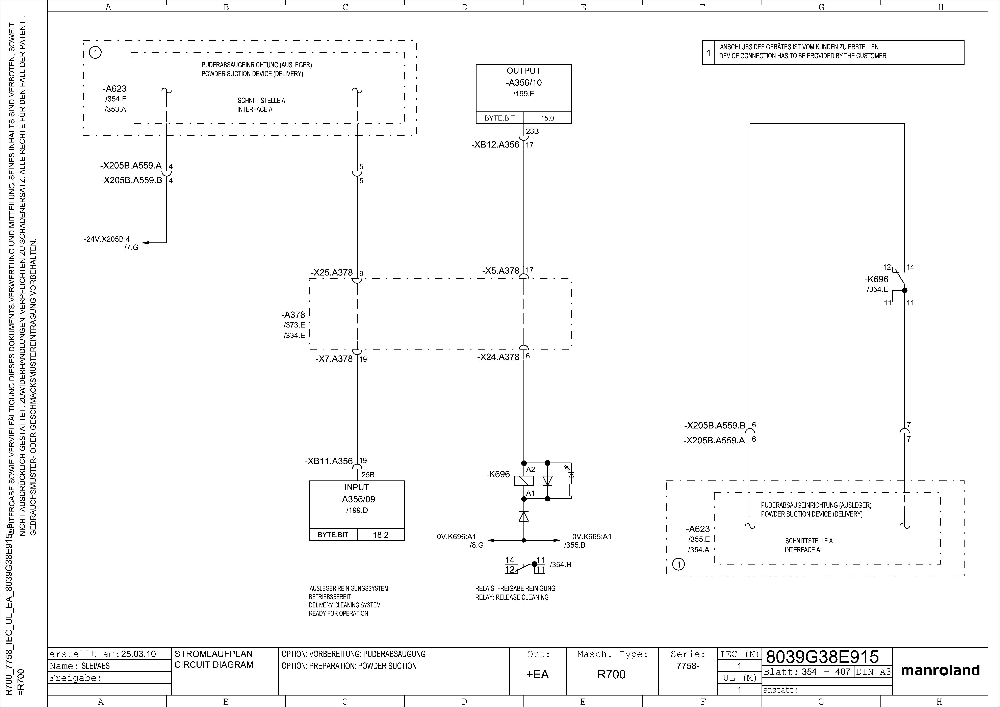

# +EA — Sheet 354 of 407 — OPTION: VORBEREITUNG: PUDERABSAUGUNG

**OPTION: PREPARATION: POWDER SUCTION**

> Part of the manroland **R700** printing press IEC/UL circuit diagrams.
> Drawing class: **Stromlaufplan / Circuit diagram** (DIN A3).
> Document `+EA` covers the **Printing unit** machine section.

## At a glance

| Field | Value |
|---|---|
| Document | `+EA`  (8039G38E915) |
| Sheet | **354** of 407 |
| Section (DE) | OPTION: VORBEREITUNG: PUDERABSAUGUNG |
| Section (EN) | OPTION: PREPARATION: POWDER SUCTION |
| Section type | CIRCUIT — Circuit diagram |
| Machine type | `R700` |
| Series | `7758` |
| Created | 25.03.10 |
| Replaces | — |
| Columns used | A, B, C, D, E, F, G, H |
| Path numbers | — |
| Labels on sheet | 83 |
| Cross-refs out | 12 |
| Cross-refs in | 25 |

**Previous:** [+EA sheet 353](SHEET_0353.md) · **Next:** [+EA sheet 355](SHEET_0355.md) · **Document TOC:** [_TOC.md](_TOC.md)  (+EA) · **Master TOC:** [all sheets](../_MASTER_TOC.md)

## Sheet image (300 DPI, exact vector render)



_Rendered directly from the PDF vector layer at 300 DPI (1-bit), no OCR and no resampling. Use it to confirm anything ambiguous in the text below._

## Cross-references on this sheet

Each entry is a wire leaving this sheet. The printed token is `/sheet.column`; the link resolves to that sheet inside the same document.

| Ref | Target sheet | Col | Path | Destination on target | Target section | From col |
|---|---|---|---|---|---|---|
| `/199.F` | [+EA sheet 199](SHEET_0199.md) | F | — | — | REFERENZMODUL | E |
| `/354.F` | [+EA sheet 354](SHEET_0354.md) | F | — | — | OPTION: VORBEREITUNG: PUDERABSAUGUNG | A |
| `/353.A` | [+EA sheet 353](SHEET_0353.md) | A | — | — | OPTION: VORBEREITUNG: PUDERABSAUGUNG | A |
| `/7.G` | [+EA sheet 7](SHEET_0007.md) | G | — | 24V.X205B:4 | SPANNUNGSVERSORGUNG: 400V, 24V | A |
| `/354.E` | [+EA sheet 354](SHEET_0354.md) | E | — | — | OPTION: VORBEREITUNG: PUDERABSAUGUNG | G |
| `/373.E` | [+EA sheet 373](SHEET_0373.md) | E | — | — | OPTION: ENDTROCKNER 1 VORBEREITUNG; | C |
| `/334.E` | [+EA sheet 334](SHEET_0334.md) | E | — | — | OPTION: BOGENWEICHE | C |
| `/199.D` | [+EA sheet 199](SHEET_0199.md) | D | — | — | REFERENZMODUL | C |
| `/8.G` | [+EA sheet 8](SHEET_0008.md) | G | — | 0V.K696:A1 0V.K665:A1 | SPANNUNGSVERSORGUNG: 400V, 24V | E |
| `/355.E` | [+EA sheet 355](SHEET_0355.md) | E | — | — | OPTION: VORBEREITUNG: PUDERABSAUGUNG | F |
| `/354.A` | [+EA sheet 354](SHEET_0354.md) | A | — | — | OPTION: VORBEREITUNG: PUDERABSAUGUNG | F |
| `/355.B` | [+EA sheet 355](SHEET_0355.md) | B | — | — | OPTION: VORBEREITUNG: PUDERABSAUGUNG | E |

### Incoming references (sheets that point here)

Every other sheet that sends a wire to this one. `Back-ref` is the token printed on *that* sheet; `Path` is its line number.

| From sheet | Cols | Back-ref | Path | Refs | What continues there |
|---|---|---|---|---|---|
| [+EA#7](SHEET_0007.md) | H | `/7.H` | — | 1 | 24V.X205B:4 |
| [+EA#8](SHEET_0008.md) | G | `/8.G` | — | 1 | 0V.K696:A1 |
| [+EA#199](SHEET_0199.md) | D, F | `/199.D`, `/199.F` | — | 2 | — |
| [+EA#242](SHEET_0242.md) | D | `/242.D` | — | 1 | — |
| [+EA#247](SHEET_0247.md) | F | `/247.F` | — | 1 | — |
| [+EA#256](SHEET_0256.md) | B | `/256.B` | — | 1 | — |
| [+EA#257](SHEET_0257.md) | D | `/257.D` | — | 1 | — |
| [+EA#266](SHEET_0266.md) | F | `/266.F` | — | 1 | — |
| [+EA#268](SHEET_0268.md) | A | `/268.A` | — | 1 | — |
| [+EA#288](SHEET_0288.md) | D, E | `/288.D`, `/288.E` | — | 7 | — |
| [+EA#334](SHEET_0334.md) | E | `/334.E` | — | 1 | — |
| [+EA#353](SHEET_0353.md) | A | `/353.A` | — | 1 | — |
| [+EA#354](SHEET_0354.md) | A, F, G | `/354.A`, `/354.F`, `/354.G` | — | 3 | — |
| [+EA#355](SHEET_0355.md) | C, E | `/355.C`, `/355.E` | — | 2 | 0V.K665:A1 0V.K673:A1 |
| [+EA#373](SHEET_0373.md) | E | `/373.E` | — | 1 | — |


## Devices on this sheet

| Tag | Class | Class meaning (IEC) | Col | Sub | Terminal | Sign |
|---|---|---|---|---|---|---|
| `A623` | A | Baugruppe / assembly, module, PC board | A | — | — | — |
| `A623` | A | Baugruppe / assembly, module, PC board | F | — | — | — |
| `K696` | K | Relais / relay, contactor | G | — | — | — |
| `A378` | A | Baugruppe / assembly, module, PC board | C | — | — | — |
| `A356/10` | A | Baugruppe / assembly, module, PC board | E | 10 | — | — |
| `A356/09` | A | Baugruppe / assembly, module, PC board | C | 09 | — | — |
| `A2` | A | Baugruppe / assembly, module, PC board | E | — | — | — |
| `A1` | A | Baugruppe / assembly, module, PC board | E | — | — | — |
| `K696` | K | Relais / relay, contactor | D | — | — | — |
| `X205B.A559.B` | — | cross-device reference | A | — | — | — |
| `X205B.A559.A` | — | cross-device reference | A | — | — | — |
| `X205B.A559.B` | — | cross-device reference | F | — | — | — |
| `X205B.A559.A` | — | cross-device reference | F | — | — | — |
| `X7.A378` | — | cross-device reference | C | — | — | — |
| `X25.A378` | — | cross-device reference | C | — | — | — |
| `15.0` | — | cross-device reference | E | — | — | — |
| `XB12.A356` | — | cross-device reference | D | — | — | — |
| `X5.A378` | — | cross-device reference | D | — | — | — |
| `X24.A378` | — | cross-device reference | D | — | — | — |
| `18.2` | — | cross-device reference | C | — | — | — |
| `XB11.A356` | — | cross-device reference | C | — | — | — |

## Potentials / nets

| Potential | Count | Columns | Attached devices | Terminals |
|---|---|---|---|---|
| `0V` | 2 | D, E | `K665`, `K696` | `A1` |
| `24V` | 1 | A | `X205B` | `4` |


A potential such as `L24+/4` or `M24+` is a named supply/return rail; every place it appears on this sheet is electrically common.

## Wire-end annotations (grouped as printed)

A wire that continues elsewhere is annotated with a small cluster: the destination description, the path/line number `#NN`, and the `/sheet.column` cross reference. Each row below is one such cluster exactly as it is grouped on the drawing.

| Col | Y | Path | Cross-ref | Text on the wire |
|---|---|---|---|---|
| G | 53.1 | — | — | `1 DEVICE CONNECTION HAS TO BE PROVIDED BY THE CUSTOMER ANSCHLUSS DES GERÄTES IST VOM KUNDEN ZU ERSTELLEN` |
| A | 59.3 | — | — | `1` |
| B | 74.3 | — | — | `PUDERABSAUGEINRICHTUNG (AUSLEGER) POWDER SUCTION DEVICE (DELIVERY)` |
| D | 80.0 | — | — | `OUTPUT` |
| E | 93.8 | — | — | `A356/10` |
| A | 100.9 | — | — | `A623` |
| E | 107.6 | — | `/199.F` | — |
| A | 114.0 | — | `/354.F`, `/353.A` | — |
| B | 116.8 | — | — | `INTERFACE A SCHNITTSTELLE A` |
| D | 137.3 | — | — | `BYTE.BIT 15.0` |
| E | 152.7 | — | — | `23B` |
| D | 167.6 | — | — | `XB12.A356 17` |
| B | 192.4 | — | — | `X205B.A559.A 4 5` |
| A | 210.1 | — | — | `X205B.A559.B 4` |
| C | 211.5 | — | — | `5` |
| A | 280.9 | — | `/7.G` | `24V.X205B:4` |
| H | 314.3 | — | — | `K696 14` |
| H | 314.3 | — | — | `12` |
| D | 317.8 | — | — | `X5.A378 17` |
| C | 319.9 | — | — | `X25.A378 9` |
| G | 340.8 | — | `/354.E` | — |
| H | 356.8 | — | — | `11 11` |
| C | 370.2 | — | — | `A378` |
| C | 383.3 | — | `/373.E`, `/334.E` | — |
| D | 419.9 | — | — | `X24.A378 6` |
| C | 422.7 | — | — | `X7.A378 19` |
| F | 502.0 | — | — | `X205B.A559.B 6` |
| H | 502.1 | — | — | `7` |
| F | 519.1 | — | — | `X205B.A559.A 6` |
| H | 519.1 | — | — | `7` |
| C | 544.6 | — | — | `XB11.A356 19` |
| E | 555.1 | — | — | `A2` |
| D | 560.1 | — | — | `K696` |
| C | 561.5 | — | — | `25B` |
| C | 576.1 | — | — | `INPUT` |
| E | 583.5 | — | — | `A1` |
| C | 589.9 | — | — | `A356/09` |
| G | 598.8 | — | — | `PUDERABSAUGEINRICHTUNG (AUSLEGER) POWDER SUCTION DEVICE (DELIVERY)` |
| C | 603.7 | — | `/199.D` | — |
| F | 625.3 | — | — | `A623` |
| C | 632.8 | — | — | `BYTE.BIT 18.2` |
| E | 635.2 | — | `/8.G` | `0V.K696:A1 0V.K665:A1` |
| F | 638.4 | — | `/355.E`, `/354.A` | — |
| G | 641.3 | — | — | `INTERFACE A SCHNITTSTELLE A` |
| E | 645.1 | — | `/355.B` | — |
| E | 662.2 | — | — | `14 12 11 11 /354.H` |
| F | 668.8 | — | — | `1` |
| D | 697.9 | — | — | `RELAIS: FREIGABE REINIGUNG RELAY: RELEASE CLEANING` |
| C | 698.1 | — | — | `BETRIEBSBEREIT DELIVERY CLEANING SYSTEM READY FOR OPERATION AUSLEGER REINIGUNGSSYSTEM` |


## Reconstructed tables

This sheet carries tabular content (pin map / terminal assignment / index). The grid below was rebuilt from the drawing's own rule lines, so each row is exactly one physical row of the table.

### Table 1 — 6 data rows × 5 columns (at x=368.5, y=76.5)

|  |  |  | OUTPUT | A356/10 /199.F |
|---|---|---|---|---|
|  |  |  | `BYTE.BIT` | `15.0` |
| `X25.A378 X7.A378 XB11.A356` | `5 5 9 19 19` |  | `XB12.A356 X5.A378 X24.A378` | `23B 17 17 6` |
|  | `25B` |  | `K696` | `A2` |
| `INPUT` |  |  |  | `A1` |
|  | `A356/09 /199.D` |  |  |  |
| `BYTE.BIT` | `18.2` | `0V.K696:A1` |  |  |


## Notes and free text on this sheet

| Text | Col | Y (pt) |
|---|---|---|
| `PUDERABSAUGEINRICHTUNG (AUSLEGER)` | B | 74.34 |
| `POWDER SUCTION DEVICE (DELIVERY)` | B | 84.95 |
| `PUDERABSAUGEINRICHTUNG (AUSLEGER)` | G | 598.75 |
| `POWDER SUCTION DEVICE (DELIVERY)` | G | 609.36 |
| `23B` | E | 152.65 |
| `OUTPUT` | D | 79.98 |
| `BYTE.BIT` | D | 137.26 |
| `25B` | C | 561.55 |
| `INPUT` | C | 576.07 |
| `BYTE.BIT` | C | 633.32 |
| `AUSLEGER REINIGUNGSSYSTEM` | C | 698.13 |
| `BETRIEBSBEREIT` | C | 708.06 |
| `DELIVERY CLEANING SYSTEM` | C | 718.02 |
| `READY FOR OPERATION` | C | 727.93 |
| `11 /354.H` | E | 668.56 |
| `RELAIS: FREIGABE REINIGUNG` | D | 697.94 |
| `RELAY: RELEASE CLEANING` | D | 708.57 |
| `SCHNITTSTELLE A` | B | 116.85 |
| `INTERFACE A` | B | 127.46 |
| `SCHNITTSTELLE A` | G | 641.26 |
| `INTERFACE A` | G | 651.87 |
| `ANSCHLUSS DES GERÄTES IST VOM KUNDEN ZU ERSTELLEN` | G | 53.07 |
| `DEVICE CONNECTION HAS TO BE PROVIDED BY THE CUSTOMER` | G | 63.7 |

## Complete label inventory (exact text from the drawing)

Every text object inside the drawing area of this sheet, in DIN reading order (column A→H, then top→bottom). This is the authoritative list: if a string is not here it is not printed on this sheet.

| Col | Y | X | Dir | Type | Text |
|---|---|---|---|---|---|
| A | 59.3 | 111.6 | → | number | `1` |
| A | 100.9 | 122.5 | → | device tag | `A623` |
| A | 114.0 | 125.6 | → | cross-reference | `/354.F` |
| A | 126.4 | 124.7 | → | cross-reference | `/353.A` |
| A | 192.4 | 119.3 | → | device ref | `X205B.A559.A` |
| A | 210.1 | 120.2 | → | device ref | `X205B.A559.B` |
| A | 280.9 | 100.1 | → | potential | `24V.X205B:4` |
| A | 290.8 | 148.3 | → | cross-reference | `/7.G` |
| B | 74.3 | 240.1 | → | text | `PUDERABSAUGEINRICHTUNG (AUSLEGER)` |
| B | 84.9 | 240.1 | → | text | `POWDER SUCTION DEVICE (DELIVERY)` |
| B | 116.8 | 283.2 | → | text | `SCHNITTSTELLE A` |
| B | 127.5 | 282.6 | → | text | `INTERFACE A` |
| B | 194.5 | 201.0 | → | number | `4` |
| B | 211.5 | 201.0 | → | number | `4` |
| C | 194.5 | 427.7 | → | number | `5` |
| C | 211.5 | 427.7 | → | number | `5` |
| C | 319.9 | 369.9 | → | device ref | `X25.A378` |
| C | 322.1 | 427.7 | → | number | `9` |
| C | 370.2 | 335.1 | → | device tag | `A378` |
| C | 383.3 | 337.9 | → | cross-reference | `/373.E` |
| C | 395.7 | 337.9 | → | cross-reference | `/334.E` |
| C | 422.7 | 375.9 | → | device ref | `X7.A378` |
| C | 424.1 | 427.2 | → | number | `19` |
| C | 544.6 | 362.8 | → | device ref | `XB11.A356` |
| C | 544.6 | 427.2 | → | number | `19` |
| C | 561.5 | 430.6 | → | text | `25B` |
| C | 576.1 | 410.3 | → | text | `INPUT` |
| C | 589.9 | 403.8 | → | device tag | `A356/09` |
| C | 603.7 | 412.4 | → | cross-reference | `/199.D` |
| C | 632.8 | 443.8 | → | device ref | `18.2` |
| C | 633.3 | 378.4 | → | text | `BYTE.BIT` |
| C | 698.1 | 368.8 | → | text | `AUSLEGER REINIGUNGSSYSTEM` |
| C | 708.1 | 367.9 | → | text | `BETRIEBSBEREIT` |
| C | 718.0 | 367.9 | → | text | `DELIVERY CLEANING SYSTEM` |
| C | 727.9 | 367.9 | → | text | `READY FOR OPERATION` |
| D | 80.0 | 603.4 | → | text | `OUTPUT` |
| D | 137.3 | 576.9 | → | text | `BYTE.BIT` |
| D | 167.5 | 561.3 | → | device ref | `XB12.A356` |
| D | 317.8 | 574.3 | → | device ref | `X5.A378` |
| D | 420.5 | 568.3 | → | device ref | `X24.A378` |
| D | 560.1 | 578.8 | → | device tag | `K696` |
| D | 635.2 | 520.2 | → | potential | `0V.K696:A1` |
| D | 645.1 | 559.3 | → | cross-reference | `/8.G` |
| D | 662.2 | 600.9 | → | number | `14` |
| D | 673.5 | 600.9 | → | number | `12` |
| D | 697.9 | 566.1 | → | text | `RELAIS: FREIGABE REINIGUNG` |
| D | 708.6 | 566.1 | → | text | `RELAY: RELEASE CLEANING` |
| E | 93.8 | 602.2 | → | device tag | `A356/10` |
| E | 107.6 | 611.3 | → | cross-reference | `/199.F` |
| E | 137.3 | 643.7 | → | device ref | `15.0` |
| E | 152.6 | 626.2 | → | text | `23B` |
| E | 169.0 | 625.6 | → | number | `17` |
| E | 317.8 | 625.6 | → | number | `17` |
| E | 419.9 | 626.2 | → | number | `6` |
| E | 555.2 | 626.5 | → | device tag | `A2` |
| E | 583.5 | 626.5 | → | device tag | `A1` |
| E | 635.2 | 681.4 | → | potential | `0V.K665:A1` |
| E | 645.1 | 671.8 | → | cross-reference | `/355.B` |
| E | 662.2 | 638.1 | → | number | `11` |
| E | 668.6 | 638.1 | → | text | `11 /354.H` |
| F | 58.4 | 840.8 | → | number | `1` |
| F | 502.0 | 814.7 | → | device ref | `X205B.A559.B` |
| F | 502.1 | 895.5 | → | number | `6` |
| F | 519.1 | 895.5 | → | number | `6` |
| F | 519.8 | 813.8 | → | device ref | `X205B.A559.A` |
| F | 625.3 | 816.9 | → | device tag | `A623` |
| F | 638.4 | 819.8 | → | cross-reference | `/355.E` |
| F | 650.8 | 819.2 | → | cross-reference | `/354.A` |
| F | 668.8 | 806.1 | → | number | `1` |
| G | 53.1 | 857.5 | → | text | `ANSCHLUSS DES GERÄTES IST VOM KUNDEN ZU ERSTELLEN` |
| G | 63.7 | 856.6 | → | text | `DEVICE CONNECTION HAS TO BE PROVIDED BY THE CUSTOMER` |
| G | 327.7 | 1029.5 | → | device tag | `K696` |
| G | 340.8 | 1032.4 | → | cross-reference | `/354.E` |
| G | 598.7 | 906.2 | → | text | `PUDERABSAUGEINRICHTUNG (AUSLEGER)` |
| G | 609.4 | 906.2 | → | text | `POWDER SUCTION DEVICE (DELIVERY)` |
| G | 641.3 | 935.1 | → | text | `SCHNITTSTELLE A` |
| G | 651.9 | 934.6 | → | text | `INTERFACE A` |
| H | 314.3 | 1051.1 | → | number | `12` |
| H | 314.3 | 1079.1 | → | number | `14` |
| H | 356.8 | 1052.2 | → | number | `11` |
| H | 356.8 | 1079.1 | → | number | `11` |
| H | 502.1 | 1079.7 | → | number | `7` |
| H | 519.1 | 1079.7 | → | number | `7` |

## Reading-order text block

The same content as a plain block, grouped by DIN column — convenient to paste or to match against a visual description.

```text
=== Column A ===
  59.3  111.6  numeric      1
 100.9  122.5  devtag       A623
 114.0  125.6  xref         /354.F
 126.4  124.7  xref         /353.A
 192.4  119.3  devref       X205B.A559.A
 210.1  120.2  devref       X205B.A559.B
 280.9  100.1  net          24V.X205B:4
 290.8  148.3  xref         /7.G
=== Column B ===
  74.3  240.1  text         PUDERABSAUGEINRICHTUNG (AUSLEGER)
  84.9  240.1  text         POWDER SUCTION DEVICE (DELIVERY)
 116.8  283.2  text         SCHNITTSTELLE A
 127.5  282.6  text         INTERFACE A
 194.5  201.0  numeric      4
 211.5  201.0  numeric      4
=== Column C ===
 194.5  427.7  numeric      5
 211.5  427.7  numeric      5
 319.9  369.9  devref       X25.A378
 322.1  427.7  numeric      9
 370.2  335.1  devtag       A378
 383.3  337.9  xref         /373.E
 395.7  337.9  xref         /334.E
 422.7  375.9  devref       X7.A378
 424.1  427.2  numeric      19
 544.6  362.8  devref       XB11.A356
 544.6  427.2  numeric      19
 561.5  430.6  text         25B
 576.1  410.3  text         INPUT
 589.9  403.8  devtag       A356/09
 603.7  412.4  xref         /199.D
 632.8  443.8  devref       18.2
 633.3  378.4  text         BYTE.BIT
 698.1  368.8  text         AUSLEGER REINIGUNGSSYSTEM
 708.1  367.9  text         BETRIEBSBEREIT
 718.0  367.9  text         DELIVERY CLEANING SYSTEM
 727.9  367.9  text         READY FOR OPERATION
=== Column D ===
  80.0  603.4  text         OUTPUT
 137.3  576.9  text         BYTE.BIT
 167.5  561.3  devref       XB12.A356
 317.8  574.3  devref       X5.A378
 420.5  568.3  devref       X24.A378
 560.1  578.8  devtag       K696
 635.2  520.2  net          0V.K696:A1
 645.1  559.3  xref         /8.G
 662.2  600.9  numeric      14
 673.5  600.9  numeric      12
 697.9  566.1  text         RELAIS: FREIGABE REINIGUNG
 708.6  566.1  text         RELAY: RELEASE CLEANING
=== Column E ===
  93.8  602.2  devtag       A356/10
 107.6  611.3  xref         /199.F
 137.3  643.7  devref       15.0
 152.6  626.2  text         23B
 169.0  625.6  numeric      17
 317.8  625.6  numeric      17
 419.9  626.2  numeric      6
 555.2  626.5  devtag       A2
 583.5  626.5  devtag       A1
 635.2  681.4  net          0V.K665:A1
 645.1  671.8  xref         /355.B
 662.2  638.1  numeric      11
 668.6  638.1  text         11 /354.H
=== Column F ===
  58.4  840.8  numeric      1
 502.0  814.7  devref       X205B.A559.B
 502.1  895.5  numeric      6
 519.1  895.5  numeric      6
 519.8  813.8  devref       X205B.A559.A
 625.3  816.9  devtag       A623
 638.4  819.8  xref         /355.E
 650.8  819.2  xref         /354.A
 668.8  806.1  numeric      1
=== Column G ===
  53.1  857.5  text         ANSCHLUSS DES GERÄTES IST VOM KUNDEN ZU ERSTELLEN
  63.7  856.6  text         DEVICE CONNECTION HAS TO BE PROVIDED BY THE CUSTOMER
 327.7 1029.5  devtag       K696
 340.8 1032.4  xref         /354.E
 598.7  906.2  text         PUDERABSAUGEINRICHTUNG (AUSLEGER)
 609.4  906.2  text         POWDER SUCTION DEVICE (DELIVERY)
 641.3  935.1  text         SCHNITTSTELLE A
 651.9  934.6  text         INTERFACE A
=== Column H ===
 314.3 1051.1  numeric      12
 314.3 1079.1  numeric      14
 356.8 1052.2  numeric      11
 356.8 1079.1  numeric      11
 502.1 1079.7  numeric      7
 519.1 1079.7  numeric      7
```

---
_Generated from the PDF vector text layer; no OCR. Source: `R700_7758_IEC_UL_EA_8039G38E915_p`, sheet 354._
