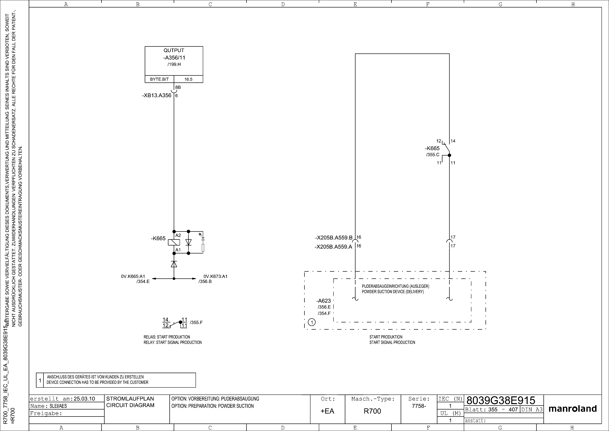

# +EA — Sheet 355 of 407 — OPTION: VORBEREITUNG: PUDERABSAUGUNG

**OPTION: PREPARATION: POWDER SUCTION**

> Part of the manroland **R700** printing press IEC/UL circuit diagrams.
> Drawing class: **Stromlaufplan / Circuit diagram** (DIN A3).
> Document `+EA` covers the **Printing unit** machine section.

## At a glance

| Field | Value |
|---|---|
| Document | `+EA`  (8039G38E915) |
| Sheet | **355** of 407 |
| Section (DE) | OPTION: VORBEREITUNG: PUDERABSAUGUNG |
| Section (EN) | OPTION: PREPARATION: POWDER SUCTION |
| Section type | CIRCUIT — Circuit diagram |
| Machine type | `R700` |
| Series | `7758` |
| Created | 25.03.10 |
| Replaces | — |
| Columns used | A, B, C, D, E, F |
| Path numbers | — |
| Labels on sheet | 44 |
| Cross-refs out | 6 |
| Cross-refs in | 11 |

**Previous:** [+EA sheet 354](SHEET_0354.md) · **Next:** [+EA sheet 356](SHEET_0356.md) · **Document TOC:** [_TOC.md](_TOC.md)  (+EA) · **Master TOC:** [all sheets](../_MASTER_TOC.md)

## Sheet image (300 DPI, exact vector render)



_Rendered directly from the PDF vector layer at 300 DPI (1-bit), no OCR and no resampling. Use it to confirm anything ambiguous in the text below._

## Cross-references on this sheet

Each entry is a wire leaving this sheet. The printed token is `/sheet.column`; the link resolves to that sheet inside the same document.

| Ref | Target sheet | Col | Path | Destination on target | Target section | From col |
|---|---|---|---|---|---|---|
| `/199.H` | [+EA sheet 199](SHEET_0199.md) | H | — | — | REFERENZMODUL | C |
| `/355.C` | [+EA sheet 355](SHEET_0355.md) | C | — | — | OPTION: VORBEREITUNG: PUDERABSAUGUNG | F |
| `/354.E` | [+EA sheet 354](SHEET_0354.md) | E | — | 0V.K665:A1 0V.K673:A1 | OPTION: VORBEREITUNG: PUDERABSAUGUNG | C |
| `/356.B` | [+EA sheet 356](SHEET_0356.md) | B | — | — | OPTION: VORBEREITUNG: PUDERABSAUGUNG | C |
| `/356.E` | [+EA sheet 356](SHEET_0356.md) | E | — | — | OPTION: VORBEREITUNG: PUDERABSAUGUNG | E |
| `/354.F` | [+EA sheet 354](SHEET_0354.md) | F | — | — | OPTION: VORBEREITUNG: PUDERABSAUGUNG | E |

### Incoming references (sheets that point here)

Every other sheet that sends a wire to this one. `Back-ref` is the token printed on *that* sheet; `Path` is its line number.

| From sheet | Cols | Back-ref | Path | Refs | What continues there |
|---|---|---|---|---|---|
| [+EA#199](SHEET_0199.md) | H | `/199.H` | — | 1 | — |
| [+EA#258](SHEET_0258.md) | F | `/258.F` | — | 1 | — |
| [+EA#288](SHEET_0288.md) | D, E | `/288.D`, `/288.E` | — | 4 | — |
| [+EA#354](SHEET_0354.md) | E, F | `/354.E`, `/354.F` | — | 2 | — |
| [+EA#355](SHEET_0355.md) | F | `/355.F` | — | 1 | — |
| [+EA#356](SHEET_0356.md) | B, E | `/356.B`, `/356.E` | — | 2 | 0V.K673:A1 |


## Devices on this sheet

| Tag | Class | Class meaning (IEC) | Col | Sub | Terminal | Sign |
|---|---|---|---|---|---|---|
| `A623` | A | Baugruppe / assembly, module, PC board | E | — | — | — |
| `K665` | K | Relais / relay, contactor | F | — | — | — |
| `A2` | A | Baugruppe / assembly, module, PC board | C | — | — | — |
| `A1` | A | Baugruppe / assembly, module, PC board | C | — | — | — |
| `K665` | K | Relais / relay, contactor | B | — | — | — |
| `A356/11` | A | Baugruppe / assembly, module, PC board | C | 11 | — | — |
| `X205B.A559.B` | — | cross-device reference | E | — | — | — |
| `X205B.A559.A` | — | cross-device reference | E | — | — | — |
| `16.5` | — | cross-device reference | C | — | — | — |
| `XB13.A356` | — | cross-device reference | B | — | — | — |

## Potentials / nets

| Potential | Count | Columns | Attached devices | Terminals |
|---|---|---|---|---|
| `0V` | 2 | B, C | `K665`, `K673` | `A1` |


A potential such as `L24+/4` or `M24+` is a named supply/return rail; every place it appears on this sheet is electrically common.

## Wire-end annotations (grouped as printed)

A wire that continues elsewhere is annotated with a small cluster: the destination description, the path/line number `#NN`, and the `/sheet.column` cross reference. Each row below is one such cluster exactly as it is grouped on the drawing.

| Col | Y | Path | Cross-ref | Text on the wire |
|---|---|---|---|---|
| B | 94.2 | — | — | `QUTPUT` |
| C | 108.0 | — | — | `A356/11` |
| C | 121.8 | — | `/199.H` | — |
| B | 151.4 | — | — | `BYTE.BIT 16.5` |
| C | 166.8 | — | — | `8B` |
| B | 181.7 | — | — | `XB13.A356 6` |
| F | 271.7 | — | — | `K665 14` |
| F | 271.7 | — | — | `12` |
| F | 298.3 | — | `/355.C` | — |
| F | 314.3 | — | — | `11 11` |
| C | 455.9 | — | — | `A2` |
| E | 459.5 | — | — | `X205B.A559.B 16` |
| F | 459.5 | — | — | `17` |
| B | 460.9 | — | — | `K665` |
| E | 476.5 | — | — | `X205B.A559.A 16` |
| F | 476.5 | — | — | `17` |
| C | 484.3 | — | — | `A1` |
| C | 536.0 | — | `/354.E` | `0V.K665:A1 0V.K673:A1` |
| C | 545.9 | — | `/356.B` | — |
| F | 556.2 | — | — | `PUDERABSAUGEINRICHTUNG (AUSLEGER) POWDER SUCTION DEVICE (DELIVERY)` |
| E | 582.8 | — | — | `A623` |
| E | 595.9 | — | `/356.E`, `/354.F` | — |
| C | 619.6 | — | — | `14 12 11 11 /355.F` |
| D | 626.2 | — | — | `1` |
| B | 655.4 | — | — | `RELAIS: START PRODUKTION RELAY: START SIGNAL PRODUCTION` |
| F | 655.4 | — | — | `START PRODUKTION START SIGNAL PRODUCTION` |
| A | 733.4 | — | — | `1 DEVICE CONNECTION HAS TO BE PROVIDED BY THE CUSTOMER ANSCHLUSS DES GERÄTES IST VOM KUNDEN ZU ERSTELLEN` |


## Reconstructed tables

This sheet carries tabular content (pin map / terminal assignment / index). The grid below was rebuilt from the drawing's own rule lines, so each row is exactly one physical row of the table.

### Table 1 — 3 data rows × 2 columns (at x=283.5, y=90.7)

| QUTPUT | A356/11 /199.H |
|---|---|
| `BYTE.BIT` | `16.5` |
| `XB13.A356` | `8B 6` |
| `K665` | `A2 A1` |


## Notes and free text on this sheet

| Text | Col | Y (pt) |
|---|---|---|
| `PUDERABSAUGEINRICHTUNG (AUSLEGER)` | F | 556.23 |
| `POWDER SUCTION DEVICE (DELIVERY)` | F | 566.84 |
| `11 /355.F` | C | 626.02 |
| `RELAIS: START PRODUKTION` | B | 655.42 |
| `RELAY: START SIGNAL PRODUCTION` | B | 666.06 |
| `8B` | C | 166.81 |
| `QUTPUT` | B | 94.16 |
| `BYTE.BIT` | B | 151.43 |
| `ANSCHLUSS DES GERÄTES IST VOM KUNDEN ZU ERSTELLEN` | A | 733.39 |
| `DEVICE CONNECTION HAS TO BE PROVIDED BY THE CUSTOMER` | A | 744.02 |
| `START PRODUKTION` | E | 655.43 |
| `START SIGNAL PRODUCTION` | F | 666.07 |

## Complete label inventory (exact text from the drawing)

Every text object inside the drawing area of this sheet, in DIN reading order (column A→H, then top→bottom). This is the authoritative list: if a string is not here it is not printed on this sheet.

| Col | Y | X | Dir | Type | Text |
|---|---|---|---|---|---|
| A | 733.4 | 92.1 | → | text | `ANSCHLUSS DES GERÄTES IST VOM KUNDEN ZU ERSTELLEN` |
| A | 738.7 | 75.4 | → | number | `1` |
| A | 744.0 | 91.3 | → | text | `DEVICE CONNECTION HAS TO BE PROVIDED BY THE CUSTOMER` |
| B | 94.2 | 319.9 | → | text | `QUTPUT` |
| B | 151.4 | 293.4 | → | text | `BYTE.BIT` |
| B | 181.7 | 277.8 | → | device ref | `XB13.A356` |
| B | 460.9 | 295.4 | → | device tag | `K665` |
| B | 536.0 | 236.7 | → | potential | `0V.K665:A1` |
| B | 545.9 | 267.0 | → | cross-reference | `/354.E` |
| B | 619.6 | 317.5 | → | number | `14` |
| B | 631.0 | 317.5 | → | number | `12` |
| B | 655.4 | 281.2 | → | text | `RELAIS: START PRODUKTION` |
| B | 666.1 | 281.2 | → | text | `RELAY: START SIGNAL PRODUCTION` |
| C | 108.0 | 319.5 | → | device tag | `A356/11` |
| C | 121.8 | 327.7 | → | cross-reference | `/199.H` |
| C | 151.5 | 360.3 | → | device ref | `16.5` |
| C | 166.8 | 342.7 | → | text | `8B` |
| C | 183.2 | 342.7 | → | number | `6` |
| C | 455.9 | 343.0 | → | device tag | `A2` |
| C | 484.3 | 343.0 | → | device tag | `A1` |
| C | 536.0 | 398.0 | → | potential | `0V.K673:A1` |
| C | 545.9 | 388.3 | → | cross-reference | `/356.B` |
| C | 619.6 | 354.6 | → | number | `11` |
| C | 626.0 | 354.6 | → | text | `11 /355.F` |
| D | 626.2 | 607.7 | → | number | `1` |
| E | 459.5 | 616.3 | → | device ref | `X205B.A559.B` |
| E | 459.5 | 696.5 | → | number | `16` |
| E | 476.5 | 696.5 | → | number | `16` |
| E | 477.2 | 615.4 | → | device ref | `X205B.A559.A` |
| E | 582.8 | 618.5 | → | device tag | `A623` |
| E | 595.9 | 621.4 | → | cross-reference | `/356.E` |
| E | 608.3 | 621.6 | → | cross-reference | `/354.F` |
| E | 655.4 | 722.6 | → | text | `START PRODUKTION` |
| F | 271.7 | 852.7 | → | number | `12` |
| F | 271.7 | 880.7 | → | number | `14` |
| F | 285.2 | 831.1 | → | device tag | `K665` |
| F | 298.3 | 833.4 | → | cross-reference | `/355.C` |
| F | 314.3 | 853.8 | → | number | `11` |
| F | 314.3 | 880.7 | → | number | `11` |
| F | 459.5 | 880.7 | → | number | `17` |
| F | 476.5 | 880.7 | → | number | `17` |
| F | 556.2 | 707.8 | → | text | `PUDERABSAUGEINRICHTUNG (AUSLEGER)` |
| F | 566.8 | 707.8 | → | text | `POWDER SUCTION DEVICE (DELIVERY)` |
| F | 666.1 | 722.6 | → | text | `START SIGNAL PRODUCTION` |

## Reading-order text block

The same content as a plain block, grouped by DIN column — convenient to paste or to match against a visual description.

```text
=== Column A ===
 733.4   92.1  text         ANSCHLUSS DES GERÄTES IST VOM KUNDEN ZU ERSTELLEN
 738.7   75.4  numeric      1
 744.0   91.3  text         DEVICE CONNECTION HAS TO BE PROVIDED BY THE CUSTOMER
=== Column B ===
  94.2  319.9  text         QUTPUT
 151.4  293.4  text         BYTE.BIT
 181.7  277.8  devref       XB13.A356
 460.9  295.4  devtag       K665
 536.0  236.7  net          0V.K665:A1
 545.9  267.0  xref         /354.E
 619.6  317.5  numeric      14
 631.0  317.5  numeric      12
 655.4  281.2  text         RELAIS: START PRODUKTION
 666.1  281.2  text         RELAY: START SIGNAL PRODUCTION
=== Column C ===
 108.0  319.5  devtag       A356/11
 121.8  327.7  xref         /199.H
 151.5  360.3  devref       16.5
 166.8  342.7  text         8B
 183.2  342.7  numeric      6
 455.9  343.0  devtag       A2
 484.3  343.0  devtag       A1
 536.0  398.0  net          0V.K673:A1
 545.9  388.3  xref         /356.B
 619.6  354.6  numeric      11
 626.0  354.6  text         11 /355.F
=== Column D ===
 626.2  607.7  numeric      1
=== Column E ===
 459.5  616.3  devref       X205B.A559.B
 459.5  696.5  numeric      16
 476.5  696.5  numeric      16
 477.2  615.4  devref       X205B.A559.A
 582.8  618.5  devtag       A623
 595.9  621.4  xref         /356.E
 608.3  621.6  xref         /354.F
 655.4  722.6  text         START PRODUKTION
=== Column F ===
 271.7  852.7  numeric      12
 271.7  880.7  numeric      14
 285.2  831.1  devtag       K665
 298.3  833.4  xref         /355.C
 314.3  853.8  numeric      11
 314.3  880.7  numeric      11
 459.5  880.7  numeric      17
 476.5  880.7  numeric      17
 556.2  707.8  text         PUDERABSAUGEINRICHTUNG (AUSLEGER)
 566.8  707.8  text         POWDER SUCTION DEVICE (DELIVERY)
 666.1  722.6  text         START SIGNAL PRODUCTION
```

---
_Generated from the PDF vector text layer; no OCR. Source: `R700_7758_IEC_UL_EA_8039G38E915_p`, sheet 355._
