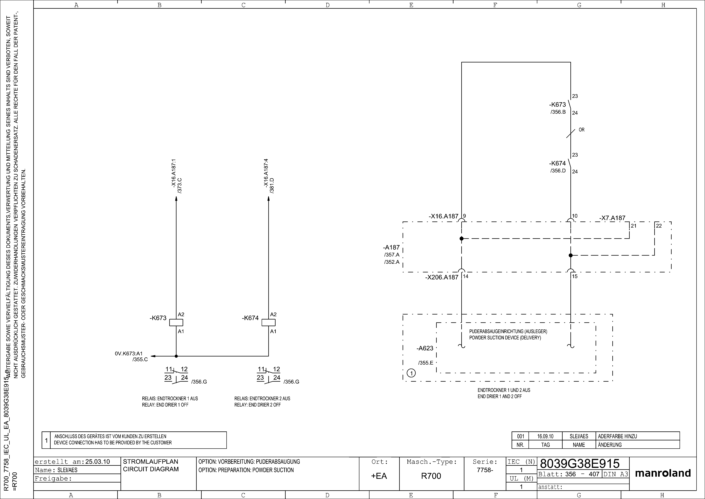

# +EA — Sheet 356 of 407 — OPTION: VORBEREITUNG: PUDERABSAUGUNG

**OPTION: PREPARATION: POWDER SUCTION**

> Part of the manroland **R700** printing press IEC/UL circuit diagrams.
> Drawing class: **Stromlaufplan / Circuit diagram** (DIN A3).
> Document `+EA` covers the **Printing unit** machine section.

## At a glance

| Field | Value |
|---|---|
| Document | `+EA`  (8039G38E915) |
| Sheet | **356** of 407 |
| Section (DE) | OPTION: VORBEREITUNG: PUDERABSAUGUNG |
| Section (EN) | OPTION: PREPARATION: POWDER SUCTION |
| Section type | CIRCUIT — Circuit diagram |
| Machine type | `R700` |
| Series | `7758` |
| Created | 25.03.10 |
| Replaces | — |
| Columns used | A, B, C, D, E, F, G, H |
| Path numbers | — |
| Labels on sheet | 65 |
| Cross-refs out | 10 |
| Cross-refs in | 16 |

**Previous:** [+EA sheet 355](SHEET_0355.md) · **Next:** [+EA sheet 357](SHEET_0357.md) · **Document TOC:** [_TOC.md](_TOC.md)  (+EA) · **Master TOC:** [all sheets](../_MASTER_TOC.md)

## Sheet image (300 DPI, exact vector render)



_Rendered directly from the PDF vector layer at 300 DPI (1-bit), no OCR and no resampling. Use it to confirm anything ambiguous in the text below._

## Cross-references on this sheet

Each entry is a wire leaving this sheet. The printed token is `/sheet.column`; the link resolves to that sheet inside the same document.

| Ref | Target sheet | Col | Path | Destination on target | Target section | From col |
|---|---|---|---|---|---|---|
| `/356.B` | [+EA sheet 356](SHEET_0356.md) | B | — | — | OPTION: VORBEREITUNG: PUDERABSAUGUNG | G |
| `/373.C` | [+EA sheet 373](SHEET_0373.md) | C | — | X16.A187:1 | OPTION: ENDTROCKNER 1 VORBEREITUNG; | B |
| `/381.D` | [+EA sheet 381](SHEET_0381.md) | D | — | X16.A187:4 | OPTION: ENDTROCKNER 2 VORBEREITUNG | C |
| `/356.D` | [+EA sheet 356](SHEET_0356.md) | D | — | — | OPTION: VORBEREITUNG: PUDERABSAUGUNG | G |
| `/357.A` | [+EA sheet 357](SHEET_0357.md) | A | — | — | OPTION: AUFLAGENZÄHLER / GUTBOGENZÄHLER | E |
| `/352.A` | [+EA sheet 352](SHEET_0352.md) | A | — | — | OPTION: VORBEREITUNG: PUDERABSAUGUNG | E |
| `/355.C` | [+EA sheet 355](SHEET_0355.md) | C | — | 0V.K673:A1 | OPTION: VORBEREITUNG: PUDERABSAUGUNG | B |
| `/355.E` | [+EA sheet 355](SHEET_0355.md) | E | — | — | OPTION: VORBEREITUNG: PUDERABSAUGUNG | E |
| `/356.G` | [+EA sheet 356](SHEET_0356.md) | G | — | — | OPTION: VORBEREITUNG: PUDERABSAUGUNG | B |
| `/356.G` | [+EA sheet 356](SHEET_0356.md) | G | — | — | OPTION: VORBEREITUNG: PUDERABSAUGUNG | D |

### Incoming references (sheets that point here)

Every other sheet that sends a wire to this one. `Back-ref` is the token printed on *that* sheet; `Path` is its line number.

| From sheet | Cols | Back-ref | Path | Refs | What continues there |
|---|---|---|---|---|---|
| [+EA#246](SHEET_0246.md) | B | `/246.B` | — | 2 | — |
| [+EA#261](SHEET_0261.md) | E | `/261.E` | — | 2 | — |
| [+EA#288](SHEET_0288.md) | F | `/288.F` | — | 2 | — |
| [+EA#352](SHEET_0352.md) | A | `/352.A` | — | 1 | — |
| [+EA#355](SHEET_0355.md) | C, E | `/355.C`, `/355.E` | — | 2 | — |
| [+EA#356](SHEET_0356.md) | B, D, G | `/356.B`, `/356.D`, `/356.G` | — | 4 | — |
| [+EA#357](SHEET_0357.md) | A | `/357.A` | — | 1 | — |
| [+EA#373](SHEET_0373.md) | C | `/373.C` | — | 1 | X16.A187:1 |
| [+EA#381](SHEET_0381.md) | D | `/381.D` | — | 1 | — |


## Devices on this sheet

| Tag | Class | Class meaning (IEC) | Col | Sub | Terminal | Sign |
|---|---|---|---|---|---|---|
| `A623` | A | Baugruppe / assembly, module, PC board | E | — | — | — |
| `A187` | A | Baugruppe / assembly, module, PC board | E | — | — | — |
| `A2` | A | Baugruppe / assembly, module, PC board | B | — | — | — |
| `A1` | A | Baugruppe / assembly, module, PC board | B | — | — | — |
| `K673` | K | Relais / relay, contactor | B | — | — | — |
| `K674` | K | Relais / relay, contactor | G | — | — | — |
| `K673` | K | Relais / relay, contactor | G | — | — | — |
| `A2` | A | Baugruppe / assembly, module, PC board | C | — | — | — |
| `A1` | A | Baugruppe / assembly, module, PC board | C | — | — | — |
| `K674` | K | Relais / relay, contactor | C | — | — | — |
| `X206.A187` | — | cross-device reference | E | — | — | — |
| `X16.A187` | — | cross-device reference | E | — | — | — |
| `NR.` | — | cross-device reference | F | — | — | — |
| `16.09.10` | — | cross-device reference | G | — | — | — |
| `X16.A187:4` | — | cross-device reference | C | — | 4 | — |
| `X16.A187:1` | — | cross-device reference | B | — | 1 | — |
| `X7.A187` | — | cross-device reference | G | — | — | — |

## Potentials / nets

| Potential | Count | Columns | Attached devices | Terminals |
|---|---|---|---|---|
| `0V` | 1 | B | `K673` | `A1` |


A potential such as `L24+/4` or `M24+` is a named supply/return rail; every place it appears on this sheet is electrically common.

## Wire-end annotations (grouped as printed)

A wire that continues elsewhere is annotated with a small cluster: the destination description, the path/line number `#NN`, and the `/sheet.column` cross reference. Each row below is one such cluster exactly as it is grouped on the drawing.

| Col | Y | Path | Cross-ref | Text on the wire |
|---|---|---|---|---|
| G | 158.4 | — | — | `23` |
| G | 171.8 | — | — | `K673 24` |
| G | 184.9 | — | `/356.B` | — |
| G | 216.1 | — | — | `OR` |
| G | 257.6 | — | — | `23` |
| B | 267.6 | — | `/373.C` | `X16.A187:1` |
| C | 267.6 | — | `/381.D` | `X16.A187:4` |
| G | 271.0 | — | — | `K674 24` |
| G | 284.1 | — | `/356.D` | — |
| F | 360.3 | — | — | `X16.A187 9 10` |
| G | 363.1 | — | — | `X7.A187` |
| H | 377.3 | — | — | `21 22` |
| E | 412.7 | — | — | `A187` |
| E | 425.8 | — | `/357.A`, `/352.A` | — |
| F | 462.4 | — | — | `X206.A187 14 15` |
| B | 526.8 | — | — | `A2` |
| C | 526.8 | — | — | `A2` |
| B | 531.8 | — | — | `K673` |
| C | 531.8 | — | — | `K674` |
| B | 555.1 | — | — | `A1` |
| C | 555.1 | — | — | `A1` |
| F | 556.2 | — | — | `PUDERABSAUGEINRICHTUNG (AUSLEGER) POWDER SUCTION DEVICE (DELIVERY)` |
| E | 582.8 | — | — | `A623` |
| B | 592.7 | — | `/355.C` | `0V.K673:A1` |
| E | 608.3 | — | `/355.E` | — |
| B | 618.2 | — | — | `23 11 12 24` |
| C | 618.2 | — | — | `23 11 12 24` |
| E | 626.2 | — | — | `1` |
| B | 640.2 | — | `/356.G` | — |
| D | 640.2 | — | `/356.G` | — |
| F | 655.4 | — | — | `ENDTROCKNER 1 UND 2 AUS END DRIER 1 AND 2 OFF` |
| B | 669.6 | — | — | `RELAIS: ENDTROCKNER 1 AUS RELAY: END DRIER 1 OFF` |
| C | 669.6 | — | — | `RELAIS: ENDTROCKNER 2 AUS RELAY: END DRIER 2 OFF` |
| G | 733.0 | — | — | `001 16.09.10 SLEI/AES ADERFARBE HINZU` |
| A | 733.4 | — | — | `1 DEVICE CONNECTION HAS TO BE PROVIDED BY THE CUSTOMER ANSCHLUSS DES GERÄTES IST VOM KUNDEN ZU ERSTELLEN` |
| G | 747.1 | — | — | `NR. TAG NAME ÄNDERUNG` |


## Reconstructed tables

This sheet carries tabular content (pin map / terminal assignment / index). The grid below was rebuilt from the drawing's own rule lines, so each row is exactly one physical row of the table.

### Table 1 — 7 data rows × 12 columns (at x=204.1, y=0.0) — **X16.A187:1 /373.C X16.A187:4 /381.D X16.A187 9 K673 /356.B K674 /356.D 23 24 OR 23 24 10 X7.A187 21 A187 /357.A**

| K673 0V.K673:A1 | A2 A1 | K674 | A2 A1 | /352.A | X206.A187 A623 |  | 14 PUDERABSAUGEINRICHTUNG POWDER SUCTION | (AUSLEGER) DEVICE (DELIVERY) |  | 15 |  |
|---|---|---|---|---|---|---|---|---|---|---|---|
| `/355.C 11 23 RELAIS: ENDTROCKNER RELAY: END DRIER KUNDEN ZU ERSTELLEN PROVIDED BY THE CUSTOMER` | `12 24 1 AUS 1 OFF` | `11 23 /356.G RELAIS: ENDTROCKNER RELAY: END DRIER` | `12 24 /356.G 2 AUS 2 OFF` |  | `/355.E 1` |  | `ENDTROCKNER END DRIER 1` | `1 UND 2 AUS AND 2 OFF 001 NR.` | `16.09.10 TAG` | `SLEI/AES ADERFARBE NAME ÄNDERUNG` | `HINZU` |
| `STROMLAUFPLAN` |  | `OPTION: VORBEREITUNG:` | `PUDERABSAUGUNG` | `Ort:` | `Masch. Type:` |  | `Serie:` | `IEC (N)` |  | `8039G38E915` |  |
| `CIRCUIT DIAGRAM` |  |  |  |  |  |  |  |  |  |  |  |
|  |  | `OPTION: PREPARATION: POWDER` | `SUCTION` |  |  |  | `7758` | `1` |  |  |  |
|  |  |  |  | `+EA` | `R700` |  |  |  | `Blatt: 356` | `DIN A3 407` |  |
|  |  |  |  |  |  |  |  | `UL (M)` |  |  |  |
|  |  |  |  |  |  |  |  | `1` | `anstatt:` |  |  |


## Notes and free text on this sheet

| Text | Col | Y (pt) |
|---|---|---|
| `PUDERABSAUGEINRICHTUNG (AUSLEGER)` | F | 556.23 |
| `POWDER SUCTION DEVICE (DELIVERY)` | F | 566.84 |
| `RELAIS: ENDTROCKNER 1 AUS` | B | 669.6 |
| `RELAY: END DRIER 1 OFF` | B | 680.23 |
| `RELAIS: ENDTROCKNER 2 AUS` | C | 669.6 |
| `RELAY: END DRIER 2 OFF` | C | 680.23 |
| `TAG` | G | 747.27 |
| `NAME` | G | 747.25 |
| `ÄNDERUNG` | G | 747.31 |
| `SLEI/AES` | G | 733.13 |
| `ADERFARBE HINZU` | G | 733.14 |
| `ANSCHLUSS DES GERÄTES IST VOM KUNDEN ZU ERSTELLEN` | A | 733.39 |
| `DEVICE CONNECTION HAS TO BE PROVIDED BY THE CUSTOMER` | A | 744.02 |
| `ENDTROCKNER 1 UND 2 AUS` | F | 655.44 |
| `END DRIER 1 AND 2 OFF` | F | 666.06 |
| `OR` | G | 216.05 |

## Complete label inventory (exact text from the drawing)

Every text object inside the drawing area of this sheet, in DIN reading order (column A→H, then top→bottom). This is the authoritative list: if a string is not here it is not printed on this sheet.

| Col | Y | X | Dir | Type | Text |
|---|---|---|---|---|---|
| A | 733.4 | 92.1 | → | text | `ANSCHLUSS DES GERÄTES IST VOM KUNDEN ZU ERSTELLEN` |
| A | 738.7 | 75.4 | → | number | `1` |
| A | 744.0 | 91.3 | → | text | `DEVICE CONNECTION HAS TO BE PROVIDED BY THE CUSTOMER` |
| B | 267.6 | 289.4 | ↕ | device ref | `X16.A187:1` |
| B | 300.2 | 299.3 | ↕ | cross-reference | `/373.C` |
| B | 526.8 | 300.5 | → | device tag | `A2` |
| B | 531.8 | 252.9 | → | device tag | `K673` |
| B | 555.2 | 300.5 | → | device tag | `A1` |
| B | 592.7 | 194.2 | → | potential | `0V.K673:A1` |
| B | 602.7 | 223.9 | → | cross-reference | `/355.C` |
| B | 618.2 | 279.2 | → | number | `11` |
| B | 618.2 | 305.0 | → | number | `12` |
| B | 632.4 | 277.8 | → | number | `23` |
| B | 632.4 | 305.9 | → | number | `24` |
| B | 640.2 | 323.1 | → | cross-reference | `/356.G` |
| B | 669.6 | 240.1 | → | text | `RELAIS: ENDTROCKNER 1 AUS` |
| B | 680.2 | 240.1 | → | text | `RELAY: END DRIER 1 OFF` |
| C | 267.6 | 445.3 | ↕ | device ref | `X16.A187:4` |
| C | 300.2 | 455.3 | ↕ | cross-reference | `/381.D` |
| C | 526.8 | 456.4 | → | device tag | `A2` |
| C | 531.8 | 408.8 | → | device tag | `K674` |
| C | 555.2 | 456.4 | → | device tag | `A1` |
| C | 618.2 | 435.1 | → | number | `11` |
| C | 618.2 | 460.9 | → | number | `12` |
| C | 632.4 | 433.7 | → | number | `23` |
| C | 632.4 | 461.8 | → | number | `24` |
| C | 669.6 | 396.0 | → | text | `RELAIS: ENDTROCKNER 2 AUS` |
| C | 680.2 | 396.0 | → | text | `RELAY: END DRIER 2 OFF` |
| D | 640.2 | 479.1 | → | cross-reference | `/356.G` |
| E | 360.3 | 724.3 | → | device ref | `X16.A187` |
| E | 412.7 | 646.9 | → | device tag | `A187` |
| E | 425.8 | 649.1 | → | cross-reference | `/357.A` |
| E | 438.2 | 649.1 | → | cross-reference | `/352.A` |
| E | 463.1 | 718.3 | → | device ref | `X206.A187` |
| E | 582.8 | 703.6 | → | device tag | `A623` |
| E | 608.3 | 706.4 | → | cross-reference | `/355.E` |
| E | 626.2 | 692.7 | → | number | `1` |
| F | 360.3 | 782.1 | → | number | `9` |
| F | 462.4 | 781.5 | → | number | `14` |
| F | 556.2 | 792.9 | → | text | `PUDERABSAUGEINRICHTUNG (AUSLEGER)` |
| F | 566.8 | 792.9 | → | text | `POWDER SUCTION DEVICE (DELIVERY)` |
| F | 655.4 | 807.0 | → | text | `ENDTROCKNER 1 UND 2 AUS` |
| F | 666.1 | 807.0 | → | text | `END DRIER 1 AND 2 OFF` |
| F | 733.0 | 873.5 | → | number | `001` |
| F | 747.1 | 872.6 | → | device ref | `NR.` |
| G | 158.4 | 966.3 | → | number | `23` |
| G | 171.8 | 927.5 | → | device tag | `K673` |
| G | 184.9 | 930.0 | → | cross-reference | `/356.B` |
| G | 186.7 | 966.3 | → | number | `24` |
| G | 216.1 | 977.7 | → | text | `OR` |
| G | 257.6 | 966.3 | → | number | `23` |
| G | 271.0 | 927.5 | → | device tag | `K674` |
| G | 284.1 | 929.8 | → | cross-reference | `/356.D` |
| G | 285.9 | 966.3 | → | number | `24` |
| G | 360.3 | 965.8 | → | number | `10` |
| G | 363.1 | 1012.3 | → | device ref | `X7.A187` |
| G | 462.4 | 965.8 | → | number | `15` |
| G | 733.1 | 907.3 | → | device ref | `16.09.10` |
| G | 733.1 | 962.4 | → | text | `SLEI/AES` |
| G | 733.1 | 1010.1 | → | text | `ADERFARBE HINZU` |
| G | 747.3 | 914.1 | → | text | `TAG` |
| G | 747.3 | 967.5 | → | text | `NAME` |
| G | 747.3 | 1010.1 | → | text | `ÄNDERUNG` |
| H | 377.3 | 1065.5 | → | number | `21` |
| H | 377.3 | 1108.1 | → | number | `22` |

## Reading-order text block

The same content as a plain block, grouped by DIN column — convenient to paste or to match against a visual description.

```text
=== Column A ===
 733.4   92.1  text         ANSCHLUSS DES GERÄTES IST VOM KUNDEN ZU ERSTELLEN
 738.7   75.4  numeric      1
 744.0   91.3  text         DEVICE CONNECTION HAS TO BE PROVIDED BY THE CUSTOMER
=== Column B ===
 267.6  289.4  devref       X16.A187:1
 300.2  299.3  xref         /373.C
 526.8  300.5  devtag       A2
 531.8  252.9  devtag       K673
 555.2  300.5  devtag       A1
 592.7  194.2  net          0V.K673:A1
 602.7  223.9  xref         /355.C
 618.2  279.2  numeric      11
 618.2  305.0  numeric      12
 632.4  277.8  numeric      23
 632.4  305.9  numeric      24
 640.2  323.1  xref         /356.G
 669.6  240.1  text         RELAIS: ENDTROCKNER 1 AUS
 680.2  240.1  text         RELAY: END DRIER 1 OFF
=== Column C ===
 267.6  445.3  devref       X16.A187:4
 300.2  455.3  xref         /381.D
 526.8  456.4  devtag       A2
 531.8  408.8  devtag       K674
 555.2  456.4  devtag       A1
 618.2  435.1  numeric      11
 618.2  460.9  numeric      12
 632.4  433.7  numeric      23
 632.4  461.8  numeric      24
 669.6  396.0  text         RELAIS: ENDTROCKNER 2 AUS
 680.2  396.0  text         RELAY: END DRIER 2 OFF
=== Column D ===
 640.2  479.1  xref         /356.G
=== Column E ===
 360.3  724.3  devref       X16.A187
 412.7  646.9  devtag       A187
 425.8  649.1  xref         /357.A
 438.2  649.1  xref         /352.A
 463.1  718.3  devref       X206.A187
 582.8  703.6  devtag       A623
 608.3  706.4  xref         /355.E
 626.2  692.7  numeric      1
=== Column F ===
 360.3  782.1  numeric      9
 462.4  781.5  numeric      14
 556.2  792.9  text         PUDERABSAUGEINRICHTUNG (AUSLEGER)
 566.8  792.9  text         POWDER SUCTION DEVICE (DELIVERY)
 655.4  807.0  text         ENDTROCKNER 1 UND 2 AUS
 666.1  807.0  text         END DRIER 1 AND 2 OFF
 733.0  873.5  numeric      001
 747.1  872.6  devref       NR.
=== Column G ===
 158.4  966.3  numeric      23
 171.8  927.5  devtag       K673
 184.9  930.0  xref         /356.B
 186.7  966.3  numeric      24
 216.1  977.7  text         OR
 257.6  966.3  numeric      23
 271.0  927.5  devtag       K674
 284.1  929.8  xref         /356.D
 285.9  966.3  numeric      24
 360.3  965.8  numeric      10
 363.1 1012.3  devref       X7.A187
 462.4  965.8  numeric      15
 733.1  907.3  devref       16.09.10
 733.1  962.4  text         SLEI/AES
 733.1 1010.1  text         ADERFARBE HINZU
 747.3  914.1  text         TAG
 747.3  967.5  text         NAME
 747.3 1010.1  text         ÄNDERUNG
=== Column H ===
 377.3 1065.5  numeric      21
 377.3 1108.1  numeric      22
```

---
_Generated from the PDF vector text layer; no OCR. Source: `R700_7758_IEC_UL_EA_8039G38E915_p`, sheet 356._
